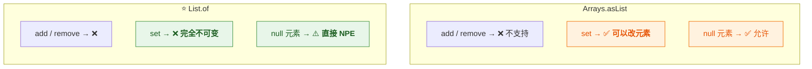
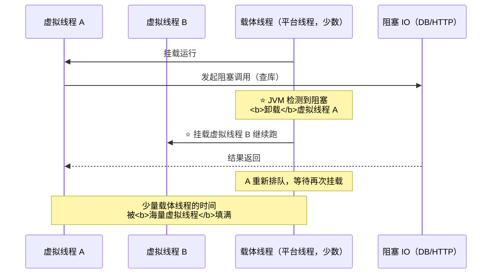
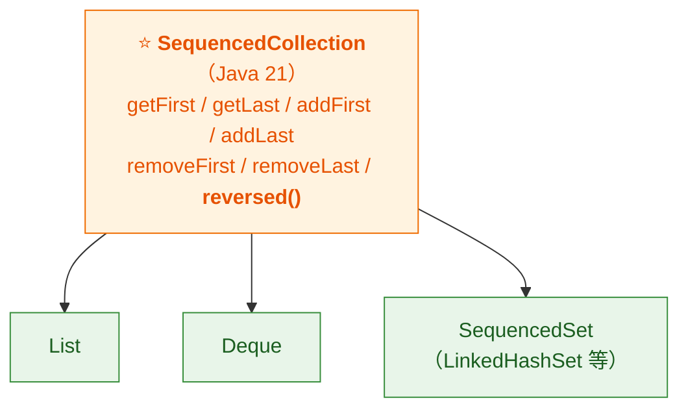
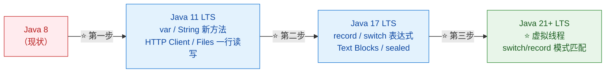

# 🧬 Java 进化论：从 9 到 21（详细整理版）

> 本篇是对 [B 站视频《Java进化论》](https://www.bilibili.com/video/BV14RbY61E5a/)（约 18.5 分钟）的**逐段深度整理**。
> 视频以"**老板要求调研 Java 8 之后的升级方案**"为任务，沿 **JEP 时间线从 9 走到 21**：
> **JShell → 不可变集合工厂 → Stream 增强 → var → String/Files 新方法 → HTTP Client → switch 表达式 → Text Blocks → record → instanceof 模式匹配 → Helpful NPE → sealed → 虚拟线程（三坑）→ switch/record 模式 → SequencedCollection → 避坑两弹 → 迁移三步走**。
> （原稿是语音转写，**var** 被识别成"war/waw/WAW"、**null** 被识别成"now/No"、
> **sealed** 被识别成"SEO"、**permits** 被识别成"promise"，见 [附录 A](#附录-a语音转写asr勘误对照)）
>
> **定位**：按视频顺序的**版本演进主线**（含大量视频独有的细节：`List.of` vs `Arrays.asList`、
> record 紧凑构造器、`&&` 可用 `||` 不可用的作用域规则、虚拟线程三坑、避坑两弹）。
> **速查全景**（Java 8 起的完整特性表）见 [[9-Java版本特性]]；
> **姊妹字幕稿**（另一部同主题视频，尚未整理）：[[从Java 8到21，你错过了什么？]]；
> **虚拟线程深入**：[[1-java/1-juc/虚拟线程-java（详细整理版）]]。
>
> 原始字幕稿：[[0-Java进化论]]。

---

## 〇、本篇地图：版本时间线

```mermaid
flowchart LR
  J9["<b>Java 9</b><br/>JShell / 集合工厂 / Stream 增强"]
  J10["<b>Java 10</b><br/>var 局部变量推断"]
  J11["<b>Java 11 LTS</b><br/>String/Files 新方法<br/>HTTP Client / 单文件运行"]
  J14["<b>Java 14</b><br/>switch 表达式<br/>Helpful NPE"]
  J15["<b>Java 15</b><br/>Text Blocks"]
  J16["<b>Java 16</b><br/>record / instanceof 模式<br/>Stream.toList"]
  J17["<b>Java 17 LTS</b><br/>sealed classes"]
  J21["<b>Java 21 LTS</b><br/>⭐ 虚拟线程<br/>switch/record 模式<br/>SequencedCollection"]
  J9 --> J10 --> J11 --> J14 --> J15 --> J16 --> J17 --> J21
  classDef lts fill:#e8f5e9,stroke:#388e3c,color:#1b5e20
  classDef std fill:#e3f2fd,stroke:#1976d2,color:#0d47a1
  classDef hero fill:#fff3e0,stroke:#ef6c00,color:#e65100
  class J11,J17 lts
  class J9,J10,J14,J15,J16 std
  class J21 hero
```



> [!important] ⭐ 视频开场的认知框架
> **"JEP 列表从 Java 9 到 21 有几百个 feature，别被数量吓到——
> 每个版本真正影响你写代码方式的，也就三五个核心特性。"**
>
> **本篇的三个总结维度**（视频结尾）：
> | 层面 | 演进方向 | 代表特性 |
> |---|---|---|
> | **语言** | **更简洁的表达 + 更强的类型安全** | record / sealed / 模式匹配 / switch 表达式 |
> | **API** | **日常编码更顺手** | HTTP Client / 集合工厂 / Stream 增强 |
> | ⭐ **平台** | **并发能力质变** | **虚拟线程**（"近 10 年最大的变革"） |

---

## 一、Java 9：JShell 与不可变集合工厂

### 1.1 JShell：即时编程实验室（REPL）

> 视频原话："**Java 9 给你准备了一个即时编程实验室 JShell——
> 不需要写完整个类再编译运行，打开终端敲 `jshell` 就能直接写 Java 代码看效果。
> 这不就是像 Python 的交互模式？——对，就是 REPL。**"

| 用途 | 举例 |
|---|---|
| **试 Lambda / Stream 操作** | 敲进去马上看结果 |
| **验证 API 行为 / 正则** | 不用为试一个方法专门建 main |

> [!tip] 工具定位
> **JShell 是"实验工具"不是"生产工具"**——
> **适合探索 API、验证行为、教学演示**。

### 1.2 ⭐⭐ 不可变集合工厂：`List.of` / `Set.of` / `Map.of`

> 视频原话："**以前每次创建不可变集合，都要写一堆 `Arrays.asList` 再包一层
> `Collections.unmodifiableList`，太啰嗦了。Java 9 给了三个工厂方法，一行搞定。**"

```java
// ❌ Java 8 的写法
List<String> l1 = Collections.unmodifiableList(Arrays.asList("a", "b"));

// ✅ Java 9+
List<String> l2 = List.of("a", "b");
Set<Integer> s  = Set.of(1, 2, 3);
Map<String, Integer> m = Map.of("k1", 1, "k2", 2);
List<String> copy = List.copyOf(existingList);   // Java 10：拷贝为不可变
```

### 1.3 ⭐⭐ `List.of` vs `Arrays.asList`（高频考点）

> 视频原话："**`Arrays.asList` 返回的是固定大小的 List——不能 add/remove，
> 但可以 set 修改元素；而 `List.of` 返回的是完全不可变的，连 set 都不行。
> 而且 `List.of` 对 null 元素零容忍，传 null 直接 NPE。**"



| 操作 | `Arrays.asList` | ⭐ **`List.of`** |
|---|---|---|
| `add` / `remove` | ❌ | ❌ |
| **`set`（改元素）** | ⚠️ **允许** | ❌ **禁止** |
| **null 元素** | ✅ 允许 | ⚠️ **NPE** |
| 本质 | **固定大小视图**（背后还是数组） | **真·不可变集合** |

> [!success] ⭐ 一句话定位（视频原话）
> **"这些工厂方法创建的集合都是不可变快照——适合做配置、返回值、常量列表。"**
>
> 👉 **"不可变 = 天然线程安全"**——这正对应 [[1-java/2-collection/5-并发容器专题|并发容器专题]]
> 的"并发选型第一问：数据会变吗？不变就上不可变容器"。
> **`Map.of` 也是同理**（详见 [[1-java/2-collection/0-Collection总览|Collection 总览]]）。

### 1.4 Stream 增强：takeWhile / dropWhile / ofNullable

> 视频原话："**takeWhile 可以理解为流水线上的质检员——只要物料合格就放行，
> 一旦碰到不合格的，后面全部停掉。反过来 dropWhile 就是丢弃前面合格的，
> 碰到不合格的才开始收。ofNullable：值是 null 就返回空 stream，
> 不是 null 就返回单元素 stream——避免了 null 判断的 if-else。**"

```java
Stream.of(1, 2, 3, 4, 5).takeWhile(n -> n < 4).toList();   // [1, 2, 3]   ← 碰到 4 停
Stream.of(1, 2, 3, 4, 5).dropWhile(n -> n < 4).toList();   // [4, 5]     ← 丢到 4 才收
Stream.ofNullable(null).count();                            // 0（空流，不 NPE）
```

> [!important] ⭐ takeWhile/dropWhile 的关键边界
> **它们是"按顺序截断"，不是"过滤"**——
> **适合"已排序数据"的分段提取**（视频原话："配合排序后的数据做分段提取特别好用"）；
> **对乱序数据用它们会得到"看起来随机"的结果**——**这是与 `filter` 的本质区别**。

---

## 二、Java 10：var 局部变量类型推断

> 视频原话："**别把 var 类比成 JavaScript 的 let，区别大了——
> Java 的 var 叫局部变量类型推断：编译器根据右边的赋值推断类型，
> 然后在编译阶段把 var 替换成真实类型。本质上 Java 依然是强类型语言，var 只是语法糖。**"

```java
var list = new ArrayList<String>();   // 编译后就是 ArrayList<String> list = ...
var s = "hello";                      // 编译后就是 String s = "hello"
// 字节码层面与显式类型完全一致
```

### 2.1 ⭐ 三个限制（必背）

| # | 限制 | 原因 |
|---|---|---|
| **1** | ⭐ **只能用于局部变量**（方法参数、返回值、字段不行） | **推断只发生在赋值点** |
| **2** | ⭐ **必须同时声明和初始化**（`var x;` 报错） | **没有右边就无从推断** |
| **3** | ⭐ **不能赋 null**（`var x = null;` 报错） | **null 推断不出类型**；lambda/方法引用同理 |

### 2.2 什么时候该用 var（可读性判断）

> 视频原话："**当右边的类型已经很明显的时候——比如 `var list = new ArrayList<String>()`，
> 左边再写一遍类型就是浪费。但如果右边的类型不明显（比如方法返回值），就别用 var，
> 否则可读性会下降。**"

| 场景 | 建议 |
|---|---|
| `var map = new HashMap<String, List<Order>>()` | ✅ **右边已说明类型** |
| `var result = service.process(input)` | ❌ **看不出类型**——显式声明 |

> [!note] 补充（Java 11 的 var 扩展）
> **Java 11 允许在 Lambda 参数上用 var**（JEP 323），**主要为配合注解**：
> `(@Nonnull var x) -> ...`。

---

## 三、Java 11（LTS）：String / Files / 单文件运行 / HTTP Client

### 3.1 String 新方法

> 视频原话："**以前处理空白用 trim，但它只处理空格——Unicode 的全角空格搞不定。
> strip 用的是 `Character.isWhitespace` 标准，能识别所有 Unicode 空白字符。**"

| 方法 | 作用 | 与旧 API 的区别 |
|---|---|---|
| **`strip()` / `stripLeading()` / `stripTrailing()`** | 去首尾空白 | ⭐ **基于 `Character.isWhitespace`**，**覆盖全角空格等 Unicode 空白**；`trim()` 只处理 ≤ U+0020 |
| ⭐ **`isBlank()`** | 是否空白串 | **比 `isEmpty()` 严格**——`"  "` 也返回 true |
| **`lines()`** | 按行终止符拆成 Stream | 处理多行文本优雅 |
| **`repeat(n)`** | 重复 n 次 | —— |

### 3.2 Files 一行读写 + 单文件直接运行

```java
String content = Files.readString(Path.of("a.txt"));   // ⭐ 一行读
Files.writeString(Path.of("a.txt"), "hello");          // ⭐ 一行写
```

> 视频原话："**还有直接运行单文件源码：`java Hello.java`，不用先 javac 了——
> 编译和运行一步到位，写脚本、做实验特别方便。**"

> [!tip] `Files.readString` 的对照
> **它就是 [[1-java/3-IO/5-nio-file与现代文件API|NIO.2 Files API]] 的延续**——
> **一步搞定"打开 + 读全部 + 关闭"**，**替代手写 try-with-resources 那一长串**。

### 3.3 ⭐ 标准 HTTP Client（扔掉 HttpURLConnection）

> 视频原话："**那个祖传 API 我用过——一堆 try-catch，连个 PUT 请求都费劲。
> 新 API 用 Builder 模式链式调用，原生支持 HTTP/2 和 WebSocket，
> 最厉害的是 sendAsync 异步非阻塞发送，返回 CompletableFuture，
> 配合 thenApply/thenCompose 做链式处理。**"

```java
HttpClient client = HttpClient.newBuilder().version(HTTP_2).build();
HttpRequest req = HttpRequest.newBuilder(URI.create("https://api.example.com"))
        .header("Content-Type", "application/json")
        .POST(HttpRequest.BodyPublishers.ofString(json))
        .build();

// ⭐ 同步
HttpResponse<String> res = client.send(req, HttpResponse.BodyHandlers.ofString());
// ⭐ 异步：返回 CompletableFuture，链式处理
client.sendAsync(req, HttpResponse.BodyHandlers.ofString())
      .thenApply(HttpResponse::body)
      .thenAccept(System.out::println);
```

> [!important] ⭐ 能替代 OkHttp 吗（视频的边界答案）
> **"大部分场景可以。但如果需要连接池精细控制、拦截器链这些高级功能，
> OkHttp / Apache HttpClient 仍有优势。标准 API 的好处是零外部依赖——
> 写工具类、SDK 的时候特别干净。"**
>
> 👉 **"标准库 vs 成熟三方库"的判断法：** **简单调用要"零依赖"，复杂需求要"生态能力"。**

---

## 四、Java 14：switch 表达式 与 Helpful NPE

### 4.1 ⭐⭐ switch 表达式（从"语句"到"表达式"）

> 视频原话："**switch 终于不是只能写在语句里了——Java 14 开始可以作为表达式使用，
> 直接返回值。最大变化是引入箭头语法，不再需要 break，
> 也不会出现 fall-through 的经典坑。多个值匹配用逗号分隔；
> 箭头右边需要复杂逻辑就用代码块加 yield 返回值。**"

```java
// ✅ 箭头语法：无 fall-through，直接返回值
int days = switch (month) {
    case JAN, MAR, MAY, JUL, AUG, OCT, DEC -> 31;
    case APR, JUN, SEP, NOV -> 30;
    case FEB -> {
        if (isLeap) yield 29;      // ⭐ 复杂逻辑用代码块 + yield
        else yield 28;
    }
};
```

> [!important] ⭐⭐ "必须穷举"才是精华（视频讲得很好）
> **"switch 表达式必须穷举——如果漏掉某个枚举值、又没有 default，编译直接报错。
> 这就是从语句到表达式的本质区别：表达式必须有返回值，编译器就会帮你检查完整性。"**
>
> **实用价值**：**给枚举加新值时，所有 switch 表达式立刻编译报错** →
> **"加了新枚举值就出 bug"这类事故从编译层被杜绝**。
> **Java 21 之后配合 sealed 还能更狠**（见 §八）。

### 4.2 ⭐ Helpful NPE：告诉你"到底谁是 null"

> 视频原话："**每次看到 NullPointerException at line 42 我都崩溃——
> 链式调用三四个方法，到底谁是 null？Java 14 开始 JVM 会告诉你精确答案。**"

```text
// 以前：NullPointerException at line 42（啥也不说）
// 现在：
java.lang.NullPointerException:
    Cannot invoke "String.length()" because the return value of
    "User.getName()" is null          ← ⭐ 直接指出是 getName() 返回了 null
```

> [!note] 版本细节（比视频说的更早）
> **Java 14 引入（JEP 358），当时需要显式开启 `-XX:+ShowCodeDetailsInExceptionMessages`；
> ⭐ **JDK 15 起默认开启**（视频说"17 以上默认开启"略保守）。
> **生产建议：确认 JDK ≥ 15 就无需任何配置。**

---

## 五、Java 15：Text Blocks

> 视频原话："**以前写个 SQL 字符串简直是灾难——满屏幕的加号引号换行符。
> Text Blocks 用三个引号包裹，内部直接写原始文本，保留所有换行和缩进。**"

```java
String sql = """
        SELECT id, name
        FROM users
        WHERE status = 'ACTIVE'
        """;
String sqlWithParam = sql.formatted(30);   // ⭐ 配合 formatted 做参数化模板
```

> [!important] ⭐ 缩进规则（视频讲对了关键）
> **"Text Blocks 用结尾三引号的位置来决定缩进基准——
> 结尾三引号前面的空格会被当做公共前缀自动去除。
> 所以你在代码里缩进四个空格，文本内容不会多出这四个空格。"**
>
> 👉 **想控制内容的缩进，就移动结尾 `"""` 的位置**——**这是唯一需要记的规则**。

---

## 六、Java 16：record 与 instanceof 模式匹配

### 6.1 ⭐⭐ record：纯数据载体

> 视频原话："**一个 record 声明，编译器自动生成全参构造器、所有字段的 accessor、
> equals、hashCode、toString——代码量直接砍到一行。
> 另外 record 的字段是 final 的，record 类本身也是 final 的，
> 不能继承也不能被继承——它就是纯粹的数据载体。**"

```java
// 一行替代过去 ~50 行的 POJO
public record Point(int x, int y) implements Comparable<Point> {
    // ⭐ 紧凑构造器：不写参数列表，校验逻辑写在里面，在标准构造器之前执行
    public Point {
        if (x < 0 || y < 0) throw new IllegalArgumentException("坐标不能为负");
    }
}

Point p = new Point(3, 4);
p.x();       // ⭐ accessor 直接用字段名，不是 getX()（有意为之）
```

| 特性 | 说明 |
|---|---|
| **自动生成** | 全参构造器、accessor、`equals`/`hashCode`/`toString` |
| ⭐ **accessor 无 get 前缀** | `p.x()` 而不是 `p.getX()`——**有意为之** |
| **不可变** | 字段全 final；类 final，**不能继承类**（隐式继承 `Record`） |
| **可实现接口** | ✅（如 `Serializable`、`Comparable`）——**不能继承类但可以实现接口** |
| ⭐ **紧凑构造器** | **不写参数列表**，直接写校验逻辑，**在标准构造器之前执行** |

> [!success] ⭐ record 与 sealed、模式匹配的合璧见 §八——**那才是它的完全体**。
> **与 Lombok `@Value` 的对比、使用边界见 [[9-Java版本特性]] §2.4。**

### 6.2 ⭐ instanceof 模式匹配（三件事合一）

> 视频原话："**`if (obj instanceof String s)` 这一行做了三件事：
> 判断类型、转换类型、绑定到变量 s。而且 s 的作用域只有在 if 为 true 的时候才有效。**"

```java
// ❌ 以前
if (obj instanceof String) {
    String s = (String) obj;      // 手动强转
    use(s.length());
}
// ✅ Java 16+
if (obj instanceof String s) {
    use(s.length());              // s 已绑定
}
```

> [!important] ⭐⭐ 作用域细节（`&&` 可以、`||` 不行——高频追问）
> ```java
> // ✅ 可以：&& 右侧时 s 一定已绑定（左边为 true 才会评估右边）
> if (obj instanceof String s && s.length() > 5) { ... }
>
> // ❌ 不行：|| 左边为 true 时右边不评估，s 可能未绑定
> if (obj instanceof String s || s.length() > 5) { ... }   // 编译报错
> ```
> **"编译器对作用域的控制非常精确"（视频原话）**——
> **这叫"确定模式匹配的流作用域（flow scoping）"**。

---

## 七、Java 17（LTS）：sealed classes

> 视频原话："**Sealed classes 很有设计哲学的味道：你作为类的设计者，
> 应该精确控制谁能继承。abstract 只告诉你不能实例化，但任何类都能继承它；
> sealed class 用 permits 关键字显式列出允许的子类，其他类一概不能继承——
> 编译器知道所有可能的子类型。**"

```java
public sealed class Shape permits Circle, Rectangle, Triangle { }
public record Circle(double radius) implements Shape { }          // ⭐ final：到此为止
public non-sealed class Rectangle implements Shape { }             // ⭐ 打破密封，谁都能继承
```

| 子类修饰 | 含义 |
|---|---|
| **`final`** | **到此为止**，不能再有子类（⭐ **大部分场景用这个，最简单**） |
| **`sealed`** | **继续密封**，指定下一层的子类 |
| **`non-sealed`** | **打破密封**，恢复"谁都能继承" |

> [!important] ⭐ sealed 的真正价值：为"穷举"提供前提
> **单独看 sealed 只是"收窄继承"**——
> **但配合 switch 模式匹配，编译器知道全部子类型 → **能检查"你是否处理了所有情况"**。
> **这就是 §八"三件合璧"的来历。**
>
> ⚠️ **边界（视频避坑第二弹）**：**permits 的子类必须在同一个模块里**（无名模块则同包）——
> **多模块项目要注意模块间可见性。**

---

## 八、Java 21（LTS）：虚拟线程 + 模式匹配合璧

### 8.1 ⭐⭐⭐ 虚拟线程：并发能力的质变

> 视频原话："**如果说前面的特性是写法变优雅，虚拟线程就是并发能力质的飞跃。
> 平台线程和操作系统线程一对一绑定，一个线程阻塞了，就真的占着操作系统资源不放；
> 虚拟线程是 JVM 管理的轻量级线程，数量可以达到百万级。
> 当一个虚拟线程遇到 IO 阻塞，JVM 会自动把它从载体线程上卸载，
> 让载体线程去服务其他虚拟线程。**"



| | **平台线程** | ⭐ **虚拟线程** |
|---|---|---|
| 绑定 | **1:1 绑定 OS 线程** | **JVM 管理，M:N 调度到载体线程** |
| 数量级 | **数千** | ⭐ **百万级** |
| 阻塞代价 | **占住 OS 线程** | ⭐ **卸载，载体线程去服务别人** |
| 创建成本 | 昂贵（所以要池化） | ⭐ **极低（所以不池化）** |

> [!important] ⭐⭐ 编程模型的回归（视频原话）
> **"以前你要搞线程池精细调优；现在简单粗暴——每个请求一个虚拟线程，
> 来多少开多少，JVM 自动调度。'一个请求一个线程'的模型配合虚拟线程，
> 回归了最简单的同步编程范式。"**
>
> **推荐写法**：
> ```java
> try (var executor = Executors.newVirtualThreadPerTaskExecutor()) {
>     executor.submit(() -> handle(request));   // ⭐ 每任务一个虚拟线程
> }
> ```

> [!danger] ⭐⭐ 三个大坑（视频重点，必须背）
> | # | 坑 | 原因 | 解法 |
> |---|---|---|---|
> | **1** | ⭐ **不要池化虚拟线程** | **池化本身是为解决"平台线程昂贵"——虚拟线程创建极低，池化是反模式** | **每任务一个，用完销毁** |
> | **2** | ⭐ **synchronized 块内无法卸载（pinning）** | **载体线程在 synchronized 块内被"定住"** → 高并发下载体线程耗尽 | **热点阻塞路径把 synchronized 换成 `ReentrantLock`** |
> | **3** | ⭐ **ThreadLocal 内存爆炸** | **以前 200 个线程各一份，现在 10 万个虚拟线程各一份** | **Java 21 引入 `ScopedValue` 替代**（生命周期精确、自动清理） |
>
> ⚠️ **时效性更新（比视频新）**：
> **坑 2 已在 JDK 24 被官方修复（JEP 491：synchronized 不再 pinning）**——
> **JDK 21 上仍要遵守，升级到 24+ 后此坑消失**。
> **ScopedValue 在 21 是预览（JEP 446），后续版本转正。**
>
> 👉 **虚拟线程完整深入见 [[1-java/1-juc/虚拟线程-java（详细整理版）]]。**

### 8.2 ⭐⭐ 三件合璧：sealed + record + switch 模式匹配

> 视频原话："**Java 21 的 switch 模式匹配——直接在 case 里写 `case Circle c` 匹配类型，
> 绑定变量一步完成，还支持 when 守卫做精确判断。
> 如果 shape 是 sealed class 只有 Circle 和 Rectangle 两个子类，
> switch 就不需要 default 了——编译器会检查你是否处理了所有情况，漏一个编译报错。
> 对比以前满屏幕的 if-instanceof 链，简直是降维打击。**"

```java
sealed interface Shape permits Circle, Rectangle { }
record Circle(double radius) implements Shape { }
record Rectangle(double w, double h) implements Shape { }

// ⭐ 穷举检查：漏掉任何一个子类型 → 编译报错（无需 default）
double area = switch (shape) {
    case Circle c when c.radius() > 10 -> Math.PI * c.radius() * c.radius();  // ⭐ when 守卫
    case Circle c                 -> Math.PI * c.radius() * c.radius();
    case Rectangle(double w, double h) -> w * h;   // ⭐ record 模式：直接解构字段
};
```

> [!success] ⭐⭐ 为什么说"不只是好看"（视频的收束）
> **"这种写法从编译层面杜绝了遗漏分支的 bug——对复杂业务逻辑来说，这是质的提升。"**
>
> **record 模式的解构还能嵌套**：
> ```java
> record Line(Point start, Point end) { }
> // case Line(Point(var x1, var y1), Point(var x2, var y2)) -> ...  一次拆出四个坐标
> ```
> 👉 **"让 Java 的类型推断和数据处理能力直接对标函数式语言"（视频原话）。**

### 8.3 SequencedCollection：统一"有序"概念

> 视频原话："**Java 21 统一了集合的有序概念——以前 List 和 Deque 各自为政，
> 访问首尾元素的方法名不一致。现在所有有序集合都实现 SequencedCollection 接口，
> 统一提供 getFirst/getLast/reversed 方法。reversed 返回一个反向视图，
> 不需要重新创建集合。**"



> [!warning] ⚠️ 两处订正/补充
> **① 方法名是 `reversed()`**（视频说成"reverse"）——**返回反向"视图"**，**不复制集合**。
> **② List 从此有了 `getFirst()/getLast()`**（以前要 `get(0)` / `get(size()-1)`）——
> **空列表调用会抛 `NoSuchElementException`**（不是返回 null）。

---

## 九、小而美的 API 补充（Java 12 / 16）

| 版本 | API | 作用 |
|---|---|---|
| **Java 16** | ⭐ **`Stream.toList()`** | **一行收集结果**（替代 `collect(Collectors.toList())`） |
| **Java 12** | `String.indent(n)` / `String.transform(f)` | 调整缩进 / **链式变换** |
| **Java 12** | `Files.mismatch(a, b)` | 比较两个文件内容 |

> [!important] ⭐⭐ `Stream.toList()` 的重要边界（视频说"语义上一样"——不完全对）
> **`Stream.toList()` 与 `Collectors.toUnmodifiableList()` 的区别**：
>
> | | **`Stream.toList()`** | `Collectors.toUnmodifiableList()` |
> |---|---|---|
> | 可变性 | ✅ 不可变 | ✅ 不可变 |
> | ⚠️ **null 元素** | ⚠️ **允许** | ❌ **null 直接 NPE** |
> | 性能 | ⭐ **内部有优化（少一次复制）** | —— |
>
> 👉 **"允许 null 的不可变 List"是个微妙组合——**别和 `List.of`（零容忍 null）搞混。
> **详见 [[1-java/2-collection/0-Collection总览|Collection 总览]]。**

---

## 十、⭐ 避坑指南两弹（视频整理好的实战清单）

### 10.1 第一弹：语法级三个坑

| # | 坑 | 说明 | 正确做法 |
|---|---|---|---|
| **1** | ⭐ **var 的两个报错** | `var x;`（无初始化）❌；`var x = null;`（推断不出）❌ | **var 必须同时声明+初始化，且右侧类型明确** |
| **2** | ⭐ **record 的"可变字段"** | **record 本身不可变，但字段若是 `List`/`Map`，外部仍能改内容** | **构造器做防御性拷贝，或暴露不可变副本**（如 `List.copyOf(items)`） |
| **3** | ⭐ **switch 表达式不接受 null** | **对 null 的选择器直接 NPE** | **switch 之前先判 null**（⚠️ Java 21 也可用 `case null` 显式处理） |

> [!tip] record 防御性拷贝的标准写法
> ```java
> public record Order(String id, List<Item> items) {
>     public Order {
>         items = List.copyOf(items);   // ⭐ 紧凑构造器里做防御性拷贝
>     }
> }
> ```
> **这也是"紧凑构造器"最实用的用途之一。**

### 10.2 第二弹：虚拟线程与架构层面

| # | 坑 | 正确做法 |
|---|---|---|
| **1** | ⭐ **虚拟线程 Executor 没 close，后台线程不会退出** | **用 try-with-resources 包裹 `newVirtualThreadPerTaskExecutor()` 自动关闭** |
| **2** | ⭐ **sealed 的 permits 子类必须在同一模块** | **多模块项目注意模块间可见性** |

---

## 十一、⭐⭐ 迁移路径与总结

### 11.1 三步走（视频原话）

> 视频原话："**不可能一下子从 8 跳到 21——建议分三步走：
> 第一步先升到 Java 11（用 var、新 String 方法、HTTP Client）；
> 第二步升到 Java 17（records、switch 表达式、Text Blocks）；
> 第三步升到 Java 21+（虚拟线程和模式匹配）。每个 LTS 之间逐步迁移，风险可控。**"



> [!important] ⭐ 只能记住三件事（视频总结）
> **① record + sealed + 模式匹配 = Java 的新类型系统——编译器替你兜底。**
> **② 虚拟线程让"一个请求一个线程"的模型重获新生。**
> **③ 分步升级到 LTS：11 → 17 → 21，每次进一步，风险可控。**

### 11.2 未来展望

| 项目 | 内容 |
|---|---|
| ⭐ **Valhalla** | **值类型**（值对象/原始类型泛型——减少装箱与指针间接） |
| ⭐ **Panama（FFM API）** | **外部函数与内存 API**（替代 JNI，Java 22 转正 JEP 454） |

> [!tip] 一句收尾
> **"Java 的进化还在继续——持续学习永远不亏。"**（视频原话）

---

## 附录 A：语音转写（ASR）勘误对照

> 原稿是语音转写，错误较多。**阅读原始字幕稿时对照此表。**

| 原稿（错） | 正确 | 说明 |
|---|---|---|
| **JEB列表** | ⭐ **JEP 列表** | Java Enhancement Proposal |
| **list stop / list of 返回的** | ⭐ **`List.of`** | 多处 |
| **now / No / 孬值** | ⭐ **null** | 全文多处 |
| **掏NP / NP** | ⭐ **NPE** | "传 null 直接 NPE" |
| **war / waw / WAW / VX** | ⭐ **var** | 全文多处（最典型） |
| **ARRELEASE** | **ArrayList** | "var 声明一个新建的 ArrayList" |
| **replace** | **REPL** | JShell 的本质 |
| **8S等于hello** | **`s` 等于 hello** | var 示例 |
| **files restrain和files restrain** | ⭐ **`Files.readString` 和 `writeString`** | Java 11 |
| **sa sync** | ⭐ **`sendAsync`** | HTTP Client |
| **dapply then compose** | ⭐ **`thenApply` / `thenCompose`** | CompletableFuture 链 |
| **HTTP u RL connection** | **HttpURLConnection** | 祖传 API |
| **Ksaturday，逗号SUNDAY** | **`case SATURDAY, SUNDAY`** | switch 多值匹配 |
| **yd的返回值** | ⭐ **`yield` 返回值** | switch 代码块 |
| **fall fu** | **fall-through** | 贯穿坑 |
| **poo jo** | **POJO** | record 背景 |
| **to stream** | **toString** | record 自动生成 |
| **EXCESSOR / get triple x** | ⭐ **accessor / `getXxx()`** | record 访问器 |
| **illegal argument section** | **IllegalArgumentException** | 紧凑构造器校验 |
| **SERIALIZABLE或comfortable** | **`Serializable` 或 `Comparable`** | record 实现接口 |
| **instances of / fl instance seve链** | ⭐ **instanceof / if-instanceof 链** | 模式匹配 |
| **异形链式调用** | **链式调用** | Helpful NPE |
| **shoal details In exception messages** | ⭐ **`ShowCodeDetailsInExceptionMessages`** | JVM 参数 |
| **SEO class / SEO** | ⭐ **sealed class / sealed** | 全文多处 |
| **promise** | ⭐ **permits** | sealed 关键字 |
| **new virtual threat protestic secutor** | ⭐ **`newVirtualThreadPerTaskExecutor()`** | 虚拟线程创建 |
| **REENTROLOCK** | ⭐ **`ReentrantLock`** | 虚拟线程坑 2 |
| **frag local** | ⭐ **ThreadLocal** | 虚拟线程坑 3 |
| **scope value** | ⭐ **`ScopedValue`** | ThreadLocal 替代 |
| **县城 / 线城池 / 现成** | **线程 / 线程池** | 全文多处 |
| **string inde** | **`String.indent`** | Java 12 |
| **海术式语言** | **函数式语言** | 模式匹配收尾 |
| **sequence collection** | ⭐ **`SequencedCollection`** | Java 21 |
| **reverse方法** | ⚠️ **订正：`reversed()`** | 返回反向视图 |
| **跟 collectors to unmodifiable list 一样吗——语义上一样** | ⚠️ **订正：都不可变，但 `Stream.toList()` 允许 null，`toUnmodifiableList` 不允许** | 见 §九 |
| **LT** | **LTS** | 长期支持版本 |
| **java时期** | **Java 17/16**（依上下文） | —— |
| **JDK11加直接上z DC** | **JDK 11+ 可用 ZGC（15 转正）** | 见 9-Java版本特性 |

---

## 附录 B：30 秒速查

> [!abstract] 记住这 15 句
> 1. **Java 9**：JShell（REPL）；⭐ **`List.of` 完全不可变（连 set 都不行、null 即 NPE）**。
> 2. **`Arrays.asList` 是"固定大小"不是"不可变"——set 允许、null 允许**。
> 3. **`takeWhile/dropWhile` 是"按顺序截断"不是过滤——适合已排序数据分段**。
> 4. **Java 10 var 只是语法糖（编译期替换）——三限制：仅局部变量 / 必须初始化 / 不能赋 null**。
> 5. **var 该用在"右边类型很明显"的地方；返回值类型不明显就别用**。
> 6. **Java 11：`strip` 按 Unicode 标准去空白（全角也行）；`isBlank` 比 isEmpty 严格**。
> 7. **Java 11：`Files.readString/writeString` 一行读写；`java Hello.java` 单文件直跑**。
> 8. **Java 11 HTTP Client：sendAsync 返回 CompletableFuture；零依赖写 SDK 干净；复杂拦截器场景 OkHttp 仍有优势**。
> 9. ⭐⭐ **switch 表达式必须穷举——从语句到表达式的本质是"编译器帮你检查完整性"**。
> 10. **Helpful NPE：Java 14 引入，JDK 15 起默认开启**。
> 11. ⭐⭐ **record：纯数据载体（final、不能继承类但可实现接口、紧凑构造器做校验/防御性拷贝、accessor 无 get 前缀）**。
> 12. ⭐ **instanceof 模式匹配：`&&` 右侧可用绑定变量，`||` 不行（流作用域）**。
> 13. ⭐⭐ **sealed 用 permits 精确控制继承（final/sealed/non-sealed），为 switch 穷举提供前提——三件合璧是 Java 21 杀手锏**。
> 14. ⭐⭐ **虚拟线程三坑：不池化 / synchronized 内 pinning（换 ReentrantLock；JDK 24 已修复）/ ThreadLocal 爆炸（换 ScopedValue）**。
> 15. ⭐ **迁移三步走：11 → 17 → 21，每个 LTS 进一步，风险可控**。

> [!tip] 三个最容易被追问的点
> ① **`List.of` vs `Arrays.asList`**（set 与 null 的差别）——考"不可变的准确含义"
> ② **switch 表达式为什么要穷举**——考"表达式 vs 语句"的本质
> ③ **虚拟线程的 synchronized 坑**——考你是否真用过 21（并知道 JDK 24 修复）

---

> 关联：[[9-Java版本特性]]（Java 8 起的速查全景）· [[从Java 8到21，你错过了什么？]]（姊妹字幕稿）
> 深入：[[1-java/1-juc/虚拟线程-java（详细整理版）|虚拟线程]] · [[1-java/2-collection/0-Collection总览|集合]]（不可变容器）· [[1-java/3-IO/5-nio-file与现代文件API|NIO.2]]
> 原始字幕稿：[[0-Java进化论]]
