# 🏬 ConcurrentHashMap：从"混乱工具箱"到"智能仓库"（详细整理版）

> 本篇是对 [B 站视频《了解一下：ConcurrentHashMap》](https://www.bilibili.com/video/BV1gs5T6gEwq/)（约 6 分半）的**逐段深度整理**。
> 视频用"**单人工具箱 → 智能仓库**"这个比喻，把 CHM 的关键设计串了一遍
> （原稿是语音转写，错别字很多，尤其"**线程**"被识别成"**县城**"、"**CAS**"识别成"**car**"，见 [附录 A](#附录-a语音转写asr勘误对照)）。
>
> **定位**：本篇负责"**比喻 ↔ 真实概念**的映射 + 设计动机 + 流程图"。
> 源码级细节与选型对照由姊妹篇承担：
> - [[1-集合框架]] §三/§四 = **HashMap 底层机制**（树化阈值推导、hash 扰动、resize 高低位拆分）
> - [[1-集合框架]] §六 = **CHM 要点速查**（1.7 vs 1.8 源码对照、null 设计决策、原子 API）
> - [[6-JUC并发工具]] = **AQS / LongAdder**（CHM 用到的底层工具）
>
> 原始字幕稿：[[了解一下：ConcurrentHashMap]]。相关：[[4-多线程与内存模型]]、[[6-JUC并发工具]]。

---

## 〇、为什么需要 CHM：HashMap 在高并发下会怎样

视频开场是一个真实事故现场：

> "老马线上商城库存查询又出错了，刚刚大促并发一上来**库存数字全乱了**，
> 我用的明明是 HashMap，怎么在高并发下就完全不可靠了呢？"

### 0.1 一句话类比

> [!important] 视频的核心比喻
> **HashMap = 没有规则的单人工具箱。**
> **多人同时伸手进去拿、放东西，没有协调，自然会乱。**
>
> **ConcurrentHashMap = 井然有序的智能仓库。**
> **多个入口，允许不同人同时存取不同区域的物品。**

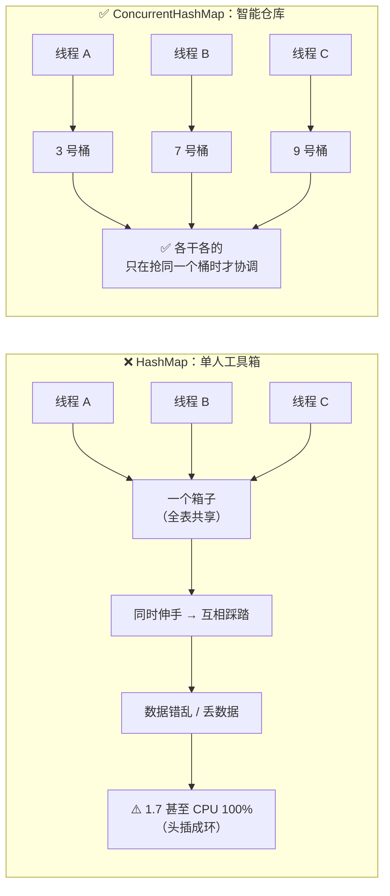

### 0.2 根本原因：HashMap 没有任何并发保护

| 问题 | 说明 |
|---|---|
| **无锁保护** | 所有线程共享一个 `table` 数组，写入没有任何同步 |
| **`++size` 不是原子操作** | 读-改-写三步，并发下会丢计数 |
| **put 丢数据** | 两个线程同时写入同一个桶，后写的覆盖先写的 |
| **1.7 头插成环** | 并发扩容时链表可能成环，`get` 陷入死循环 → **CPU 100%** |
| **`modCount` 机制** | 只在迭代时抛 `ConcurrentModificationException`，**是"事后报警"不是"事前阻止"** |

> [!danger] 关键认知：HashMap 的"线程不安全"不是"偶尔算错"
> **它会真的把数据结构搞坏。**（尤其 1.7 的成环问题，详见 [[1-集合框架]] §5.2）
>
> 而 **`ConcurrentModificationException` 只是"最好的情况"**——
> 它至少告诉你出问题了；更多时候是**静默的数据错乱**。

### 0.3 那用 `Collections.synchronizedMap` 呢？

**可以，但性能差**——它是给整张表加一把锁（类似 `Hashtable`）：

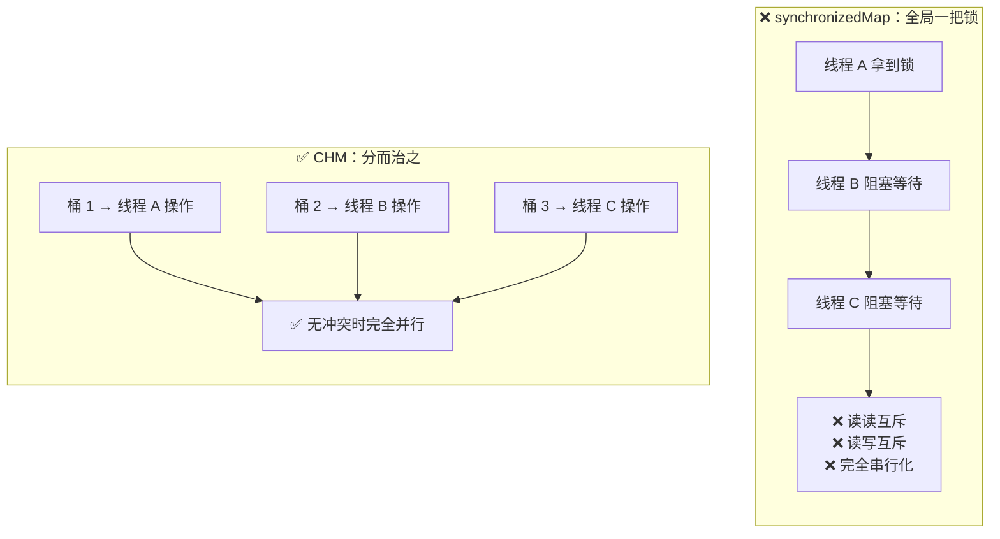

> [!important] CHM 的设计哲学（视频结尾的总结）
> **"以最小的锁粒度，换取最大的并发性能。"**
>
> 这句话是全篇的主线——下面每个机制（CAS、桶级锁、协助扩容、分散计数）
> **都是在做同一件事：把"大锁"拆成"小锁"，把"必须串行"变成"尽量并行"。**

---

## 一、核心思想：分而治之

### 1.1 数据布局

> 视频原话："它内部是一个巨大的数组，**每个位置称为一个桶**，
> 不同的线程可以同时对**不同的桶**进行操作，这就大大减少了冲突。"

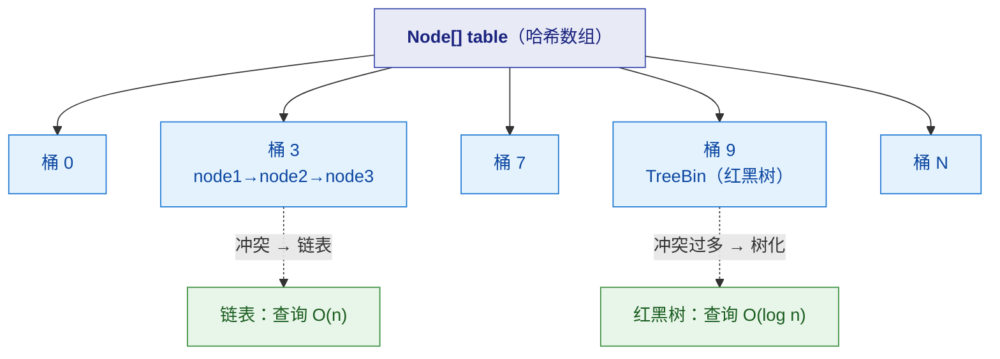

### 1.2 关键概念对照

| 视频中的说法 | 真实概念 | 作用 |
|---|---|---|
| 巨大的数组 | `Node<K,V>[] table` | 哈希桶数组 |
| 一个桶 | `table[i]` | 一个哈希槽位 |
| 桶里的链表 | `Node` 链（`next` 指针） | 解决哈希冲突 |
| 仓库的多个入口 | **不同桶的锁相互独立** | 并发粒度 |
| 挤同一个入口 | **哈希冲突到同一个桶** | 需要协调 |

> [!important] 为什么"分桶"就能提升并发
> **冲突是"局部"的，不是"全局"的。**
> 只要两个线程操作的 key **不落在同一个桶**，它们**完全互不干扰**。
>
> **所以锁的粒度可以做到"一个桶"**——这就是 1.8 相对 1.7 的进步：
> **1.7 是"一个段"（默认 16 段），1.8 是"一个桶"（几倍于 16 的粒度）。**

---

## 二、基本操作：插入 / 查询 / 删除

### 2.1 ⭐ 插入（put）：三种路径

> 视频原话："首先他会计算自己该去哪个桶……**如果桶里没人**，
> 他通过一次 **CAS**（比较并交换）原子性地把自己放进去……**如果桶不空**，
> 比如已经有 A 到 B 的链表，他会沿着链条走到末尾，然后链上自己。"

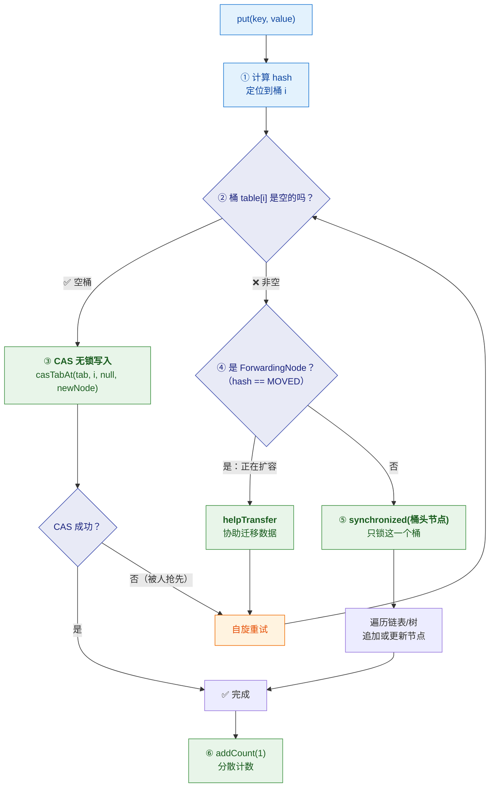

> [!important] ⭐ 三种路径的本质区别
> | 路径 | 同步手段 | 为什么这样 |
> |---|---|---|
> | **空桶** | **CAS（无锁）** | 只有一个线程能成功写入，**不需要锁**——这是最乐观也最快的路径 |
> | **非空桶** | **synchronized(桶头)** | 要改链表结构，需要互斥；**但只锁这一个桶** |
> | **扩容中** | **协助迁移** | 遇到 `ForwardingNode` 就**加入搬运行列**，而不是干等 |
>
> **"空桶用 CAS，非空桶才加锁"** 是 1.8 的关键优化——
> **在哈希分布良好的情况下，大多数写入都落在空桶，所以大多数写入是无锁的。**

**代码骨架**（完整版见 [[1-集合框架]] §6.1）：

```java
final V putVal(K key, V value, boolean onlyIfAbsent) {
    if (key == null || value == null) throw new NullPointerException();
    for (Node<K,V>[] tab = table;;) {
        Node<K,V> f; int n, i, fh;
        if (tab == null || (n = tab.length) == 0)
            tab = initTable();                                  // ① 懒初始化
        else if ((f = tabAt(tab, i = (n - 1) & hash)) == null) {
            if (casTabAt(tab, i, null, new Node<K,V>(hash, key, value, null)))
                break;                                          // ② 空桶：CAS 无锁
        }
        else if ((fh = f.hash) == MOVED)
            tab = helpTransfer(tab, f);                         // ③ 扩容中：协助迁移
        else {
            synchronized (f) { /* ④ 只锁这个桶 */ }
        }
    }
    addCount(1L, binCount);                                     // ⑤ 分散计数
    return null;
}
```

> [!note] `(n - 1) & hash` 是什么
> **等价于 `hash % n`，但更快**——因为 `n` 是 **2 的幂**。
> 这是 HashMap/CHM 共有设计，**推导见 [[1-集合框架]] §3.5**。

### 2.2 ⭐ 查询（get）：为什么几乎不加锁

> 视频原话："这就是 ConcurrentHashMap 聪明的设计——**读操作大多数时候根本不需要加锁**，
> 因为它的内部数据结构通过 **volatile** 保证可见性，
> 查询直接根据索引和遍历就能准确读值，**性能极高**。"

| 关键点 | 说明 |
|---|---|
| **不加锁** | `get` **完全不加锁**，这是它能扛高并发读的根本原因 |
| **`volatile` 保证可见性** | `Node.val` 和 `Node.next` 都是 `volatile` → **一个线程的写入，其他线程立即可见** |
| **数组元素也是 volatile 语义** | 通过 `tabAt()`（内部用 `Unsafe.getObjectVolatile`）读取，**保证读到最新桶引用** |

```java
// get 的核心：无锁 + volatile 读
static final <K,V> Node<K,V> tabAt(Node<K,V>[] tab, int i) {
    return (Node<K,V>)U.getObjectVolatile(tab, ((long)i << ASHIFT) + ABASE);
}
```

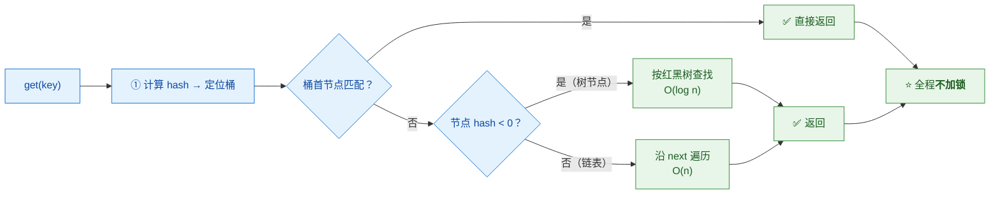

> [!important] ⭐ "无锁读"是怎么做到的（这是 CHM 最精妙的地方之一）
> **靠三层 `volatile` 语义保证可见性：**
> 1. **桶数组元素**——`tabAt()` 用 `Unsafe.getObjectVolatile` 读，**保证看到最新的桶头**
> 2. **`Node.val`**——`volatile`，**保证看到最新值**
> 3. **`Node.next`**——`volatile`，**保证看到最新的链表结构**
>
> **所以：读线程不需要锁，也能看到一致的（虽然未必是最新的）状态。**
>
> ⚠️ **代价**：正因为不加锁，`get` 可能读到**"写入过程中"的中间状态**——
> 这就是后面第 7 节要讲的**弱一致性**。

### 2.3 删除（remove）：找到 + 加锁 + 接链

> 视频原话："删除稍有不同，它需要**先找到节点再捅上枷锁**，
> 然后像**外科手术**一样把节点剔除，再把断开的链条重新接好，
> 保证整个过程对结构无破坏。"

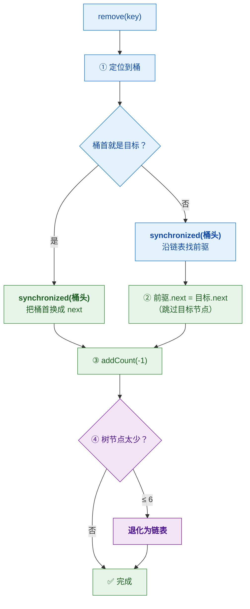

> [!important] 为什么删除必须加锁，而读不用
> **因为删除要"改结构"（改 `next` 指针），而读只是"看结构"。**
>
> - **读**：只要保证**看到的指针是有效的**，就能正确遍历 → `volatile` 足够
> - **写（含删除）**：要保证**多个写者不互相破坏结构** → 必须互斥
>
> **"读不加锁、写加锁"** 这个不对称设计，正是**读多写少场景性能极高**的原因。

---

## 三、链表 → 红黑树：动态演化

### 3.1 为什么需要树化

> 视频原话："如果**链表太长**，查找效率会**从 O(1) 退化到 O(n)**
> ……所以 ConcurrentHashMap 有个机智的演化。"

| 结构 | 查询复杂度 | 何时使用 |
|---|---|---|
| **数组 + 空桶** | **O(1)** | 无冲突 |
| **链表** | **O(n)** | 冲突较少（≤ 8） |
| **红黑树** | **O(log n)** | 冲突严重（> 8 且容量 ≥ 64） |

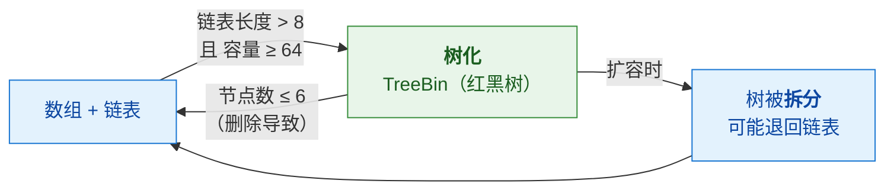

### 3.2 为什么阈值是 8

> 视频原话："**基于泊松分布统计**，在正常哈希分布下，
> 链表长度达到 8 的概率已经**极低**，这时转化为树**性价比最高**。"

> [!important] ⭐ 关键理解：8 不是"随便定的"，而是"统计学上几乎不会发生"
> **在理想哈希（均匀分布）下，一个桶里的节点数服从泊松分布。**
> 官方注释给出的概率：
>
> | 链表长度 | 概率 |
> |---|---|
> | 0 | 0.60653066 |
> | 1 | 0.30326533 |
> | 2 | 0.07581633 |
> | 3 | 0.01263606 |
> | 4 | 0.00157952 |
> | 5 | 0.00015795 |
> | 6 | 0.00001316 |
> | 7 | 0.00000094 |
> | **8** | **0.00000006**（约**亿分之六**） |
>
> **所以树化的实际触发条件极其罕见**——
> **一旦真的达到 8，说明哈希分布已经严重异常**（比如攻击者构造的哈希碰撞），
> **此时用 O(log n) 的树来兜底。**
>
> **这是"乐观路径 + 极端情况兜底"的设计思路**：
> 正常情况走链表（简单快），异常情况才上树（防退化）。
>
> 👉 **推导细节见 [[1-集合框架]] §3.1。**

### 3.3 为什么还要"容量 ≥ 64"

| 条件 | 原因 |
|---|---|
| **链表 > 8 但容量 < 64** | ⭐ **优先扩容，而不是树化** |
| **链表 > 8 且容量 ≥ 64** | 才真正树化 |

> [!important] 这个前置条件的理由（容易被忽略）
> **容量小时，冲突多往往是因为"桶太少"**——
> **扩容（把桶变多）比树化更根本、更有效。**
>
> 而且**树化本身有开销**（要维护平衡），
> **在小容量下频繁树化/退化反而更浪费。**
>
> **所以顺序是：先扩容解决，实在不行才树化。**

### 3.4 为什么退化阈值是 6（不是 7）

> 视频原话："当删除导致树中节点太少，比如**剩下六个或更少**，
> 继续保持树结构就有点**大材小用**了……这时候他就会退化成链表。"

> [!important] 8 和 6 之间的"缓冲带"
> **为什么不是"降到 7 就退化"？因为那样会在 7~8 之间反复横跳。**
>
> ```
> 链表长 8 → 树化 → 删一个变 7 → 退化 → 加一个变 8 → 又树化 → ...
> ```
>
> **6 与 8 之间留出 1 个节点的缓冲带**，
> **避免"树化/退化"频繁抖动**（因为树化和退化本身都不便宜）。
>
> 👉 **这是"用一点空间换稳定"的典型设计。**

> [!warning] 一个必须澄清的常见误解
> **"链表长度到 8 就树化" ❌ 不完整。**
> **完整条件是：链表长度 > 8 **且** table 容量 ≥ 64。**
> 容量不足 64 时**先扩容**。
>
> 面试只说"阈值 8"会被追问"那容量不到 64 呢"。

---

## 四、⭐ 扩容：多线程协作搬迁

### 4.1 为什么要"协作"

> 视频原话："当元素越来越多，仓库装不下就会触发扩容，**容量直接翻倍**。
> 但为了**不卡顿**，它是**多线程协作搬迁**的，
> 每个线程领取一段搬运任务。"

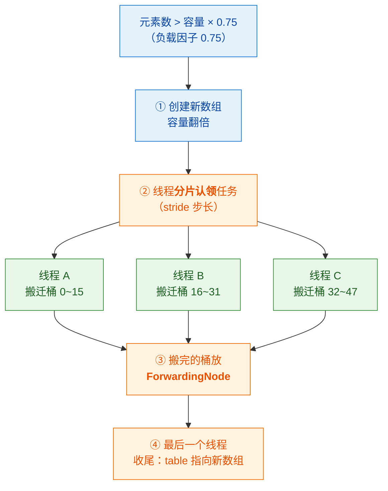

> [!important] ⭐ "协作扩容"和 1.7 的根本区别
> | | **1.7** | **1.8** |
> |---|---|---|
> | 谁扩容 | **单线程**（持段锁，其他线程等） | ⭐ **多线程协作** |
> | 其他线程 | **阻塞等待** | **helpTransfer 一起搬** |
> | 结果 | 扩容期间吞吐骤降 | **吞吐受影响小得多** |
>
> **这就是"把串行变成并行"的又一个体现。**

### 4.2 ⭐ 搬迁时怎么"不重新哈希"

> 视频原话："最巧妙的是针对每个桶的链表或树，
> 它通过节点**哈希值的高位参与计算**，把一条链**优雅地拆分成两条**：
> 一条**留在原位（低链）**，一条**迁移到高位**……
> 这样搬迁后**不需要重新哈希**，高效且分散。"

> [!important] ⭐ 这是 CHM（和 HashMap）最优雅的设计之一

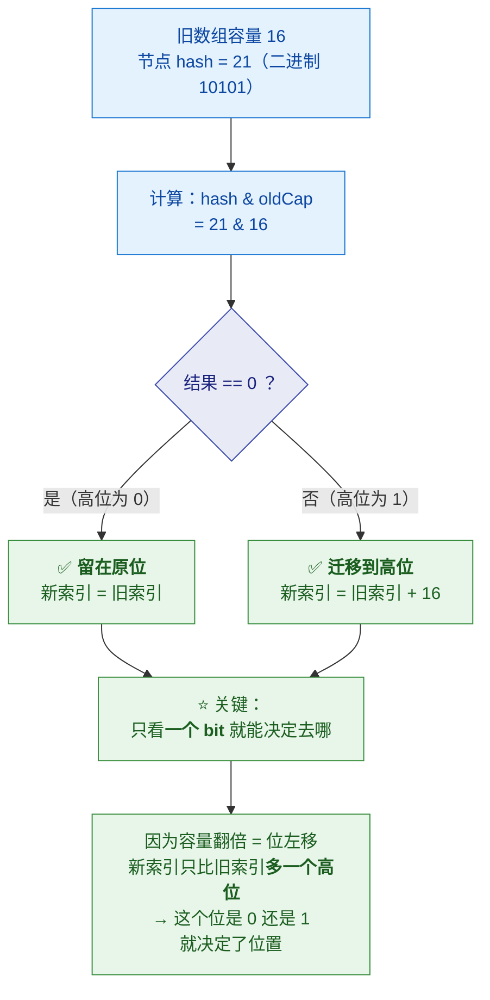

**为什么这样能"不重新哈希"**：

| 步骤 | 说明 |
|---|---|
| 旧容量 16（`10000`） | 索引 = `hash & 15`（看低 4 位） |
| 新容量 32（`100000`） | 索引 = `hash & 31`（看低 5 位） |
| **差异** | ⭐ **只多了第 5 位** |
| **判断** | `hash & 16`：**为 0 → 原位；为 1 → 原位 + 16** |

> [!success] 这个设计的精妙之处
> **不需要重新计算 `hash % newCapacity`**——
> **只需检查 hash 的一个 bit，就能确定节点去新数组的哪个位置。**
>
> **而且原来的链表会自然"一分为二"（低链 + 高链）**，
> **既保持了相对顺序，又实现了均匀分散。**
>
> 👉 **详细源码（`loHead/loTail/hiHead/hiTail`）见 [[1-集合框架]] §4.3。**

### 4.3 ⭐ ForwardingNode：扩容期间还能读

> 视频原话："看到这个 **ForwardingNode** 了吗？
> 扩容期间如果查询遇到**已经搬空的旧桶**，
> 它会**自动指引你去新仓库找**，保证服务不中断。"

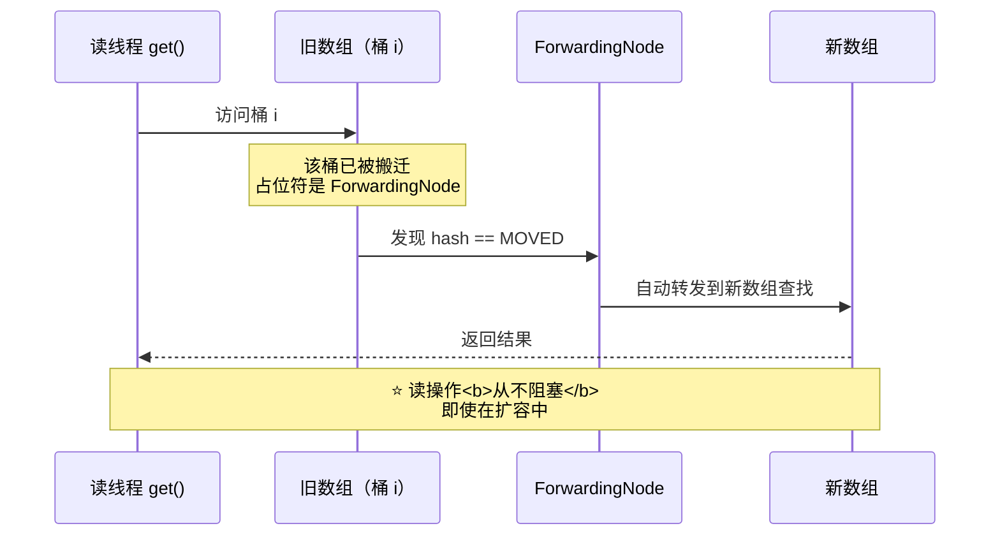

> [!important] ForwardingNode 做了三件事
> | 作用 | 说明 |
> |---|---|
> | **① 标记"这个桶已搬迁"** | 用一个特殊节点占位（`hash = MOVED = -1`） |
> | **② 转发读请求** | `get` 遇到它就去新数组查 |
> | **③ 触发写线程协助** | `put` 遇到它 → `helpTransfer` 加入搬迁 |
>
> **一个占位符同时解决了"读"和"写"两个问题**——
> **这是 CHM 设计中最值得品味的一处。**
>
> **它保证了：扩容期间读操作完全不阻塞，写操作不空等。**

---

## 五、⭐ size()：分散计数（LongAdder 思想）

### 5.1 问题：统计总数为什么要锁整表

> 视频原话："这么多人同时增删，那统计总数量 size 不是很困难吗？
> 难道要锁住整个仓库？那性能就太糟了。"

**朴素做法的问题**：

```java
// ❌ 朴素做法：用一个共享计数器
size++;   // 读-改-写三步，并发下会丢更新；加锁又会成为热点
```

> [!danger] 为什么"一个计数器"不行
> **它会成为新的"热点"**：
> - 所有线程都要竞争**同一个变量**
> - `size++` 是**复合操作**（读-改-写），**必须同步**
> - **结果是：你为了避开"整表锁"，却造出了一个"计数器锁"**
>
> **这就是典型的"把瓶颈从一个地方挪到另一个地方"。**

### 5.2 解法：分散热点（CounterCell）

> 视频原话："它采用了**分散技术**，有一个**基础计数器**，
> 但如果竞争激烈，就会启用一个 **CounterCell 数组**，
> 每个线程更新时**随机或根据探测落在一个 cell 上**进行 CAS 增减，
> 最后计算 size 时，把所有 cell 的值和基础值加起来就行。"

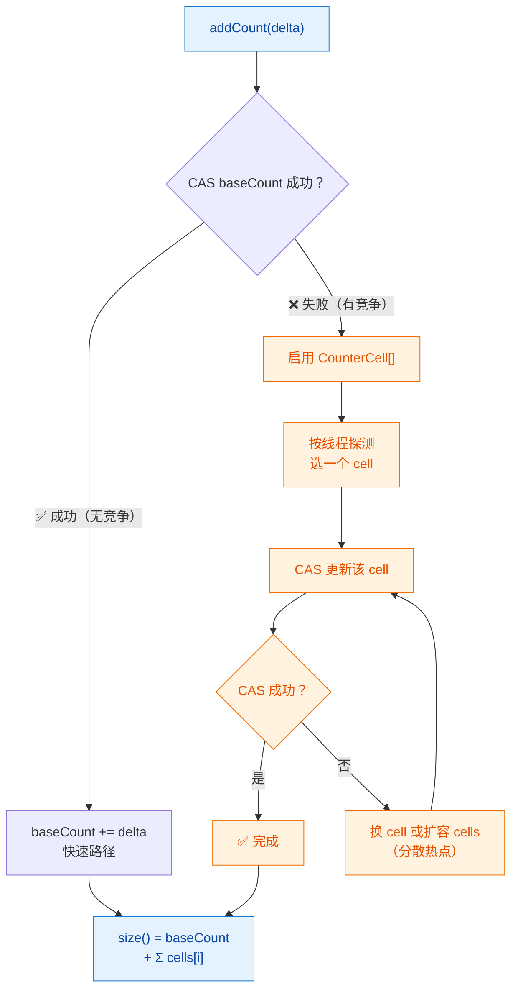

> [!important] ⭐ 这就是 `LongAdder` 的思想
> **核心：不要所有线程争一个变量，而是让它们各改各的 cell。**
>
> | | 单计数器 | 分散计数 |
> |---|---|---|
> | 竞争点 | **1 个** | **N 个 cell** |
> | 并发写 | 激烈冲突 | **冲突大幅降低** |
> | 读取成本 | 低 | **要遍历求和** |
>
> **这是一个明确的取舍：写更快，读稍慢。**
> **而 CHM 显然是"写多读少"的场景**（size() 调用频率远低于 put）——
> **所以这个取舍是划算的。**
>
> 👉 **`LongAdder` 的完整原理见 [[6-JUC并发工具]]。**

### 5.3 ⚠️ 所以 `size()` 是近似值

> [!danger] ⭐ 一个重要结论
> **`size()` 返回的是"某瞬间的近似值"，不是精确值。**
>
> **原因**：
> 1. **求和过程本身不是原子的**——遍历 cell 期间可能有线程在改
> 2. **`sumCount()` 只做一次遍历**——遍历中发生的修改可能看不到
>
> **官方 API 注释明确说：`size()` 是"估计值"（estimate）。**

**两个 API 的差别**：

| 方法 | 返回 | 说明 |
|---|---|---|
| `size()` | `int` | ⚠️ **可能溢出**（元素 > 21 亿时） |
| **`mappingCount()`** | `long` | ⭐ **推荐**——不会因 `int` 截断 |

```java
public long mappingCount() {
    long n = sumCount();
    return (n < 0L) ? 0L : n;      // ⭐ 明确返回 long
}
```

> [!tip] 需要精确计数怎么办
> **如果你真的需要精确计数：**
> - **自己维护一个 `LongAdder`**（但要考虑与 CHM 操作的一致性）
> - **或换用其他方案**（因为你已经需要"跨操作的原子性"，这超出 CHM 的保证范围）
>
> **切记：CHM 的 `size()` 设计目标就是"高并发下的近似统计"，不是精确值。**

---

## 六、1.7 vs 1.8：锁粒度是怎么一步步变小的

> [!important] ⭐ 这张表体现"锁粒度不断缩小"的演进主线

| 维度 | **JDK 1.7** | **JDK 1.8** |
|---|---|---|
| **锁粒度** | **Segment（默认 16 段）** | ⭐ **单个桶的头节点** |
| **数据结构** | Segment 数组 + HashEntry 数组 | Node 数组 + 链表 + 红黑树 |
| **空桶写入** | 需加**段锁** | ⭐ **CAS 无锁** |
| **扩容** | **单线程**（持段锁） | ⭐ **多线程协作**（helpTransfer） |
| **链表 → 树** | ❌ 不支持 | ✅ 支持（TreeBin，阈值 8） |
| **读** | 不加锁（`HashEntry.value` volatile） | 不加锁（`Node.val`/`next` volatile） |
| **并发度上限** | **16**（段数） | **桶数量级**（可达数千） |


> [!note] 为什么 1.7 要用分段
> **因为 1.7 的 HashEntry 数组是"段内私有"的**，
> 段与段之间天然隔离，**所以锁一个段就够了**。
> 但**段数固定（默认 16）**，**并发度上限就是 16** —— 这是它的瓶颈。
>
> 1.8 改成"直接锁桶头节点"，**并发度等于桶数量**（可能几千），
> **大幅提升了并发上限**。

---

## 七、⚠️ 常见坑（视频结尾的重点）

### 7.1 坑一：复合操作不是原子的（最经典）

> 视频原话："很多人以为 ConcurrentHashMap 是并发安全的，
> 就把**先检查 containsKey 再 put** 这么写，这可是经典的**先检查后执行竞态**。
> 该怎么做？用 **computeIfAbsent**，原子的执行你的缺失操作。"

```java
// ❌ 经典错误：check-then-act 竞态
if (!map.containsKey(key)) {
    map.put(key, createValue());     // ⚠️ 两个线程可能都通过检查
}
// 结果：createValue() 被调用两次，后者覆盖前者
```

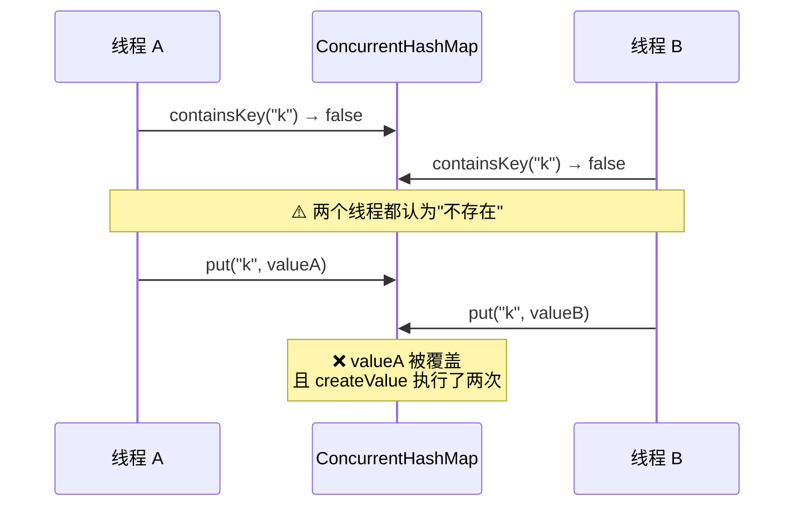

**正确做法：用原子复合方法**

```java
// ✅ 原子操作
map.computeIfAbsent(key, k -> createValue());
```

| 原子方法 | 作用 |
|---|---|
| **`computeIfAbsent`** | 不存在才计算并放入（**原子**） |
| **`computeIfPresent`** | 存在才更新 |
| **`compute`** | 无论是否存在都计算 |
| **`merge`** | 合并（常用于计数累加） |
| **`putIfAbsent`** | 不存在才放（返回旧值） |
| **`replace`** | 存在才替换 |

> [!important] ⭐ 核心原则（必须记住）
> **CHM 只保证"单个方法调用"的原子性，不保证"多个调用的组合"原子。**
>
> **所以任何"先检查、后动作"的写法都可能有竞态**——
> **必须用 CHM 提供的原子复合方法（`compute*` / `merge` / `putIfAbsent`）。**
>
> 👉 **这一条比"CHM 线程安全"这个结论重要得多。**
> 详见 [[1-集合框架]] §6.4。

### 7.2 坑二：迭代是弱一致性的

> 视频原话："另外**遍历的时候它也是弱一致性的**，
> 允许在遍历期间看到**部分更新**，**不需要另外加锁**。"

| 特性 | 说明 |
|---|---|
| **不抛 `ConcurrentModificationException`** | ⭐ 与 HashMap 的关键差别 |
| **可能看到也可能看不到遍历期间的修改** | "弱一致"的含义 |
| **绝不重复、绝不抛异常** | 有保证的部分 |
| **不需要加锁** | 可以直接遍历 |

```java
// ✅ 可以安全遍历，不需要加锁，也不会抛 CME
for (Map.Entry<K, V> e : chm.entrySet()) {
    // 遍历期间其他线程可以继续读写
}
```

> [!warning] ⚠️ 弱一致 ≠ 快照
> **"不抛 CME"不代表"你看到的是稳定快照"。**
>
> | 迭代器类型 | 语义 |
> |---|---|
> | **`CopyOnWriteArrayList`** | **真快照**——遍历期间的写入**完全不可见** |
> | **`ConcurrentHashMap`** | **弱一致**——`next()` 沿当时的链表走，**可能看到也可能看不到**新元素 |
> | **`HashMap`** | **fail-fast**——**抛 CME** |
>
> **能讲清这个差别，比笼统说"fail-safe"高一个档次。**
> 详见 [[1-集合框架]] §（迭代器对比）。

### 7.3 坑三：不允许 null

> [!danger] CHM 的 key 和 value **都不允许 null**
> ```java
> map.put(null, "x");      // ❌ NullPointerException
> map.put("k", null);      // ❌ NullPointerException
> ```

**为什么？（这是设计决策，不是"做不到"）**

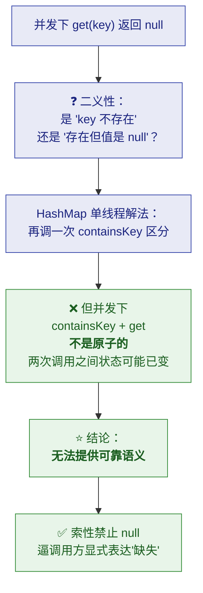

> [!tip] 加分表述
> **"`Hashtable` 也不允许 null，但那是历史包袱；
> `ConcurrentHashMap` 的禁止是明确的设计决策。"**
>
> **面试时说出"二义性 + 无法原子地组合两次调用"，
> 比"CHM 不允许 null"这个结论值钱得多。**

### 7.4 三个坑速查

| 坑 | 症状 | 正确做法 |
|---|---|---|
| **复合操作** | `containsKey` + `put` 竞态 | ⭐ 用 `computeIfAbsent` / `merge` |
| **迭代** | 以为遍历看到的就是全部 | 接受**弱一致**；需快照请自行 `new ArrayList<>(map.entrySet())` |
| **null** | `NPE` | 用 `Optional` 或哨兵值表达"缺失" |

---

## 八、完整设计动机总表

> [!important] ⭐ 全篇回看：每个机制解决什么问题

| 机制 | 解决什么问题 | 核心手段 | 代价 |
|---|---|---|---|
| **分而治之（分桶）** | HashMap 无并发保护 | 锁粒度 = 单桶 | 冲突时仍需协调 |
| **空桶 CAS** | 加锁开销大 | 无锁写入 | 失败要自旋重试 |
| **volatile 字段** | 读也要加锁 | 无锁读 | **弱一致性** |
| **桶级 synchronized** | 写要改结构 | 只锁一个桶 | 热点桶会竞争 |
| **树化（>8 且 ≥64）** | 链表 O(n) 退化 | 红黑树 O(log n) | 维护平衡有开销 |
| **退化（≤6）** | 树维护不划算 | 退回链表 | —— |
| **协作扩容 + ForwardingNode** | 扩容时吞吐骤降 | 多线程搬 + 读可转发 | 实现复杂 |
| **高位拆分搬迁** | 重新哈希开销 | 只看 1 个 bit | —— |
| **CounterCell 分散计数** | size 计数成热点 | 分散 CAS + 求和 | **size 是近似值** |
| **禁止 null** | get 二义性 | 直接抛 NPE | 使用不便 |
| **原子复合 API** | check-then-act 竞态 | compute/merge | 需改变写法 |

> [!success] 一句话总结 CHM 的设计哲学
> **"以最小的锁粒度，换取最大的并发性能。"**
>
> 具体展开就是三步：
> 1. **能不加锁就不加**（读、空桶写用 volatile + CAS）
> 2. **必须加锁时，把锁粒度做到最小**（一个桶，而不是整表／整段）
> 3. **必须串行时，想办法让它并行**（扩容协作、计数分散）

---

## 九、面试高频追问

| 追问 | 答题要点 |
|---|---|
| **CHM 怎么保证线程安全？** | 三层：① **读无锁**（volatile 可见性）② **空桶 CAS** ③ **非空桶 synchronized 锁头节点** |
| **1.7 和 1.8 最大区别？** | **锁粒度**：1.7 是 **Segment（16 段）**，并发上限 16；1.8 是**单桶**，并发度 = 桶数；且 1.8 支持**协作扩容**和**树化** |
| **为什么 1.8 放弃分段锁？** | 分段锁**并发度固定为 16**，成为瓶颈；桶级锁**并发度随容量增长**，且空桶可 CAS 完全无锁 |
| **读操作为什么不加锁？** | `Node.val`/`next` 是 **volatile**，`tabAt` 用 `Unsafe.getObjectVolatile` → **可见性由 volatile 保证**，无需互斥 |
| **树化阈值为什么是 8？** | **泊松分布**——理想哈希下长度达 8 的概率约 **亿分之六**，属"几乎不会发生"；真发生说明哈希异常，用树兜底 |
| **为什么还要容量 ≥ 64？** | 容量小时冲突多，**扩容比树化更根本**；避免小容量下频繁树化/退化 |
| **退化阈值为什么是 6？** | **留缓冲带**（8 与 6 之间），避免在 7~8 间**反复树化/退化抖动** |
| **扩容时还能读吗？** | ✅ 能。**ForwardingNode** 标记已搬迁的桶，读遇到它**自动转发到新数组** |
| **扩容时其他线程干什么？** | **helpTransfer 协助搬迁**（而不是阻塞等待）——这是 1.8 相对 1.7 的关键改进 |
| **扩容为什么不用重新哈希？** | 容量翻倍后**新索引只多一个高位**，`hash & oldCap` 是 0 留原位、是 1 则 +oldCap，**链表一分为二** |
| **`size()` 精确吗？** | ❌ **是近似值**。用 **CounterCell 分散计数**（LongAdder 思想），求和期间可能仍在变；建议用 **`mappingCount()`**（long，不溢出） |
| **为什么 size 要分散计数？** | 单计数器会成**新热点**（所有线程争一个变量）→ **把瓶颈从"表锁"挪到"计数器锁"** |
| **为什么不允许 null？** | **二义性 + 并发下 `containsKey` 与 `get` 无法原子组合** → 索性禁止，逼调用方显式表达缺失 |
| **CHM 完全线程安全吗？** | ⚠️ **只保证单方法原子**。`containsKey`+`put` 这类**复合操作仍有竞态** → 用 `computeIfAbsent`/`merge` |
| **迭代器是什么语义？** | **弱一致**——不抛 CME、不重复，但**可能看到也可能看不到遍历期间的修改** |
| **和 Hashtable / synchronizedMap 比？** | 前者**全表锁**已淘汰；后者高并发下性能差且**迭代要手动加锁**；**CHM 是并发场景默认选择** |
| **和 LongAdder 什么关系？** | CHM 的计数用了 **LongAdder 的分散热点思想**（`CounterCell[]` + baseCount） |

---

## 附录 A：语音转写（ASR）勘误对照

> 原稿是语音转写，错误较多。**阅读原始字幕稿时对照此表。**

| 原稿（错） | 正确 | 出现位置 |
|---|---|---|
| **县城** | **线程** | 全文多处（最典型） |
| **car** | **CAS** | "通过一次 car" |
| **concurrent hashmap / hatch map** | **ConcurrentHashMap** | 全文多处 |
| **concurrent hatch map** | **ConcurrentHashMap** | 多处 |
| **sell / cell** | **CounterCell / cell** | "把所有 sell 的值加起来" |
| **cw** | **CAS** | "进行 cw 增减" |
| **便利 / 便利的时候** | **遍历** | "查询直接根据索引和便利" |
| **静态不原子** | **竞态（race condition）** | "先检查后执行静态不原子" |
| **先检查后执行** | **check-then-act** | 同上 |
| **O嗯** | **O(n)** | "从 O1 退化到 O嗯" |
| **大材小** | **大材小用** | "继续用树结构有点大材小用" |
| **移后的星瞳** | **迁移后的新桶** | 扩容拆分段落 |
| **低链** | **低位链（loHead）** | 扩容拆分（此处原文基本正确） |
| **现成安全哲学** | **线程安全哲学** | 结尾总结 |
| **分铜锁 / 分铜** | **分桶 / 分段锁** | "从分铜锁链表数化" |
| **链表数化** | **链表树化** | 同上 |
| **技术分散** | **计数分散** | 同上 |
| **加了枷锁 / 捅上枷锁** | **加上锁** | 删除段落 |
| **探测落在** | **探测（probe）落在** | 计数分散段落（意思基本正确） |

---

## 附录 B：30 秒速查

> [!abstract] 记住这 12 句
> 1. **HashMap 并发下会真坏**（丢数据、1.7 成环 CPU 100%），不只是"算错"。
> 2. CHM 的思想是**分而治之**——**锁粒度 = 单个桶**。
> 3. **读完全不加锁**，靠 `Node.val`/`next` 的 **volatile** 保证可见性。
> 4. **空桶用 CAS 无锁写入**，**非空桶才 synchronized 锁头节点**。
> 5. 冲突多时**链表 → 红黑树**，条件是**长度 > 8 且容量 ≥ 64**。
> 6. **8 来自泊松分布**（概率约亿分之六），是"极端情况兜底"。
> 7. **退化阈值 6**，与 8 之间留**缓冲带**，防抖动。
> 8. **扩容多线程协作**，靠 **ForwardingNode** 让读操作**转发不阻塞**。
> 9. 搬迁**只看 hash 一个 bit**（`hash & oldCap`）→ **不需要重新哈希**。
> 10. **size() 是近似值**（CounterCell 分散计数），推荐用 **`mappingCount()`**。
> 11. **不允许 null**——因为并发下 get 的二义性**无法原子消除**。
> 12. ⭐ **只保证单方法原子**——复合操作必须用 **`computeIfAbsent`/`merge`**。

> [!tip] 三个最容易被追问到底的点
> ① **为什么读不用加锁**（volatile 可见性）→ 会追问"那能看到最新吗"（**弱一致**）
> ② **树化为什么是 8 且要 ≥64** → 会追问"泊松分布""为什么不是 7 或 9"
> ③ **复合操作为什么不安全** → 会让你**手写正确写法**（`computeIfAbsent`）

---

> 关联：[[1-集合框架]]（§三/§四 HashMap 机制、§六 CHM 要点）· [[6-JUC并发工具]]（AQS、LongAdder）· [[4-多线程与内存模型]]（volatile、CAS 语义）
> 原始字幕稿：[[了解一下：ConcurrentHashMap]]
> 返回 → [[0.1-JUC核心类结构总览图.md]]
