# 🧋 AQS：从奶茶店排队到同步器工厂（详细整理版）

> 本篇是对 [B 站视频《你怎么理解AQS我不懂》](https://www.bilibili.com/video/BV1E69aB9E3U/)（约 6 分钟）的**逐段深度整理**：视频用"**奶茶店排队**"这个比喻讲透了 AQS 的全部骨架（原稿错别字极多，尤其"**线程**"被识别成"**县城**"，见 [附录 A](#附录-a语音转写asr勘误对照)）。
> 定位：**先建立直觉，再进源码**。本篇负责"比喻 ↔ 真实概念"的映射与流程图；源码级细节（CLH 原始实现差异、`Node` 位字段、中断/超时、`Condition` 条件队列）由姊妹篇 [[6-JUC并发工具]] §二 展开。
> 原始字幕稿：[[你怎么理解AQS我不懂]]。相关：[[4-多线程与内存模型]]、[[5-线程池]]、[[0.1-JUC核心类结构总览图.md]]。

---

## 〇、为什么需要 AQS：无序竞争的代价

奶茶店里没有排队规矩会怎样？

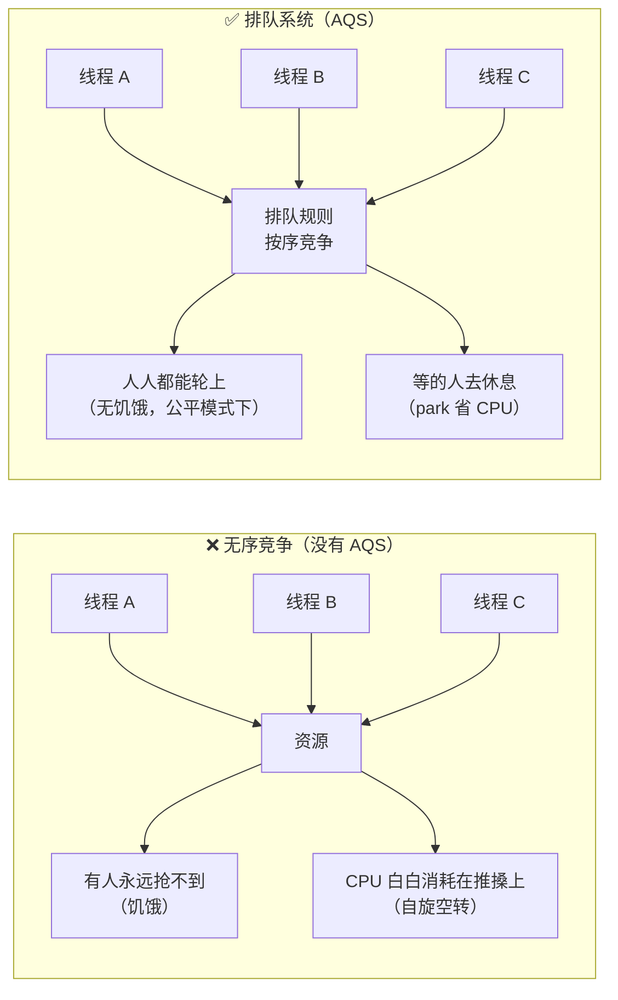

> [!important] AQS 是什么（一句话）
> **AQS = 给线程立规矩、让它们有序竞争资源的"排队管理系统"**。
> 它是一个**抽象类**，不直接面向业务，而是作为**同步器的骨架**——子类只需要回答一个问题：**"什么叫做获取成功、什么叫做释放成功"**（即 `state` 的语义）。

**奶茶店比喻 ↔ 真实概念总对照**（全文反复回看这张表）：

| 奶茶店 | AQS 真实概念 | 作用 |
| --- | --- | --- |
| 公告 / 排队规矩 | `AbstractQueuedSynchronizer` | 抽象同步骨架 |
| 珍珠计数器（罐里有几颗珍珠） | `volatile int state` | 资源数 / 重入次数 |
| 号码牌队列 | **CLH 变种双向队列**（`Node`） | 排队等待 |
| 号牌上写的状态 | `Node.waitStatus` | SIGNAL / CANCELLED / CONDITION / PROPAGATE |
| 号码牌串成的线 | `prev` / `next` 指针 | 双向，方便前后照应 |
| 坐下歇着 | `LockSupport.park()` | 阻塞线程，让出 CPU |
| 拍肩膀叫醒 | `LockSupport.unpark(thread)` | 唤醒后继 |

---

## 一、三件法宝：AQS 的三大要素

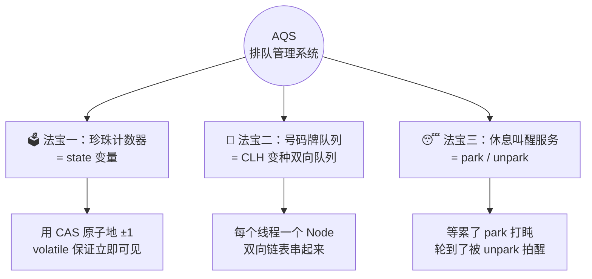

### 1.1 法宝一：珍珠计数器 = `state`

> 视频原话："罐子里有几颗珍珠，就代表资源还有几份。每服务一个顾客，我就用 **CAS 原子性地摇走一颗**；其他人都能**立即看到**最新数量。"

| 要点 | 说明 |
| --- | --- |
| `state` 是什么 | 一个 `volatile int`，**含义由子类定义**（可以是锁的持有次数、许可数、倒计时数…） |
| 怎么修改 | **CAS**（`compareAndSetState`）——保证"读-改-写"的原子性 |
| 为什么要 `volatile` | 让所有线程**立即可见**最新值（否则读到的可能是缓存里的旧值） |
| ⚠️ 关键 | `volatile` **只保证可见性，不保证原子性**——所以必须配 CAS，"摇走一颗"才不会两个线程同时摇同一颗 |

> [!note] `state` 的语义随同步器而变
> | 同步器 | `state` 的含义 |
> | --- | --- |
> | `ReentrantLock` | **锁的持有次数**（可重入计数）：0 = 空闲，1 = 被持有，2 = 同一线程重入两次 |
> | `Semaphore` | **可用许可数**（水龙头还剩几个） |
> | `CountDownLatch` | **剩余倒计时数**（减到 0 就开门） |
> | `ReentrantReadWriteLock` | **高 16 位 = 读锁计数，低 16 位 = 写锁计数**（一个 int 塞两种锁） |

### 1.2 法宝二：号码牌队列 = CLH 变种队列

> 视频原话："每个排队的**线程**都会领到一个 **Node 号牌**，牌子上写着状态……**队列是双向的，方便前后照应**。"

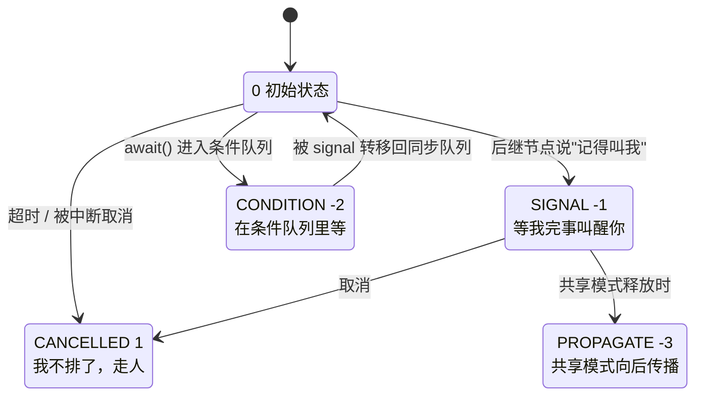

| `waitStatus` | 值 | 大白话 | 什么时候用 |
| --- | --- | --- | --- |
| **初始** | `0` | 新来的号牌，还没表态 | 刚入队 |
| **SIGNAL** | `-1` | "**等我完事叫醒你**" | 入队后发现要等很久，把**前驱**标记为 SIGNAL，然后自己 park |
| **CANCELLED** | `1` | "**我不排了，走人**" | 超时、被中断 |
| **CONDITION** | `-2` | 在条件队列（`await`）里等 | `Condition.await()` |
| **PROPAGATE** | `-3` | 共享模式下"**继续往后叫**" | 共享模式释放（见 [§四](#四共享模式柠檬水机的两个水龙头)） |

> [!tip] 为什么是"双向"队列？
> **往后**：释放锁时要顺着 `next` 找到后继并唤醒它；
> **往前**：`next` 是"懒设置"的（CAS 改 `tail` 之后才写 `pred.next`），存在瞬时为 null 的窗口——所以 `unparkSuccessor` 必要时会**从 `tail` 反向扫描 `prev`** 去找一个可唤醒的节点。
> 这就是视频说的"**方便前后照应**"。细节见 [[6-JUC并发工具]] §2.2、§2.3。

### 1.3 法宝三：休息叫醒服务 = `park` / `unpark`

> 视频原话："顾客等累了，可以用 **park 坐下歇着**；轮到他的时候，前一个顾客或者我用 **unpark 拍他肩膀**叫醒——**比傻站着省体力多了**。"

| 比喻 | 真实 API | 效果 |
| --- | --- | --- |
| 坐下歇着 | `LockSupport.park()` | 线程**阻塞**，不再占用 CPU 时间片 |
| 拍肩膀叫醒 | `LockSupport.unpark(thread)` | 唤醒指定线程，让它继续竞争 |

> [!important] 为什么"比傻站着省体力"？
> **傻站着 = 自旋（spin）**：线程反复检查条件，**一直烧 CPU**；
> **坐下歇着 = park**：线程进入阻塞态，**不占 CPU**，等被叫醒再回来。
> AQS 的做法是**先自旋一小会儿**（赌锁马上释放，省一次上下文切换），**没戏就 park**——这是"自旋"与"阻塞"的折中。

> [!note] `park` / `unpark` 和 `wait` / `notify` 的区别（面试常考）
> | 维度 | `park` / `unpark` | `wait` / `notify` |
> | --- | --- | --- |
> | 是否需要**先持有锁** | 不需要 | **必须**在 `synchronized` 块内 |
> | 唤醒对象 | **精确指定某个线程** | `notify` 随机唤醒一个 |
> | 顺序 | **可以先 `unpark` 再 `park`**（许可机制，`park` 立即返回） | `notify` 不能先于 `wait` |
> | 中断响应 | 直接返回，不抛异常（调用方自己检查） | 抛 `InterruptedException` |

---

## 二、独占模式全流程：A 喝到茶，B、C 排队

### 2.1 完整时序图（视频主线）

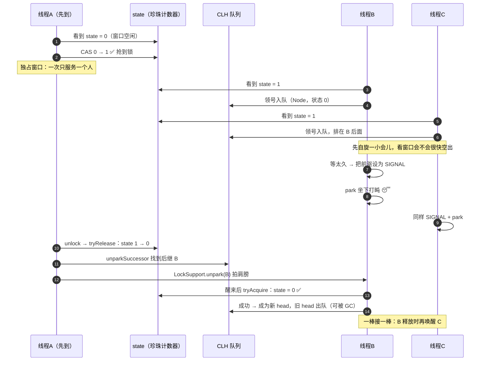

### 2.2 A 获取锁：`state` 0 → 1

**流程**：A 最先到 → 发现 `state == 0`（窗口空闲）→ **用 CAS 把 0 改成 1** → 抢到锁，把"当前独占线程"记为 A。

```java
// AQS.acquire 的入口（模板方法）
public final void acquire(int arg) {
    if (!tryAcquire(arg) &&                              // ① 先试着直接拿
        acquireQueued(addWaiter(Node.EXCLUSIVE), arg))   // ② 失败才入队排队
        selfInterrupt();
}

// ReentrantLock 非公平锁的 tryAcquire（子类实现）
final boolean nonfairTryAcquire(int acquires) {
    final Thread current = Thread.currentThread();
    int c = getState();
    if (c == 0) {
        if (compareAndSetState(0, acquires)) {   // ⭐ CAS 抢占
            setExclusiveOwnerThread(current);
            return true;                          // 拿到锁
        }
    } else if (current == getExclusiveOwnerThread()) {
        // ④ 可重入：发现持有者是自己
        int nextc = c + acquires;
        if (nextc < 0) throw new Error("Maximum lock count exceeded");
        setState(nextc);                          // 重入无需 CAS（独占持有，无竞争）
        return true;
    }
    return false;
}
```

### 2.3 可重入：A 喝到一半想加珍珠

> 视频对话："如果 A 喝到一半想加珍珠，需要重新排队吗？—— **不用，这就是可重入的好处**。"

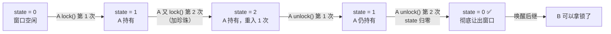

**关键点**：持有者是自己时，`tryAcquire` **不是去 CAS 抢，而是把 `state` 加一**（"多喝了一口"）；释放时要**分次释放**，只有 `state` **回到 0** 才算彻底让出窗口。

### 2.4 排队时在做什么：先自旋，再 SIGNAL + park

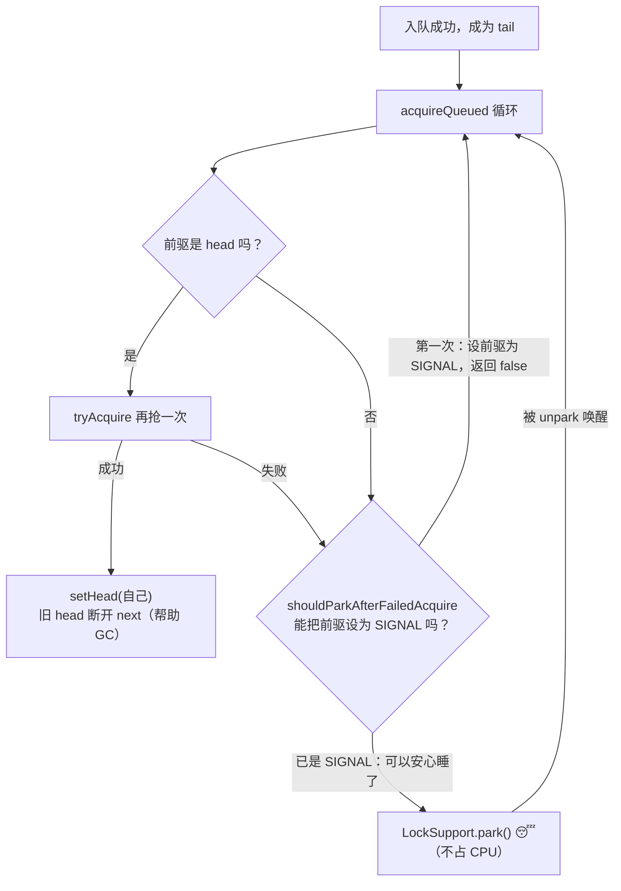

```java
// AQS.acquireQueued 的核心循环（"先自旋后挂起"就发生在这里）
for (;;) {
    final Node p = node.predecessor();       // 看前驱
    if (p == head && tryAcquire(arg)) {      // 前驱是 head → 有资格再抢一次
        setHead(node);                       // 抢到 → 自己成为新 head
        p.next = null;                       // 旧 head 断开引用，帮助 GC
        return interrupted;
    }
    if (shouldParkAfterFailedAcquire(p, node) &&  // 把前驱标记为 SIGNAL
        parkAndCheckInterrupt())                  // 然后 park 睡下
        interrupted = true;
}
```

> [!tip] "先自旋后挂起"到底在哪？
> **循环本身就是自旋**：每次醒来（或被唤醒）都会回到循环顶部再试一次；但**不是无脑空转**——`shouldParkAfterFailedAcquire` 第一次会先把前驱标成 `SIGNAL`（"记得叫我"），第二次才真正 `park` 睡下。这样既不会错过马上释放的锁，也不浪费 CPU。

### 2.5 A 释放锁：`release` → `tryRelease` → `unparkSuccessor`

```java
public final boolean release(int arg) {
    if (tryRelease(arg)) {                 // ① 子类判断"这算释放成功了吗"
        Node h = head;
        if (h != null && h.waitStatus != 0)
            unparkSuccessor(h);            // ② 唤醒后继
        return true;
    }
    return false;
}

// ReentrantLock.tryRelease：state 减到 0 才算真释放
protected final boolean tryRelease(int releases) {
    int c = getState() - releases;
    if (Thread.currentThread() != getExclusiveOwnerThread())
        throw new IllegalMonitorStateException();
    boolean free = false;
    if (c == 0) {                          // ⭐ 减到 0 才彻底释放（可重入的分次释放）
        free = true;
        setExclusiveOwnerThread(null);
    }
    setState(c);
    return free;
}
```

### 2.6 B 被唤醒后：位置有利，一抢一个准

> 视频对话："B 醒来后要重新竞争吗？会不会被插队？—— **B 醒来的位置非常有利，他的前节点就是 head**，他会再次自旋尝试 `tryAcquire`，这个时候 `state` 已经是零，所以能一次成功。"

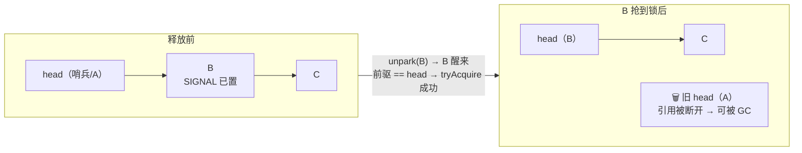

> [!warning] 一个必须澄清的细节
> 视频说"不会被插队"，这在**公平锁**下严格成立；
> 但在**非公平锁**下，B 被唤醒后 `tryAcquire` 时**仍可能被刚到达的新线程抢走**（新线程上来就 CAS）——这正是非公平锁"吞吐更高但可能让排队者饥饿"的双刃剑（见下一节）。B 相对有利，是因为它**已经被唤醒、且前驱就是 head**，省掉了重新入队。

### 2.7 一棒接一棒：`head` 不断前移

- C 现在变成 B 的后继；
- B 释放锁时，同样走 `release → unparkSuccessor → unpark(C)`；
- 于是**每个线程都被前一个叫醒**，队列像传送带一样向前走，**所有人都能喝到奶茶，也没有争先恐后**。

---

## 三、公平锁 vs 非公平锁

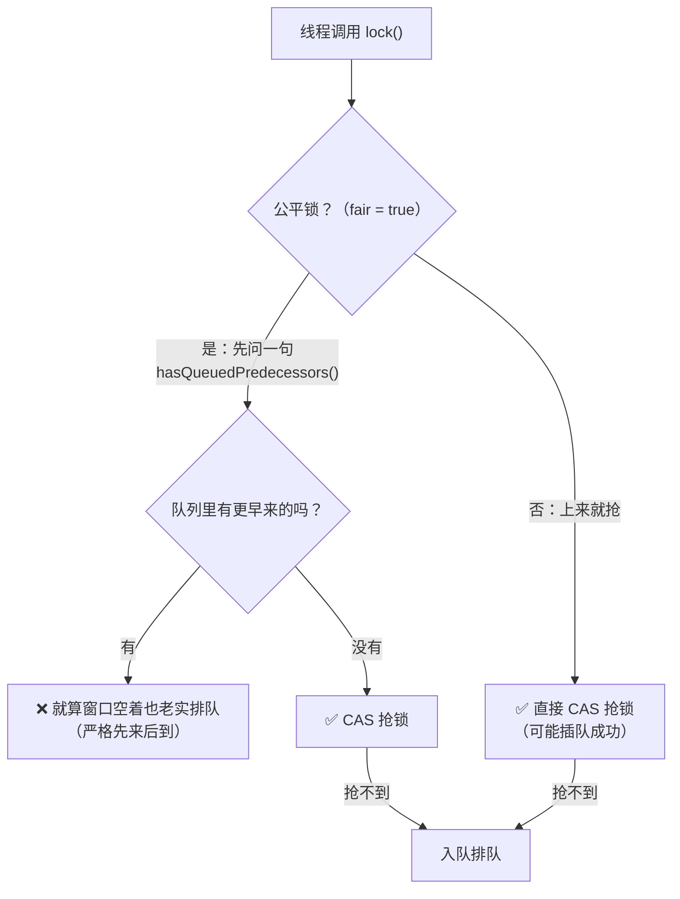

| 维度 | 公平锁（Fair） | 非公平锁（Nonfair） |
| --- | --- | --- |
| 抢锁前 | 先调 `hasQueuedPredecessors()` **检查有没有前辈** | **直接 CAS 抢** |
| 结果 | 严格**先来后到**，无饥饿 | 新来的线程可能**插队**，队列里的线程可能**饥饿** |
| 吞吐 | 较低（每次都要唤醒排队线程，**上下文切换多**） | **高 10%~30%**（减少唤醒切换；被唤醒线程还没跑起来，锁可能已被新线程拿走） |
| 默认 | `new ReentrantLock(true)` | ⭐ **`new ReentrantLock()` 默认非公平** |

```java
// 公平锁的 tryAcquire：多了 hasQueuedPredecessors() 一道检查
protected final boolean tryAcquire(int acquires) {
    final Thread current = Thread.currentThread();
    int c = getState();
    if (c == 0) {
        if (!hasQueuedPredecessors() &&          // ⭐ 先看队列里有没有更早来的
            compareAndSetState(0, acquires)) {
            setExclusiveOwnerThread(current);
            return true;
        }
    } else if (current == getExclusiveOwnerThread()) {
        // 可重入逻辑同上
    }
    return false;
}
```

> [!important] 为什么非公平锁吞吐更高？
> 非公平锁允许"**刚到的线程直接抢**"：如果持有者刚释放，新来的线程可以在**被唤醒的排队线程还没被调度起来之前**就拿到锁——**省掉了一次 park/unpark 上下文切换**。代价是排队线程可能反复抢不到（饥饿）。
> **大多数场景默认用非公平**（追求吞吐），只有在需要**严格顺序 / 防饥饿**时才用公平锁。

---

## 四、共享模式：柠檬水机的两个水龙头

> 视频对话："如果资源不止一个呢？比如柠檬水机有两个水龙头——这就是**共享模式**。"

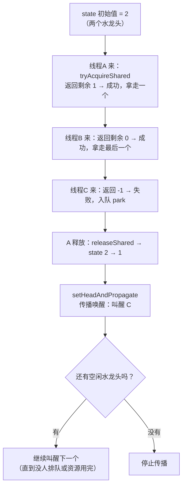

| 要点 | 说明 |
| --- | --- |
| 资源初始化 | `state = N`（N 个许可 / 水龙头） |
| 获取 | `tryAcquireShared` 返回**剩余资源数**：`< 0` 失败；`= 0` 成功但没剩余；`> 0` 成功且有剩余 |
| 释放 | `tryReleaseShared` 增加 `state`，返回 `true` 表示"**可以继续唤醒别人**" |
| **传播唤醒** | 释放时先唤醒一个，发现**还有空闲资源**就**继续唤醒下一个**（`PROPAGATE` 状态就干这个）——这是共享模式与独占模式最大的不同 |

```java
// Semaphore 的共享实现（state = 可用许可数）
final int nonfairTryAcquireShared(int acquires) {
    for (;;) {
        int available = getState();
        int remaining = available - acquires;          // 还剩几个
        if (remaining < 0 ||                            // 不够了 → 失败（负数）
            compareAndSetState(available, remaining))
            return remaining;                           // 返回剩余数
    }
}
```

---

## 五、AQS 是"同步器工厂"：奶茶店菜单

> 视频原话："AQS 其实是个**同步器工厂**——我给你看看奶茶店的菜单。"

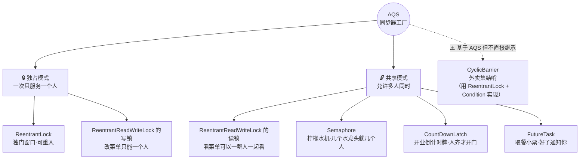

| 工具 | 奶茶店比喻 | 模式 | 关键特性 |
| --- | --- | --- | --- |
| **`ReentrantLock`** | 独门窗口，可重入 | 独占 | 可重入、支持公平/非公平、可中断、可超时 |
| **`ReentrantReadWriteLock`** | 看菜单一群人一起看 / 改菜单只能一个人 | **读共享 + 写独占** | `state` 高 16 位记读锁、低 16 位记写锁；支持锁降级 |
| **`Semaphore`** | 柠檬水机，几个水龙头允许多人同时接水 | 共享 | 许可数 = 并发上限；**许可证可被非持有者释放** |
| **`CountDownLatch`** | 开业倒计时牌，人齐了才开门 | 共享 | **一次性**（减到 0 就不能再用） |
| **`CyclicBarrier`** | 外卖集结哨，人齐出发 | ⚠️ 非 AQS 子类 | **可反复使用**（`reset`）；基于 `ReentrantLock` + `Condition` |
| **`FutureTask`** | 取餐小票，交了钱先去逛，好了通知你 | 共享 | 内部 `Sync extends AQS`；`get()` 阻塞等待结果 |

> [!warning] 两个常见误解（视频的口语化表述需要澄清）
> ① **`CyclicBarrier` 不是 AQS 的直接子类**——它内部用 `ReentrantLock` + `Condition` 实现"人齐"的等待/唤醒；说它"基于 AQS 体系"没错，但说"继承 AQS"就错了。
> ② **`StampedLock` 也完全不是 AQS 子类**——它自己实现了一套队列与状态（为了支持乐观读），面试时被追问要能分清。

---

## 六、怎么记：AQS 全家福

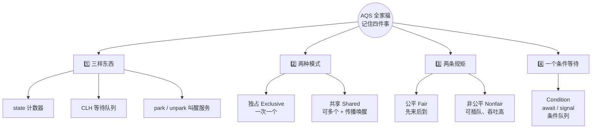

> [!tip] 背诵口诀
> **"一个计数器，一条等待队，一套叫醒服务；配上独占共享两种模式、公平非公平两条规矩，再加一个条件等待——AQS 全家福就齐了。"**
> 记住这些，`ReentrantLock`、`Semaphore`、`CountDownLatch` **全都不在话下**。

---

## 七、面试高频追问

| 追问 | 答题要点 |
| --- | --- |
| AQS 为什么要**双向**队列？ | `next` 是懒设置的，存在瞬时 null 窗口；`unparkSuccessor` 必要时**从 tail 反向扫 prev** 找可唤醒节点。（详见 [[6-JUC并发工具]] §2.2） |
| `state` 已经是 `volatile` 了，为什么还要 CAS？ | `volatile` 只保证**可见性**，不保证**原子性**；`state--` 是"读-改-写"三步，不加 CAS 会丢更新。 |
| B 被唤醒后为什么不重新排队？ | 它的**前驱就是 head**，`acquireQueued` 循环里直接 `tryAcquire`；成功即 `setHead(自己)`，旧 head 断开引用被 GC。 |
| 非公平锁为什么吞吐更高？ | 新线程可直接 CAS 抢，**省掉一次 park/unpark 上下文切换**；代价是排队线程可能饥饿（吞吐高 10%~30%）。 |
| 共享模式为什么需要 `PROPAGATE`？ | 释放后**要连续唤醒多个**等待者（还有空闲资源就继续叫），`PROPAGATE` 防止"传播中断"导致唤醒丢失。 |
| `park` / `unpark` 和 `wait` / `notify` 区别？ | `park` 不需要持锁、**精确唤醒指定线程**、**可先 unpark 后 park**（许可）；`wait` 必须在 `synchronized` 里，`notify` 随机唤醒。 |
| 哪些同步器不是 AQS 子类？ | `CyclicBarrier`（用 `ReentrantLock` + `Condition`）、`StampedLock`（自研队列）、`synchronized`（JVM 内置 monitor）。 |
| 自己写同步器要重写什么？ | 独占：`tryAcquire` / `tryRelease` / `isHeldExclusively`；共享：`tryAcquireShared` / `tryReleaseShared`。**其余排队逻辑 AQS 已经写好**。 |

### 自定义同步器模板（面试手写常考）

```java
// 一个不可重入的独占锁：只需要实现"什么叫获取/释放成功"
class MyLock extends AbstractQueuedSynchronizer {
    @Override
    protected boolean tryAcquire(int arg) {
        if (compareAndSetState(0, 1)) {           // state 0 → 1
            setExclusiveOwnerThread(Thread.currentThread());
            return true;
        }
        return false;                              // 失败：AQS 会自动入队 + park
    }
    @Override
    protected boolean tryRelease(int arg) {
        if (getState() == 0) throw new IllegalMonitorStateException();
        setExclusiveOwnerThread(null);
        setState(0);                               // 释放
        return true;                               // true → AQS 会去唤醒后继
    }
    @Override
    protected boolean isHeldExclusively() {
        return getState() == 1;
    }
    public void lock()   { acquire(1); }
    public void unlock() { release(1); }
}
```

---

## 附录 A：语音转写（ASR）勘误对照

原始字幕稿由 vCaptions 生成，最典型的错误是**"线程"被识别成"县城"**（全文 20+ 处）：

| 原始转写 | 应为 |
| --- | --- |
| **县城**（全文） | **线程** |
| 县城镇 / 县城池 | 线程池 |
| 用 K 原子性的摇走一颗 | 用 **CAS** 原子性地摇走一颗 |
| 用 car 把它改成一抢 | 用 **CAS** 改成 1，抢到 |
| 珍珠计数器 | **state 变量**（比喻名；也可能原音是"整数计数器"，按奶茶比喻保留） |
| Cancellt | **CANCELLED** |
| park 和 on park | park / **unpark** |
| 用 UNPARK 拍他肩膀 | 用 **unpark** 拍他肩膀 |
| lock support on park | **LockSupport.unpark** |
| on park successor 登场 | **unparkSuccessor** |
| 他会找到对手的节点 | 找到**后继**（队首后面那个）节点 |
| try quire / trial quire | **tryAcquire** |
| 再次自寻 | 再次**自旋** |
| 变成新 HD | 变成新 **head** |
| 原来的 hate 就被 GC 回收了 | 原来的 **head** 就被 GC 回收 |
| C 现在变成对手 | C 变成**后继** |
| 回到灵才彻底让出窗口 | 回到 **0** 才彻底让出 |
| has cute predecessors | **`hasQueuedPredecessors()`** |
| 非公平锁上来就扣一抢锁 | 上来就 **CAS** 抢锁 |
| 吞吐量高 10% 到 30 | 高 **10%~30%** |
| Try quire shared | **tryAcquireShared** |
| Ren tt lock / reentrance lock | **ReentrantLock** |
| Reentrance to read right lock | **ReentrantReadWriteLock** |
| SAMHOR 柠檬水机 | **Semaphore** |
| Count down latch 及其材料才开门 | **CountDownLatch**，"**人齐了才开门**" |
| psychic barrier 外卖集结哨 | **CyclicBarrier** |
| future task 取餐小票 | **FutureTask** |
| 县城池的后厨 | **线程池**的后厨 |
| State 初始值设为二 | state 初始值设为 **2** |
| 还有几分 | 还有几**份** |

## 附录 B：30 秒速查

| 问题 | 一句话答案 |
| --- | --- |
| AQS 是什么 | 用 `state` + CLH 队列 + `park/unpark` 搭好的**同步器骨架**，子类只定义 `state` 语义 |
| 三大要素 | ① `volatile int state`（CAS 修改）② CLH 变种**双向**队列 ③ `LockSupport.park/unpark` |
| 获取锁流程 | `tryAcquire` → 失败 `addWaiter` 入队 → `acquireQueued`：**前驱是 head 就再抢一次，否则设前驱 SIGNAL 后 park** |
| 释放锁流程 | `tryRelease` → `state` 减到 0 → `unparkSuccessor` → `LockSupport.unpark(后继)` |
| 为什么"先自旋后挂起" | 赌锁马上释放省一次上下文切换；没戏就 park，**不空转烧 CPU** |
| 可重入怎么实现 | 持有者是自己 → `state + 1`（不需要 CAS）；释放时**分次减，回到 0** 才算真释放 |
| 公平 vs 非公平 | 公平先 `hasQueuedPredecessors()` 检查、严格 FIFO；非公平直接 CAS 抢，**吞吐高 10%~30%** 但可能饥饿；**默认非公平** |
| 共享模式 | `state` = 资源数，`tryAcquireShared` 返回剩余数；释放时**传播唤醒**（PROPAGATE），连续叫醒多个 |
| AQS 家族 | 独占：`ReentrantLock`、写锁；共享：读锁、`Semaphore`、`CountDownLatch`、`FutureTask`；**`CyclicBarrier`/`StampedLock` 不是 AQS 子类** |
| 记忆口诀 | **一个计数器、一条等待队、一套叫醒服务 + 两种模式 + 两条规矩 + 条件等待** |
