# 🧵 Java 虚拟线程（详细整理版）

> 本篇是对 [B 站视频《虚拟线程-java》](https://www.bilibili.com/video/BV14XVo63EnP/)（约 5.5 分钟）的**逐段深度整理**。视频从"**就改了个查询接口，并发一上来线程数飙到 5000，内存吃满、GC 都救不回来**"的事故切入，把 Project Loom 虚拟线程的**原理、机制、写法、暗礁、适用场景**讲了一遍。
> 定位：**虚拟线程专题详解**——原理链路 + 可直接用的代码 + **版本演进的事实校正**。
> 原始字幕稿：[[虚拟线程-java]]（ASR 把"线程"识别成"**县城**"、"栈"识别成"**战争/站**"，见 [附录 A](#附录-a语音转写asr勘误对照)）。
>
> **相关笔记**：[[5-线程池]]（平台线程池 vs 虚拟线程、为什么不要池化）、[[4-多线程与内存模型]]（线程模型与 JMM）、[[6-JUC并发工具]]（`ReentrantLock`/`StampedLock` —— pinning 的替代方案）、[[1-JVM内存区域与对象布局]]（栈与堆：为什么栈数据能搬回堆）、[[9-Java版本特性]]（JDK 21/24/25 的演进）、[[0-知识点/10-面试高频题|Java 面试高频题]]。

> [!important] 先给三个版本事实（视频基于 JDK 21，需要更新）
> | 版本 | 事件 | 影响 |
> | --- | --- | --- |
> | **JDK 21 (LTS)** | **JEP 444：虚拟线程正式** | 虚拟线程 GA；但 `synchronized` 会 pin 载体线程 |
> | ⭐ **JDK 24** | **JEP 491：Synchronize Virtual Threads without Pinning** | **`synchronized` 和 `Object.wait()` 不再 pin** —— "把 synchronized 换成 ReentrantLock"从**必修**降级为**可选优化** |
> | ⭐ **JDK 25 (LTS)** | **JEP 506：Scoped Values 正式**、**JEP 505：Structured Concurrency 正式** | `ThreadLocal` 的替代方案与结构化并发都转正 |
>
> 也就是说：**如果项目已经在 JDK 24+，视频里"必修课"那条要重新评估**（详见 [§7.3](#73-⭐-转折点jdk-24-起-synchronized-不再-pin)）。视频讲的其他内容依然全部成立。

---

## 〇、问题起点：一请求一线程模型撞墙

> 视频开场："线上又炸了！**我就改了个查询接口，并发一上去线程数直接飙到 5000**，内存吃满，GC 都救不回来。—— 你这是典型的**一请求一线程模型撞墙**了。"

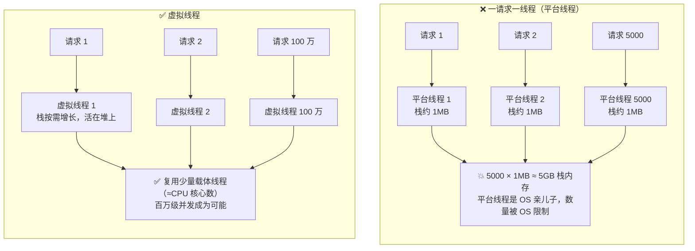

| 维度 | 平台线程（Platform Thread） | 虚拟线程（Virtual Thread） |
| --- | --- | --- |
| 实现者 | **操作系统** | **JVM**（JDK 提供） |
| 与 OS 线程关系 | **1:1** 绑定 | **M:N** 复用（不直接绑定） |
| 栈内存 | 固定预留约 **1MB**（`-Xss`，平台相关） | 初始几百字节，**按需增长、存在堆里** |
| 数量级 | 数千（受 OS 与内存限制） | **百万级** |
| 调度者 | **OS 内核** | ⭐ **JVM 自己的调度器** |
| 阻塞代价 | ⭐ **OS 线程跟着睡**，CPU 干瞪眼 | **卸载**虚拟线程，载体线程去干别的活 |
| 创建成本 | 高（要分配栈、内核登记） | 极低（一个对象） |

> 视频比喻："**每个请求都开一个线程，就像每个客人来了都给他盖一栋别墅。**"
> 更准确的一句话：**平台线程是"重资源"，虚拟线程是"轻对象"。**

**「撞墙」的根因**：不是机器不够强，而是**线程在等 IO 的时候占着资源不干活**——硬件资源全耗在"等"上了。

---

## 一、虚拟线程是什么：把调度权从 OS 手里抢回来

> 视频原话："Java 21 带来了 Project Loom 的正式版虚拟线程——**它不是魔法，是把线程的调度权从 OS 手里抢回 JVM**。从此线程可以**轻如鸿毛、多如繁星**。"

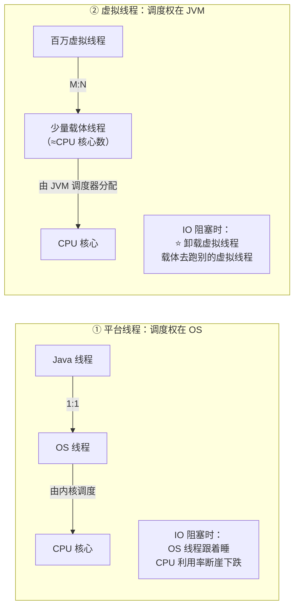

> [!important] 一句话抓住本质
> **虚拟线程 = 把"线程"这个概念从操作系统搬到 JVM 里实现。**
> 于是 JVM 就获得了"**在阻塞时把线程从 CPU 上撤下来、把 CPU 让给别人**"的能力——而这在平台线程模型里是做不到的（OS 线程一阻塞就真的睡在那了）。

---

## 二、三件套：Runnable + Continuation + Scheduler

> 视频对话："这公式看起来像个**三合一**大招？—— 可以这么理解：**RUNNABLE 是你的任务本体，Continuation 是 JVM 的存档点**（负责在阻塞时把现场打包存进堆内存），**Scheduler 是调度器**（决定哪个虚拟线程去抢占有限的载体）。**三者合体才是完整的虚拟线程**。"

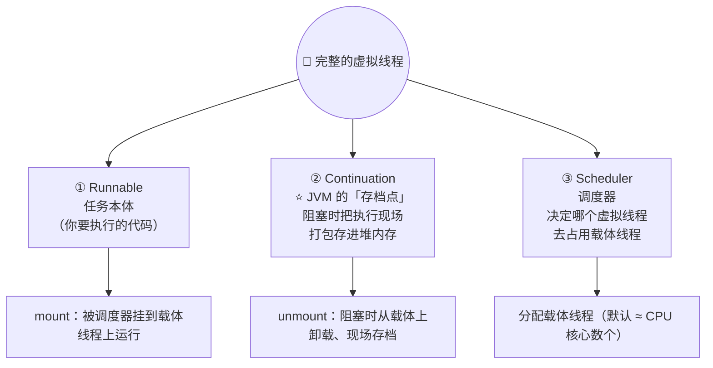

| 组成 | 角色 | 类比 |
| --- | --- | --- |
| **Runnable / Callable** | 任务本体 | 你要办的事 |
| **Continuation** | ⭐ **可暂停/可恢复的执行上下文** | **游戏存档点** |
| **Scheduler** | 分配载体线程 | 交警 / 派工调度室 |

> [!note] 补充：虚拟线程就是 `java.lang.Thread` 的实例
> 虚拟线程**不是新类型**——它就是 `Thread` 的对象，只是**不是由 OS 实现**。所以 `Thread` 的 API（`join`、`interrupt`、`getName`、`Thread.currentThread()`）全部可用，**业务代码几乎不用改**。
> 差异点：虚拟线程**永远是守护线程**、**没有线程优先级**、**不属于任何 ThreadGroup**、**不能通过 `ThreadGroup` 管理**。

---

## 三、M:N 调度与载体线程

> 视频对话："这么多虚拟线程怎么挤进这么少的载体线程？—— 这就是 **M:N 调度：M 个虚拟线程映射到 N 个载体线程**。JVM 自己当交警，不用 OS 插手。
> 虚拟线程不直接绑定 OS 线程，而是由 JVM 灵活分配。**数量上虚拟线程可以是百万级；载体线程只跟 CPU 核心数挂钩**。"

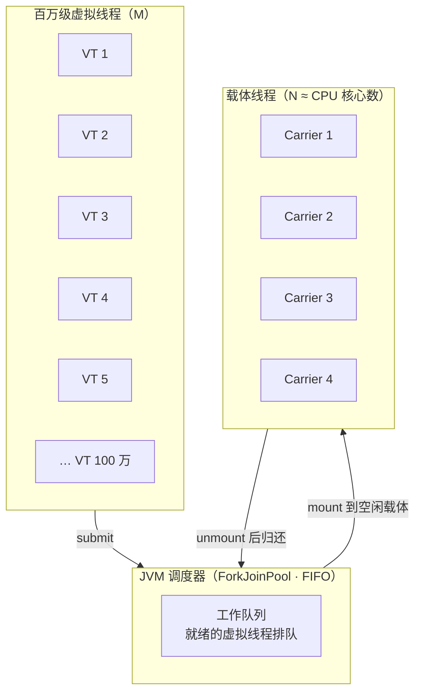

### 3.1 调度器：也是 ForkJoinPool，但"同根不同魂"

> 视频对话："调度器用的也是 **ForkJoinPool**，跟并行流那个一样——**同根不同魂**：虚拟线程调度器是**独立的** ForkJoinPool，默认并行度 = **CPU 核心数**，但它是 **FIFO 模式**（保证公平性）；而并行流用的是 **common pool，LIFO 模式**（偏向深度优先）。"

| 维度 | 虚拟线程调度器 | 并行流的 common pool |
| --- | --- | --- |
| 实现 | ⭐ **独立的** ForkJoinPool 实例 | **共享**的 common pool |
| 默认并行度 | **CPU 核心数** | CPU 核心数 − 1 |
| 队列模式 | ⭐ **FIFO**（公平，先来先跑） | **LIFO**（深度优先，利于分治递归） |
| 用途 | 调度虚拟线程 | `parallelStream()`、`CompletableFuture` 默认池 |
| 能否共用 | ❌ **绝对不能**（会互相拖死） | — |

> [!warning] 经典事故：虚拟线程"借"了 common pool
> 如果用 `CompletableFuture.supplyAsync()`（默认走 common pool）**或**在 `parallelStream()` 里创建虚拟线程，就会出现"**大量任务挤在固定大小的池里互相等待**"——严重时**死锁**。
> **正确做法**：虚拟线程用 `Executors.newVirtualThreadPerTaskExecutor()`；需要阻塞的 `CompletableFuture` 显式传自己的执行器。

**JVM 参数（视频提到"可调整并行度和最大池大小"，一般默认就够）**：

```bash
-Djdk.virtualThreadScheduler.parallelism=8      # 调度器并行度，默认 = CPU 核心数
-Djdk.virtualThreadScheduler.maxPoolSize=256    # ⭐ 载体线程池上限，默认 256
-Djdk.virtualThreadScheduler.minRunnable=1      # 保底可运行载体数
```

> [!tip] 关于 `maxPoolSize=256`（来自 JEP 491 的说明）
> 载体线程池上限**默认 256**——这意味着：**如果大量虚拟线程被 pin 住（占着载体不放），池子会被耗尽**，此时再多的虚拟线程也跑不动（starvation 甚至 deadlock）。
> 这正是 [§七 pinning](#七pinning虚拟线程最大的暗礁) 为什么必须重视的原因。

---

## 四、核心机制：mount / unmount（阻塞但不阻塞 OS 线程）

> 视频对话（这段是全片最精髓的部分）：
> "它阻塞了载体线程，怎么没被卡住？—— **关键来了：遇到 IO 阻塞时，JVM 执行 unmount，把虚拟线程的栈数据从载体线程的栈里搬回堆内存，载体线程立刻解放去接别的活。IO 完成后，再 mount 回来，可能换了个载体，但代码感知不到**——这就是'**阻塞，但不阻塞 OS 线程**'的黑科技。"

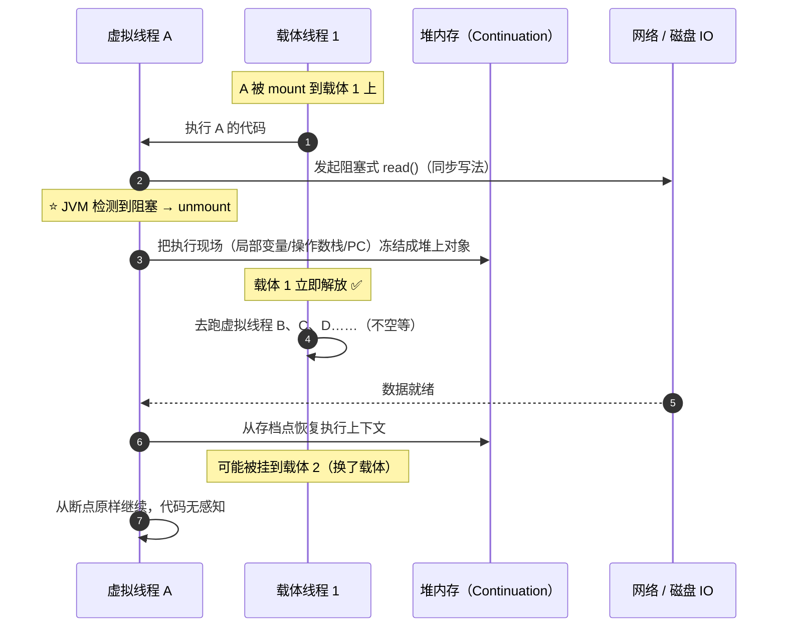

| 动作 | 发生时机 | 做了什么 |
| --- | --- | --- |
| **mount** | 虚拟线程被调度执行 | 虚拟线程**挂到载体线程**上运行，载体成为它的 carrier |
| **unmount** | 遇到阻塞操作（IO / sleep / park…） | ⭐ **把栈数据从载体线程栈搬回堆内存**，**释放载体线程** |
| **re-mount** | 阻塞完成 | 从堆上恢复执行上下文，**可能换到另一个载体** |

> [!important] "代码感知不到"是虚拟线的全部价值所在
> 你写的是**同步阻塞**代码（`inputStream.read()`、`jdbc.query()`），但底层**没有真的阻塞 OS 线程**。
> 这就是视频说的："**同步写代码，异步级性能**"——**不用再在回调地狱（`CompletableFuture` 嵌套、响应式 `Mono/Flux`）里打滚**。

**哪些操作会触发 unmount**：

| 类别 | 例子 |
| --- | --- |
| 网络 IO | `Socket`/`HttpClient`/`NIO` 的读写 |
| 文件 IO | `FileInputStream.read`（部分场景） |
| 定时等待 | `Thread.sleep()`、`TimeUnit.*.sleep()` |
| 并发原语 | `LockSupport.park()`、`juc` 的 `BlockingQueue`、`Semaphore`、`ReentrantLock` 等待 |
| 显式让出 | `Thread.yield()` |
| ⭐ 监视器（**JDK 24+**） | `synchronized`、`Object.wait()`（此前会 **pin**，见 [§七](#七pinning虚拟线程最大的暗礁)） |

---

## 五、Continuation：比游戏存档更精妙的"存档点"

> 视频对话："这 Continuation 怎么像游戏存档？—— **比游戏存档更精妙**：它保存的不是画面，是**完整的执行上下文**——**局部变量、操作数栈、程序计数器**。虚拟线程阻塞时，把这一整套**冻结成堆上的对象**；恢复时从断点**原样继续**。对业务代码来说，就像什么都没发生。"

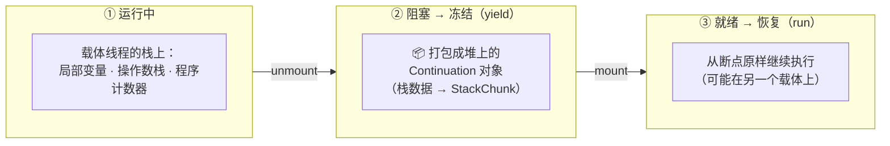

| 存了什么 | 说明 |
| --- | --- |
| **局部变量** | 方法栈帧里的所有局部变量 |
| **操作数栈** | 当前字节码运算的中间结果 |
| **程序计数器（PC）** | ⭐ **断点位置**——恢复到"执行到哪一行" |
| **栈帧链** | 整个调用链的帧结构 |

> [!note] 两个容易搞错的点
> ① **`Continuation` 是 JDK 内部 API**（`jdk.internal.vm.Continuation`）——**不要直接使用**（模块封装，且不是稳定 API）。它的能力通过虚拟线程对外提供。
> ② **虚拟线程的栈存在堆里**，随用随增长（以 `StackChunk` 形式），**不像平台线程那样固定预留 1MB**——这才是"一个线程只占几百字节"的原因，也是"**内存反而更低**"的根本原因。

---

## 六、代码怎么写：三种写法 + 一条铁律

> 视频对话："代码怎么写？还是熟悉的 Thread API 吗？—— **完全兼容**，三种写法。"

```java
// ============ 写法一：最简洁 ============
Thread.startVirtualThread(() -> {
    System.out.println("跑在一个虚拟线程里：" + Thread.currentThread());
});

// ============ 写法二：自定义名字（便于排查） ============
Thread.ofVirtual()
      .name("order-query-", 0)      // 名字 + 起始编号，日志里好认
      .start(() -> handleOrder());

// ============ 写法三：⭐ 最推荐 —— 每任务一个虚拟线程 ============
try (var executor = Executors.newVirtualThreadPerTaskExecutor()) {
    IntStream.range(0, 10_000).forEach(i ->
        executor.submit(() -> {
            Thread.sleep(Duration.ofSeconds(1));   // 同步阻塞写法
            return i;
        }));
}   // try-with-resources：自动 close，并等待所有任务结束
```

| 写法 | 特点 | 适用 |
| --- | --- | --- |
| `Thread.startVirtualThread(r)` | 一行搞定 | 一次性任务、demo |
| `Thread.ofVirtual().name(...).start(r)` | 可命名、可配置 | 需要排查定位的场景 |
| ⭐ `Executors.newVirtualThreadPerTaskExecutor()` | 每任务一线程 + **自动关闭** | ⭐**推荐**：结构性最好，配 `try-with-resources` 不会泄漏 |

### 6.1 铁律：不要池化虚拟线程

> 视频原话："注意虚拟线程**极其廉价，不要池化**！每个任务开一个，**用完 JVM 自己回收**。"

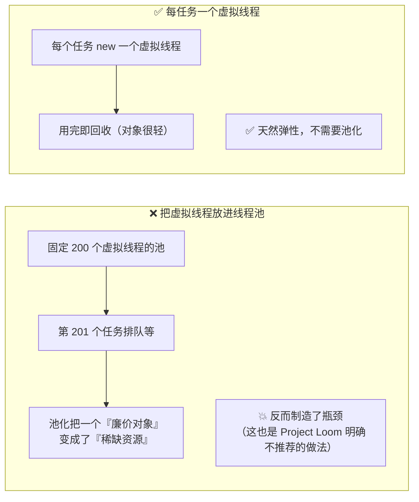

> [!important] 为什么"池化"是反模式？
> 线程池存在的意义是**分摊平台线程的高昂创建成本**（栈分配 + 内核登记）。虚拟线程**创建成本极低**，池化只剩坏处：
> ① 池大小成了新的瓶颈（明明能开百万个，却被限死在 200）；
> ② 破坏了虚拟线程"用完即焚"的语义（`ThreadLocal` 等状态会残留到下一个任务）。

### 6.2 框架里怎么开启（视频没提，但工程上最常用）

```properties
# Spring Boot 3.2+：一行开启，Tomcat 用虚拟线程处理请求
spring.threads.virtual.enabled=true
```

| 框架 | 支持情况 |
| --- | --- |
| **Spring Boot 3.2+** | `spring.threads.virtual.enabled=true`（Web 容器 + `@Async` + 调度） |
| **Tomcat 10.1+ / Jetty 12+** | 原生支持虚拟线程执行器 |
| **JDBC 驱动** | 需驱动自身不 pin（多数现代驱动已适配；老驱动注意 `synchronized`） |
| **gRPC / HttpClient** | JDK `HttpClient` 已支持；注意连接池大小要放开 |

---

## 七、pinning：虚拟线程最大的暗礁

### 7.1 为什么会 pinning：监视器锁"记错了主人"

> 视频对话："我代码里还有 `synchronized`，能直接跑在虚拟线程上吗？—— **能跑，但会导致 pinning，钉住载体线程**：`synchronized` 块内的阻塞操作**不会让虚拟线程卸载**，因为 **JVM 不敢在持有监视器锁时搬动**。"

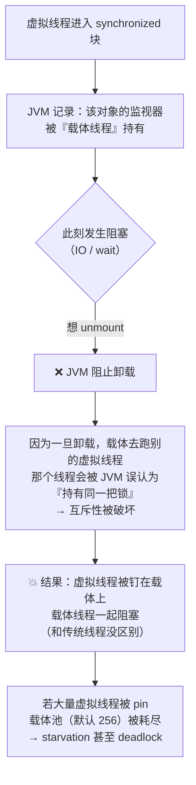

### 7.2 会 pin 住的"暗礁"清单

> 视频对话："另外 **JNI 调用本地方法**，甚至 **`Object.wait()`**，这些 **JVM 插不进去手**的操作，都会导致 pinning，要避开这些暗礁。"

| 操作 | JDK 21~23 | JDK 24+（JEP 491） |
| --- | --- | --- |
| `synchronized` 方法/代码块 | ❌ **pin** | ✅ **不再 pin** |
| `Object.wait()` | ❌ **pin** | ✅ **不再 pin** |
| 阻塞时获取监视器（锁竞争） | ❌ **pin** | ✅ **不再 pin** |
| **JNI / FFM 本地调用**（native 帧内阻塞或回调 Java 阻塞） | ❌ pin | ⚠️ **仍然 pin** |
| 类加载（解析符号引用时阻塞） | ❌ pin | ⚠️ 仍可能 pin |
| 类初始化（`<clinit>` 中阻塞 / 等待别的线程初始化类） | ❌ pin | ⚠️ 仍可能 pin |

### 7.3 ⭐ 转折点：JDK 24 起 `synchronized` 不再 pin

> **JEP 491（JDK 24 已交付）**：改造了 JVM 对 `synchronized` 的实现，让**虚拟线程可以独立于载体持有监视器**——在 `synchronized` 方法/代码块内阻塞、以及 `Object.wait()` 等待时，**都能正常卸载**。

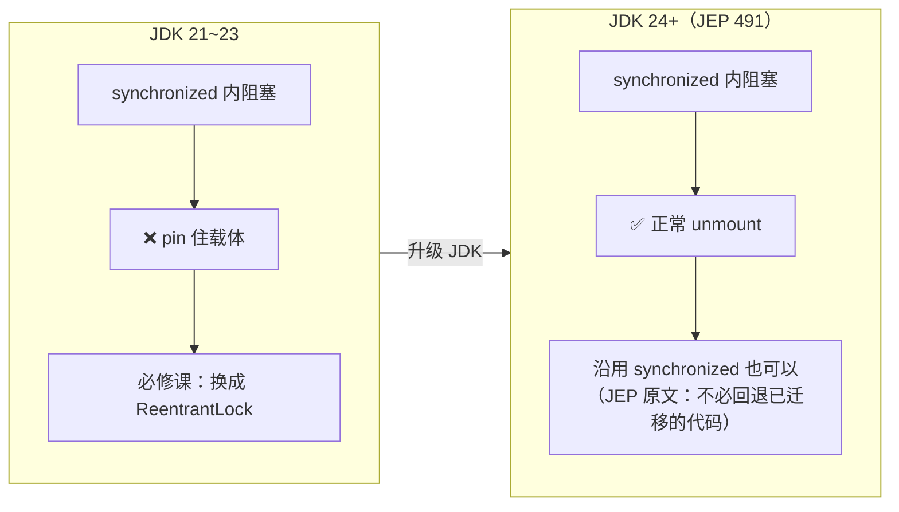

> [!important] 这意味着实践建议要分版本
> - **JDK 21~23**：视频说的**没错**——`synchronized` 会 pin，"把 `synchronized` 换成 `ReentrantLock`"是**必修课**（或至少是热点路径的必修课）。
> - **JDK 24+**：pinning 已被消除，**`synchronized` 与 `ReentrantLock` 可以纯粹按"哪个更合适"来选**（JEP 491 的原话大意）。**已经迁移到 `ReentrantLock` 的代码不需要回退**。
> - **仍要避开**：JNI/FFM 本地调用、类加载与类初始化期间的阻塞（这三类 pin 依旧存在）。

**排查 pinning 的工具变化**：

| 工具 | 说明 |
| --- | --- |
| ❌ `-Djdk.tracePinnedThreads=full` | **JDK 24 起已移除**（设置无效）；旧版本可用 |
| ⭐ **JFR 事件 `jdk.VirtualThreadPinned`** | JDK 24 起增强：**会携带 pin 原因 + 载体线程标识**，是现在的标准手段 |
| **`jcmd` 线程转储** | 能看到虚拟线程与载体的挂载关系（见 [§九](#九可观测性jcmd--jfr)） |

### 7.4 `ThreadLocal` 的内存陷阱 → `ScopedValue`（JDK 25 正式）

> 视频对话："`ThreadLocal` 还能用吗？我们代码里到处都是。—— **技术上能用，但百万虚拟线程每个都带 `ThreadLocal`，内存直接爆炸**。虚拟线程是**用完即焚**的，而 **`ThreadLocal` 的设计假设是线程长期存活**。建议迁移到 **`ScopedValue`**（结构化并发配套）。"

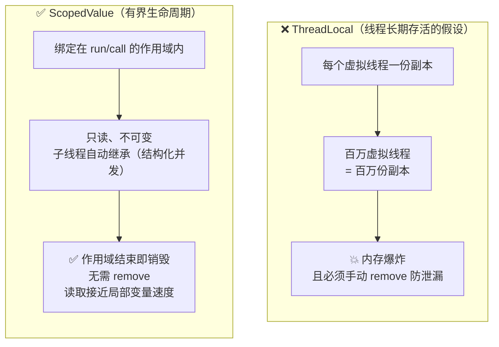

**`ThreadLocal` 的三个设计缺陷**（JEP 506 原文总结）：

| 缺陷 | 说明 |
| --- | --- |
| **无约束可变性** | 任何能 `get` 的代码都能 `set`，数据流向难以追踪 |
| **无界生命周期** | 忘了 `remove` 就泄漏；线程池场景会**串味**到下一个任务 |
| **继承昂贵** | `InheritableThreadLocal` 会为子线程**复制**所有父线程的变量（虚拟线程下成本被放大百万倍） |

**`ScopedValue` 用法**（JDK 25 正式）：

```java
private static final ScopedValue<UserContext> CTX = ScopedValue.newInstance();

// 绑定 + 执行（作用域结束自动解绑）
ScopedValue.where(CTX, ctx).run(() -> handle(request));

// 调用链任意深处读取（只读，无法被篡改）
UserContext c = CTX.get();
```

> [!tip] 迁移建议（JEP 506 的口径）
> **当 `ThreadLocal` 的用途是"从调用方向被调方单向传递不变数据"时，就应该迁移到 `ScopedValue`**。
> 但如果是"**双向/无结构**"用法（深层代码通过 `ThreadLocal.set` 回传给远处的调用者），则**不适合迁移**——那种设计本身就该重构。

---

## 八、性能：什么时候用、收益多少

> 视频对话："实测数据：**IO 密集型场景下，虚拟线程的吞吐量通常是平台线程的 5~10 倍，内存反而更低**——因为**载体线程始终满负荷运转，没有空等 IO 的浪费**。
> 但记住：**CPU 密集型计算，别用虚拟线程**——它没有魔法，**算不过就是算不过**。"

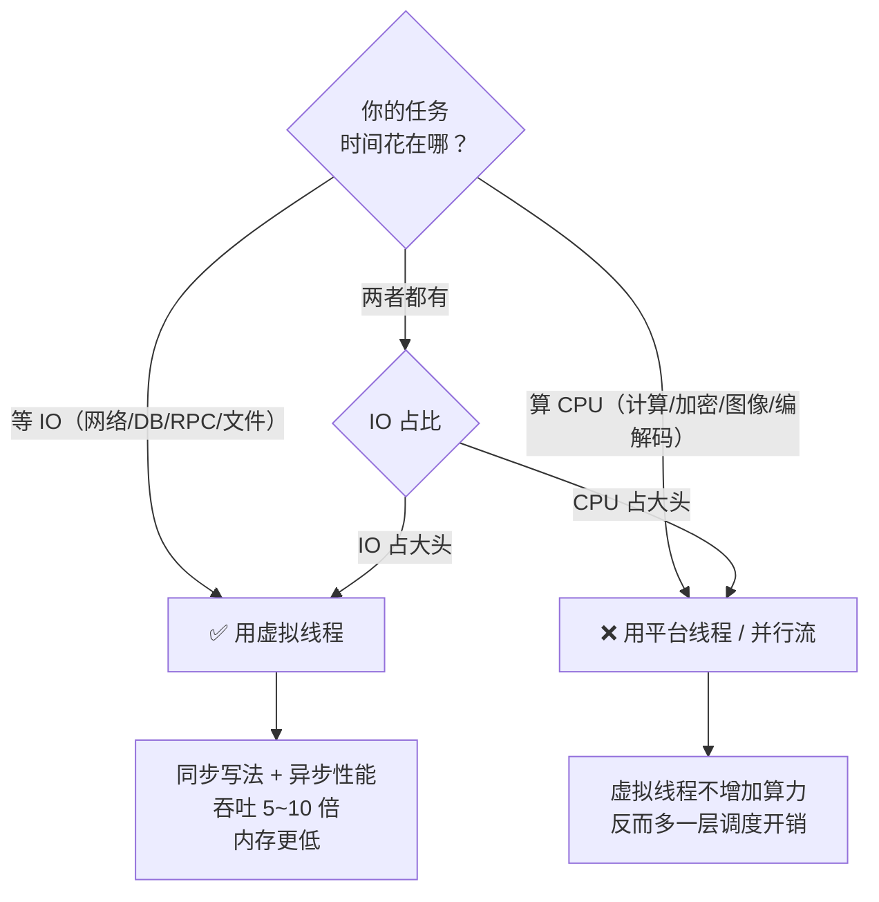

| 场景 | 推荐 | 原因 |
| --- | --- | --- |
| Web 服务器 / 微服务 / **网关** | ⭐ **虚拟线程** | 大量请求在等下游 |
| **RPC 调用 / 数据库访问** | ⭐ **虚拟线程** | 典型的 IO 等待 |
| 消息队列消费者 | ⭐ **虚拟线程** | 拉取 + 处理外部系统 |
| 文件/对象存储读写 | ⭐ 虚拟线程 | IO 密集 |
| **纯计算 / 图像渲染** | ❌ 平台线程 | 没有等待，虚拟线程无收益 |
| **大量 JNI 调用** | ❌ 平台线程 | native 帧会 pin，优势尽失 |
| 并行流 / `CompletableFuture` 默认池 | ⚠️ 谨慎 | 别和虚拟线程混用同一个池 |

> [!important] 为什么"内存反而更低"？
> 平台线程即使**在等待**，也占着 1MB 栈 + 内核资源（"空等 IO 的浪费"）；
> 虚拟线程在等待时**栈被搬到堆上、载体被释放**——**同一时刻真正占着 CPU 的线程只有载体线程那么多**。所以：**并发量越大、IO 等待越多，虚拟线程的内存优势越明显**。

---

## 九、可观测性：jcmd + JFR

> 视频对话："跳来跳去的排查问题不会更麻烦吗？—— **JDK 21 做了大量可观测性增强**：用 **`jcmd` 导出 JSON 格式的线程转储**，你能清晰看到**每个虚拟线程当前挂在哪个载体上、调用栈全貌，甚至 mount/unmount 的历史**；**JFR 也新增了虚拟线程专属事件**，性能分析完全透明。"

```bash
# ⭐ 导出 JSON 格式线程转储（能看到虚拟线程与载体的对应关系）
jcmd <pid> Thread.dump_to_file -format=json /tmp/threads.json

# 传统文本转储（会列出虚拟线程，但关系不如 JSON 直观）
jcmd <pid> Thread.print

# 开启 JFR 采集（包含 jdk.VirtualThreadPinned / mount / unmount 事件）
jcmd <pid> JFR.start name=vthread duration=60s filename=/tmp/vthread.jfr
```

| 工具 | 能看什么 |
| --- | --- |
| `jcmd Thread.dump_to_file -format=json` | ⭐ **虚拟线程 → 载体线程的挂载关系**、调用栈全貌 |
| `jcmd Thread.print` | 文本转储（快速看有没有卡住） |
| **JFR `jdk.VirtualThreadPinned`** | ⭐ **pinning 事件**（含原因与载体标识） |
| **JFR 虚拟线程事件** | **mount / unmount 历史**、调度延迟 |
| **JFR `jdk.VirtualThreadStart/End`** | 虚拟线程的创建与结束统计 |

> [!warning] 注意：虚拟线程默认**不出现在传统线程转储的"线程列表"里**
> 因为数量可能上百万。要看它们必须用**专门的虚拟线程转储**（JSON 格式）或 JFR——这也是为什么 JDK 要专门增强可观测性。

---

## 十、四句口诀与迁移路径

> 视频给的记忆口诀（原文）：
> **"IO 密集用虚拟，CPU 密集用平台；synchronized 换锁，`ThreadLocal` 要慎重；Web 网关 RPC 调用、数据库访问是虚拟线程的主场；纯计算图像渲染大量 JNI，老老实实平台线程。"**

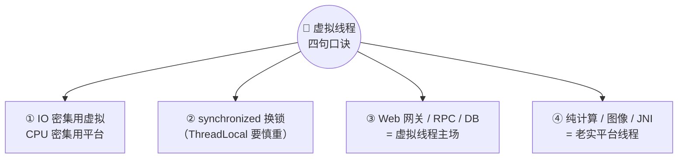

| 口诀 | 含义 | 版本校正 |
| --- | --- | --- |
| ① IO 密集用虚拟，CPU 密集用平台 | 虚拟线程解决的是"**等待**"问题，不是"算力"问题 | ✅ 长期有效 |
| ② `synchronized` 换锁，`ThreadLocal` 要慎重 | 避免 pinning + 避免内存爆炸 | ⚠️ **JDK 24+ 起 `synchronized` 已不 pin**；`ThreadLocal → ScopedValue` 仍建议 |
| ③ Web 网关 / RPC / DB 是主场 | 典型 IO 密集 | ✅ 长期有效 |
| ④ 纯计算 / 图像 / JNI 用平台线程 | 无等待收益 / native 帧仍 pin | ✅ 长期有效 |

### 10.1 渐进式迁移路径（视频建议）

> 视频原话："**渐进式替换，从网关层开始切入，风险最低。**"

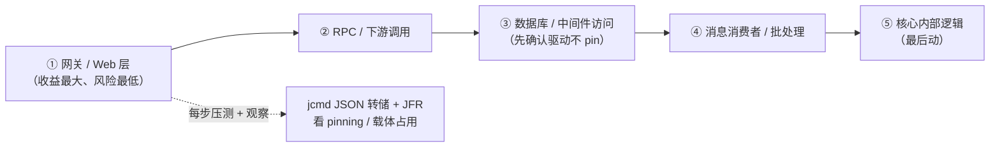

### 10.2 上线前检查清单

| # | 检查项 | 通过标准 |
| --- | --- | --- |
| 1 | **JDK 版本** | ≥ 21（推荐 **24+**，synchronized 不再 pin） |
| 2 | **适用性** | 任务是 **IO 密集**（等待占比高） |
| 3 | **写法** | 用 `newVirtualThreadPerTaskExecutor()` + `try-with-resources` |
| 4 | ⭐ **没有池化** | 不存在"固定大小的虚拟线程池" |
| 5 | **pinning 排查** | 用 **JFR `jdk.VirtualThreadPinned`** 扫一遍热点路径 |
| 6 | **锁** | JDK 21~23：热点路径把 `synchronized` 换 `ReentrantLock`；JDK 24+：按需 |
| 7 | **`ThreadLocal`** | 大对象/大量使用的场景迁移到 **`ScopedValue`** |
| 8 | **连接池** | 下游连接池（DB/HTTP）上限要放开，否则**新的瓶颈在连接池** |
| 9 | **执行器隔离** | 不与 common pool / `parallelStream` 混用 |
| 10 | **可观测** | 已接入 `jcmd` JSON 转储与 JFR 虚拟线程事件 |

> [!warning] 第 8 条最容易被忽略
> 虚拟线程把"线程数"瓶颈解除了，**瓶颈会立刻转移到下游连接池**：数据库连接池、HTTP 连接池、限流器、下游服务的承载能力。
> **虚拟线程不会让下游变快**——它只是让你"能发出更多并发请求"。上线前务必确认下游扛得住。

---

## 附录 A：语音转写（ASR）勘误对照

原始字幕稿由 vCaptions 生成，本份的典型错误是 **"线程" → "县城"**、**"栈" → "战争/站"**：

| 原始转写 | 应为 |
| --- | --- |
| **县城 / 现城**（全文多处） | **线程** |
| 一请求一**线城**模型撞墙 | 一请求一**线程**模型撞墙 |
| 一个就要吃**一兆占空间** | 一个要吃约 **1MB（栈空间）** |
| OS 内核还一比一盯着 **IOE 阻塞** | OS 内核 **1:1** 盯着，**IO 阻塞时** |
| CPU **利用绿**断崖下跌 | CPU **利用率**断崖下跌 |
| **Virtual pres** | **Virtual Threads** |
| 把**现成**的调度权从 OS 抢回 JVM | 把**线程**的调度权抢回 JVM |
| **载体现城 / 载体现程** | **载体线程**（carrier thread） |
| **M 比 N 调度** | **M:N 调度** |
| JVM 执行 **amount** | JVM 执行 **unmount** |
| 把虚拟线程的**战争数据** | 把虚拟线程的**栈数据** |
| 从载体线程的**站**里搬回堆内存 | 从载体线程的**栈**里搬回堆内存 |
| 在 **mount** 回来 | **再 mount 回来** |
| 阻塞但不阻塞 OS **现成**的黑科技 | 阻塞但不阻塞 OS **线程** |
| 调用 **UJVM** 把这一整套冻结 | 调用（**Continuation 的 yield**）把这一整套冻结 |
| **数栈程序**计数器 | **操作数栈、程序**计数器 |
| 调用 **run** 从断点原样继续 | 调用 **run** 从断点原样继续 ✅ |
| **fork john pool** | **ForkJoinPool** |
| 它是 **file 模式** | 它是 **FIFO** 模式 |
| common pool **lil 模式** | common pool **LIFO** 模式 |
| 最大**尺**大小 | 最大**池**大小（`maxPoolSize`） |
| 还是熟悉的 **FRED API** 吗 | 还是熟悉的 **Thread API** 吗 |
| **1threat 点 start virtual threat** | **`Thread.startVirtualThread()`** |
| **2thread 点 a virtual 点 name 点 start** | **`Thread.ofVirtual().name(...).start()`** |
| **executors 点 NO virtual fried protested executor** | **`Executors.newVirtualThreadPerTaskExecutor()`** |
| 虚拟线程**适用后即焚** | 虚拟线程**用完即焚** |
| 会**定住 pinning** | 会**导致 pinning** |
| 持有**监视器所**时 | 持有**监视器锁**时 |
| **reentrance log 或 stm pluck** | **ReentrantLock 或 StampedLock** |
| **fred local** | **ThreadLocal** |
| **scope value** 结构化并发配套 | **ScopedValue**（结构化并发配套） |
| 甚至 **object 点 weight** | 甚至 **`Object.wait()`** |
| 都会导致 **ping** | 都会导致 **pinning** |
| **Jf2，java flat recorder** | **JFR（Java Flight Recorder）** |
| 调用**占**全貌 | 调用**栈**全貌 |

## 附录 B：虚拟线程速查 + 面试速答

| 问题 | 一句话答案 |
| --- | --- |
| 虚拟线程是什么 | **JVM 实现的轻量线程**（JDK 21 正式），把调度权从 OS 拿到 JVM |
| 为什么需要它 | 一请求一线程下，**平台线程约 1MB 栈 + OS 1:1 调度**，等 IO 时白占资源 |
| 三件套 | **Runnable**（任务）+ **Continuation**（存档点）+ **Scheduler**（调度器） |
| M:N 调度 | M 个虚拟线程复用 **N 个载体线程**（N ≈ CPU 核心数） |
| 载体线程哪来的 | JVM 内置**独立 ForkJoinPool** 调度器，**FIFO**，`maxPoolSize` 默认 **256** |
| 为什么阻塞不卡 | ⭐ **unmount**：阻塞时**把栈搬到堆上**、**释放载体**；就绪后 re-mount（可能换载体） |
| Continuation 存什么 | **局部变量、操作数栈、程序计数器**（完整执行上下文） |
| 怎么写 | `Thread.startVirtualThread` / `Thread.ofVirtual()` / ⭐ **`newVirtualThreadPerTaskExecutor()`** |
| 要池化吗 | ❌ ⭐ **绝对不要**：极廉价，一任务一线程，用完即回收 |
| pinning 是什么 | 虚拟线程**无法卸载**、被钉在载体上，载体池（256）会被耗尽 |
| 谁会 pin | JDK 21~23：`synchronized`、`Object.wait()`；**JDK 24+ 已解决（JEP 491）**；**JNI/FFM 与类加载仍会 pin** |
| `ThreadLocal` 能用吗 | 能用但**百万虚拟线程下内存爆炸**，建议迁移到 **`ScopedValue`**（JDK 25 正式） |
| 收益多少 | IO 密集场景吞吐 **5~10 倍**，内存更低（载体满负荷、无空等） |
| 什么时候别用 | **CPU 密集**、**大量 JNI**、图像渲染 |
| 怎么排查 | `jcmd Thread.dump_to_file -format=json` + **JFR `jdk.VirtualThreadPinned`** |
| 迁移怎么走 | ⭐ **从网关层开始**，渐进替换，每步压测 |

### 面试 30 秒模板

> **"虚拟线程是 JDK 21 正式的特性，本质是把线程的调度权从操作系统收回到 JVM。**
> 它由三部分构成：任务的 Runnable、负责保存执行现场的 Continuation、以及基于独立 ForkJoinPool 的调度器。
> 核心机制是 **M:N 调度**——大量虚拟线程复用少量载体线程；**遇到 IO 阻塞时 JVM 会 unmount，把栈数据搬到堆上并释放载体线程**，所以能'阻塞但不阻塞 OS 线程'，写同步代码就能拿到异步性能。
> 两个坑：**一是不要池化**；**二是 pinning**——JDK 21~23 下 `synchronized` 会钉住载体（改用 `ReentrantLock`），**JDK 24 的 JEP 491 已经解决**，但 JNI 和类加载仍会 pin；另外大量 `ThreadLocal` 会内存爆炸，应改用 JDK 25 正式化的 `ScopedValue`。
> 适用场景是 **IO 密集**（网关、RPC、DB 访问），**CPU 密集没有收益**。迁移建议**从网关层渐进切入**。"

> [!note] 收尾：Project Loom 的初心（视频原话）
> "**不用在回调地狱里打滚，写同步代码就能抗住百万并发**——这就是 Project Loom 的初心：**让并发编程回归简单**。技术终究是为了让人少操心，而不是多受罪。"
