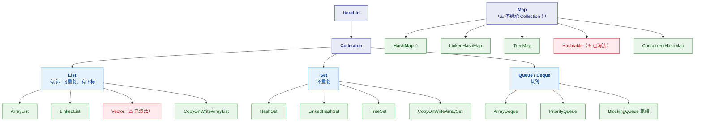
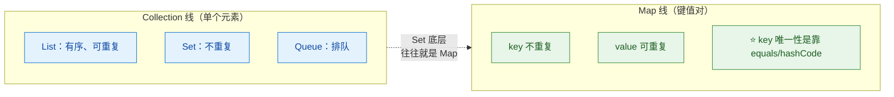

# 🗃️ Java 集合框架总览

> 这是 Java 集合框架的**总入口（MOC）**，也是 `2-collection/` 目录的导航页。
> 集合是 Java 面试的**绝对主战场**——`HashMap` 几乎是每场必问。
> 系列按"**体系 → HashMap 深挖 → 各容器专题 → 并发容器**"组织。
> 关联：[[1-java/1-juc/6-JUC并发工具|JUC 系列]]（并发容器）、[[1-java/0-知识点/0-Java总览|Java 总览]]。

> [!note] 版本口径
> 以 **JDK 8 ~ 17** 为基线。涉及 1.7 差异（HashMap 头插法、ConcurrentHashMap 分段锁）会明确标注。
> **所有源码行为与数值均经实测验证**（JDK 17.0.11）。

> [!important] ⭐ 本系列的分工
> | 笔记 | 定位 |
> |---|---|
> | [[1-集合框架]]（**已有**） | 速查全景：各类容器要点 + 选型表 + 必答三连 |
> | **本系列各篇** | ⭐ **专题深挖**——每个容器讲透 |
> | [[1-HashMap全解]] | ⭐ **自包含的 HashMap 完整解析**（结构→源码→扩容→树化） |
> | [[2-HashMap实战]] | ⭐ **工程实践**：key 设计、hashCode、序列化、并发事故 |
> | [[1-java/1-juc/6-JUC并发工具\|6-JUC并发工具]] | AQS / LongAdder（并发容器的底层工具） |

---

## 一、系列导航

| # | 笔记 | 一句话定位 | 核心内容 |
|---|---|---|---|
| 0 | **[[1-集合框架]]**（已有） | 📋 **速查全景** | 两条主干、选型总表、各容器要点、必答三连 |
| 1 | **[[1-HashMap全解]]** | ⭐ **HashMap 完整解析** | 结构选型、hash 扰动、put/get/resize 源码、**树化**、**1.7 死循环** |
| 2 | **[[2-HashMap实战]]** | ⭐ **HashMap 工程实践** | **key 设计**、**hashCode 契约**、序列化、**并发事故**、容量预设 |
| 3 | **[[3-List专题]]** | 列表怎么选 | ArrayList 扩容、LinkedList 真相、Vector、CopyOnWriteArrayList |
| 4 | **[[4-Set与Queue专题]]** | 去重与队列 | HashSet/LinkedHashSet/TreeSet、ArrayDeque/PriorityQueue/BlockingQueue |
| 5 | **[[5-并发容器专题]]** | 并发怎么选 | ConcurrentHashMap、CopyOnWrite、BlockingQueue、性能对比 |

---

> [!tip] 画图约定
> 本库支持 Mermaid。本系列的图**优先用 Mermaid**，只有"依赖精确对齐"的图（源码片段、内存布局）才用代码块。规范见 [[1-java/0-知识点/0-Java总览|Java 总览]] §七。

## 二、按需求的阅读路径

> [!tip] 四条路径
> **面试突击（半天）**：[[1-HashMap全解]] → [[2-HashMap实战]] → [[1-集合框架]] §13（必答三连）
> **吃透 HashMap（2～3 天）**：[[1-HashMap全解]] 精读 → [[2-HashMap实战]] 应用
> **系统学集合（1 周）**：0 → 1 → 2 → 3 → 4 → 5 顺序
> **并发场景选型**：[[5-并发容器专题]] → [[1-java/1-juc/6-JUC并发工具|JUC 并发工具]]

---

## 三、⭐ 集合体系总图



> [!important] ⭐⭐ 三个必须记住的结构事实
> **① `Map` 不继承 `Collection`！**
> 它是一个**独立的顶层接口**。所以：
> - ❌ 不能 `new ArrayList<>(map)`
> - ❌ 不能直接 `for (Object o : map)`
> - ✅ 要遍历得用 `map.entrySet()` / `keySet()` / `values()`
>
> **② `List` / `Set` / `Queue` 都继承 `Collection`**，所以它们共享 `add`/`remove`/`size`/`iterator`。
>
> **③ `Iterable` 是最顶层**——只有实现了它才能用 `for-each`。

---

## 四、⭐ 两条主干与核心区别



> [!tip] ⭐ 一个"打通"的洞察
> **`HashSet` 底层就是一个 `HashMap`**（value 是个占位对象）：
> ```java
> // HashSet 的真实实现（简化）
> private transient HashMap<E,Object> map;
> private static final Object PRESENT = new Object();   // ⭐ 哑值
>
> public boolean add(E e) {
>     return map.put(e, PRESENT) == null;
> }
> ```
>
> **同理**：`LinkedHashSet` 底层是 `LinkedHashMap`，`TreeSet` 底层是 `TreeMap`。
>
> 👉 **所以"搞懂 Map，Set 就懂了一半"**——这也是为什么本系列把 HashMap 放在最前面。

### 4.1 语义差异速查

| | **List** | **Set** | **Map** | **Queue** |
|---|---|---|---|---|
| 顺序 | ✅ 有序（插入序/索引） | 看实现 | 看实现 | ✅ FIFO（或优先级） |
| 重复 | ✅ 可重复 | ❌ 不重复 | **key 不重复** | ✅ 可重复 |
| 索引 | ✅ `get(i)` | ❌ | **key 查找** | ❌（只有队首队尾） |
| 允许 null | ✅ | **看实现**（TreeSet ❌） | **看实现**（CHM ❌） | `ArrayDeque` ❌ |

---

## 五、⭐ 选型总表

| 需求 | 首选 | 备选 | 备注 |
|---|---|---|---|
| **按 key 查找** | ⭐ **`HashMap`** | `LinkedHashMap`（要顺序） | **最常用** |
| **要插入顺序/访问顺序** | `LinkedHashMap` | —— | ⭐ 可做 **LRU** |
| **要排序的 Map** | `TreeMap` | —— | 红黑树，O(log n) |
| **并发 Map** | ⭐ **`ConcurrentHashMap`** | —— | ⚠️ **别用 `Hashtable`** |
| **随机访问列表** | ⭐ **`ArrayList`** | —— | 绝大多数场景 |
| **频繁头尾增删** | ⭐ **`ArrayDeque`** | `LinkedList` | ⚠️ **不是 LinkedList！** |
| **去重** | `HashSet` | `LinkedHashSet`（保序） | —— |
| **排序去重** | `TreeSet` | —— | —— |
| **栈/队列** | ⭐ **`ArrayDeque`** | —— | ⚠️ **`Stack` 已淘汰** |
| **优先级队列 / topK** | `PriorityQueue` | —— | 二叉堆 |
| **线程安全队列** | `BlockingQueue` | `ConcurrentLinkedQueue` | —— |
| **读多写少的并发 List** | `CopyOnWriteArrayList` | —— | ⚠️ 写代价大 |

> [!danger] ⚠️ 三个"不要用"的类（面试常问）
> | 类 | 为什么不用 | 替代 |
> |---|---|---|
> | **`Hashtable`** | ⭐ **全表锁**（所有方法 `synchronized`）→ 并发性能极差 | `ConcurrentHashMap` |
> | **`Vector`** | ⭐ 同上（全表锁），且扩容 2 倍浪费空间 | `ArrayList` / `CopyOnWriteArrayList` |
> | **`Stack`** | ⭐ **继承 `Vector`**，同样全表锁；且 **`Deque` 接口更完整** | **`ArrayDeque`** |
>
> **这三个都是 JDK 1.0/1.2 的遗留类**——
> **面试时能说"已淘汰，用 XXX 替代"比只会背 API 强。**

---

## 六、30 秒速查表

| 问题 | 一句话答案 | 详见 |
|---|---|---|
| `Map` 继承 `Collection` 吗 | ⭐ **不继承**——它是独立顶层接口 | 本篇 §三 |
| 怎么遍历 Map | ⭐ **`entrySet()`**（最推荐）/ `keySet()` / `values()` | [[1-集合框架]] |
| `HashSet` 底层是什么 | ⭐ **`HashMap`**（value 是占位 `PRESENT`） | 本篇 §四 |
| `TreeSet` 底层是什么 | **`TreeMap`** | [[4-Set与Queue专题]] |
| List 和 Set 的核心区别 | **List 有序可重复；Set 不可重复** | 本篇 §四 |
| 为什么不用 `Hashtable` | ⭐ **全表锁**，并发差 | [[5-并发容器专题]] |
| 为什么不用 `Stack` | ⭐ **继承 `Vector`（全表锁）**；`Deque` 更完整 | [[4-Set与Queue专题]] |
| 栈/队列用什么 | ⭐ **`ArrayDeque`** | [[4-Set与Queue专题]] |
| 并发 Map 用什么 | ⭐ **`ConcurrentHashMap`** | [[5-并发容器专题]] |
| 并发的 List 用什么 | **`CopyOnWriteArrayList`**（读多写少） | [[5-并发容器专题]] |
| HashMap 为什么线程不安全 | ⭐ 1.7 会**头插成环 CPU 100%**；1.8 会**丢数据** | [[1-HashMap全解]] |
| HashMap 树化阈值 | **8**（且容量 ≥ 64） | [[1-HashMap全解]] |
| 为什么容量是 2 的幂 | ⭐ **`(n-1) & hash` 等价取模且更快** | [[1-HashMap全解]] |
| 为什么负载因子 0.75 | **时间与空间的折中**（λ=0.5 由此而来） | [[1-HashMap全解]] |
| HashMap 的 key 要注意什么 | ⭐ **不可变 + 正确实现 `equals`/`hashCode`** | [[2-HashMap实战]] |
| 预设容量怎么写 | ⭐ **`new HashMap<>((int)(n/0.75)+1)`** | [[2-HashMap实战]] |
| `HashMap` 线程安全的替代 | **`ConcurrentHashMap`** | [[5-并发容器专题]] |

---

## 七、学习检查清单

- [ ] ⭐ 能画出**集合体系总图**（含"Map 不继承 Collection"）
- [ ] ⭐ 能说清 `List` / `Set` / `Queue` / `Map` 的**语义差异**
- [ ] ⭐ 能解释"**`HashSet` 底层是 `HashMap`**"这个打通点
- [ ] 能说出**至少三个"已淘汰"的类**及替代方案
- [ ] ⭐ 能根据需求**快速选型**（对照 §五 总表）
- [ ] 能说清 `Map` 的**三种遍历方式**及推荐哪种
- [ ] ⭐ 能说出 `HashMap` 的**树化阈值、容量规则、负载因子**
- [ ] 能说出 `HashMap` 的 **key 设计要点**（不可变、equals/hashCode 契约）
- [ ] ⭐ 能说出**并发场景该选什么容器**

---
> 下一篇 → [[1-HashMap全解]] ｜ 速查全景 → [[1-集合框架]] ｜ 返回 → [[1-java/0-知识点/0-Java总览|Java 总览]]
