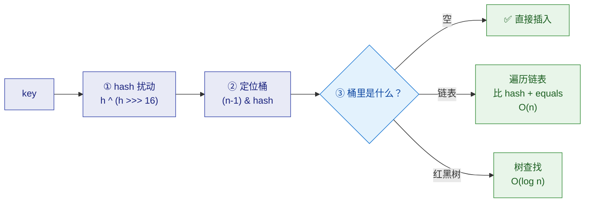
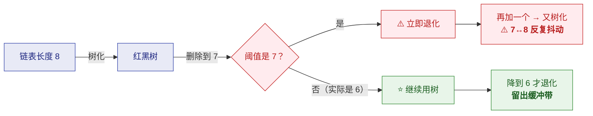
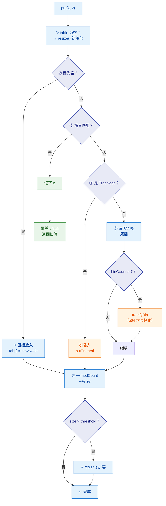
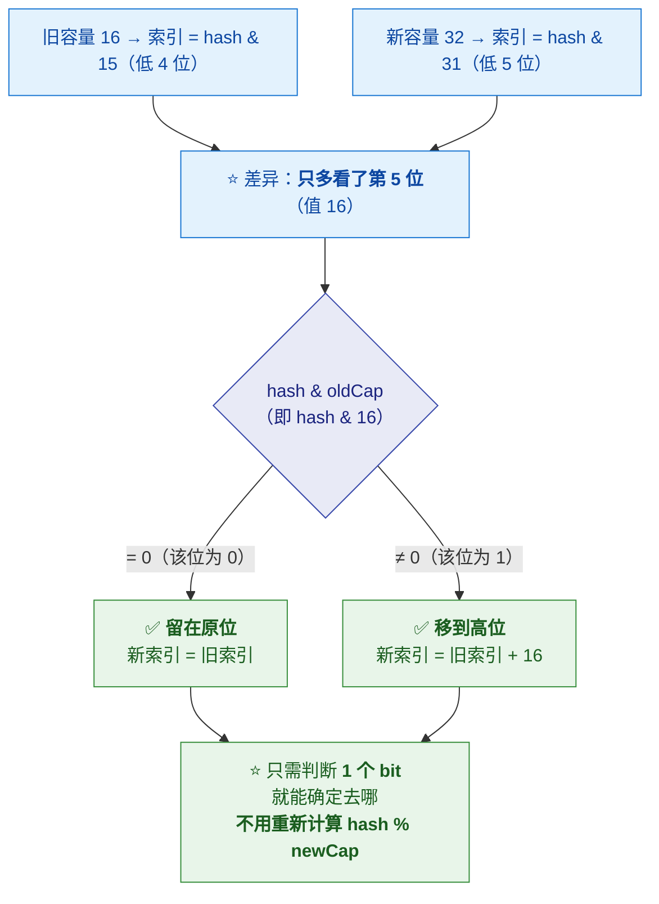
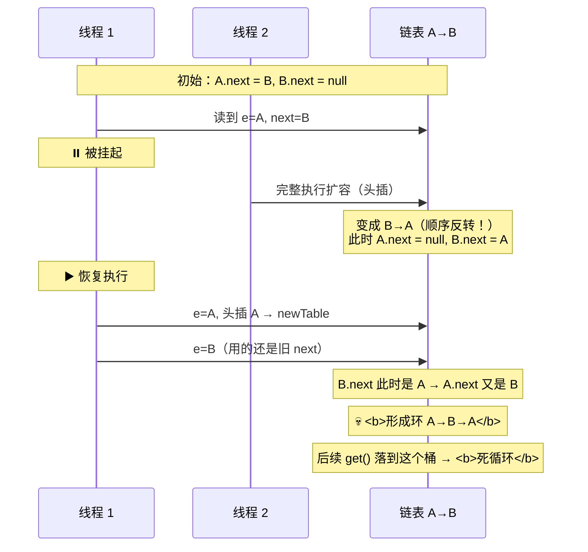
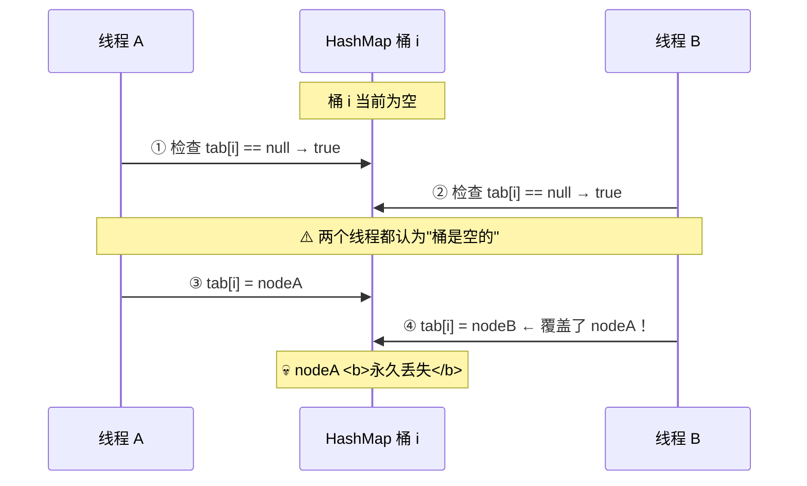

# 🗺️ 一、HashMap 全解（自包含）

> [!abstract] 本篇定位
> **自包含的 HashMap 完整解析**——从"为什么这样设计"到源码逐行，
> 再到扩容、树化、版本差异。**只看这一篇就能答全 HashMap 的所有面试题。**
>
> **数值与行为均经 JDK 17.0.11 实测验证**（非凭记忆）。
> 工程实践（key 设计/hashCode/并发事故）见姊妹篇 [[2-HashMap实战]]。

---

## 一、全景：HashMap 到底是什么

> [!important] 一句话定义
> **HashMap = 数组 + 链表 + 红黑树** 的哈希表实现，
> **用 `(n-1) & hash` 定位桶，用 `equals` 解决冲突，用扩容维持性能。**

### 1.1 核心字段（JDK 8）

```java
public class HashMap<K,V> extends AbstractMap<K,V>
        implements Map<K,V>, Cloneable, Serializable {

    transient Node<K,V>[] table;          // ⭐ 桶数组，长度永远是 2 的幂
    transient int size;                   // 键值对数量
    transient int modCount;               // ⭐ 修改次数（fail-fast 用）
    int threshold;                        // 扩容阈值 = capacity * loadFactor
    final float loadFactor;               // 默认 0.75

    static final int DEFAULT_INITIAL_CAPACITY = 1 << 4;   // 16
    static final int MAXIMUM_CAPACITY = 1 << 30;          // 2^30
    static final float DEFAULT_LOAD_FACTOR = 0.75f;
    static final int TREEIFY_THRESHOLD = 8;               // 链表 → 树
    static final int UNTREEIFY_THRESHOLD = 6;             // 树 → 链表
    static final int MIN_TREEIFY_CAPACITY = 64;           // 树化的最小容量

    static class Node<K,V> implements Map.Entry<K,V> {
        final int hash;      // ⭐ 缓存 hash，避免每次比较都重算
        final K key;
        V value;
        Node<K,V> next;      // ⭐ 链表指针
    }
}
```

> [!note] ⭐ 为什么 `Node.hash` 要缓存
> **因为 `hash` 是 `final` 的**——**算一次就固定了**。
> **在链表/树里比较节点时，先比 `hash` 再比 `equals`**——
> **`hash` 是 int 比较（一个 CPU 指令），比调 `equals()` 快得多。**
>
> ```java
> if (e.hash == hash && ((k = e.key) == key || (key != null && key.equals(k))))
> //  ⭐ 先比 hash（快）→ 短路再比 equals（慢）
> ```

### 1.2 三层查找结构



> [!important] ⭐ 为什么绝大多数情况"数组就够了"
> **理想 hash 分布下，桶长 0/1/2 占 99% 以上**（见 §三 泊松分布表）。
> **所以红黑树是"极端情况的兜底"**——防止恶意构造 key 导致 O(n) 退化。

---

## 二、⭐ 为什么容量必须是 2 的幂

### 2.1 核心：用 `&` 替代 `%`

```java
// JDK 8 定位桶
int index = (n - 1) & hash;     // ⭐ 等价于 hash % n，但快得多
```

| 维度 | `hash % n` | ⭐ `(n-1) & hash` |
|---|---|---|
| 指令 | **除法**（几十个周期） | **位与**（1 个周期） |
| 负数 | ⚠️ **可能为负**，要 `Math.floorMod` | ✅ **天然非负** |
| 前提 | 无 | ⭐ **n 必须是 2 的幂** |

> [!important] ⭐ 两个关键点
> **① 只有 n 是 2 的幂时，`n-1` 才是"低位全 1"的掩码**
> ```
> n = 16  →  n-1 = 15  = 0000 1111   ← 低位 4 位全 1
> n = 15  →  n-1 = 14  = 0000 1110   ← ⚠️ 最后一位是 0！
> ```
> **如果 n 不是 2 的幂（如 15），`&` 的结果某些下标永远取不到**——
> **会导致大量桶空着，分布极不均匀。**
>
> **② 对负数 hashCode，`&` 天然给出非负下标**
> **因为只保留低位，符号位被"与"掉了**——
> ⭐ **这就是 HashMap 从不需要 `Math.abs(hash)` 的原因。**

### 2.2 `tableSizeFor`：向上取 2 的幂

> [!important] ⭐ 所以 `new HashMap<>(17)` 实际容量是 **32**（实测确认）

```java
static final int tableSizeFor(int cap) {
    int n = cap - 1;          // ⭐ 先减 1：保证 cap 本身是 2 的幂时不会翻倍
    n |= n >>> 1;             // 把最高位 1 之后的所有位"传播"成 1
    n |= n >>> 2;
    n |= n >>> 4;
    n |= n >>> 8;
    n |= n >>> 16;
    return (n < 0) ? 1 : (n >= MAXIMUM_CAPACITY) ? MAXIMUM_CAPACITY : n + 1;
}
```

**实测结果**（JDK 17）：

| 输入 cap | 0 | 1 | 2 | 3 | 7 | 8 | 9 | 17 | 64 | 100 | 1000 |
|---|---|---|---|---|---|---|---|---|---|---|---|
| **返回** | 1 | 1 | 2 | 4 | 8 | 8 | **16** | **32** | 64 | **128** | **1024** |

> [!tip] 为什么要 `cap - 1`
> **如果不减 1**，当 `cap = 16`（已是 2 的幂）时：
> 传播后 `n = 31`，`n + 1 = 32` → ⭐ **白白翻倍！**
> **减 1 后**：`n = 15`，传播后仍是 `15`，`n + 1 = 16` ✅

> [!note] ⭐ 一个容易踩的坑：**容量是"懒分配"的**
> **实测：`new HashMap<>(16)` 之后 `table` 仍然是 `null`！**
> ```
> new HashMap<>(16) → threshold=16, table=null(懒加载)
> put 之后          → table 长度 = 16
> ```
> **`threshold` 字段在"表未分配"时被临时用来存"初始容量"**——
> **真正的数组在第一次 `put` 时才分配**（`resize()` 里）。
>
> 👉 **这个设计避免了"创建了但没用"时的内存浪费。**

---

## 三、⭐ 为什么树化阈值是 8（泊松分布）

> [!important] ⭐ 这不是"随便定的"，而是统计学结论
> **理想情况下（hash 完全随机），桶内节点数服从参数 λ=0.5 的泊松分布：**
> $$P(k) = \frac{e^{-0.5} \cdot 0.5^k}{k!}$$
>
> **（λ=0.5 来自"默认负载因子 0.75 下的平均桶长"）**

| 桶内节点数 k | 0 | 1 | 2 | 3 | 4 | 5 | 6 | 7 | **8** |
|---|---|---|---|---|---|---|---|---|---|
| **概率** | .6065 | .3033 | .0758 | .0126 | .0016 | .00016 | .0000132 | .00000094 | **.00000006** |

> [!success] ⭐ 关键推理（面试要讲出来）
> **链表长度到 8 的概率 < 千万分之一（约亿分之六）。**
>
> **既然这么罕见，一旦真的发生，就说明"hash 分布已经严重异常"**——
> 可能是：
> - ⭐ **`hashCode()` 实现极差**（大量 key 落到同一桶）
> - ⭐ **恶意构造的 key**（哈希碰撞攻击，如 DoS）
>
> **此时必须把 O(n) 拉回 O(log n)** → 用红黑树兜底。
>
> **为什么不选 4？** **4 的概率约 1.6%，太常见**——
> **频繁树化/退化本身有成本**（`TreeNode` 大小约为 `Node` 的两倍，还要维护平衡）。
>
> 👉 **8 的含义是："平时几乎不树化；一旦树化，就是异常信号。"**

### 3.1 为什么退化阈值是 6（不是 7）



> [!important] ⭐ 这叫"滞后（hysteresis）设计"
> **如果树化和退化都是 8（或 7），长度在 7↔8 波动时会不停重建结构**——
> **而 `treeifyBin` / `untreeify` 都是 O(n) 的结构重建。**
>
> **留出 6↔8 的空档（中间隔 1 个节点）即可避免边界抖动。**

### 3.2 树化的前置条件：容量 ≥ 64

```java
final void treeifyBin(Node<K,V>[] tab, int hash) {
    int n, index; Node<K,V> e;
    if (tab == null || (n = tab.length) < MIN_TREEIFY_CAPACITY)
        resize();                 // ⭐ 容量不足 64 → 先扩容，不树化
    else if ((e = tab[index = (n - 1) & hash]) != null) {
        // 真正转 TreeNode
    }
}
```

> [!important] ⭐ 为什么"先扩容"
> **桶长达到 8 有两种可能：**
> | 原因 | 应对 |
> |---|---|
> | ① **hash 真的差** | 树化 |
> | ② ⭐ **只是表太小**（容量 16 时只有 4 位参与索引，高位全丢 → 必然碰撞） | ⭐ **扩容直接把元素分散开，比树化更划算** |
>
> 👉 **所以"table 长度 < 64 时优先扩容"。**

> [!tip] ⭐ 直接指导调优
> **监控到某个 `HashMap` 频繁树化，先看它容量是不是只有 16/32**——
> **很可能只是"初始容量没设"，而不是 `hashCode` 有问题。**
> （容量设置见 [[2-HashMap实战]]）

---

## 四、⭐ hash 扰动函数

```java
static final int hash(Object key) {
    int h;
    return (key == null) ? 0 : (h = key.hashCode()) ^ (h >>> 16);
}
```

> [!important] ⭐ 为什么要把高 16 位异或到低 16 位
> **因为索引只取低 log₂(n) 位**——
> **容量 16 时只取低 4 位，高位信息完全被丢弃！**
>
> **那些"高位不同、低位相同"的 key 会全部落进同一个桶**——
> 典型如**自增 ID、短字符串、某些 `Integer`**。

```text
hashCode()        = 1111 0000 1010 1010 0000 0000 0000 0101
hashCode() >>> 16 = 0000 0000 0000 0000 1111 0000 1010 1010
XOR 结果           = 1111 0000 1010 1010 1111 0000 1010 1111
                                                  ↑ 低位混入了高位的熵
```

**代价**：仅一次移位 + 一次异或。

> [!note] ⭐ 1.7 与 1.8 的扰动差异（体现取舍）
> | 版本 | 扰动 | 为什么 |
> |---|---|---|
> | **1.7** | **4 次移位 + 4 次异或**（+ `hashSeed` 随机种子） | 没有树兜底，必须让 hash 更均匀 |
> | ⭐ **1.8** | **1 次移位 + 1 次异或** | ⭐ **有红黑树兜底了**——即使 hash 差也能 O(log n) |
>
> 👉 **这是"用树化成本换 hash 计算成本"的明确取舍。**

### 4.1 实测：为什么"看起来不同的字符串"会碰撞

> [!example] ⭐ 实测数据（JDK 17）
> ```
> "Aa"   hashCode=2112      扰动后=2112      （低 4 位 = 0）
> "BB"   hashCode=2112      扰动后=2112      （低 4 位 = 0）  ← ⚠️ 完全相同！
> "AaAa" hashCode=2031744   扰动后=2031775   （低 4 位 = 15）
> "BBBB" hashCode=2031744   扰动后=2031775   （低 4 位 = 15） ← ⚠️ 完全相同！
> ```
>
> **`"Aa"` 和 `"BB"` 的 `hashCode()` 都是 2112**——
> **它们必然落进同一个桶**（无论怎么扰动都没用，因为 hash 完全相同）。

**为什么？看 `String.hashCode` 公式**：

```java
// String.hashCode 的实现
public int hashCode() {
    int h = hash;
    for (int i = 0; i < value.length; i++) {
        h = 31 * h + value[i];       // ⭐ 多项式：s[0]*31^(n-1) + ... + s[n-1]
    }
    return h;
}
```

**实测验证**：
```
"a".hashCode()  = 97
"ab".hashCode() = 3105      = 'a'*31 + 'b' = 97*31 + 98 = 3105   ✅
"abc".hashCode()= 96354     = 'a'*31² + 'b'*31 + 'c' = 96354     ✅
```

> [!tip] ⭐ 为什么 `"Aa"` 和 `"BB"` 必然碰撞（可以算出来）
> ```
> "Aa": 'A'=65, 'a'=97  →  65*31 + 97  = 2015 + 97  = 2112
> "BB": 'B'=66, 'B'=66  →  66*31 + 66  = 2046 + 66  = 2112
> ```
> **因为 `31 * (65 - 66) = -31`，而 `97 - 66 = 31`——两者恰好抵消！**
>
> 👉 **这是"数学上必然碰撞"的经典例子**——不是 bug，
> **而是"字符串哈希必然存在碰撞"的体现**（鸽巢原理）。
> **也正因如此，HashMap 必须有链表/树来处理碰撞。**

> [!success] ⭐ 面试加分点
> **能算出 `"Aa"`/`"BB"` 碰撞的人，比只会说"HashMap 用链表解决冲突"的人强得多**——
> 因为它同时说明了：
> ① `String.hashCode` 的多项式公式
> ② 为什么 `31` 这个乘数会产生规律性碰撞
> ③ 为什么必须有链表兜底

---

## 五、put 全流程（源码逐行）

```java
public V put(K key, V value) {
    return putVal(hash(key), key, value, false, true);
}

final V putVal(int hash, K key, V value, boolean onlyIfAbsent, boolean evict) {
    Node<K,V>[] tab; Node<K,V> p; int n, i;

    // ① 懒初始化 / 容量检查
    if ((tab = table) == null || (n = tab.length) == 0)
        n = (tab = resize()).length;

    // ② 桶为空 → CAS 式直接放（单线程下就是直接赋值）
    if ((p = tab[i = (n - 1) & hash]) == null)
        tab[i] = newNode(hash, key, value, null);

    else {
        Node<K,V> e; K k;
        // ③ 桶首节点就匹配 → 记下，后面覆盖 value
        if (p.hash == hash && ((k = p.key) == key || (key != null && key.equals(k))))
            e = p;
        // ④ 是红黑树 → 走树插入
        else if (p instanceof TreeNode)
            e = ((TreeNode<K,V>)p).putTreeVal(this, tab, hash, key, value);
        else {
            // ⑤ 遍历链表
            for (int binCount = 0; ; ++binCount) {
                if ((e = p.next) == null) {
                    p.next = newNode(hash, key, value, null);      // ⭐ 尾插
                    if (binCount >= TREEIFY_THRESHOLD - 1)         // ⭐ 达到 8 尝试树化
                        treeifyBin(tab, hash);
                    break;
                }
                if (e.hash == hash && ((k = e.key) == key || (key != null && key.equals(k))))
                    break;                                          // 找到已存在的 key
                p = e;
            }
        }
        // ⑥ key 已存在 → 覆盖 value，返回旧值
        if (e != null) {
            V oldValue = e.value;
            if (!onlyIfAbsent || oldValue == null)
                e.value = value;
            afterNodeAccess(e);           // ⭐ 给 LinkedHashMap 的回调
            return oldValue;
        }
    }

    ++modCount;                            // ⭐ fail-fast 计数
    if (++size > threshold)                // ⭐ 超过阈值 → 扩容
        resize();
    afterNodeInsertion(evict);             // ⭐ 给 LinkedHashMap 的回调
    return null;
}
```



> [!important] ⭐ 五个关键点
> **① 桶为空时是"直接放"**——单线程下就是 `tab[i] = newNode(...)`（**无需 CAS**，
> 因为 `HashMap` 本来就不保证线程安全）。
>
> **② 链表是"尾插"（1.8 改动）**——
> **1.7 是头插，这正是 1.7 并发死循环的根源**（见 §八）。
>
> **③ 树化条件是 `binCount >= 7`（即链表有 8 个节点时）**——
> 注意 `binCount` 从 0 开始，所以是"**第 8 个**"触发。
>
> **④ `onlyIfAbsent` 参数**：`put` 传 `false`（覆盖），`putIfAbsent` 传 `true`。
>
> **⑤ `afterNodeAccess` / `afterNodeInsertion` 是空实现**——
> ⭐ **专门给 `LinkedHashMap` 重写的钩子**（实现 LRU 的关键）。

### 5.1 get 流程

```java
final Node<K,V> getNode(int hash, Object key) {
    Node<K,V>[] tab; Node<K,V> first, e; int n; K k;
    if ((tab = table) != null && (n = tab.length) > 0 &&
        (first = tab[(n - 1) & hash]) != null) {

        // ① 先检查桶首（最常见命中）
        if (first.hash == hash && ((k = first.key) == key || (key != null && key.equals(k))))
            return first;

        if ((e = first.next) != null) {
            // ② 红黑树
            if (first instanceof TreeNode)
                return ((TreeNode<K,V>)first).getTreeNode(hash, key);
            // ③ 链表遍历
            do {
                if (e.hash == hash && ((k = e.key) == key || (key != null && key.equals(k))))
                    return e;
            } while ((e = e.next) != null);
        }
    }
    return null;    // ⭐ 找不到返回 null（这也是"不允许 null 有二义性"的来源）
}
```

> [!tip] ⭐ 为什么先检查"桶首"
> **因为大多数桶只有 0~1 个元素**——
> **桶首命中的概率极高，直接返回可以省掉进入循环的开销。**
> **这是一个很实际的微优化。**

---

## 六、⭐ resize：扩容与高低位拆分

### 6.1 扩容时机与倍数

| 项 | 值 |
|---|---|
| **触发条件** | ⭐ **`++size > threshold`**（不是 `>=`） |
| **阈值** | `threshold = capacity * loadFactor` |
| **倍数** | ⭐ **2 倍**（`newCap = oldCap << 1`） |
| **实测** | 容量 16、负载 0.75 → **第 13 个元素时扩到 32** ✅ |

> [!example] ⭐ 实测验证（16 容量）
> ```
> put 第 11 个 → size=11, table.len=16
> put 第 12 个 → size=12, table.len=16
> put 第 13 个 → size=13, table.len=32   ← ⭐ 第 13 个触发扩容
> ```
> **因为 `threshold = 16 * 0.75 = 12`**，
> **`++size = 13 > 12` → 扩容。** ✅ 与源码逻辑完全吻合。

### 6.2 ⭐⭐ 高低位拆分：为什么"不需要重新哈希"

> [!important] ⭐ 这是 HashMap（和 ConcurrentHashMap）最优雅的设计

```java
// resize() 中迁移链表的核心
Node<K,V> loHead = null, loTail = null;    // 低位链（留在原位）
Node<K,V> hiHead = null, hiTail = null;    // 高位链（移到 原位+oldCap）
do {
    next = e.next;
    if ((e.hash & oldCap) == 0) {          // ⭐ 只判断这一个 bit！
        if (loTail == null) loHead = e; else loTail.next = e;
        loTail = e;
    } else {
        if (hiTail == null) hiHead = e; else hiTail.next = e;
        hiTail = e;
    }
} while ((e = next) != null);

if (loTail != null) { loTail.next = null; newTab[j] = loHead; }             // ⭐ 原位
if (hiTail != null) { hiTail.next = null; newTab[j + oldCap] = hiHead; }    // ⭐ 原位+oldCap
```



> [!important] ⭐⭐ 为什么这样能"不重新哈希"
> | 步骤 | 说明 |
> |---|---|
> | 旧容量 16 (`10000`) | 索引 = `hash & 15`（看低 4 位） |
> | 新容量 32 (`100000`) | 索引 = `hash & 31`（看低 5 位） |
> | ⭐ **差异** | **只多了第 5 位** |
> | ⭐ **判断** | `hash & 16`：**为 0 → 原位；为 1 → 原位 + 16** |
>
> **所以原来的一条链表会自然"一分为二"（低链 + 高链）**，
> **既保持了相对顺序，又实现了均匀分散。**
>
> 👉 **这个设计也是 ConcurrentHashMap 协作扩容的基础。**

### 6.3 扩容的代价

| 代价 | 说明 |
|---|---|
| ⭐ **O(n) 全量迁移** | 每个元素都要重新挂链 |
| **可能触发树化/退化** | `split()` 处理 TreeNode 的拆分 |
| **内存峰值** | 新旧两个数组短暂共存 |

> [!danger] ⚠️ 这就是"预设容量"的动机
> **如果 `HashMap` 要存 1000 个元素而用默认容量**：
> **16 → 32 → 64 → ... → 1024，共扩容 7 次，迁移了约 1000+ 个元素。**
>
> **正确写法**（见 [[2-HashMap实战]]）：
> ```java
> // ⭐ 预设容量，避免扩容
> new HashMap<>((int) (expectedSize / 0.75f) + 1);
> ```

---

## 七、⭐ 1.7 vs 1.8 的差异

| 维度 | **JDK 1.7** | **JDK 1.8** |
|---|---|---|
| **数据结构** | 数组 + **链表** | 数组 + 链表 + ⭐ **红黑树** |
| **插入方式** | ⭐ **头插法** | ⭐ **尾插法** |
| **hash 扰动** | 4 次移位 + 4 次异或（+ `hashSeed`） | ⭐ **1 次移位 + 1 次异或** |
| **扩容迁移** | 重新计算 `indexFor` | ⭐ **高低位拆分（`hash & oldCap`）** |
| **并发后果** | ⚠️ **头插成环 → CPU 100%** | ⚠️ **丢数据（但不成环）** |
| **树化** | ❌ 不支持 | ✅ 支持（阈值 8 + 容量 ≥ 64） |

### 7.1 ⭐ 1.7 头插法死循环：完整成因

> [!danger] ⚠️ 这是最经典的并发事故（虽然现在已经不用 1.7 了，但要能讲清）

```java
// JDK 1.7 transfer() 的核心（头插）
void transfer(Entry[] newTable, boolean rehash) {
    for (Entry<K,V> e : table) {
        while (null != e) {
            Entry<K,V> next = e.next;      // ⚠️ 保存 next
            int i = indexFor(e.hash, newTable.length);
            e.next = newTable[i];          // ⭐ 头插：接到新桶的头上
            newTable[i] = e;
            e = next;
        }
    }
}
```

**两个线程同时扩容会怎样**：



> [!important] ⭐ 根因是"头插 + 并发"
> **头插法会把链表顺序反转**（A→B 变成 B→A）。
> **线程 1 持有的是"旧视角的 next 指针"**，
> **在线程 2 反转链表后继续用，就把环接上了。**
>
> **表现**：某次 `get()` 恰好落在这个桶 → **`while ((e = e.next) != null)` 永远出不来**
> → **CPU 100%、线程卡死**。

> [!success] ⭐ 1.8 为什么修好了这个问题
> **改成尾插法**——**尾插不会反转链表顺序**，
> 所以"旧视角的 next 指针"仍然有效（最多丢失数据，不会成环）。
>
> ⚠️ **但注意：1.8 仍然线程不安全！**
> **只是"从 CPU 100% 死循环"降级成"丢数据"**——
> **它依然是 bug，只是后果没那么惨烈。**

---

## 八、⭐ 线程不安全的三种表现

> [!danger] ⚠️ 三种并发问题（要能分别说清）

| # | 问题 | 场景 | 后果 |
|---|---|---|---|
| **1** | ⭐ **数据覆盖（丢数据）** | 两个线程同时 `put` 到**同一个空桶** | 后写的覆盖先写的 |
| **2** | ⭐ **`size` 不准** | 并发 `++size` 不是原子操作 | 计数偏小 |
| **3** | ⚠️ **1.7 头插成环** | 并发扩容 | **CPU 100% / 死循环** |

### 8.1 数据覆盖的详细过程



> [!important] ⭐ 根因：**"检查-然后-动作"（check-then-act）不是原子的**
> **`if ((p = tab[i] = ...) == null) tab[i] = newNode(...)` 是两步**——
> **中间可能被其他线程插入。**
>
> ⚠️ **这也是为什么 `ConcurrentHashMap` 在空桶时用 `casTabAt`**——
> **把"检查 + 写入"合成一个原子操作**（见 [[5-并发容器专题]]）。

### 8.2 正确做法

| 场景 | 用什么 |
|---|---|
| ⭐ **并发读写** | **`ConcurrentHashMap`** |
| **读多写极少** | `Collections.synchronizedMap`（⚠️ 性能差） |
| **单线程** | `HashMap`（✅ 最快） |
| **只读共享** | ⭐ **`Map.of(...)` / 不可变包装**（创建后不再改，天然安全） |

> [!tip] ⭐ 一个常被忽略的正解
> **如果 Map 创建后就是只读的**（配置、字典），
> **用 `Map.of()` 或 `Collections.unmodifiableMap()`**——
> **天然线程安全，而且不需要任何同步开销。**
>
> **很多人一遇到并发就上 `ConcurrentHashMap`，
> 但如果数据是只读的，不可变 Map 更好。**

---

## 九、⚠️ 关于 null 的设计

| | **`HashMap`** | **`Hashtable`** | **`ConcurrentHashMap`** |
|---|---|---|---|
| **null key** | ✅ **允许**（1 个） | ❌ 不允许 | ❌ **不允许** |
| **null value** | ✅ 允许 | ❌ 不允许 | ❌ **不允许** |

**为什么 `HashMap` 允许 null key**：
```java
static final int hash(Object key) {
    int h;
    return (key == null) ? 0 : (h = key.hashCode()) ^ (h >>> 16);
    //                   ⭐ null 的 hash 固定为 0 → 放在 0 号桶
}
```

> [!important] ⭐ `ConcurrentHashMap` 为什么禁止 null（高频考点）
> **不是"做不到"，而是"并发下无法提供可靠语义"**：
> ```java
> // 并发下 get 返回 null 有二义性
> Object v = map.get(k);
> if (v == null) {
>     // ⚠️ 是"key 不存在"，还是"存在但 value 是 null"？
> }
> ```
> **单线程的 `HashMap` 可以用 `containsKey` 补一刀区分**——
> **但并发下 `containsKey` + `get` 不是原子的**：
> **两次调用之间状态可能已变，任何依赖这两步的判断都是错的。**
>
> **既然无法提供可靠语义，索性禁止 null，逼调用方显式表达"缺失"。**
>
> 👉 **详细展开见 [[5-并发容器专题]]。**

---

## 十、30 秒速查表

| 问题 | 一句话答案 |
|---|---|
| HashMap 的底层结构 | ⭐ **数组 + 链表 + 红黑树** |
| 为什么容量是 2 的幂 | ⭐ **`(n-1) & hash` 等价取模、更快、天然非负** |
| `(n-1) & hash` 背后的原理 | **n-1 只有低位全 1 时才能当掩码** |
| 为什么不用 `Math.abs` | ⭐ **`&` 只保留低位，天然非负** |
| `tableSizeFor` 做什么 | **向上取 2 的幂**（`new HashMap<>(17)` → 32） |
| ⚠️ 为什么要 `cap - 1` | **防止 cap 本身是 2 的幂时白白翻倍** |
| ⚠️ `new HashMap<>(16)` 会分配数组吗 | ❌ **不会**——懒分配，`threshold` 暂存容量 |
| 树化阈值 | ⭐ **8**（且**容量 ≥ 64**） |
| 为什么是 8 | ⭐ **泊松分布**：长度 8 的概率约**亿分之六**，属"异常信号" |
| 为什么不选 4 | **概率约 1.6%，太常见**；树化本身有成本 |
| 退化阈值 | ⭐ **6**（和 8 之间留**缓冲带**，防抖动） |
| 容量 < 64 时桶长到 8 怎么办 | ⭐ **先扩容**（表太小才是根因） |
| hash 扰动函数 | ⭐ **`h ^ (h >>> 16)`**——把高位熵混入低位 |
| 为什么要扰动 | **索引只取低位，不扰动会浪费高位信息** |
| 1.8 为什么简化扰动 | ⭐ **有红黑树兜底了**（用树化成本换 hash 成本） |
| ⭐ "Aa" 和 "BB" 会碰撞吗 | ⭐ **会**——`hashCode` 都是 **2112**（`65*31+97 = 66*31+66`） |
| `String.hashCode` 公式 | ⭐ **`s[0]*31^(n-1) + ... + s[n-1]`** |
| put 的链表插入方式 | ⭐ **尾插**（1.7 是**头插**） |
| 桶为空时怎么放 | **直接赋值**（单线程无需 CAS） |
| get 为什么先查桶首 | **大多数桶只有 0~1 个元素，桶首命中率极高** |
| 扩容触发条件 | ⭐ **`++size > threshold`**（实测：16 容量时第 13 个） |
| 扩容倍数 | **2 倍** |
| ⭐ 扩容怎么不重新哈希 | ⭐ **`hash & oldCap`**：为 0 留原位，为 1 移到 `原位+oldCap` |
| 为什么这个技巧成立 | **容量翻倍 = 索引只多一个高位** |
| ⚠️ 1.7 死循环根因 | ⭐ **头插 + 并发**→ 链表反转 → **成环** → `get` 死循环 |
| 1.8 修好了吗 | ⭐ **改成尾插，不成环了**——⚠️ **但仍会丢数据** |
| 线程不安全的三种表现 | **丢数据 / size 不准 / 1.7 成环** |
| 并发用什么 | ⭐ **`ConcurrentHashMap`** |
| 只读共享用什么 | ⭐ **`Map.of()` / `unmodifiableMap`**（天然安全） |
| HashMap 允许 null 吗 | ✅ **key 和 value 都允许**（`null` key 的 hash 固定为 0） |
| CHM 为什么禁止 null | ⭐ **并发下 `get` 的 null 二义性无法原子消除** |
| `afterNodeAccess` 是干什么的 | ⭐ **给 `LinkedHashMap` 的钩子**（实现 LRU） |

---

## 十一、学习检查清单

- [ ] ⭐ 能画出 **HashMap 的三层结构**（数组/链表/红黑树）
- [ ] 能说出**核心字段**及 `Node.hash` 为什么要缓存
- [ ] ⭐⭐ 能解释**为什么容量是 2 的幂**（含"n-1 必须是低位全 1"）
- [ ] ⭐ 能解释**为什么不需要 `Math.abs`**
- [ ] ⭐ 能手写 **`tableSizeFor`** 并解释 `cap - 1` 的作用
- [ ] ⚠️ 能说出**容量是懒分配**的（`new HashMap<>(16)` 不建数组）
- [ ] ⭐⭐ 能用**泊松分布**解释树化阈值为什么是 8
- [ ] ⭐ 能解释**退化阈值 6** 的"滞后"设计意图
- [ ] ⭐ 能解释**容量 < 64 时先扩容**的理由
- [ ] ⭐ 能写出**hash 扰动函数**并解释原理
- [ ] 能说出 **1.7 与 1.8 扰动的差异及原因**
- [ ] ⭐⭐ 能**手算** `"Aa"` 与 `"BB"` 的 hashCode 并解释为什么碰撞
- [ ] ⭐ 能完整讲出 **put 的流程**（含树化判断）
- [ ] 能说清 **get 为什么先查桶首**
- [ ] ⭐ 能说出**扩容的触发条件与倍数**（含实测数据）
- [ ] ⭐⭐ 能讲清**高低位拆分**（`hash & oldCap`）及为什么不用重新哈希
- [ ] ⭐ 能说出**扩容的代价**与"预设容量"的动机
- [ ] ⭐ 能对比 **1.7 与 1.8 的五个差异**
- [ ] ⭐⭐ 能完整讲清 **1.7 头插成环**的成因
- [ ] ⭐ 能说清 **1.8 用尾插修好了什么、没修好什么**
- [ ] ⭐ 能说出**线程不安全的三种表现**
- [ ] 能说出**只读共享场景该用什么**（不可变 Map）
- [ ] ⭐ 能说清 **`ConcurrentHashMap` 禁止 null 的理由**

---
> 下一篇 → [[2-HashMap实战]]（工程实践）｜ 并发替代 → [[5-并发容器专题]]
> 返回 [[0-Collection总览]] ｜ 速查全景 → [[1-集合框架]]
