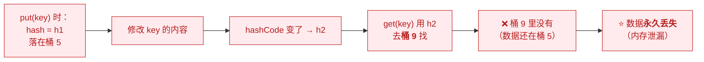
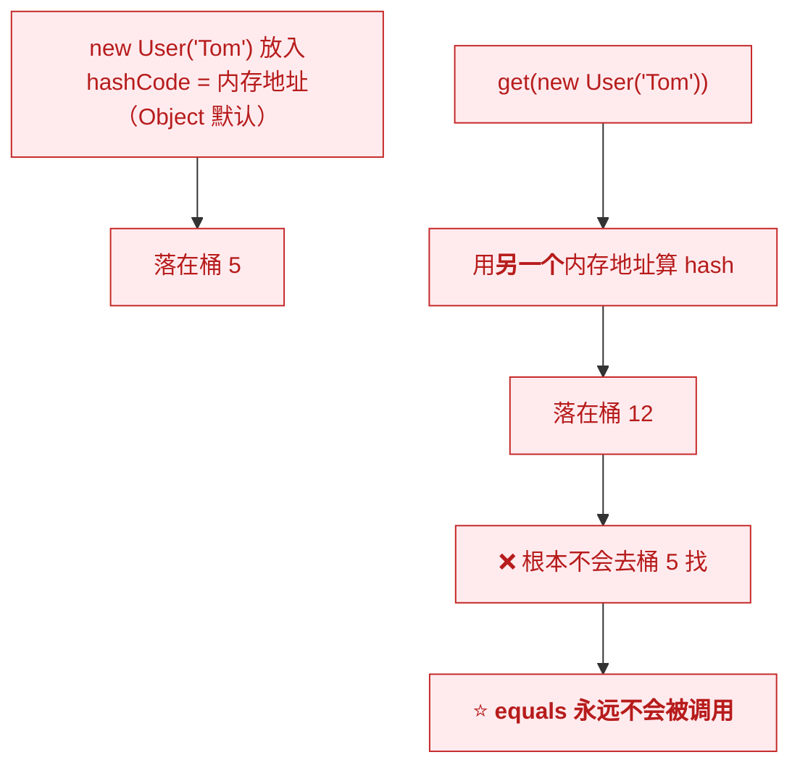
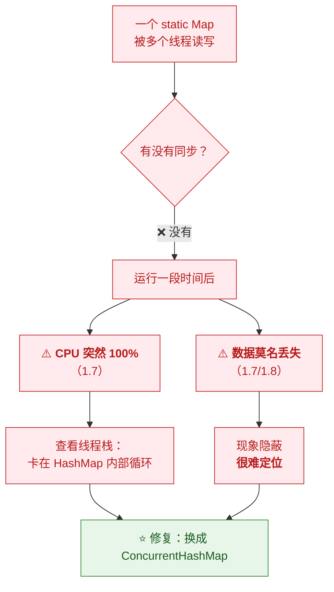

# 🔧 二、HashMap 实战

> [!abstract] 本篇定位
> [[1-HashMap全解]] 讲**源码原理**；本篇讲**工程实践**——
> **key 怎么设计、`hashCode` 怎么写、序列化有什么坑、
> 并发会出什么事、容量怎么预设**。
>
> **这些是"写过生产代码"和"背过八股"的分水岭。**

---

## 一、⭐ key 的选择：三条铁律

> [!important] ⭐⭐ 三条铁律
> | # | 铁律 | 违反的后果 |
> |---|---|---|
> | **1** | ⭐ **key 必须不可变** | **改了就再也 get 不到** |
> | **2** | ⭐ **必须同时正确实现 `equals` 和 `hashCode`** | 用 `containsKey` 找不到刚放进去的 key |
> | **3** | **优先用不可变类型**（`String`/`Integer`/枚举） | 避开一切麻烦 |

### 1.1 铁律一：key 不可变

```java
// ❌ 灾难：用可变对象做 key
Map<List<String>, String> map = new HashMap<>();
List<String> key = new ArrayList<>(List.of("a"));
map.put(key, "value");
key.add("b");                      // ⚠️ 修改了 key！
System.out.println(map.get(key));  // ⭐ null —— 再也找不到了！
```



> [!danger] ⚠️ 这是"静默的内存泄漏"
> **`get` 返回 `null`（看起来像"没放进去"）**，
> **但那个 Entry 还在桶 5 里，永远不会被访问、也不会被清理。**
>
> ⭐ **如果这种情况发生在缓存里 → 内存持续增长 → 最终 OOM。**

### 1.2 铁律二：`equals` 与 `hashCode` 的契约

> [!important] ⭐⭐ 契约（必须背）
> | 规则 | 说明 |
> |---|---|
> | **① `equals` 相等 → `hashCode` 必须相等** | ⭐ **违反它 HashMap 就废了** |
> | **② `hashCode` 相等 → `equals` 不一定相等** | **这是"碰撞"，允许** |
> | ③ 自反/对称/传递/一致 | 通用 `equals` 契约 |
> | ④ `equals` 的参数类型必须是 `Object` | ⚠️ **写错成具体类型就是"重载"不是"重写"** |

```java
// ❌ 经典错误：重写了 equals，忘了 hashCode
class User {
    String name;
    @Override public boolean equals(Object o) {
        return o instanceof User && Objects.equals(name, ((User) o).name);
    }
    // ⚠️ 没有 hashCode！→ 两个"相等"的对象 hashCode 不同
}

Map<User, String> map = new HashMap<>();
map.put(new User("Tom"), "A");
map.get(new User("Tom"));      // ⭐ null！明明 equals 相等，却找不到
```

**为什么找不到**：



> [!important] ⭐ 关键理解
> **HashMap 是"先比 hash 找桶，再比 equals 确认"**——
> **hash 不对，连桶都找错，`equals` 根本没机会执行。**
>
> 👉 **所以"只重写 equals 不重写 hashCode"是最危险的 bug**：
> **代码看起来完全正确，但就是找不到数据。**

### 1.3 正确的写法

```java
// ✅ 方式一：手写（要正确、且注意 Objects.hash 的开销）
public final class User {
    private final String name;
    private final int age;

    @Override public boolean equals(Object o) {
        if (this == o) return true;                          // ⭐ 快速路径
        if (o == null || getClass() != o.getClass()) return false;
        User u = (User) o;
        return age == u.age && Objects.equals(name, u.name);
    }

    @Override public int hashCode() {
        return Objects.hash(name, age);       // ⭐ 变长参数会创建数组，有开销
    }
}
```

> [!tip] ⭐ 三种写法的取舍
> | 方式 | 优点 | 缺点 |
> |---|---|---|
> | **`Objects.hash(...)`** | 简洁 | ⚠️ **变长参数 → 每次调用创建一个 `Object[]`** |
> | **手写 `31 * h + ...`** | ⭐ **最快、无额外分配** | 啰嗦 |
> | ⭐ **IDE / Lombok `@EqualsAndHashCode`** | 省事、不易错 | 需要生成/依赖 |
>
> **高频调用的场景**（如把对象当 key 疯狂查），**手写更快**：
> ```java
> @Override public int hashCode() {
>     int result = name != null ? name.hashCode() : 0;
>     result = 31 * result + age;       // ⭐ 无额外对象分配
>     return result;
> }
> ```

> [!warning] ⚠️ `Objects.hash` 的性能陷阱
> **它是 `Arrays.hashCode(new Object[]{...})`**——
> **也就是说每次调用都会：**
> 1. **创建一个 `Object[]` 数组**
> 2. **把每个字段装箱**（`int` → `Integer`）
>
> **在"每次请求都算几次 hash"的场景下，这是可观的分配压力。**
> **JDK 9+ 可用 `Objects.hash` 的替代——或直接手写。**

### 1.4 铁律三：优先用不可变类型

> [!success] ⭐ 推荐用作 key 的类型
> | 类型 | 为什么好 |
> |---|---|
> | ⭐ **`String`** | 不可变、`hashCode` 有缓存（见 §二）、最常用 |
> | ⭐ **`Integer` / `Long`** | 不可变、`hashCode` 就是值本身 |
> | ⭐ **枚举** | ⭐ **天然不可变、`hashCode` 稳定**（用 `EnumMap` 更好） |
> | **`UUID` / `BigDecimal`** | 不可变、`equals`/`hashCode` 已正确实现 |
>
> ⚠️ **要小心的类型**：
> | 类型 | 风险 |
> |---|---|
> | **`Date`** | ⚠️ **可变**（`setTime`）→ 别做 key |
> | **`List` / `Map`** | ⚠️ **可变** → 别做 key |
> | **自定义对象** | 必须自己保证不可变 + 正确实现契约 |
> | **数组** | ⚠️ **`equals` 是引用比较**（`int[] a.equals(b)` 永远 false）→ 绝不要做 key |

> [!danger] ⚠️ 数组做 key 是"静默失效"
> ```java
> Map<int[], String> map = new HashMap<>();
> map.put(new int[]{1, 2}, "A");
> map.get(new int[]{1, 2});      // ⭐ null！
> ```
> **因为数组的 `hashCode` 是"对象地址"**，**`equals` 也是引用比较**——
> **两个内容相同的数组永远不相等。**
>
> **如果真要用，包成 `List`（`List.of(1,2)`）或用 `Arrays.hashCode`/`Arrays.equals` 自定义包装类。**

---

## 二、⭐ `hashCode` 的实现与"31"的由来

### 2.1 `String.hashCode` 的公式

```java
public int hashCode() {
    int h = hash;                          // ⭐ 有缓存！
    if (h == 0 && value.length > 0) {
        for (int i = 0; i < value.length; i++) {
            h = 31 * h + value[i];         // ⭐ 多项式
        }
        hash = h;
    }
    return h;
}
```

> [!important] ⭐ 两个设计细节
> **① 公式：`s[0]*31^(n-1) + s[1]*31^(n-2) + ... + s[n-1]`**
> **实测验证**：
> ```
> "a"   → 97
> "ab"  → 3105   = 97*31 + 98              ✅
> "abc" → 96354  = 97*31² + 98*31 + 99     ✅
> ```
>
> **② `String` 缓存了 `hashCode`**——
> ⭐ **因为 `String` 不可变，hash 算一次就固定了**，
> **之后每次调用直接返回缓存值。**
>
> 👉 **这也是"`String` 是最佳 key"的原因之一**：
> **不可变 + hash 缓存 → 高频查找极快。**

### 2.2 为什么乘数是 31

| 理由 | 说明 |
|---|---|
| ⭐ **31 是奇素数** | **奇数避免信息丢失**（偶数会导致乘法"移位"丢位）；素数减少规律性碰撞 |
| ⭐ **`31 * i` 可优化为移位** | `31 * i == (i << 5) - i`——**JIT 会做这个优化** |
| **31 不太大** | 乘积不易溢出（虽然溢出本身没问题，但要避免规律性） |
| **实践效果好** | 大量字符串分布均匀（有实证研究支持） |

> [!note] 为什么"奇数"很重要
> **如果乘数是偶数（如 2），`2 * h` 相当于"左移一位"**——
> **低位永远是 0，信息不断丢失。**
> **乘奇数则保证"低位信息能混入高位"。**

### 2.3 ⭐ 实测：规律性碰撞

> [!example] ⭐ 真实验证（JDK 17）
> ```
> "Aa"   hashCode = 2112     低 4 位 = 0
> "BB"   hashCode = 2112     低 4 位 = 0     ← ⚠️ 与 "Aa" 完全相同
> "AaAa" hashCode = 2031744  低 4 位 = 0
> "BBBB" hashCode = 2031744  低 4 位 = 0     ← ⚠️ 与 "AaAa" 完全相同
> ```
>
> **手算验证**：
> ```
> "Aa": 'A'=65, 'a'=97  →  65*31 + 97 = 2015 + 97 = 2112
> "BB": 'B'=66, 'B'=66  →  66*31 + 66 = 2046 + 66 = 2112
> ```
> **因为 `31 * (65 - 66) = -31`，而 `97 - 66 = 31`——恰好抵消！**

> [!success] ⭐ 这个例子很值钱（面试加分）
> **它能同时说明三件事：**
> 1. **`String.hashCode` 的多项式公式**（能手算）
> 2. **为什么 `31` 会产生规律性碰撞**（字符差值 × 31 恰好抵消）
> 3. **为什么 HashMap 必须有链表/树兜底**（碰撞不可避免）
>
> **能算出 `"Aa"`/`"BB"` 碰撞，比"HashMap 用链表解决冲突"深刻得多。**

### 2.4 ⚠️ 自定义 `hashCode` 的常见错误

| # | 错误 | 后果 |
|---|---|---|
| **1** | ⭐ **返回常量**（如 `return 1;`） | **所有 key 进同一个桶** → 退化成链表/树 → **O(n)** |
| **2** | ⭐ **只用不可变字段算** | —— |
| **3** | **用了可变字段** | 字段一变就找不到（§1.1） |
| **4** | **`hashCode` 与 `equals` 不一致** | ⭐ **最严重**——找不到数据 |
| **5** | **依赖随机数/时间** | **同一个对象两次调用返回不同 hash** → 完全失效 |

> [!danger] ⚠️ 错误 1 的严重性（哈希碰撞攻击）
> ```java
> // ❌ 所有对象 hash 相同
> @Override public int hashCode() { return 1; }
> ```
> **所有元素进同一个桶**——
> - **1.8 之前**：O(n) 链表 → **性能崩溃**
> - ⭐ **如果有人恶意构造大量这样的 key → DoS 攻击**
>
> **这正是 1.8 引入红黑树的原因之一**（见 [[1-HashMap全解]] §三）：
> **即使 hash 全相同，也能保持 O(log n)。**
>
> **历史背景**：2011 年有研究者证明**可以用大量碰撞的字符串让 Java 服务器 CPU 打满**
> （利用已知的 `String.hashCode` 碰撞构造），此后 JDK 引入了树化与随机种子。

---

## 三、⭐ 容量预设（性能优化第一招）

### 3.1 为什么必须预设

> [!important] ⭐ 不预设的代价
> **存 1000 个元素、用默认容量 16**：
> ```
> 16 → 32 → 64 → 128 → 256 → 512 → 1024
> 共 7 次扩容，每次都 O(n) 迁移
> ```
> **多做了约 1000+ 次元素迁移**（还有 7 次数组分配）。

### 3.2 ⭐ 正确的公式

```java
// ❌ 错误：以为传"元素个数"就是容量
Map<String, String> m1 = new HashMap<>(1000);
// ⚠️ threshold = 1000 * 0.75 = 750
// 存到第 751 个就扩容 → 变成 2048（浪费一倍空间）

// ✅ 正确：按负载因子反推
int expectedSize = 1000;
Map<String, String> m2 = new HashMap<>((int) (expectedSize / 0.75f) + 1);
// ⭐ 1334 → tableSizeFor → 2048，threshold = 1536 > 1000 ✅ 不扩容
```

> [!important] ⭐ 公式推导
> **我们要：`capacity * 0.75 >= n`**
> **所以：`capacity >= n / 0.75`**
> **即：`new HashMap<>((int) (n / 0.75f) + 1)`**
>
> ⚠️ **`+ 1` 是为了向上取整**（避免整除截断导致差一个）。
> **`tableSizeFor` 会再把它向上取到 2 的幂。**

**速查表**：

| 预期元素数 | ⭐ 推荐初始容量 | 实际分配 | 最终 threshold |
|---|---|---|---|
| 10 | `(int)(10/0.75)+1` = **14** | **16** | 12 ✅ |
| 100 | **134** | **256** | 192 ✅ |
| 1000 | **1334** | **2048** | 1536 ✅ |
| 10000 | **13334** | **16384** | 12288 ✅ |

> [!tip] ⭐ 更省事的写法（Guava）
> ```java
> // Guava 帮你算好了
> Map<String, String> m = Maps.newHashMapWithExpectedSize(1000);
> ```
> **如果项目已经有 Guava，直接用这个**（它内部就是上面的公式）。
> ⚠️ **注意区分**：`Maps.newHashMapWithExpectedSize` 和 `Maps.newHashMapWithExpectedSize`
> 的语义——**Guava 的实现已经处理了 0.75 的反推**。

### 3.3 ⚠️ 一个反直觉的点

> [!warning] ⚠️ 预设容量不一定总是更快
> | 场景 | 建议 |
> |---|---|
> | ⭐ **明确知道要存多少**（如批量导入 10 万条） | ✅ **一定预设** |
> | **不确定、可能很小** | 🤔 **别预设太大**——浪费内存 |
> | **创建后很快就丢弃** | ⭐ **默认容量反而好**（懒分配，可能一次都不扩容） |
>
> **关键**：**预设容量的收益是"少扩容"，代价是"可能浪费空间"。**
> **要按实际规模权衡，不是无脑预设。**

---

## 四、⚠️ 序列化相关的坑

### 4.1 `HashMap` 是可序列化的

```java
public class HashMap<K,V> extends AbstractMap<K,V>
        implements Map<K,V>, Cloneable, Serializable {
```

> [!important] ⭐⭐ 一个精妙的设计：**自定义了 `writeObject` / `readObject`**
> **`table` 字段是 `transient` 的**（不参与默认序列化）：
> ```java
> transient Node<K,V>[] table;      // ⭐ transient！
> ```
>
> **为什么？** ⭐ **因为 `Node` 的 `hash` 字段和"桶位置"都是"实现细节"**——
> - **`table` 的长度是 2 的幂（取决于当时的容量）**
> - **每个元素在哪个桶（取决于当时的 hash 扰动实现）**
>
> **如果直接序列化 `table`，那么"反序列化时的 JDK 版本"必须完全一致**，
> **否则桶位置全错。**
>
> **所以 `HashMap` 自己实现了 `writeObject`——只写"键值对 + size"**，
> **反序列化时**重新 put（重算 hash 和桶位置）**。
> 👉 **这让序列化格式"与实现解耦"。**

```java
// HashMap 的 writeObject（简化）
private void writeObject(java.io.ObjectOutputStream s) throws IOException {
    s.defaultWriteObject();
    s.writeInt(buckets);          // 容量
    s.writeInt(size);             // 元素数
    for (Map.Entry<K,V> e : entrySet()) {   // ⭐ 只写键值对
        s.writeObject(e.getKey());
        s.writeObject(e.getValue());
    }
}
```

> [!tip] ⭐ 这解释了一个常见现象
> **"为什么序列化后的 `HashMap` 反序列化回来，
> `table` 长度可能和我预期的不一样？"**
>
> **因为反序列化时是"重新 put 一遍"**，
> **容量由 `size` 重新推导**，而不是"恢复原来的数组尺寸"。

### 4.2 ⚠️ 序列化的三个坑

| # | 坑 | 说明 |
|---|---|---|
| **1** | ⭐ **key/value 必须可序列化** | 否则抛 `NotSerializableException` |
| **2** | ⚠️ **序列化后 key 的 `hashCode` 必须稳定** | 见下 |
| **3** | **`serialVersionUID`** | 不显式声明的话，类一改就反序列化失败 |

> [!danger] ⚠️ 坑 2 很隐蔽：`hashCode` 不稳定会怎样
> **如果 key 的 `hashCode` 依赖"运行时环境"**（如对象地址、随机数），
> **那么"序列化 → 反序列化"后 hash 会变** →
> **但 `HashMap` 的序列化是重新 put，所以碰巧没问题**。
>
> ⚠️ **但如果你自己序列化了整个对象图（如 JSON 反序列化成 key）**，
> **而 `hashCode` 又不稳定，就会出现"找不到 key"。**
>
> **正解**：⭐ **`hashCode` 只依赖不可变的业务字段**（见 §1.3）。

### 4.3 ⚠️ 不要用 `HashMap` 做配置文件的持久化格式

> [!warning] ⚠️ Java 原生序列化的通用问题
> | 问题 | 说明 |
> |---|---|
> | **版本兼容差** | 类一改就可能反序列化失败 |
> | **安全风险** | ⭐ **反序列化漏洞是重灾区**（`ObjectInputStream` 可执行任意代码） |
> | **不可读** | 二进制，无法排查 |
> | **体积大** | 比 JSON/Protobuf 大 |
> | **跨语言差** | 只有 Java 能读 |
>
> **生产建议**：⭐ **用 JSON / Protobuf**，不要用 Java 原生序列化。
> （📌 序列化的深入讨论见 [[1-java/3-IO/3-IO与网络编程|3-IO与网络编程]] §三）

---

## 五、⭐⭐ 并发事故：HashMap 的三种死法

> [!danger] ⚠️ 详细成因见 [[1-HashMap全解]] §七/§八，这里讲"实战表现与排查"

### 5.1 三种表现对照

| # | 表现 | 版本 | 症状 | 排查 |
|---|---|---|---|---|
| **1** | ⭐ **CPU 100% 死循环** | **仅 1.7** | **线程卡死、CPU 打满** | 看线程栈**卡在 `HashMap.getEntry`/`transfer`** |
| **2** | ⭐ **数据丢失** | 1.7 / 1.8 | **put 进去了但 get 不到** | 数据量对不上 |
| **3** | **`size` 不准** | 1.7 / 1.8 | **`size()` 与实际不符** | 计数偏小 |

### 5.2 ⭐ 生产事故的典型现场



> [!warning] ⚠️ 最危险的是"数据丢失"这种
> **CPU 100% 至少还能发现**——
> **而"数据丢失"是静默的**：程序不报错，只是"有时候查不到"，
> **在测试环境几乎复现不了**（并发压力不够）。
>
> 👉 **所以"用 `static HashMap` 做缓存"是常见的生产事故源头。**

### 5.3 ⭐ 正确的并发方案

| 场景 | 方案 | 说明 |
|---|---|---|
| ⭐ **并发读写** | **`ConcurrentHashMap`** | 默认选择 |
| ⭐ **只读共享** | **`Map.of()` / `unmodifiableMap`** | ⭐ **天然安全、零开销** |
| **读极多、写极少** | `Collections.synchronizedMap` | ⚠️ 全表锁，但简单 |
| **需要"计算缺失值"** | `computeIfAbsent` | ⭐ **必须是 CHM 的原子版本** |

```java
// ⭐ 最容易被忽略的正解
private static final Map<String, Config> CONFIG = Map.of(
    "a", new Config(...),
    "b", new Config(...)
);   // ⭐ 创建后不可变 → 天然线程安全，且无同步开销

// ⭐ 并发 + 惰性初始化
private static final Map<String, Expensive> CACHE = new ConcurrentHashMap<>();
CACHE.computeIfAbsent(key, k -> loadExpensive(k));   // ⭐ 原子
```

> [!success] ⭐ 一个能体现深度的对比
> **很多人一遇到"并发 + Map"就上 `ConcurrentHashMap`**——
> **但如果数据是"初始化后只读"的，`Map.of()` 更好**：
> - ⭐ **无同步开销**（读就是普通数组访问）
> - ⭐ **不可能有并发 bug**（不可变）
> - **语义更清晰**（"这是常量"）
>
> **`ConcurrentHashMap` 是"要改"的场景才需要。**

---

## 六、⭐ 性能调优清单

| # | 手段 | 收益 | 备注 |
|---|---|---|---|
| **1** | ⭐ **预设容量** | **消除所有扩容** | 见 §三 公式 |
| **2** | ⭐ **选好的 key**（`String`/`Integer`/枚举） | hash 分布均匀 + 有缓存 | §1.4 |
| **3** | ⭐ **不可变 key** | 避免"找不到" | §1.1 |
| **4** | **合理实现 `hashCode`** | 避免碰撞 | §2.4 |
| **5** | ⭐ **用 `entrySet` 遍历**（不是 `keySet` + `get`） | **省掉 N 次查找** | 见下 |
| **6** | **避免频繁扩容的负载因子** | 一般别改 | 0.75 是平衡点 |
| **7** | **`EnumMap` 替代 `HashMap<Enum, V>`** | 数组实现，更快更省 | 见下 |

### 6.1 ⭐ 遍历：`entrySet` vs `keySet`

```java
// ❌ 慢：每次都 get 一次（O(1) 但仍有 hash + 查找开销）
for (String k : map.keySet()) {
    String v = map.get(k);      // ⚠️ 多一次查找
}

// ✅ 快：直接拿 Entry
for (Map.Entry<String, String> e : map.entrySet()) {
    String k = e.getKey();
    String v = e.getValue();    // ⭐ 零额外查找
}
```

> [!important] ⭐ 差别有多大
> **`keySet` + `get` 是"两次查找"**（一次遍历桶、一次定位 key）——
> **`entrySet` 是"一次遍历直接拿到键值"。**
>
> **大 Map 上这是"翻倍"的差距**，不是常数级微优化。

### 6.2 ⭐ `EnumMap`：被低估的优化

```java
// ❌ 普通写法
Map<Status, String> m1 = new HashMap<>();

// ✅ ⭐ 枚举专用：内部是数组，无 hash 计算、无碰撞
Map<Status, String> m2 = new EnumMap<>(Status.class);
```

| 维度 | `HashMap<Enum,V>` | ⭐ **`EnumMap`** |
|---|---|---|
| 底层 | 数组 + 链表/树 | ⭐ **纯数组**（用 `ordinal()` 做下标） |
| hash 计算 | 需要 | ⭐ **不需要** |
| 碰撞 | 可能 | ⭐ **不可能** |
| 内存 | 较大 | ⭐ **更小** |
| 迭代顺序 | 无序 | ⭐ **枚举声明顺序** |

> [!tip] 同理还有 `EnumSet`
> **`EnumSet` 内部是"位向量"（`long`）**——
> **64 个以内的枚举用一个 `long` 就能表示集合**，极省内存、极快。
> **`EnumSet.of(A, B)` 比 `new HashSet<>()` 好得多。**

---

## 七、⚠️ 常见事故速查

| # | 事故 | 根因 | 修复 |
|---|---|---|---|
| **1** | ⭐ **key 改了之后 get 不到** | key 可变 | 用不可变 key |
| **2** | ⭐ **只重写 `equals`** | 违反契约 | 同时重写 `hashCode` |
| **3** | **数组做 key 找不到** | `equals` 是引用比较 | 包成 `List` 或自定义包装 |
| **4** | ⭐ **`hashCode` 返回常量** | 全进一个桶 | 正确实现（防哈希碰撞攻击） |
| **5** | **不预设容量** | 反复扩容 | `(int)(n/0.75)+1` |
| **6** | ⭐ **static Map 并发读写** | 线程不安全 | `ConcurrentHashMap` |
| **7** | **`keySet` + `get` 遍历** | 两次查找 | 用 `entrySet` |
| **8** | **序列化 key 不可序列化** | 抛异常 | key 实现 `Serializable` |
| **9** | ⭐ **`Objects.hash` 高频调用** | 每次创建数组 | 手写 `31 * h + ...` |
| **10** | **误设负载因子** | 性能/内存失衡 | 保持 0.75 |

---

## 八、30 秒速查表

| 问题 | 一句话答案 |
|---|---|
| ⭐⭐ key 的三条铁律 | **不可变 + 同时重写 `equals`/`hashCode` + 优先用不可变类型** |
| key 可变会怎样 | ⭐ **hash 变了 → 再也找不到 → 静默内存泄漏** |
| 只重写 `equals` 会怎样 | ⭐ **`get` 返回 null**（hash 不对，桶都找错） |
| `equals`/`hashCode` 契约 | ⭐ **`equals` 相等 → `hashCode` 必须相等**（反之不要求） |
| 数组能做 key 吗 | ❌ **不能**（`equals` 是引用比较，永远不相等） |
| 推荐用什么做 key | ⭐ **`String` / `Integer` / 枚举** |
| ⭐ `String.hashCode` 公式 | **`s[0]*31^(n-1) + ... + s[n-1]`** |
| `String` 缓存 hash 吗 | ⭐ **缓存**（不可变，算一次就固定） |
| 为什么乘数是 31 | ⭐ **奇素数**（避免丢位）+ **`31*i = (i<<5)-i`** 可优化 |
| ⭐ `"Aa"` 和 `"BB"` 的 hash | ⭐ **都是 2112**（`65*31+97 = 66*31+66`） |
| `hashCode` 返回常量会怎样 | ⭐ **全进一个桶 → O(n)**；恶意利用即**哈希碰撞攻击** |
| 为什么 1.8 加红黑树 | ⭐ **防哈希碰撞导致的性能退化（含 DoS 攻击）** |
| ⭐⭐ 容量怎么预设 | ⭐ **`new HashMap<>((int)(n/0.75f) + 1)`** |
| 为什么是 `n/0.75` | **要满足 `capacity * 0.75 >= n`** |
| `new HashMap<>(1000)` 够吗 | ⚠️ **不够**——threshold 只有 750，存到 751 就扩容 |
| `Objects.hash` 的问题 | ⚠️ **变长参数 → 每次创建 `Object[]` + 装箱** |
| ⭐ `HashMap` 自定义序列化吗 | ⭐ **是**——`table` 是 `transient`，**只序列化键值对**，反序列化**重新 put** |
| 为什么这么做 | **避免"桶位置"与实现/JDK 版本绑定** |
| 序列化的坑 | **key/value 必须可序列化**；⚠️ **Java 原生序列化有安全风险** |
| ⭐ 并发读写用什么 | **`ConcurrentHashMap`** |
| ⭐ 只读共享用什么 | ⭐ **`Map.of()` / `unmodifiableMap`**（天然安全、零开销） |
| HashMap 并发的三种死法 | **丢数据 / size 不准 / ⚠️ 1.7 CPU 100%** |
| 哪种最危险 | ⭐ **丢数据**（静默、测试环境难复现） |
| ⭐ 遍历为什么用 `entrySet` | **`keySet`+`get` 是两次查找，`entrySet` 是一次** |
| `EnumMap` 好在哪 | ⭐ **纯数组实现**——无 hash、无碰撞、更小、有序 |
| `EnumSet` 好在哪 | ⭐ **位向量实现**，极省内存 |

---

## 九、学习检查清单

- [ ] ⭐⭐ 能说出 **key 的三条铁律**并解释每条的原因
- [ ] ⭐ 能演示"**key 可变导致再也不到**"的完整过程
- [ ] ⭐⭐ 能说清"**只重写 `equals` 不重写 `hashCode`**"为什么找不到数据
- [ ] 能背出 **`equals`/`hashCode` 契约**
- [ ] ⚠️ 能说出**数组做 key 为什么不行**
- [ ] 能列出**推荐与不推荐的 key 类型**
- [ ] ⭐ 能写出 **`String.hashCode` 公式**并手算验证
- [ ] ⭐ 能解释**为什么乘数是 31**（奇数 + 移位优化）
- [ ] ⭐⭐ 能**手算 `"Aa"`/`"BB"` 碰撞**并解释原因
- [ ] ⭐ 能说出 **`hashCode` 返回常量**的后果与**哈希碰撞攻击**
- [ ] 能说出 **1.8 引入红黑树的安全动机**
- [ ] ⭐⭐ 能背出**容量预设公式**并解释推导
- [ ] ⚠️ 能说清 **`Objects.hash` 的性能陷阱**及手写替代
- [ ] ⭐ 能说清 **`HashMap` 自定义序列化**的原因（`table` 是 transient）
- [ ] ⚠️ 能说出 **Java 原生序列化的风险**及生产建议
- [ ] ⭐ 能说出 **HashMap 并发的三种死法**及哪种最危险
- [ ] ⭐ 能说清 **"只读共享用 `Map.of()`"** 这个更优解
- [ ] ⭐ 能解释 **`entrySet` 比 `keySet`+`get` 快**的原因
- [ ] 能说出 **`EnumMap`/`EnumSet`** 的底层与优势
- [ ] ⭐ 能背出**常见事故速查表**（至少八条）

---
> 上一篇 → [[1-HashMap全解]]（源码原理）｜ 并发深入 → [[5-并发容器专题]]
> 返回 [[0-Collection总览]] ｜ 序列化 → [[1-java/3-IO/3-IO与网络编程|3-IO与网络编程]]
