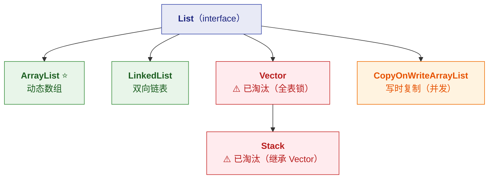
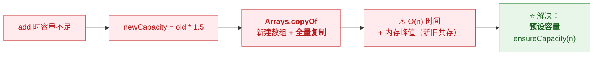
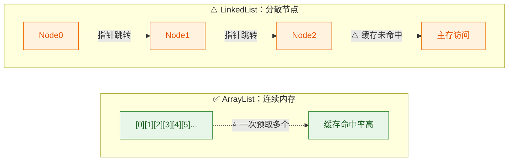
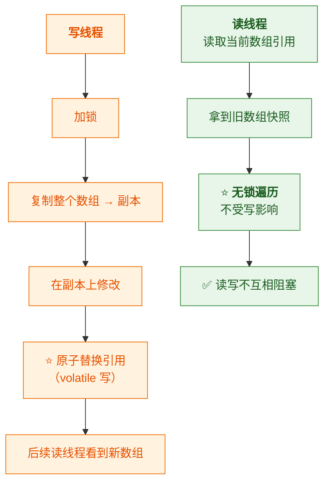
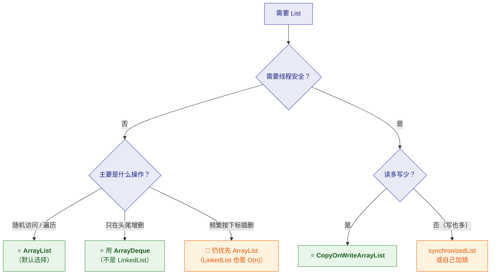

# 📋 三、List 专题

> [!abstract] 本篇定位
> 把 `List` 家族讲透：**`ArrayList` 的扩容机制、`LinkedList` 的真相、
> 为什么 `Vector` 被淘汰、`CopyOnWriteArrayList` 何时用**。
>
> 前置见 [[0-Collection总览]]；HashMap 见 [[1-HashMap全解]]。

---

## 一、List 家族全景



| 实现 | 底层 | 线程安全 | 现状 |
|---|---|---|---|
| ⭐ **`ArrayList`** | **动态数组** | ❌ | ⭐ **默认选择（95% 场景）** |
| **`LinkedList`** | **双向链表** | ❌ | ⚠️ **被高估了**（见 §三） |
| **`Vector`** | 动态数组 | ✅（全表锁） | ⚠️ **已淘汰** |
| **`Stack`** | 继承 `Vector` | ✅（全表锁） | ⚠️ **已淘汰**（用 `ArrayDeque`） |
| **`CopyOnWriteArrayList`** | 数组 + 写时复制 | ✅ | 读多写少场景 |

---

## 二、⭐ `ArrayList` 深度解析

### 2.1 核心字段

```java
public class ArrayList<E> extends AbstractList<E>
        implements List<E>, RandomAccess, Cloneable, Serializable {

    transient Object[] elementData;   // ⭐ 真正存数据的数组
    private int size;                 // ⭐ 元素个数（不是数组长度！）
    private static final int DEFAULT_CAPACITY = 10;
    private static final Object[] DEFAULTCAPACITY_EMPTY_ELEMENTDATA = {};
}
```

> [!important] ⭐⭐ 一个必须分清的点：`size` vs `elementData.length`
> | | 含义 |
> |---|---|
> | **`size`** | ⭐ **实际元素个数**（`list.size()` 返回它） |
> | **`elementData.length`** | ⭐ **数组容量**（能装多少，不暴露给用户） |
>
> **通常 `size <= elementData.length`**——
> **多出来的空间是"预留的富余"。**
>
> 👉 **`new ArrayList<>(100)` 的 `size()` 是 0，但数组长度是 100。**

### 2.2 ⭐ `ArrayList(0)` 与懒初始化

> [!warning] ⚠️ 一个容易混淆的历史演变
> | 场景 | JDK 行为 |
> |---|---|
> | `new ArrayList<>()` | ⭐ **空数组**（`DEFAULTCAPACITY_EMPTY_ELEMENTDATA`），**首次 add 才扩到 10** |
> | `new ArrayList<>(0)` | **空数组**（`EMPTY_ELEMENTDATA`），**首次 add 扩到 1** |
> | `new ArrayList<>(5)` | **直接分配长度 5 的数组** |
>
> ⭐ **两个"空数组"常量是不同的对象**——
> **`add` 时靠"是不是 `DEFAULTCAPACITY_EMPTY_ELEMENTDATA`"来区分"要不要用默认 10"。**

```java
// 第一次 add 时的逻辑（简化）
private void add(E e, Object[] elementData, int s) {
    if (s == size)
        elementData = grow();          // ⭐ 触发扩容
    elementData[s] = e;
    size = s + 1;
}

private Object[] grow() {
    return grow(size + 1);
}

private Object[] grow(int minCapacity) {
    // ⭐ 关键：如果是"默认空数组"，用 DEFAULT_CAPACITY(10)，否则用请求的容量
    int newCapacity = newLength(oldCapacity,
            minCapacity - oldCapacity,
            oldCapacity >> 1);          // ⭐ 1.5 倍
    ...
}
```

### 2.3 ⭐⭐ 扩容机制：1.5 倍

```java
// ArrayList 的扩容（JDK 8+）
private void grow(int minCapacity) {
    int oldCapacity = elementData.length;
    int newCapacity = oldCapacity + (oldCapacity >> 1);   // ⭐ 1.5 倍
    if (newCapacity - minCapacity < 0)
        newCapacity = minCapacity;                        // 至少满足需求
    if (newCapacity - MAX_ARRAY_SIZE > 0)
        newCapacity = hugeCapacity(minCapacity);          // 处理极大值
    elementData = Arrays.copyOf(elementData, newCapacity); // ⭐ 全量复制
}
```

| 容量 | 扩容后 |
|---|---|
| 0 | **10**（首次 add，用默认容量） |
| 10 | **15** |
| 15 | **22** |
| 100 | **150** |

> [!important] ⭐ 为什么是 1.5 倍（不是 2 倍）
> | 倍数 | 问题 |
> |---|---|
> | **1.5 倍** | ⭐ **空间利用率与复制次数的折中** |
> | **2 倍**（如 `Vector`） | ⚠️ **空间浪费更多**；且难以复用之前释放的内存（总和增长太快） |
> | **1.1 倍** | ⚠️ **扩容过于频繁**，复制次数多 |
>
> **数学直觉**：**倍数越小 → 空间越省但复制越频繁；
> 倍数越大 → 复制越少但空间越浪费。1.5 是常用折中。**
>
> ⭐ **另一个技术原因**：**1.5 倍时，`oldCapacity + (oldCapacity >> 1)` 可以用
> 移位 + 加法实现**（比乘法快）——**而且多次扩容后的总容量增长比较平滑。**

### 2.4 ⚠️ 扩容的代价



```java
// ⭐ 明确知道大概多少个元素时，直接预设
List<String> list = new ArrayList<>(10000);   // 一次到位，零扩容
```

> [!tip] ⭐ `ArrayList` 要"预估"而不是"反推负载因子"
> **对比 `HashMap`**（[[2-HashMap实战]] §三）：
> | | 预设方式 |
> |---|---|
> | **`HashMap`** | ⭐ **要除以 0.75**（因为有负载因子） |
> | **`ArrayList`** | ⭐ **直接传元素个数**（没有负载因子概念） |
>
> **因为 `ArrayList` 只在"满了"时才扩容**，
> **而 `HashMap` 在"到 75%"时就扩容。**

### 2.5 `RandomAccess` 接口的意义

```java
public class ArrayList<E> implements List<E>, RandomAccess, ... { }
public class LinkedList<E> implements List<E>, Deque<E>, ... { }   // ⚠️ 没有 RandomAccess
```

> [!important] ⭐ 这是个"标记接口"（空接口）
> **它的唯一作用：告诉调用方"我的 `get(i)` 是 O(1)"**——
> **让通用算法能据此选择"下标遍历"还是"迭代器遍历"。**
>
> **JDK 里的实际应用**：
> ```java
> // Collections.binarySearch 内部就这么做
> public static <T> int binarySearch(List<? extends Comparable<? super T>> list, T key) {
>     if (list instanceof RandomAccess || list.size() < BINARYSEARCH_THRESHOLD)
>         return Collections.indexedBinarySearch(list, key);   // ⭐ 下标访问
>     else
>         return Collections.iteratorBinarySearch(list, key);  // ⭐ 迭代器访问
> }
> ```
>
> 👉 **所以"遍历 LinkedList 用 `for(int i=0;i<size;i++) list.get(i)`"是灾难**——
> **`get(i)` 是 O(n)，整体变成 O(n²)。**

### 2.6 ⭐ `modCount` 与 fail-fast

```java
public class ArrayList<E> extends AbstractList<E> {
    protected transient int modCount = 0;    // 来自 AbstractList
}

// 迭代器记录期望值
private class Itr implements Iterator<E> {
    int expectedModCount = modCount;

    public E next() {
        checkForComodification();            // ⭐ 检查
        ...
    }
    final void checkForComodification() {
        if (modCount != expectedModCount)
            throw new ConcurrentModificationException();   // ⭐ CME
    }
}
```

> [!danger] ⚠️ 经典错误：遍历时删除
> ```java
> // ❌ 抛 ConcurrentModificationException
> for (String s : list) {
>     if (s.equals("x")) list.remove(s);
> }
> ```
>
> **为什么**：`for-each` 底层是迭代器，**`list.remove` 改的是 `modCount`**，
> 而**迭代器持有的 `expectedModCount` 没变** → **下次 `next()` 检查失败**。

**三种正确做法**：

```java
// ✅ 方式一：显式用迭代器（迭代器的 remove 会同步 modCount）
Iterator<String> it = list.iterator();
while (it.hasNext()) {
    if (it.next().equals("x")) it.remove();      // ⭐ 迭代器的 remove
}

// ✅ 方式二：removeIf（JDK 8+，最简洁）
list.removeIf(s -> s.equals("x"));

// ✅ 方式三：倒序删除（避免下标错位）
for (int i = list.size() - 1; i >= 0; i--) {
    if (list.get(i).equals("x")) list.remove(i);
}
```

> [!warning] ⚠️ 为什么"普通 for 正序删除"也是错的
> ```java
> // ❌ 逻辑 bug（不一定抛异常，但会漏删）
> for (int i = 0; i < list.size(); i++) {
>     if (list.get(i).equals("x")) list.remove(i);   // ⚠️ 删除后后面元素前移
> }
> ```
> **删除 `i` 之后，原来的 `i+1` 变成了新的 `i`**，
> **但循环 `i++` 跳过了它** → **漏删相邻元素。**
>
> ⭐ **这是"逻辑错误"而不是"异常"——更危险**（不报错但结果错）。

---

## 三、⭐⭐ `LinkedList`：被高估的容器

### 3.1 结构

```java
public class LinkedList<E> extends AbstractSequentialList<E>
        implements List<E>, Deque<E>, Cloneable, Serializable {

    transient int size = 0;
    transient Node<E> first;      // ⭐ 头指针
    transient Node<E> last;       // ⭐ 尾指针

    private static class Node<E> {
        E item;
        Node<E> next;
        Node<E> prev;             // ⭐ 双向
    }
}
```

### 3.2 ⭐⭐ "增删快"是有条件的（最重要的认知纠正）

> [!danger] ⚠️⭐ 这是面试最大的坑
> **`LinkedList` 的"增删快"只对"已经定位到节点"的情况成立。**
>
> | 操作 | `ArrayList` | `LinkedList` |
> |---|---|---|
> | **按下标 `add(i, e)` / `remove(i)`** | **O(n)**（要搬移） | ⭐ **O(n)**（要**先遍历**到 i） |
> | **按引用删除**（已有节点） | O(n) | ⭐ **O(1)** |
> | **头尾增删** | 头部 O(n)、尾部**均摊 O(1)** | ⭐ **O(1)** |
> | **随机 `get(i)`** | ⭐ **O(1)** | ⚠️ **O(n)** |
> | **遍历** | ⭐ **快**（连续内存） | ⚠️ **慢**（指针跳转 + 缓存不友好） |

> [!important] ⭐⭐ 核心结论
> **`LinkedList` 的 `get(i)` 是 O(n)**——**它必须先从头（或尾）遍历到第 i 个。**
> **而 `add(i, e)` 也要先 `get(i)` 定位** → **所以也是 O(n)！**
>
> 👉 **"LinkedList 增删快"这句话，在"按下标操作"的场景下是错的。**
>
> **它真正快的场景是**：
> **已经持有某个 `Node` 引用**（或只在头尾操作）——
> **而在 `List` 接口下你根本拿不到 `Node`**（`ListIterator` 可以）。

### 3.3 ⭐ 为什么 `LinkedList` 通常更慢（CPU 缓存）

> [!important] ⭐ 一个超出"复杂度分析"的关键因素
> **`ArrayList` 的元素在内存里是连续的**——
> **读取时能利用 CPU 缓存行（cache line）预取**，**命中率极高**。
>
> **`LinkedList` 的每个 `Node` 散落在堆上**——
> **每次 `next` 都可能是一次"缓存未命中"**（要访问主存）。
>
> **实测中，即使理论上都是 O(n)，
> `ArrayList` 的遍历也常比 `LinkedList` 快几倍。**



### 3.4 ⭐ 什么时候真的该用 `LinkedList`

| 场景 | 更优选择 |
|---|---|
| ⭐ **当队列/栈用（头尾操作）** | ⭐ **`ArrayDeque`**（不是 `LinkedList`！） |
| **需要 `Deque` 接口** | `ArrayDeque` |
| **频繁在"已知位置"插入删除** | 🤔 **仍然优先考虑 `ArrayList`**（见下） |
| **超大列表、内存碎片敏感** | `ArrayList` |

> [!warning] ⚠️ `ArrayDeque` 通常优于 `LinkedList`（即使当队列用）
> | | `LinkedList` | ⭐ **`ArrayDeque`** |
> |---|---|---|
> | 底层 | 双向链表 | ⭐ **循环数组** |
> | 内存 | 每元素一个 `Node` 对象（开销大） | ⭐ **紧凑** |
> | 缓存 | ⚠️ 差 | ⭐ **好** |
> | 允许 null | ✅ | ❌ **不允许** |
> | 性能 | 基准 | ⭐ **通常更快** |
>
> 👉 **`ArrayDeque` 是 Java 里"栈和队列"的首选实现。**

> [!success] ⭐ 一句话总结（面试可以直说）
> **"`LinkedList` 在实践中几乎没有优势场景：**
> - **当 `List` 用**：`get`/`add(i)` 都是 O(n)，还多占内存、缓存差
> - **当 `Deque` 用**：`ArrayDeque` 更快
>
> **所以"增删快"这个说法，只在'已持有节点引用'时才成立——
> 而 `List` 接口根本不给你这个引用。"**

---

## 四、⚠️ `Vector` 与 `Stack`：为什么淘汰

```java
// Vector：所有方法都加 synchronized
public synchronized boolean add(E e) { ... }
public synchronized E get(int index) { ... }
public synchronized E remove(int index) { ... }
```

| 问题 | 说明 |
|---|---|
| ⭐ **全表锁** | **每个方法都 `synchronized`** → **并发性能差** |
| ⭐ **扩容 2 倍** | 比 `ArrayList` 的 1.5 倍更浪费空间 |
| **`Stack` 继承 `Vector`** | ⚠️ **继承了全表锁**；且**继承关系不合理**（栈不是列表） |
| **API 冗余** | 有 `elementAt`/`setElementAt` 等老 API |

> [!danger] ⚠️ `Stack` 的三宗罪
> 1. ⭐ **继承 `Vector` → 全表锁**（性能差）
> 2. ⭐ **继承了 `List` 的全部方法** → **可以用 `get(0)` 从栈底取元素**，
>    **破坏了"栈"的语义封装**
> 3. **`Deque` 接口更完整**（`push`/`pop`/`peek` 都有，且支持双端）

**替代方案**：

```java
// ❌ 老写法
Stack<String> stack = new Stack<>();
stack.push("a");
stack.pop();

// ✅ 新写法
Deque<String> stack = new ArrayDeque<>();
stack.push("a");      // ⭐ 等价 addFirst
stack.pop();          // ⭐ 等价 removeFirst
```

> [!important] ⚠️ 一个容易踩的 `ArrayDeque` 坑
> **`ArrayDeque` 不允许 `null`！**
> ```java
> Deque<String> d = new ArrayDeque<>();
> d.push(null);        // ⭐ NullPointerException
> ```
> **如果业务上需要存 `null`，只能退回 `LinkedList`。**
> （这是"用 `ArrayDeque` 替代 `LinkedList`"唯一的例外）

---

## 五、`CopyOnWriteArrayList`：读多写少

### 5.1 原理：写时复制

```java
public boolean add(E e) {
    synchronized (lock) {
        Object[] es = getArray();
        int len = es.length;
        Object[] newElements = Arrays.copyOf(es, len + 1);   // ⭐ 复制整个数组
        newElements[len] = e;                                // 改副本
        setArray(newElements);                               // ⭐ 原子替换引用
        return true;
    }
}
```



| 特性 | 说明 |
|---|---|
| ⭐ **读** | **完全无锁**（读的是不可变快照） |
| ⭐ **写** | **加锁 + 复制整个数组** |
| **迭代器** | ⭐ **不会抛 CME**（遍历的是快照） |
| **一致性** | ⭐ **弱一致**（读不到写线程"正在做"的修改） |

### 5.2 ⭐ 适用与不适用

| ✅ 适合 | ❌ 不适合 |
|---|---|
| ⭐ **读远多于写**（如监听器列表、配置） | ⚠️ **写频繁**——每次写都复制 O(n) |
| **遍历多、修改少** | **数据量大且经常变** |
| **不允许遍历时抛 CME** | **要求"写后立即读到"** |

> [!danger] ⚠️ 写频繁时性能灾难
> **每次 `add` 都要 `Arrays.copyOf` 整个数组**——
> **10000 个元素的列表，加一个元素要复制 10000 个引用。**
> **如果是"循环里不断 add"，性能会极差。**
>
> 👉 **判断标准**：**"写操作的数量级是否远小于读？"**
> **如果写也很多，应该用 `Collections.synchronizedList` 或加锁自己控制。**

> [!tip] ⭐ 典型正例：监听器列表
> ```java
> // 事件监听器：注册少、触发多、且触发时不能因为遍历被阻塞
> private final List<Listener> listeners = new CopyOnWriteArrayList<>();
>
> public void fireEvent(Event e) {
>     for (Listener l : listeners) {   // ⭐ 无锁遍历，不怕注册/注销
>         l.onEvent(e);
>     }
> }
> ```

---

## 六、⭐ List 选型决策



---

## 七、30 秒速查表

| 问题 | 一句话答案 |
|---|---|
| List 默认用什么 | ⭐ **`ArrayList`**（95% 场景） |
| `ArrayList` 底层 | **动态数组 `Object[]`** |
| ⭐ `size` 与数组长度 | ⭐ **`size` 是元素数，数组长度是容量**，通常 `size <= length` |
| `new ArrayList<>(100)` 的 size | ⭐ **0**（数组长度才是 100） |
| `new ArrayList<>()` 初始容量 | ⭐ **0**（空数组），**首次 add 才扩到 10** |
| ⭐⭐ 扩容倍数 | ⭐ **1.5 倍**（`old + (old >> 1)`） |
| 为什么是 1.5 不是 2 | **空间与复制次数的折中**；2 倍更浪费（`Vector` 就是 2 倍） |
| 扩容代价 | ⭐ **`Arrays.copyOf` 全量复制，O(n)** |
| 怎么避免扩容 | ⭐ **`new ArrayList<>(预估个数)`** |
| `ArrayList` 预设要除 0.75 吗 | ❌ **不用**（那是 HashMap 的规则） |
| ⭐ `RandomAccess` 是什么 | **标记接口**，表示"`get(i)` 是 O(1)" |
| 谁实现了 `RandomAccess` | ⭐ **`ArrayList` 实现了；`LinkedList` 没有** |
| 为什么它重要 | **让通用算法选择"下标"还是"迭代器"遍历** |
| ⭐ `LinkedList.get(i)` 复杂度 | ⚠️ **O(n)**——必须先遍历到 i |
| ⭐⭐ "LinkedList 增删快"对吗 | ⚠️ **只在"已持有节点引用"时成立**；**按下标也是 O(n)** |
| `LinkedList` 为什么通常更慢 | ⭐ **节点分散 → CPU 缓存不友好** |
| 栈/队列该用什么 | ⭐ **`ArrayDeque`**（不是 `LinkedList`） |
| ⚠️ `ArrayDeque` 的限制 | ❌ **不允许 `null`** |
| 为什么淘汰 `Vector` | ⭐ **全表锁 + 扩容 2 倍** |
| 为什么淘汰 `Stack` | ⭐ **继承 `Vector`（全表锁）+ 暴露 List 方法破坏语义** |
| ⭐ 遍历时删除的正确做法 | **`iterator.remove()` / `removeIf` / 倒序删除** |
| 正序 for 删除的问题 | ⚠️ **删除后元素前移 → 漏删**（不一定报错） |
| `CopyOnWriteArrayList` 原理 | ⭐ **写时复制整个数组 + 原子替换引用** |
| 它的读要加锁吗 | ⭐ **不用**（读的是快照） |
| 它的迭代器抛 CME 吗 | ⭐ **不抛**（遍历快照） |
| ⚠️ 它适合什么 | ⭐ **读多写少**（如监听器列表） |
| ⚠️ 它不适合什么 | **写频繁**（每次写 O(n) 复制） |

---

## 八、学习检查清单

- [ ] ⭐ 能画出 **List 家族**并说出各自现状
- [ ] ⭐ 能分清 **`size` 与 `elementData.length`**
- [ ] ⭐ 能说清 **`new ArrayList<>()` 的懒初始化**（首次 add 才到 10）
- [ ] ⭐⭐ 能说出**扩容倍数 1.5 及原因**（对比 `Vector` 的 2 倍）
- [ ] ⭐ 能说出**扩容的代价**及"预设容量"的做法
- [ ] ⭐ 能说清 **`ArrayList` 与 `HashMap` 预设方式的区别**（要不要除 0.75）
- [ ] ⭐ 能解释 **`RandomAccess` 标记接口**的作用
- [ ] ⭐⭐ 能说清 **`LinkedList.get(i)` 是 O(n)** 及"增删快"的成立条件
- [ ] ⭐ 能解释 **`LinkedList` 为什么通常更慢**（CPU 缓存）
- [ ] ⭐ 能说出**栈/队列首选 `ArrayDeque`**（及它的 null 限制）
- [ ] ⭐ 能说出**为什么淘汰 `Vector` 和 `Stack`**
- [ ] ⭐ 能说出**遍历时删除的三种正确做法**
- [ ] ⚠️ 能说清"**正序 for 删除会漏删**"这个逻辑 bug
- [ ] ⭐ 能画出 **`CopyOnWriteArrayList` 的写时复制流程**
- [ ] ⭐ 能判断**什么时候该用/不该用 `CopyOnWriteArrayList`**
- [ ] ⭐ 能根据场景**做出 List 选型决策**

---
> 上一篇 → [[2-HashMap实战]] ｜ 下一篇 → [[4-Set与Queue专题]] ｜ 返回 [[0-Collection总览]]
