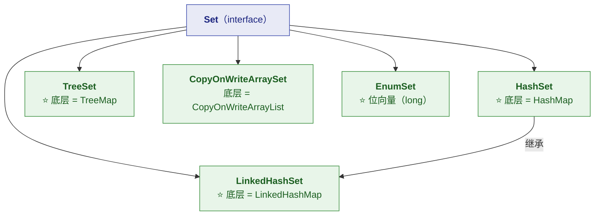
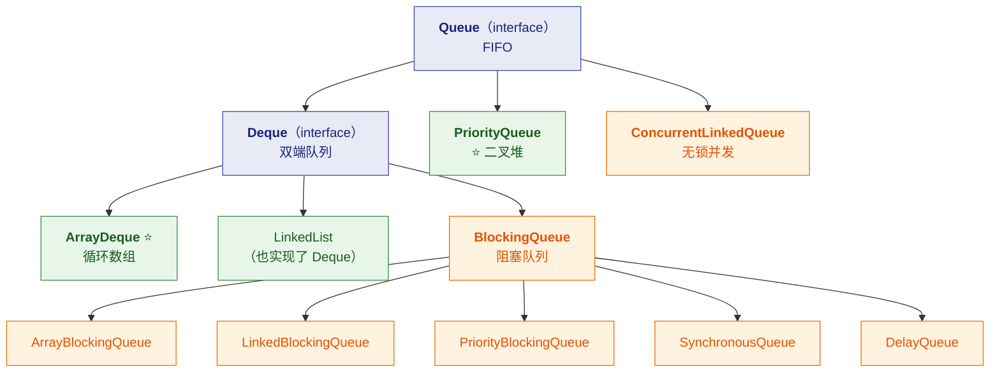

# 🎯 四、Set 与 Queue 专题

> [!abstract] 本篇定位
> **Set**（去重）与 **Queue**（排队）两个家族。
> 核心洞察：⭐ **`HashSet` 就是 `HashMap`，`TreeSet` 就是 `TreeMap`**——
> **搞懂 Map，Set 就懂了一半。**
>
> 前置见 [[0-Collection总览]]、[[1-HashMap全解]]；List 见 [[3-List专题]]。

---

## 一、⭐ Set 家族：底层都是 Map



> [!important] ⭐⭐ 一张表看穿 Set 的本质
> | Set 实现 | 底层容器 | 顺序 | 复杂度 | `null` |
> |---|---|---|---|---|
> | **`HashSet`** | ⭐ **`HashMap`** | ❌ 无序 | O(1) | ✅ 允许 1 个 |
> | **`LinkedHashSet`** | ⭐ **`LinkedHashMap`** | ✅ **插入顺序** | O(1) | ✅ 允许 |
> | **`TreeSet`** | ⭐ **`TreeMap`** | ✅ **排序** | O(log n) | ❌ **不允许** |
> | **`CopyOnWriteArraySet`** | `CopyOnWriteArrayList` | ✅ 插入顺序 | 读 O(1)、**写 O(n)** | ✅ |
> | **`EnumSet`** | ⭐ **位向量** | ✅ 枚举顺序 | O(1) | ❌ |

### 1.1 `HashSet` 的源码（一眼看穿）

```java
public class HashSet<E> extends AbstractSet<E>
        implements Set<E>, Cloneable, Serializable {

    private transient HashMap<E, Object> map;          // ⭐ 真正的容器
    private static final Object PRESENT = new Object(); // ⭐ 哑值（占位）

    public HashSet() { map = new HashMap<>(); }

    public boolean add(E e) {
        return map.put(e, PRESENT) == null;            // ⭐ 返回值判断"是否是新增"
    }

    public boolean contains(Object o) {
        return map.containsKey(o);                     // ⭐ 直接委托
    }

    public boolean remove(Object o) {
        return map.remove(o) == PRESENT;
    }

    public Iterator<E> iterator() {
        return map.keySet().iterator();                // ⭐ 遍历 key
    }
}
```

> [!success] ⭐ 这个设计非常优雅
> **所有 `Set` 操作都委托给 `Map`**——
> **`add(e)` = `map.put(e, PRESENT)`，`contains(e)` = `map.containsKey(e)`。**
>
> **`PRESENT` 是个共享的哑值对象**（所有 key 共用同一个 value）——
> **不浪费内存。**
>
> 👉 **所以 `HashSet` 的全部特性都继承自 `HashMap`**：
> **2 的幂容量、1.5 倍扩容……不，是 0.75 负载因子、树化、hash 扰动。**
> ⭐ **包括"线程不安全"和"1.7 头插成环"的坑！**

> [!warning] ⚠️ 一个实用推论
> **既然 `HashSet` 底层是 `HashMap`，那么**：
> - **`HashSet` 也有"负载因子 0.75"** → 预设容量**同样要除以 0.75**
> - **`HashSet` 的 key 也必须正确实现 `equals`/`hashCode`**（**这是去重的依据**）
> - **`HashSet` 也是线程不安全的**
>
> ⭐ **预设容量的正确写法**（和 HashMap 一样）：
> ```java
> new HashSet<>((int) (expectedSize / 0.75f) + 1);
> ```

### 1.2 ⚠️ Set 去重的依据：`equals` + `hashCode`

```java
Set<User> set = new HashSet<>();
set.add(new User("Tom"));
set.contains(new User("Tom"));    // ⭐ 取决于 User 有没有正确实现契约
```

> [!danger] ⚠️ 与 HashMap key 完全相同的坑
> **`HashSet` 去重靠的是 `hashCode` 找桶 + `equals` 确认**——
> **只重写 `equals` 不重写 `hashCode` → 去重完全失效。**
>
> ```java
> // ❌ 只重写 equals
> Set<User> set = new HashSet<>();
> set.add(new User("Tom"));
> set.add(new User("Tom"));
> System.out.println(set.size());   // ⭐ 2！去重失败
> ```
> **详细成因见 [[2-HashMap实战]] §1.2。**

### 1.3 `LinkedHashSet`：既去重又保序

> [!important] ⭐ 它怎么做到"既哈希又保序"
> **底层是 `LinkedHashMap`**——**即 `HashMap` + 一条双向链表**。
> **链表把所有 Entry 按插入顺序串起来**，所以迭代时有序。
>
> ```java
> // LinkedHashSet 的构造：调 LinkedHashMap 的构造
> public LinkedHashSet() {
>     map = new LinkedHashMap<>();
> }
> ```

| | `HashSet` | `LinkedHashSet` |
|---|---|---|
| 顺序 | ❌ 无序 | ✅ **插入顺序** |
| 性能 | 略快 | 略慢（维护链表） |
| 内存 | 小 | 略大（链表指针） |
| 用途 | 只要去重 | ⭐ **既要去重又要顺序** |

> [!tip] ⭐ 一个实用场景
> **"去重但要保留第一次出现的顺序"**——比如：
> ```java
> // ⭐ 最常见的用法：数组去重且保序
> List<String> unique = new ArrayList<>(new LinkedHashSet<>(originalList));
> ```
> **如果用 `HashSet`，顺序就乱了。**

### 1.4 `TreeSet`：排序去重

> [!important] ⭐ 底层是 `TreeMap`（红黑树）
> **所以 `TreeSet` 的全部特性来自 `TreeMap`**：
> - ✅ **自动排序**（自然序或比较器）
> - ✅ **`NavigableSet` 的独有能力**（见下）
> - ⚠️ **O(log n)**（不是 O(1)）
> - ⚠️ **不允许 `null`**（要用 `compareTo`，`null` 会 NPE）

**`NavigableSet` 的独有能力**（`HashSet` 没有）：

```java
TreeSet<Integer> set = new TreeSet<>(List.of(10, 20, 30, 40));

set.first();              // 10    ⭐ 最小
set.last();               // 40    ⭐ 最大
set.floor(25);            // 20    ⭐ ≤25 的最大值
set.ceiling(25);          // 30    ⭐ ≥25 的最小值
set.lower(30);            // 20    ⭐ <30 的最大值
set.higher(30);           // 40    ⭐ >30 的最小值
set.headSet(30);          // [10, 20]         ⭐ 视图
set.tailSet(30);          // [30, 40]         ⭐ 视图
set.subSet(20, 40);       // [20, 30]         ⭐ 视图
set.descendingSet();      // [40, 30, 20, 10]
```

> [!success] ⭐ 这些方法是"范围查询"的利器
> **`floor` / `ceiling` / `higher` / `lower` 在做"找最接近的值"时极其方便**——
> **`HashSet` 完全做不到（无序）。**
>
> ⚠️ **注意 `headSet`/`tailSet`/`subSet` 返回的是"视图"**（不是拷贝）：
> **修改原 Set 会反映到视图上**（与 `List.subList` 同理，见 [[1-集合框架]] §12.3）。

> [!danger] ⚠️ `TreeSet` 最危险的坑：比较器与 `equals` 不一致
> ```java
> // 如果 Comparator 认为"相等"，但 equals 认为"不等"
> TreeSet<String> set = new TreeSet<>(String.CASE_INSENSITIVE_ORDER);
> set.add("a");
> set.add("A");
> System.out.println(set.size());    // ⭐ 1 —— "A" 被认为重复！
> ```
> **`TreeSet` 用 `compareTo`/`Comparator` 判断重复，不用 `equals`**——
> **这与 `HashSet` 语义不同，容易踩坑。**
>
> **规则**：⭐ **`Comparator` 的"相等"最好与 `equals` 保持一致。**

### 1.5 ⭐ `EnumSet`：被低估的优化

```java
// ❌ 普通写法
Set<Status> s1 = new HashSet<>();

// ✅ ⭐ 枚举专用：位向量（long 位运算）
Set<Status> s2 = EnumSet.of(Status.ACTIVE, Status.PENDING);
```

| 维度 | `HashSet<Enum>` | ⭐ **`EnumSet`** |
|---|---|---|
| 底层 | 哈希表 | ⭐ **位向量**（`RegularEnumSet` 用一个 `long`） |
| 内存 | 每个元素一个 Entry | ⭐ **64 个枚举只需 8 字节** |
| 性能 | hash 计算 | ⭐ **位运算**（极快） |
| 顺序 | 无序 | ⭐ **枚举声明顺序** |
| `null` | ✅ | ❌ |

> [!important] ⭐ 为什么 `EnumSet` 这么省
> **它内部就是一个 `long`（64 位）**——
> **第 i 位为 1 表示"第 i 个枚举值在集合里"。**
> **所以"加入/判断/删除"都是位运算，O(1) 且常数极小。**
>
> ⚠️ **超过 64 个枚举值时会用 `JumboEnumSet`（`long[]`）**，但很少见。
>
> 👉 **`EnumSet` 在"枚举集合"场景下**：**比 `HashSet` 快得多、省得多**——
> **而且语义更清晰。**
> **同理 `EnumMap`（见 [[2-HashMap实战]] §6.2）。**

---

## 二、Queue 家族



### 2.1 ⭐ `Queue` 的两套 API（容易搞混）

> [!important] ⭐⭐ 每个操作都有"抛异常"和"返回特殊值"两个版本
> | 操作 | **抛异常** | ⭐ **返回特殊值** |
> |---|---|---|
> | **入队** | `add(e)` | ⭐ **`offer(e)`**（满了返回 `false`） |
> | **出队** | `remove()` | ⭐ **`poll()`**（空了返回 `null`） |
> | **查看队首** | `element()` | ⭐ **`peek()`**（空了返回 `null`） |
>
> 👉 **实践建议**：⭐ **优先用 `offer` / `poll` / `peek`**——
> **它们不抛异常，用返回值表达"失败"，更好处理。**
>
> ⚠️ **但 `ArrayDeque` 不允许 `null`**——
> **所以 `poll()` 返回 `null` 意味着"空"（不会有歧义）。**
> **这也是 `ArrayDeque` 禁止 `null` 的原因之一。**

### 2.2 ⭐⭐ `ArrayDeque`：栈和队列的首选

```java
public class ArrayDeque<E> extends AbstractCollection<E>
        implements Deque<E>, Cloneable, Serializable {

    transient Object[] elements;    // ⭐ 循环数组
    transient int head;             // 头指针
    transient int tail;             // 尾指针
}
```

> [!important] ⭐ 循环数组的关键：`head` 和 `tail` 会"绕回去"
> ```java
> // 数组长度 8，head=6，tail=2 时：
> // 元素实际占用：[6][7][0][1]  ← ⭐ 绕了一圈
> ```
> **这样"头尾增删"都不需要搬移元素**——
> **只需移动指针（取模）。**

| 操作 | `ArrayDeque` | `LinkedList` |
|---|---|---|
| 头/尾增删 | ⭐ **均摊 O(1)** | O(1) |
| **CPU 缓存** | ⭐ **好**（连续内存） | ⚠️ 差 |
| **内存开销** | ⭐ **小** | ⚠️ 每元素一个 `Node` |
| **`null`** | ❌ **不允许** | ✅ 允许 |
| **扩容** | 2 倍 | 无（链表） |

> [!success] ⭐ 结论：**栈和队列一律用 `ArrayDeque`**
> ```java
> // ✅ 栈
> Deque<String> stack = new ArrayDeque<>();
> stack.push("a");      // = addFirst
> stack.pop();          // = removeFirst
> stack.peek();         // = peekFirst
>
> // ✅ 队列
> Deque<String> queue = new ArrayDeque<>();
> queue.offer("a");     // = addLast
> queue.poll();         // = pollFirst
> queue.peek();         // = peekFirst
> ```
>
> ⚠️ **注意语义差异**：
> **`push`/`pop` 操作"头部"，`offer`/`poll` 操作"尾部"**——
> **所以同一个 `ArrayDeque` 可以当栈用，也可以当队列用，但别混着用。**

### 2.3 `PriorityQueue`：二叉堆与 topK

```java
public class PriorityQueue<E> extends AbstractQueue<E> {
    transient Object[] queue;    // ⭐ 二叉堆（数组表示）
    private final Comparator<? super E> comparator;
}
```

> [!important] ⭐ 堆的两个关键性质
> 1. **结构性质**：完全二叉树（用数组存，**无指针开销**）
> 2. **堆序性质**：**父节点 ≤ 子节点**（小顶堆，默认）
>
> **关键操作复杂度**：
> | 操作 | 复杂度 |
> |---|---|
> | `peek()`（看堆顶） | ⭐ **O(1)** |
> | `offer()`（插入 + 上浮） | O(log n) |
> | `poll()`（取堆顶 + 下沉） | O(log n) |
> | ⚠️ **`contains()`** | ⚠️ **O(n)**（要线性扫描） |
> | ⚠️ **遍历** | ⚠️ **无序！** |

> [!danger] ⚠️ `PriorityQueue` 两个最容易被坑的点
> **① 遍历是无序的！**
> ```java
> PriorityQueue<Integer> pq = new PriorityQueue<>(List.of(3, 1, 2));
> for (int x : pq) System.out.print(x + " ");   // ⭐ 输出 1 3 2（不是 1 2 3！）
> while (!pq.isEmpty()) System.out.print(pq.poll() + " ");  // ✅ 1 2 3
> ```
> **因为数组只保证"堆序"（父子关系），不保证"整体有序"。**
> **要按顺序输出必须反复 `poll()`。**
>
> **② 不允许 `null`，且要求元素可比较**
> **没有 `Comparator` 时元素必须实现 `Comparable`**，否则 `ClassCastException`。

> [!success] ⭐ `PriorityQueue` 的经典用法：topK 问题
> ```java
> // ⭐ 求"最大的 K 个" → 用小顶堆（堆里只留 K 个）
> int k = 10;
> PriorityQueue<Integer> heap = new PriorityQueue<>(k);   // ⭐ 小顶堆
> for (int num : nums) {
>     heap.offer(num);
>     if (heap.size() > k) {
>         heap.poll();      // ⭐ 弹出最小的 → 留下最大的 K 个
>     }
> }
> // heap 里就是最大的 K 个
> ```
>
> **为什么用小顶堆求 topK 最大？**
> **因为要"快速淘汰最小的"**——`poll()` 是 O(log k)，
> **总体 O(n log k)，优于全排序的 O(n log n)。**

### 2.4 `BlockingQueue`（详见 [[5-并发容器专题]]）

| 实现 | 结构 | 特点 |
|---|---|---|
| **`ArrayBlockingQueue`** | 数组 | ⭐ **有界**（必须指定容量） |
| **`LinkedBlockingQueue`** | 链表 | 可有界可无界（默认 `Integer.MAX_VALUE`） |
| **`PriorityBlockingQueue`** | 堆 | **无界** + 优先级 |
| ⭐ **`SynchronousQueue`** | —— | ⭐ **容量为 0**（直接交接） |
| **`DelayQueue`** | 堆 + 延迟 | 延迟取出 |

> [!note] 细节见 [[5-并发容器专题]] 与 [[1-java/1-juc/5-线程池|5-线程池]]
> **`BlockingQueue` 是线程池的核心**（`ThreadPoolExecutor` 的工作队列）——
> **⚠️ `LinkedBlockingQueue` 默认无界是"任务积压导致 OOM"的常见原因。**

---

## 三、30 秒速查表

| 问题 | 一句话答案 |
|---|---|
| ⭐⭐ `HashSet` 底层是什么 | ⭐ **`HashMap`**（value 是共享的哑值 `PRESENT`） |
| `LinkedHashSet` 底层 | ⭐ **`LinkedHashMap`** |
| `TreeSet` 底层 | ⭐ **`TreeMap`** |
| `add(e)` 怎么实现 | ⭐ **`map.put(e, PRESENT) == null`** |
| ⭐ `HashSet` 有负载因子吗 | ⭐ **有（0.75）**——预设容量**同样要除 0.75** |
| Set 去重靠什么 | ⭐ **`hashCode` 找桶 + `equals` 确认** |
| 只重写 `equals` 会怎样 | ⭐ **去重失效**（两个"相等"对象都进去） |
| `LinkedHashSet` 保什么序 | ⭐ **插入顺序** |
| ⭐ 数组去重且保序怎么写 | **`new ArrayList<>(new LinkedHashSet<>(list))`** |
| `TreeSet` 的复杂度 | **O(log n)**（红黑树） |
| `TreeSet` 允许 null 吗 | ❌ **不允许**（要 `compareTo`） |
| `TreeSet` 的独有能力 | ⭐ **`floor` / `ceiling` / `higher` / `lower`**（范围查询） |
| ⚠️ `TreeSet` 怎么判重复 | ⭐ **用 `compareTo`/`Comparator`，不用 `equals`** |
| ⚠️ 比较器与 equals 不一致 | **会被误判为重复**（如 `CASE_INSENSITIVE_ORDER`） |
| ⭐ `EnumSet` 好在哪 | ⭐ **位向量（一个 `long`）**——极省内存、极快、有序 |
| `Queue` 两套 API | **抛异常**：`add`/`remove`/`element`；⭐ **返回值**：`offer`/`poll`/`peek` |
| 该用哪套 | ⭐ **`offer`/`poll`/`peek`**（不抛异常） |
| ⭐⭐ 栈/队列首选 | ⭐ **`ArrayDeque`**（循环数组） |
| ⚠️ `ArrayDeque` 的限制 | ❌ **不允许 `null`** |
| ⚠️ 为什么 `ArrayDeque` 禁 null | **让 `poll()` 返回 null 无歧义**（只表示"空"） |
| `ArrayDeque` 扩容倍数 | **2 倍** |
| `PriorityQueue` 底层 | ⭐ **二叉堆**（用数组存完全二叉树） |
| 堆顶操作复杂度 | ⭐ **`peek()` O(1)**；`offer`/`poll` **O(log n)** |
| ⚠️ `PriorityQueue` 遍历有序吗 | ❌ **无序**（只保证堆序，不保证整体有序） |
| 怎么按序输出 | ⭐ **反复 `poll()`** |
| ⭐ topK 用什么堆 | ⭐ **求最大 K 个 → 小顶堆**（快速淘汰最小） |
| topK 的复杂度 | **O(n log k)**（优于全排序 O(n log n)） |
| `BlockingQueue` 干嘛的 | **线程池的工作队列**（详见并发容器篇） |

---

## 四、学习检查清单

- [ ] ⭐⭐ 能说出 **`HashSet`/`LinkedHashSet`/`TreeSet` 的底层**都是对应 Map
- [ ] ⭐ 能写出 **`HashSet.add` 的源码**（`map.put(e, PRESENT)`）
- [ ] ⭐ 能说出 **`HashSet` 同样有 0.75 负载因子**（预设要除）
- [ ] ⭐ 能说清 **Set 去重靠 `equals` + `hashCode`**，及只重写一个的后果
- [ ] ⭐ 能说出 **`LinkedHashSet` 保插入序**及"去重且保序"的写法
- [ ] ⭐ 能说出 **`TreeSet` 的 `NavigableSet` 独有能力**（`floor`/`ceiling`…）
- [ ] ⚠️ 能说清 **`TreeSet` 用比较器判重复**这个与 `HashSet` 的语义差异
- [ ] ⭐ 能解释 **`EnumSet` 为什么极省**（位向量）
- [ ] ⭐ 能背出 **`Queue` 的两套 API** 及推荐用哪套
- [ ] ⭐⭐ 能说清**栈/队列为什么首选 `ArrayDeque`**（缓存 + 内存）
- [ ] ⚠️ 能说出 **`ArrayDeque` 不允许 `null`** 及这个设计的好处
- [ ] ⭐ 能解释 **`PriorityQueue` 的堆结构**及各操作复杂度
- [ ] ⚠️ 能说清 **`PriorityQueue` 遍历无序**这个坑
- [ ] ⭐ 能用 **`PriorityQueue` 手写 topK** 并解释为什么用小顶堆
- [ ] 能说出 **`BlockingQueue` 各实现**的区别

---
> 上一篇 → [[3-List专题]] ｜ 下一篇 → [[5-并发容器专题]] ｜ 返回 [[0-Collection总览]]
