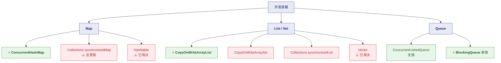
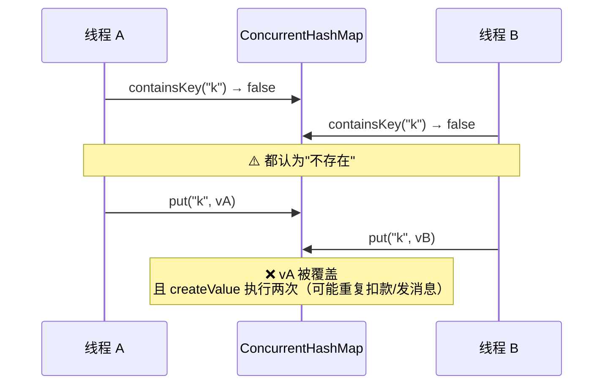
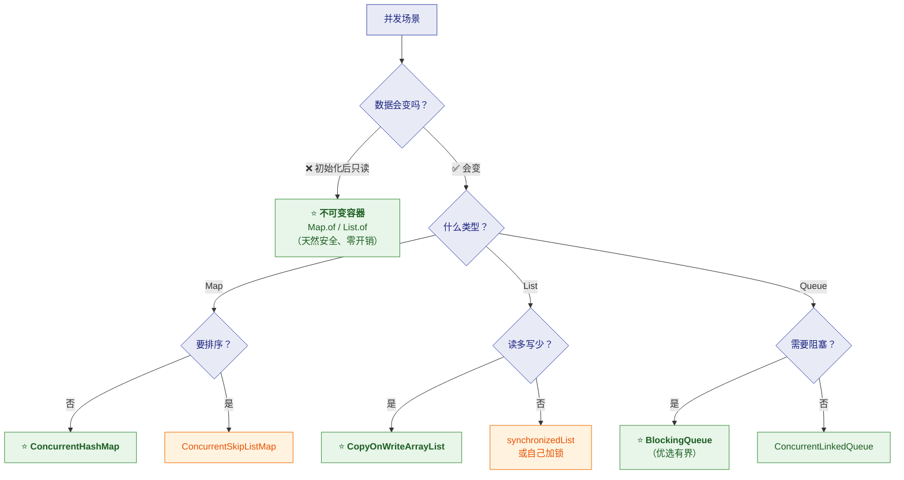

# 🔒 五、并发容器专题

> [!abstract] 本篇定位
> **并发场景该选什么容器、为什么、有什么坑。**
> 核心是 **`ConcurrentHashMap`**（面试必问），
> 外加 `CopyOnWrite` 家族与 `BlockingQueue`。
>
> ⭐ **CHM 的完整源码分析（分段锁演进、size 分散计数、扩容协作）
> 见 [[1-java/1-juc/6-JUC并发工具|6-JUC并发工具]] 与 [[1-java/1-juc/了解一下：ConcurrentHashMap（详细整理版）|CHM 详细整理版]]。**
> 本篇聚焦**选型与实战**。

---

## 一、⭐ 并发容器全景



### 1.1 ⚠️ 先破除一个误解

> [!danger] ⚠️ `Collections.synchronizedXxx` 是"包装器"，不是"并发容器"
> ```java
> Map<String, String> m = Collections.synchronizedMap(new HashMap<>());
> ```
> **它只是在每个方法外面套了一层 `synchronized`**——
> **本质是"全表锁"，和 `Hashtable` 一个思路。**
>
> ⭐ **而且它有个致命陷阱**：
> ```java
> // ❌ 复合操作仍然不是原子的！
> if (!m.containsKey(k)) {     // 加锁
>     m.put(k, v);             // 解锁 → 中间可能被别人插入
> }
>
> // ❌ 遍历时必须手动加锁（文档明确要求）
> synchronized (m) {
>     for (Map.Entry<String,String> e : m.entrySet()) { ... }
> }
> ```
> **"包装成同步的" ≠ "所有操作都原子"。**
>
> 👉 **所以并发场景应该直接用 `ConcurrentHashMap`，而不是包装 `HashMap`。**

---

## 二、⭐⭐ `ConcurrentHashMap` 选型要点

### 2.1 为什么选它

| 维度 | `Hashtable` / `synchronizedMap` | ⭐ **`ConcurrentHashMap`** |
|---|---|---|
| 锁粒度 | ⭐ **整张表**（全表锁） | ⭐ **单个桶**（1.8） |
| 并发度 | **1**（完全串行） | ⭐ **桶数量级** |
| 读操作 | ⭐ **也要加锁** | ⭐ **完全无锁**（volatile） |
| 空桶写入 | 加锁 | ⭐ **CAS 无锁** |
| 扩容 | 单线程 | ⭐ **多线程协作** |
| 迭代器 | 要手动加锁 | ⭐ **弱一致，无需加锁** |

> [!important] ⭐ 一句话
> **`ConcurrentHashMap` 用"桶级锁 + CAS + volatile 无锁读 + 协作扩容"，
> 把并发度从 1 提升到"桶数量级"。**

### 2.2 ⭐ 三个必须记住的 CHM 特性

**① 读操作完全无锁**

```java
// get 不加锁，靠 volatile 保证可见性
static final <K,V> Node<K,V> tabAt(Node<K,V>[] tab, int i) {
    return (Node<K,V>)U.getObjectVolatile(tab, ((long)i << ASHIFT) + ABASE);
}
// Node.val 和 Node.next 都是 volatile
```

**② 空桶用 CAS，非空桶才加锁**

```java
// 空桶：CAS 无锁写入
if (casTabAt(tab, i, null, new Node<K,V>(hash, key, value, null))) break;
// 非空桶：只锁这个桶
else { synchronized (f) { ... } }
```

> [!tip] ⭐ 为什么"大多数写入是无锁的"
> **哈希分布良好时，大多数 key 落在空桶** →
> **走 CAS 无锁路径** → **只有哈希冲突时才加锁。**

**③ 不允许 `null`**

```java
public V put(K key, V value) {
    if (key == null || value == null) throw new NullPointerException();
}
```

> [!important] ⭐⭐ 为什么禁止 null（最高频考点）
> **不是"做不到"，而是并发下无法提供可靠语义：**
> ```java
> Object v = map.get(k);
> if (v == null) {
>     // ⚠️ 是"key 不存在"还是"value 就是 null"？
> }
> ```
> **单线程的 `HashMap` 可以用 `containsKey` 补一刀区分**——
> **但并发下 `containsKey` + `get` 不是原子的**：
> **两次调用之间状态可能已变，任何依赖这两步的判断都是错的。**
>
> **既然无法提供可靠语义 → 索性禁止 null → 逼调用方显式表达"缺失"。**
>
> ⭐ **标准答法**：**"二义性 + 无法原子地组合两次调用"**——
> 比"CHM 不允许 null"这个结论值钱得多。
>
> ⚠️ **补充**：`Hashtable` 也不允许 null，**但那是历史包袱**；
> **CHM 的禁止是明确的设计决策。**

### 2.3 ⚠️ CHM 不是"全能的线程安全"

> [!danger] ⚠️⭐ `ConcurrentHashMap` 只保证**单方法原子**
> ```java
> // ❌ 经典错误：check-then-act 竞态
> if (!map.containsKey(k)) {
>     map.put(k, createExpensiveValue());
> }
> // ⚠️ 两个线程可能都通过检查 → createValue 执行两次 → 后者覆盖前者
> ```



**正确做法：用原子复合方法**

```java
// ✅ 原子
map.computeIfAbsent(key, k -> createValue());
```

| 原子方法 | 用途 |
|---|---|
| ⭐ **`computeIfAbsent`** | 不存在才计算（**本地缓存/惰性初始化**） |
| `computeIfPresent` | 存在才更新 |
| `compute` | 无论是否存在都计算 |
| ⭐ **`merge`** | 合并（**计数累加**） |
| `putIfAbsent` | 不存在才放 |
| `replace` | 存在才替换 |

```java
// ⭐ merge 做计数（比 get + put 安全得多）
map.merge(key, 1L, Long::sum);

// ⭐ computeIfAbsent 做本地缓存
Cache cache = map.computeIfAbsent(key, k -> loadFromDb(k));
```

> [!success] ⭐ 一条原则（必须记）
> **"CHM 只保证单个方法调用的原子性，不保证多个调用组合的原子。"**
> **任何"先检查、后动作"的写法都可能有竞态**——
> **必须用 `compute*` / `merge` / `putIfAbsent`。**

### 2.4 ⚠️ `computeIfAbsent` 的死锁陷阱

> [!danger] ⚠️ 在 `computeIfAbsent` 里操作**同一个 Map** 会死锁
> ```java
> // ❌ 死锁或并发问题
> map.computeIfAbsent(key, k -> {
>     map.put(otherKey, value);    // ⚠️ 递归修改同一个桶/表
>     return compute(k);
> });
> ```
> **因为 `computeIfAbsent` 在计算时会持有该桶的锁**——
> **在回调里再修改同一个 Map，可能造成死锁或状态破坏。**
>
> ⭐ **规则**：**回调里只做"计算"，不要修改这个 Map 本身。**

### 2.5 `size()` 是近似值

```java
public long mappingCount() { ... }   // ⭐ 推荐：返回 long
public int size() { ... }            // ⚠️ 可能 int 溢出
```

| 方法 | 说明 |
|---|---|
| **`size()`** | ⚠️ **近似值**（`sumCount()` 求和期间可能还在变）；**`int` 可能溢出** |
| ⭐ **`mappingCount()`** | ⭐ **推荐**——返回 `long`，不会截断 |

> [!important] ⭐ 为什么 `size()` 不精确
> **CHM 用 `CounterCell[]` 分散计数**（`LongAdder` 思想）——
> **`sumCount()` 遍历所有 cell 求和，遍历期间可能仍有线程在改**。
>
> **官方注释明确说它是"估计值"。**
> **需要精确计数要自己维护 `LongAdder`。**

---

## 三、`CopyOnWrite` 家族

### 3.1 原理回顾

```java
// CopyOnWriteArrayList.add
public boolean add(E e) {
    synchronized (lock) {
        Object[] es = getArray();
        Object[] newElements = Arrays.copyOf(es, es.length + 1);  // ⭐ 复制
        newElements[es.length] = e;
        setArray(newElements);                                    // ⭐ 原子替换
        return true;
    }
}
```

> [!important] ⭐ 读写分离的代价
> | | `CopyOnWriteArrayList` |
> |---|---|
> | **读** | ⭐ **无锁**（读不可变快照） |
> | **写** | ⚠️ **加锁 + 复制整个数组 O(n)** |
> | **内存** | ⚠️ **写时新旧两份共存** |
> | **一致性** | **弱一致**（读不到"正在写"的数据） |
> | **迭代器** | ⭐ **不抛 CME** |

### 3.2 ⭐ 适用判断

| ✅ 适合 | ❌ 不适合 |
|---|---|
| ⭐ **读远多于写**（监听器、配置、白名单） | ⚠️ **写频繁**（每次 O(n)） |
| **遍历多、修改少** | **数据量大且常变** |
| **要求"遍历不抛 CME"** | **要求"写后立即读到"** |

> [!danger] ⚠️ 反例：把 COW 当普通 List 用
> ```java
> // ❌ 灾难：循环里不断 add
> List<Item> list = new CopyOnWriteArrayList<>();
> for (Item item : source) {
>     list.add(item);      // ⚠️ 每次都复制整个数组 → O(n²)
> }
> ```
> **1 万个元素 = 约 5000 万次引用复制**——
> **性能比 `ArrayList` 差几个数量级。**
>
> 👉 **"读多写少"是它唯一的适用条件**，判断错了就是灾难。

---

## 四、`BlockingQueue` 家族

### 4.1 五种实现的取舍

| 实现 | 结构 | 有界性 | 适用 |
|---|---|---|---|
| **`ArrayBlockingQueue`** | 数组 | ⭐ **有界**（必须指定） | ⭐ **需要背压**（防积压） |
| **`LinkedBlockingQueue`** | 链表 | ⚠️ **可有界可无界**（默认 `Integer.MAX_VALUE`） | 通用，⚠️ **注意默认无界** |
| **`PriorityBlockingQueue`** | 堆 | ⚠️ **无界** | 带优先级 |
| ⭐ **`SynchronousQueue`** | —— | ⭐ **容量 0** | ⭐ **直接交接**（如 `newCachedThreadPool`） |
| **`DelayQueue`** | 堆 + 延迟 | 无界 | **定时任务** |

### 4.2 ⭐ `BlockingQueue` 的四组 API

> [!important] ⭐⭐ 比 `Queue` 多了"阻塞"和"超时"两套
> | 操作 | 抛异常 | 返回特殊值 | ⭐ **阻塞** | ⭐ **超时** |
> |---|---|---|---|---|
> | **入队** | `add(e)` | `offer(e)` | ⭐ **`put(e)`** | `offer(e, t, unit)` |
> | **出队** | `remove()` | `poll()` | ⭐ **`take()`** | `poll(t, unit)` |
>
> **阻塞版的意义**：
> - **`put`**：队满时**阻塞等待**（而不是丢弃或抛异常）
> - **`take`**：队空时**阻塞等待**（而不是返回 null）
>
> 👉 **这就是"生产者-消费者"模式的基石。**

### 4.3 ⚠️ 生产者-消费者模板

```java
BlockingQueue<Task> queue = new ArrayBlockingQueue<>(1000);   // ⭐ 有界！

// 生产者
queue.put(task);          // 满了就阻塞（⭐ 天然背压）

// 消费者
Task task = queue.take(); // 空了就阻塞等待
```

> [!danger] ⚠️⭐ `LinkedBlockingQueue` 默认无界是"OOM 事故"的常见原因
> ```java
> // ⚠️ 默认容量 Integer.MAX_VALUE
> ExecutorService pool = new ExecutorService(...);
> new ThreadPoolExecutor(2, 4, 60L, SECONDS,
>         new LinkedBlockingQueue<>());     // ⚠️ 无界队列！
> ```
> **任务生产速度 > 消费速度时，任务无限堆积 → 内存耗尽 → OOM。**
>
> ⭐ **而且无界队列会让 `maximumPoolSize` 失效**——
> **队列永远不"满"，所以永远不创建新线程**（详见 [[1-java/1-juc/5-线程池|5-线程池]]）。
>
> **正解**：⭐ **用有界队列 + 合理的拒绝策略**（背压）。

---

## 五、⭐ 并发容器选型决策



> [!success] ⭐ 决策的第一问很关键
> **"数据会变吗？"**——
> **如果不会变（配置、字典、常量表），`Map.of()` / `List.of()` 是最优解**：
> - ⭐ **零同步开销**（读就是普通访问）
> - ⭐ **不可能有并发 bug**
>
> **很多人一遇到"并发"就上 `ConcurrentHashMap`，
> 但如果是只读数据，不可变容器更好。**

---

## 六、30 秒速查表

| 问题 | 一句话答案 |
|---|---|
| ⚠️ `synchronizedMap` 是并发容器吗 | ❌ **是包装器**（全表锁），**且复合操作仍不原子** |
| ⭐ CHM 的锁粒度 | ⭐ **单个桶**（1.8；1.7 是 16 个 Segment） |
| CHM 的读加锁吗 | ⭐ **不加锁**（`Node.val`/`next` 是 `volatile`） |
| CHM 空桶怎么写 | ⭐ **CAS 无锁** |
| CHM 扩容谁来做 | ⭐ **多线程协作**（`helpTransfer`） |
| ⭐⭐ CHM 为什么禁止 null | ⭐ **二义性 + 并发下 `containsKey`+`get` 无法原子组合** |
| CHM 是"完全线程安全"吗 | ⚠️ **只保证单方法原子**；**复合操作仍有竞态** |
| ⭐ `containsKey` + `put` 怎么办 | ⭐ **用 `computeIfAbsent`** |
| 原子复合方法有哪些 | **`computeIfAbsent`/`compute`/`compute`/`merge`/`putIfAbsent`/`replace`** |
| `merge` 常用在哪 | ⭐ **计数累加**（`map.merge(k, 1L, Long::sum)`） |
| ⚠️ `computeIfAbsent` 的坑 | ⚠️ **回调里别操作同一个 Map**（可能死锁） |
| CHM 的 `size()` 精确吗 | ❌ **近似值**（分散计数求和），推荐 **`mappingCount()`**（long） |
| `CopyOnWrite` 的读加锁吗 | ⭐ **不加锁**（读快照） |
| `CopyOnWrite` 的写代价 | ⚠️ **加锁 + 复制整个数组 O(n)** |
| COW 的迭代器抛 CME 吗 | ⭐ **不抛** |
| ⭐ COW 适合什么 | ⭐ **读多写少**（监听器、配置） |
| ⚠️ COW 不适合什么 | **写频繁**（会退化成 O(n²)） |
| `BlockingQueue` 比 `Queue` 多什么 | ⭐ **阻塞（`put`/`take`）和超时两套 API** |
| ⭐ `LinkedBlockingQueue` 默认容量 | ⚠️ **`Integer.MAX_VALUE`（无界）**——**OOM 常见原因** |
| 无界队列的额外危害 | ⭐ **让 `maximumPoolSize` 失效** |
| `SynchronousQueue` 容量 | ⭐ **0**（直接交接） |
| ⭐ 并发选型第一问 | ⭐ **"数据会变吗？"**——不变就用不可变容器 |
| 并发 Map 用什么 | ⭐ **`ConcurrentHashMap`** |
| 需要排序的并发 Map | `ConcurrentSkipListMap` |
| 并发 Queue（不阻塞） | `ConcurrentLinkedQueue` |

---

## 七、学习检查清单

- [ ] ⚠️ 能说清 **`synchronizedMap` 是包装器而非并发容器**（全表锁 + 复合操作不原子）
- [ ] ⭐ 能说出 **CHM 相对 `Hashtable` 的优势**（锁粒度、无锁读）
- [ ] ⭐ 能说清 **CHM 的三种同步手段**（volatile 读 / CAS 空桶 / 桶锁）
- [ ] ⭐⭐ 能完整回答 **CHM 为什么禁止 null**（二义性 + 无法原子组合）
- [ ] ⭐ 能说清 **`Hashtable` 禁 null 与 CHM 禁 null 的性质差异**
- [ ] ⭐⭐ 能说出 **"CHM 只保证单方法原子"** 并举 `containsKey`+`put` 反例
- [ ] ⭐ 能列出**六个原子复合方法**及各自用途
- [ ] ⭐ 能用 **`merge` 写计数**、用 `computeIfAbsent` 写缓存
- [ ] ⚠️ 能说清 **`computeIfAbsent` 回调里不能操作同一 Map**
- [ ] ⭐ 能说清 **`size()` 为什么不精确**及 `mappingCount` 的区别
- [ ] ⭐ 能说清 **`CopyOnWrite` 的读写代价**
- [ ] ⭐ 能判断 **COW 的适用与不适用场景**
- [ ] ⚠️ 能说清 **COW 在写频繁时退化成 O(n²)**
- [ ] ⭐ 能背出 **`BlockingQueue` 的四组 API**
- [ ] ⚠️⭐ 能说清 **`LinkedBlockingQueue` 默认无界的两个危害**（OOM + maxPoolSize 失效）
- [ ] ⭐ 能说出 **`SynchronousQueue` 容量为 0** 的含义
- [ ] ⭐⭐ 能按**决策树**做出并发容器选型
- [ ] ⭐ 能说清**"数据会变吗"**这个第一问的价值

---
> 上一篇 → [[4-Set与Queue专题]] ｜ 返回 [[0-Collection总览]]
> CHM 源码深入 → [[1-java/1-juc/6-JUC并发工具|6-JUC并发工具]] · [[1-java/1-juc/了解一下：ConcurrentHashMap（详细整理版）|CHM 详细整理版]]
> 线程池 → [[1-java/1-juc/5-线程池|5-线程池]] ｜ HashMap 原理 → [[1-HashMap全解]]
