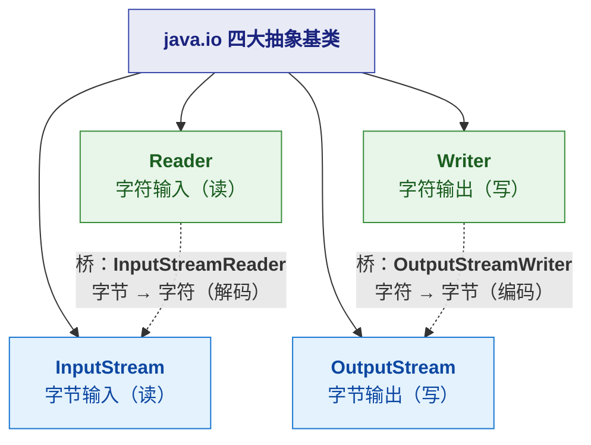
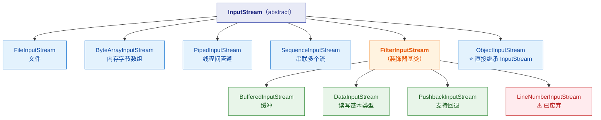
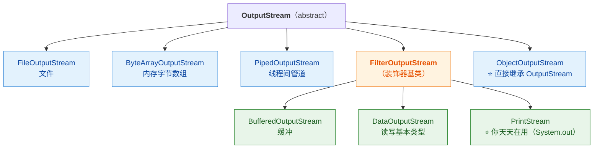
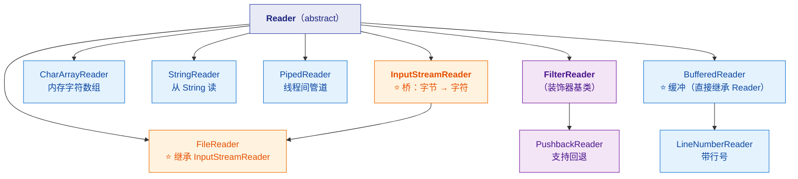
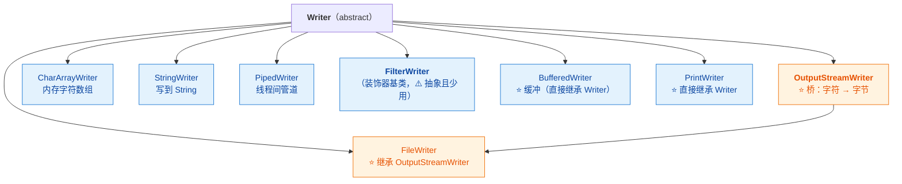
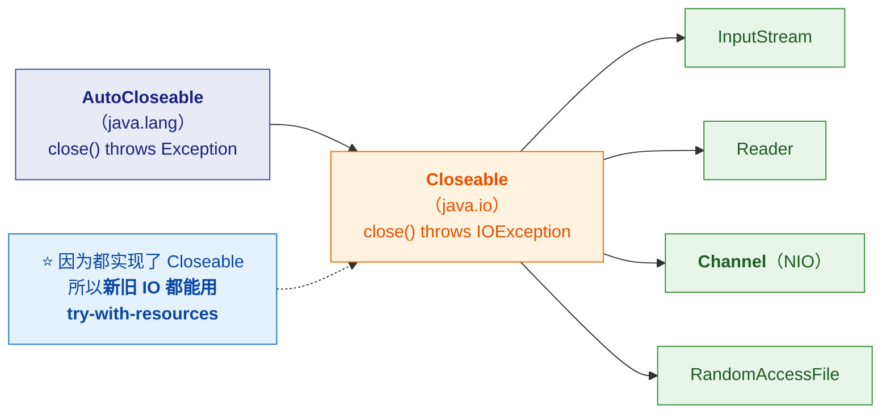
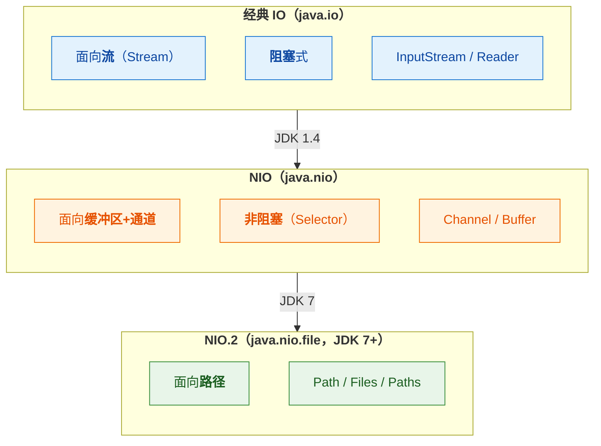

# 🗺️ 一、Java IO 类结构继承总图

> [!abstract] 本篇解决什么
> **把 `java.io` 包的类结构彻底理顺**——谁继承谁、谁是装饰器、字节流和字符流怎么桥接。
> 所有继承关系**都用 JDK 反射实测过**（非凭记忆），保证准确。
>
> **与已有笔记的分工**：
> - **本篇 + [[2-装饰器与流组合]]** = ⭐ **类结构与组合方式**（你这次要的重点）
> - [[3-IO与网络编程]] = **IO 模型、NIO、零拷贝、网络编程**（概念与原理）
> 两篇互补，不重复。

> [!note] 版本口径
> 继承关系基于 **JDK 17 反射实测**。与 8 的差异（如 `FileInputStream` 在 17 中实现方式有变）会标注。

---

## 一、先看全景：四大基类 + 两条主线

> [!important] ⭐ 记住这个"骨架"就不会迷路
> **`java.io` 的一切都围绕 4 个抽象基类展开**：
>
> | 基类 | 方向 | 单位 | 抽象方法 |
> |---|---|---|---|
> | **`InputStream`** | 读 | **字节** | `read()` |
> | **`OutputStream`** | 写 | **字节** | `write(int)` |
> | **`Reader`** | 读 | **字符（char）** | `read()` |
> | **`Writer`** | 写 | **字符（char）** | `write(int)` |
>
> **两条主线**：**字节线（Stream）** 与 **字符线（Reader/Writer）**。
> **两线之间靠"桥"连接**：`InputStreamReader` / `OutputStreamWriter`。



---

## 二、字节输入流继承体系



> [!important] ⭐ 三个必须记住的结构要点
> **① `FilterInputStream` 是"装饰器基类"**——
> **它继承 `InputStream`，同时内部持有一个 `InputStream`**（这就是装饰器模式的两要素）。
>
> **② `BufferedInputStream` / `DataInputStream` / `PushbackInputStream` 都是它的子类**——
> **它们都是"装饰器"**，用来包裹其他流。
>
> **③ ⚠️ `ObjectInputStream` 直接继承 `InputStream`，不走 `FilterInputStream`！**
> 这是**最容易记错的一点**——它看起来像装饰器，但**实际不是**。

### 2.1 逐个说明

| 类 | 数据源 | 类型 | 说明 |
|---|---|---|---|
| **`FileInputStream`** | 文件 | 源 | ⭐ 最常用；`new FileInputStream(File/String/FileDescriptor)` |
| **`ByteArrayInputStream`** | 内存数组 | 源 | 常用于**测试/解析**（把 `byte[]` 当流读） |
| **`PipedInputStream`** | 线程间管道 | 源 | ⭐ **必须配合 `PipedOutputStream`**，用于**线程间通信** |
| **`SequenceInputStream`** | 多个流串联 | 源 | ⭐ **把多个流"接成一条"**（如合并多个文件） |
| **`ObjectInputStream`** | 序列化数据 | 源 | ⚠️ **直接继承 `InputStream`**，不是装饰器 |
| **`FilterInputStream`** | 被包裹的流 | **装饰器基类** | 本身只是转发，子类才有增强 |
| **`BufferedInputStream`** | 被包裹的流 | 装饰器 | 加缓冲（减少系统调用） |
| **`DataInputStream`** | 被包裹的流 | 装饰器 | 读写 `int`/`long`/`double` 等**基本类型** |
| **`PushbackInputStream`** | 被包裹的流 | 装饰器 | 支持 `unread()` **把读到的字节退回去** |
| **`LineNumberInputStream`** | 被包裹的流 | 装饰器 | ⚠️ **已废弃**（因为按字节计行号，对多字节编码不准） |

> [!tip] `PushbackInputStream` 什么时候用
> **典型场景：词法分析器（Lexer）。**
> 读到某个字节发现"这个词已经结束了"，但这个字节属于下一个词——
> **需要把它"退回去"**。`PushbackInputStream` 就是干这个的
> （`PushbackReader` 是它的字符版）。
>
> ⚠️ **注意**：只能回退到**构造时指定的缓冲大小**，超出会抛 `IOException`。

---

## 三、字节输出流继承体系



> [!important] ⭐ 发现了吗：**输入输出是"不对称"的**
> | | 输入侧 | 输出侧 |
> |---|---|---|
> | 装饰器基类 | `FilterInputStream` | `FilterOutputStream` |
> | **无缓冲的字符输出** | —— | ⭐ **`PrintStream` 是字节流！** |
>
> **特别记住**：**`PrintStream` 是字节输出流**（`System.out` 就是它），
> **而 `PrintWriter` 是字符输出流**——**这两个经常被搞混！**

### 3.1 `PrintStream` vs `PrintWriter`（⭐ 高频混淆点）

| | **`PrintStream`** | **`PrintWriter`** |
|---|---|---|
| **继承自** | `FilterOutputStream` → **`OutputStream`** | **直接 `Writer`** |
| **单位** | ⭐ **字节** | ⭐ **字符** |
| **典型实例** | ⭐ **`System.out` / `System.err`** | 需要自己 new |
| **常用方法** | `print` / `println` / `printf` | 同上 |
| **异常处理** | ⚠️ **吞掉 `IOException`**（用 `checkError()` 查） | 同样吞掉 |
| **怎么选** | 控制台/字节输出 | ⭐ **写文本文件**（可指定编码） |

```java
// System.out 就是 PrintStream
System.out.println(System.out.getClass());   // class java.io.PrintStream

// 写文本文件用 PrintWriter（可指定编码，避免平台默认编码问题）
try (PrintWriter pw = new PrintWriter(
        new OutputStreamWriter(new FileOutputStream("a.txt"), StandardCharsets.UTF_8))) {
    pw.println("中文");
}
```

> [!warning] ⚠️ 为什么 `PrintWriter(File)` 有坑
> `new PrintWriter("a.txt")` 会**用平台默认编码**（Windows 上是 GBK）
> → **跨平台乱码**。
> **所以实践上应该走 `OutputStreamWriter` 显式指定编码**（如上例）。

---

## 四、字符输入流继承体系



> [!important] ⭐⭐ 这里有个**必须记住的反直觉点**
> **`BufferedReader` 直接继承 `Reader`，而不是 `FilterReader`！**
>
> | 流 | 装饰器基类是谁 | 是否走装饰器基类 |
> |---|---|---|
> | `BufferedInputStream` | `FilterInputStream` | ✅ 走 |
> | **`BufferedReader`** | —— | ❌ **直接继承 `Reader`** |
> | `PushbackReader` | `FilterReader` | ✅ 走 |
> | `LineNumberReader` | ⭐ **`BufferedReader`** | ❌ 继承的是 `BufferedReader` |
>
> **所以"输入侧的缓冲流是装饰器基类的子类、字符侧的缓冲流不是"——
> 这个不对称是真实存在的**，别按对称去记。

### 4.1 ⭐ 桥梁：`InputStreamReader` 与 `FileReader`

> [!important] ⭐⭐ 这是理解字符流的关键
> **`FileReader` 继承 `InputStreamReader`，而 `InputStreamReader` 继承 `Reader`。**
>
> ```java
> // FileReader 的本质（简化）
> public class FileReader extends InputStreamReader {
>     public FileReader(String fileName) throws FileNotFoundException {
>         super(new FileInputStream(fileName));   // ⭐ 内部包了一个字节流！
>     }
> }
> ```
>
> **结论：`FileReader` 只是"语法糖"**——
> **它内部就是 `InputStreamReader` + `FileInputStream`**，
> ⚠️ **而且它用平台默认编码！**

| 方式 | 编码 | 建议 |
|---|---|---|
| `new FileReader(f)` | ⚠️ **平台默认** | ❌ 跨平台有乱码风险 |
| ⭐ `new InputStreamReader(new FileInputStream(f), UTF_8)` | ✅ **显式指定** | ⭐ **推荐** |

> [!danger] ⚠️ 这是生产环境的经典乱码根源
> **`FileReader` / `FileWriter` / `PrintWriter(File)` 都用"平台默认编码"**——
> - **开发机（Linux，UTF-8）测着没问题**
> - **部署到 Windows 服务器（GBK）→ 中文全乱**
>
> **所以规范是**：⭐ **永远显式指定编码**，走 `InputStreamReader` / `OutputStreamWriter`。

---

## 五、字符输出流继承体系



> [!note] `FilterWriter` 是个"孤儿"
> **它是抽象类，但 JDK 里没有任何子类**（`protected` 构造，只能外部继承）。
> **所以你几乎不会遇到它**——但看类图时会疑惑，这里说明一下。
>
> ⭐ **对比**：`FilterInputStream` / `FilterOutputStream` / `FilterReader` 都有实际子类，
> **只有 `FilterWriter` 是空的。**

---

## 六、⭐ 完整对照总表（字节 vs 字符）

> [!important] ⭐ 用这张表"对号入座"，比记继承图更实用

| 用途 | **字节流** | **字符流** |
|---|---|---|
| **基类** | `InputStream` / `OutputStream` | `Reader` / `Writer` |
| **文件** | `FileInputStream` / `FileOutputStream` | `FileReader` / `FileWriter`（⚠️ 默认编码） |
| **内存数组** | `ByteArrayInputStream` / `ByteArrayOutputStream` | `CharArrayReader` / `CharArrayWriter` |
| **字符串** | —— | `StringReader` / `StringWriter` |
| **管道（线程间）** | `PipedInputStream` / `PipedOutputStream` | `PipedReader` / `PipedWriter` |
| **缓冲** | `BufferedInputStream` / `BufferedOutputStream` | `BufferedReader` / `BufferedWriter` |
| **基本类型** | `DataInputStream` / `DataOutputStream` | ❌ 没有 |
| **对象序列化** | `ObjectInputStream` / `ObjectOutputStream` | ❌ 没有 |
| **格式化打印** | `PrintStream`（`System.out`） | `PrintWriter` |
| **回退** | `PushbackInputStream` | `PushbackReader` |
| **行号** | `LineNumberInputStream`（⚠️ 废弃） | `LineNumberReader` |
| **桥接** | —— | ⭐ `InputStreamReader` / `OutputStreamWriter` |
| **串联多流** | `SequenceInputStream` | ❌ 没有 |

> [!tip] 一个规律
> **"字符流有的，字节流基本都有（File/数组/管道/缓冲/回退/行号）；
> 但"基本类型/对象序列化"只有字节流有——
> 因为它们是二进制协议，字符流做编码转换会破坏数据。**

---

## 七、⭐ 为什么能"用 try-with-resources"：Closeable 的继承链



> [!important] ⭐ 一个统一了"新旧 IO"的洞察
> **`Closeable` 继承 `AutoCloseable`**，而：
> - **`InputStream` / `OutputStream` / `Reader` / `Writer`** 实现 `Closeable`（经典 IO）
> - ⭐ **`java.nio.channels.Channel`** 也实现 `Closeable`（NIO）
> - **`RandomAccessFile`** 实现 `Closeable`
>
> **所以"新旧 IO 都能用 try-with-resources"**——
> **这是它们唯一的共同祖先。**
>
> **而且 `Closeable.close()` 抛的是 `IOException`（更具体），
> 而 `AutoCloseable.close()` 抛 `Exception`（更宽）**——
> 这是"收窄异常"的合法覆盖。

```java
// 因为实现了 Closeable，所以这样写是安全的
try (InputStream in = new FileInputStream("a.txt");
     Channel ch = new FileInputStream("b.txt").getChannel()) {   // NIO 也能
    // ...
}   // 退出时自动 close（逆序）
```

---

## 八、新旧 IO 的对应关系（⭐ 别搞混两套 API）



| 需求 | 经典 IO | **NIO** | **NIO.2（推荐）** |
|---|---|---|---|
| 读文件 | `FileInputStream` | `Files.newInputStream` | ⭐ `Files.readAllBytes` / `newBufferedReader` |
| 写文件 | `FileOutputStream` | `Files.newOutputStream` | ⭐ `Files.write` / `newBufferedWriter` |
| 复制文件 | 手动循环 | `FileChannel.transferTo` | ⭐ **`Files.copy`** |
| 目录操作 | `File` | `File` | ⭐ **`Path` + `Files`** |
| 遍历目录 | `File.listFiles` | `DirectoryStream` | ⭐ **`Files.walk` / `walkFileTree`** |

> [!success] 面试可以这样总结
> "**java.io 是流式的阻塞 IO；java.nio 引入了 Channel/Buffer/Selector 支持非阻塞；
> JDK 7 的 NIO.2 又补上了 `Path`/`Files` 这套现代文件 API。**
> **日常文件操作优先用 `Files`——它更简洁、异常语义更清晰、还能自动处理编码。**"

---

## 九、30 秒速查表

| 问题 | 一句话答案 |
|---|---|
| IO 包几个基类 | ⭐ **4 个**：`InputStream` / `OutputStream` / `Reader` / `Writer` |
| 字节与字符的区别 | **字节流处理原始字节；字符流处理解码后的 `char`** |
| 两条线怎么桥接 | ⭐ **`InputStreamReader`（字节→字符）/ `OutputStreamWriter`（字符→字节）** |
| 装饰器基类 | `FilterInputStream` / `FilterOutputStream` / `FilterReader` / **`FilterWriter`（无子类）** |
| ⭐ 哪些是装饰器 | `Buffered*`、`Data*`、`Pushback*`、`Print*`（**都在 `Filter*` 下**） |
| ⚠️ `ObjectInputStream` 是装饰器吗 | ❌ **不是**——它**直接继承 `InputStream`** |
| ⚠️ `BufferedReader` 继承谁 | ❌ **直接继承 `Reader`**（不是 `FilterReader`） |
| ⭐ `FileReader` 继承谁 | ⭐ **`InputStreamReader`**（所以它内部包了个字节流） |
| `FileReader` 的坑 | ⚠️ **用平台默认编码** → 跨平台乱码 |
| `PrintStream` vs `PrintWriter` | ⭐ **前者是字节流**（`System.out`），**后者是字符流** |
| `System.out` 是什么 | ⭐ **`PrintStream`** |
| `LineNumberInputStream` | ⚠️ **已废弃**（按字节计行号，多字节不准）；用 `LineNumberReader` |
| `Pushback` 系列干什么 | **支持 `unread()` 回退**（词法分析器常用） |
| `SequenceInputStream` 干什么 | ⭐ **把多个流串联成一条** |
| `Piped*` 系列干什么 | ⭐ **线程间通信**（必须配对使用） |
| 为什么能 try-with-resources | ⭐ **`Closeable extends AutoCloseable`**——新旧 IO 都实现了它 |
| NIO 的 Channel 也实现了 Closeable 吗 | ✅ **是**（所以也能 try-with-resources） |
| NIO.2 是哪三个类 | ⭐ **`Path` / `Paths` / `Files`**（JDK 7+） |
| 现代文件操作用什么 | ⭐ **`Files`**（比 `File` 简洁、异常清晰） |

---

## 十、学习检查清单

- [ ] ⭐ 能说出 **4 个抽象基类**及字节/字符的分工
- [ ] ⭐ 能画出**字节输入流的继承树**（含 `FilterInputStream` 分支）
- [ ] ⚠️ 能指出 **`ObjectInputStream` 直接继承 `InputStream`**（不是装饰器）
- [ ] ⭐ 能画出**字符输入流的继承树**，并说出 **`BufferedReader` 直接继承 `Reader`**
- [ ] ⭐⭐ 能说清 **`FileReader` 继承 `InputStreamReader`** 及它的编码坑
- [ ] ⭐ 能区分 **`PrintStream`（字节）与 `PrintWriter`（字符）**
- [ ] 能说出 **`FilterWriter` 没有子类**这个特例
- [ ] ⭐ 能说出 **`Closeable extends AutoCloseable`** 及其意义（统一新旧 IO）
- [ ] 能说出 **`Pushback*` / `Sequence*` / `Piped*`** 各自解决什么问题
- [ ] ⭐ 能背出**字节流 vs 字符流的完整对照表**
- [ ] 能说出**只有字节流有 `Data*` 和 `Object*`** 的原因
- [ ] ⭐ 能说清**经典 IO / NIO / NIO.2 的关系与演进**
- [ ] 能说出**现代文件操作优先用 `Files`** 的理由

---
> 下一篇 → [[2-装饰器与流组合]] ｜ 相关 → [[3-IO与网络编程]]（IO 模型与 NIO 原理）
> 返回 → [[1-java/0-知识点/0-Java总览|Java 总览]]
