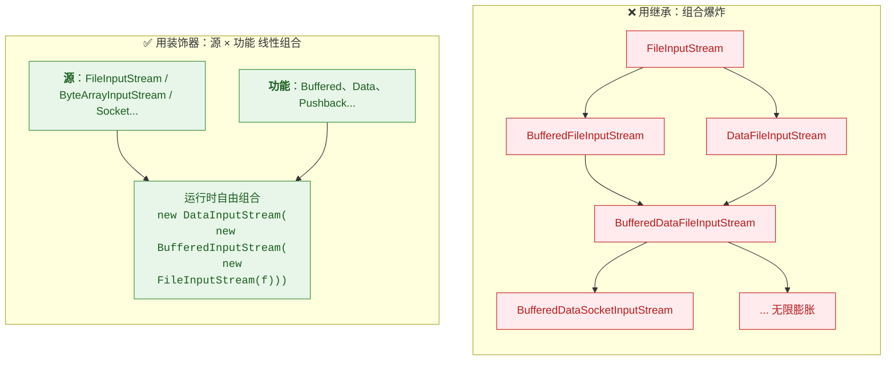
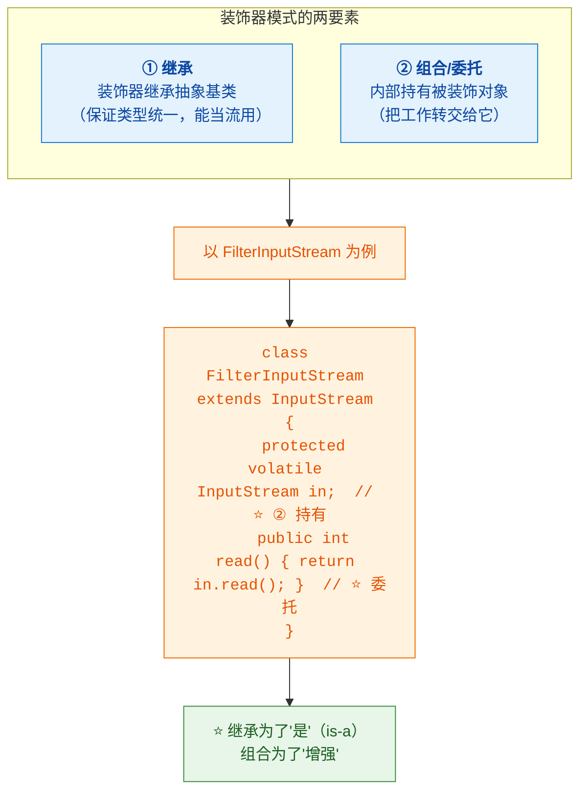
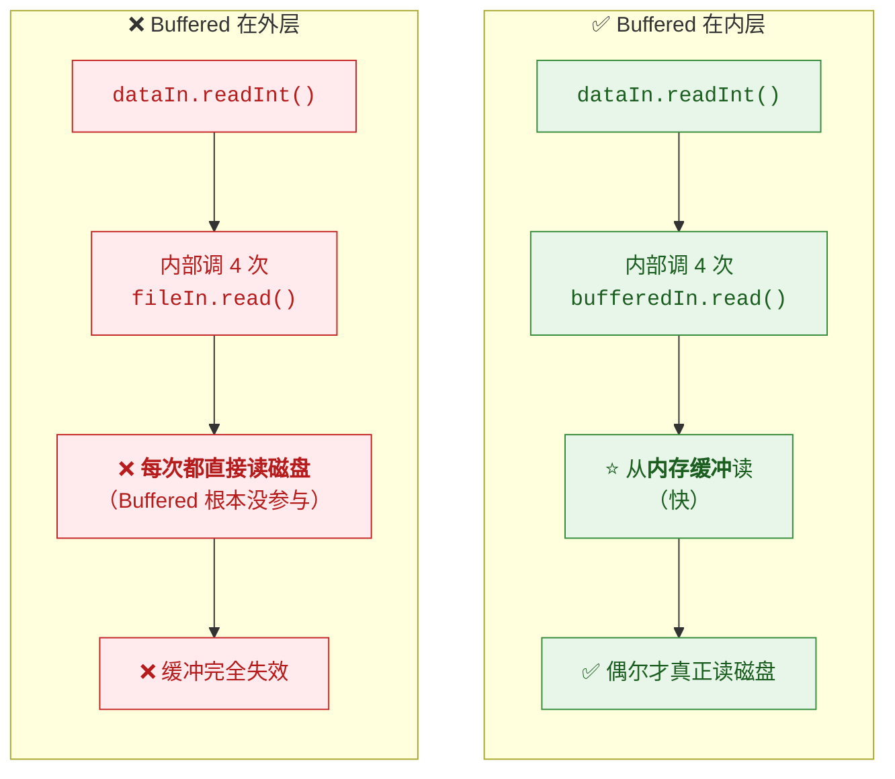
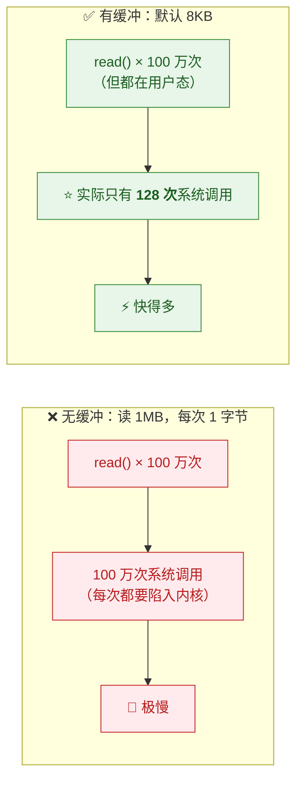
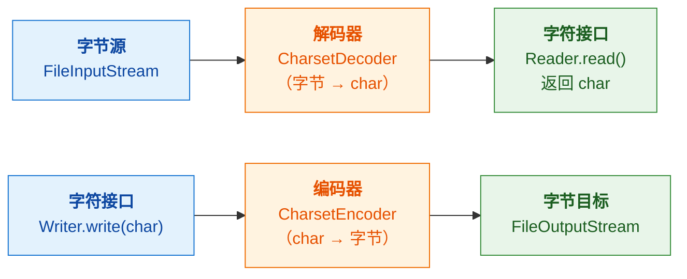

# 🎁 二、IO 装饰器模式与流组合

> [!abstract] 本篇解决什么
> **为什么 IO 体系要设计成"层层包裹"？怎么组合才不出错？**
> `java.io` 是**装饰器模式最经典的教科书案例**——理解了它，
> 既懂了 IO，也懂了装饰器。
>
> 前置见 [[1-IO类结构继承总图]]；IO 模型原理见 [[3-IO与网络编程]]。

---

## 一、为什么用装饰器：先看"不用"会怎样

> [!question] 假设不用装饰器
> **我们需要的组合非常多**：
> - 文件 + 缓冲 + 读基本类型
> - 内存数组 + 缓冲
> - Socket + 缓冲 + 读基本类型
> - 文件 + 缓冲 + 读字符
> - ……
>
> **如果用继承**：**"数据源" × "功能" 会组合爆炸**——
> `BufferedFileInputStream`、`DataFileInputStream`、
> `BufferedDataFileInputStream`、`BufferedDataSocketInputStream`……
> **类数量 = 源 × 功能¹ × 功能² ……**



> [!important] ⭐ 装饰器的核心价值
> **把"功能"从"数据源"里解耦出来**——
> **类数量从"乘积"降到"和"，而且组合发生在运行时。**

---

## 二、装饰器的两个要素



> [!important] 源码骨架（记住这个就懂了装饰器）
> ```java
> public class FilterInputStream extends InputStream {
>     protected volatile InputStream in;          // ⭐ 要素②：持有
>
>     protected FilterInputStream(InputStream in) { this.in = in; }
>
>     @Override public int read() throws IOException {
>         return in.read();                        // ⭐ 默认只是"转发"
>     }
>     // ... 其他方法同样转发
> }
> ```
>
> **`FilterInputStream` 本身不做任何增强**——它只是**转发**。
> **增强由子类完成**：
> ```java
> public class BufferedInputStream extends FilterInputStream {
>     @Override public synchronized int read() throws IOException {
>         // ⭐ 从自己的缓冲区读，而不是每次都调 in.read()
>     }
> }
> ```

---

## 三、常见装饰器及其"增强点"

| 装饰器 | 增强什么 | 原理 |
|---|---|---|
| **`Buffered*`** | ⭐ **减少系统调用** | 一次性读一大块到内存，后续从内存读 |
| **`Data*`** | ⭐ **读写基本类型** | 把 `int` 拆成 4 字节（大端序）写入/读出 |
| **`Object*`** | **对象序列化** | 对象图 → 字节流（⚠️ 但**不走** `Filter*` 基类） |
| **`Print*`** | **格式化输出** | `print`/`println`/`printf`；⚠️ **吞异常** |
| **`Pushback*`** | **回退读取** | 内部缓冲已读字节，支持 `unread()` |
| **`LineNumber*`** | **跟踪行号** | 统计换行符；⚠️ **按字节计，多字节编码不准**（故废弃） |

> [!success] 一句话总结装饰器的价值
> **"数据源只负责'从哪读'，装饰器负责'怎么读'——两者正交，可以自由组合。"**

---

## 四、⭐ 装饰顺序：最容易出错的地方

> [!danger] ⚠️⭐ 顺序错了，缓冲直接失效
> ```java
> // ✅ 正确：Buffered 在内层
> DataInputStream in = new DataInputStream(
>         new BufferedInputStream(new FileInputStream("a.bin")));
>
> // ❌ 错误：Buffered 在外层 —— 缓冲形同虚设！
> DataInputStream in = new DataInputStream(
>         new FileInputStream("a.bin"));
> BufferedInputStream buf = new BufferedInputStream(in);  // 没用
> ```

### 4.1 为什么顺序会影响性能



> [!important] ⭐ 规则："**让'读得碎'的流位于内层**"
> **判断方法：看谁在"调用别人"。**
> - `DataInputStream.readInt()` **会调用 4 次 `read()`** → 它"读得碎" → **它在外层**
> - `BufferedInputStream.read()` **会真正读磁盘** → 它在内层
>
> **换句话说**：**"消耗者"在外，"提供者"在内。**
>
> ⭐ **记忆口诀**：**"谁调谁，谁在外"**（谁调用别人的方法，谁就在外层）。

### 4.2 正确的组合公式

```java
// ⭐ 读文本的"标准配方"
BufferedReader reader = new BufferedReader(                      // ③ 字符缓冲
        new InputStreamReader(                                   // ② 桥：字节→字符
                new FileInputStream("a.txt"),                    // ① 数据源
                StandardCharsets.UTF_8));                        // ②' 指定编码

// ⭐ 读二进制的"标准配方"
DataInputStream in = new DataInputStream(                        // ③ 读基本类型
        new BufferedInputStream(                                 // ② 缓冲
                new FileInputStream("a.bin")));                   // ① 数据源

// ⭐ 写文本的"标准配方"
PrintWriter out = new PrintWriter(
        new BufferedWriter(                                      // ③ 字符缓冲
                new OutputStreamWriter(                          // ② 桥：字符→字节
                        new FileOutputStream("a.txt"),           // ① 数据源
                        StandardCharsets.UTF_8)));
```

> [!tip] 从内到外的记忆顺序
> **数据源（最内）→ 缓冲 → 桥接/类型转换（最外）**
>
> **"内层管从哪读，外层管怎么读。"**

---

## 五、`Buffered*` 为什么必要

> [!important] 核心：**减少系统调用（用户态 ↔ 内核态切换）**



| 项 | 说明 |
|---|---|
| **默认缓冲大小** | `BufferedInputStream` **8192 字节（8KB）**；`BufferedReader` **8192 字符** |
| **可自定义** | `new BufferedInputStream(in, 64 * 1024)` |
| **代价** | 多一次内存拷贝，但**远小于系统调用的开销** |

> [!success] 为什么"缓冲"能快这么多
> **系统调用（read/write）需要从用户态陷入内核态**——
> **这个切换本身有固定开销（几百纳秒到微秒级）。**
> **无缓冲时读 1MB（每次 1 字节）= 100 万次切换** → **开销远超实际的数据传输。**
>
> ⭐ **这就是"缓冲流"存在的唯一理由**——
> **不是为了"少读数据"，而是为了"少切换"。**

---

## 六、`Reader`/`Writer` 的桥接细节

> [!important] ⭐ 字符流的"三层结构"
> **一个字符流内部其实是三段**：



| 组件 | 作用 |
|---|---|
| **字节流** | 从数据源读/写原始字节 |
| **`CharsetDecoder` / `CharsetEncoder`** | ⭐ **字节 ⇄ 字符的转换（编码/解码）** |
| **`Reader` / `Writer` 接口** | 对外提供字符级的 API |

> [!warning] ⚠️ 为什么要缓冲 + 桥接一起用
> **`InputStreamReader.read()` 每次可能只解码"一个字符"**——
> **而一个 UTF-8 中文字符要 3 个字节**，
> **没有缓冲的话，每次读一个字符都要多次访问底层字节流。**
>
> **所以标准配方是**：**`BufferedReader(InputStreamReader(FileInputStream))`**——
> **桥接负责"转换"，缓冲负责"批量"。**

---

## 七、⚠️ 常见陷阱

| # | 陷阱 | 说明 | 正确做法 |
|---|---|---|---|
| **1** | ⭐ **装饰顺序反了** | 缓冲失效（见第四节） | **"谁调谁，谁在外"** |
| **2** | ⭐ **`FileReader` 用默认编码** | 跨平台乱码 | 用 `InputStreamReader` **显式指定** |
| **3** | ⚠️ **`PrintWriter` 吞异常** | `write` 失败也不抛，**静默丢数据** | 用 `checkError()` 检查 |
| **4** | **忘记 flush / close** | 缓冲数据没落盘 | ⭐ **`try-with-resources`** |
| **5** | **`BufferedWriter` 没 flush** | 内容还在缓冲区 | 同上，或显式 `flush()` |
| **6** | **`close()` 会关掉被包裹的流** | 多层装饰时最外层 close 即可 | **只关最外层** |
| **7** | **`ObjectInputStream` 以为是装饰器** | 它直接继承 `InputStream` | 它**同样包装`InputStream`**，但继承关系不同 |

> [!danger] ⚠️ 陷阱 3 值得展开：`PrintWriter` 的静默失败
> ```java
> PrintWriter pw = new PrintWriter(new FileWriter("a.txt"));
> pw.println("data");
> pw.close();
> // ⚠️ 如果磁盘满了，write 会失败——但 println 不抛异常！
> if (pw.checkError()) {   // ⭐ 必须显式检查
>     // 出错了
> }
> ```
> **这是 `PrintStream` / `PrintWriter` 的设计**（为了 `System.out` 好用）。
> **写重要数据时务必 `checkError()`，或改用 `BufferedWriter`。**

> [!note] 陷阱 6 的解释
> **`FilterInputStream.close()` 的默认实现是"关掉内部的 in"**：
> ```java
> public void close() throws IOException { in.close(); }
> ```
> **所以关最外层，会级联关掉里面所有层**——
> **这正是我们想要的**（不需要逐层 close）。
> ⚠️ **但要注意**：如果多个装饰器共享同一个底层流，关一个会让其他也失效。

---

## 八、30 秒速查表

| 问题 | 一句话答案 |
|---|---|
| 为什么用装饰器 | ⭐ **避免"数据源 × 功能"的组合爆炸**（类数量从乘积降到和） |
| 装饰器的两要素 | ⭐ **继承抽象基类（类型统一）+ 持有被装饰对象（委托增强）** |
| `FilterInputStream` 做什么 | **只是转发**，**增强由子类完成** |
| `Buffered*` 增强什么 | ⭐ **减少系统调用**（一次读一大块，后续读内存） |
| `Data*` 增强什么 | **读写基本类型**（`int` 拆 4 字节） |
| ⭐ 默认缓冲大小 | **8192（8KB）字节 / 8192 字符** |
| 缓冲为什么快 | ⭐ **不是少读数据，而是少"系统调用"**（减少用户态↔内核态切换） |
| ⭐⭐ 装饰顺序规则 | **"谁调谁，谁在外"**——`Data*` 在外，`Buffered*` 在内 |
| 顺序错了会怎样 | ⚠️ **缓冲完全失效**（每次都直接读磁盘） |
| 标准读文本配方 | `BufferedReader(InputStreamReader(FileInputStream, UTF_8))` |
| 标准读二进制配方 | `DataInputStream(BufferedInputStream(FileInputStream))` |
| 标准写文本配方 | `PrintWriter(BufferedWriter(OutputStreamWriter(FileOutputStream, UTF_8)))` |
| 组合顺序怎么记 | ⭐ **数据源（最内）→ 缓冲 → 桥接/类型转换（最外）** |
| 字符流内部有哪三层 | **字节源 + 解码器（字节⇄char）+ 字符接口** |
| 为什么桥接也要配缓冲 | **一个中文字符 3 字节**，不缓冲会频繁访问底层 |
| ⚠️ `PrintWriter` 的坑 | **吞掉 IOException** → 必须 `checkError()` |
| 多层装饰怎么关 | ⭐ **只关最外层**（`close` 会级联） |

---

## 九、学习检查清单

- [ ] ⭐ 能解释**为什么用装饰器**（组合爆炸问题）
- [ ] ⭐ 能说出装饰器的**两个要素**（继承 + 持有）并写出源码骨架
- [ ] 能说清 **`FilterInputStream` 只是转发，增强在子类**
- [ ] 能列出**常见装饰器及各自的增强点**
- [ ] ⭐⭐ 能说清**装饰顺序的规则**（"谁调谁，谁在外"）及顺序错了的后果
- [ ] 能**默写三个标准配方**（读文本/读二进制/写文本）
- [ ] ⭐ 能解释**缓冲为什么快**（减少系统调用，而非少读数据）
- [ ] 能说出**默认缓冲大小**（8KB）
- [ ] ⭐ 能说清**字符流内部的三层结构**（字节源 + 解码器 + 字符接口）
- [ ] 能解释**为什么桥接也要配缓冲**（中文字符多字节）
- [ ] ⭐ 能说出**至少五个常见陷阱**及正确做法
- [ ] ⚠️ 能说清 **`PrintWriter` 吞异常**的问题与应对
- [ ] 能解释**多层装饰只需关最外层**的原因

---
> 上一篇 → [[1-IO类结构继承总图]] ｜ 下一篇 → [[3-NIO类结构体系]] ｜ 相关 → [[3-IO与网络编程]]
