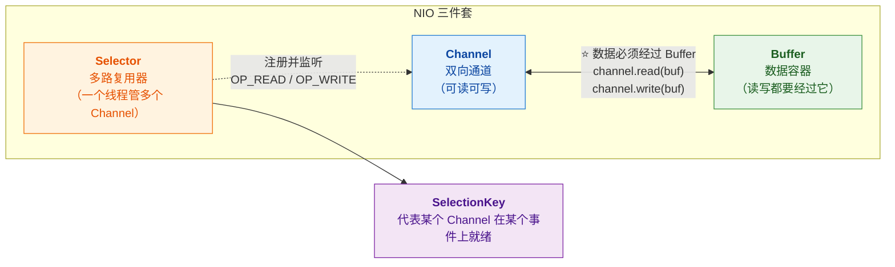
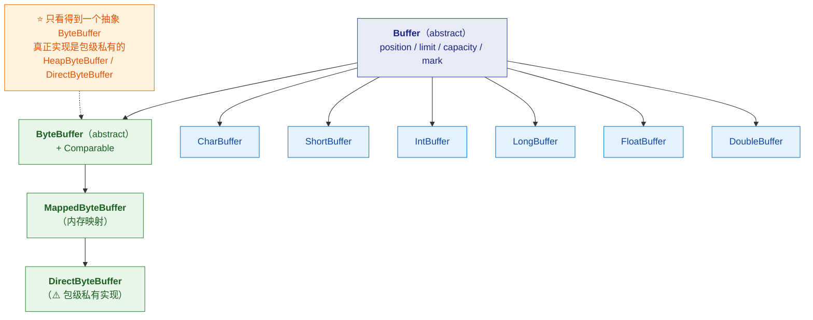
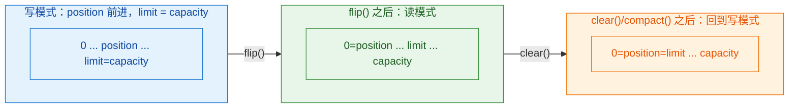
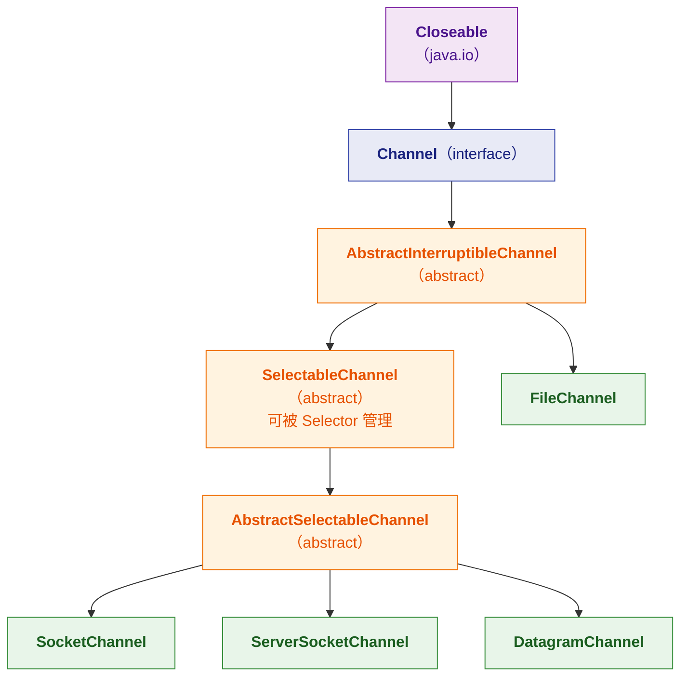
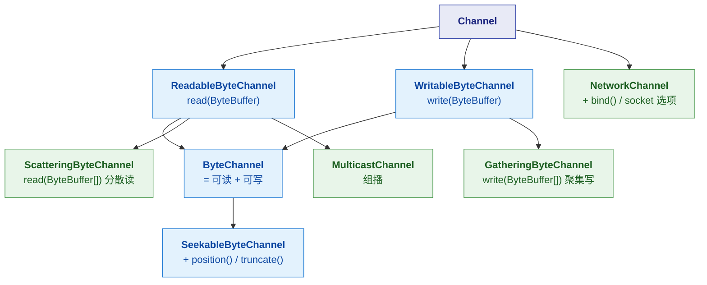
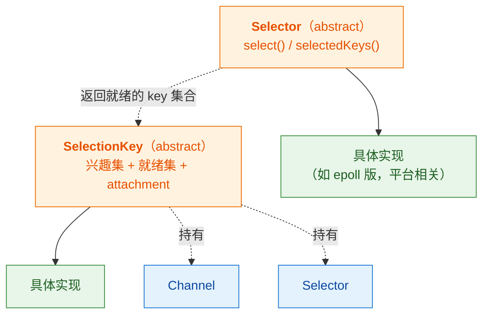
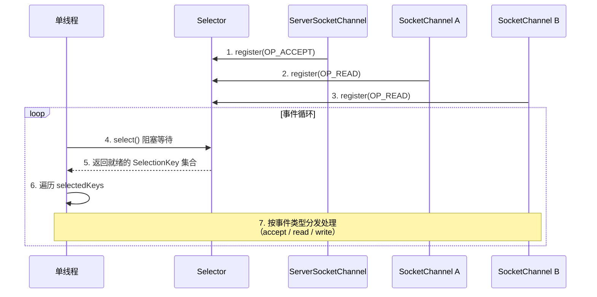
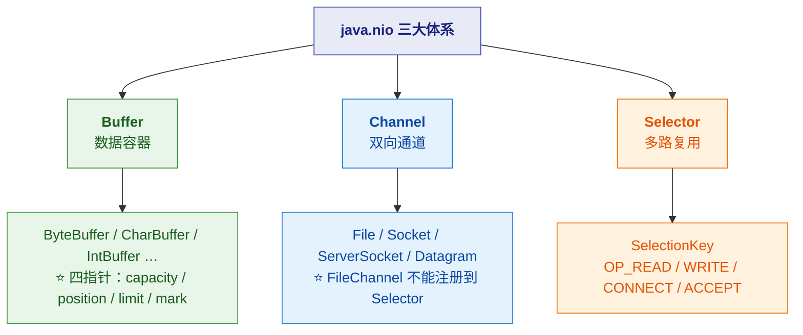

# 🔀 三、NIO 类结构体系

> [!abstract] 本篇解决什么
> **NIO 的类结构**：`Channel` / `Buffer` / `Selector` 三大体系的继承关系。
> 所有继承关系**都用 JDK 反射实测过**。
>
> **与已有笔记的分工**：
> - **本篇** = ⭐ **NIO 的类结构与继承体系**（你这次要的重点）
> - [[3-IO与网络编程]] = **IO 模型、epoll、零拷贝、Netty**（原理与实现细节）
>
> 前置见 [[1-IO类结构继承总图]]。

---

## 一、⭐ NIO 三大组件的关系



> [!important] ⭐ 与传统 IO 的根本差异
> | | **传统 IO（java.io）** | **NIO** |
> |---|---|---|
> | 抽象 | **流（Stream）** | ⭐ **通道（Channel）+ 缓冲区（Buffer）** |
> | 方向 | ⭐ **单向**（输入流只能读） | ⭐ **双向**（Channel 可读可写） |
> | 数据读写 | **直接读/写到流** | ⭐ **必须经过 Buffer** |
> | 阻塞 | **阻塞** | ⭐ **可非阻塞**（配 Selector） |
> | 多路复用 | ❌ 无 | ⭐ **Selector** |
>
> **关键记忆**：**"流是单向的，通道是双向的；而且 NIO 的数据读写一定经过 Buffer。"**

---

## 二、Buffer 体系（⭐ 继承关系）

### 2.1 继承结构



> [!warning] ⚠️ 一个容易困惑的点：**`ByteBuffer` 是抽象类**
> **你不能 `new ByteBuffer()`**——只能通过**静态工厂**创建：
> ```java
> ByteBuffer.allocate(1024);          // ⭐ 堆内（HeapByteBuffer）
> ByteBuffer.allocateDirect(1024);    // ⭐ 堆外（DirectByteBuffer）
> ByteBuffer.wrap(byteArray);         // ⭐ 包装已有数组
> ```
> **而 `HeapByteBuffer` / `DirectByteBuffer` 都是包级私有类**，
> **你在 API 文档里看不到它们**——但它们是**真正的实现**。

### 2.2 ⭐ 四个核心指针

> [!important] ⭐ 理解 Buffer 就是理解这四个值

| 属性 | 含义 | 初始值 |
|---|---|---|
| **`capacity`** | ⭐ **容量（固定不变）** | 创建时指定 |
| **`position`** | ⭐ **下一个要读/写的位置** | 写模式 0；`flip()` 后归 0 |
| **`limit`** | ⭐ **读/写的边界** | 写模式 = capacity；`flip()` 后 = 原 position |
| **`mark`** | **标记位置**（配合 `reset()`） | 未设置 |



> [!important] ⭐⭐ 最容易搞混的四个方法
> | 方法 | 做什么 | 何时用 |
> |---|---|---|
> | **`flip()`** | ⭐ **`limit = position; position = 0`** | **写完要读之前**（必备！） |
> | **`rewind()`** | `position = 0`（`limit` 不变） | **重读一遍** |
> | **`clear()`** | ⭐ **`position = 0; limit = capacity`** | **完全重写**（⚠️ **数据没清，只是指针重置**） |
> | **`compact()`** | 把未读数据移到开头，`position` = 剩余数 | **部分读完，想继续写** |
>
> ⚠️ **`clear()` 最容易误解**——**它不"清空数据"，只是把指针复位**。
> **未读数据仍然存在，但会被后续写入覆盖。**

### 2.3 堆内 vs 堆外（`DirectByteBuffer`）

| | **HeapByteBuffer** | **DirectByteBuffer** |
|---|---|---|
| 内存位置 | **JVM 堆** | ⭐ **堆外（本地内存）** |
| 创建 | `allocate()` | `allocateDirect()` |
| 分配/回收 | 快（JVM 管理，受 GC） | ⚠️ **慢/贵**（要调系统调用，`Cleaner` 回收） |
| IO 效率 | ⚠️ **要复制到堆外才能做 IO** | ⭐ **可直接做 IO**（少一次拷贝） |
| 适用 | 一般场景 | ⭐ **大文件/长生命周期/高频 IO** |

> [!important] ⭐ 为什么"堆内 Buffer 做 IO 会多一次拷贝"
> **操作系统做 IO（如 `read` 系统调用）要求"直接内存地址"**，
> **而 JVM 堆内对象会**被 GC 移动**——
> **所以必须先把数据复制到一块"不会被移动的堆外内存"再交给内核。**
>
> **`DirectByteBuffer` 分配在堆外，地址固定 → 省掉这次拷贝。**
>
> ⚠️ **代价**：**分配/释放成本高**（不受 GC 直接管理，靠 `Cleaner` 虚引用回收），
> **所以不适合"频繁创建小 Buffer"的场景**（应该复用）。

---

## 三、Channel 体系（⭐ 继承关系）

### 3.1 完整继承图



> [!important] ⭐⭐ 一个关键发现：**`FileChannel` 不能被 Selector 管理！**
> | Channel | 继承链 | 能否注册到 Selector |
> |---|---|---|
> | **`SocketChannel`** | …→ **`SelectableChannel`** | ✅ **能** |
> | **`ServerSocketChannel`** | …→ **`SelectableChannel`** | ✅ **能** |
> | **`DatagramChannel`** | …→ **`SelectableChannel`** | ✅ **能** |
> | **`FileChannel`** | → **`AbstractInterruptibleChannel`**（❗ **不走 SelectableChannel**） | ❌ **不能** |
>
> **为什么？**
> ⭐ **因为"文件 IO"在操作系统层面就"总是就绪"的**——
> **文件读取不会"等待数据到来"**（不像网络），
> **所以 `epoll` 对普通文件无能为力**（`epoll` 不支持普通文件描述符）。
>
> 👉 **这是一个很好的面试点**：
> **"Selector 只能管网络 Channel，因为文件 IO 天然就绪，
> 而且 epoll 不支持普通文件 fd。"**

### 3.2 Channel 的接口体系



| 接口 | 方法 | 用途 |
|---|---|---|
| **`ReadableByteChannel`** | `read(ByteBuffer)` | 读 |
| **`WritableByteChannel`** | `write(ByteBuffer)` | 写 |
| **`ByteChannel`** | 两者合并 | ⭐ **可读可写** |
| **`SeekableByteChannel`** | `position(long)` / `truncate()` | ⭐ **可定位**（文件） |
| **`ScatteringByteChannel`** | `read(ByteBuffer[])` | ⭐ **分散读**（读到多个 Buffer） |
| **`GatheringByteChannel`** | `write(ByteBuffer[])` | ⭐ **聚集写**（从多个 Buffer 写） |

> [!tip] "分散读 / 聚集写"（Scatter/Gather）很实用
> **典型场景：协议头 + 协议体**
> ```java
> ByteBuffer header = ByteBuffer.allocate(8);
> ByteBuffer body   = ByteBuffer.allocate(1024);
> channel.read(new ByteBuffer[]{ header, body });   // ⭐ 一次读满两个
> ```
> **省掉"先读到一块再拆分"的拷贝与代码。**

### 3.3 具体 Channel 的类关系

| Channel | 实现的关键接口 | 说明 |
|---|---|---|
| **`FileChannel`** | `SeekableByteChannel` + `GatheringByteChannel` + `ScatteringByteChannel` | 文件；⭐ **能 `transferTo` 零拷贝** |
| **`SocketChannel`** | `ByteChannel` + `Scattering` + `Gathering` + `NetworkChannel` | TCP 客户端/连接 |
| **`ServerSocketChannel`** | `NetworkChannel` | ⭐ **只 `accept()`，不能读写** |
| **`DatagramChannel`** | `ByteChannel` + `Scattering` + `Gathering` + `MulticastChannel` | UDP |

> [!note] `ServerSocketChannel` 的特殊性
> **它不实现 `ReadableByteChannel` / `WritableByteChannel`**——
> **因为它不传输数据，只负责 `accept()` 新连接。**
> **数据读写在 `accept()` 返回的 `SocketChannel` 上做。**

---

## 四、Selector 体系（多路复用）

### 4.1 继承关系



### 4.2 四种事件（`SelectionKey` 常量）

| 常量 | 值 | 含义 | 可用于 |
|---|---|---|---|
| **`OP_READ`** | 1 | 可读 | SocketChannel / DatagramChannel |
| **`OP_WRITE`** | 4 | 可写 | SocketChannel / DatagramChannel |
| **`OP_CONNECT`** | 8 | 连接完成 | ⭐ **SocketChannel（客户端）** |
| **`OP_ACCEPT`** | 16 | 有新连接 | ⭐ **ServerSocketChannel（服务端）** |

> [!warning] ⚠️ 一个非常容易踩的坑：**`OP_WRITE` 几乎总是就绪的**
> **只要发送缓冲区有空位，`OP_WRITE` 就为真**——
> **如果你一直注册 `OP_WRITE`，Selector 会"永远忙"，CPU 飙高。**
>
> **正确做法**：
> ⭐ **只在"确实写不进去"时才注册 `OP_WRITE`，写完后立刻取消注册。**
> ```java
> // 写不进去时
> key.interestOps(key.interestOps() | SelectionKey.OP_WRITE);
> // 写完后
> key.interestOps(key.interestOps() & ~SelectionKey.OP_WRITE);
> ```

### 4.3 Selector 工作流程



> [!important] ⭐ 这就是"一个线程管多个连接"的原理
> **线程不再"为每个连接阻塞等待"，而是"问 Selector 谁就绪了"**——
> **只处理就绪的连接。**
>
> 👉 **`select()` / `epoll` 的底层原理（LT/ET、红黑树、就绪链表）
> 见 [[3-IO与网络编程]] §五。**

---

## 五、⭐ Channel 与传统流的"互操作"

> [!tip] NIO.2 提供的桥接工具（JDK 7+）
> | `java.nio.channels.Channels` 的方法 | 作用 |
> |---|---|
> | `Channels.newInputStream(Channel)` | ⭐ **Channel → InputStream** |
> | `Channels.newOutputStream(Channel)` | ⭐ **Channel → OutputStream** |
> | `Channels.newReader(Channel, charset)` | Channel → Reader |
> | `Channels.newWriter(Channel, charset)` | Channel → Writer |
>
> **反向（流 → Channel）**：
> ```java
> FileInputStream fis = new FileInputStream("a.txt");
> FileChannel ch = fis.getChannel();     // ⭐ 从流拿 Channel
> ```

> [!note] 什么时候需要这种互操作
> **典型场景：某库只接受 `InputStream`，但你手里是 `SocketChannel`。**
> **用 `Channels.newInputStream(ch)` 桥接即可。**

---

## 六、NIO 三件套对照速查



---

## 七、30 秒速查表

| 问题 | 一句话答案 |
|---|---|
| NIO 三件套 | ⭐ **Channel（通道）/ Buffer（缓冲）/ Selector（多路复用）** |
| 与传统 IO 的根本差异 | ⭐ **流单向、通道双向；NIO 读写必经 Buffer** |
| Buffer 的继承根 | **`Buffer`（抽象）**，下有 7 种基本类型子类 |
| ⚠️ `ByteBuffer` 能 new 吗 | ❌ **是抽象类**——用 `allocate` / `allocateDirect` / `wrap` |
| Buffer 四个指针 | ⭐ **`capacity` / `position` / `limit` / `mark`** |
| `flip()` 做什么 | ⭐ **`limit=position; position=0`**（写完要读之前必调） |
| `clear()` 做什么 | ⭐ **`position=0; limit=capacity`**——⚠️ **不清数据，只重置指针** |
| `compact()` 做什么 | **把未读数据移到开头**，用于"部分读完继续写" |
| 堆内 vs 堆外 | **堆内快分配但 IO 要多一次拷贝；堆外相反** |
| 为什么堆外 IO 快 | ⭐ **堆内对象会被 GC 移动，必须复制到固定地址才能做 IO** |
| Channel 继承根 | **`Channel`（接口）→ `AbstractInterruptibleChannel`** |
| ⭐⭐ `FileChannel` 能注册 Selector 吗 | ❌ **不能**——它不走 `SelectableChannel` |
| 为什么 FileChannel 不行 | ⭐ **文件 IO 天然就绪，且 epoll 不支持普通文件 fd** |
| 能注册 Selector 的有哪些 | ⭐ **`SocketChannel` / `ServerSocketChannel` / `DatagramChannel`** |
| `ByteChannel` 是什么 | **= `ReadableByteChannel` + `WritableByteChannel`** |
| `ServerSocketChannel` 能读写吗 | ❌ **只能 `accept()`**，数据读写在返回的 `SocketChannel` 上 |
| 分散读/聚集写 | ⭐ `read(ByteBuffer[])` / `write(ByteBuffer[])`——**一次操作多个 Buffer** |
| 四种事件 | ⭐ **`OP_READ` / `OP_WRITE` / `OP_CONNECT` / `OP_ACCEPT`** |
| ⚠️ `OP_WRITE` 的坑 | **它几乎总是就绪**——常注册会让 CPU 飙高，要"用完即取消" |
| Selector 为什么能管多连接 | **线程只处理"就绪"的连接，不为每个连接阻塞** |
| 流 ⇄ Channel 怎么转 | ⭐ `Channels.newInputStream(ch)` / `fileInputStream.getChannel()` |

---

## 八、学习检查清单

- [ ] ⭐ 能说出 **NIO 三件套**及它们的关系
- [ ] ⭐ 能说清**传统 IO 与 NIO 的五个差异**
- [ ] ⭐ 能画出 **Buffer 的继承体系**（7 种类型 + MappedByteBuffer）
- [ ] ⚠️ 能说出 **`ByteBuffer` 是抽象类**及三种创建方式
- [ ] ⭐ 能说清 **Buffer 四个指针**的含义与变化
- [ ] ⭐⭐ 能说清 **`flip` / `clear` / `compact` / `rewind`** 的区别
- [ ] ⭐ 能说清**堆内 vs 堆外 Buffer**的取舍及原因（GC 移动）
- [ ] ⭐⭐ 能画出 **Channel 的继承体系**（含 `SelectableChannel` 分支）
- [ ] ⭐⭐ 能解释**为什么 `FileChannel` 不能注册到 Selector**
- [ ] 能说出 **Channel 的各个接口**（Readable/Writable/Byte/Seekable/Scatter/Gather）
- [ ] 能说出**分散读/聚集写的用途**
- [ ] 能说出**四种事件常量**及各自适用于哪种 Channel
- [ ] ⚠️ 能说清 **`OP_WRITE` 几乎总是就绪**这个坑
- [ ] ⭐ 能说清 **Selector "一个线程管多连接"的原理**
- [ ] 能说出**流与 Channel 的互转方式**（`Channels` 工具类）

---
> 上一篇 → [[2-装饰器与流组合]] ｜ 下一篇 → [[4-RandomAccessFile与FileDescriptor]] ｜ 返回 [[1-IO类结构继承总图]]
> NIO 原理深化（epoll/零拷贝/Netty）→ [[3-IO与网络编程]]
