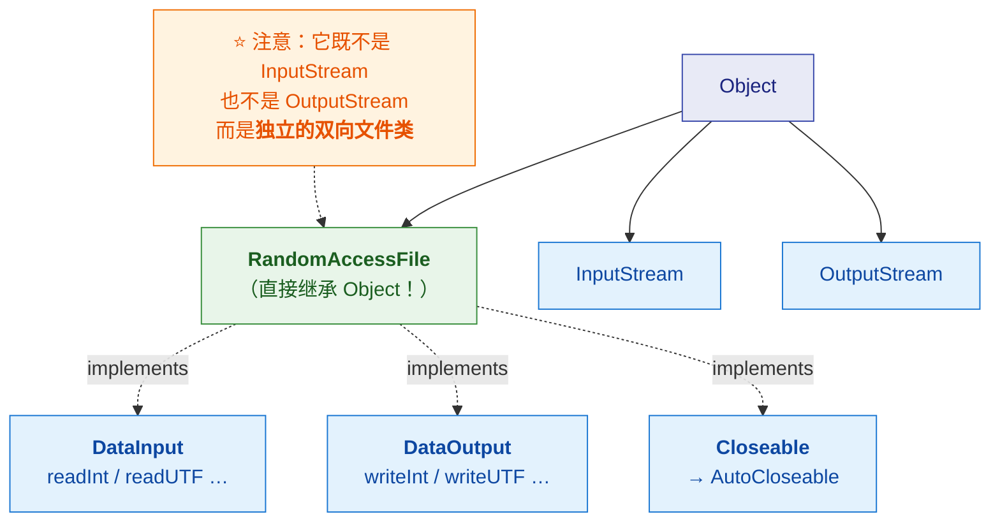
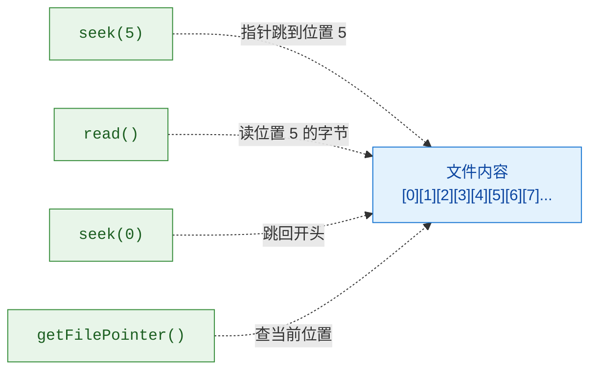
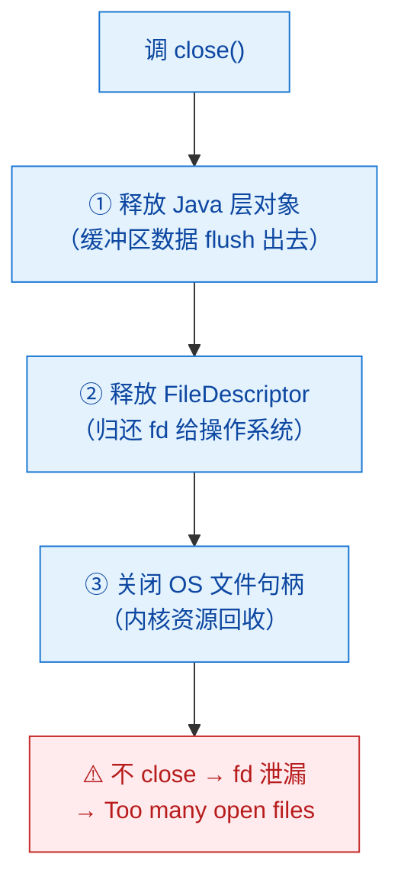

# 📍 四、RandomAccessFile 与 FileDescriptor

> [!abstract] 本篇解决什么
> **两个"特殊"的类**——它们**不在四大基类的继承树里**，但很常用：
> - ⭐ **`RandomAccessFile`**：唯一支持"随机访问"的文件类
> - ⭐ **`FileDescriptor`**：文件描述符，连接 Java 与操作系统的桥梁
>
> 前置见 [[1-IO类结构继承总图]]。

---

## 一、`RandomAccessFile`：为什么它"特殊"

### 1.1 ⭐ 它不属于 InputStream/OutputStream 体系



> [!important] ⭐ 实测的继承关系（JDK 17 反射）
> ```
> RandomAccessFile  implements: DataOutput, DataInput, Closeable
> RandomAccessFile  <-  Object        ← ⭐ 父类是 Object，不在 IO 体系里！
> ```
>
> **它实现了 `DataInput` + `DataOutput`**——
> **所以它有 `readInt()` / `writeInt()` / `readUTF()` 这些方法**，
> **但它的"身份"是"可随机访问的文件"，不是流。**

### 1.2 ⭐ 核心能力：文件指针（`seek`）

> [!important] ⭐⭐ 这是它区别于所有流的地方
> **流只能"顺序读到底"**——**读过的就过去了，不能回头。**
> **`RandomAccessFile` 有一个"文件指针"，可以任意跳转。**



| 方法 | 作用 |
|---|---|
| **`seek(long pos)`** | ⭐ **把指针移到指定位置** |
| **`getFilePointer()`** | ⭐ **返回当前指针位置** |
| **`length()`** | 文件长度 |
| **`setLength(long)`** | ⭐ **截断或扩展文件** |
| `read()` / `readInt()` / `readUTF()` | 读（`DataInput` 接口） |
| `write()` / `writeInt()` / `writeUTF()` | 写（`DataOutput` 接口） |

### 1.3 两种模式

```java
// "r"  —— 只读。文件必须存在。
RandomAccessFile r = new RandomAccessFile("a.txt", "r");

// "rw" —— 读写。文件不存在则创建。⭐ 最常用
RandomAccessFile rw = new RandomAccessFile("a.txt", "rw");

// "rws" / "rwd" —— 每次写都同步到磁盘（性能差，慎用）
```

| 模式 | 含义 |
|---|---|
| **`"r"`** | 只读 |
| **`"rw"`** | ⭐ **读写**（最常用） |
| `"rws"` | 读写 + **每次写同步内容与元数据** |
| `"rwd"` | 读写 + **每次写同步内容**（不同步元数据） |

> [!warning] ⚠️ `"rws"` / `"rwd"` 性能很差
> **它们每次写入都调用 `fsync`**（强制刷盘）——
> **比普通写慢几个数量级。**
> **只有"绝对不能丢"的场景才用**（如某些日志/元数据文件）。

### 1.4 ⭐ 典型用途

| 场景 | 为什么用 `RandomAccessFile` |
|---|---|
| ⭐ **大文件指定位置读取** | 不用从头读到尾（如读文件末尾的索引） |
| ⭐ **断点续传** | **记录已下载位置**，下次 `seek` 过去继续写 |
| ⭐ **文件末尾追加** | `seek(length())` 然后写 |
| **修改文件中间内容** | `seek(pos)` 后写入（**等长覆盖**） |
| ⭐ **`FileChannel` 的入口** | **`raf.getChannel()`** 是获得 `FileChannel` 的方式之一 |
| **实现简单索引文件** | 定长记录 → **`seek(i * RECORD_SIZE)`** 直接定位第 i 条 |

**示例：定长记录的直接定位（很经典）**

```java
// 每条记录固定 100 字节
final int RECORD_SIZE = 100;

try (RandomAccessFile raf = new RandomAccessFile("data.db", "rw")) {
    // ⭐ 直接跳到第 5 条记录，无需读前 4 条
    raf.seek(5L * RECORD_SIZE);
    raf.writeInt(42);
    raf.writeUTF("hello");

    // 读回第 5 条
    raf.seek(5L * RECORD_SIZE);
    int id = raf.readInt();
    String name = raf.readUTF();
}
```

**示例：文件末尾追加**

```java
try (RandomAccessFile raf = new RandomAccessFile("log.txt", "rw")) {
    raf.seek(raf.length());     // ⭐ 跳到末尾
    raf.writeUTF("new line\n");
}
```

> [!warning] ⚠️ 注意：**`RandomAccessFile` 不支持"插入"**
> **写入是"覆盖式"的**——在中间写入会**覆盖原有字节**，
> **不会"把后面的内容往后推"。**
>
> **所以它适合定长记录**（每条一样大，可以精确算出偏移）。
> **变长记录想做"插入"，需要自己重写整个文件。**

### 1.5 与 `FileChannel` 的关系

> [!important] ⭐ `RandomAccessFile.getChannel()` 是获得 `FileChannel` 的三种方式之一
> | 获得 `FileChannel` 的方式 | 打开的 Channel |
> |---|---|
> | `new FileInputStream(f).getChannel()` | **只读** |
> | `new FileOutputStream(f).getChannel()` | **只写** |
> | ⭐ **`new RandomAccessFile(f, "rw").getChannel()`** | ⭐ **读写** |
>
> **想用 `FileChannel` 做"读写"（如 `transferTo` + 修改），
> 必须通过 `RandomAccessFile` 打开。**
>
> 👉 **`FileChannel` 的零拷贝（`transferTo`）详见 [[3-IO与网络编程]] §七。**

---

## 二、`FileDescriptor`：Java 与操作系统的接口

### 2.1 它是什么

> [!important] ⭐ 定义
> **`FileDescriptor` 是"打开的文件、Socket 等"的句柄**——
> **它本质上就是一个整数**（操作系统里的 fd）。
>
> **你几乎不会直接 new 它**，而是从流里获取：
> ```java
> FileInputStream fis = new FileInputStream("a.txt");
> FileDescriptor fd = fis.getFD();      // ⭐ 拿到文件描述符
> fd.sync();                            // ⭐ 强制刷盘（fsync）
> ```


### 2.2 ⭐ 三个预定义的标准流

> [!important] ⭐ 这三个你天天在用
> ```java
> public static final FileDescriptor in;    // 标准输入（fd 0）
> public static final FileDescriptor out;   // 标准输出（fd 1）
> public static final FileDescriptor err;   // 标准错误（fd 2）
> ```
>
> **这正是 `System.in` / `System.out` / `System.err` 的底层**：
> ```java
> public static final InputStream in  = new BufferedInputStream(new FileInputStream(FileDescriptor.in));
> public static final PrintStream out = new PrintStream(new FileOutputStream(FileDescriptor.out), true);
> ```
>
> ⭐ **注意 `System.out` 是 `PrintStream`**（字节流），见 [[1-IO类结构继承总图]]。

### 2.3 ⭐ `sync()`：为什么需要它

> [!important] ⭐ 缓冲的"三层"
> **你写的数据要经过三层缓冲才真正落盘**（见下图）：


| 方法 | 作用 | 到哪一层 |
|---|---|---|
| **`flush()`**（流的方法） | 把**应用层缓冲**推给 OS | ⚠️ **不保证落盘** |
| ⭐ **`fd.sync()`** | 强制 OS **把数据刷到磁盘**（`fsync`） | ⭐ **真正落盘** |

> [!danger] ⚠️ 一个常见误解
> **"调了 `flush()` 数据就安全了"** —— ❌ **不够！**
> **`flush()` 只是把数据交给操作系统**，**操作系统还有自己的页缓存**——
> **断电时这部分数据仍可能丢。**
>
> **要真正落盘必须 `sync()`**（或 `RandomAccessFile` 用 `"rwd"/"rws"` 模式）。

### 2.4 ⚠️ 关于"文件描述符耗尽"

> [!warning] ⚠️ fd 是有限资源
> **每个打开的文件/Socket 都占一个 fd**，
> **而一个进程的 fd 数量有上限**（`ulimit -n`，常见 1024 或 65535）。
>
> **症状**：`Too many open files`
>
> **常见原因**：
> - ⭐ **流没关闭**（没用 try-with-resources）
> - **连接泄漏**（Socket 没关）
> - **连接池配置过大**
>
> **排查**：
> ```bash
> ls /proc/<pid>/fd | wc -l     # 当前进程打开了多少 fd
> ulimit -n                      # 上限
> ```

---

## 三、⭐ 为什么需要"关闭"：资源的三层释放



> [!important] ⭐ 所以要养成 `try-with-resources` 的习惯
> ```java
> // ✅ 自动 close（逆序），异常也不会漏
> try (InputStream in = new FileInputStream("a.txt");
>      OutputStream out = new FileOutputStream("b.txt")) {
>     // ...
> }
> ```
> **原理见 [[1-IO类结构继承总图]] §七（`Closeable extends AutoCloseable`）。**

---

## 四、30 秒速查表

| 问题 | 一句话答案 |
|---|---|
| `RandomAccessFile` 继承谁 | ⭐ **直接继承 `Object`**（不在 InputStream/OutputStream 体系） |
| 它实现了什么接口 | ⭐ **`DataInput` + `DataOutput` + `Closeable`** |
| 它的核心能力 | ⭐ **文件指针可任意跳转**（`seek` / `getFilePointer`） |
| 为什么流不行 | **流只能顺序读到底，不能回头** |
| 两种模式 | **`"r"` 只读**；⭐ **`"rw"` 读写**（最常用） |
| ⚠️ `"rws"`/`"rwd"` 的代价 | **每次写都 fsync**——性能差几个数量级 |
| 支持"插入"吗 | ❌ **写入是覆盖式的**，不会把后面内容后移 |
| 所以适合什么 | ⭐ **定长记录**（可精确算偏移） |
| 典型用途 | **大文件指定位置读、断点续传、末尾追加、定长记录索引** |
| 怎么拿 `FileChannel` | ⭐ **`raf.getChannel()`**——唯一能拿到"可读写" Channel 的方式 |
| `FileDescriptor` 是什么 | ⭐ **打开文件/Socket 的句柄**（本质是个整数 fd） |
| 三个预定义 fd | ⭐ **`in`(0) / `out`(1) / `err`(2)**——`System.in/out/err` 的底层 |
| `System.out` 是什么类型 | **`PrintStream`**（字节流） |
| ⭐ `flush()` 与 `sync()` 的区别 | **`flush` 推给 OS（不保证落盘）；⭐ `sync` 强制刷盘（fsync）** |
| ⚠️ "flush 了就安全了吗" | ❌ **不够**——OS 还有页缓存，断电仍可能丢 |
| fd 会用完吗 | ⚠️ **会**——`Too many open files` |
| fd 泄漏的常见原因 | ⭐ **流没 close**（没用 try-with-resources） |
| 怎么查 fd 数量 | `ls /proc/<pid>/fd \| wc -l` |
| 为什么要 close | **释放缓冲 + 归还 fd + 关闭 OS 句柄**（三层） |

---

## 五、学习检查清单

- [ ] ⭐ 能说出 **`RandomAccessFile` 直接继承 `Object`**（不在 IO 流体系里）
- [ ] 能说出它实现的三个接口（`DataInput` / `DataOutput` / `Closeable`）
- [ ] ⭐⭐ 能说清**文件指针（`seek`）的意义**，以及"流为什么不行"
- [ ] 能说出**四种模式**及 `"rws"`/`"rwd"` 的性能代价
- [ ] ⚠️ 能说出**它不支持插入**（写入是覆盖式）及"适合定长记录"的原因
- [ ] 能说出**至少四种典型用途**（断点续传、末尾追加、定长索引）
- [ ] ⭐ 能说清**它是获得可读写 `FileChannel` 的方式**
- [ ] ⭐ 能说清 **`FileDescriptor` 的本质**（操作系统 fd 的句柄）
- [ ] ⭐ 能说出**三个预定义 fd** 及与 `System.in/out/err` 的关系
- [ ] ⭐⭐ 能说清 **`flush()` 与 `sync()` 的区别**，并纠正"flush 就安全"的误解
- [ ] ⚠️ 能说清 **fd 是有限资源**、泄漏的症状（`Too many open files`）与排查方法
- [ ] ⭐ 能说出 **`close()` 释放的三层资源**

---
> 上一篇 → [[3-NIO类结构体系]] ｜ 下一篇 → [[5-nio-file与现代文件API]] ｜ 返回 [[1-IO类结构继承总图]]
