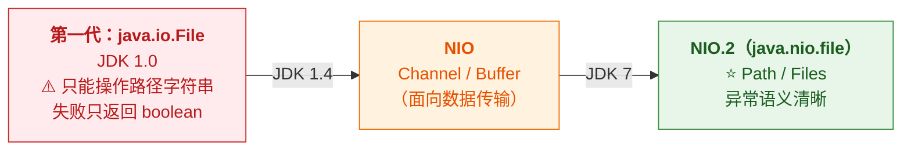
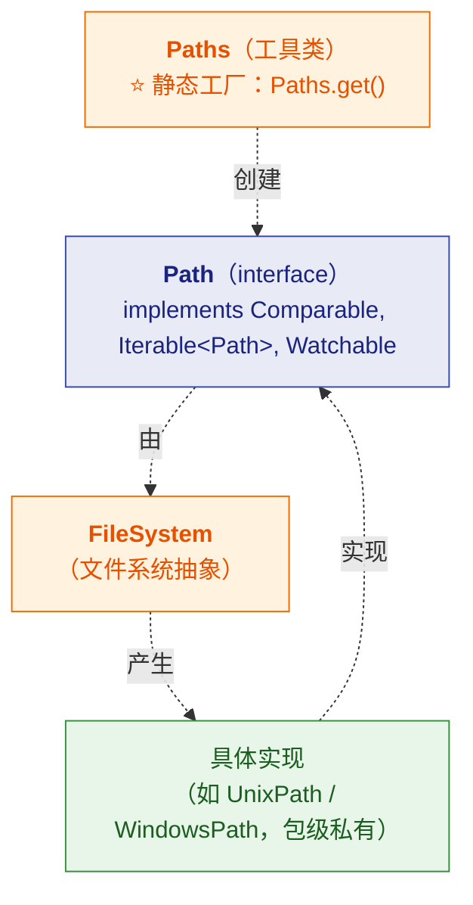
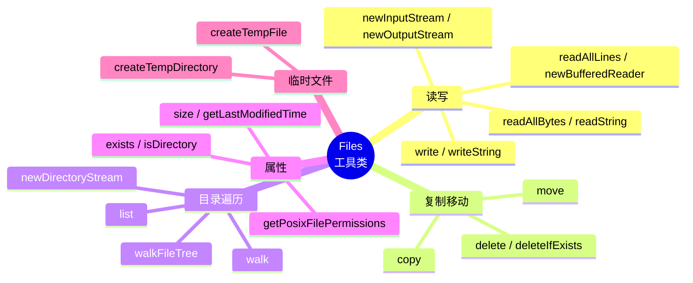

# 🗃️ 五、java.nio.file 与现代文件 API

> [!abstract] 本篇解决什么
> **JDK 7 引入的 NIO.2**（`java.nio.file` 包）——
> ⭐ **`Path` / `Paths` / `Files` 三件套**，以及它与老的 **`File`** 的关系。
>
> **结论先行**：⭐ **新的文件操作优先用 `Files`**，`File` 主要是历史包袱。
>
> 前置见 [[1-IO类结构继承总图]]；NIO 类结构见 [[3-NIO类结构体系]]。

---

## 一、三代文件 API 的演进



> [!important] ⭐ 为什么要引入 NIO.2
> **`java.io.File` 有四个明显缺陷：**
> | 缺陷 | 说明 |
> |---|---|
> | ⭐ **失败信息差** | `file.delete()` 返回 `false`——**但不告诉你为什么**（权限？占用？不存在？） |
> | **没有元数据 API** | 拿不到权限、属主、创建时间（要额外依赖） |
> | **不支持符号链接** | 无法区分"链接"和"目标" |
> | **跨平台差** | 路径分隔符、大小写敏感等处理粗糙 |
>
> **NIO.2 全部解决**：⭐ **失败抛具体异常**（`NoSuchFileException` / `AccessDeniedException`…）。

---

## 二、`Path`：路径的抽象

### 2.1 类关系



> [!important] ⭐ 实测的接口关系（JDK 17 反射）
> ```
> Path  implements: Comparable<Path>, Iterable<Path>, Watchable
> ```
> **注意 `Iterable<Path>`**——⭐ **所以 `Path` 可以被 `for` 遍历**：
> ```java
> Path p = Paths.get("/a/b/c.txt");
> for (Path part : p) {
>     System.out.println(part);   // 依次输出 a, b, c.txt
> }
> ```

### 2.2 创建与常用方法

```java
// 创建（三种等价方式）
Path p1 = Paths.get("/data", "a.txt");                    // ⭐ 最常用
Path p2 = Path.of("/data/a.txt");                         // ⭐ JDK 11+ 推荐
Path p3 = new File("/data/a.txt").toPath();               // 从 File 转

// 拼接与解析
p1.resolve("sub/x.txt");     // ⭐ /data/a.txt/sub/x.txt
p1.getParent();              // /data
p1.getFileName();            // a.txt
p1.toAbsolutePath();         // 绝对路径
p1.normalize();              // ⭐ 去掉 . 和 ..

// File 与 Path 互转
File f = p1.toFile();
Path p4 = f.toPath();

// 相对化
Path base = Paths.get("/data");
base.relativize(Paths.get("/data/a/b.txt"));   // a/b.txt
```

> [!tip] `Paths.get` 的可变参数很实用
> **`Paths.get("/data", "2026", "a.txt")` 会自动用平台正确的分隔符拼接**——
> **不用手写 `"/"` 或 `File.separator`**（后者是老写法）。

---

## 三、⭐ `Files`：现代文件操作的"瑞士军刀"

### 3.1 能力总览



### 3.2 ⭐ 读写：一行搞定

```java
// ⭐ 读整个文件（小文件）
byte[] bytes = Files.readAllBytes(Paths.get("a.txt"));
String text = Files.readString(Paths.get("a.txt"));                    // JDK 11+
List<String> lines = Files.readAllLines(Paths.get("a.txt"));           // ⭐ 按行

// ⭐ 读大文件（流式，不占内存）
try (BufferedReader r = Files.newBufferedReader(path, StandardCharsets.UTF_8)) {
    String line;
    while ((line = r.readLine()) != null) { /* ... */ }
}

// ⭐ 写文件
Files.write(path, bytes);
Files.writeString(path, "hello", StandardCharsets.UTF_8);              // JDK 11+
Files.write(path, lines);                                              // 写多行

// 追加（默认是覆盖！）
Files.write(path, bytes, StandardOpenOption.APPEND);

// ⭐ 流式写
try (BufferedWriter w = Files.newBufferedWriter(path, StandardCharsets.UTF_8)) {
    w.write("hello");
}
```

> [!success] ⭐ `Files.newBufferedReader(path, charset)` 的好处
> **它一步到位**：**打开文件 + 包装缓冲 + 指定编码**——
> **省掉了 `new BufferedReader(new InputStreamReader(new FileInputStream(...), UTF_8))` 这一长串**
> （见 [[2-装饰器与流组合]]）。
>
> **而且它是"显式指定编码"的**——避开了 `FileReader` 的平台默认编码坑。

> [!warning] ⚠️ 两个注意点
> **① `Files.write` 默认是"覆盖"（CREATE + TRUNCATE_EXISTING）**——
> **追加要显式传 `StandardOpenOption.APPEND`。**
>
> **② `readAllBytes` / `readAllLines` 会把整个文件读进内存**——
> **大文件必须用流式 API**（`newBufferedReader` / `lines`）。

### 3.3 ⭐ 复制、移动、删除

```java
// 复制（可选：覆盖已有、复制属性）
Files.copy(src, dst, StandardCopyOption.REPLACE_EXISTING,
                     StandardCopyOption.COPY_ATTRIBUTES);

// 移动（可选：原子移动、覆盖）
Files.move(src, dst, StandardCopyOption.ATOMIC_MOVE);

// 删除（失败抛异常，信息具体）
Files.delete(path);
Files.deleteIfExists(path);        // ⭐ 不存在也不报错
```

> [!important] ⭐⭐ `ATOMIC_MOVE` 在工程上非常重要
> **它是"原子重命名"的 Java 实现**——
> **要么完成、要么没发生，不存在"中间态"。**
>
> **这正是[[1-java/10-数据仓库/5-ETL调度与数据同步|数据加载方案]]里
> "`.tmp` → 原子 rename"的技术基础**：
> ```java
> Files.move(tmp, finalPath, StandardCopyOption.ATOMIC_MOVE);
> ```
> **下游永远不会读到"写了一半"的文件。**
>
> ⚠️ **注意**：`ATOMIC_MOVE` 要求**同一文件系统内**，
> 跨文件系统（如跨挂载点）会抛 `AtomicMoveNotSupportedException`。

### 3.4 ⭐ 目录遍历：`walk` 与 `walkFileTree`

```java
// ⭐ walk：返回 Stream<Path>（JDK 8+），适合"过滤 + 处理"
try (Stream<Path> s = Files.walk(Paths.get("/data"), 3)) {   // 深度 3
    s.filter(Files::isRegularFile)
     .filter(p -> p.toString().endsWith(".log"))
     .forEach(System.out::println);
}

// ⭐ walkFileTree：访问者模式，适合"需要精细控制"（如删除整棵树）
Files.walkFileTree(Paths.get("/data"), new SimpleFileVisitor<Path>() {
    @Override public FileVisitResult visitFile(Path f, BasicFileAttributes a) throws IOException {
        Files.delete(f);                        // 先删文件
        return FileVisitResult.CONTINUE;
    }
    @Override public FileVisitResult postVisitDirectory(Path d, IOException e) throws IOException {
        Files.delete(d);                        // ⭐ 后删目录（必须后序）
        return FileVisitResult.CONTINUE;
    }
});
```

| 方法 | 返回 | 适用 |
|---|---|---|
| **`Files.list(dir)`** | `Stream<Path>`（**只一层**） | 列目录 |
| **`Files.walk(dir, depth)`** | `Stream<Path>`（**递归**） | ⭐ **过滤/收集文件** |
| ⭐ **`Files.walkFileTree`** | 回调（`FileVisitor`） | ⭐ **需要精细控制**（删除整树、统计、跳过子树） |

> [!warning] ⚠️ `walk` 返回的是 `Stream`，必须关闭！
> **它底层持有目录句柄**——**不关会泄漏 fd**（`Too many open files`）。
> ```java
> try (Stream<Path> s = Files.walk(dir)) {   // ⭐ 一定要 try-with-resources
>     // ...
> }
> ```

---

## 四、⭐ 新旧 API 对照表（迁移速查）

| 需求 | ❌ 老 `File` | ⭐ 新 `Path` + `Files` |
|---|---|---|
| 创建路径 | `new File("/a/b")` | `Path.of("/a/b")` |
| 是否存在 | `f.exists()` | `Files.exists(p)` |
| 是否目录 | `f.isDirectory()` | `Files.isDirectory(p)` |
| 文件大小 | `f.length()` | `Files.size(p)` |
| 最后修改 | `f.lastModified()` | `Files.getLastModifiedTime(p)` |
| 创建文件 | `f.createNewFile()` ⚠️ 返回 boolean | `Files.createFile(p)` ⭐ **抛具体异常** |
| 创建目录 | `f.mkdir()` / `mkdirs()` | `Files.createDirectory` / `createDirectories` |
| 删除 | `f.delete()` ⚠️ 返回 boolean | `Files.delete(p)` ⭐ **抛具体异常** |
| 重命名 | `f.renameTo()` ⚠️ 返回 boolean | `Files.move(...)` ⭐ **可原子** |
| 复制 | ❌ **不支持** | ⭐ `Files.copy` |
| 读全部 | ❌ 手写循环 | ⭐ `Files.readAllBytes` / `readString` |
| 写全部 | ❌ 手写循环 | ⭐ `Files.write` |
| 列目录 | `f.listFiles()`（可能返回 `null`） | ⭐ `Files.list` / `walk` |
| 读属性 | ❌ 能力弱 | ⭐ `Files.readAttributes` |
| 临时文件 | `File.createTempFile` | ⭐ `Files.createTempFile` |

> [!danger] ⭐ `File` 的三个"坑"
> **① `listFiles()` 可能返回 `null`**——
> 路径不是目录、或 IO 错误时返回 `null`，**不检查就 NPE**。
>
> **② `delete()` / `renameTo()` 返回 `boolean`**——
> **失败了你不知道原因**（这是 NIO.2 要解决的核心问题）。
>
> **③ `File` 只是"路径抽象"，不代表文件存在**——
> **`new File("x").exists()` 才检查。**
> **（`File` 对象本身创建成功 ≠ 文件存在）**

---

## 五、⭐ `Path` vs `File`：怎么选

> [!important] ⭐ 结论
> | 场景 | 建议 |
> |---|---|
> | ⭐ **新代码** | **一律用 `Path` + `Files`** |
> | **老 API 需要 `File`**（如某些第三方库） | 用 `path.toFile()` 转换 |
> | **只需要"路径字符串拼接"** | `Path.of(...)` 也比 `new File(...)` 清晰 |
>
> **为什么新代码不用 `File`**：
> **① 异常语义清晰 ② 功能更全（`copy`/`walk`/属性）③ 支持符号链接 ④ 跨平台更好**

---

## 六、⚠️ 常见陷阱

| # | 陷阱 | 说明 | 正确做法 |
|---|---|---|---|
| **1** | ⚠️ **`Files.write` 默认覆盖** | 想追加却覆盖了数据 | 传 `StandardOpenOption.APPEND` |
| **2** | ⚠️ **`Files.walk` 不关流** | fd 泄漏 | ⭐ **`try-with-resources`** |
| **3** | ⚠️ **`readAllBytes` 读大文件** | **OOM** | 用 `newBufferedReader` 流式读 |
| **4** | **`ATOMIC_MOVE` 跨文件系统** | 抛异常 | 确保同文件系统 |
| **5** | **`File.listFiles()` 返回 null** | NPE | 用 `Files.list` 或判空 |
| **6** | **`delete()` 非空目录失败** | 目录必须先清空 | 用 `walkFileTree` **后序删除** |
| **7** | **没指定编码** | 跨平台乱码 | ⭐ **显式传 `StandardCharsets.UTF_8`** |
| **8** | **`Path.of` 与 `Paths.get` 混用** | 功能相同，风格不一 | 新代码统一用 **`Path.of`** |

> [!tip] 陷阱 6 的完整解法（删目录树的"标准姿势"）
> **必须先删子项、再删目录自己**（后序遍历）：
> ```java
> Files.walkFileTree(dir, new SimpleFileVisitor<Path>() {
>     @Override public FileVisitResult visitFile(Path f, BasicFileAttributes a) throws IOException {
>         Files.delete(f);              // ① 删文件
>         return FileVisitResult.CONTINUE;
>     }
>     @Override public FileVisitResult postVisitDirectory(Path d, IOException e) throws IOException {
>         Files.delete(d);              // ② 后序删目录（此时已空）
>         return FileVisitResult.CONTINUE;
>     }
> });
> ```
> ⭐ **注意是 `postVisitDirectory`（后序），不是 `preVisitDirectory`。**

---

## 七、30 秒速查表

| 问题 | 一句话答案 |
|---|---|
| NIO.2 是哪三个类 | ⭐ **`Path`（路径）/ `Paths`（工厂）/ `Files`（工具）** |
| 引入版本 | **JDK 7** |
| ⭐ 为什么要 NIO.2 | `File` **失败只返回 boolean，不告诉你原因** |
| 创建 Path | ⭐ **`Path.of(...)`**（JDK 11+）或 `Paths.get(...)` |
| ⭐ `Path` 实现了什么 | **`Comparable` / `Iterable<Path>` / `Watchable`** |
| `Iterable` 意味着什么 | ⭐ **`Path` 可以被 `for` 遍历**（逐级路径） |
| `Path` 与 `File` 互转 | **`path.toFile()` / `file.toPath()`** |
| ⭐ 读写一行搞定 | **`Files.readString` / `readAllBytes` / `writeString` / `write`** |
| ⚠️ `Files.write` 默认行为 | ⭐ **覆盖**（追加要传 `APPEND`） |
| 读大文件怎么办 | ⭐ **`Files.newBufferedReader`**（流式，不占内存） |
| `Files.newBufferedReader` 的好处 | ⭐ **一步搞定"打开+缓冲+指定编码"** |
| ⭐⭐ `ATOMIC_MOVE` 的意义 | **原子重命名**——工程上防"半截文件"的基础 |
| `ATOMIC_MOVE` 的限制 | ⚠️ **要求同一文件系统** |
| 三种遍历 | **`list`（一层）/ `walk`（递归流）/ `walkFileTree`（回调）** |
| ⚠️ `walk` 的坑 | ⭐ **返回 Stream，必须关闭**（否则 fd 泄漏） |
| 删目录树的姿势 | ⭐ **`walkFileTree` + `postVisitDirectory`**（后序删） |
| ⚠️ `File` 的三个坑 | **`listFiles` 返回 null / `delete` 只返回 boolean / `File` ≠ 文件存在** |
| 新代码该用哪个 | ⭐ **`Path` + `Files`**（老库需要时 `toFile()` 转） |
| `Paths.get` vs `Path.of` | **功能相同**，新代码统一用 **`Path.of`** |

---

## 八、学习检查清单

- [ ] ⭐ 能说出 **`java.io.File` 的四个缺陷**
- [ ] ⭐ 能说出 **NIO.2 三件套**及引入版本（JDK 7）
- [ ] ⭐ 能说出 **`Path` 实现的三个接口**，并解释 `Iterable` 的意义
- [ ] 能写出 **`Path` 的创建与常用方法**（`resolve`/`getParent`/`normalize`）
- [ ] ⭐ 能说出 **`Files` 的读写 API**，并区分"小文件"与"大文件"的做法
- [ ] ⚠️ 能说清 **`Files.write` 默认覆盖**及追加写法
- [ ] ⭐ 能说清 **`Files.newBufferedReader` 相对传统写法的优势**
- [ ] ⭐⭐ 能解释 **`ATOMIC_MOVE` 的意义**及与"防半截文件"的关系
- [ ] ⚠️ 能说出 **`ATOMIC_MOVE` 的同文件系统限制**
- [ ] ⭐ 能区分 **`list` / `walk` / `walkFileTree`** 的适用场景
- [ ] ⚠️ 能说清 **`Files.walk` 必须关闭**（fd 泄漏）
- [ ] ⭐ 能写出**删除目录树的正确姿势**（后序删）
- [ ] ⭐ 能背出**新旧 API 对照表**的关键几行
- [ ] ⚠️ 能说出 **`File` 的三个坑**
- [ ] ⭐ 能给出"**新代码该用 `Path` + `Files`**"的建议及理由

---
> 上一篇 → [[4-RandomAccessFile与FileDescriptor]] ｜ 返回 [[1-IO类结构继承总图]]
> 相关 → [[3-IO与网络编程]]（NIO 原理）· [[1-java/10-数据仓库/5-ETL调度与数据同步|ETL 原子 rename]]
