# ♻️ 深入理解 JVM GC：G1 与 ZGC 实战（详细整理版）

> 本篇是对 [B 站视频《深入理解JVM GC：G1与ZGC实战》](https://www.bilibili.com/video/BV1PMEQ6eEkd/)（约 19 分钟）的**逐段深度整理**。视频以"**凌晨三点生产告警：Full GC 每分钟 47 次、CPU 打满、堆内存锯齿状抖动**"的真实事故开场，从 GC 基础一路讲到 G1、ZGC 的机制、坑点、选型与**切换上线流程**。
> 定位：**G1/ZGC 实战专题**——机制图解 + 坑点 + 选型决策 + 上线 SOP。
> 原始字幕稿：[[深入理解JVM GC：G1与ZGC实战]]（ASR 把 **读屏障识别成"毒屏障"**、ZGC 识别成 "CGC"、jstat 识别成 "Stat koto"，见 [附录 A](#附录-a语音转写asr勘误对照)）。
>
> **相关笔记**：[[2-GC机制深度]]（算法原理：三色标记、SATB、卡表与写屏障）、[[6-JVM参数与调优实战]]（参数速查与容器内存账）、[[7-JVM故障排查实战]]（GC 问题定位）、[[1-JVM内存区域与对象布局]]（堆与对象）。

> [!important] 先校正 ZGC 的版本链条（视频有一处混淆）
> 视频说"**Java 15 起 ZGC 加入了分带（分代）机制**"——**这里把两件事混在一起了**：
> 
> | 版本 | 真实事件 | JEP |
> | --- | --- | --- |
> | **JDK 11** | ZGC **实验性引入**（单代） | JEP 333 |
> | ⭐ **JDK 15** | ZGC **转正**（Production Ready）——这才是"Java 15"的意义 | JEP 377 |
> | JDK 16 | 支持并发栈处理（栈也可并发扫描） | JEP 376 |
> | ⭐ **JDK 21** | **分代 ZGC 引入**（实验，需 `-XX:+ZGenerational`） | JEP 439 |
> | **JDK 23** | **分代成为 ZGC 默认模式** | JEP 474 |
> | ⭐ **JDK 24** | **单代 ZGC 被移除**，`-XX:+ZGenerational` 废弃（写了会告警） | JEP 490 |
>
> 结论：**JDK 24+ 用 `-XX:+UseZGC` 就是分代 ZGC，不需要也不该再写 `ZGenerational`**。

---

## 〇、事故驱动：从"GC 风暴"开始

> 视频开场："凌晨三点，生产环境告警——**Full GC 每分钟 47 次，CPU 直接打满**，堆内存像锯齿一样上下跳，GC 暂停时间越来越长…… —— 这是典型的 **GC 风暴**。"

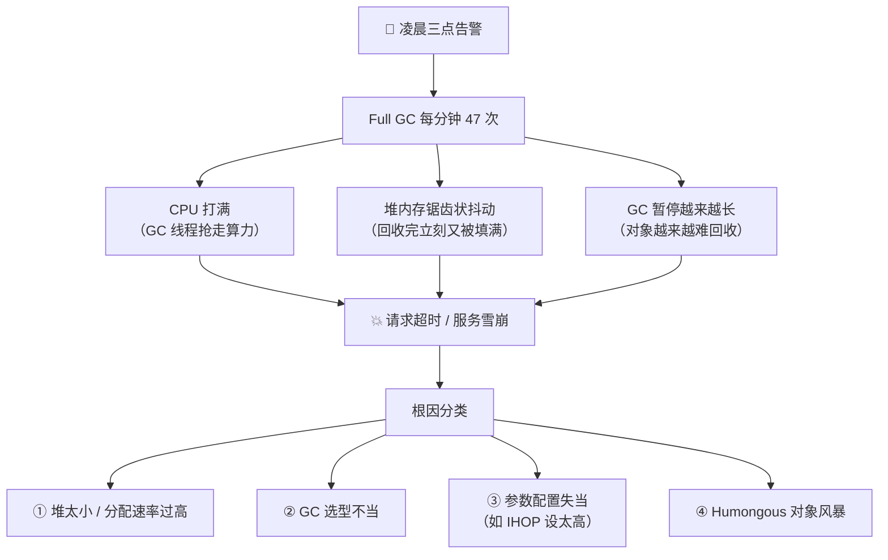

**视频给的学习路线**：`GC 基础原理 → G1 深入 → ZGC 深入 → 对比选型 → 实战坑点`。

---

## 一、GC 基础：堆结构与对象的一生

> 视频比喻："JVM 的堆内存就像**一块地皮分成两大块**：上边是年轻代，下边是老年代。年轻代又分三小块——**一个 Eden 区 + 两个 Survivor 区**。
> 新创建的对象先进 Eden，活过一轮 GC 的搬到 Survivor，**再活几轮就晋升到老年代**——就像人生一样，**从小房间搬到大房间**。区别是**旧的房间会定期清扫**。"

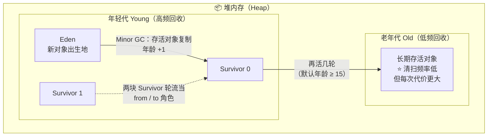

| 区域 | 角色 | 回收频率 | 单次代价 |
| --- | --- | --- | --- |
| **Eden** | 新对象出生地，**大部分对象朝生夕死** | 高 | 低（存活少，复制便宜） |
| **Survivor ×2** | 存放"活过一轮"的中间态对象（两块轮流当 from/to） | 高 | 低 |
| **老年代 Old** | 长期存活对象 | **低** | ⭐ **高**（对象多，整理/复制昂贵） |

> [!important] 全片的核心问题（视频原话）
> "**老年代的清扫频率低，但每次清扫的代价更大——所以关键问题是怎么高效地清理老年代。** 这就是 G1 和 ZGC 要解决的核心问题。"

> 深读：分代假说为什么成立、对象何时真正晋升（动态年龄判定），见 [[2-GC机制深度]] §一。

---

## 二、GC 演进的比喻：从自行车到磁悬浮

> 视频比喻（这段很适合记忆）：
> **Serial GC = 自行车**（简单，但慢，一次只能一个人干活）
> **Parallel GC = 公交车**（多个人一起干，吞吐量上去了，但**停站时间长**）
> **CMS = 出租车**（尽量不停车，但路况复杂时**还是会堵**）
> **G1 = 地铁**（**分区管理，可预测到站时间**）
> **ZGC = 磁悬浮**（**几乎不停站，速度快得离谱**）

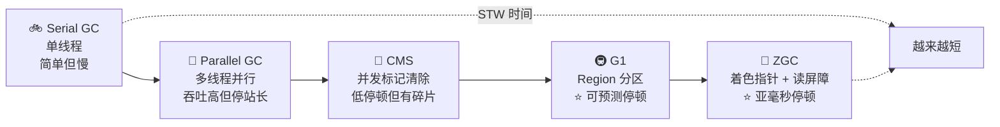

| 收集器 | 交通比喻 | 特点 | 停顿 | 适用 |
| --- | --- | --- | --- | --- |
| **Serial** | 自行车 | 单线程，简单 | 长 | 小堆、客户端 |
| **Parallel** | 公交车 | 多线程，**吞吐量最高** | 较长 | 批处理、后台任务 |
| **CMS** | 出租车 | 并发标记清除，低停顿 | 中 | 老版本低延迟（**JDK 14 已移除**） |
| **G1** | 地铁 | **Region 化 + 可预测停顿** | 中短（10~100ms） | ⭐ 中等堆、均衡场景（**JDK 9+ 默认**） |
| **ZGC** | 磁悬浮 | **全并发 + 亚毫秒停顿** | ⭐ **极短（0.1~1ms）** | ⭐ 大堆、低延迟 |

> 深读：三色标记、SATB 与增量更新的差别、CMS 为什么被淘汰，见 [[2-GC机制深度]] §四。

---

## 三、G1 详解：Region 化与增量回收

### 3.1 核心思想：Garbage First（垃圾优先）

> 视频原话："G1 全称 **Garbage First（垃圾优先）**。传统 GC 是**按代来回收**；G1 换了个思路——**按 region 来回收，哪个 region 垃圾最多就优先回收哪个**。所以它**不关心对象是年轻还是老，只关心哪里垃圾多**。"

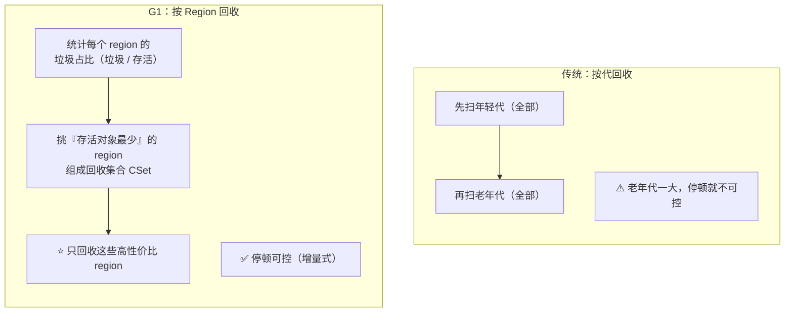

### 3.2 Region 网格与"角色可变"

> 视频对话："G1 把堆切成很多**等大的 region**，默认每个 **1MB ~ 32MB**。每个 region 在任意时刻**只有一个角色**：Eden、Survivor、Old 或空闲——**但角色不是固定的**，GC 回收完一个 region，它就变成空闲，下次可以重新分配。**就像停车位：同一个车位，今天停红色车，明天可以停蓝色车。**"

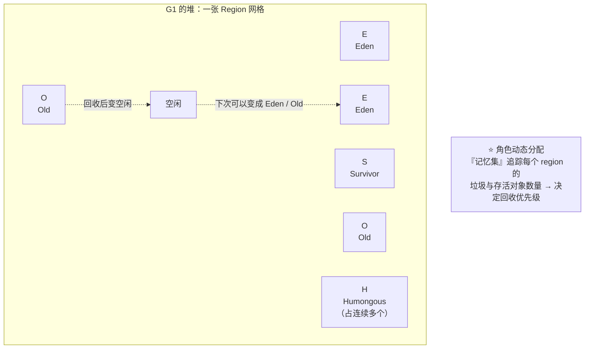

| 要点 | 说明 |
| --- | --- |
| Region 大小 | 默认 **1MB ~ 32MB**（2 的幂，约 `堆大小 / 2048`，可用 `-XX:G1HeapRegionSize` 调整） |
| 角色 | Eden / Survivor / Old / **Humongous** / 空闲 |
| 角色可变 | ⭐ 回收后变空闲，下次可重新分配为任意角色 |
| 为什么叫 Garbage First | ⭐ **存活对象越少的 region，回收性价比越高 → 优先回收** |

### 3.3 对象分配与 Humongous 坑

> 视频对话："小对象进 Eden region，**放满一个换下一个**；但注意——**如果一个对象超过 region 大小的一半，它就是 Humongous 对象，会占连续的多个 region**。"
> "**这是 G1 的一个坑**：Humongous 对象**分配和回收都很昂贵**，后面实战部分会重点讲。"

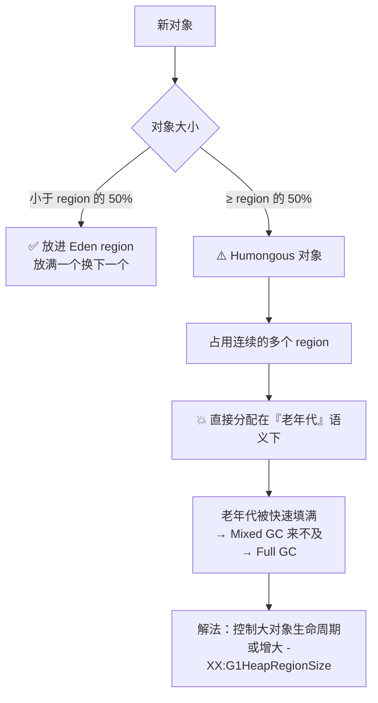

| 项 | 说明 |
| --- | --- |
| 判定阈值 | 对象大小 **≥ region 大小的一半** |
| 分配方式 | 占用**连续的多个 region**（H 标记） |
| 为什么贵 | ① 需要连续空间（易碎片化失败）；② 回收时整段处理；③ **绕过年轻代**，直接冲击老年代 |
| 应对 | 增大 region（`G1HeapRegionSize`）、减少大对象、改用 ZGC（变长 region） |

### 3.4 跨代引用：Card Table + RSet

> 视频对话："young GC 要回收年轻代，**但老年代的对象可能引用了年轻代的对象**——怎么知道哪些老年代对象有引用？G1 用了两个机制：**Card Table 和 Remembered Set**。"

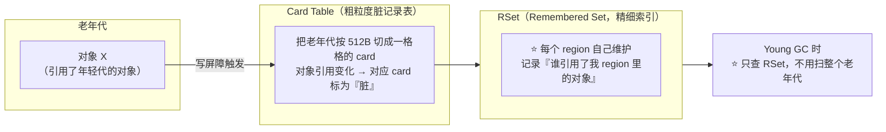

| 机制 | 粒度 | 作用 | 维护者 |
| --- | --- | --- | --- |
| **Card Table** | 粗（512 字节/卡） | 记录"老年代→年轻代"的**脏卡** | JVM 全局 |
| ⭐ **RSet** | 细（region 级） | 记录"**谁引用了我这个 region 里的对象**" | **每个 region 自己维护** |
| ⚠️ 代价 | — | ⭐ **RSet 内存开销约占堆的 5%~10%** | 这是 G1 的"隐性成本" |

> 深读：写屏障（Write Barrier）是怎么把卡标脏的、SATB 如何配合，见 [[2-GC机制深度]] §五。

### 3.5 Young GC：快，但不是问题的关键

> 视频对话："young GC 触发了，**这时候所有应用线程都会暂停（STW）**。G1 会扫描所有 Eden 和 Survivor region，找出存活对象，复制到新的 Survivor region。**暂停 18ms**，感觉还行——**young GC 通常很快，因为大部分对象都是垃圾**。"

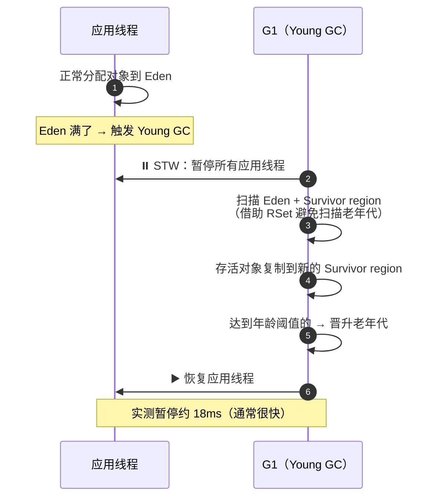

> [!warning] 真正的风险在老年代
> 视频原话："**如果老年代满了，触发 Full GC，暂停可能是几秒甚至几十秒。**"
> 所以 G1 的设计重点不是让 Young GC 更快，而是**通过 Mixed GC 提前、增量地清理老年代，避免走到 Full GC**。

### 3.6 并发标记周期：找出"值得回收"的老年代 Region

> 视频对话："G1 不是上来就回收老年代——**它先做一轮并发标记，找出哪些 old region 值得回收**。
> 注意看：**只有 Initial Mark 和 Remark 两个阶段是 STW 的，但它们极短（通常不到 1 毫秒）**；**大部分标记工作在 Concurrent Mark 阶段完成，和应用线程一起跑，不暂停**。"

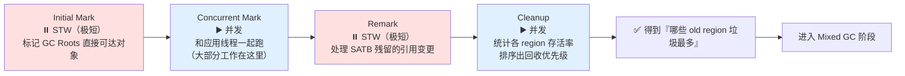

| 阶段 | 是否 STW | 耗时 | 做什么 |
| --- | --- | --- | --- |
| **Initial Mark** | ⏸️ **是** | **不到 1ms** | 标记 GC Roots 直接可达对象（借用一次 Young GC 的暂停） |
| **Concurrent Mark** | ▶️ 并发 | 较长但**不暂停** | 遍历对象图（G1 用 **SATB** 快照语义） |
| **Remark** | ⏸️ **是** | **不到 1ms** | 处理标记期间的引用变更（SATB 缓冲） |
| **Cleanup** | ▶️ 并发 | 短 | ⭐ **统计各 region 的存活率并排序** → 决定回收哪些 |

### 3.7 Mixed GC：增量式回收老年代（G1 的精髓）

> 视频对话："标记完之后，G1 就知道哪些 region 垃圾最多了，接下来进入 **Mixed GC**——**年轻代和老年代一起回收**，但**不是全部老年代，只回收标记阶段选出的高价值 region**。**这就是 G1 的精髓：增量式回收——老年代每次只拿一小部分，保证暂停时间可控**。"

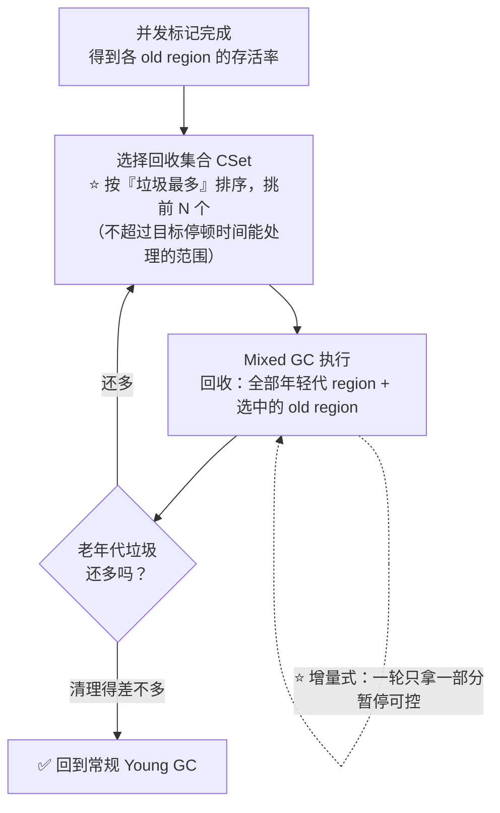

| 对比 | Young GC | **Mixed GC** |
| --- | --- | --- |
| 回收范围 | 仅年轻代 region | **年轻代 + 选中的部分 old region** |
| 触发时机 | Eden 满 | ⭐ **并发标记完成后**（由 IHOP 触发标记） |
| 老年代处理 | 不动 | ⭐ **增量式，每轮只拿高价值的一部分** |
| 设计目的 | 快速腾出空间 | ⭐ **避免走到 Full GC** |

### 3.8 Full GC：G1 最不想看到的路径

> 视频对话："如果老年代增长太快，来不及 Mixed GC 怎么办？—— **那就可能触发 Full GC：整个堆 STW 扫描，所有应用线程停顿**……**2.1 秒**。生产环境里，**这就是灾难**。"
> "**G1 的设计目标就是避免 Full GC**；但如果你的堆太小、分配速率太高、或者 Humongous 对象太多，G1 就可能顶不住。"

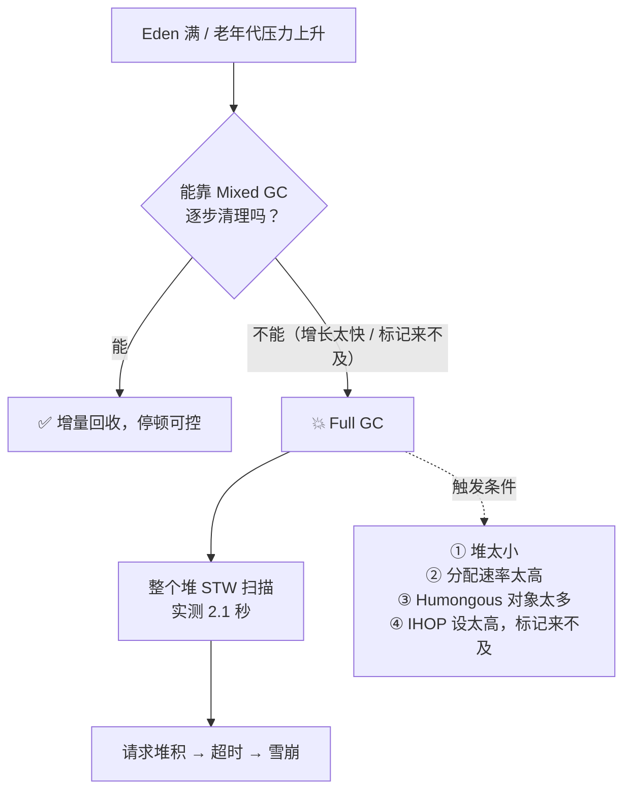

> [!note] 补充：G1 的 Full GC 早已不是单线程
> 视频没提：**JDK 10 起 G1 的 Full GC 已并行化**（[JEP 307: Parallel Full GC for G1](https://openjdk.org/jeps/307)）。虽然仍是 STW，但比最初的单线程版本快得多——这也是为什么现代 G1 的 Full GC"只有"秒级而不是几十秒。

### 3.9 G1 关键参数

> 视频对话："G1 的参数不多，但这几个最关键。"

| 参数 | 默认值 | 作用 | 调优要点 |
| --- | --- | --- | --- |
| ⭐ `-XX:MaxGCPauseMillis` | **200ms** | **目标停顿时间**，G1 会尽量控制在这个范围内 | 调小 → 每轮回收更少、更频繁；调大 → 吞吐更好但停顿更长 |
| ⭐ `-XX:InitiatingHeapOccupancyPercent`（IHOP） | **45%** | **触发并发标记的堆占用阈值** | ⚠️ **设太低 → 频繁触发标记**（浪费 CPU）；**设太高 → 来不及标记就被 Full GC** |
| `-XX:G1HeapRegionSize` | 堆/2048，1~32MB | region 大小 | **Humongous 多时增大它** |
| `-XX:ConcGCThreads` | 约并行 GC 线程的 1/4 | 并发标记线程数 | ⭐ **标记被高 CPU 应用抢占时增加它** |
| `-XX:G1MixedGCCountTarget` | 8 | 一轮 Mixed GC 分几次做完 | 停顿敏感可调大（每轮更小） |
| `-XX:G1MixedGCLiveThresholdPercent` | 85% | 存活率高于此值的 region **不回收** | 控制回收的"性价比门槛" |

```bash
# G1 生产模板（视频口径 + 常用配套）
-Xms16g -Xmx16g                              # ⭐ 固定堆，避免动态扩缩抖动
-XX:+UseG1GC
-XX:MaxGCPauseMillis=50                      # 目标停顿 50ms（比默认 200ms 更激进）
-XX:InitiatingHeapOccupancyPercent=35        # 提前启动并发标记（默认 45% 偏晚）
-XX:G1HeapRegionSize=16m                     # Humongous 多时增大
-XX:ConcGCThreads=4                          # 标记跟不上分配时增加
-XX:+ParallelRefProcEnabled                  # 并行处理引用，减少 Remark 停顿
-Xlog:gc*:file=/var/log/app/gc.log:time,uptime,level,tags:filecount=10,filesize=50M
-XX:+HeapDumpOnOutOfMemoryError -XX:HeapDumpPath=/var/log/app/
```

---

## 四、ZGC 详解：着色指针 + 读屏障

### 4.1 三个设计目标

> 视频对话："ZGC 是 Oracle 在 **Java 11** 引入的杀手级垃圾收集器，**三个设计目标**：**① 停顿时间不超过 1 毫秒；② 最大支持 16TB 堆；③ 整个 GC 过程几乎不暂停应用线程**。"

| 目标 | 数值 | 意义 |
| --- | --- | --- |
| **停顿时间** | **不超过 1ms**（亚毫秒级） | 与堆大小**基本无关** |
| **最大堆** | **16TB** | 远超 G1 的实用范围 |
| **并发度** | 几乎全程并发 | 只有 3 个极短的 STW 点 |

> 视频对话："16TB G1 也支持大堆，**但停顿时间能做到亚毫秒——这就是 ZGC 的厉害之处**。"

### 4.2 着色指针（Colored Pointers）：把指针的高位"废物利用"

> 视频对话："普通指针只存地址，但 ZGC **偷偷用了指针的高位来存颜色标记**——比如这个对象有没有被标记、有没有被移动过。"
> "（追问）篡改指针不会出问题？—— **不会，因为这些高位本来就是未使用的**，因为目前的硬件根本用不到那么多地址空间。**ZGC 把它们废物利用了**。"

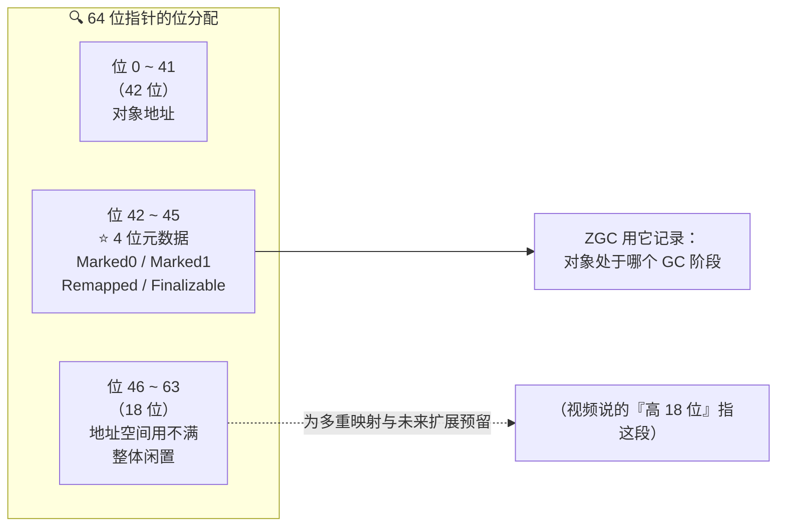

> [!warning] 一处技术细节需要精确（视频说"高 18 位存颜色"不够准确）
> 严格来说：**真正承载"颜色"的是 4 个 bit（位 42~45）**，对应 **Marked0 / Marked1 / Remapped / Finalizable** 四种状态；
> **位 46~63 这 18 位整体是闲置地址空间**，ZGC 用它们配合**多重映射**来构造多个地址视图。
> 视频把"高 18 位"和"颜色位"合在一起说了——**作为面试回答，说"用指针高位存 GC 元数据（4 个标记位）"更准确**。

**多重映射（Multi-Mapping）**：

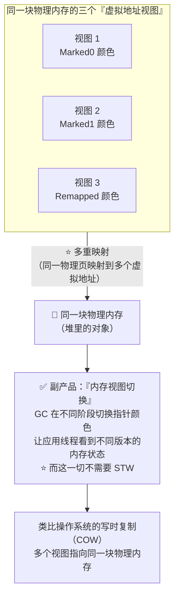

> [!important] 这就是"完全并发"的技术基础
> **通过指针颜色来协调 GC 线程与应用线程对内存的理解**——所以 GC 可以在**不暂停应用**的情况下改变堆的布局。
> ⚠️ 代价：**ZGC 不支持压缩指针**（Compressed Oops），因为它把指针高位用掉了；同时**多重映射会多占用虚拟地址空间**（这是后面 [§6.3 容器坑](#63-容器化的坑内存账要算清楚) 的根源）。

### 4.3 读屏障（Load Barrier）：那个"隐形的导航员"

> ⚠️ 视频字幕写的是"**毒屏障**"，正确术语是 **读屏障（Load Barrier）**。
> 视频对话："每当应用线程**读取一个对象引用**时，ZGC 会插入一段轻量检查——**看这个指针的颜色对不对**；如果颜色不对，说明**对象可能已经被 GC 移动了**，这时候就**悄悄更新引用到新地址**。"
> "（追问）这个检查会不会很慢？—— **几乎可以忽略，通常只有 1%~3% 的 CPU 开销**。比起 G1 动辄几十 ms 的 STW，这点开销太值了。"

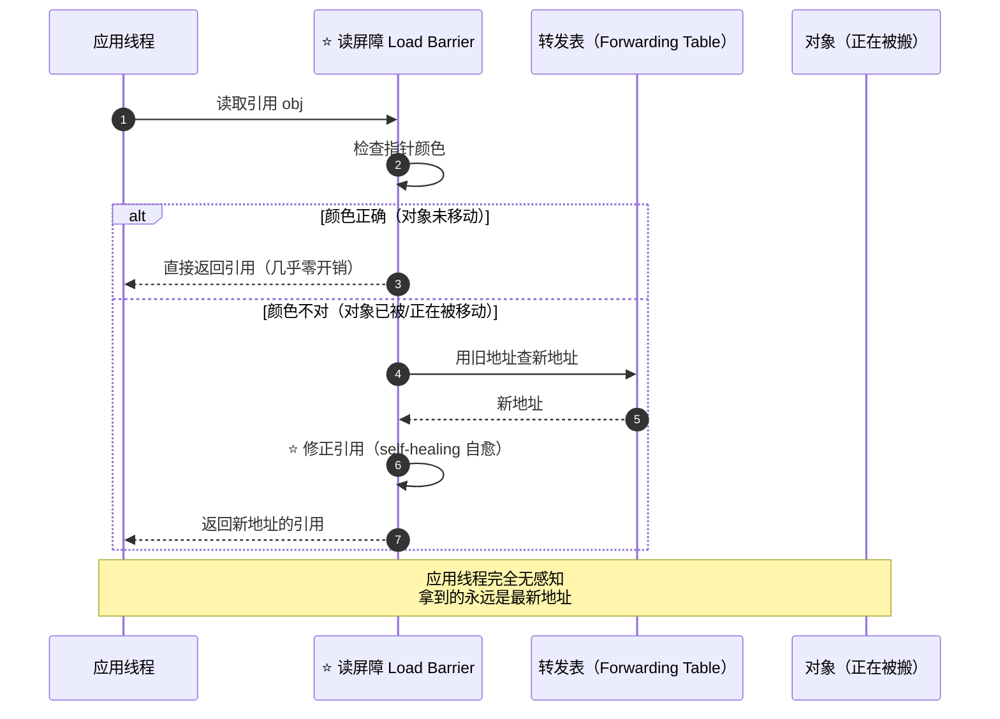

| 项 | 说明 |
| --- | --- |
| 触发时机 | **每次读取对象引用**（不是每次读字段值） |
| 检查内容 | 指针的**颜色位**是否符合当前 GC 阶段 |
| 颜色不对时 | ⭐ **查转发表修正引用（自愈）**，应用无感知 |
| 开销 | ⭐ **约 1%~3% CPU**（视频口径）——这就是 ZGC"吞吐略低"的原因 |

### 4.4 回收周期：三个极短的 STW（视频只说了两个）

> 视频对话："ZGC 的完整回收周期**只有两个极短的 STW 暂停**：**初始标记**和**转移开始**，通常都在一毫秒以内；其余所有工作——**并发标记、并发转移、并发重映射**——全都跟应用线程一起跑。"

> [!warning] 需要补一个：ZGC 实际有 **3 个** STW 暂停点
> 视频只列了 `Pause Mark Start` 和 `Pause Relocate Start`，**漏掉了 `Pause Mark End`（再标记）**。非分代 ZGC 的完整 STW 点是：
> **① Pause Mark Start → ② Pause Mark End → ③ Pause Relocate Start**（都在亚毫秒级）。
> 视频给的日志样例里其实也只显示了这两个——面试时把三个都说出来更完整。

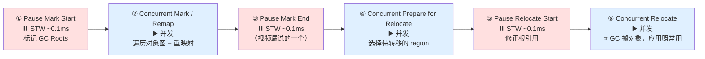

**并发转移是 ZGC 最精彩的部分**：

> 视频对话："**GC 线程在搬对象，应用线程在用对象，两条线并行，完全不冲突**。读屏障就像一个**隐形的导航员**：应用线程要访问的对象如果正在搬家，导航员会**自动引导到新地址**——所以应用线程永远看到的是正确的数据，**即使 GC 在背后忙得不可开交**。"

| 阶段 | STW？ | 典型耗时 | 做什么 |
| --- | --- | --- | --- |
| Pause Mark Start | ⏸️ | ~0.1ms | 标记根集合 |
| Concurrent Mark / Remap | ▶️ | 数百 ms | 并发遍历 + 重映射（不影响应用延迟） |
| **Pause Mark End** | ⏸️ | ~0.1ms | 处理并发期变更（**视频未提及**） |
| Concurrent Prepare for Relocate | ▶️ | — | 挑选待转移 region |
| Pause Relocate Start | ⏸️ | ~0.1ms | 修正根引用 |
| Concurrent Relocate | ▶️ | — | ⭐ **并发搬对象**（读屏障护航） |

### 4.5 可变 Region 大小：从设计上规避 G1 的 Humongous 尴尬

> 视频对话："ZGC 也用 region 管理内存，但**和 G1 不同：ZGC 的 region 大小是可变的**——**小对象放小 region，大对象放大 region**，避免了 G1 那种 Humongous 对象的尴尬。**所以 ZGC 从设计上就规避了 G1 的那些坑**——ZGC 晚于 G1 设计，吸取了很多教训。"

| 对比 | G1 | ZGC |
| --- | --- | --- |
| Region 大小 | **等大**（1~32MB 固定） | ⭐ **可变**：Small 2MB / Medium 32MB / Large（2MB 的整数倍） |
| 大对象 | ⚠️ **Humongous 占连续多个 region**，昂贵 | ✅ **直接分配 Large region**，无特殊路径 |
| 后果 | Humongous 风暴 → Full GC | 从设计上规避 |

### 4.6 分代 ZGC 与版本演进（含视频事实校正）

> 视频对话："**Java 15 起 ZGC 加入了分代机制**……G1 天然就是分代的，ZGC 反而是后来才加上。"

**⚠️ 这里需要校正**（见文首版本表）：

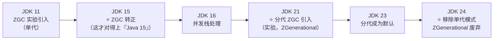

| 要点 | 说明 |
| --- | --- |
| 为什么要分代 | **年轻代高频回收**（大部分对象朝生夕死，快速清理）；**老年代低频回收**（专注长期存活对象） |
| 分代带来的收益 | 分代 ZGC 在**多数场景**下性能优于单代（JEP 439 的判断） |
| 与 G1 的差别 | G1 **天然就是分代**的；ZGC 是后来才补上，仍在持续优化 |
| ⭐ 现状 | **JDK 23 起分代是默认；JDK 24 起单代被移除**——`-XX:+UseZGC` 就是分代 ZGC |

### 4.7 ZGC 参数（很简洁）

```bash
# ZGC 生产模板
-Xms32g -Xmx32g                  # ⭐ 固定堆，避免动态扩缩
-XX:+UseZGC                      # ⭐ JDK 24+ 即分代 ZGC（无需再写 ZGenerational）
# -XX:+ZGenerational             # JDK 21~23 需要显式开启；JDK 24+ 已废弃（写了会告警）
-XX:+ZProactive                  # 主动回收（默认开启）：空闲时也主动做 GC，降低突发压力
-XX:+ZUncommit                   # 空闲内存归还 OS（默认开启）
-XX:ZUncommitDelay=300           # 多久未使用才归还（秒）
-Xlog:gc*:file=/var/log/app/gc-zgc.log:time,uptime,level,tags:filecount=10,filesize=50M
```

| 参数 | 说明 |
| --- | --- |
| `-XX:+UseZGC` | 启用 ZGC（JDK 24+ 默认分代） |
| `-XX:+ZGenerational` | JDK 21~23 用于开启分代；**JDK 24+ 已废弃** |
| `-XX:+ZProactive` | 主动回收，默认开启 |
| `-XX:+ZUncommit` | 空闲内存归还 OS，**容器场景很关键** |
| `-XX:ConcGCThreads` | 并发 GC 线程数（ZGC 也支持，但默认通常够用） |

---

## 五、G1 vs ZGC：对比与选型

> 视频对话（直接对比）：
> "G1 停顿通常 **10~100ms**，ZGC 在 **0.1~1ms**；
> G1 **吞吐量更高**，适合**堆不大的批处理**；ZGC **延迟更低**，适合**大堆低延迟**；
> G1 内存开销主要是 **RSet 5%~10%**，ZGC 主要是**着色指针的多重映射**（额外虚拟地址空间）；
> G1 **参数多但成熟度高**，ZGC **参数少、默认配置好**，但**生态工具还在追赶**。"

| 维度 | **G1** | **ZGC** |
| --- | --- | --- |
| ⭐ 停顿时间 | 通常 **10~100ms** | ⭐ **0.1~1ms**（与堆大小基本无关） |
| 吞吐量 | ⭐ **更高** | 略低（读屏障 + 并发操作 1%~3% CPU 开销） |
| 最大堆 | 实用范围几十 GB | ⭐ **16TB** |
| 分代 | ✅ 天然分代 | ✅ 分代（JDK 21+，23 起默认） |
| 老年代处理方式 | ⭐ **增量式 Mixed GC** | ⭐ **完全并发转移** |
| 内存开销 | **RSet 占堆 5%~10%** | **多重映射额外虚拟地址空间**（不支持压缩指针） |
| 大对象 | ⚠️ Humongous 有坑 | ✅ 变长 region，无此问题 |
| 调优 | 参数多、成熟 | 参数少、默认好，**但工具生态仍在追赶** |
| 版本 | JDK 9+ 默认 | JDK 11 引入 / 15 转正 / 21 分代 / 24 单代移除 |

### 选型决策树

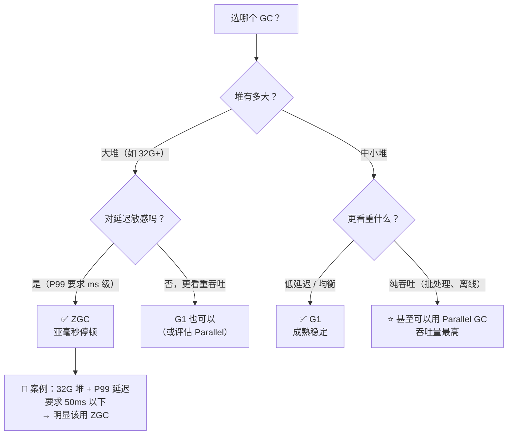

> [!important] 一句话记住两者的核心差异（视频收尾原话）
> "**两者的核心差异在于怎么处理老年代：G1 用增量式 Mixed GC，ZGC 用完全并发转移。**"

---

## 六、实战坑点

### 6.1 G1 的三大坑

> 视频对话："切换 GC 不是改个参数就完了，得了解实战中的坑。"

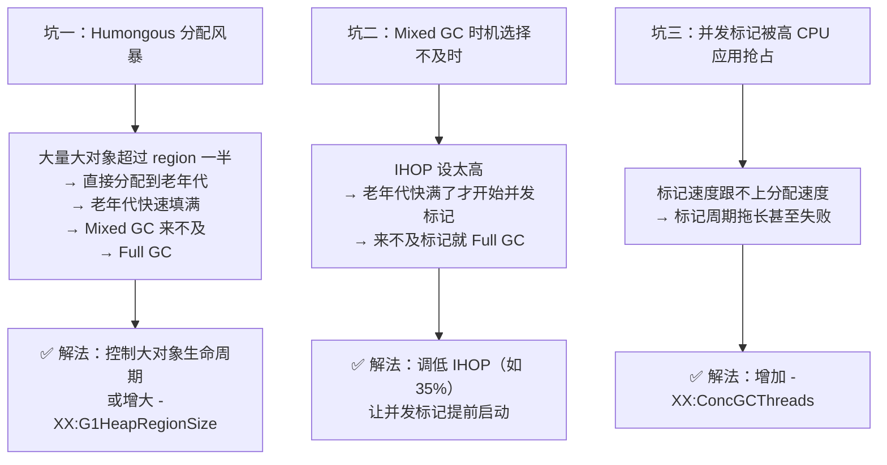

| 坑 | 现象 | 根因 | 解法 |
| --- | --- | --- | --- |
| **Humongous 风暴** | Full GC 频繁 | 大对象（≥ region/2）直接进老年代 | 控制大对象生命周期、增大 region、改用 ZGC |
| **Mixed GC 不及时** | Full GC 突袭 | ⭐ **IHOP 设太高** | 调低 IHOP（35% 左右） |
| **并发标记被抢占** | 标记周期拖长 | 应用吃满 CPU，标记线程饿死 | 增加 `ConcGCThreads`、错峰、扩 CPU |

### 6.2 ZGC 的三大坑

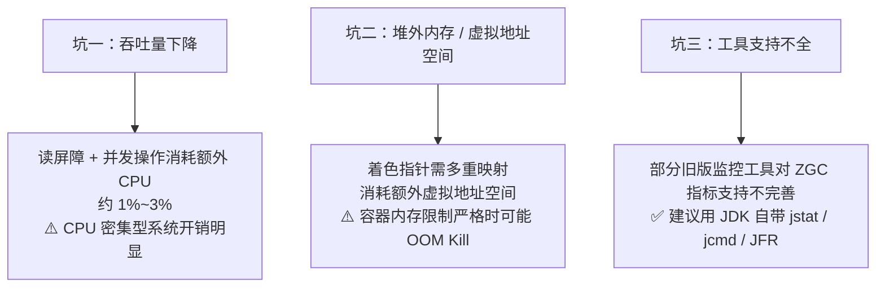

| 坑 | 说明 | 对策 |
| --- | --- | --- |
| **吞吐量下降** | 读屏障和并发操作有 CPU 开销（1%~3%） | CPU 密集型系统评估后再用；必要时提高 CPU 配额 |
| **堆外内存/虚拟地址空间** | 多重映射消耗额外虚拟地址空间 + **不支持压缩指针** | 容器里留足余量（见 [§6.3](#63-容器化的坑内存账要算清楚)） |
| **工具支持** | 旧监控工具指标不全 | ⭐ **用 JDK 自带 `jstat` / `jcmd` / JFR** |

> [!note] 补充两个容器/内核层面的 ZGC 注意事项（视频未提，建议核查）
> ① **`vm.max_map_count`**：ZGC 多重映射会让内存映射数量显著增加（同一个 region 有多个虚拟视图），在容器/主机上可能撞到该内核上限（常见默认 65530）；
> ② **共享内存/大页限制**：ZGC 在 Linux 上的堆后备与 `/dev/shm`、`vm.max_map_count` 等参数有关，容器（尤其 K8s 默认 `/dev/shm` 仅 64MB）需实测验证。
> **这两条属于运维细节，上线前务必在目标环境压测确认。**

### 6.3 容器化的坑：内存账要算清楚

> 视频对话："容器化环境有个大坑——**内存限制**。ZGC 的着色指针用多重映射会**额外占用虚拟地址空间**；K8s 的 `memory limit` **设得太紧，JVM 可能被 OOM Kill**。
> 建议：**堆大小不超过容器内存的 70%**，留够堆外空间。**容器的 memory limit 和 JVM 的 Xmx 要协调设置**，而且 **Xms 和 Xmx 必须一致**——避免 JVM 在容器内动态扩缩堆。"

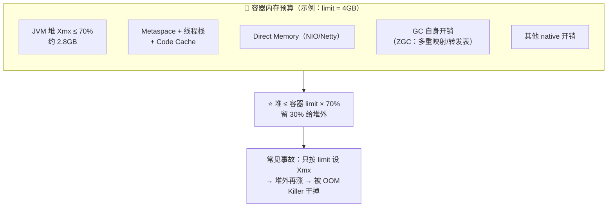

| 项 | 建议 |
| --- | --- |
| **堆上限** | ⭐ **`-Xmx` ≤ 容器 memory limit × 70%** |
| **固定堆** | ⭐ **`-Xms = -Xmx`**（避免容器内动态扩缩带来的抖动） |
| 容器感知 | 现代 JDK 默认开启 `-XX:+UseContainerSupport`，会按 cgroup 限制算默认值——但**仍要显式设置** |
| 堆外预算 | Metaspace、线程栈、Direct Memory、GC 结构都要算进去（详见 [[6-JVM参数与调优实战]] §四） |

---

## 七、监控与日志：生产环境的命脉

> 视频对话："**没有银弹，监控是生产环境的命脉。** 三个命令帮你掌控 GC。"

```bash
# ① 看整体 GC 概况（回收次数、各分区容量、暂停时间）
jstat -gc <pid> 1000
jstat -gcutil <pid> 1000        # 以百分比展示，便于快速判断

# ② 看堆的实时状态
jcmd <pid> GC.heap_info

# ③ ⭐ 最关键：GC 日志（ZGC 会把每个阶段耗时都记录下来）
-Xlog:gc*:file=/var/log/app/gc.log:time,uptime,level,tags
-Xlog:gc+phases=debug            # 打开阶段细节（ZGC 阶段耗时）
```

### 7.1 读懂 ZGC 日志（视频逐行讲解）

```
[0.123s][info][gc] GC(1) Pause Mark Start 0.012ms          ← ⏸️ STW
[0.352s][info][gc] GC(1) Concurrent Mark 230.123ms         ← ▶️ 并发（应用照跑）
[0.354s][info][gc] GC(1) Pause Mark End 0.015ms            ← ⏸️ STW
[0.356s][info][gc] GC(1) Pause Relocate Start 0.008ms      ← ⏸️ STW
[0.402s][info][gc] GC(1) Concurrent Relocate 45.678ms      ← ▶️ 并发
```

| 视频的解读 | 说明 |
| --- | --- |
| 两次 STW 加起来不到 **0.2ms** | `Pause Mark Start 0.12ms` + `Pause Relocate Start 0.08ms` |
| `Concurrent Mark` 耗时 **230ms** | ⭐ **但这期间应用线程在正常跑**（并发阶段不伤延迟） |
| ⭐ **关键看暂停时间** | "**它才是影响用户体验的**"——并发阶段再长也不影响 P99 |

**阶段耗时异常的排查思路**：

| 异常 | 可能原因 | 对策 |
| --- | --- | --- |
| **标记阶段慢** | 存活对象太多 / **CPU 被抢占** | 减少对象存活、增加并发 GC 线程、扩 CPU |
| **转移阶段慢** | **需要转移的 region 太多** | 提高回收频率（`ZProactive`）、减少大对象、增加堆 |

### 7.2 三个必须盯的阈值（视频口径）

```mermaid
flowchart LR
    T1["① 暂停时间<br/>⭐ 始终低于 1ms"] --> OK["✅ GC 健康"]
    T2["② CPU 使用率<br/>⭐ 控制在 80% 以下"] --> OK
    T3["③ 并发周期间隔<br/>⭐ 低于 30 秒<br/>（说明 GC 跟得上分配）"] --> OK
```

| 指标 | 阈值 | 超标意味着 |
| --- | --- | --- |
| **GC 暂停时间** | **< 1ms** | 堆过大 / 分配过快 / 阶段异常 |
| **CPU 使用率** | **< 80%** | GC 线程与业务抢 CPU（读屏障开销放大） |
| **并发周期间隔** | **< 30s** | GC 跟不上分配速率 → 即将退化为频繁 GC |

---

## 八、配置模板与切换四步走

### 8.1 两套模板（视频口径）

```bash
# ========== G1：目标停顿 50ms + 提前并发标记 ==========
-Xms16g -Xmx16g
-XX:+UseG1GC
-XX:MaxGCPauseMillis=50
-XX:InitiatingHeapOccupancyPercent=35
-Xlog:gc*:file=/var/log/app/gc.log:time,uptime,level,tags:filecount=10,filesize=50M

# ========== ZGC：分代模式 + 固定堆 + 主动回收 ==========
-Xms32g -Xmx32g
-XX:+UseZGC
# JDK 21~23 才需要：-XX:+ZGenerational（JDK 24+ 已废弃）
-XX:+ZProactive
-XX:+ZUncommit
-Xlog:gc*:file=/var/log/app/gc-zgc.log:time,uptime,level,tags:filecount=10,filesize=50M
```

> [!warning] 注意两条纪律
> ① ⭐ **`-Xms` 与 `-Xmx` 保持一致**，避免动态扩缩带来的性能波动；
> ② ⭐ **容器里 `Xmx` ≤ limit × 70%**，并且**先压测再切生产**。

### 8.2 切换 GC 的四步走（14 天）

> 视频对话："切换 GC **不要一刀切**，我推荐四步走。"

```mermaid
flowchart LR
    D1["📅 第 1 天<br/>压测环境跑满 24 小时<br/>对比 G1 vs ZGC：<br/>GC 暂停 / 吞吐量 / CPU"] --> D2["📅 第 3 天<br/>预发环境<br/>验证业务逻辑正确性<br/>（GC 切换不影响功能）"]
    D2 --> D3["📅 第 7 天<br/>生产小流量 5%<br/>观察真实用户侧<br/>P99 延迟变化"]
    D3 --> D4["📅 第 14 天<br/>确认无误<br/>⭐ 全量切换"]
    D4 --> OK["🎉 效果：P99 延迟 1.2ms<br/>GC 暂停 0.3ms"]
```

| 阶段 | 时长 | 做什么 | 通过标准 |
| --- | --- | --- | --- |
| **① 压测** | 第 1 天（跑满 **24 小时**） | 对比 G1 vs ZGC 的**暂停、吞吐、CPU** | 暂停达标（ZGC < 1ms）、吞吐无明显下降 |
| **② 预发** | 第 3 天 | 验证**业务逻辑正确性** | 功能回归全绿（GC 切换不该影响功能） |
| **③ 小流量** | 第 7 天 | 生产 **5%** 流量，观察真实用户延迟 | P99 达标、无异常告警 |
| **④ 全量** | 第 14 天 | 全量切换 | ⭐ 持续监控（**GC 选型不是一劳永逸**） |

> 视频提醒："**压测时还要观察 CPU 使用率、堆外内存，确认没问题再上生产。**"

---

## 九、总结：两大主角的分工

> 视频收尾原话：
> "**G1 是稳扎稳打**——region 化管理、可预测停顿、成熟生态，适合**中等规模、高吞吐**场景。
> **ZGC 是极致追求**——着色指针、读屏障、全程并发，适合**大堆、低延迟**场景。
> ⭐ **两者的核心差异在于怎么处理老年代：G1 用增量式 Mixed GC，ZGC 用完全并发转移。**"

```mermaid
flowchart LR
    subgraph G["🚇 G1：稳扎稳打"]
        direction TB
        G1["Region 化 + 角色可变"]
        G2["RSet 解决跨代引用<br/>（代价 5%~10% 堆）"]
        G3["并发标记 → 增量 Mixed GC<br/>⭐ 老年代分批清理"]
        G4["✅ 可预测停顿、生态成熟"]
    end
    subgraph Z["🚄 ZGC：极致追求"]
        direction TB
        Z1["着色指针（高位存元数据）<br/>+ 多重映射"]
        Z2["读屏障（1%~3% CPU）<br/>⭐ 自愈式引用修正"]
        Z3["3 个极短 STW<br/>⭐ 老年代完全并发转移"]
        Z4["✅ 亚毫秒停顿、支持 16TB 堆"]
    end
    G3 -.->|"核心差异：<br/>老年代怎么处理"| Z3
```

> [!note] 视频结尾的"下一步"
> "**GC 选型只是第一步**，后面还有**堆外内存、JIT 编译、类加载**，慢慢来。"
> 对应本库：[[5-JIT编译与运行时优化]]、[[3-类加载机制与字节码]]、[[1-JVM内存区域与对象布局]]（直接内存/堆外内存）。

---

## 附录 A：语音转写（ASR）勘误对照

| 原始转写 | 应为 |
| --- | --- |
| four gc / foo gc | **Full GC** |
| 你用的什么 GC | ✅ 正确 |
| **CGC / cgc / UCGC** | **ZGC** |
| **毒屏障 / 五毒屏障** | ⭐ **读屏障（Load Barrier）** |
| **着色指针** | ✅ 正确（Colored Pointers） |
| **cart table** | **Card Table（卡表）** |
| **r set / RSet** | **RSet / Remembered Set（记忆集）** |
| **humongous / human gas** | **Humongous（大对象）** |
| 暂停 18ms | ✅ 正确 |
| initial Mark 和 remark | **Initial Mark** 和 **Remark** |
| concurrent Mark | **Concurrent Mark** |
| initiating hip occupancy percent | **`-XX:InitiatingHeapOccupancyPercent`（IHOP）** |
| 使目标停顿时间 | **`-XX:MaxGCPauseMillis`**（"使" = Max） |
| **CONCGCFZZ** | **`-XX:ConcGCThreads`**（并发 GC 线程数） |
| **java15 起 ZGC 加入了分带机制** | ⚠️ **需校正**：JDK 15 是 ZGC **转正**；**分代 ZGC 是 JDK 21**（见文首版本表） |
| **UCGC 启用 / z generational** | **`-XX:+UseZGC` / `-XX:+ZGenerational`** |
| 10~100 毫秒 | ✅ 正确 |
| **Stat koto** | **`jstat`** |
| **jc mv gc hip 下划线 info** | **`jcmd <pid> GC.heap_info`** |
| **加 x log g c z g c 等于 debug 参数** | **`-Xlog:gc*`**（阶段细节用 `-Xlog:gc+phases=debug`） |
| **GF2** | **JFR（Java Flight Recorder）** |
| **Pos mark start / Pass relocate start** | **Pause Mark Start / Pause Relocate Start** |
| 队列/队太小 | **堆太小** |
| **释站中的坑** | **实战中的坑** |
| **OMQ / OMMQ** | **OOM（OOM Kill）** |
| **CUBBERNIS 的 memory limit** | **Kubernetes（K8s）的 memory limit** |
| 射得太紧 / 射太高 / 射太低 | **设**得太紧 / **设**太高 / **设**太低 |
| **XMS 和 XMX** | ✅ 正确（`-Xms` / `-Xmx`） |
| 下次讲 **git** | 视频口误/ASR 误识，应为 **JIT** |

## 附录 B：速查表 + 面试速答

### B.1 一页速查

| 问题 | 一句话答案 |
| --- | --- |
| G1 的核心思想 | ⭐ **Garbage First**：按 region 回收，**优先回收垃圾最多（存活最少）的 region** |
| G1 的 region | 堆切成等大 region（**1~32MB**），**角色可变**（Eden/Survivor/Old/空闲） |
| Humongous 是什么 | 对象 **≥ region/2** → 占连续多个 region，**分配回收都贵**，是 G1 的主要坑 |
| G1 怎么解决跨代引用 | **Card Table（粗粒度脏卡）+ RSet（每 region 记录"谁引用我"）**，**RSet 占堆 5%~10%** |
| Young GC | STW，扫描 Eden/Survivor，存活对象复制搬家（约 18ms） |
| G1 并发标记 | **只有 Initial Mark 和 Remark 是 STW**（<1ms），大部分工作在 Concurrent Mark |
| Mixed GC | ⭐ 年轻代 + **标记选出的部分老年代**一起回收，**增量式**，保证停顿可控 |
| G1 什么时候会 Full GC | 堆太小 / 分配太快 / **Humongous 太多** / **IHOP 设太高** |
| G1 两个关键参数 | `MaxGCPauseMillis`（默认 **200ms**）、`InitiatingHeapOccupancyPercent`（默认 **45%**） |
| ZGC 三个目标 | 停顿 **< 1ms**、支持 **16TB** 堆、**几乎全程并发** |
| 着色指针 | ⭐ 用指针**高位的 4 个 bit**（位 42~45）存 GC 元数据；配合**多重映射**做内存视图切换 |
| 读屏障 | ⭐ 每次读引用检查指针颜色，**不对就修正到新地址（自愈）**，开销 **1%~3% CPU** |
| ZGC 的 STW 点 | ⭐ **三个**：Pause Mark Start / **Pause Mark End** / Pause Relocate Start（均 ~0.1ms） |
| ZGC 的 region | ⭐ **大小可变**（Small 2MB / Medium 32MB / Large），**从设计上规避 Humongous** |
| 分代 ZGC | **JDK 21 引入（JEP 439）→ 23 默认（JEP 474）→ 24 移除单代（JEP 490）** |
| G1 vs ZGC 核心差异 | ⭐ **老年代怎么处理**：G1 增量 Mixed GC；ZGC **完全并发转移** |
| ZGC 的代价 | 吞吐略低（读屏障 1%~3%）、**不支持压缩指针**、多重映射占虚拟地址空间、工具生态追赶中 |
| 容器怎么配 | ⭐ **堆 ≤ 容器 limit × 70%**，**Xms = Xmx**，留足堆外空间 |
| 监控三件套 | `jstat -gc <pid>`、`jcmd <pid> GC.heap_info`、**`-Xlog:gc*`**（+ JFR） |
| 三个阈值 | 暂停 **< 1ms**、CPU **< 80%**、并发周期间隔 **< 30s** |
| 切换流程 | ⭐ **四步走**：压测 24h → 预发验证 → 生产 5% → 14 天全量 |

### B.2 面试 30 秒模板

> **"G1 和 ZGC 解决的是同一个问题——如何高效回收老年代，但思路完全不同。**
> **G1** 把堆切成等大 region，按'垃圾优先'原则挑选回收集合；用 **RSet** 解决跨代引用（代价是占堆 5%~10%）；老年代靠**并发标记 + 增量式 Mixed GC** 分批清理，目标停顿由 `MaxGCPauseMillis`（默认 200ms）控制。它的坑是 **Humongous 对象**和 **IHOP 配置不当导致 Full GC**。
> **ZGC** 用**着色指针 + 读屏障**实现全程并发：指针高位存 GC 元数据，配合多重映射做内存视图切换；应用每次读引用都由读屏障校验并自愈修正。**只有 3 个亚毫秒级 STW 点**，停顿与堆大小无关，支持 16TB 堆，代价是**吞吐略低（1%~3% CPU）、不支持压缩指针**。
> **核心差异：老年代的处理方式——G1 增量 Mixed GC，ZGC 完全并发转移。**
> 选型上：**大堆 + 低延迟选 ZGC**（如 32G 堆、P99 50ms 以内），**中等堆 + 高吞吐选 G1**，纯批处理可以考虑 Parallel。切换要**压测 24 小时 → 预发 → 5% 小流量 → 全量**，并且容器里 **Xmx ≤ limit × 70%、Xms = Xmx**。"

> [!note] 视频最后一句
> "**记住 GC 选型不是一劳永逸的事，要持续监控、持续优化。**"
