# 🧭 Java 面试别再死背八股了（详细整理版）

> 本篇是对 [B 站视频《Java面试别再死背八股了》](https://www.bilibili.com/video/BV1qq8X6XE45/)（约 8 分钟）的**逐段深度整理**：把口语化的字幕稿修正错漏后（原稿错别字极多，见 [附录 A](#附录-a语音转写asr勘误对照)），按知识结构重新组织，并为每个考点补上 **Mermaid 原理图**。
> 视频的核心观点：**面试不是背八股，而是讲清楚"为什么"和"怎么做"**——把散落的珠子串成线。
> 原始字幕稿（未整理）：[[Java面试别再死背八股了]]。相关总入口：[[0-Java总览]]、[[0-知识点/10-面试高频题|Java 面试高频题]]、[[面试准备/技术面试题库/00-总览与使用说明|技术面试题库]]。

---

## 〇、知识罗盘：一张图看懂 17 个考点

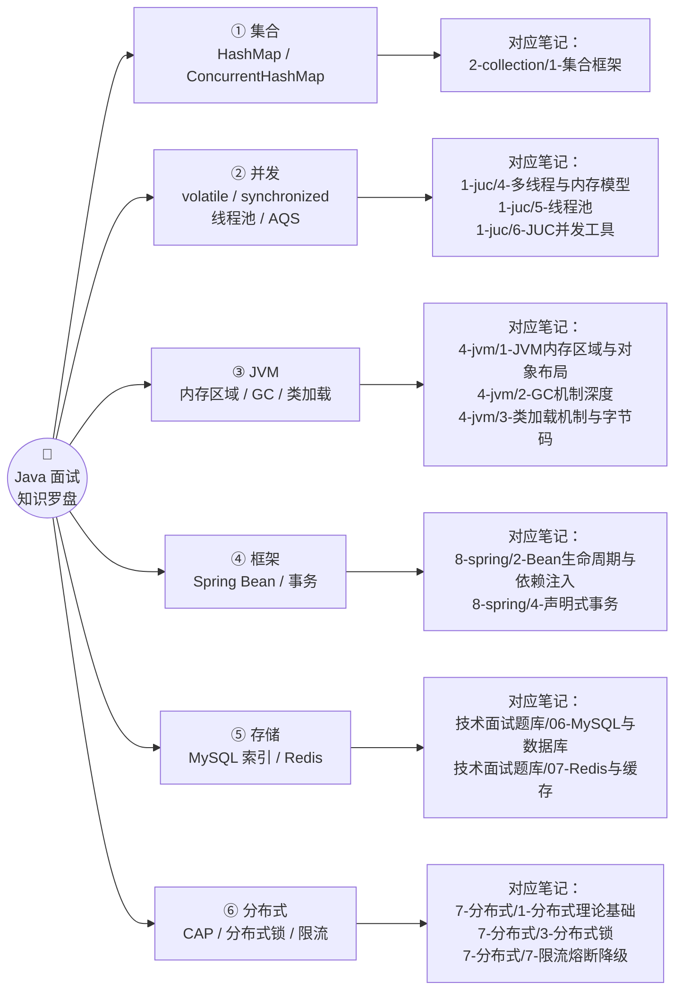

**本篇提及的考点与可深读的笔记对照：**

| 考点 | 深读笔记 |
| --- | --- |
| HashMap / ConcurrentHashMap | [[1-集合框架]] |
| volatile / synchronized | [[4-多线程与内存模型]] |
| 线程池 | [[5-线程池]] |
| AQS / 并发工具 | [[6-JUC并发工具]] |
| JVM 内存区域 | [[1-JVM内存区域与对象布局]] |
| GC 机制 | [[2-GC机制深度]] |
| 类加载与字节码 | [[3-类加载机制与字节码]] |
| Spring Bean / 循环依赖 | [[2-Bean生命周期与依赖注入]]、[[13-Spring源码骨架]] |
| AOP 与事务 | [[3-AOP原理与实战]]、[[4-声明式事务]] |
| MySQL 索引与数据库 | [[面试准备/技术面试题库/06-MySQL与数据库\|MySQL 题库]] |
| Redis 与缓存 | [[面试准备/技术面试题库/07-Redis与缓存\|Redis 题库]]、[[6-缓存一致性与高可用]] |
| CAP / BASE / 分布式锁 / 限流 | [[1-分布式理论基础]]、[[3-分布式锁]]、[[7-限流熔断降级]] |

### 视频时间轴

| 时间 | 主题 | 本篇章节 |
| --- | --- | --- |
| 00:00 | 开场：三面前的浆糊状态 | 〇 |
| 00:22 | HashMap 底层结构与红黑树 | 一 |
| 00:43 | ConcurrentHashMap 高并发之道 | 二 |
| 01:08 | volatile：可见性只是表象 | 三 |
| 01:32 | synchronized 锁升级 | 四 |
| 01:59 | 线程池参数与执行流程 | 五 |
| 02:23 | AQS：排队叫号机 | 六 |
| 02:53 | JVM 内存区域 | 七 |
| 03:21 | GC 算法与收集器选型 | 八 |
| 03:52 | 双亲委派与打破它的场景 | 九 |
| 04:21 | Spring Bean 生命周期与循环依赖 | 十 |
| 04:50 | 事务失效与传播行为 | 十一 |
| 05:18 | MySQL 索引：B+ 树 | 十二 |
| 05:51 | Redis 数据结构与缓存三大问题 | 十三 |
| 06:23 | CAP 与 BASE | 十四 |
| 07:00 | 分布式锁的三大坑 | 十五 |
| 07:18 | 限流算法选型 | 十六 |
| 07:31 | 面试方法论：三句话 | 十七 |

> [!tip] 三句话总结整支视频
> 面试官深挖一个点，考的不是"你知不知道答案"，而是**你能不能讲清取舍**。每个考点下面都有一句"面试坑点/深挖点"，那些才是得分位。

---

## 一、HashMap：数组 + 链表 + 红黑树

### 1.1 结构演进

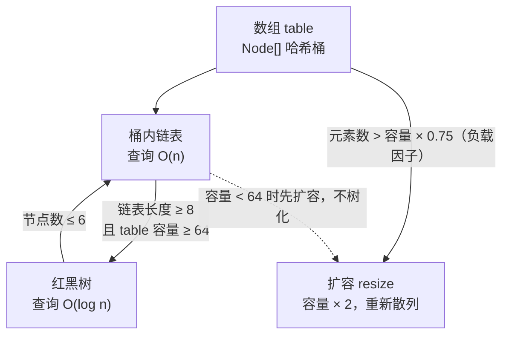

### 1.2 为什么 JDK8 要加红黑树

> [!important] 一句话回答（视频原话）
> **链表太长，查询会退化成 O(n)；红黑树是 O(log n)，但维护有开销，所以阈值设在了 8——这是"空间换时间"的博弈。**

| 结构 | 查询复杂度 | 代价 |
| --- | --- | --- |
| 链表 | O(n) | 无额外开销，短链表最快 |
| 红黑树 | O(log n) | 需要旋转/染色维护，节点占用更大 |

### 1.3 面试坑点：阈值 8 和 6

| 参数 | 值 | 说明 |
| --- | --- | --- |
| `TREEIFY_THRESHOLD` | **8** | 链表长度达到 8 → 尝试树化 |
| `UNTREEIFY_THRESHOLD` | **6** | 树节点数降到 6 → 退化回链表 |
| `MIN_TREEIFY_CAPACITY` | 64 | 树化前容量必须 ≥ 64，否则**先扩容** |

> [!warning] 为什么要留 8 和 6 的差值？
> **中间差值防止频繁摇摆**——如果树化和退化都用同一个阈值，在 8 附近来回增删就会反复转换结构，白白消耗性能。

深读：[[1-集合框架]]（扩容机制、hash 扰动函数、为什么容量是 2 的幂）。

---

## 二、ConcurrentHashMap：怎么做到高并发

### 2.1 两代实现对比

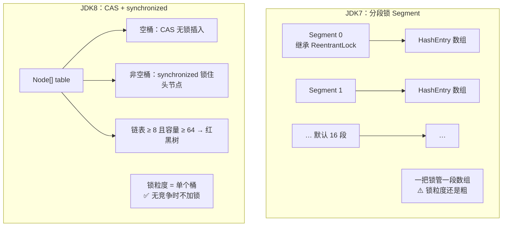

> [!important] 演进逻辑（视频原话）
> **JDK7 是分段锁，一把锁管一段数组，力度还是粗；JDK8 改成 CAS + synchronized——桶是空的就直接 CAS 放，没竞争；有竞争才上 synchronized 锁住那个 Node。**

### 2.2 面试常挖坑：`size()` 怎么统计

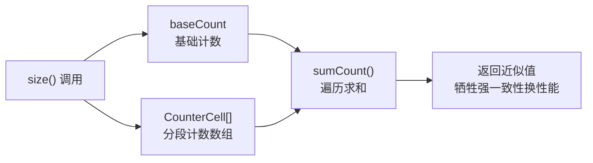

**答案：`baseCount` + `CounterCell` 数组（分段计数思想，类似 LongAdder），最后遍历求和——牺牲强一致性换性能。**

深读：[[1-集合框架]]、[[6-JUC并发工具]]（LongAdder 的分段累加原理）。

---

## 三、volatile：可见性只是表象

### 3.1 从"可见性"深挖到底层

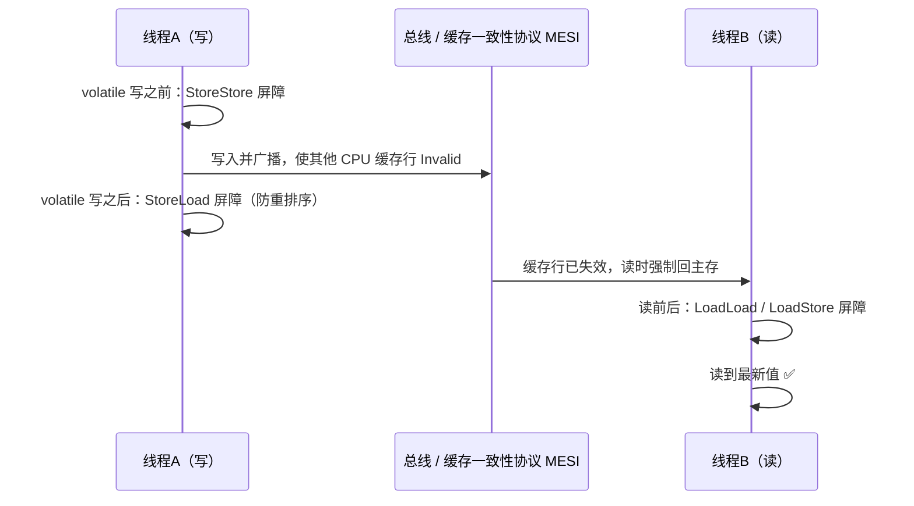

| 层 | 机制 |
| --- | --- |
| 硬件层 | **CPU 缓存一致性协议 MESI**（Modified / Exclusive / Shared / Invalid） |
| 指令层 | 插入**内存屏障**；volatile 写后加 **StoreLoad** 屏障，**防止指令重排序** |
| 语义层 | 保证**可见性** + **有序性** |

> [!important] 面试深挖点
> "可见性只是表象，底层是 CPU 缓存一致性协议 + 内存屏障"——这句话就是视频里强调的**得分句**。

### 3.2 坑：volatile 不保证原子性

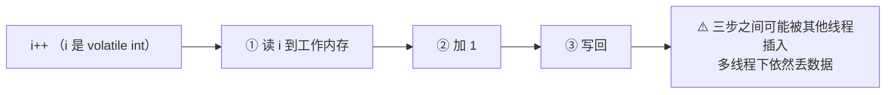

**`i++` 分三步（读 → 改 → 写），多线程下还是会丢数据，别踩这个坑。**

> [!tip] 顺带考点：双重检查锁（DCL）单例为什么必须加 volatile？
> 因为 `instance = new Singleton()` 也分三步（分配内存 → 初始化 → 赋引用），**2 和 3 可能重排序**，导致别的线程拿到"半成品对象"——volatile 禁止这个重排序。

深读：[[4-多线程与内存模型]]（JMM、happens-before、内存屏障细节）。

---

## 四、synchronized：锁升级机制

### 4.1 锁升级路径

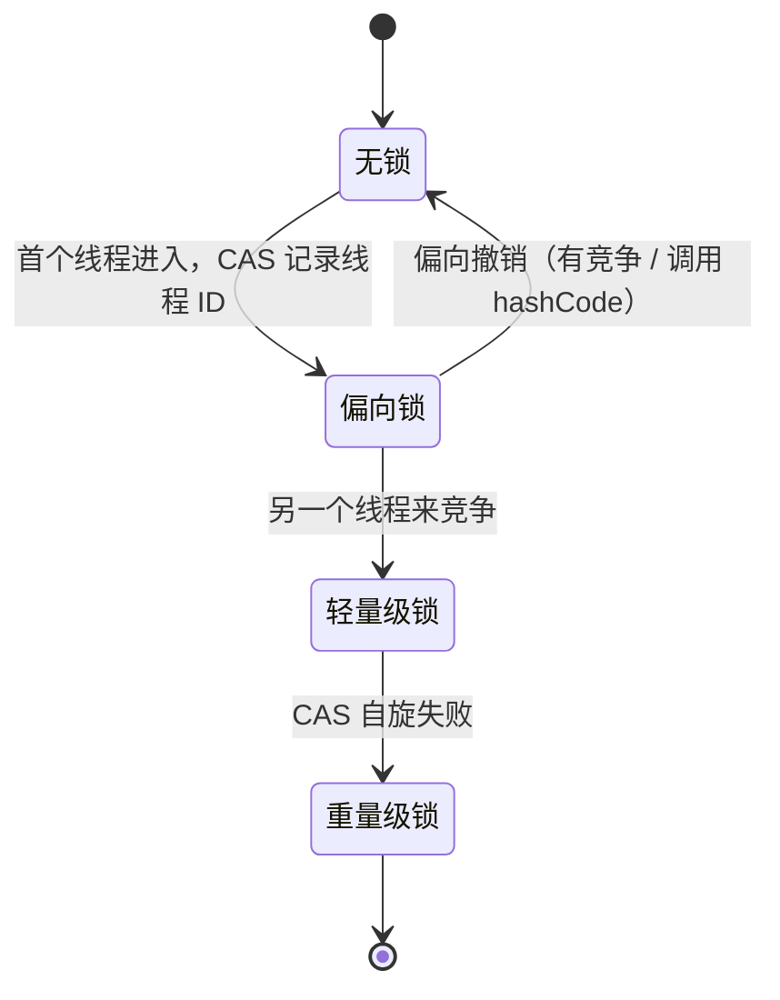

| 阶段 | 假设 | 手段 | 代价 |
| --- | --- | --- | --- |
| **偏向锁** | 只有一个线程反复进入 | 在 Mark Word 里记线程 ID，**连 CAS 都省了** | 最低 |
| **轻量级锁** | 竞争不激烈、锁持有时间短 | **CAS 自旋**抢锁，**不惊动操作系统** | 中 |
| **重量级锁** | 竞争激烈 | 交给 **OS 互斥量（monitor）**，线程阻塞排队 | 高（用户态↔内核态切换） |

> [!important] 面试陷阱
> **锁只能升级，不能降级**——除了偏向锁**可以被撤销**。
> JDK6 之后引入锁升级，本质是"**先假设没有竞争，等真有竞争了再逐步加码**"。

> [!note] 版本补充（视频未展开）
> - 偏向锁的撤销除了"另一线程竞争"，还有：**调用 `hashCode()`**（Mark Word 里要存 identity hash，没位置留给线程 ID，只能撤销）；
> - **批量重偏向 / 批量撤销**：当撤销次数超过阈值（默认 20 次），JVM 会批量处理，甚至**禁用**该类的偏向锁；
> - **JDK15（JEP 374）起默认禁用偏向锁**——现代应用线程池导致竞争普遍，偏向锁收益低、维护成本高。详见 [[9-Java版本特性]]。

深读：[[4-多线程与内存模型]]（对象头 Mark Word 布局、锁记录与 monitor 竞争）。

---

## 五、线程池：参数与执行流程

### 5.1 执行流程（记这个流程就够）

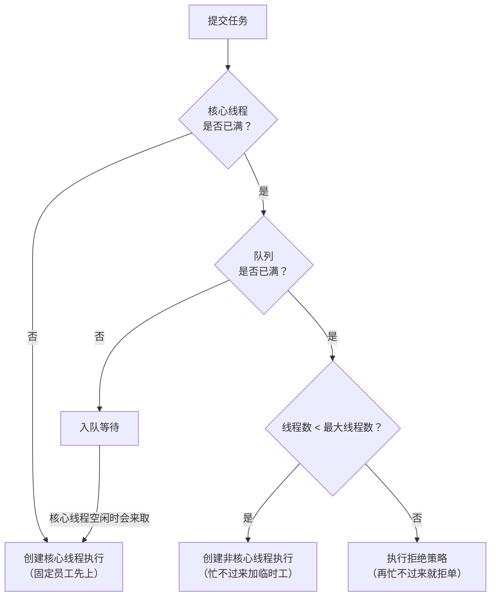

> [!tip] 工厂比喻（视频原话）
> **像工厂接单：固定员工先上 → 忙不过来了加临时工 → 再忙不过来就拒单。**

### 5.2 七大参数

| 参数 | 含义 |
| --- | --- |
| `corePoolSize` | 核心线程数（常驻） |
| `maximumPoolSize` | 最大线程数 |
| `keepAliveTime` + `unit` | 非核心线程空闲存活时间 |
| `workQueue` | 任务队列 |
| `threadFactory` | 线程工厂（命名便于排查） |
| `handler` | 拒绝策略（Abort / CallerRuns / Discard / DiscardOldest） |

### 5.3 面试高频坑

| 坑 | 说明 |
| --- | --- |
| **CPU 密集型设 N+1，IO 密集型设 2N** | 但**别死记**——要结合 **RT（响应时间）和 QPS** 算 |
| **别用无界队列** | `LinkedBlockingQueue` 默认容量接近无界 → **maximumPoolSize 永远用不上**，任务无限堆积 → **OOM** |
| 线程池命名 | 出问题时 jstack 里能认出业务线程 |

> [!important] 更准的估算公式
> 线程数 ≈ **N × (1 + 等待时间 / 计算时间)**（N = CPU 核数）。
> N+1 和 2N 只是这个公式在两个极端下的特例：等待占比 0 → N+1；等待与计算相当 → 2N。

深读：[[5-线程池]]（队列选型、拒绝策略、动态调参、线程池监控）。

---

## 六、AQS：想象成一台排队叫号机

### 6.1 核心机制

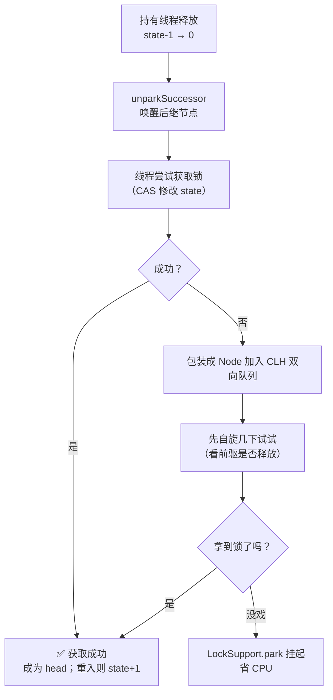

> [!important] 一句话讲清 AQS（视频原话）
> **state 就是资源数**，线程来抢；抢不到就进 **CLH 队列**；队列里**不是傻等**——先自旋几下，没戏就**挂起省 CPU**；释放时 `unparkSuccessor` **唤醒后继**。

### 6.2 关键设计点

| 设计 | 为什么 |
| --- | --- |
| `state`（volatile int） | 用**一个整数**表达资源数/重入次数，CAS 修改保证原子 |
| CLH 变体双向队列 | FIFO 保证公平性，双向链表便于唤醒前驱/后继 |
| **先自旋后挂起** | 短临界区自旋就能拿到（省去内核态切换）；长时间拿不到就 park，**不空耗 CPU** |
| 独占 / 共享两种模式 | `ReentrantLock` 独占；`CountDownLatch`、`Semaphore` 共享 |

**基于 AQS 实现的类**：`ReentrantLock`、`CountDownLatch`、`Semaphore`、`ReentrantReadWriteLock`、`CyclicBarrier`（内部用 ReentrantLock）等。

深读：[[6-JUC并发工具]]（Condition 等待队列、公平/非公平锁实现差异）。

---

## 七、JVM 内存区域

### 7.1 一张图记住归属

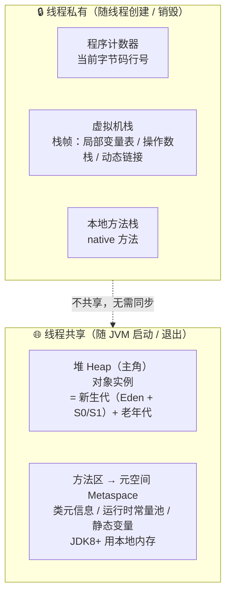

> [!tip] 视频原话
> "线程私有的程序计数器、虚拟机栈、本地方法栈；线程共享的堆和方法区。**堆是主角**，分新生代和老年代。"

### 7.2 对象的生命周期位置

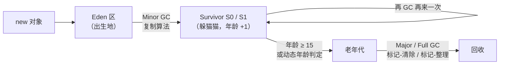

**"对象在 Eden 出生，Survivor 里躲猫猫，15 岁进老年代"**——15 岁即 `-XX:MaxTenuringThreshold` 默认值。

### 7.3 面试陷阱：元空间

| 项 | 说明 |
| --- | --- |
| **JDK8 起取代永久代** | `PermGen` → **`Metaspace`** |
| 用的是**本地内存** | 不在 JVM 堆里 |
| 默认**只受物理内存限制** | ⚠️ 不设限**容易 OOM** |
| 应对 | `-XX:MaxMetaspaceSize` 设上限，`-XX:MetaspaceSize` 设初始阈值 |

深读：[[1-JVM内存区域与对象布局]]（对象头、指针压缩、TLAB）、[[6-JVM参数与调优实战]]。

---

## 八、GC 算法与收集器

### 8.1 分代与算法匹配

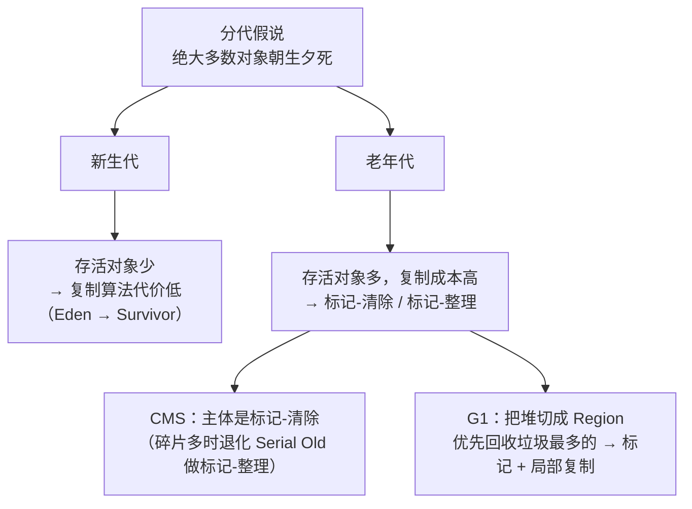

### 8.2 收集器对比

| 收集器 | 分代 | 算法 | 停顿目标 | 备注 |
| --- | --- | --- | --- | --- |
| Serial / ParNew / Parallel | 分代 | 复制 + 标记整理 | 吞吐优先 | JDK8 默认 Parallel |
| **CMS** | 老年代并发 | **标记-清除** | 低停顿 | 有碎片问题，JDK9 起废弃、JDK14 移除 |
| **G1** | 整堆 Region | 标记 + 局部复制 | **`-XX:MaxGCPauseMillis`，默认 200ms** | JDK9+ 默认；可预测停顿 |
| **ZGC** | 整堆并发 | 染色指针 + 读屏障 | **10ms 以下（亚毫秒级）** | **JDK11+ 才有**（实验），JDK15 转正 |

> [!important] 面试必考：G1 的核心思想
> **把堆砌成一个个 Region，优先回收垃圾最多的 Region（Garbage First）**，用 `-XX:MaxGCPauseMillis` 设定目标停顿时间（**默认 200ms**），在可控停顿下尽量多回收。

> [!note] 为什么"选算法"要看分代
> 新生代**存活少**→ 复制算法只需搬少量对象，代价低；
> 老年代**存活多**→ 复制就太贵了，只能标记-清除 / 标记-整理。

深读：[[2-GC机制深度]]（三色标记、卡表、Remembered Set、GC 日志分析）。

---

## 九、类加载与双亲委派

### 9.1 双亲委派模型

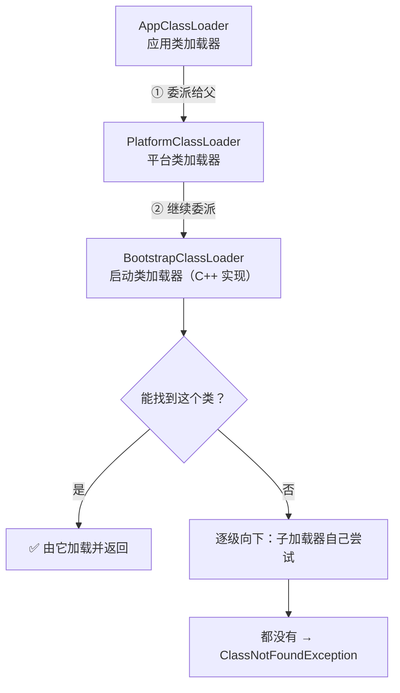

**"先找爸爸，爸爸找爷爷"**——目的是**保证核心类库安全**（`java.lang.String` 不会被自定义同名类替换）。

### 9.2 为什么要"破坏"双亲委派

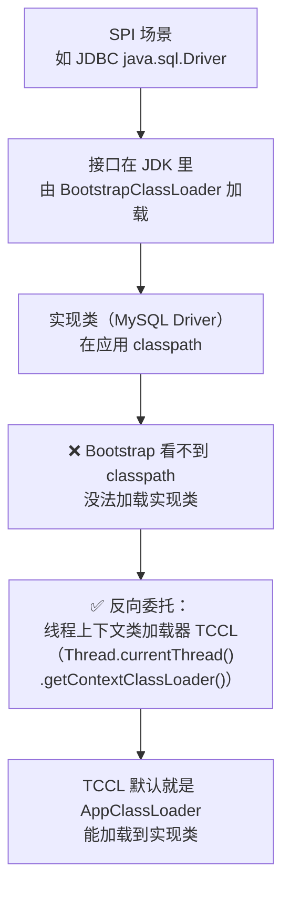

> [!important] 面试深挖点
> 双亲委派保证核心类库安全，但 **SPI 场景下接口由 Bootstrap 加载、实现类却在 classpath**，Bootstrap 找不到 → 只能**反向委托线程上下文类加载器（TCCL）**。

### 9.3 Tomcat 的类加载器设计

| 设计 | 目的 |
| --- | --- |
| 每个 webapp 一个**独立类加载器** | **应用隔离**：不同应用的同类名互不干扰 |
| **优先加载自己**的类（打破双亲委派） | webapp 的类优先于公共库 |
| 热部署时**换掉整个 webapp 的类加载器** | 旧类加载器连同其加载的所有类一起**可被 GC**，实现类卸载 |

深读：[[3-类加载机制与字节码]]（加载/验证/准备/解析/初始化、Class 文件结构）。

---

## 十、Spring Bean 生命周期

### 10.1 完整流水线

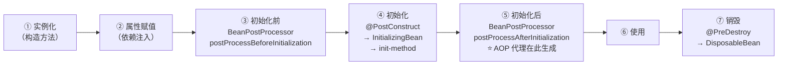

> [!tip] 记流水线（视频原话）
> **实例化 → 属性赋值 → 初始化前（BeanPostProcessor）→ 初始化（@PostConstruct / InitializingBean）→ 初始化后（AOP 代理在这生成）→ 销毁。**

### 10.2 面试陷阱：循环依赖靠三级缓存

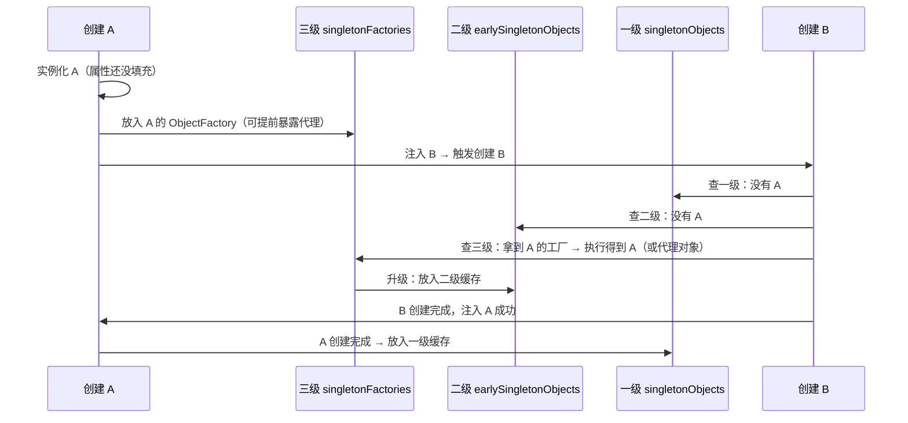

| 缓存 | 名字 | 存放内容 |
| --- | --- | --- |
| 三级 | `singletonFactories` | **ObjectFactory**（能提前生产早期引用/AOP 代理） |
| 二级 | `earlySingletonObjects` | **早期 Bean**（未完成属性赋值） |
| 一级 | `singletonObjects` | **成品 Bean** |

> [!warning] 构造器注入为什么解决不了循环依赖？
> 因为**实例化阶段就需要依赖对象**——此时 Bean 还没进任何缓存（三级缓存是在"实例化完成后"才放工厂），所以直接抛 `BeanCurrentlyInCreationException`。
> 只有**setter/字段注入**（先实例化、后赋值）才能靠三级缓存兜住。

深读：[[2-Bean生命周期与依赖注入]]、[[13-Spring源码骨架]]。

---

## 十一、事务失效与传播行为

### 11.1 事务为什么会失效

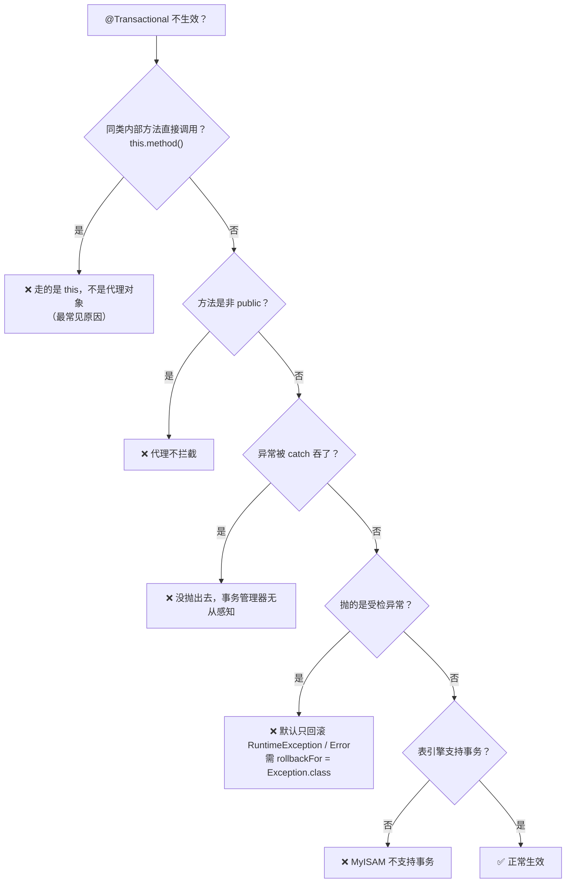

> [!important] 最经典的坑（视频原话）
> **Spring 事务靠 AOP 代理实现，同类方法调用走的是 `this`，不是代理对象——所以不生效。**
> 其他经典坑：**非 public 方法**、**异常被吞**、**数据库引擎不支持**。

### 11.2 七种传播行为

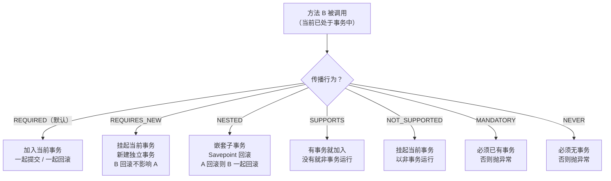

| 传播行为 | 一句话 | 典型场景 |
| --- | --- | --- |
| **REQUIRED**（默认） | 加入或新建 | 绝大多数业务方法 |
| **REQUIRES_NEW** | 挂起当前，新建独立 | **记流水日志**（主业务回滚，日志要留下） |
| **NESTED** | 嵌套 + Savepoint | 子步骤失败只回滚子步骤 |
| SUPPORTS | 随大流 | 查询方法 |
| NOT_SUPPORTED | 挂起事务 | 非事务操作（如发 MQ） |
| MANDATORY | 必须已有事务 | 强制调用方开事务 |
| NEVER | 必须无事务 | 禁止在事务中执行 |

> [!tip] 视频提醒
> **结合业务场景选，别死记**。面试答"REQUIRES_NEW 用于日志/审计"比背七个名字有用得多。

深读：[[4-声明式事务]]、[[3-AOP原理与实战]]（代理创建时机、自调用问题的三种解法）。

---

## 十二、MySQL 索引：B+ 树

### 12.1 B+ 树为什么快

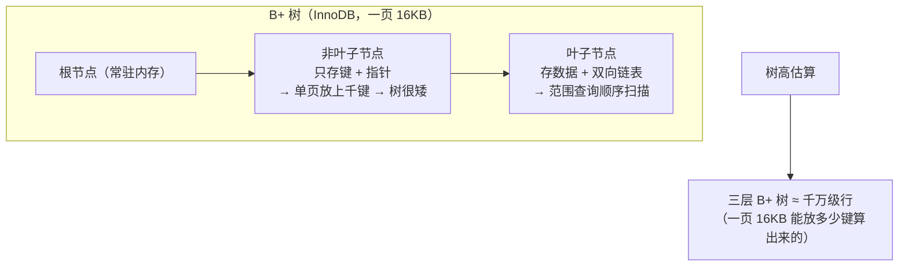

| 特性 | 好处 |
| --- | --- |
| 非叶子**只存键**、不存数据 | 单页容纳更多键 → **树更矮** → 磁盘 IO 更少 |
| 叶子**双向链表** | **范围查询快**（顺序扫描，不用回树） |
| 所有数据都在叶子、**查询路径等长** | 性能稳定 |

### 12.2 聚簇索引、回表与覆盖索引

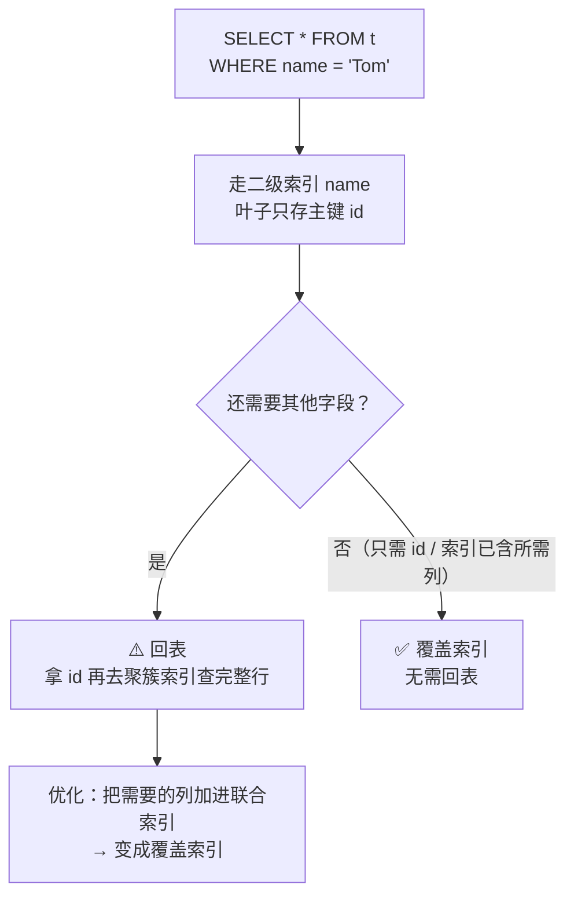

| 索引类型 | 叶子节点存什么 |
| --- | --- |
| **聚簇索引**（主键） | **整行数据** |
| **二级索引**（普通/唯一） | **主键值** → 查其他字段要**回表** |

**这就是"覆盖索引优化"的原理**：让查询所需字段都在索引里，避免回表。

### 12.3 面试连环坑

| 坑 | 结论 |
| --- | --- |
| **最左前缀原则** | 联合索引 `(a,b,c)`，跳过 a 直接查 b 用不上索引 |
| **范围查询后的列失效** | `a > 1 AND b = 2`：a 之后的 b **不走索引**（只能用于过滤） |
| **`like '%xxx'` 不走索引** | 前导通配符无法定位 B+ 树起点（`like 'xxx%'` 可以） |
| **索引下推 ICP** | MySQL 5.6+：把 where 条件下推到存储引擎层过滤，**减少回表次数** |
| 计算/函数/隐式类型转换 | 索引列上用函数、或类型不匹配 → 索引失效 |

深读：[[面试准备/技术面试题库/06-MySQL与数据库|MySQL 题库]]、`4-db/`（执行计划、锁与事务隔离级别）。

---

## 十三、Redis：数据结构与缓存三大问题

### 13.1 底层数据结构的花样

| 类型 | 底层实现 | 为什么这么设计 |
| --- | --- | --- |
| String | **SDS**（简单动态字符串） | 记录 `len`/`alloc` → O(1) 长度、**二进制安全**、预分配减少重分配、**杜绝 C 字符串的缓冲区溢出** |
| Hash / ZSet（小数据） | **ziplist / listpack** | **省内存**（连续内存、无指针开销） |
| Hash / ZSet（大数据） | **hashtable / skiplist** | **保速度**（O(1) / O(log n)） |

> [!important] 视频金句
> **这是"时间与空间的炼金术"**：小数据用紧凑结构省内存，超过阈值自动转成高性能结构。

### 13.2 缓存三大问题（必考）

```mermaid
flowchart LR
    A["缓存问题"] --> B["① 穿透<br/>查根本不存在的数据"]
    A --> C["② 击穿<br/>某个热点 key 突然过期"]
    A --> D["③ 雪崩<br/>大量 key 同时过期<br/>或 Redis 整体宕机"]
    B --> B1["布隆过滤器拦截<br/>+ 空值缓存（短 TTL）"]
    C --> C1["互斥锁（只放一个线程查库）<br/>+ 热点 key 永不过期 / 逻辑过期"]
    D --> D1["过期时间加随机值<br/>+ 多级缓存（本地 + Redis）<br/>+ 集群高可用 / 熔断降级"]
```

| 问题 | 本质 | 对策 |
| --- | --- | --- |
| **穿透** | 缓存和 DB 都没有（恶意查不存在的 id） | **布隆过滤器**、**空值缓存** |
| **击穿** | 单个热点 key 过期瞬间，请求全打到 DB | **互斥锁**、**热点 key 永不过期（逻辑过期）** |
| **雪崩** | 大批 key 同时失效 / Redis 挂了 | **随机过期时间**、**多级缓存**、集群 + 限流降级 |

### 13.3 集群分片

> [!warning] 面试陷阱
> **Redis Cluster 是 16384 个槽位（CRC16 取模），不是一致性哈希。**
> 两者区别：槽位是**固定数量的桶**，迁移以槽为单位；一致性哈希是**哈希环**。详见 [[5-一致性哈希与负载均衡]]。

深读：[[面试准备/技术面试题库/07-Redis与缓存|Redis 题库]]、[[6-缓存一致性与高可用]]。

---

## 十四、CAP 与 BASE

### 14.1 CAP 不是"三选二"这么简单

```mermaid
flowchart TD
    CAP(("CAP<br/>三者不可兼得")) --> C["C 一致性<br/>Consistency"]
    CAP --> A["A 可用性<br/>Availability"]
    CAP --> P["P 分区容错<br/>Partition tolerance"]
    P --> P1["分布式系统里 P 是必选的<br/>因为网络分区一定会发生"]
    P1 --> T{"真正的权衡：C 还是 A？"}
    T -->|"偏 C（CP）"| CP["支付 / 资金 / 库存<br/>宁可拒绝服务，不可数据错乱"]
    T -->|"偏 A（AP）"| AP["社交 Feed / 商品浏览<br/>保证用户能刷到内容"]
    AP --> BASE["BASE 理论（AP 的实践指导）<br/>基本可用 + 软状态 + 最终一致性"]
```

> [!important] 面试陷阱（视频原话）
> **别死记硬背"三选二"。P（分区容错）在分布式系统里是必选的**——网络分区一定会发生。**真正的选择是在 C 和 A 之间做权衡**，而且**不是非黑即白，是连续谱**。
> 要结合业务说：**支付系统偏 CP 保证资金安全，社交 Feed 偏 AP 保证用户能刷内容。**

### 14.2 BASE 理论

| 要素 | 含义 |
| --- | --- |
| **B**asically **A**vailable 基本可用 | 允许损失部分可用性（降级、限流、延迟响应） |
| **S**oft state 软状态 | 允许中间状态存在（如"支付中"） |
| **E**ventually consistent 最终一致性 | 经过一段时间后数据达成一致 |

**BASE 是 AP 系统的实践指导**——既然放弃了强一致性，就要用"最终一致 + 补偿"把业务做对。

深读：[[1-分布式理论基础]]、[[2-分布式事务]]（TCC、Saga、本地消息表）。

---

## 十五、分布式锁：SETNX 的三大坑

```mermaid
flowchart TD
    A["用 SETNX 加锁"] --> B["坑1：没设过期时间"]
    B --> B1["客户端崩溃 → 锁永不释放 → 💀 死锁"]
    A --> C["坑2：业务耗时 &gt; 锁过期时间"]
    C --> C1["锁被提前释放 → 其他线程进入 → 💀 超卖"]
    A --> D["坑3：主从切换"]
    D --> D1["主节点加锁后宕机，锁未同步到从库<br/>→ 新主上锁丢失 → 💀 双写"]
    B1 --> S1["对策：SET key value NX PX 30000<br/>+ 唯一 value + Lua 脚本校验后删除"]
    C1 --> S2["对策：Redisson 看门狗自动续期"]
    D1 --> S3["对策：RedLock 多主节点多数派"]
```

| 坑 | 后果 | 对策 |
| --- | --- | --- |
| **没设过期时间** | 客户端挂了 → 死锁 | `SET key value NX PX ttl`（**一条命令原子完成**） |
| **业务超时、锁提前释放** | 别的线程拿到锁 → **超卖** | **Redisson 看门狗自动续期**（默认 30s 续一次） |
| **主从切换** | 锁丢失 → 双写 | **RedLock**（多主节点，多数派加锁成功才算成功） |

> [!important] 两个必答细节
> 1. **释放锁必须用 Lua 脚本**（先比对 value 再删除），否则"判断 + 删除"两步之间锁可能已过期被他人持有，会误删别人的锁；
> 2. **value 必须是唯一标识**（如 UUID + 线程 ID），才能判断"这把锁是不是我的"。

深读：[[3-分布式锁]]（Redisson 实现、RedLock 争议、锁 vs 幂等的关系）。

---

## 十六、限流算法：结合场景说选型

```mermaid
flowchart LR
    REQ["请求流量"] --> A{"选哪种限流？"}
    A -->|"计数器 / 滑动窗口"| A1["实现最简单<br/>⚠️ 固定窗口有临界突刺问题<br/>Sentinel 用滑动窗口"]
    A -->|"漏桶 Leaky Bucket"| A2["恒定速率流出<br/>→ 输出平滑<br/>❌ 不允许突发"]
    A -->|"令牌桶 Token Bucket"| A3["固定速率放令牌<br/>桶容量决定突发上限<br/>✅ 允许突发流量<br/>Spring Cloud Gateway 默认"]
```

| 算法 | 特点 | 适用 |
| --- | --- | --- |
| 固定窗口计数 | 简单，**临界问题**（两个窗口边界处可能双倍流量） | 粗粒度限流 |
| **滑动窗口** | 把窗口切细，平滑临界问题（**Sentinel**） | 通用、精确 |
| **漏桶** | **恒定速率**流出，**平滑输出**，不允许突发 | 保护下游稳定（如调用第三方） |
| **令牌桶** | 按速率放令牌，**桶容量允许突发**（**Spring Cloud Gateway** 默认） | 面向用户、允许短时突发 |

> [!tip] 视频提醒
> **面试要结合场景说选型，别只背名字。** 例如："网关层用令牌桶（允许用户突发），调用第三方支付接口用漏桶（严格平滑保护对方）。"

深读：[[7-限流熔断降级]]（Sentinel 滑动窗口实现、熔断状态机、降级策略）。

---

## 十七、面试方法论：最后三句话

> [!important] 视频结尾的三句话
> **① 源码要读过**——至少要跟过核心流程（如 HashMap.put、AQS.acquire）；
> **② 场景要真实**——结合项目讲，比背概念强十倍；
> **③ 坑要踩过**——能说出"我曾经以为……结果发现……"，面试官眼睛会亮。

> [!tip] 最核心的一句
> **技术深度不是"知道多少答案"，而是"能在不确定中做出合理判断"。**

### 落地建议

| 准备动作 | 具体做法 |
| --- | --- |
| 把知识串成线 | 用本页的罗盘图自检：任取两点，能否说出它们的关系？（如 AQS → 线程池、三级缓存 → AOP） |
| 每个考点备一个"坑" | 每个知识点配一个自己踩过的真实案例 |
| 每个考点备一句"取舍" | 面试官深挖时，答"为什么这么设计 + 代价是什么" |
| 读核心源码 | HashMap.put / ConcurrentHashMap.putVal / AQS.acquire / Spring refresh |

---

## 附录 A：语音转写（ASR）勘误对照

原始字幕稿由 vCaptions 生成，**同音字错误极多**（本篇修正量是历次最大）。整理时按下表修正，阅读原始稿 [[Java面试别再死背八股了]] 时可对照：

| 原始转写 | 应为 |
| --- | --- |
| MESSI | **MESI**（CPU 缓存一致性协议） |
| K 加 synchronize / 用 K 改 state | **CAS** + synchronized / 用 **CAS** 改 state |
| base count 加 counter cell | **baseCount + CounterCell** |
| ADVOR 入队 | **CAS 失败就入队** |
| EQUEQ 自旋或阻塞 | 在**队列**里自旋或阻塞 |
| unpark successor | **unparkSuccessor** |
| Reentrclock count down edge | **ReentrantLock、CountDownLatch** |
| 虚拟基站 / 本地方法站 | 虚拟机**栈** / 本地方法**栈** |
| 原空间 metis space / 永久带 | **元空间 Metaspace** / 永久**代** |
| 某某 max matter space size | **`-XX:MaxMetaspaceSize`** |
| 画家标记复制 / G1 是 region | **[把堆]划分 region** + **标记-复制** |
| 某某 max gc plus minutes | **`-XX:MaxGCPauseMillis`** |
| CDC 更猛 | **ZGC** 更猛 |
| but JDK11 加才有 | **JDK11+ 才有**（ZGC 实验引入） |
| class type | **classpath** |
| 就对象全部 gc | 旧**对象全部可被 GC** |
| Been in post processor | **BeanPostProcessor** |
| at post construct / initializing bean | **@PostConstruct / InitializingBean** |
| a OP 代理 / a OP 原理 | **AOP** |
| Singleton factories / Early Singleton objects | 三级缓存：**singletonFactories / earlySingletonObjects / singletonObjects** |
| 事物（多处） | **事务** |
| Required / requires 下划线 new / nested save point | **REQUIRED / REQUIRES_NEW / NESTED（Savepoint）** |
| 界面不生效 | **[所以就]不生效** |
| 毕加数 / B 加数 | **B+ 树** |
| 快据速索引 / 叶子存整形 | **聚簇索引** / 叶子存**整行** |
| 步走索引 / like 百分号某某 | **不走索引** / **`like '%xxx'`** |
| i sap / 索引下推 i sap | **ICP 索引下推**（Index Condition Pushdown） |
| 16db 一页 16KB | **InnoDB 一页 16KB** |
| hash 和 c set 小数据用 zip list | **Hash 和 ZSet** 小数据用 **ziplist** |
| 1 万 6384 个槽位 | **16384 个槽位** |
| 不是一致性哈 | 不是**一致性哈希** |
| SETTX / SETX | **SETNX** |
| radiance 用看门狗 / red lock | **Redisson** 看门狗 / **RedLock** |
| SANTAL 用滑动窗口 / Get way | **Sentinel** / **Gateway** |
| frank start jvm（01:50） | ⚠️ **语义不明**——上下文是"会撤销偏向锁，因为大概率有竞争"，推测指**线程池等多线程场景**；已在正文按标准机制补全（竞争 / hashCode / 批量撤销阈值） |
| 对列别用无界队列会 OAQS | **队列**别用无界队列会 **OOM** |
| 用靠试试 | 用轻量级锁 **CAS 试试** |
| 沉默是金小哀 | 开场玩梗"沉默是金" |

## 附录 B：30 秒速查

| 考点 | 一句话答案 |
| --- | --- |
| HashMap 为什么加红黑树 | 链表长了查询退化 O(n)，树是 O(log n)；**阈值 8，退化 6，差值防摇摆** |
| ConcurrentHashMap 怎么高并发 | JDK7 分段锁 → **JDK8 CAS + synchronized 锁桶头**；size 用 **baseCount + CounterCell** |
| volatile 的本质 | 可见性只是表象，底层是 **MESI + 内存屏障**（写后 StoreLoad 防重排序）；**不保证原子性**（i++ 三步） |
| synchronized 锁升级 | 无锁 → 偏向锁 → 轻量级锁 → 重量级锁；**只能升级不能降级**（偏向锁可撤销） |
| 线程池执行流程 | **核心线程 → 队列 → 最大线程 → 拒绝策略**；线程数按 **N×(1+等待/计算)** 算，别死记 N+1/2N |
| AQS 是什么 | **state = 资源数**，抢不到进 CLH 队列，**先自旋后挂起**，释放时 unparkSuccessor 唤醒后继 |
| JVM 内存区域 | 私有：程序计数器 / 虚拟机栈 / 本地方法栈；共享：**堆 + 方法区（元空间）** |
| 对象何时进老年代 | Eden 出生 → Survivor 躲猫猫，**年龄 ≥ 15 或动态年龄判定** |
| 元空间陷阱 | JDK8 取代永久代，**用本地内存，默认只受物理内存限制** → 设 `MaxMetaspaceSize` |
| GC 算法怎么选 | 新生代**复制**（存活少）；老年代**标记-清除/整理**；**G1 按 Region 优先回收垃圾最多**，默认目标 200ms |
| 为什么破坏双亲委派 | **SPI**：接口由 Bootstrap 加载、实现在 classpath → **反向委托 TCCL**；Tomcat 为隔离与热部署 |
| Bean 生命周期 | 实例化 → 属性赋值 → 初始化前 → 初始化 → **初始化后（生成 AOP 代理）** → 使用 → 销毁 |
| 循环依赖为什么能解 | **三级缓存**（singletonFactories/earlySingletonObjects/singletonObjects）；**构造器注入无解** |
| 事务为什么失效 | **同类方法自调用（this 不是代理）**、非 public、异常被吞、引擎不支持 |
| 传播行为怎么答 | REQUIRED 默认加入或新建；**REQUIRES_NEW 挂起新建**（日志场景）；NESTED 用 Savepoint |
| 回表与覆盖索引 | 二级索引叶子存**主键** → 查其他列要**回表**；把所需列放进索引 = **覆盖索引** |
| 索引失效场景 | 违反**最左前缀**、**范围查询后的列**、`like '%x'`、列上用函数/隐式转换 |
| Redis 缓存三问题 | **穿透**→布隆过滤器/空值缓存；**击穿**→互斥锁/热点永不过期；**雪崩**→随机过期/多级缓存 |
| Redis 集群分片 | **16384 个槽位**（CRC16），**不是一致性哈希** |
| CAP 怎么答 | **P 必选**，真正权衡在 C 与 A，是**连续谱**；支付 CP、Feed AP；**BASE 是 AP 的实践指导** |
| 分布式锁三大坑 | 没设过期→死锁；**业务超时提前释放→超卖**；**主从切换→锁丢失**；对策：NX PX + Lua、Redisson 看门狗、RedLock |
| 限流怎么选 | 令牌桶**允许突发**（Gateway）、漏桶**平滑输出**、滑动窗口（Sentinel） |
