# 支付系统架构设计（三高）

> 支付场景核心诉求：**资金安全 > 数据一致 > 高可用 > 高并发**
> 与电商秒杀不同，支付**不能靠"降级"牺牲一致性**，宁可拒绝服务也不能错账。

---

## 一、支付场景的特殊约束

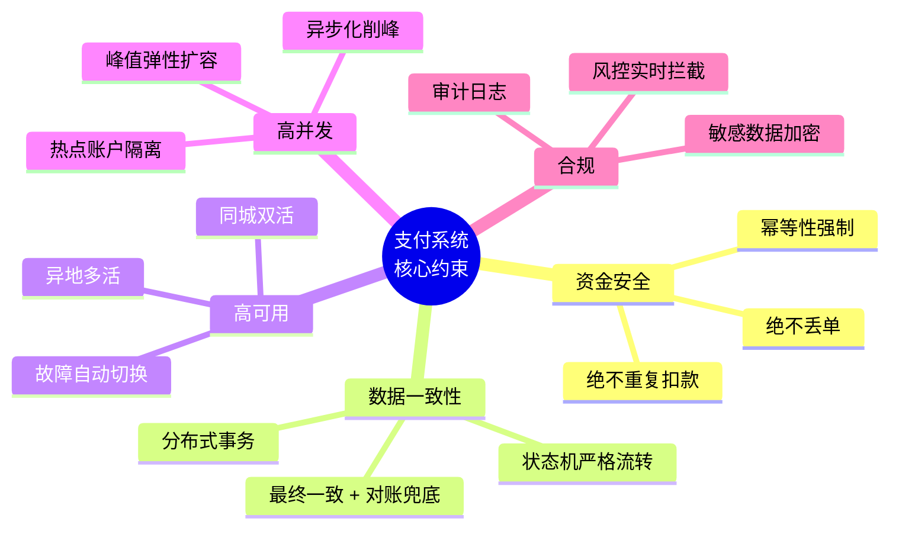

---

## 二、整体架构图

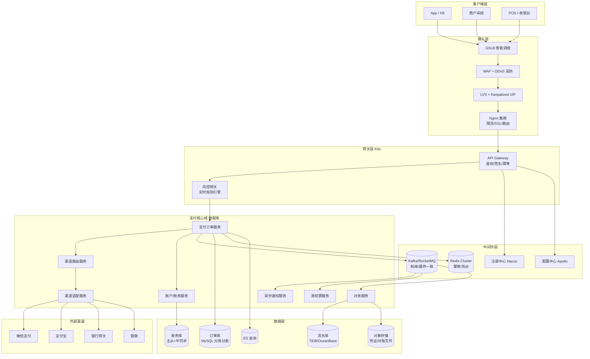

---

## 三、支付核心链路时序图

### 3.1 支付下单主流程（同步 + 异步）

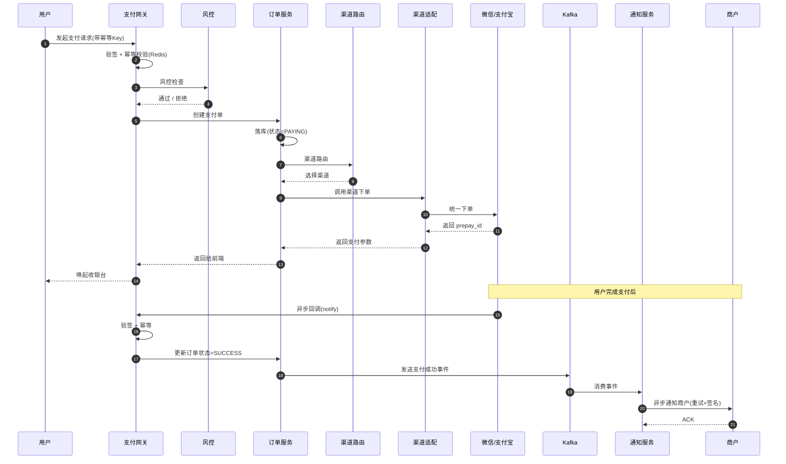

### 3.2 状态机（严格流转）

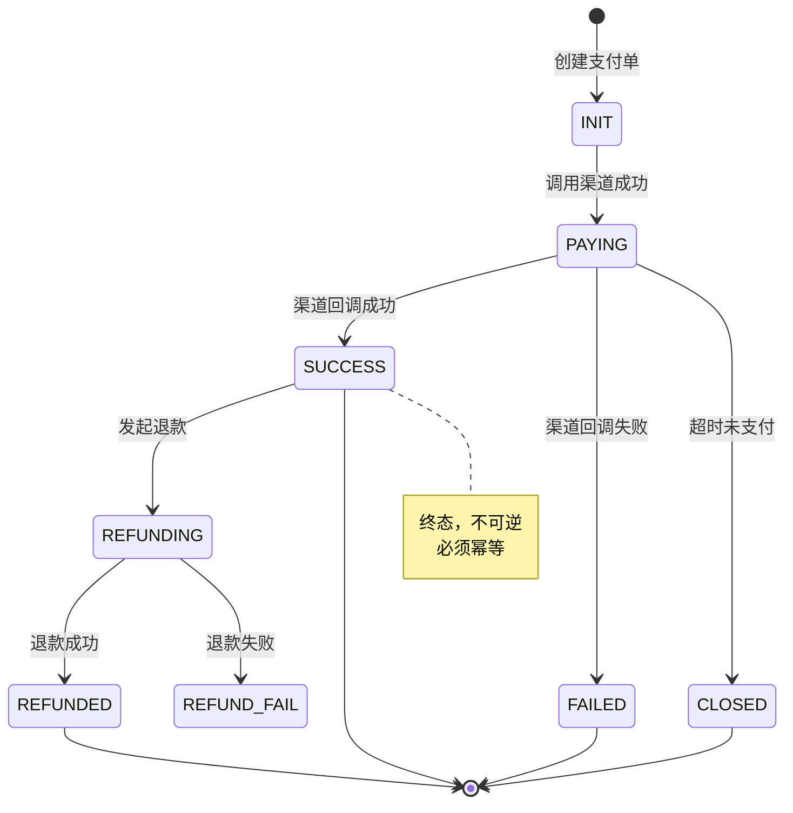

---

## 四、关键设计点详解

### 4.1 幂等性（支付的生命线）

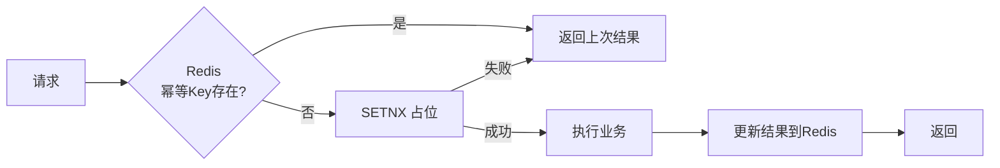

**三层幂等**：

| 层级 | 手段 |
|------|------|
| 网关 | 商户订单号 + 签名去重 |
| 服务 | Redis SETNX + 唯一索引 |
| DB | `uk_merchant_order` 唯一约束兜底 |

---

### 4.2 分布式事务（账户扣款 + 订单更新）

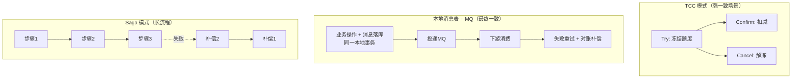

**支付系统推荐**：
- 核心扣款 → **TCC**
- 通知/清结算 → **本地消息表 + MQ**
- 跨系统长流程 → **Saga**

---

### 4.3 渠道路由（高可用关键）

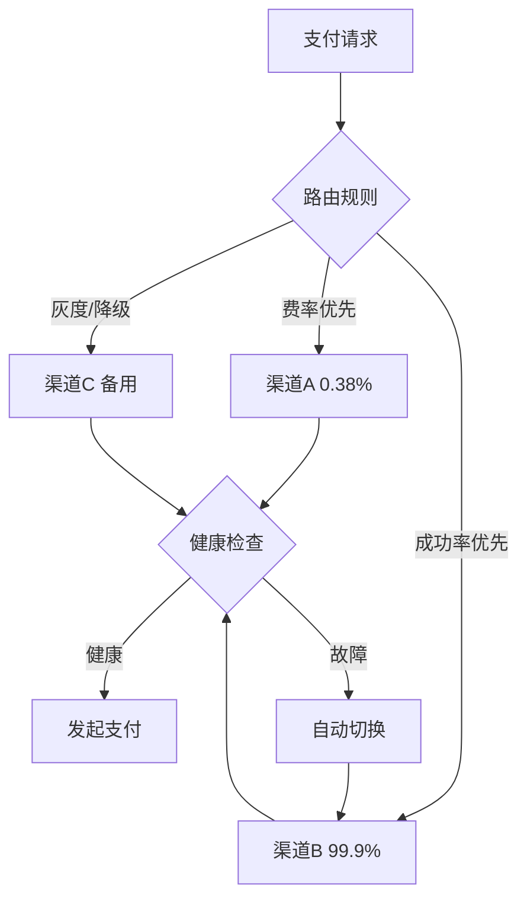

**路由策略**：
- 权重轮询 + 成功率动态调整
- 渠道故障自动熔断（Sentinel）
- 多渠道路由兜底（微信挂了切支付宝）

---

### 4.4 热点账户问题

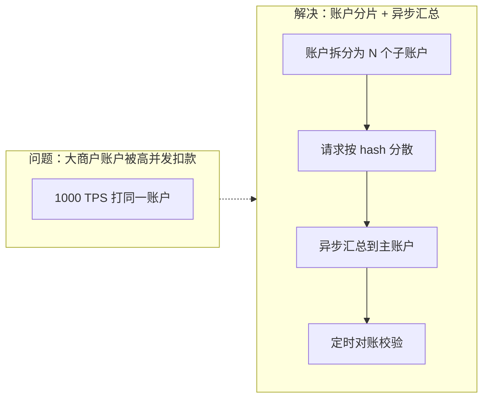

**手段**：
1. **账户分片**：一个逻辑账户拆 N 个物理子账户
2. **异步记账**：请求先入 MQ，串行消费
3. **缓冲记账**：Redis 累加，定期落库
4. **行锁优化**：`UPDATE ... WHERE balance >= amount` 替代 `SELECT FOR UPDATE`

---

## 五、高可用部署拓扑

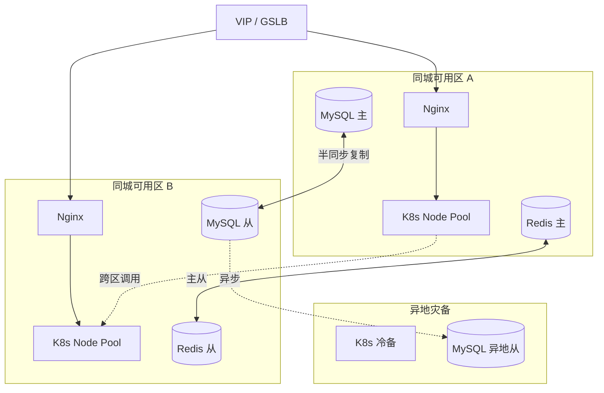

**多活策略**：

| 级别 | 说明 |
|------|------|
| 同城双活 | 两个 AZ 同时承载流量，RTT < 2ms |
| 异地多活 | 单元化，用户按 ID 路由到固定单元 |
| 异地灾备 | 冷备/温备，RTO < 30min，RPO ≈ 0 |

---

## 六、可观测性 & 对账兜底

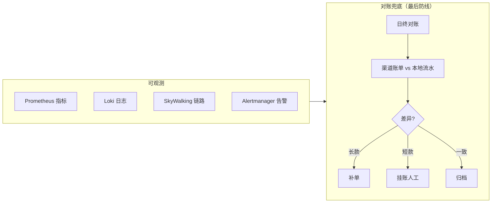

**核心告警指标**：
- 支付成功率（< 99% 告警）
- 渠道回调延迟（P99 > 5s 告警）
- 订单状态不一致数
- 对账差异笔数
- MQ 积压量

---

## 七、性能与容量设计

| 维度 | 目标 | 手段 |
|------|------|------|
| 峰值 QPS | 10w+ | 无状态 + HPA + 异步化 |
| P99 延迟 | < 200ms | 缓存 + 连接池 + 异步 |
| 成功率 | > 99.99% | 多渠道路由 + 熔断 |
| 数据零丢失 | RPO = 0 | 半同步复制 + 本地消息表 |
| 故障恢复 | RTO < 30s | K8s 自愈 + 自动切换 |

---

## 八、设计原则（支付版）

> [!important] 支付系统铁律
> 1. **宁可拒绝，不可错账** —— 一致性优先于可用性
> 2. **一切皆幂等** —— 网络不可靠，重试是常态
> 3. **状态机严格流转** —— 禁止状态跳跃
> 4. **对账是最后防线** —— 再完美的系统也要兜底
> 5. **资金操作必须留痕** —— 审计日志不可篡改
> 6. **渠道必须多活** —— 单渠道 = 单点
> 7. **热点必须隔离** —— 大商户不能拖垮全局
> 8. **灰度 + 回滚** —— 支付变更零容忍

---

## 九、落地路线图

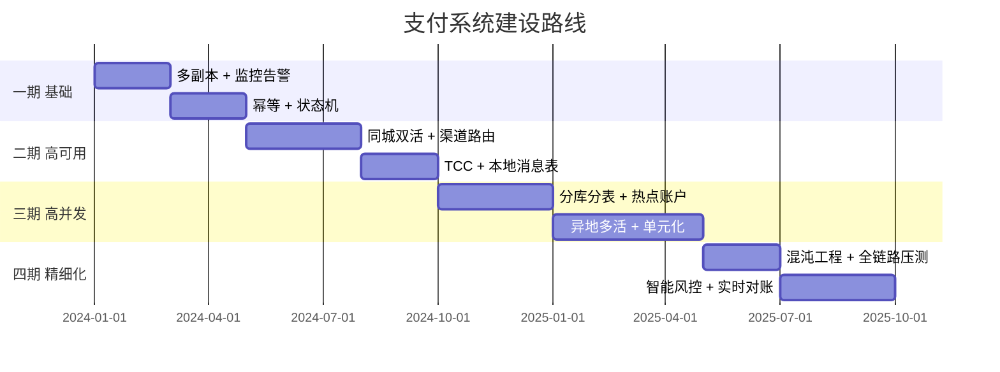

---

> [!tip] 需要继续深入？
> 我可以针对以下任一主题展开：
> - **账户体系设计**（子账户、冻结、余额快照）
> - **清结算系统**（T+0/T+1、分账、计费）
> - **风控引擎**（规则引擎、实时决策、名单）
> - **对账系统**（渠道对账、差错处理）
> - **单元化多活**（SET 化、路由、数据同步）
>
> 告诉我方向，我继续用 Obsidian + Mermaid 风格输出。