# 🧭 DNS + GSLB 全局负载调度 · 5W1H 整理版

> [!abstract] 一句话定位
> DNS + GSLB 是**接入层的 L0 / 流量入口的第一跳**：它在**请求还没到达任何机房之前**，就用"域名解析"这一步决定用户去**哪个机房、哪个运营商线路、哪个 CDN 边缘**。
> 它贡献三高的方式是——**可用性**（机房级故障自动摘除）、**性能**（就近接入降低 RTT）、**并发**（把全球流量在解析阶段就摊到多个机房）。

> [!info] 本篇来源与关系
> - 主要来源：[[1-1-三高接入层架构设计]] §2.1（GSLB / 智能 DNS）、§4.1（消除单点）、故障演练 DNS 相关项。
> - 全局骨架：[[0-高可用高并发高性能 系统设计（5W1H 整理版）]]。
> - 支付场景约束：[[0-1-支付场景三高 系统架构设计]]。
> - 同系列分层笔记：CDN（L1）、WAF+DDOS（L2）、LVS(VIP)（L3）、Nginx（L4）、k8s（L5）。

> [!warning] 一句话结论（先记住）
> **DNS 能容灾，但切换不"秒级"。** 真正的小 TTL + 主动探测 + **多 DNS 服务商 + HTTPDNS + 客户端多 IP 重试** 组合，才敢承诺"分钟级到秒级"的入口切换。

---

## 〇、5W1H 速览

| 要素 | 要回答的问题 | DNS + GSLB 的答案 | 位置 |
|------|--------------|-------------------|------|
| **What** | 它到底是什么？ | 在 DNS 解析阶段做**机房级负载与容灾**的全局调度层 | [§1](#一what它到底是什么) |
| **Why** | 为什么必须有？ | 机房级故障转移、就近接入、跨网加速、抗 DNS 单点 | [§2](#二why为什么必须有) |
| **Who** | 谁负责、谁配合？ | SRE / 网络 / 云解析服务商 / 安全 / 业务方 | [§3](#三who谁负责) |
| **When** | 什么时候用、什么时候切换？ | 多机房多地域时启用；故障时按 TTL 节奏切换 | [§4](#四when什么时候用) |
| **Where** | 落在架构哪一层？ | 接入层 L0，在 CDN 与 LB **之前**，CDN 本身也靠 CNAME 接入 | [§5](#五where落在架构哪里) |
| **How** | 具体怎么做？ | 分线路解析、健康探测、权重与主备、HTTPDNS、Anycast、DNSSEC | [§6](#六how具体怎么做) |
| **How much** | 代价与收益？ | TTL 与解析 QPS 成反比；云解析按量/套餐计费；SLO 用解析成功率衡量 | [§7](#七how-much代价与收益) |

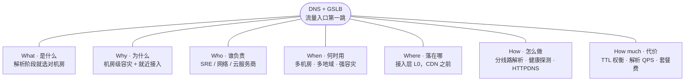

---

## 一、What：它到底是什么

### 1.1 两个概念拆开看

| 概念 | 全称 | 干什么 | 决策粒度 |
|------|------|--------|----------|
| **DNS** | Domain Name System | 把域名翻译成 IP 的**分层分布式数据库** | 记录级（A / CNAME / NS…） |
| **GSLB** | Global Server Load Balancing | 在 DNS 回答时按**地域 / 运营商 / 健康度 / 权重**选机房 | **机房级、全局级** |
| **SLB / LB** | Server Load Balancing | 请求**到达机房之后**在服务器间分发（LVS、Nginx） | 服务器级、机房内 |

> [!important] 一句话区分
> **GSLB 在"解析阶段"选机房，LB 在"请求阶段"选服务器。**
> 前者失败会导致"流量根本不去这个机房"，后者失败只会导致"这个机房内部不均"。

### 1.2 记录类型速查（排查问题时最常打交道的）

| 类型 | 作用 | 三高场景用途 |
|------|------|--------------|
| **A / AAAA** | 域名 → IPv4 / IPv6 地址 | GSLB 最终下发的就是它 |
| **CNAME** | 域名 → 另一个域名 | 接入 CDN / 云 LB 的标准姿势 |
| **NS** | 指定该域的权威服务器 | 决定"谁有权回答"，是容灾关键 |
| **SOA** | 区域权威与序列号 | 主从同步、TTL 默认值 |
| **TXT** | 文本记录 | 域名所有权校验、SPF |
| **MX** | 邮件路由 | 邮件告警通道 |
| **SRV** | 服务 + 端口发现 | 部分中间件/服务发现 |
| **PTR** | IP → 域名反解 | 日志溯源、反垃圾 |

> [!warning] 踩坑：CNAME 不能放在根域
> `xxx.com` 这种**裸域（apex）不能直接配 CNAME**（会与 NS/SOA 冲突）。
> 云厂商的解法是 **CNAME 展平（CNAME Flattening）/ ALIAS / ANAME 记录**；自建场景只能解析成 A 记录并由 GSLB 动态维护。

### 1.3 一次完整解析要经过谁

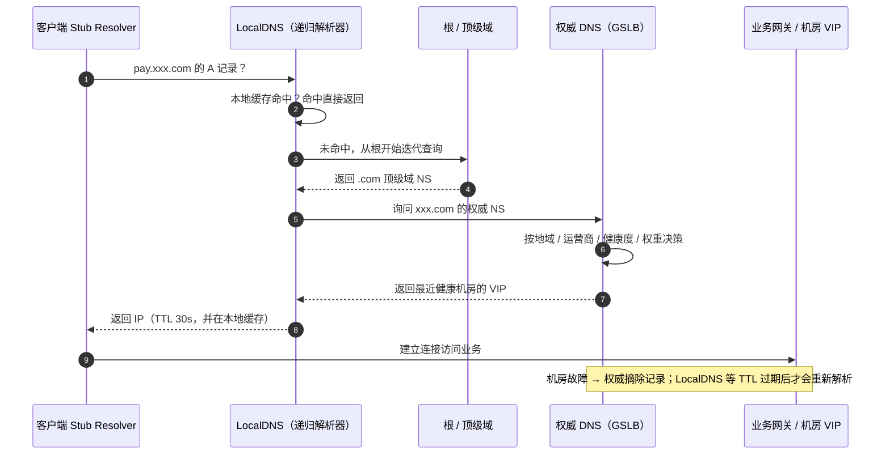

**这条链路上有 4 处缓存**：浏览器/系统 DNS 缓存 → LocalDNS 缓存 → 权威记录的 TTL → 客户端连接池复用。
**"故障切了但流量还在打旧机房"，几乎都是某一级缓存没到期。**

---

## 二、Why：为什么必须有

### 2.1 五个必须解决的问题

| # | 问题 | 不做 GSLB 的后果 | 手段 |
|---|------|------------------|------|
| 1 | **机房级故障** | 整站不可用，只能等抢修 | GSLB 健康探测 + 摘除 + 主备切换 |
| 2 | **跨地域/跨网访问慢** | 华南用户绕到华北，RTT 翻倍 | 分线路解析、就近接入 |
| 3 | **DNS 单点** | 域名解析不了 = 全站挂，比机房挂更彻底 | 多 DNS 服务商 + 权威集群 |
| 4 | **DNS 劫持 / 污染** | 用户被导到假站点或广告页 | HTTPDNS / DoH / DNSSEC |
| 5 | **LocalDNS 调度不准** | 调度到"离 LocalDNS 近"而非"离用户近"的机房 | EDNS Client Subnet、HTTPDNS |

### 2.2 用 5Why 挖入口层根因


> [!note] 结论
> **入口容灾能力 = TTL × 探测节奏 × 缓存层级 × 客户端兜底**，缺一项，切换时间就退化到最慢的那一环。

---

## 三、Who：谁负责

| 角色 | 关注点 | 交付物 |
|------|--------|--------|
| SRE / 运维 | 可用性、切换时效、演练 | 切换预案、探测配置、演练报告 |
| 网络 / 基础架构 | 线路、Anycast、BGP、多服务商 | 线路规划、NS 冗余方案 |
| 云解析服务商 | 解析 SLA、QPS 配额 | 解析服务、监控看板 |
| 安全 | 劫持、污染、DNSSEC、域名安全 | DNSSEC 配置、域名锁定 |
| 业务 / 产品 | 域名规划、可容忍降级范围 | 域名清单、切换口径 |
| 后端开发 | HTTPDNS SDK 接入、重试逻辑 | 客户端兜底与超时策略 |

### RACI（每行有且只有一个 A）

| 事项 | R 执行 | A 最终负责 | C 被咨询 | I 被告知 |
|------|--------|-----------|----------|----------|
| 域名与 NS 规划 | 网络 | 架构负责人 | SRE、安全 | 业务 |
| GSLB 探测与权重配置 | SRE | 架构负责人 | 网络 | 业务 |
| 机房切换演练 | SRE | 技术负责人 | 网络、业务 | 管理层 |
| 域名安全（锁定 / DNSSEC） | 安全 | 安全负责人 | 网络 | SRE |

---

## 四、When：什么时候用

### 4.1 判断标准

| 场景 | 是否需要 GSLB |
|------|----------------|
| 单机房、用户集中一地 | ❌ 不需要，用云 LB 就够 |
| 多机房同城双活 | ✅ 需要（机房级摘除） |
| 多地用户 + 多地域机房 | ✅ 需要（就近接入） |
| 跨运营商体验差异明显 | ✅ 需要（分线路解析） |
| 有强容灾/合规要求（异地灾备） | ✅ 需要（主备 + 权重调度） |

### 4.2 生命周期内的动作

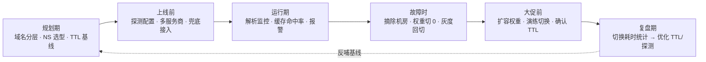

### 4.3 故障切换的时间线（真实预期）

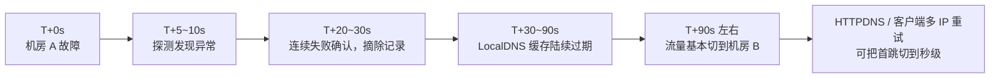

> [!warning] 别对 DNS 承诺秒级
> 你能控制权威记录，**控制不了运营商 LocalDNS 的缓存行为**。所以"秒级切换"必须靠 **HTTPDNS 或客户端多 IP 兜底**，而不是靠把 TTL 调到 1s。

---

## 五、Where：落在架构哪里

### 5.1 位置：接入层 L0

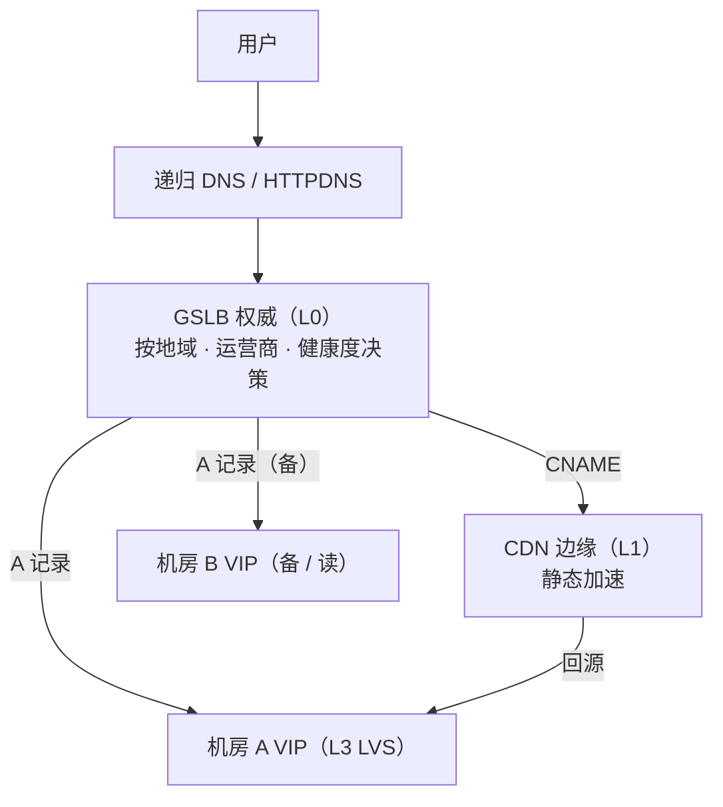

| 层级 | 组件 | 与 DNS/GSLB 的关系 |
|------|------|--------------------|
| L0 | **DNS / GSLB** | 本身，决定去哪个机房哪个边缘 |
| L1 | CDN | 通过 **CNAME** 接入，边缘节点选择也依赖 DNS |
| L2 | WAF / 高防 | 高防 IP 常通过 CNAME/A 记录切换（清洗/回切） |
| L3 | LVS + VIP | GSLB 下发的就是各机房 VIP |
| L4/L5 | Nginx / Ingress | 不参与全局调度，只做机房内分发 |

### 5.2 部署形态三选一

| 形态 | 说明 | 适用 |
|------|------|------|
| **云解析 + 云 GSLB** | 阿里云云解析/全局流量管理、腾讯 DNSPod、AWS Route 53（延迟/地理/故障转移路由） | 绝大多数团队，开箱即用 |
| **自建权威 + 开源方案** | BIND/NSD + view（分线路）+ PowerDNS + dnsdist + 自研探测 | 有强合规/成本诉求 |
| **商用 GSLB 设备** | F5 BIG-IP DNS、A10、Citrix ADC | 传统金融/大企业 |

> [!tip] K8s 场景补充
> 集群内部解析靠 **CoreDNS**（可用 NodeLocal DNSCache 降延迟）；对外域名用 **ExternalDNS** 把 Service/Ingress 自动同步到云解析，避免手工改记录。

---

## 六、How：具体怎么做

### 6.1 调度策略：GSLB 怎么"选"

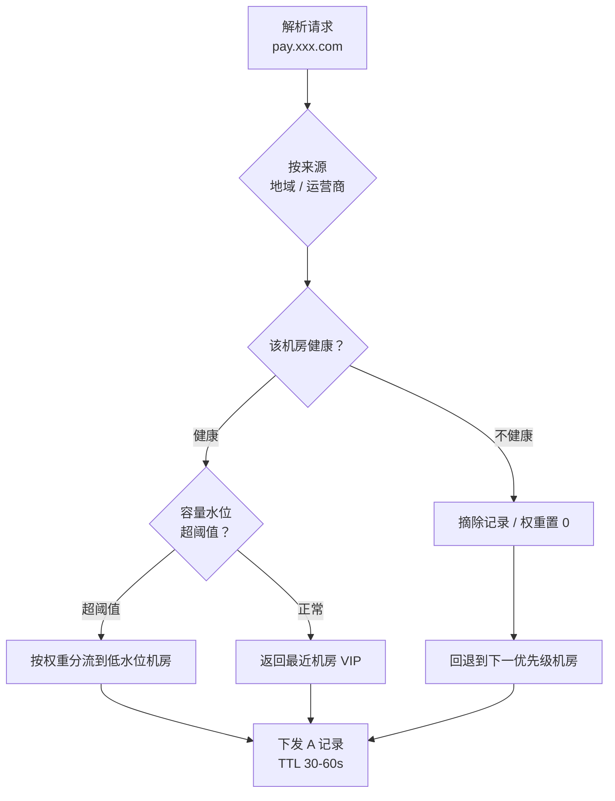

| 策略 | 说明 | 典型用途 |
|------|------|----------|
| 地理/就近 | 按用户来源地域解析 | 多地用户 |
| 分线路 | 电信/联通/移动/境外分别解析 | 跨网体验差 |
| 权重 | 按比例分流 | 灰度、容量分配 |
| 主备 | 主不可用才返回备 | 异地灾备、成本敏感 |
| 性能 | 按 RTT / 丢包 / 探测质量排序 | 动态最优 |
| 容量水位 | 按机房负载反馈调度 | 防单机房过载 |

### 6.2 健康探测：什么时候摘、什么时候回

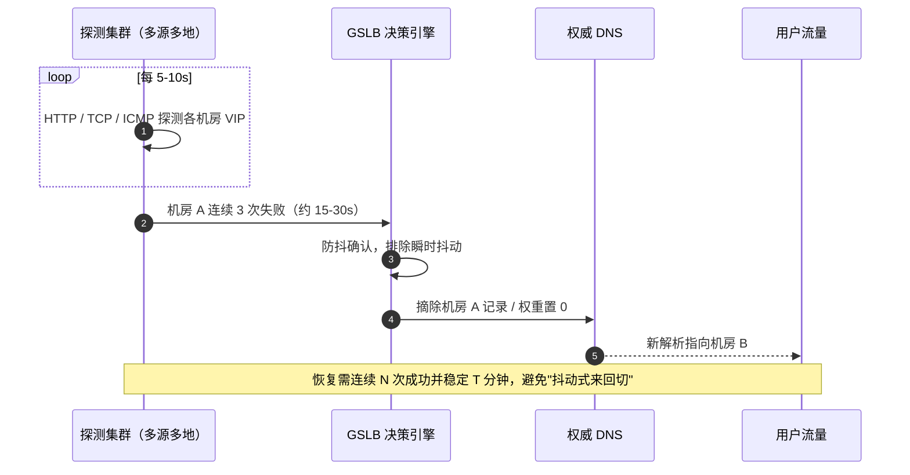

| 参数 | 建议值 | 说明 |
|------|--------|------|
| 探测间隔 | 5–10s | 越短发现越快，但探测流量与成本上升 |
| 超时 | 2–3s | 与被探测接口的真实耗时匹配 |
| 失败阈值 | 连续 3 次 | 防抖，避免单次网络抖动触发全局切换 |
| 恢复条件 | 连续 5 次成功 | 防"切来切去"造成流量震荡 |
| 探测源 | ≥3 地多线 | 避免探测源自身网络问题造成误判 |
| 探测目标 | 业务语义探针 | 探"能真实服务"的接口，而不是仅 ping 通 |

> [!important] 探针要探"能力"，不要只探"活着"
> Ping 通 ≠ 能服务。支付类系统建议探测**带鉴权的轻量业务接口**（如 `/health/biz`），避免"机器活着但依赖挂了"仍被判健康。

### 6.3 消除 DNS 单点（组合拳）

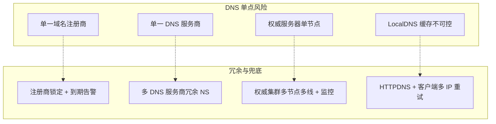

**最小可用配置（来自接入层设计）**：**多 DNS 服务商 + TTL ≤ 60s + HTTPDNS 兜底**。

### 6.4 HTTPDNS：绕开 LocalDNS

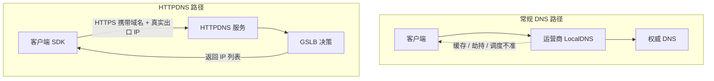

| 维度 | LocalDNS | HTTPDNS |
|------|----------|---------|
| 调度依据 | LocalDNS 的出口 IP | 客户端**真实 IP** |
| 缓存控制 | 受运营商缓存影响 | 由 App/客户端控制 |
| 劫持风险 | 存在 | 走 HTTPS，基本消除 |
| 切换时效 | 受 TTL 约束 | **可近实时** |
| 成本 | 免费 | 按调用量计费 |
| 适用 | Web 通用 | App / 强容灾核心域名 |

> [!warning] HTTPDNS 也会被绕过
> iOS/Android 若开启系统级 **DoH/DoT**，或在隐私模式下，SDK 方案可能失效。生产建议：**HTTPDNS 优先 → 常规 DNS 兜底 → 多 IP 轮询重试**，三层都要有。

### 6.5 Anycast：同一 IP，多地就近

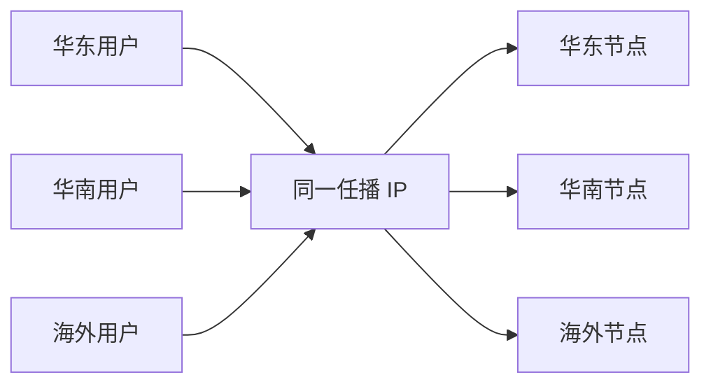

- 同一 IP 在多地用 **BGP 宣告**，路由天然把用户带到最近节点。
- 优点：**天然抗 DDoS + 抗局部故障**，无需等 TTL 过期。
- 代价：BGP 运维门槛高，国内跨运营商需多线资源；根 DNS 与公共 DNS 是典型 Anycast 应用。

### 6.6 安全与合规

| 项 | 手段 |
|----|------|
| 防污染 / 防投毒 | DNSSEC、随机源端口与事务 ID、只允许可信递归 |
| 防劫持 | HTTPDNS / DoH / DoT |
| 域名安全 | 注册商锁定（ClientHold 保护）、到期与变更告警、MFA |
| 合规 | 国内域名备案、解析服务商属地要求 |
| 防放大攻击 | 关闭不必要的递归、限制 ANY 查询、响应限速 |

> [!note] DNSSEC 的取舍
> 能防伪造，但会**放大记录体积、增加运维复杂度**，且部分 GSLB 的"动态视图 + ECS"与签名存在冲突。核心防劫持更实用的是 **HTTPDNS**。

### 6.7 配置与验证片段

```bash
# 查权威返回是否按线路/健康度变化
dig @<权威NS> pay.xxx.com A +short
# 带来源子网（ECS），验证就近调度是否生效
dig @<权威NS> pay.xxx.com A +subnet=220.181.0.0/24 +short
# 全链路看在哪一级被缓存
dig +trace pay.xxx.com
# 换公共 DNS 对比，排查 LocalDNS 缓存/劫持
dig @223.5.5.5 pay.xxx.com A +short
dig @8.8.8.8 pay.xxx.com A +short
# 强制 TCP，排查 UDP 截断/污染
dig +tcp pay.xxx.com
# 看 TTL 倒计时，确认缓存还差多久过期
dig pay.xxx.com A | grep -A1 "ANSWER SECTION"
```

```bind
; 自建权威：按来源网段做 view（分线路解析示意）
view "telecom" {
    match-clients { telecom_acl; };
    zone "pay.xxx.com" {
        type master;
        file "pay.xxx.com.telecom.zone";   ; 指向电信机房 VIP
    };
};
view "unicom" {
    match-clients { unicom_acl; };
    zone "pay.xxx.com" {
        type master;
        file "pay.xxx.com.unicom.zone";    ; 指向联通机房 VIP
    };
};
```

> [!warning] 变更发布纪律
> 用 **API + 版本化**改解析（禁止手工点控制台），每次变更记录**变更人 / 前后值 / 回滚命令**；
> 大批量切换要**分批放量**（权重 5% → 50% → 100%），观察黄金指标再继续。

---

## 七、How much：代价与收益

### 7.1 TTL 是核心权衡

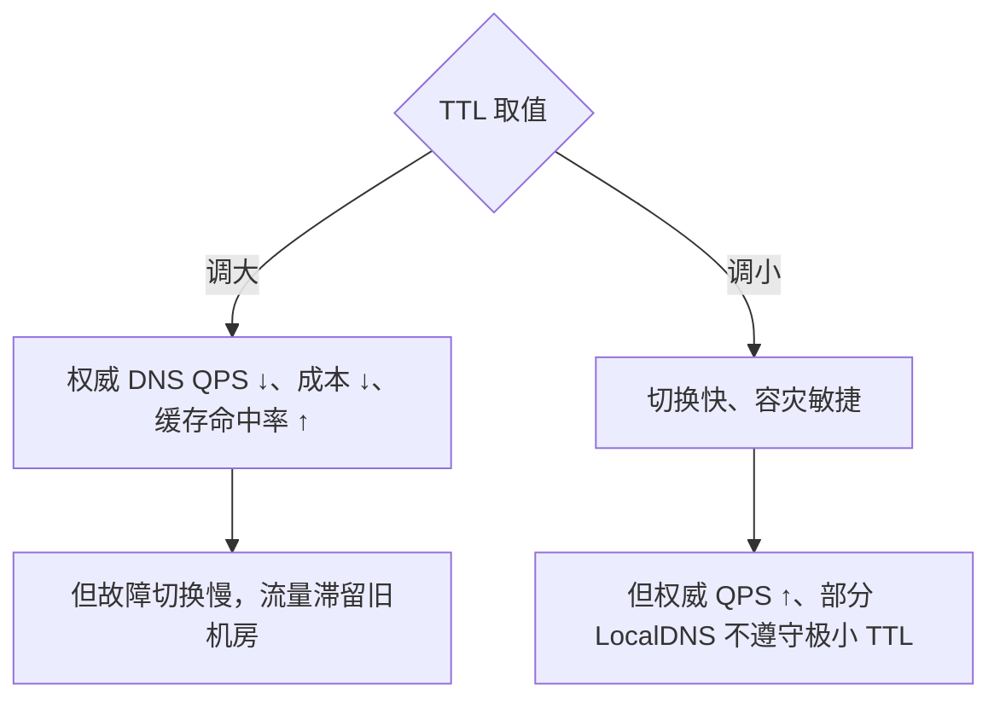

| TTL | 权威 QPS | 切换时效 | 适用 |
|-----|----------|----------|------|
| 300–600s | 低 | 慢（5–10min） | 静态资源、非核心域 |
| 60s | 中 | 1–2min | 一般业务 |
| 30s | 高 | <1min | 核心交易域（配合 HTTPDNS） |
| <10s | 很高 | 秒级 | ⚠️ 多数 LocalDNS 会强制抬高下限，得不偿失 |

> [!important] 权威 QPS 与 TTL 近似成反比
> **权威解析 QPS ≈ 活跃客户端数 / TTL**。把 TTL 从 600s 降到 30s，权威压力约涨 20 倍——**要同步评估云解析套餐的 QPS 上限**，否则"为了容灾调小 TTL"反而把解析打挂。

### 7.2 成本构成

| 项 | 计费方式 | 备注 |
|----|----------|------|
| 云解析 | 套餐 + 按 QPS/超额 | 分线路、权重、健康检查常属高级功能 |
| 权威冗余 | 2 家以上服务商 | 冗余即双份配置与联调成本 |
| HTTPDNS | 按调用量 | App 规模大时是主要成本项 |
| 自建权威 | 服务器 + 多线带宽 + 人力 | 省授权费但吃运维 |
| 演练 | 人力 + 时间 | 不做则用故障换经验 |

### 7.3 用 SLO 钉住

| 指标 | 目标示例 | 验收方式 |
|------|----------|----------|
| 解析成功率 | ≥ 99.99% | 多源拨测（全国多线） |
| 解析时延 P99 | < 100ms | 拨测平台 |
| 机房摘除时效 | ≤ 30s | 故障演练计时 |
| 端到端流量切换 | ≤ 90s（无 HTTPDNS）/ 秒级（有） | 演练统计 |
| 误摘除率 | 接近 0 | 防抖参数评审 + 历史回溯 |

---

## 八、Checklist（上线 / 评审逐条打勾）

- [ ] 域名分层规划清晰（静态/动态/核心交易域分开，便于差异化 TTL）。
- [ ] **多 DNS 服务商**冗余 NS，权威记录一致且可自动比对。
- [ ] 核心域名 **TTL ≤ 60s**，且已评估权威 QPS 与套餐上限。
- [ ] 健康探测覆盖每个机房，参数（间隔/超时/阈值/恢复）有成文基线。
- [ ] 探测目标为**业务语义探针**，非单纯 ping。
- [ ] 摘除与恢复都有**防抖**，避免流量震荡。
- [ ] **HTTPDNS 兜底**已接入客户端，且保留常规 DNS 与多 IP 重试。
- [ ] 注册商域名锁定开启、到期与变更告警已配置。
- [ ] 解析变更走 API + 版本化，有回滚命令与分批放量策略。
- [ ] 解析成功率/时延已纳入可观测看板，拨测覆盖多运营商多地域。
- [ ] 每半年至少一次**机房切换演练**，统计真实切换耗时。
- [ ] 有异地灾备或主备权重方案，并演练过回切。

---

## 附：高频坑点速查

| 坑 | 现象 | 对策 |
|----|------|------|
| TTL 太大 | 故障后流量仍打旧机房 | TTL ≤ 60s + HTTPDNS |
| TTL 太小 | 权威 QPS 暴涨、被打挂 | 评估套餐上限，别低于 LocalDNS 下限 |
| LocalDNS 不遵守 TTL/ECS | 调度不准、切换慢 | HTTPDNS，客户端兜底 |
| 裸域配 CNAME | 记录冲突、解析失败 | CNAME 展平 / ALIAS |
| 单一 NS 服务商 | 服务商故障 = 全站不可达 | 多服务商冗余 |
| 探测只探 ping | 机器活着但不能服务 | 业务语义探针 |
| 探测源单一 | 探测源网络问题导致误摘 | 多源多地探测 |
| 恢复条件太松 | 流量来回震荡 | 连续 N 次成功 + 稳定 T 分钟 |
| 手工改解析 | 变更不可追溯、易配错 | API + 版本化 + 回滚命令 |
| 忘了客户端缓存 | App 进程内缓存 IP 不刷新 | SDK 处理 TTL + 失败即重解析 |

---

> [!success] 一句话收口
> **DNS + GSLB 的三高价值，全在"解析这一步就把流量放对地方"：**
> 就近接入换来性能，分线路解析换来体验，健康探测 + 冗余 NS + HTTPDNS 换来可用性——
> 而 **TTL 是你为这一切付出的代价**，必须量化后用 SLO 管住。

## 相关笔记

- [[1-1-三高接入层架构设计]]
- [[0-高可用高并发高性能 系统设计（5W1H 整理版）]]
- [[0-1-支付场景三高 系统架构设计]]
- [[0-高可用高并发高性能 系统设计]]
