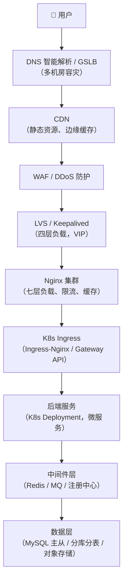
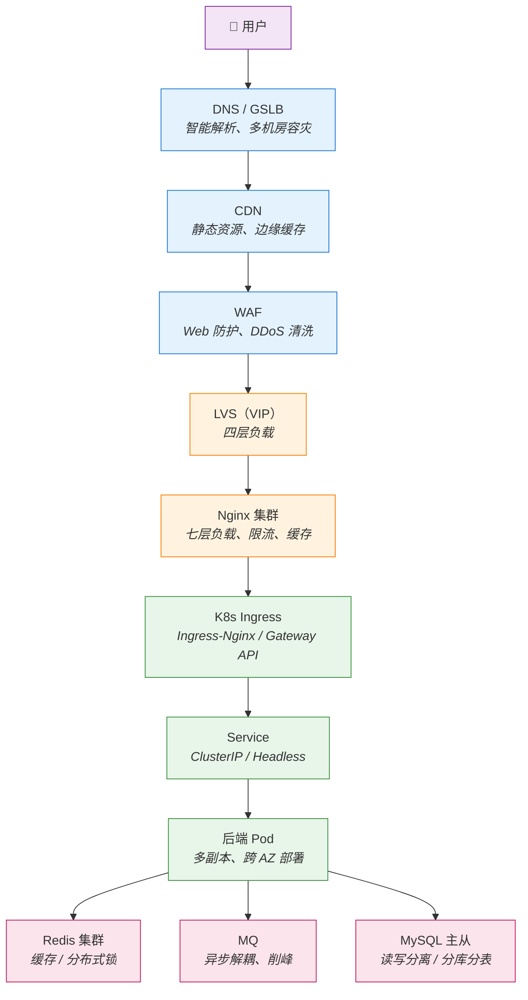

**前言**

设计一个"三高"（高可用、高并发、高性能）系统，需要从**流量入口 → 接入层 → 服务层 → 数据层 → 基础设施**逐层设计。下面我按一个系统架构师的思路，给出一套完整的方案。

## 一、整体架构分层

## 二、逐层设计要点

### 1. 接入层（高可用入口）
- **DNS 智能解析 + GSLB**：按地域/机房调度，支持故障自动摘除。
- **CDN**：静态资源、图片、视频下沉到边缘，减少回源。
- **WAF + DDoS 高防**：清洗异常流量，防 CC 攻击。
- **LVS + Keepalived**：四层负载，VIP 漂移，主备/双活。
- **Nginx 集群**：
    - 七层负载、反向代理、SSL 卸载
    - `limit_req` / `limit_conn` 限流
    - `proxy_cache` 缓存热点
    - 健康检查 + 故障节点自动剔除
**高可用关键**：Nginx 本身不能是单点，至少 2 台 + Keepalived VIP，或直接用云 LB。

### 2. K8s 服务层（弹性 + 自愈）
| 维度   | 设计                                        |
| ---- | ----------------------------------------- |
| 部署   | Deployment / StatefulSet，多副本              |
| 反亲和  | `podAntiAffinity` 打散到不同节点/可用区             |
| 滚动更新 | RollingUpdate，`maxUnavailable=0`          |
| 自愈   | Liveness / Readiness / Startup Probe      |
| 弹性   | HPA（CPU/QPS 自定义指标）+ Cluster Autoscaler    |
| 资源   | requests/limits + QoS 保障                  |
| 隔离   | Namespace + NetworkPolicy + ResourceQuota |
| 服务发现 | CoreDNS + Service / Headless Service      |
| 入口   | Ingress-Nginx 或 Gateway API，多副本           |
| 配置   | ConfigMap / Secret，热更新                    |
**多可用区部署**：节点分布在 3 个 AZ，任一 AZ 挂掉不影响整体。

### 3. 后端服务层
- **无状态化**：Session 外置到 Redis，服务可任意扩缩。
- **微服务拆分**：业务域拆，避免单点巨石。
- **服务治理**：
    - 注册中心（Nacos / Consul / K8s Service）
    - 熔断降级（Sentinel / Hystrix / Istio）
    - 限流（令牌桶 / 漏桶 / 滑动窗口）
    - 超时控制 + 重试（幂等前提下）
- **异步化**：MQ 削峰填谷（Kafka / RocketMQ / RabbitMQ）。
- **缓存**：本地缓存（Caffeine）+ 分布式缓存（Redis Cluster）。
- **Service Mesh（可选）**：Istio/Linkerd 做流量治理、灰度、mTLS。
### 4. 数据层（高可用核心）
- **MySQL**：
    - 主从复制 + MHA / Orchestrator 自动切换
    - 读写分离（ShardingSphere / ProxySQL）
    - 分库分表（ShardingSphere / Vitess）
    - 半同步复制，保证数据不丢
- **Redis**：
    - Cluster 分片 + 主从 + Sentinel
    - 持久化 AOF + RDB
- **对象存储**：S3 / OSS，多副本跨区
- **分布式事务**：Seata / 消息最终一致

### 5. 可观测性（三高的眼睛）

| 类型  | 工具                                  |
| --- | ----------------------------------- |
| 指标  | Prometheus + Grafana                |
| 日志  | ELK / Loki                          |
| 链路  | SkyWalking / Jaeger / OpenTelemetry |
| 告警  | Alertmanager + 钉钉/企微                |
| APM | 商业或自建                               |
**黄金指标**：延迟、流量、错误率、饱和度。

## 三、高并发设计核心手段
1. **分层缓存**：CDN → Nginx → 本地缓存 → Redis → DB
2. **异步化**：MQ 解耦、削峰
3. **水平扩展**：无状态 + HPA
4. **读写分离 + 分库分表**
5. **限流降级**：保护核心链路
6. **连接池 + 批量操作**：减少 IO
7. **CDN + 静态化**：减少动态请求

## 四、高可用设计核心手段

1. **消除单点**：每层至少 2 副本，跨 AZ
2. **故障隔离**：舱壁模式、线程池隔离
3. **自动故障转移**：Keepalived / MHA / K8s 自愈
4. **多机房/多活**：同城双活 + 异地灾备
5. **混沌工程**：定期演练（Chaos Mesh）
6. **灰度发布**：金丝雀 + 蓝绿
7. **容量规划 + 压测**：全链路压测

## 五、典型流量路径示例

