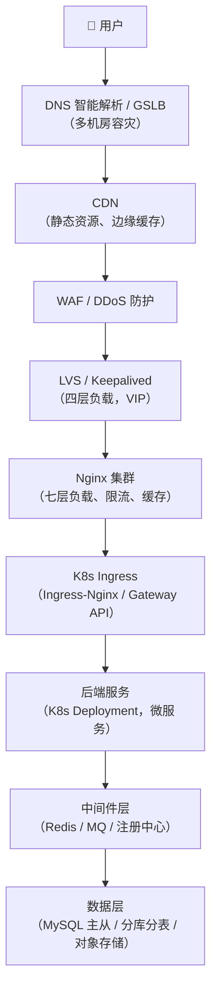

**前言**

设计一个"三高"（高可用、高并发、高性能）系统，需要从**流量入口 → 接入层 → 服务层 → 数据层 → 基础设施**逐层设计。下面我按一个系统架构师的思路，给出一套完整的方案。

## 一、整体架构分层

## 二、逐层设计要点

### 1. 接入层（高可用入口）
- **DNS 智能解析 + GSLB**：按地域/机房调度，支持故障自动摘除。
- **CDN**：静态资源、图片、视频下沉到边缘，减少回源。
- **WAF + DDoS 高防**：清洗异常流量，防 CC 攻击。
- **LVS + Keepalived**：四层负载，VIP 漂移，主备/双活。
- **Nginx 集群**：
    - 七层负载、反向代理、SSL 卸载
    - `limit_req` / `limit_conn` 限流
    - `proxy_cache` 缓存热点
    - 健康检查 + 故障节点自动剔除
**高可用关键**：Nginx 本身不能是单点，至少 2 台 + Keepalived VIP，或直接用云 LB。

### 2. K8s 服务层（弹性 + 自愈）
|维度|设计|
|---|---|
|部署|Deployment / StatefulSet，多副本|
|反亲和|`podAntiAffinity` 打散到不同节点/可用区|
|滚动更新|RollingUpdate，`maxUnavailable=0`|
|自愈|Liveness / Readiness / Startup Probe|
|弹性|HPA（CPU/QPS 自定义指标）+ Cluster Autoscaler|
|资源|requests/limits + QoS 保障|
|隔离|Namespace + NetworkPolicy + ResourceQuota|
|服务发现|CoreDNS + Service / Headless Service|
|入口|Ingress-Nginx 或 Gateway API，多副本|
|配置|ConfigMap / Secret，热更新|