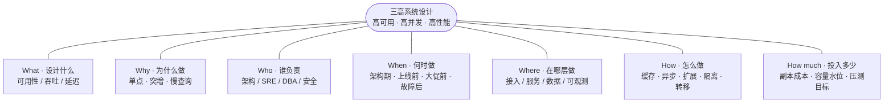
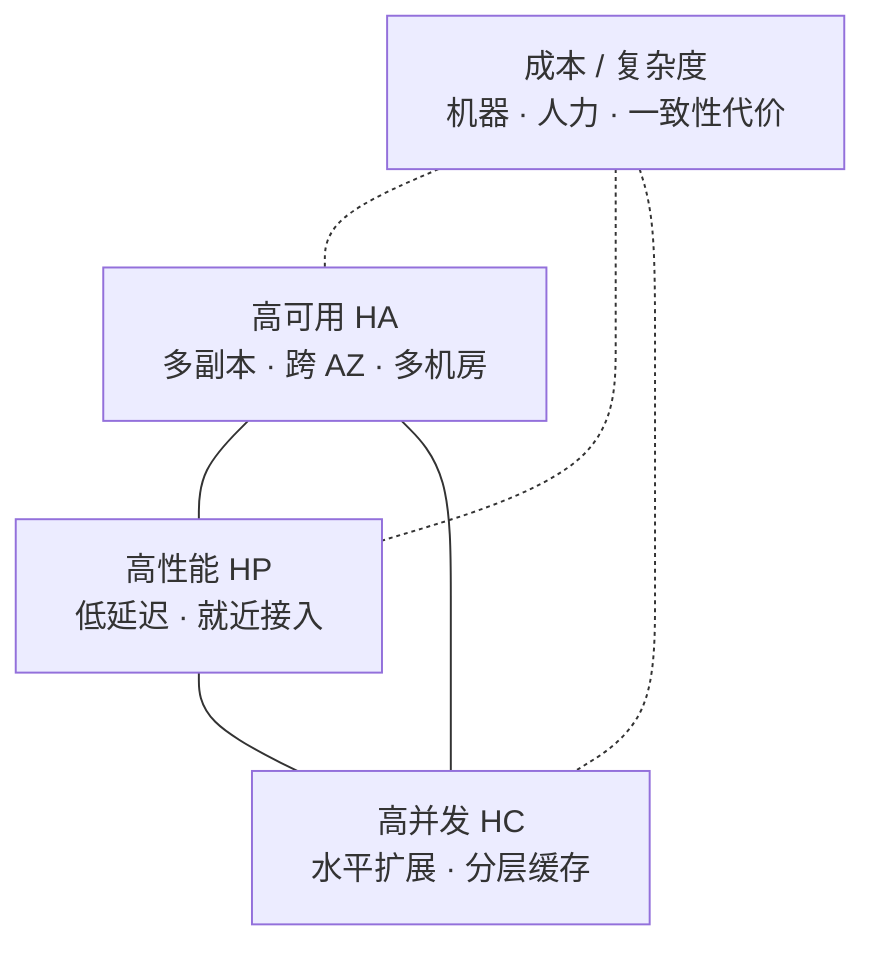
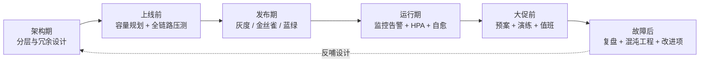
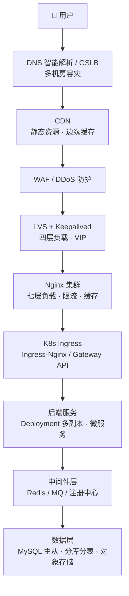
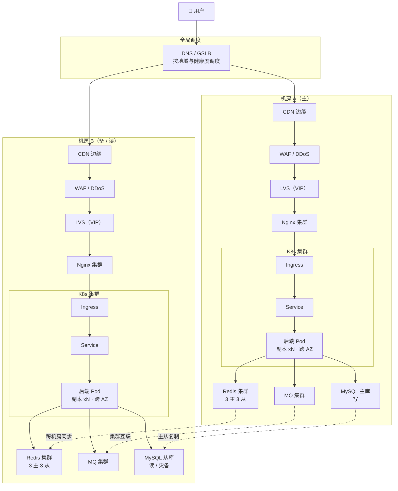
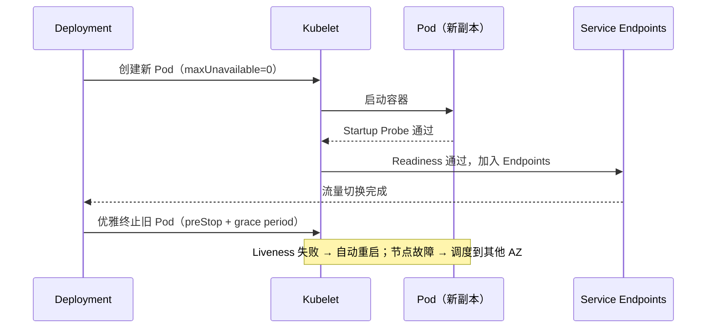
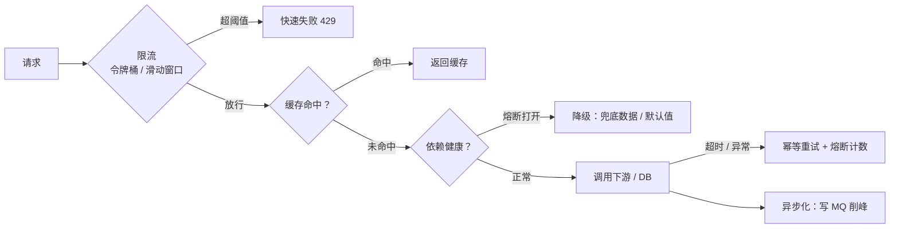
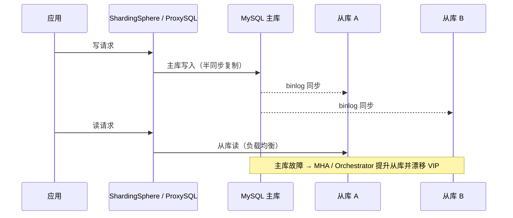
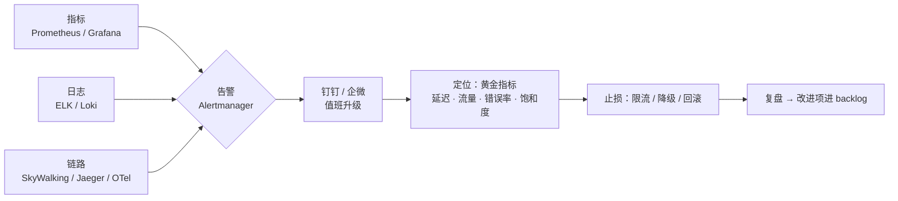
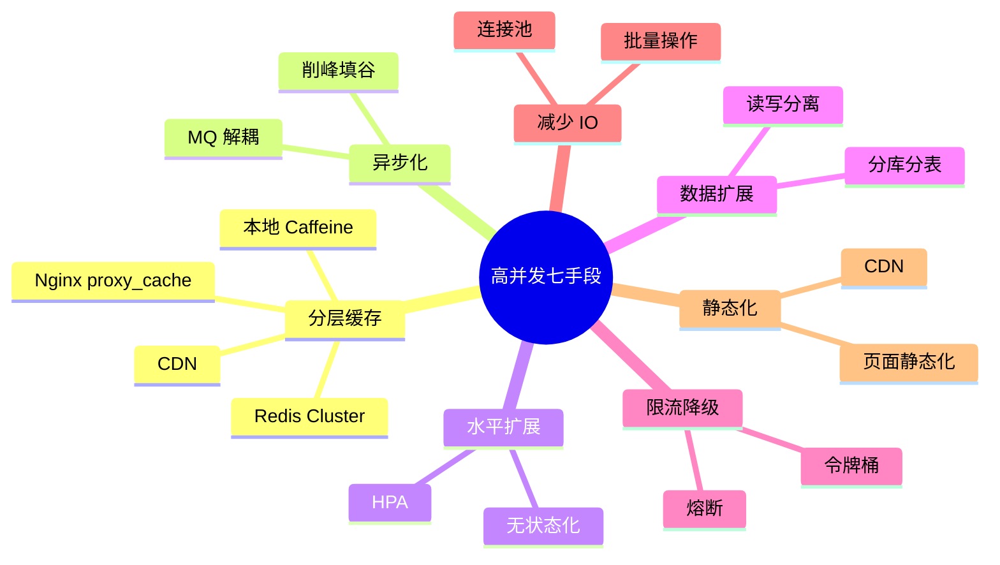

# 🌐 三高系统设计 · 5W1H 整理版

> [!abstract] 一句话主线
> 原文档给的是**一份"三高"组件清单与逐层要点**；本篇用 **5W1H** 把它重排成**六个可以回答、可以验收的问题**：
> **设计什么（What）→ 为什么必须设计（Why）→ 谁负责（Who）→ 什么时候做（When）→ 在哪一层做（Where）→ 具体怎么做、代价多少（How / How much）**。
> 三高的本质不是"堆中间件"，而是**在成本约束下，用冗余消除单点、用分层缓存与异步化扛住流量、用可观测性把故障收敛在分钟级**。

> [!info] 本篇定位与来源
> - 来源：[[0-高可用高并发高性能 系统设计]]（逐层要点原文）。
> - 本篇不新增组件，只做**结构化重组 + 配图**，便于背诵与落地评审。
> - 相邻笔记：[[1-1-三高接入层架构设计]]、[[0-1-支付场景三高 系统架构设计]]、[[高并发系统设计（详细整理版）]]。
> - 思维模型出处：[[02-结构化思维-5W1H与任务拆解|5W1H 与任务拆解]]。

---

## 〇、5W1H 速览：六个问题锁住整套架构

| 要素 | 要追问的问题 | 在"三高"设计中的落点 | 本篇位置 |
|------|--------------|----------------------|----------|
| **What** | 我要设计出什么？验收标准是什么？ | 可用性 / 吞吐 / 延迟三个量化目标及其张力 | [§1](#一what要设计出什么) |
| **Why** | 为什么必须做？不做会怎样？ | 单点故障、流量突增、慢查询三大失败模式 | [§2](#二why为什么必须这样设计) |
| **Who** | 谁设计、谁负责、谁受影响？ | 架构师 / SRE / DBA / 开发 / 安全 / 产品 + RACI | [§3](#三who谁来设计与负责) |
| **When** | 什么时机做、里程碑是什么？ | 架构期 → 上线前 → 发布期 → 运行期 → 大促前 → 故障后 | [§4](#四when什么时候做什么) |
| **Where** | 在哪些层、哪些机房落位？ | 接入层 / K8s 服务层 / 后端服务层 / 数据层 / 可观测层 | [§5](#五where在哪些层落位) |
| **How** | 具体方案、流程、风险应对？ | 逐层设计要点 + 高并发七手段 + 高可用七手段 | [§6](#六how具体怎么做) |
| **How much** | 投入多少人/钱/机器？产出怎么量化？ | 容量水位、副本成本、SLA 目标、压测通过标准 | [§7](#七how-much投入多少换回什么) |

> [!tip] 用法
> 拿这张表去做**架构评审的提问清单**：任何一层只要有一个格子答不上来，就是风险点。

---

## 一、What：要设计出什么

### 1.1 三个目标，各有各的度量

| 目标 | 一句话定义 | 核心指标 | 典型目标 |
|------|-----------|----------|----------|
| **高可用 HA** | 故障时**少停、快恢复** | 可用性 SLA、MTBF、MTTR | 99.99%（年停机 ≈ 52 分钟） |
| **高并发 HC** | 大量请求**同时进来也不崩** | QPS / TPS、并发连接数、峰值倍率 | 支撑预估峰值的 2–3 倍 |
| **高性能 HP** | 单次请求**快** | RT 的 P95 / P99 / P999、吞吐 | 核心接口 P99 < 200ms |

> [!warning] 别把三个目标混成一个
> - **高并发**解决"**同一时刻来很多请求**" → 靠扩展、缓存、异步、限流。
> - **高性能**解决"**一个请求要多快返回**" → 靠减少 IO、索引、连接池、就近接入。
> - **高可用**解决"**坏了还能不能用**" → 靠冗余、隔离、自动转移。
> 手段会互相借用，但**根因和指标完全不同**，混着谈就会"压测很漂亮，故障照样挂"。

### 1.2 三者的张力：不能白拿

- **冗余 ↑ → 可用性 ↑，但一致性与成本 ↓**（主从延迟、跨机房同步）。
- **缓存 ↑ → 性能与并发 ↑，但一致性风险 ↑**。
- 结论：三高设计的本质是**在成本约束下做取舍**，而不是把每个指标拉到极限。

### 1.3 交付物边界

| 属于本篇 | 不属于本篇 |
|----------|-----------|
| 分层架构、冗余与容灾、容量与限流、可观测性 | 业务逻辑正确性、代码规范 |
| 接入层安全能力（WAF、DDoS、验签纳入接入层） | 数据合规、法务与隐私评审（另立专题） |

---

## 二、Why：为什么必须这样设计

### 2.1 三大失败模式 → 对应设计

| 失败模式 | 不做的后果 | 对应设计手段 |
|----------|-----------|--------------|
| **单点故障**（一台 Nginx / 一个主库挂） | 全站不可用 | 每层 ≥2 副本、VIP 漂移、主从自动切换 |
| **流量突增**（大促、热点、爬虫、CC 攻击） | 线程池打满 → 雪崩 | 限流、熔断降级、MQ 削峰、HPA |
| **慢依赖**（慢 SQL、下游超时、缓存击穿） | 请求堆积 → 级联失败 | 缓存、异步化、超时控制、舱壁隔离 |

### 2.2 用 5Why 挖到可修复的根因

> [!note] Why 的正确问法
> 问到"**没有机制 / 没有 owner / 没有阈值**"这一层才算根因；停在"某人不小心"就一定会复发。

---

## 三、Who：谁来设计与负责

### 3.1 角色与关注点

| 角色 | 关注 | 关键交付物 |
|------|------|-----------|
| 架构师 | 分层、冗余、一致性取舍 | 架构方案、SLO 定义 |
| SRE / 运维 | 容量、发布、告警、演练 | 值班表、预案、压测报告 |
| DBA | 主从、分库分表、慢 SQL | 索引与分片方案、切换演练 |
| 后端开发 | 无状态、限流熔断、幂等 | 服务改造、降级开关 |
| 安全 | WAF、DDoS、验签防重放 | 防护策略、攻击演练 |
| 产品 / 业务 | 优先级、可容忍降级范围 | 降级口径（哪些能降、降到什么程度） |

### 3.2 RACI：每行有且只有一个 A

| 事项 | R 执行 | A 最终负责 | C 被咨询 | I 被告知 |
|------|--------|-----------|----------|----------|
| 接入层与容灾设计 | 架构师 | 技术负责人 | SRE、安全 | 产品 |
| 全链路压测 | SRE | 技术负责人 | DBA、开发 | 业务 |
| 限流 / 降级开关 | 开发 | 架构师 | 产品、SRE | 客服 |
| 故障复盘与改进 | SRE | 技术负责人 | 全体 | 管理层 |

> [!warning] 责任坑
> **A 不唯一 = 出事没人兜；A 为空 = 出事没人管。** 降级口径必须产品签字，否则故障时会为了"少扣一点数据"吵到超时。

---

## 四、When：什么时候做什么

| 时机 | 必做动作 | 完成标准 |
|------|----------|----------|
| 架构期 | 分层、去单点、定义 SLO | 每层无单点，SLO 可量化 |
| 上线前 | 容量规划、全链路压测 | 3 倍预估峰值通过 |
| 发布期 | 金丝雀 / 蓝绿、可回滚 | 有回滚脚本且演练过 |
| 运行期 | 监控告警、HPA、自愈 | 黄金指标全覆盖 |
| 大促前 | 预案、演练、值班、扩容 | 预案有开关、值班有升级路径 |
| 故障后 | 复盘、混沌演练 | 改进项进 backlog 且有 owner |

---

## 五、Where：在哪些层落位

### 5.1 整体分层链路（纵向）

### 5.2 层 × 职责速查

| 层 | 组件 | 核心职责 | 去单点方式 |
|----|------|----------|-----------|
| L0 全局调度 | DNS / GSLB | 就近接入、机房级容灾 | 多机房 + 健康探测 |
| L1 边缘 | CDN | 静态加速、抗量 | 多边缘节点 |
| L2 防护 | WAF / 高防 | 攻击清洗、CC 防护 | 集群 + 云高防 |
| L3 四层 | LVS + Keepalived | 四层负载、VIP 漂移 | 主备 / 双活 VIP |
| L4 七层 | Nginx 集群 | 负载、限流、SSL、缓存 | ≥2 台 + Keepalived |
| L5 服务入口 | K8s Ingress | 路由、灰度 | 多副本 |
| L6 应用 | 后端服务 | 业务逻辑 | 无状态 + 多副本跨 AZ |
| L7 中间件 | Redis / MQ | 缓存、异步、注册 | Cluster + 主从 |
| L8 数据 | MySQL / OSS | 持久化 | 主从 + 分片 |

### 5.3 多机房落位：同城双活 + 异地灾备

> [!tip] 读图要点
> **主线是链路，末端是扇出**：`Pod` 之后同时依赖 `Redis`、`MQ`、`MySQL`，是**并列依赖**而非串联数据流——所以从 Pod 画三条独立箭头，不要画成 `Redis --> MQ --> MySQL`。

---

## 六、How：具体怎么做

### 6.1 接入层（高可用入口）

| 组件 | 关键动作 |
|------|----------|
| DNS + GSLB | 按地域/机房调度、故障自动摘除、TTL 调小 |
| CDN | 静态资源/图片/视频下沉边缘，减少回源 |
| WAF + 高防 | 清洗异常流量、防 CC |
| LVS + Keepalived | 四层负载、VIP 漂移、主备/双活 |
| Nginx 集群 | 七层负载、SSL 卸载、`limit_req` / `limit_conn`、`proxy_cache`、健康检查剔除坏节点 |

> [!warning] 高可用关键
> **Nginx 自己不能是单点**：至少 2 台 + Keepalived VIP，或直接用云 LB。

### 6.2 K8s 服务层（弹性 + 自愈）

| 维度 | 设计 |
|------|------|
| 部署 | Deployment / StatefulSet，多副本 |
| 反亲和 | `podAntiAffinity` 打散到不同节点/可用区 |
| 滚动更新 | RollingUpdate，`maxUnavailable=0` |
| 自愈 | Liveness / Readiness / Startup Probe |
| 弹性 | HPA（CPU/QPS 自定义指标）+ Cluster Autoscaler |
| 资源 | requests / limits + QoS 保障 |
| 隔离 | Namespace + NetworkPolicy + ResourceQuota |
| 服务发现 | CoreDNS + Service / Headless Service |
| 入口 | Ingress-Nginx 或 Gateway API，多副本 |
| 配置 | ConfigMap / Secret 热更新 |

> [!note] 多可用区部署
> 节点分布在 **3 个 AZ**，任一 AZ 挂掉不影响整体。

### 6.3 后端服务层（可扩展 + 可治理）

- **无状态化**：Session 外置 Redis，服务可任意扩缩。
- **微服务拆分**：按业务域拆，避免巨石单点。
- **服务治理**：注册中心（Nacos / Consul / K8s Service）、熔断降级（Sentinel / Hystrix / Istio）、限流（令牌桶 / 漏桶 / 滑动窗口）、超时控制 + 幂等前提下的重试。
- **异步化**：MQ 削峰填谷（Kafka / RocketMQ / RabbitMQ）。
- **缓存**：本地缓存（Caffeine）+ 分布式缓存（Redis Cluster）。
- **Service Mesh（可选）**：Istio / Linkerd 做流量治理、灰度、mTLS。

### 6.4 数据层（高可用核心）

| 组件 | 设计 |
|------|------|
| MySQL | 主从复制 + MHA / Orchestrator 自动切换；读写分离（ShardingSphere / ProxySQL）；分库分表（ShardingSphere / Vitess）；半同步复制保证不丢 |
| Redis | Cluster 分片 + 主从 + Sentinel；持久化 AOF + RDB |
| 对象存储 | S3 / OSS，多副本跨区 |
| 分布式事务 | Seata / 消息最终一致 |

### 6.5 可观测性（三高的眼睛）

| 类型 | 工具 |
|------|------|
| 指标 | Prometheus + Grafana |
| 日志 | ELK / Loki |
| 链路 | SkyWalking / Jaeger / OpenTelemetry |
| 告警 | Alertmanager + 钉钉/企微 |
| APM | 商业或自建 |

**黄金指标**：延迟、流量、错误率、饱和度。

### 6.6 高并发七手段

| # | 手段 | 一句话 |
|---|------|--------|
| 1 | 分层缓存 | CDN → Nginx → 本地缓存 → Redis → DB，逐层拦截 |
| 2 | 异步化 | MQ 解耦与削峰，把同步等待变排队消费 |
| 3 | 水平扩展 | 无状态 + HPA，加机器就加容量 |
| 4 | 读写分离 + 分库分表 | 写主读从，数据量大了再分片 |
| 5 | 限流降级 | 保护核心链路，牺牲边缘保核心 |
| 6 | 连接池 + 批量操作 | 减少 IO 次数与连接开销 |
| 7 | CDN + 静态化 | 把动态请求变成静态请求 |

### 6.7 高可用七手段

| # | 手段 | 落地方式 |
|---|------|----------|
| 1 | 消除单点 | 每层 ≥2 副本，跨 AZ |
| 2 | 故障隔离 | 舱壁模式、线程池隔离 |
| 3 | 自动故障转移 | Keepalived / MHA / K8s 自愈 |
| 4 | 多机房/多活 | 同城双活 + 异地灾备 |
| 5 | 混沌工程 | Chaos Mesh 定期演练 |
| 6 | 灰度发布 | 金丝雀 + 蓝绿 |
| 7 | 容量规划 + 压测 | 全链路压测，按 2–3 倍峰值验收 |

---

## 七、How much：投入多少，换回什么

### 7.1 容量与成本账

| 项 | 估算口径 | 说明 |
|----|----------|------|
| 峰值 QPS | 日均 QPS × 峰值系数（3–10）× 安全系数（2–3） | 压测按此目标验收 |
| 副本数 | 峰值 / 单副本容量 + 冗余（≥2 或 N+1） | 跨 AZ 后成本约 ×1.5–2 |
| 缓存容量 | 热点数据集 × 1.5 冗余 | 决定命中率与 DB 压力 |
| 多机房 | 同城双活 ≈ 2 倍资源；异地灾备可降配 | 用可用性等级换钱 |
| 人力 | 压测、演练、值班常态投入 | 不做就是"用故障换经验" |

### 7.2 用 SLO 把"多少"钉死

| 指标 | 目标示例 | 验收方式 |
|------|----------|----------|
| 可用性 | 99.99% | 年度故障时长统计 |
| 核心接口 P99 | < 200ms | 压测 + 线上监控 |
| 峰值承载 | 预估峰值 ×3 | 全链路压测 |
| 故障恢复 MTTR | < 5 分钟 | 故障演练计时 |

---

## 八、一页 Checklist（评审时逐条打勾）

- [ ] **What**：三个目标都有量化指标（SLA / QPS / P99），而不是形容词。
- [ ] **Why**：列得出本系统最可能的 3 个失败模式与对应手段。
- [ ] **Who**：每项工作有唯一 A，降级口径有产品确认。
- [ ] **When**：压测、演练、灰度、复盘的时机和完成标准已排期。
- [ ] **Where**：每一层都没有单点，且明确跨 AZ / 跨机房策略。
- [ ] **How**：限流、熔断、降级、超时、重试（幂等）五件套齐全。
- [ ] **How much**：容量水位与扩容阈值明确，成本与可用性等级匹配。
- [ ] 可观测：黄金指标（延迟/流量/错误/饱和度）全覆盖并接告警。
- [ ] 有回滚脚本、有值班升级路径、有混沌演练计划。

---

## 附：Mermaid 绘图约定与踩坑（摘自原文）

1. **`<i>` 斜体说明**：部分渲染器支持有限 HTML 标签，若渲染异常直接删掉标签。
2. **中文全角括号 `（）` 安全**，不要用英文双引号包裹带括号标签时产生歧义——保险做法是**统一用 `["..."]` 双引号包裹标签**。
3. **分层泳道 vs 纯链路**：强调"请求依次经过哪些层"用纵向链路图；强调"系统由哪些层组成"用分组图。
4. **数据层三组件并列**：`Redis` / `MQ` / `MySQL` 从 `Pod` 扇出三条独立箭头，不要画成串联。

---

> [!success] 一句话收口
> **What 定指标、Why 定动机、Who 定责任、When 定节奏、Where 定分层、How 定手段、How much 定预算——七个问题答完，架构方案才算能评审、能落地、能验收。**

## 相关笔记

- 原文：[[0-高可用高并发高性能 系统设计]]
- 分层深挖：[[DNS+GSLB 全局负载调度（5W1H 整理版）]]（L0）
- [[1-1-三高接入层架构设计]]
- [[0-1-支付场景三高 系统架构设计]]
- [[高并发系统设计（详细整理版）]]
- [[02-结构化思维-5W1H与任务拆解]]
