# 接入层详细设计（支付场景 · 三高）

> [!abstract] 接入层定位
> 接入层是**流量的第一道闸门**，承担：**抗攻击、负载均衡、限流、SSL 卸载、灰度路由、可观测埋点**。
> 支付场景下，接入层还必须是**资金安全的第一道防线**：验签、防重放、防篡改。

---

## 一、接入层在整体架构中的位置

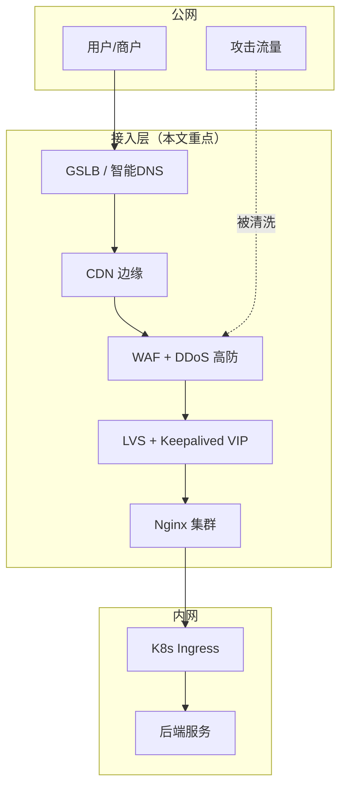

**分层职责**：

| 层级 | 组件 | 核心职责 |
|------|------|----------|
| L0 | GSLB / 智能 DNS | 就近接入、机房级容灾 |
| L1 | CDN | 静态加速、边缘缓存、抗量 |
| L2 | WAF / 高防 | 攻击清洗、CC 防护 |
| L3 | LVS + Keepalived | 四层负载、VIP 漂移 |
| L4 | Nginx 集群 | 七层负载、限流、SSL、路由 |
| L5 | K8s Ingress | 服务发现、灰度、金丝雀 |

---

## 二、逐层详解

### 2.1 GSLB / 智能 DNS

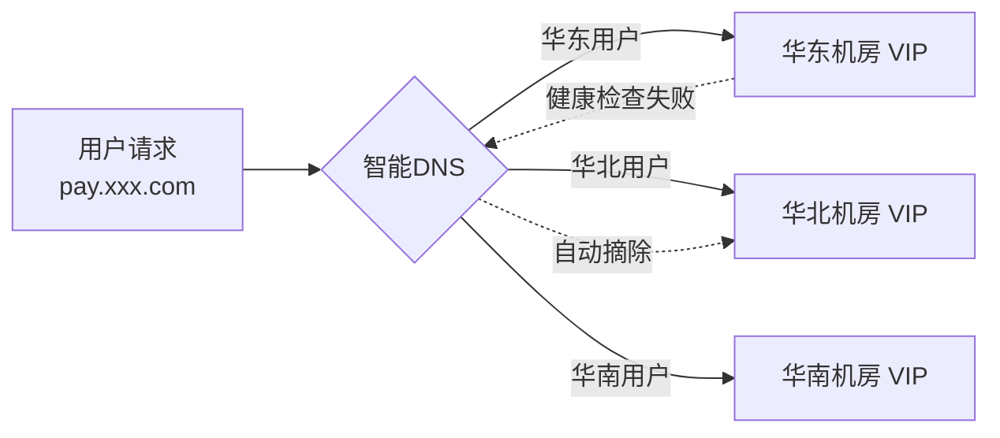

**能力**：
- **就近接入**：按运营商 + 地域解析
- **健康探测**：机房级故障自动摘除
- **权重调度**：灰度 / 容量分配
- **秒级切换**：TTL 设小（30s）+ 备 IP

> [!warning] 坑点
> DNS 缓存不可控，切换有延迟。核心支付域名建议 **TTL ≤ 60s**，并配合 **HTTPDNS** 兜底。

---

### 2.2 CDN 边缘层

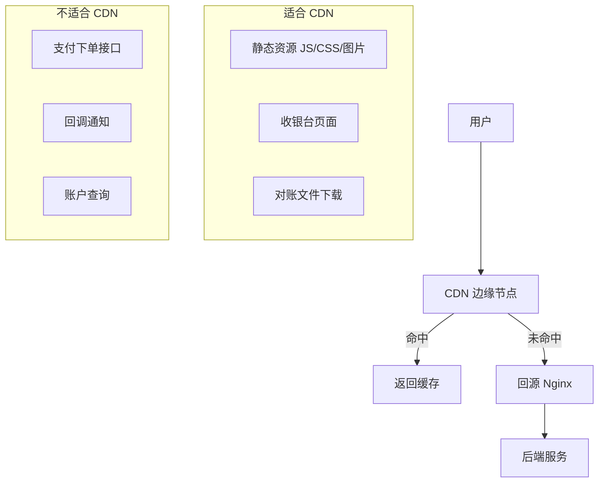

**支付场景策略**：
- **动态接口**：`Cache-Control: no-store`，禁止缓存
- **静态资源**：长缓存 + 文件名 hash
- **敏感接口**：CDN 层直接 bypass，不回源前不落任何数据

---

### 2.3 WAF + DDoS 高防

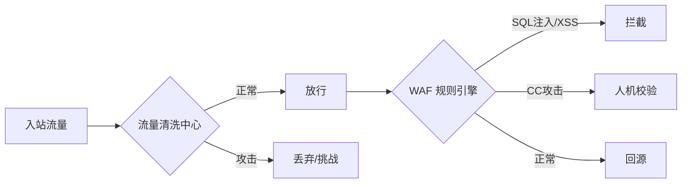

**防护矩阵**：

| 攻击类型 | 手段 |
|----------|------|
| DDoS 流量 | 高防 IP + 流量清洗 |
| CC 攻击 | 频率限制 + 人机验证 |
| SQL 注入 | WAF 规则 + 参数化 |
| XSS | 输入过滤 + CSP |
| 爬虫 | UA/行为分析 + 指纹 |
| 重放攻击 | 时间戳 + Nonce + 签名 |

> [!important] 支付特有防护
> - **防重放**：请求带 `timestamp + nonce`，服务端校验 5 分钟窗口
> - **防篡改**：全参数签名（RSA2 / HMAC-SHA256）
> - **防伪造**：商户证书双向校验

---

### 2.4 LVS + Keepalived（四层）

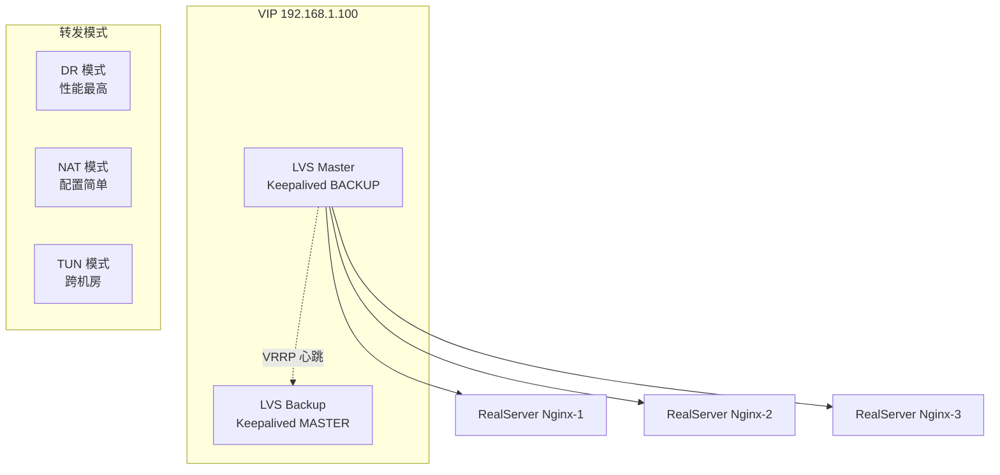

**选型建议**：
- 同机房 → **DR 模式**（响应直接回客户端，性能最优）
- 跨机房 → **TUN 模式**
- 小规模 → **NAT 模式**

**Keepalived 要点**：
- VRRP 心跳间隔 1s，抢占延迟 3s
- 健康检查脚本探测 Nginx 端口
- 脑裂防护：`nopreempt` + 单播

---

### 2.5 Nginx 集群（七层 · 核心）

#### 2.5.1 集群拓扑

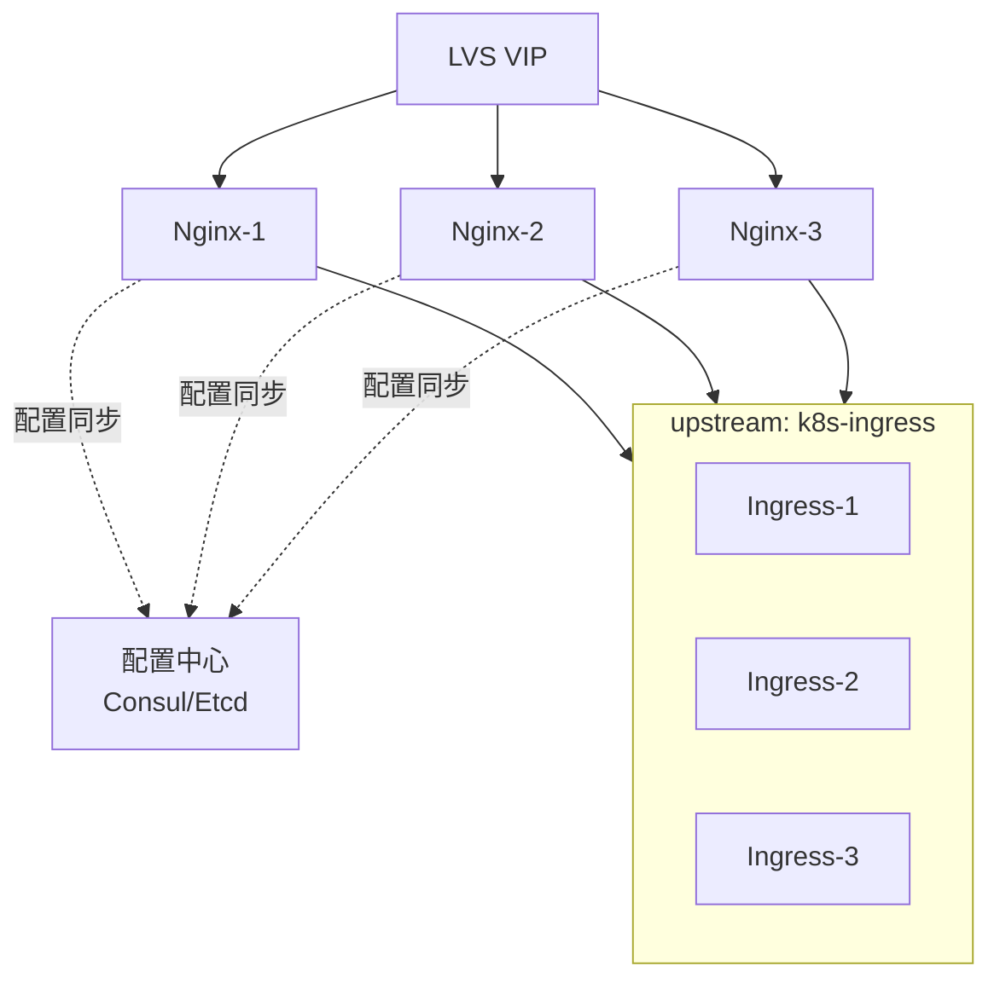

#### 2.5.2 核心配置能力

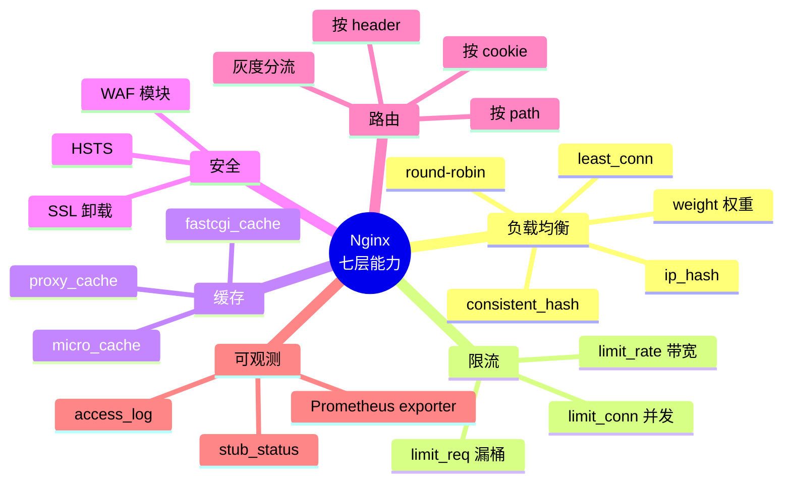

#### 2.5.3 关键配置示例

```nginx
# ============ 上游集群 ============
upstream pay_backend {
    least_conn;
    server 10.0.1.10:8080 weight=5 max_fails=3 fail_timeout=10s;
    server 10.0.1.11:8080 weight=5 max_fails=3 fail_timeout=10s;
    server 10.0.1.12:8080 weight=3 backup;
    keepalive 200;
}

# ============ 限流 ============
limit_req_zone $binary_remote_addr zone=pay_req:100m rate=100r/s;
limit_conn_zone $binary_remote_addr zone=pay_conn:100m;

# ============ 缓存 ============
proxy_cache_path /data/cache levels=1:2 keys_zone=pay_cache:100m
                 max_size=10g inactive=60m use_temp_path=off;

server {
    listen 443 ssl http2;
    server_name pay.xxx.com;

    # SSL 卸载
    ssl_certificate     /etc/nginx/certs/pay.crt;
    ssl_certificate_key /etc/nginx/certs/pay.key;
    ssl_protocols TLSv1.2 TLSv1.3;
    ssl_ciphers HIGH:!aNULL:!MD5;

    # 安全头
    add_header Strict-Transport-Security "max-age=31536000" always;
    add_header X-Content-Type-Options nosniff;
    add_header X-Frame-Options DENY;

    # 支付下单接口：严格限流 + 不缓存
    location /api/pay/create {
        limit_req zone=pay_req burst=200 nodelay;
        limit_conn pay_conn 50;
        proxy_cache off;
        proxy_pass http://pay_backend;
        proxy_set_header X-Real-IP $remote_addr;
        proxy_set_header X-Request-Id $request_id;

        # 超时控制
        proxy_connect_timeout 2s;
        proxy_send_timeout    5s;
        proxy_read_timeout    5s;
    }

    # 灰度：按 header 分流
    location /api/ {
        if ($http_x_gray = "v2") {
            proxy_pass http://pay_backend_v2;
        }
        proxy_pass http://pay_backend;
    }

    # 健康检查
    location /nginx_status {
        stub_status;
        allow 10.0.0.0/8;
        deny all;
    }
}
```

#### 2.5.4 负载均衡算法对比

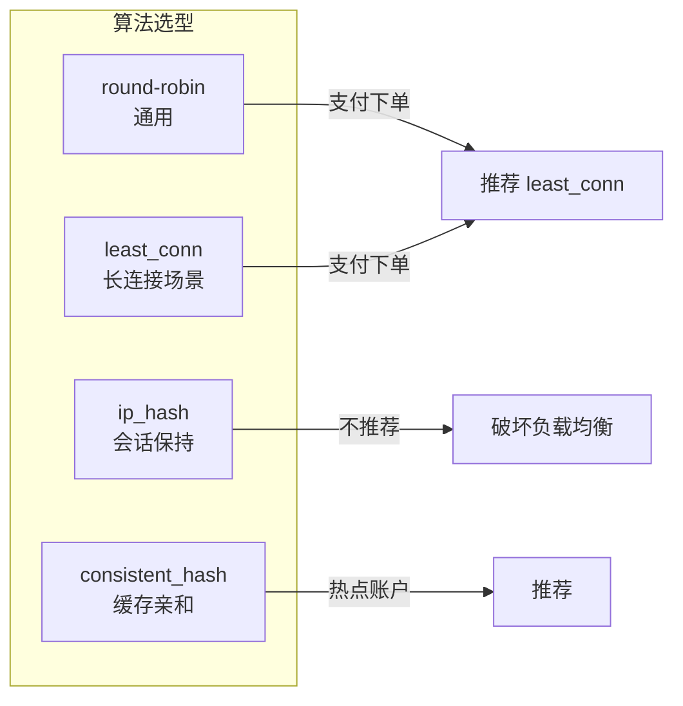

> [!tip] 支付场景选型
> - 下单接口 → `least_conn`（避免慢节点堆积）
> - 热点账户 → `consistent_hash`（同一账户固定节点，减少锁竞争）
> - **避免 `ip_hash`**：NAT 出口会导致流量倾斜

---

### 2.6 K8s Ingress（服务接入）

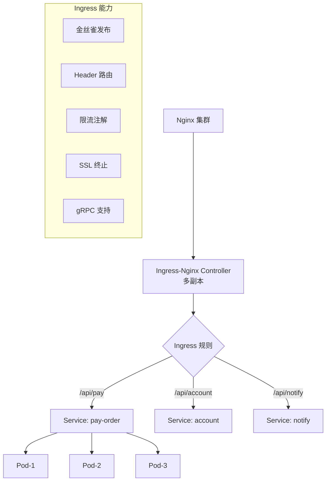

**金丝雀示例**：

```yaml
apiVersion: networking.k8s.io/v1
kind: Ingress
metadata:
  name: pay-order-canary
  annotations:
    nginx.ingress.kubernetes.io/canary: "true"
    nginx.ingress.kubernetes.io/canary-weight: "5"   # 5% 流量
    nginx.ingress.kubernetes.io/canary-by-header: "x-gray"
    nginx.ingress.kubernetes.io/canary-by-header-value: "v2"
spec:
  rules:
    - host: pay.xxx.com
      http:
        paths:
          - path: /api/pay
            pathType: Prefix
            backend:
              service:
                name: pay-order-v2
                port:
                  number: 8080
```

---

## 三、限流体系（接入层核心能力）

### 3.1 多级限流架构

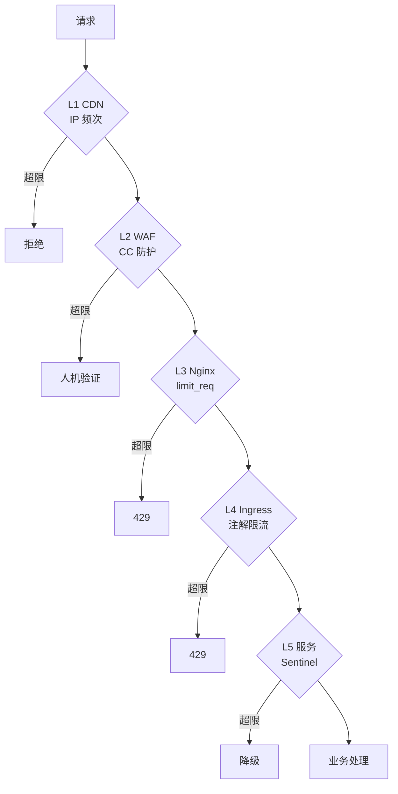

### 3.2 限流算法对比

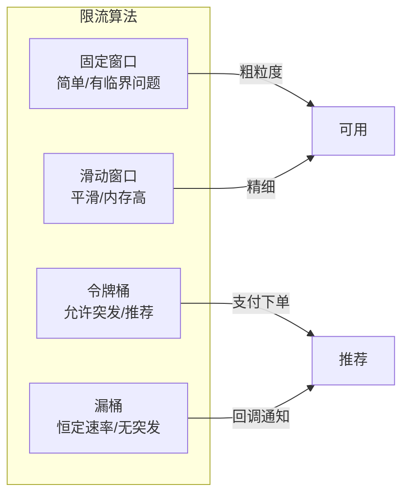

### 3.3 限流维度

| 维度 | 示例 | 场景 |
|------|------|------|
| IP | 100 r/s | 防刷 |
| 商户 | 1000 r/s | 大商户隔离 |
| 接口 | 5000 r/s | 核心接口保护 |
| 用户 | 10 r/s | 防误操作 |
| 全局 | 10w r/s | 系统容量红线 |

> [!important] 限流优先级
> **商户维度 > IP 维度 > 全局维度**
> 支付场景必须做**商户级限流**，避免单商户拖垮全局。

---

## 四、高可用设计

### 4.1 消除单点

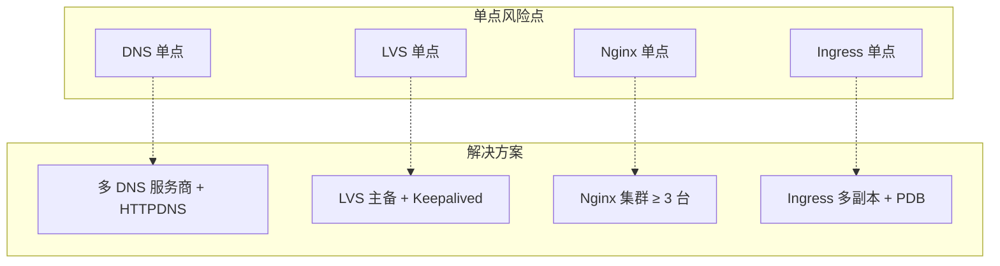

### 4.2 故障隔离

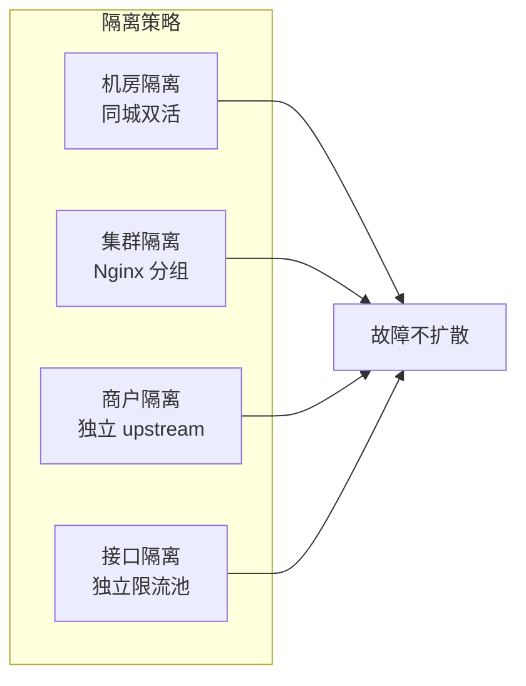

### 4.3 健康检查与自动摘除

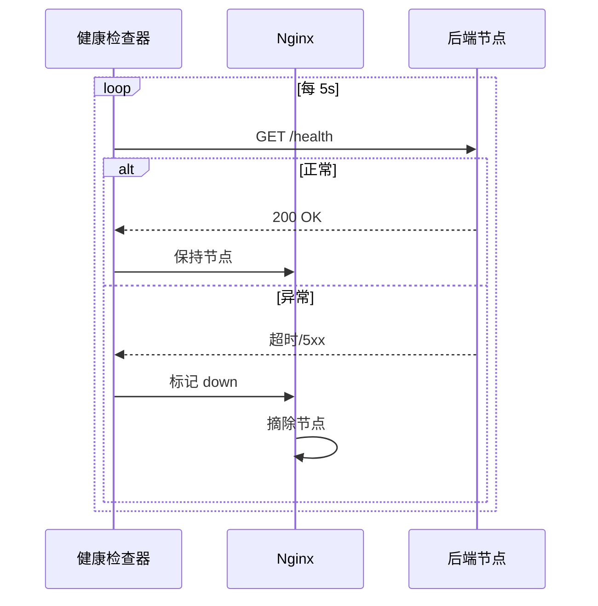

**Nginx 主动健康检查**（开源版需 `nginx_upstream_check_module` 或 `OpenResty`）：

```nginx
upstream pay_backend {
    server 10.0.1.10:8080;
    server 10.0.1.11:8080;
    check interval=3000 rise=2 fall=3 timeout=1000 type=http;
    check_http_send "GET /health HTTP/1.0\r\n\r\n";
    check_http_expect_alive http_2xx http_3xx;
}
```

---

## 五、可观测性埋点

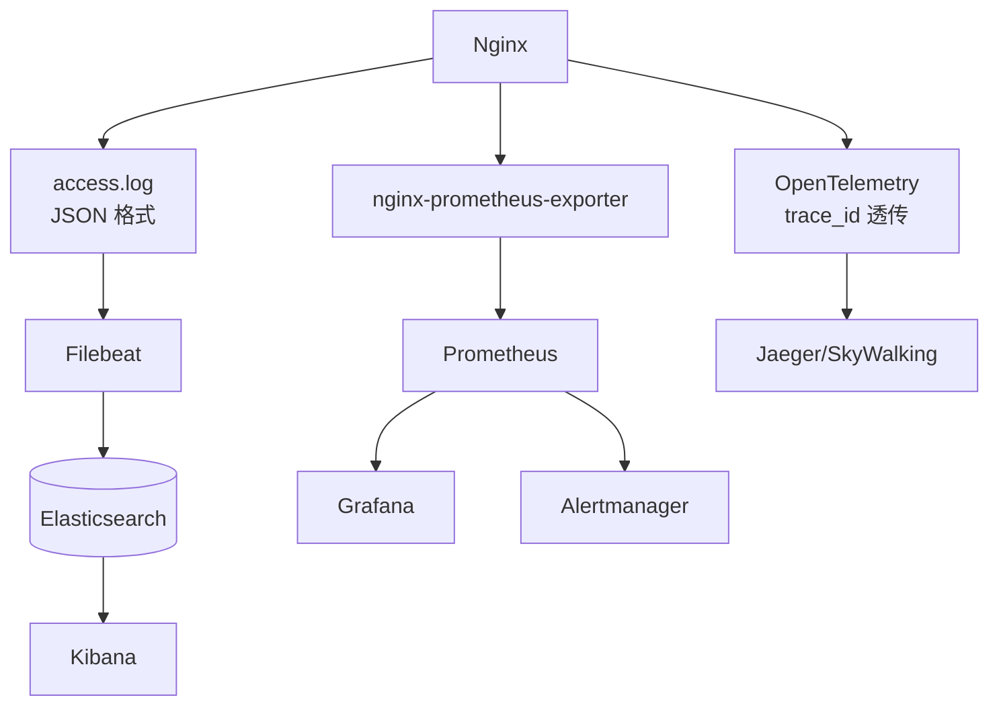

**关键埋点字段**：

| 字段 | 用途 |
|------|------|
| `request_id` | 全链路追踪 |
| `upstream_addr` | 定位后端节点 |
| `upstream_response_time` | 后端耗时 |
| `request_time` | 总耗时 |
| `merchant_id` | 商户维度分析 |
| `status` | 成功率统计 |

**Nginx JSON 日志**：

```nginx
log_format pay_json escape=json '{
  "time":"$time_iso8601",
  "request_id":"$request_id",
  "remote_addr":"$remote_addr",
  "method":"$request_method",
  "uri":"$request_uri",
  "status":$status,
  "request_time":$request_time,
  "upstream_addr":"$upstream_addr",
  "upstream_time":"$upstream_response_time",
  "merchant_id":"$http_x_merchant_id",
  "body_bytes":$body_bytes_sent
}';

access_log /var/log/nginx/pay.log pay_json;
```

---

## 六、支付场景特有的接入层设计

### 6.1 验签与防重放

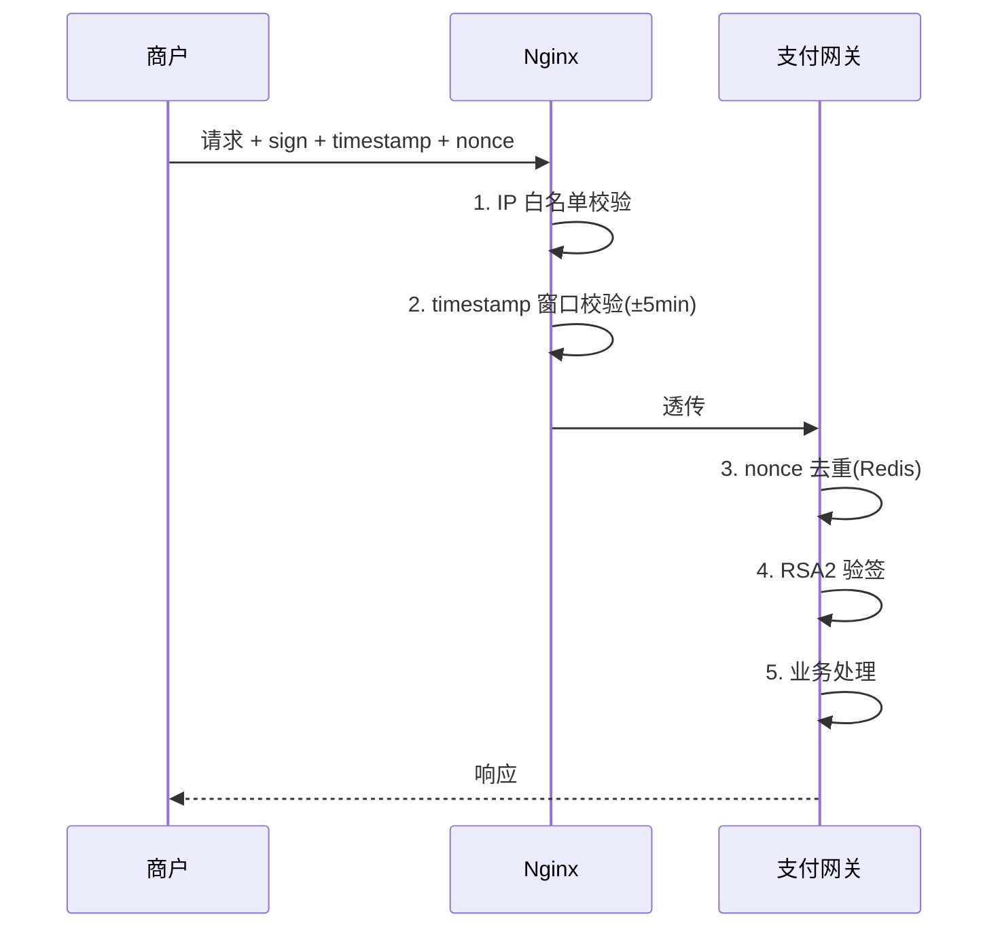

> [!warning] 关键点
> - **验签在网关层做**，Nginx 只做粗粒度校验（IP、时间戳）
> - **nonce 存储**：Redis `SETNX` + TTL 10min
> - **签名算法**：RSA2（非对称）优于 MD5（对称）

### 6.2 商户隔离

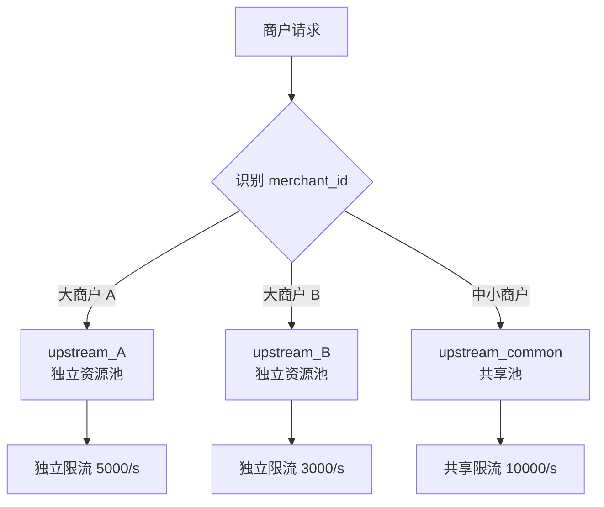

### 6.3 回调通知入口

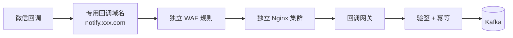

> [!tip] 为什么回调要独立入口？
> - 回调流量特征与用户流量不同（突发、来源固定）
> - 独立入口可单独限流、单独扩容
> - 避免被用户流量挤占，导致回调延迟 → 商户投诉

---

## 七、容量与性能

### 7.1 Nginx 性能调优

```nginx
worker_processes auto;              # = CPU 核数
worker_rlimit_nofile 100000;        # 文件描述符

events {
    worker_connections 10000;       # 单 worker 连接数
    use epoll;                      # Linux 高效模型
    multi_accept on;
}

http {
    keepalive_timeout 65;
    keepalive_requests 1000;
    client_max_body_size 10m;
    client_body_buffer_size 128k;

    # 开启高效传输
    sendfile on;
    tcp_nopush on;
    tcp_nodelay on;

    # 连接池
    upstream pay_backend {
        keepalive 200;
        keepalive_requests 1000;
        keepalive_timeout 60s;
    }
}
```

### 7.2 容量估算

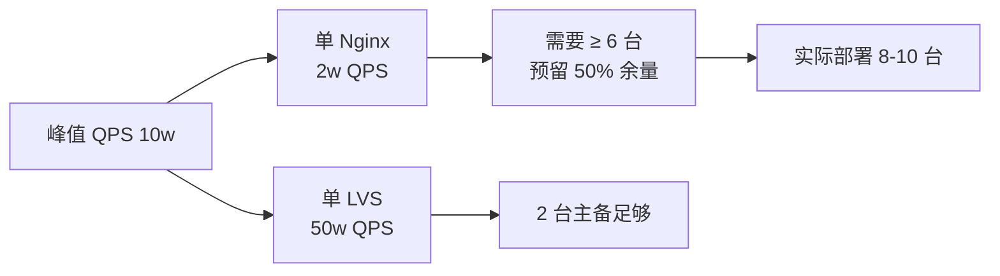

| 组件 | 单机能力 | 部署建议 |
|------|----------|----------|
| Nginx | 2-5w QPS | ≥ 3 台，N+2 |
| LVS | 50w QPS | 2 台主备 |
| WAF | 视厂商 | 云 WAF 或硬件 |
| Ingress | 1-2w QPS | ≥ 3 副本 |

---

## 八、部署架构总览

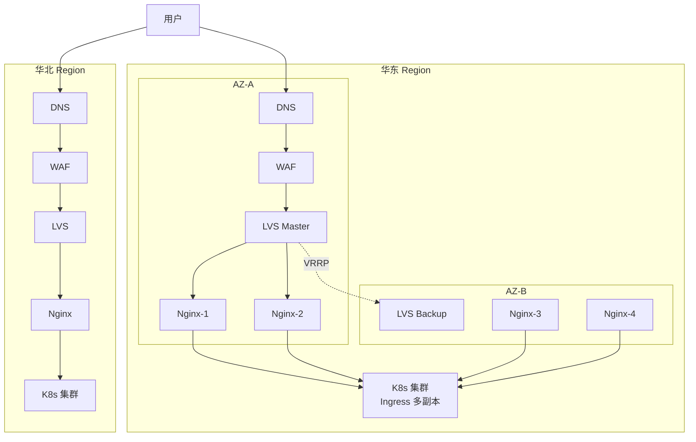

---

## 九、接入层 Checklist

> [!check] 上线前必查
> - [ ] DNS 多服务商 + TTL ≤ 60s
> - [ ] CDN 动态接口已 bypass
> - [ ] WAF 规则已覆盖 OWASP Top 10
> - [ ] LVS 主备 + VRRP 心跳正常
> - [ ] Nginx ≥ 3 台，跨 AZ 部署
> - [ ] 限流配置：IP + 商户 + 接口三维度
> - [ ] SSL 证书自动续期
> - [ ] 健康检查 + 自动摘除
> - [ ] JSON 日志 + trace_id 透传
> - [ ] 验签 + 防重放已启用
> - [ ] 回调独立入口
> - [ ] 压测报告：单机 2w QPS 达标
> - [ ] 故障演练：摘除任一 Nginx 无感知

---

## 十、常见故障与应对

```mermaid
flowchart TB
    subgraph Fault["常见故障"]
        F1[Nginx 单点挂]
        F2[LVS 脑裂]
        F3[证书过期]
        F4[CC 攻击]
        F5[后端全挂]
        F6[DNS 污染]
    end

    subgraph Fix["应对"]
        R1[多副本 + 自动摘除]
        R2[Keepalived 单播 + 仲裁]
        R3[自动续期 + 监控告警]
        R4[WAF + 限流 + 人机]
        R5[降级页 + 熔断]
        R6[HTTPDNS + 多服务商]
    end

    F1 --> R1
    F2 --> R2
    F3 --> R3
    F4 --> R4
    F5 --> R5
    F6 --> R6
```

---

> [!tip] 下一步深入方向
> 接入层讲完后，可以继续展开：
> - **K8s 服务层设计**（Deployment、HPA、Service Mesh）
> - **支付订单服务设计**（状态机、分库分表）
> - **账务核心设计**（TCC、热点账户、余额快照）
> - **清结算系统**（T+1、分账、计费）
> - **对账系统**（渠道对账、差错处理）
> - **风控引擎**（规则引擎、实时决策）
>
> 告诉我下一个主题，我继续用同样的 Obsidian + Mermaid 风格输出。