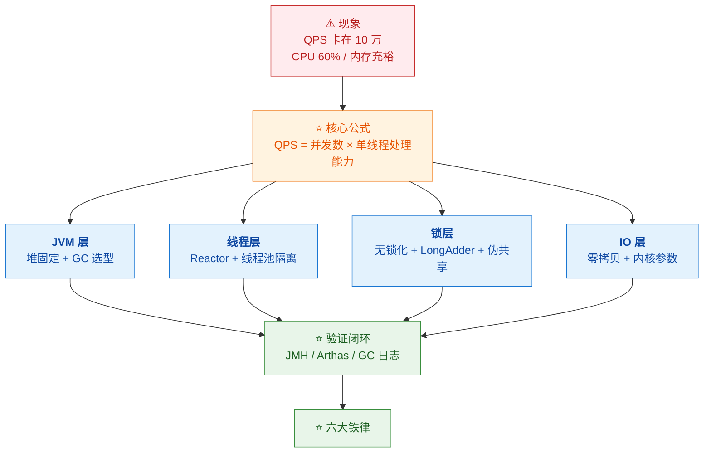
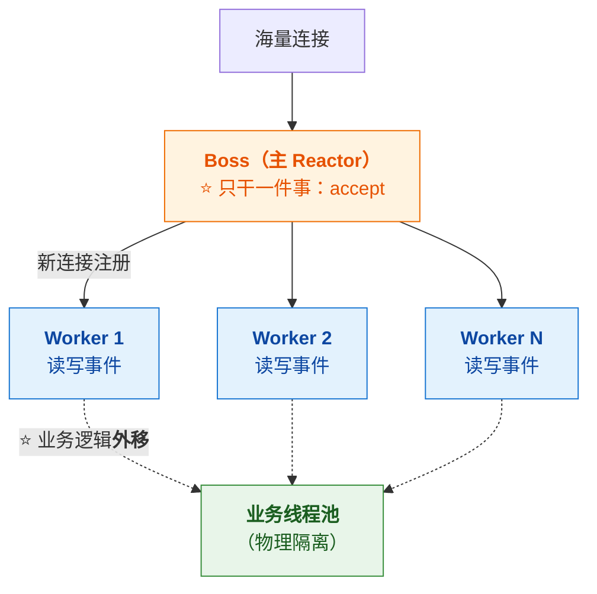
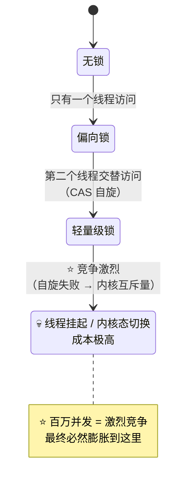
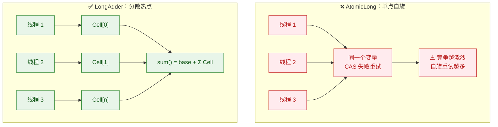
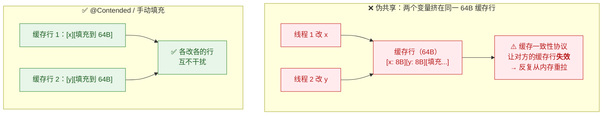
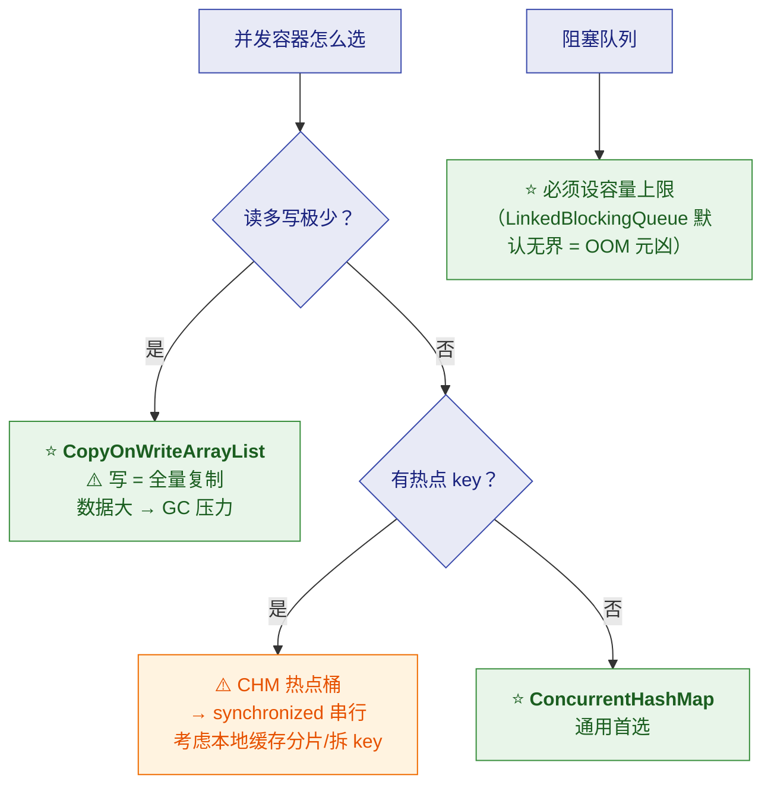
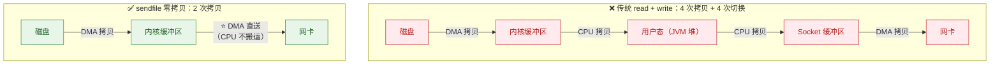
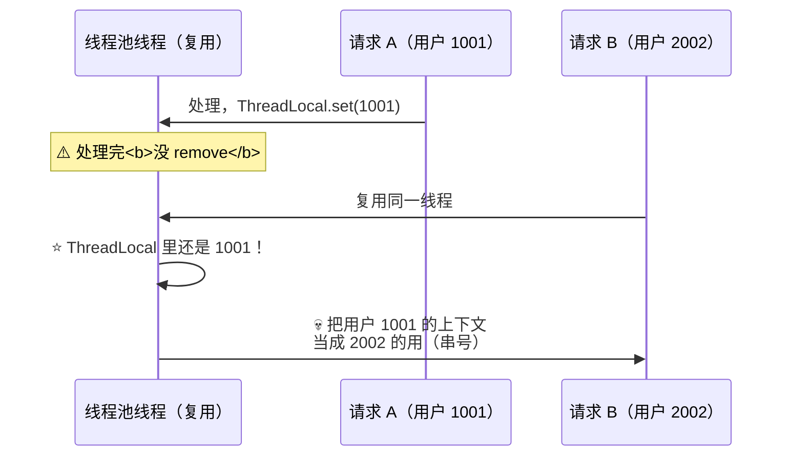
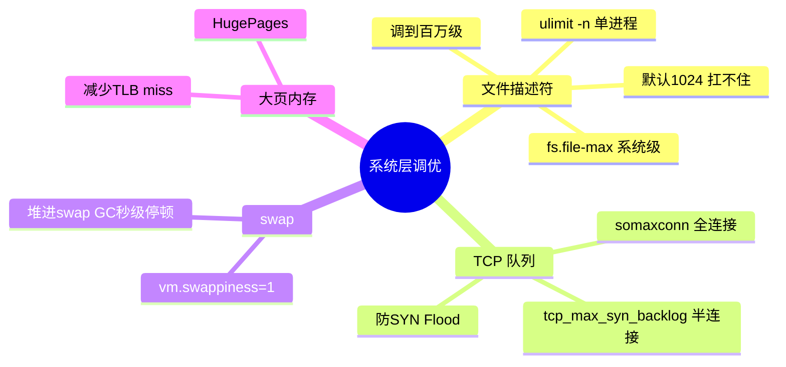
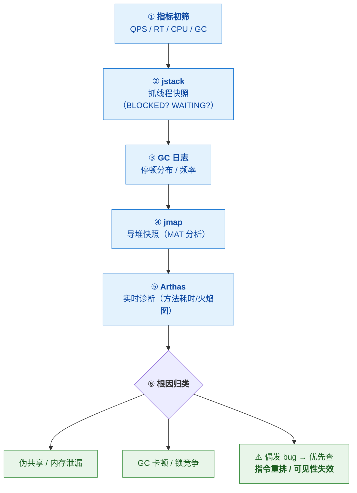

# 🔬 QPS 卡在 10 万？Java 单机百万调优全流程（详细整理版）

> 本篇是对 [B 站视频《QPS卡在10万？拆解Java单机百万调优全流程，从JVM到Linux内核硬核突围！》](https://www.bilibili.com/video/BV1LvNt6DEHf/)（约 8 分钟）的**逐段深度整理**。
> 视频从一个经典的压测现象切入——**CPU 才 60%、内存充裕，QPS 却死活卡在 10 万**——
> 然后沿着 **核心公式 → JVM 层（堆/GC）→ 线程层（Reactor）→ 锁层（锁升级/LongAdder/伪共享）→ 容器选型 → IO 层（零拷贝/内核参数）→ ThreadLocal 两颗雷 → 系统层（fd/swap/大页）→ 验证闭环** 一路打通，最后收到**六大铁律**。
> （本稿 ASR 错误**极多**——Netty 被识别成"NATALIE"、ZGC 被识别成"CGC/zDC/ZTC"、
> ThreadLocal 被识别成"fat local"、ulimit 被识别成"UNLIMITN"，**勘误表是全系列最长的一篇**，见 [附录 A](#附录-a语音转写asr勘误对照)）
>
> **定位**：这是一条**从 JVM 到 Linux 内核的"单机调优"主线**。
> 机制细节由各专题系列承担：
> JVM → [[1-java/4-jvm/0-JVM总览|JVM 总览]]、[[1-java/4-jvm/2-GC机制深度|GC 机制深度]]、[[1-java/4-jvm/6-JVM参数与调优实战|JVM 参数实战]]、[[1-java/4-jvm/7-JVM故障排查实战|JVM 故障排查实战]]；
> 线程与锁 → [[1-java/1-juc/4-多线程与内存模型|多线程与内存模型]]、[[1-java/1-juc/6-JUC并发工具|JUC 并发工具]]；
> IO → [[1-java/3-IO/3-IO与网络编程|IO 与网络编程]]（Reactor/零拷贝原理）；
> 容器 → [[1-java/2-collection/5-并发容器专题|并发容器专题]]。
>
> 原始字幕稿：[[1-QPS卡在10万？拆解Java单机百万调优全流程，从JVM到Linux内核硬核突围！]]。
> 相关：[[高并发系统设计（详细整理版）]]（架构层）、[[50万QPS实时推荐 延迟从小时压到毫秒（详细整理版）]]（链路层）。

---

## 〇、本篇地图与核心公式



### 0.1 ⭐⭐ 核心公式（Little's Law，全篇的总纲）

> 视频原话："**单机百万并发的核心公式就这一个：
> QPS = 并发数 × 单线程处理能力。
> 线程数受上下文切换成本限制，单线程能力又卡在 IO 阻塞和 GC 停顿上。
> 想破百万，得从 JVM、线程、锁、IO 四层一起动刀。**"

$$QPS = 线程数 \times \frac{1000ms}{单请求耗时(ms)}$$

**用数字感受这个公式的残酷**（以 RT = 10ms 为例）：

| 线程数 | 理论 QPS | 现实约束 |
|---|---|---|
| 200 | 2 万 | ✅ 正常 |
| 2,000 | 20 万 | ⚠️ **上下文切换开销剧增** |
| 10,000 | 100 万 | ❌ **线程栈内存 ~10GB + 切换把 CPU 吃光** |

> [!important] ⭐⭐ 公式读出的两条路（也是全篇的结构）
> | 杠杆 | 受什么限制 | 怎么突破 |
> |---|---|---|
> | **↑ 线程数** | ⚠️ **上下文切换 + 内存**（不能无限加） | **Reactor 少线程扛多连接**（§三） |
> | **↑ 单线程能力** | ⭐ **IO 阻塞 + GC 停顿 + 锁竞争** | **堆/GC（§二）+ 无锁化（§四）+ 零拷贝（§六）** |
>
> 👉 **"10 万到百万不是差一个零，是从能用到精通的鸿沟"**——
> **因为突破靠的不是"调一个参数"，而是四层同时动刀。**

### 0.2 ⭐ 先回答开场问题：CPU 60% 为什么就卡了

> 视频原话："**CPU 才用了 60%，内存也充裕，这瓶颈到底卡在哪了？——瓶颈是 IO。**"

> [!important] ⭐ "资源不满"本身就是诊断信号
> **CPU/内存没满却上不去 QPS，说明线程不是在"算"，而是在"等"**：
>
> | 在等什么 | 表现 |
> |---|---|
> | ⭐ **等磁盘/网络 IO** | CPU 空闲，线程 BLOCKED/WAITING |
> | **等锁** | jstack 里大量 BLOCKED on monitor |
> | **等 GC** | CPU 忽高忽低，GC 日志有长停顿 |
> | **等下游** | 级联慢（见 [[高并发系统设计（详细整理版）]] §七） |
>
> 👉 **"资源不满"≠"没有瓶颈"——真正的瓶颈在"等待"，不在"计算"。**
> **这也是六步排查链路（§九）的出发点。**

---

## 一、JVM 层：堆与 GC（第一刀）

### 1.1 百万并发下 GC 为什么是头号敌人

> 视频原话："**高并发场景下，伊甸区就像早高峰的地铁站，对象潮水般涌进来。
> 如果新生代配小了，Minor GC 会频繁触发 STW 停顿，直接吃掉你的 QPS。**"


> [!success] ⭐ 视频这个数字值得心算一遍
> **10 万 QPS × 200ms 停顿 = 2 万个请求在同一瞬间被冻结**——
> **而且它们全部同时恢复，形成"二次洪峰"**（雪上加霜）。
>
> 👉 **GC 停顿的危害是"平方级"的**：**停顿本身 + 恢复时的瞬时洪峰**。
> **所以百万并发的 GC 目标不是"停顿短一点"，而是"业务感知不到"。**

### 1.2 第一刀：固定堆大小 + 新生代配比

> 视频原话："**第一刀：固定堆大小，消除扩容开销；新生代占比调到 30% 至 40%。**"

| 参数 | 建议 | 为什么 |
|---|---|---|
| ⭐ **`-Xms` = `-Xmx`** | **堆固定** | **动态伸缩（扩容/收缩）会触发 Full GC + 抖动**——**"高并发抖动的元凶"**（视频原话） |
| **新生代 30%~40%** | 经验值 | **配大新生代 → Minor GC 频率下降**（对象朝生夕死时收益最大） |

> [!warning] ⚠️ 两个必须补的边界（视频没讲）
> **① "新生代 30%~40%" 是经验值，不是定律**——
> **G1 默认会自动调新生代比例**（`G1NewSizePercent`~`G1MaxNewSizePercent`）来满足停顿目标；
> **手动固定适合"分配率稳定、追求确定性"的场景**，**对象存活率高（缓存类服务）时反而要小新生代**。
>
> **② 堆"固定"≠堆"越大越好"**——
> **堆越大 → GC 一次扫的堆越大 → 单次停顿可能更长**（除非用并发收集器）。
> **这对应六大铁律第 1 条："堆不是越大越好，配比合理才关键"。**

### 1.3 ⭐⭐ GC 收敛器选型：G1 vs ZGC

> 视频原话："**JDK8 用 G1，JDK11+ 直接上 ZGC。
> G1 能把 STW 压到 200ms 内，但 ZGC 是亚毫秒级。
> 百万并发下一次 200ms 的停顿，就意味着几万请求卡死；
> ZGC 的并发标记、并发转移，几乎让业务感知不到 GC 存在。**"

| | **G1** | ⭐ **ZGC** |
|---|---|---|
| 停顿 | **百毫秒级**（目标可控，如 200ms） | ⭐ **亚毫秒级（< 1ms）** |
| 原理 | 分 Region、并发标记、** Mixed GC 增量回收** | **并发标记 + ⭐ 并发转移**（读屏障） |
| 堆规模 | 数十 GB 级 | ⭐ **TB 级也能保持停顿** |
| 可用性 | **JDK 9+ 默认** | **JDK 11 实验性 → JDK 15 转正** |
| 吞吐 | 略高（不做并发转移） | ⚠️ 略低（并发转移占 CPU，吞吐换延迟） |
| 适用 | 一般服务 | ⭐ **百万并发 / 大堆 / 低延迟要求** |

> [!danger] ⚠️ 视频的三个技术细节需要订正（按订正后的记）
> **① "JDK8 用 G1"不准确**——**JDK 8 的默认收集器是 Parallel GC**，
> G1 在 JDK 8 只是**可选**；**JDK 9+ 才默认 G1**。
>
> **② ZGC 停顿是"亚毫秒级"**（视频说的"10ms 以内"是它早期的设计目标，
> JDK 16+ 实际停顿 < 1ms）。
>
> **③ ZGC 从 JDK 15 起才是生产可用**（JDK 11 只是实验性）；
> **JDK 21 引入分代 ZGC**（JEP 439，视频结尾说的"分带 CDC"就是它）——
> **分代后吞吐接近 G1，是当前百万并发的推荐组合**。
>
> 👉 **详细机制见 [[1-java/4-jvm/深入理解JVM GC：G1与ZGC实战（详细整理版）]]、[[1-java/4-jvm/2-GC机制深度|GC 机制深度]]。**

### 1.4 ⭐ 参数口诀（视频原话）

> 视频原话："**记住口诀：堆大小固定（`-Xms` = `-Xmx`）、目标停顿设 10ms、
> 并发线程数适配 CPU 核数。千万别让堆动态伸缩——那是高并发抖动的元凶。**"

```bash
# 百万并发参考起点（ZGC，JDK 17/21）
-Xms32g -Xmx32g \                        # ⭐ 堆固定
-XX:+UseZGC \
-XX:ConcGCThreads=4 \                    # 并发线程适配核数
-XX:+ZGenerational \                     # JDK21 分代 ZGC
-Xlog:gc*:file=gc.log:time,uptime:filecount=5,filesize=50m   # ⭐ GC 日志必开
```

> [!note] 说明
> **"目标停顿 10ms" 是 G1 的参数思路**（`-XX:MaxGCPauseMillis`）——
> **ZGC 没有这个参数**（它自己把停顿做到亚毫秒）。
> **视频把两代收集器的口诀合在一起说了，实际按所选收集器区分。**

---

## 二、线程层：Reactor 模型（第二刀）

> 视频原话："**线程模型我听过 Reactor，但 Netty 怎么落地？
> Netty 的主从多 Reactor 就是百万并发的标配——
> Boss 线程只干一件事：accept 连接；Worker 线程池处理读写。**"

### 2.1 主从 Reactor 结构



| 角色 | 线程数 | 职责 |
|---|---|---|
| **Boss（主 Reactor）** | ⭐ **1 个就够** | **只 accept**（新连接） |
| **Worker（从 Reactor）** | ⭐ **CPU 核数 × 2**（Netty 默认值） | **读写事件 + 编解码** |
| ⭐ **业务线程池** | 按业务评估 | **业务逻辑**（**必须与 IO 线程隔离**） |

### 2.2 ⭐⭐ "别把业务逻辑塞进 IO 线程"（高频实战坑）

> 视频原话："**千万别把业务逻辑塞到 IO 线程里，那会阻塞整个 Worker，
> 并发量直接腰斩。业务逻辑放哪？另起业务线程池，和 IO 线程隔离——
> 物理隔离、连接池隔离、线程池隔离，这是高并发铁律。**"

> [!danger] ⚠️ 为什么这一条能"腰斩"并发
> **一个 Worker（EventLoop）负责成百上千个连接的读写**——
> **如果在其中执行耗时业务（查库/远程调用）**：
> **该 Worker 上的**所有**连接都无法处理读写**（事件循环被卡住）。
>
> 👉 **这不是"慢一点"，而是"一个 Worker 上的全部连接一起停摆"。**
>
> ⭐ **这也与 [[高并发系统设计（详细整理版）]] 的"舱壁隔离"同源**——
> **隔离是一切高并发的底线**（视频原话）。
> **Reactor 原理详见 [[1-java/3-IO/3-IO与网络编程]]、[[1-java/1-juc/5-线程池|线程池]]。**

---

## 三、锁层：锁升级、LongAdder 与伪共享（第三刀）

### 3.1 ⭐ synchronized 在百万并发下还能用吗

> 视频原话："**JDK1.6 之后 synchronized 会自动升级：无锁→偏向锁→轻量级锁→重量级锁。
> 低竞争时性能不错，但百万并发意味着激烈竞争，最终一定会膨胀为重量级锁——
> 线程挂起、内核切换，成本极高。**"



> [!warning] ⚠️ 两个必须更新的知识（视频没讲）
> **① 偏向锁已被废弃**——**JDK 15 起默认禁用并标记废弃（JEP 374），后续版本移除**——
> **因为它在多核高并发下收益为负**（撤销成本高）。**背"四级升级"时加上这个时效性，是加分项。**
>
> **② 结论不是"禁用 synchronized"**，而是：
> **"高竞争的热点路径要设计成无锁/细粒度"**——
> **低竞争场景 synchronized 反而最快**（JVM 持续优化过）。
> **锁升级机制详见 [[1-java/1-juc/4-多线程与内存模型]]。**

### 3.2 ⭐ 计数器：AtomicLong → LongAdder

> 视频原话："**计数器累加统计优先用 LongAdder——
> 它把竞争分散到多个 Cell，最后汇总，
> 比 AtomicLong 的单点自旋 CAS 高效得多。**"



> [!important] ⭐ 一句话记住取舍
> **LongAdder 用"空间（多个 Cell）"换"无竞争"，⭐ 写快、读要汇总（弱一致）**——
> **所以它适合"计数统计"（QPS 统计、指标累加），不适合"要精确读"的场景**。
>
> 👉 **这与 ConcurrentHashMap 的 `CounterCell` 完全同源**（见
> [[1-java/1-juc/了解一下：ConcurrentHashMap（详细整理版）]] §五、[[1-java/1-juc/6-JUC并发工具|JUC 并发工具]]）。

### 3.3 ⭐⭐ 伪共享（False Sharing）：最隐蔽的暗坑

> 视频原话："**CPU 缓存以 64 字节为一个缓存行。两个线程修改同一缓存行里的不同变量，
> 会触发缓存一致性协议频繁刷新，导致 CPU 空转。
> 百万并发下这种损耗能让性能暴跌 30% 至 80%。怎么解决？
> JDK8 用 `@Contended` 注解自动填充缓存行，把变量物理隔离，
> 或者手动填充无意义变量。高并发计数器、状态标记必须做缓存行隔离。**"



| 手段 | 说明 |
|---|---|
| ⭐ **`@Contended`**（JDK 8+） | **JVM 自动在字段前后填充缓存行**；⚠️ **用户类需要 `-XX:-RestrictContended` 才生效** |
| **手动填充** | 字段前后加 7 个 `long` 占位（p1~p7），凑满 64B |
| **适用位置** | ⭐ **高频写的计数器、状态标记、Disruptor 的 RingBuffer 序号** |

> [!important] ⭐ 为什么说它"最隐蔽"
> **伪共享在代码层面完全正确**——**没有锁、没有竞争、逻辑无误**，
> **只是性能莫名差**。**不深入到 CPU 缓存行层面，永远查不出来。**
>
> ⚠️ **"30%~80%" 是特定基准的结果**，**实际取决于"两个热变量的写频率"**——
> **但量级说明问题：这是能排进"性能玄学 top3"的坑。**
> **内存模型与可见性原理见 [[1-java/1-juc/4-多线程与内存模型]]。**

---

## 四、并发容器选型（速查）

> 视频原话："**读多写极少用 CopyOnWriteArrayList——但注意写操作会全量复制数组，
> 数据量大时内存直接翻倍，触发 Young GC 甚至 Full GC。
> 通用读写用 ConcurrentHashMap——但热点 key 会导致哈希冲突退化为单线程串行。**"



| 容器 | 用途 | ⚠️ 坑 |
|---|---|---|
| **CopyOnWriteArrayList** | 读多写极少（监听器/配置） | ⭐ **写全量复制** → 大数据量 GC 压力 |
| ⭐ **ConcurrentHashMap** | 通用读写 | **热点 key 落同一桶 → 桶锁串行** |
| ⭐ **LinkedBlockingQueue** | 生产者-消费者 | ⚠️ **默认无界 → 任务无限堆积 → OOM** |
| ⭐ **原子复合操作** | `get`+`put` 不是原子的 | **必须 `merge` / `computeIfAbsent`** |

> [!success] ⭐ 这一段与已有笔记完全互验
> **COW 的写复制 → [[1-java/2-collection/3-List专题|List 专题]]；
> CHM 桶锁与热点 key → [[1-java/1-juc/了解一下：ConcurrentHashMap（详细整理版）|CHM 整理版]]；
> LinkedBlockingQueue 默认无界 → [[1-java/2-collection/5-并发容器专题|并发容器专题]]；
> 复合操作 → [[高并发系统设计（详细整理版）]] "MQ 三件套/CHM 只保证单方法原子"。**
> **四个来源同一结论——这类"多源互验"的知识可以放心背。**

---

## 五、IO 层：内核参数与零拷贝（第四刀）

### 5.1 内核参数：连接队列

> 视频原话："**单机百万，内核参数必须调：somaxconn 设 65535，让内核连接队列抗住洪水；
> tcp_tw_reuse 开启快速回收 TIME_WAIT 连接。**"

| 参数 | 建议值 | 作用 |
|---|---|---|
| ⭐ **`net.core.somaxconn`** | 65535 | **全连接队列上限**（默认 128，高并发下直接打满丢连接） |
| ⭐ **`net.ipv4.tcp_tw_reuse`** | 1 | **快速复用 TIME_WAIT 端口**（高 QPS 短连接场景端口耗尽） |
| **`net.ipv4.tcp_max_syn_backlog`** | 拉满 | **半连接队列**（防 SYN Flood 打挂，见 §六系统层） |

> [!note] 补充边界
> **`tcp_tw_reuse` 只对"客户端（主动连接方）"生效**，且依赖时间戳（`tcp_timestamps`）——
> **服务端 TIME_WAIT 堆积的根治是"长连接/连接池"，不是调参**。

### 5.2 ⭐⭐ 零拷贝：最狠的一刀

> 视频原话："**最狠的是零拷贝——文件传输不走用户态，
> DMA 直接从内核缓冲区送到网卡，CPU 不参与数据搬运。
> Netty 的 FileRegion 封装了 transferTo，一行代码就能触发 sendfile。**"



> [!important] ⭐ 订正一个说法
> **零拷贝省的不是"网络带宽"，而是 ⭐ CPU 与内存拷贝带宽**——
> **少 2 次拷贝 + 少 2 次上下文切换**，**CPU 才能腾出来做业务**。
> **视频说"带宽省 80%""CPU 90%→45%"**——**后者这类实测数字高度依赖场景（大文件、高吞吐传输），
> 量级可信、数字别背**。
>
> **`O_DIRECT` 绕过 page cache 的边界**：**适合"一次性大文件/应用自管缓存"（如数据库）；
> 如果数据会被反复读，绕过 page cache 反而更慢。**
>
> 👉 **四种零拷贝方案（mmap/sendfile/transferTo/DirectBuffer）的完整对比，
> 见 [[1-java/3-IO/3-IO与网络编程]] §七。**

---

## 六、⭐ ThreadLocal：两颗隐蔽的雷

> 视频原话："**线程池场景下，ThreadLocal 是内存泄漏的重灾区——
> 线程复用数据不清理，上一次请求的 userId、token 会串到下一次请求，
> 引发上下文错乱甚至 OOM。怎么防？
> 所有外部接口、异步任务必须在 finally 块里执行 remove；
> 框架层用拦截器统一兜底。**"

### 6.1 雷一：线程复用 → 数据串号



> [!danger] ⚠️ 两层危害
> **① 串数据**（比泄漏更严重）：**用户 A 的 token/权限串到用户 B 的请求** → **越权事故**。
> **② 内存泄漏**：**线程池里的线程永不死亡**，**ThreadLocalMap 的 Entry 一直持有对象**；
> **key 是弱引用会被回收，value 不会** → **`value` 泄漏**。
>
> **标准姿势**：
> ```java
> try {
>     threadLocal.set(ctx);
>     doBusiness();
> } finally {
>     threadLocal.remove();   // ⭐ 必须在 finally
> }
> ```
> **框架层用拦截器/过滤器统一 remove 兜底**（防漏写）。

### 6.2 ⭐ 雷二：异步线程池上下文丢失

> 视频原话："**还有异步线程池上下文传递会丢失，用 TransmittableThreadLocal（TTL）解决。**"

| 场景 | 问题 | 解法 |
|---|---|---|
| **同步调用** | ThreadLocal 正常 | —— |
| ⭐ **线程池异步** | **子线程读不到主线程的 ThreadLocal** | **InheritableThreadLocal（仅"新建线程"时继承）** |
| ⭐⭐ **线程复用 + 异步** | **Inheritable 也会失效/串号**（线程是复用的，不是新建的） | ⭐ **TransmittableThreadLocal（TTL）+ TtlRunnable 包装** |

> [!important] ⭐ 三者的关系（一句话）
> **ThreadLocal 管"本线程"；InheritableThreadLocal 管"新建的子线程"；
> ⭐ TTL 管"线程池里被复用的线程"**——
> **它们解决的问题逐层递进，选错一个就串号。**
>
> 👉 **"百万并发下最容易被忽略的隐蔽炸弹"（视频原话）——
> 深入见 [[1-java/1-juc/4-多线程与内存模型]]。**

---

## 七、系统层：文件描述符、swap 与大页

> 视频原话："**JVM 和代码都调了，系统层还要动——
> 百万并发，文件描述符先给你卡死。默认 1024，连 1 万并发都扛不住。**"



| 项 | 默认 | 建议 | 为什么 |
|---|---|---|---|
| ⭐ **`ulimit -n`（单进程 fd）** | 1024 | **百万级**（或 ≥ 65535） | **每连接一个 fd，1024 连 1 万并发都扛不住** |
| **`fs.file-max`（系统级）** | 因机器而异 | 百万级 | **全系统 fd 总量** |
| ⭐ **`vm.swappiness`** | 60 | ⭐ **1** | **Java 堆一旦被换出到 swap，GC 触碰内存页 → 页错误 → 停顿从毫秒级变秒级** |
| **HugePages** | 关 | 视场景开启 | **大页减少页表项 → TLB miss 下降 → 访存效率提升**（视频称 30%，**场景相关**） |

> [!warning] ⚠️ 订正一个说法："swappiness 设 1 禁止 swap"
> **`vm.swappiness=1` 不是"禁止"，是"几乎不用"**（仅快 OOM 时才换出）——
> **真正的"禁止"是 `swapoff -a`**。
> ⚠️ **也别设成 0**：0 在老内核语义激进，可能内存压力下直接 OOM kill；
> **数据库/Java 大堆服务的常见实践就是 1**。

---

## 八、⭐ 验证闭环：调优靠数据，不靠玄学

> 视频原话："**凭感觉绝对不行，调优是数据驱动的闭环——
> 先用 JMH 做微基准测试，确定优化真的有收益；
> 上线后用 Arthas 实时看线程状态、方法耗时、GC 情况；
> GC 日志必须开，用 GCViewer 分析停顿时间分布。**"

### 8.1 三件验证工具

| 工具 | 验证什么 | 关键点 |
|---|---|---|
| ⭐ **JMH** | **微基准**（某段代码/某个改动的收益） | **防 JIT 优化干扰**（预热、死代码消除）——**"快了"必须先过 JMH** |
| ⭐ **Arthas** | **线上实时诊断**（线程/方法耗时/火焰图） | **不停机 attach** |
| ⭐ **GC 日志 + GCViewer** | **停顿时间分布/频率** | **必须常开**（事故后没法补录） |

### 8.2 ⭐⭐ 六步排查链路（固定套路）

> 视频原话："**有没有标准排查流程？六步固定链路：
> ① 指标监控初筛（QPS/RT/CPU/GC）→ ② jstack 抓线程快照 →
> ③ GC 日志分析 → ④ jmap 导堆快照 → ⑤ Arthas 实时诊断 → ⑥ 根因归类。**"



> [!important] ⭐ "偶发 bug 优先查指令重排/可见性"这条很有含金量
> **偶发、难复现的问题**，**十有八九与"并发可见性"有关**：
> **没 volatile 的状态标记、DCL 没加 volatile、伪共享导致的状态延迟可见**——
> **这类问题在压测/大促的高并发下被"放大成必然"**。
> **happens-before 原理见 [[1-java/1-juc/4-多线程与内存模型]]；排查实战见 [[1-java/4-jvm/7-JVM故障排查实战]]。**

---

## 九、⭐⭐ 四层总结与六大铁律

> 视频原话："**从 10 万到百万，不是改一两个参数，而是——
> JVM 层（ZGC+堆固定）、线程层（Reactor）、锁层（LongAdder+无锁化）、
> IO 层（零拷贝+内核调优）的系统性工程。每一层都有坑，但每一层都有解。**"

| 层 | 动作 | 关键参数/手段 |
|---|---|---|
| **JVM 层** | 堆固定 + 低延迟 GC | `-Xms=-Xmx`、**ZGC**、GC 日志常开 |
| **线程层** | Reactor + 隔离 | Boss=1、Worker=核×2、⭐ **业务逻辑外移** |
| **锁层** | 无锁化 + 缓存行隔离 | **LongAdder**、`@Contended`、细粒度锁 |
| **IO 层** | 零拷贝 + 内核 | **sendfile/FileRegion**、somaxconn、tcp_tw_reuse |
| **系统层** | fd/swap/大页 | **ulimit 百万级**、swappiness=1、HugePages |

### 9.1 ⭐ 五条心法（视频原话）

> 视频原话："**最关键的收获：先监控再调优；先升级 JDK 再调参数；
> 无锁优于加锁；局部优于全局；隔离是一切高并发的底线。**"

| 心法 | 为什么 |
|---|---|
| ⭐ **先监控再调优** | **没有数据就没有"优化"——只有"碰运气"** |
| ⭐ **先升级 JDK 再调参数** | **ZGC/虚拟线程这类"版本红利"远大于抠参数** |
| ⭐ **无锁优于加锁** | **锁是"并行变串行"的开关**（§三） |
| **局部优于全局** | **锁的范围越小越好**（方法级 < 对象级 < 字段级/分段） |
| ⭐⭐ **隔离是底线** | **线程池/连接池/舱壁隔离**（呼应 [[高并发系统设计（详细整理版）]] §七） |

### 9.2 ⭐⭐ 六大铁律（Checklist）

> 视频原话："**六大铁律刻进 DNA：**"

| ✅ | # | 铁律 | 对应 |
|---|---|---|---|
| [ ] | 1 | **堆不是越大越好，配比合理才关键** | §一 |
| [ ] | 2 | ⭐ **别信默认参数：固定堆 + ZGC 是底线** | §一 |
| [ ] | 3 | ⭐ **线程池必须隔离，核心/非核心不能混用** | §二 |
| [ ] | 4 | **高并发计数器必防伪共享** | §三 |
| [ ] | 5 | ⭐ **ThreadLocal 用必清理（finally remove）** | §六 |
| [ ] | 6 | ⭐⭐ **调优靠数据，不靠玄学** | §八 |

> [!success] ⭐ 结尾的三条展望（视频原话）
> **"调优是一场没有终点的修行——业务在变，流量在变，JDK 也在进化：
> Java 21 的虚拟线程、分代 ZGC，又给了单机百万新的可能性。"**
>
> 👉 **虚拟线程正是"换杠杆"的典型**：**不再靠"加线程数"扛并发**，
> **详见 [[1-java/1-juc/虚拟线程-java（详细整理版）]]。**

---

## 附录 A：语音转写（ASR）勘误对照

> 本稿是**全系列 ASR 质量最差的一篇**——**技术名词大面积损坏**。
> **不对照此表，多处完全无法读懂。**

| 原稿（错） | 正确 | 位置 |
|---|---|---|
| ⭐ **NATALIE / NT** | ⭐ **Netty** | "现成模型我听过 reactor，但 NATALIE 怎么落地" |
| ⭐ **CGC / z DC / ZTC / CDC** | ⭐ **ZGC** | 全文多处（最致命） |
| ⭐ **fat local** | ⭐ **ThreadLocal** | "fat local 是内存泄漏的重灾区" |
| ⭐ **UNLIMITN** | ⭐ **ulimit -n** | "UNLIMITN 和 fs file max" |
| ⭐ **XMX等于XMX** | ⭐ **`-Xms` = `-Xmx`**（堆固定） | 参数口诀 |
| ⭐ **K原子类** | **CAS 原子类（AtomicLong）** | "计数器累加优先用 LongAdder" |
| **atomic integer的单依靠自旋** | **AtomicLong 的单点自旋 CAS** | LongAdder 对比 |
| ⭐ **at contended** | ⭐ **`@Contended`** | 伪共享注解 |
| ⭐ **髻束器** | **计数器** | "高并发计数器状态标记必须做缓存行隔离" |
| ⭐ **缓存型** | **缓存行（cache line）** | 全文多处 |
| **copy on write release** | ⭐ **CopyOnWriteArrayList** | 容器选型 |
| **four gc** | **Full GC** | "触发 young gc 甚至 full gc" |
| **Link blocking q** | **LinkedBlockingQueue** | 阻塞队列 |
| **computive absent** | ⭐ **computeIfAbsent** | 原子复合方法 |
| ⭐ **so max gun / 搜max杠** | ⭐ **somaxconn** | 内核参数 |
| **TCP下划线 TW下划线 reuse** | **`tcp_tw_reuse`** | TIME_WAIT 复用 |
| **time下划线 weight** | **TIME_WAIT** | —— |
| **TCP下划线 max下划线 sin下划线 Backlog** | ⭐ **`tcp_max_syn_backlog`** | 半连接队列 |
| **file region** | **FileRegion** | Netty 零拷贝 API |
| **transfer to** | **transferTo** | —— |
| **O下划线direct** | **`O_DIRECT`** | 绕过 page cache |
| **page cash** | **page cache** | —— |
| **transmitable threat local ttl** | ⭐ **TransmittableThreadLocal（TTL）** | 异步上下文 |
| **异布线城池** | **异步线程池** | "异步线程池上下文传递会丢失" |
| **现成**（多处） | **线程** | 全文多处 |
| **所竞争 / 枷锁** | **锁竞争 / 加锁** | —— |
| **无所化** | **无锁化** | 六大铁律 |
| **伊甸区** | **Eden 区** | 堆内存 |
| **six部固定电路** | ⭐ **六步固定链路** | 排查流程 |
| **RTCPUGC** | **RT、CPU、GC** | 指标初筛 |
| **jz stack / j map** | **jstack / jmap** | 排查工具 |
| **DC情况** | **GC 情况** | Arthas |
| **gc viewer** | **GCViewer** | GC 日志分析 |
| **ARTHAS** | **Arthas** | —— |
| **vm swap iness设一** | ⭐ **`vm.swappiness=1`** | swap 调优 |
| **分带CDC** | ⭐ **分代 ZGC** | JDK 21（JEP 439） |
| **JDK8用G1** | ⚠️ **订正：JDK8 默认是 Parallel GC，G1 是可选；JDK9+ 才默认 G1** | 见 §1.3 |
| **ZGC 亚毫秒级10ms以内** | ⚠️ **订正：亚毫秒级（<1ms）；10ms 是早期设计目标** | 见 §1.3 |
| **SO上有bug** | —— | —— |
| **大素食** | **大促时** | ——（本稿无此句，忽略） |

---

## 附录 B：30 秒速查

> [!abstract] 记住这 15 句
> 1. ⭐ **CPU/内存没满却卡 QPS = 瓶颈在"等待"**（IO/锁/GC/下游），不在"计算"。
> 2. ⭐⭐ **核心公式：QPS = 线程数 × (1000/RT)**——两条杠杆：少线程多连接（Reactor）、降 RT。
> 3. ⭐ **第一刀固定堆：`-Xms = -Xmx`**——动态伸缩是"高并发抖动的元凶"。
> 4. ⭐ **GC 选型：JDK9+ 默认 G1（百毫秒级）；百万并发上 ZGC（亚毫秒级，JDK15+ 生产可用）**。
> 5. ⭐ **心算：10 万 QPS × 200ms 停顿 = 2 万请求冻结**——GC 停顿的危害是平方级的。
> 6. ⭐ **Netty 主从 Reactor：Boss=1 只 accept，Worker=核数×2 管读写**。
> 7. ⭐⭐ **业务逻辑绝不能塞 IO 线程**——会卡住该 Worker 上**全部**连接。
> 8. ⭐ **百万并发下 synchronized 必膨胀为重量级锁**（内核切换）；热点路径无锁化。
> 9. ⭐ **计数器用 LongAdder**（分散 Cell，写快读汇总）——与 CHM CounterCell 同源。
> 10. ⭐⭐ **伪共享：64B 缓存行 + `@Contended`/手动填充**——代码正确但性能暴跌的隐形坑。
> 11. ⭐ **COW 写全量复制；LBQ 默认无界；`get+put` 不是原子**（用 `merge`/`computeIfAbsent`）。
> 12. ⭐ **零拷贝省的是 CPU 与拷贝**（sendfile：4 次拷贝→2 次）；Netty 用 FileRegion。
> 13. ⭐⭐ **ThreadLocal 在线程池必须 finally remove**——串数据比泄漏更严重（越权）。
> 14. ⭐ **异步上下文传递用 TransmittableThreadLocal**（Inheritable 在线程池失效）。
> 15. ⭐ **系统层四件套：fd 百万级 / somaxconn 65535 / swappiness=1 / HugePages**。

> [!tip] 六大铁律（背这六句）
> **① 堆不是越大越好，配比合理才关键；② 别信默认参数（固定堆+ZGC 是底线）；
> ③ 线程池必须隔离；④ 高并发计数器必防伪共享；⑤ ThreadLocal 用必清理；
> ⑥ 调优靠数据不靠玄学。**

---

> 关联：[[1-java/4-jvm/0-JVM总览|JVM 系列]]（堆/GC 原理）· [[1-java/4-jvm/深入理解JVM GC：G1与ZGC实战（详细整理版）|G1 与 ZGC 实战]] ·
> [[1-java/1-juc/4-多线程与内存模型|多线程与内存模型]]（锁升级/伪共享原理）· [[1-java/1-juc/6-JUC并发工具|LongAdder]] ·
> [[1-java/3-IO/3-IO与网络编程|Reactor 与零拷贝原理]] · [[1-java/2-collection/5-并发容器专题|并发容器]] ·
> [[1-java/1-juc/虚拟线程-java（详细整理版）|虚拟线程]]
> 架构层配合：[[高并发系统设计（详细整理版）]]（隔离/限流）· [[50万QPS实时推荐 延迟从小时压到毫秒（详细整理版）]]（链路级调优）
> 原始字幕稿：[[1-QPS卡在10万？拆解Java单机百万调优全流程，从JVM到Linux内核硬核突围！]]
