# 🚪 单机被打爆后，我才读懂 Nginx（详细整理版）

> 本篇是对 [B 站视频《单机被打爆后，我才读懂 Nginx》](https://www.bilibili.com/video/BV1t5hf6dEnZ/)（约 16.5 分钟）的**逐段深度整理**。
> 视频以"**凌晨两点订单服务被打爆、加机器也没用（请求全往一台撞）**"开场，
> 沿一条完整主线把 Nginx 从里到外讲了一遍：
> **角色（动静分离/正反向代理）→ 高性能原理（C10K/epoll/master-worker）→ 配置五层 → location 优先级 → 反向代理与斜杠大坑 → X-Real-IP/XFF → 负载均衡与健康检查 → HTTPS 三件套 → rewrite/缓存/限流 → 热重载 → 502/504 分诊 → 锦囊五条**。
> （原稿是语音转写，**Nginx 被识别成 mix/NX/LINX/INX 等**、**epoll** 识别成"app l"，
> 勘误见 [附录 A](#附录-a语音转写asr勘误对照)）
>
> **定位**：这是**接入层（五层架构的第 ① 层）的专篇**——
> 与 [[高并发系统设计（详细整理版）]]（五层架构与限流）、
> [[1-QPS卡在10万？拆解Java单机百万调优全流程，从JVM到Linux内核硬核突围！（详细整理版）]]（sendfile 零拷贝/文件描述符/内核参数）
> **互为拼图**：那两篇讲"为什么"，本篇讲"Nginx 这一层具体怎么配"。
> IO 模型与零拷贝原理 → [[1-java/3-IO/3-IO与网络编程]]。
>
> 原始字幕稿：[[2-单机被打爆后，我才读懂 Nginx]]。

---

## 〇、事故与药方：你缺的不是算力，是"门口管秩序的人"

> [!example] 视频开场事故
> **"凌晨两点，订单服务被打爆了，单个 node 进程 CPU 快冒烟了，重启也不管用。
> 加机器——可用户的请求又不长眼，全往一台上撞。"**

> [!important] ⭐ 病根与药方（视频原话）
> **"一台服务器硬扛所有请求，就像让一个收银员应付整个商场的人流。
> 你缺的不是算力，是一个门口管秩序的人。"**
>
> **加机器为什么没用**：**新加的机器没有流量入口**——
> **请求仍然全部打到原来那台**（因为没有"分配"这一层）。
> 👉 **这就是接入层的意义**：**流量先到 Nginx，由它决定谁来干活。**

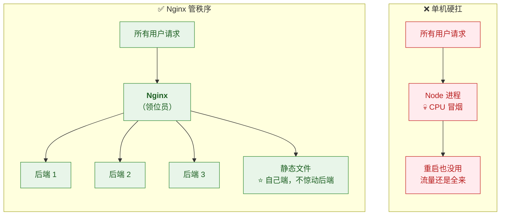

> [!success] ⭐ 全篇收束（视频结尾）：**Nginx 其实只干三件事**
> **① 自己发静态文件（动静分离）② 把请求转给别人（反向代理）③ 把流量分给一群人（负载均衡）**——
> **"剩下的全是这三件事的放大和组合。"**

---

## 一、Nginx 是什么：两个角色与一层薄纱

### 1.1 角色：既能自己端菜，也能分给厨师

> 视频原话："**有了它，所有请求先到前台——他既能自己端菜，也能把客人分给合适的厨师。
> 自己端菜指的它本身就是高性能 Web 服务器：图片、JS、CSS 这些静态文件直接由它返回，
> 根本不用惊动后端——sendfile 零拷贝，文件从磁盘直送网卡，少绕两次内核拷贝。
> 这叫动静分离。**"

| 角色 | 干什么 | 为什么快 |
|---|---|---|
| **静态 Web 服务器** | 图片/JS/CSS 直接返回 | ⭐ **sendfile 零拷贝**（磁盘→网卡，不过用户态） |
| ⭐ **反向代理** | 把动态请求转给后端 | 见 §1.2 |

> [!tip] 交叉验证
> **sendfile 零拷贝的原理（4 次拷贝 → 2 次）在
> [[1-QPS卡在10万？拆解Java单机百万调优全流程，从JVM到Linux内核硬核突围！（详细整理版）]] §五和
> [[1-java/3-IO/3-IO与网络编程]] §七都画过**——**三个来源同一结论**。

### 1.2 ⭐ 正向代理 vs 反向代理（一句话分清）

> 视频原话："**正向代理替客户端出面——服务器不知道真正的你是谁；
> 反向代理替服务端挡枪——用户以为在直接访问网站，其实根本不知道背后是哪台机器在干活。**"

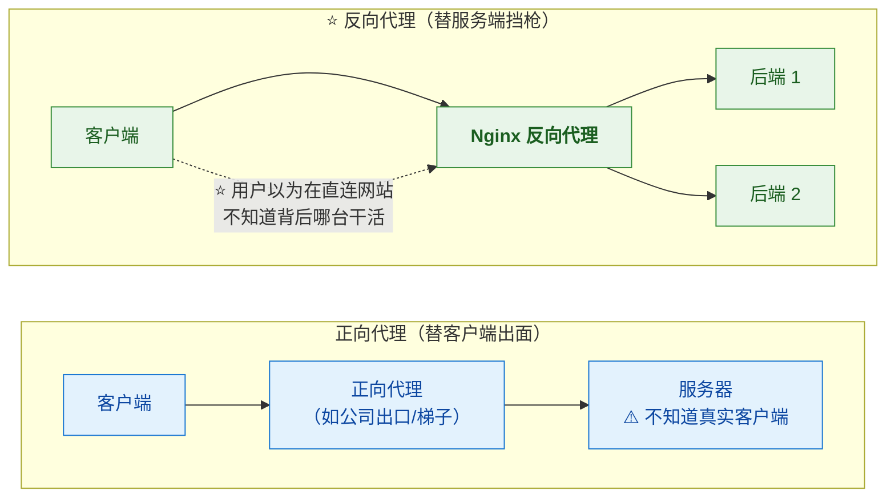

> [!important] ⭐ "多一层不是更慢吗？"——换来的是安全和秩序
> 视频原话："**后端 IP 全部隐藏，免受直接攻击；SSL 在这一层统一终结；
> 还能缓存、限流、分发。一层薄纱，挡住的是整个后厨。**"
>
> | 收益 | 说明 |
> |---|---|
> | **隐藏后端** | **攻击面收敛到 Nginx 一层** |
> | ⭐ **SSL 统一终结** | **证书只配一处，后端仍走 HTTP** |
> | **统一挂载点** | ⭐ **日志 / 缓存 / 限流 / 负载均衡都有地方挂** |

---

## 二、⭐ 高性能原理：C10K 与 epoll（凭什么一台抗几万并发）

> 视频原话："**一台 Nginx 抗几万并发，内存才几十兆——总不会开几万个线程吧？
> 恰恰相反，它几乎不开线程。传统模型一个连接配一个线程，
> 连接多了线程堆成山，光切换就把 CPU 耗光了——这就是当年著名的 C10K 问题。
> 2004 年 Igor Sysoev 写出 Nginx 就是为了干掉它。**"

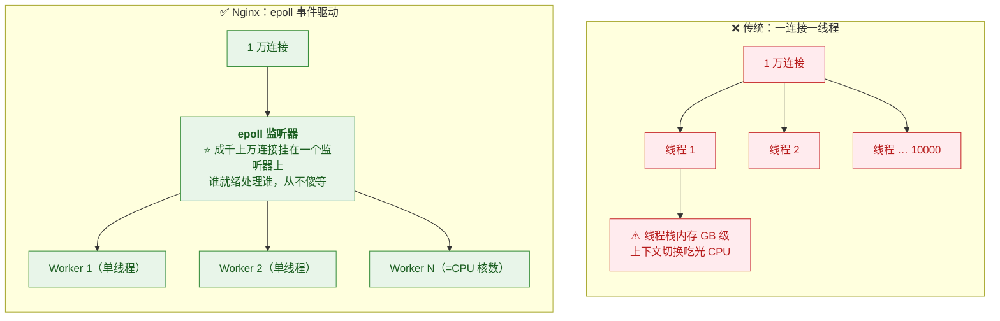

| 维度 | 传统（每连接一线程/进程） | ⭐ **Nginx** |
|---|---|---|
| 模型 | **阻塞式，一连接一线程** | ⭐ **事件驱动（epoll），单线程管海量连接** |
| 内存 | 1 万连接 **GB 级**（每线程栈） | **几十 MB** |
| CPU 消耗 | **大量耗在上下文切换** | **几乎全部用于真正处理** |
| Worker 数 | —— | ⭐ **= CPU 核数，各管一摊互不干扰** |

> [!important] ⭐ master 与 worker 的分工（记住它，热重载全靠它）
> 视频原话："**Master 用 root 跑，不处理请求，只负责读配置、管理 Worker、接收信号。**"
>
> | 角色 | 职责 |
> |---|---|
> | **Master** | **读配置 / 管理 worker / 接收信号（reload、quit）** |
> | **Worker** | ⭐ **真正处理请求**（每个都是单线程 epoll 循环） |
>
> 👉 **"Master 不干活、Worker 干活"的分工，正是 §十二"不停车换轮胎"（热重载）的基础。**
>
> ⚠️ **两个工程细节**：**`worker_connections` 决定每个 worker 最多管多少连接**
> （总连接 ≈ worker 数 × worker_connections，反向代理下一个请求占 2 个 fd）；
> **同时别忘了系统层 `ulimit -n`**（见 [[1-QPS卡在10万？拆解Java单机百万调优全流程，从JVM到Linux内核硬核突围！（详细整理版）]] §七——**Nginx 调了，内核没调照样卡死**）。

---

## 三、配置五层：俄罗斯套娃

> 视频原话："**第一次打开 nginx.conf 满屏大括号，完全不知道从哪看起——
> 把它当俄罗斯套娃就行，一共五层。**"

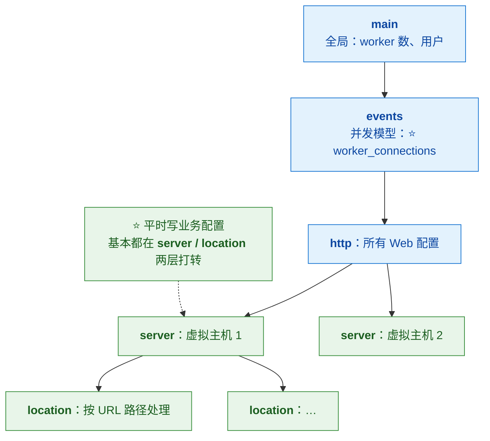

| 层 | 管什么 | 关键 |
|---|---|---|
| **main** | 全局 | worker 进程数（建议 = CPU 核数） |
| **events** | 并发模型 | ⭐ **`worker_connections`**——每个 worker 同时伺候多少连接 |
| **http** | 所有 Web 相关 | gzip、日志格式、upstream、include |
| **server** | ⭐ **一个虚拟主机** | listen + server_name |
| **location** | URL 路径路由 | ⭐ **匹配优先级**（见 §四） |

> [!tip] 生产习惯（视频原话）
> **"主配置只留骨架，业务配置全拆到 `conf.d/` 目录里，用 include 引入——
> 一个站点一个文件，改谁动谁，清爽。"**

---

## 四、⭐⭐ location 匹配优先级：四道关卡

> 视频原话："**我写了好几个 location，结果请求总走进我不想让它进的那个——
> 到底按什么顺序匹配？四道关卡，优先级背下来。**"

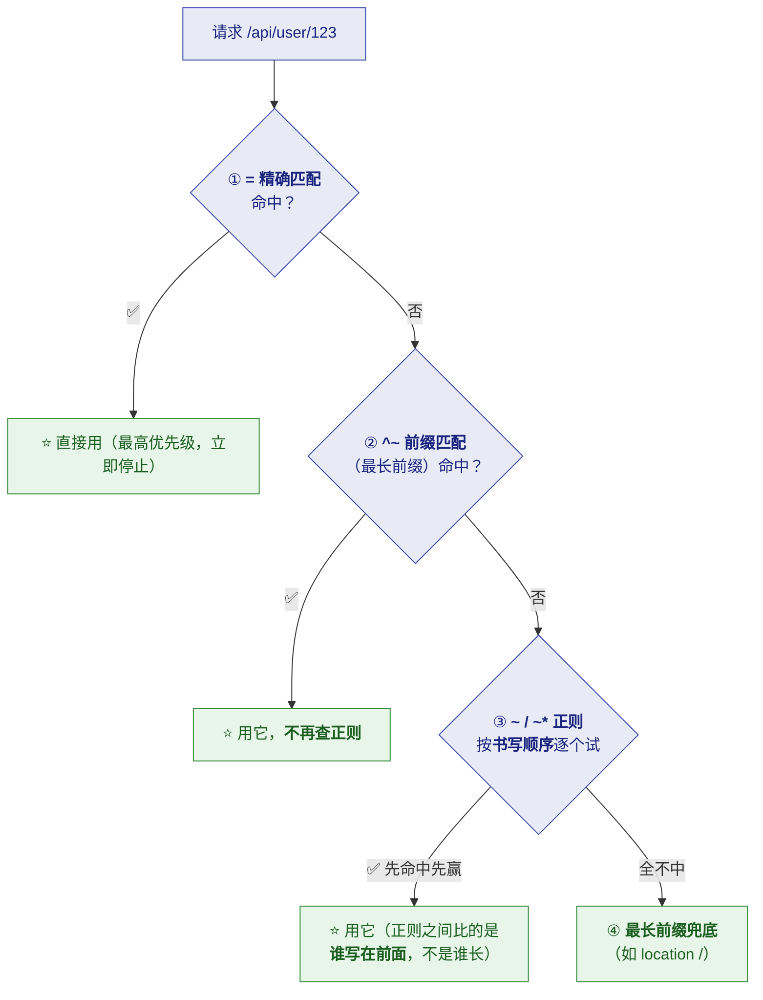

| 关卡 | 修饰符 | 规则 | 新人易踩点 |
|---|---|---|---|
| **① 精确** | `location = /path` | **命中立即用，停止查找** | —— |
| **② 前缀跳正则** | `^~ /path` | **最长前缀命中后，跳过正则** | —— |
| **③ 正则** | `~`（区分大小写）/ `~*` | ⭐ **按配置文件里的书写顺序**，先命中先赢 | **"正则之间比的不是长短，是谁写在前面"** |
| **④ 前缀兜底** | `/path` | **都不中 → 最长前缀匹配** | **`/api/user` 比 `/api` 更精确就赢它**——**`location /` 兜底靠的也是这条规则** |

> [!success] ⭐ 一句话总结（可直接背）
> **"等号最优先；^~ 是'选定前缀就别再试正则'；正则看书写顺序；最后最长前缀兜底。"**
>
> ⚠️ **实践守则**：**想让某个静态目录不被正则干扰 → 用 `^~`；
> 正则 location 的顺序就是优先级 → 最具体的正则写在最前面。**

---

## 五、虚拟主机：一台机器跑 N 个网站

> 视频原话："**每隔 server 块就是一家独立店铺——Nginx 收到请求，
* 先看请求头里的 Host 域名，再决定进哪家店。这就是虚拟主机：靠域名分流，不靠端口。**"

| 机制 | 说明 |
|---|---|
| **`server_name`** | **按请求头 `Host` 匹配**（域名分流） |
| **没注册过的域名** | **走默认 server**——标了 `default_server` 的那个，**通常是配置里的第一个** |
| ⭐ **生产建议** | **专门给默认站点返回 444**（不回包直接掐断）——**省得乱域名解析过来蹭你资源** |

```nginx
# ⭐ 默认站点兜底：陌生域名直接掐断
server {
    listen 80 default_server;
    server_name _;
    return 444;            # ⭐ 不返回任何内容，直接关闭连接
}
```

---

## 六、⭐⭐ 反向代理最小配置与"斜杠大坑"

### 6.1 最小可用配置（六行让 Node 藏到 Nginx 后面）

> 视频原话："**核心就一行 proxy_pass。listen 80 接收请求，server_name 认领域名，
> location 圈定路径，proxy_pass 把请求原样转给本机 3000 端口的 Node——
> 用户访问的还是 80 端口，完全感知不到背后是谁。**"

```nginx
server {
    listen 80;
    server_name example.com;
    location / {
        proxy_pass http://127.0.0.1:3000;    # ⭐ 核心一行
        proxy_set_header Host $host;          # （§十三锦囊 3：不然后端拿到的是 upstream 名）
    }
}
```

> [!important] ⭐ "为什么不直接暴露 3000 端口？"
> 视频原话："**能跑，但那是裸奔。走 Nginx 这一层，你才有地方挂 HTTPS、挂日志、
> 挂限流、挂负载均衡——它就是你架构里的总开关。**"
> 👉 **对应 [[高并发系统设计（详细整理版）]]：**限流分级、缓存、熔断降级，都需要这个"统一挂载点"。

### 6.2 ⭐⭐ Nginx 第一大坑：proxy_pass 末尾的斜杠

> 视频原话："**我照抄了同事的配置，就少了个斜杠，结果接口全 404 了。
> 规则一句话：proxy_pass 后面只要带了路径——哪怕只是一个斜杠——
> Nginx 就会拿它替换掉 location 匹配到的那段前缀。**"

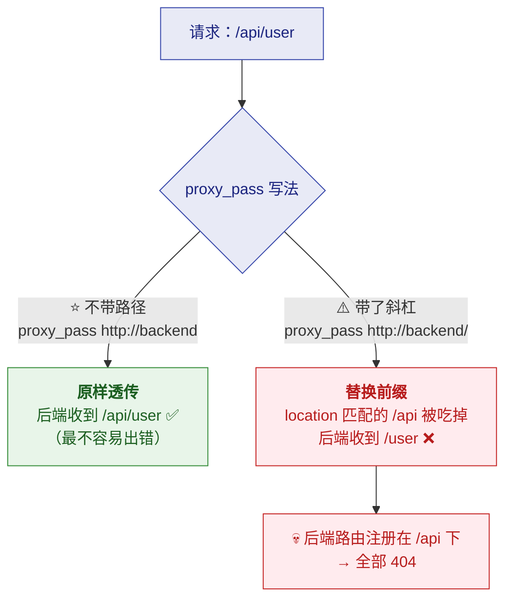

| 写法 | 后端收到的路径 | 何时用 |
|---|---|---|
| ⭐ **`proxy_pass http://backend;`**（无路径） | **原样透传**（`/api/user`） | **默认用这个，最不易错** |
| ⚠️ **`proxy_pass http://backend/;`**（带 `/`） | **替换匹配前缀**（`/user`） | **刻意要"剥前缀"时才用**（如后端没挂 /api 前缀） |

> [!success] ⭐ 防坑口诀（视频原话）
> **"改一个字符前，先在脑子里把 URL 拼一遍。"**
>
> **拼一遍的演示**：`location /api/` + `proxy_pass http://backend/;`
> 请求 `/api/user` → 匹配前缀 `/api/` 被替换为 `/` → 后端收到 **`/user`**——
> **想通了这条替换规则，Nginx 的斜杠问题从此免疫。**

---

## 七、⭐ X-Real-IP 与 X-Forwarded-For：找回真实 IP

> 视频原话："**上线后发现风控全废了——后端日志里所有用户的 IP 都是 127.0.0.1。
> 不是鬼，是 Nginx 太尽职：后端看到的连接是 Nginx 发起的，原始 IP 在转发时丢了。**"

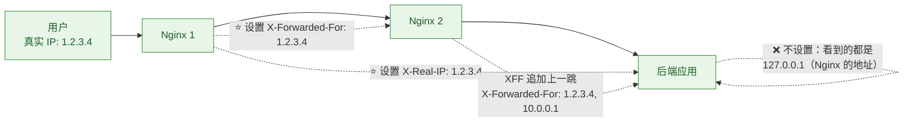

| 头 | 形态 | 用途 |
|---|---|---|
| ⭐ **`X-Real-IP`** | **一对一**：存最终用户 IP | **业务直接取用**（风控/日志） |
| ⭐ **`X-Forwarded-For`** | **一条链**：每过一层代理追加上一跳 | **还原整条访问路径**（安全审计/地域统计） |

> [!danger] ⭐ 两个都建议带上，但要记住——**它们是明文、可伪造的**
> 视频原话："**这些头是明文、可伪造的。信任边界要在最外层——Nginx 就重置掉。**"
>
> 👉 **正确姿势**：**最外层 Nginx 用 `$remote_addr`（TCP 层真实地址，伪造不了）覆写这两个头**，
> **内层只信任最外层传来的值**。**风控按"直接连你 TCP 的那台"判定，别信请求体里的自报家门。**
> **这正是 [[高并发系统设计（详细整理版）]] 限流分级（用户级/IP 级）的前提。**

---

## 八、⭐ 负载均衡：upstream 与健康检查

### 8.1 四种调度策略

> 视频原话："**Upstream 把后端列成一个池子，proxy_pass 指向池子名，调度就开始了。
> 默认轮询，一人一次绝对公平；机器配置不一样加 weight；有会话状态用 ip_hash；
> 请求耗时差异大用 least_conn——谁手头活少派给谁。**"

| 场景 | 策略 | 一句话 |
|---|---|---|
| **默认** | ⭐ **轮询（round-robin）** | **一人一次，绝对公平** |
| **机器配置不均** | **weight** | **高配 `weight=3`，流量按 3:1:1:1 量体裁衣** |
| **有会话状态** | **ip_hash** | ⭐ **同一用户永远打到同一台**（购物车存内存） |
| **请求耗时差异大** | **least_conn** | **谁手头活少派给谁** |

> [!success] 视频的总结口诀（原话）
> **"无状态默认轮询；异构加 weight；会话粘住用 ip_hash；长链接场景 least_conn。"**
>
> ⚠️ **补充边界**：**ip_hash 是"会话粘性"的权宜之计——根治是"把状态外置"（Redis），
> 让后端无状态**（否则扩缩容/挂机都会丢会话）。**这又回到 [[高并发系统设计（详细整理版）]] 的"无状态化"原则。**

### 8.2 被动健康检查与 backup

> 视频原话："**开源版 Nginx 用的是被动健康检查：max_fails=3 配 fail_timeout=30s——
> 30 秒内失败满 3 次，这台就被拉黑，流量自动绕开。
> 拉黑期满，先放一个试探请求过去，成了就官复原职，不成再拉黑一轮。**"

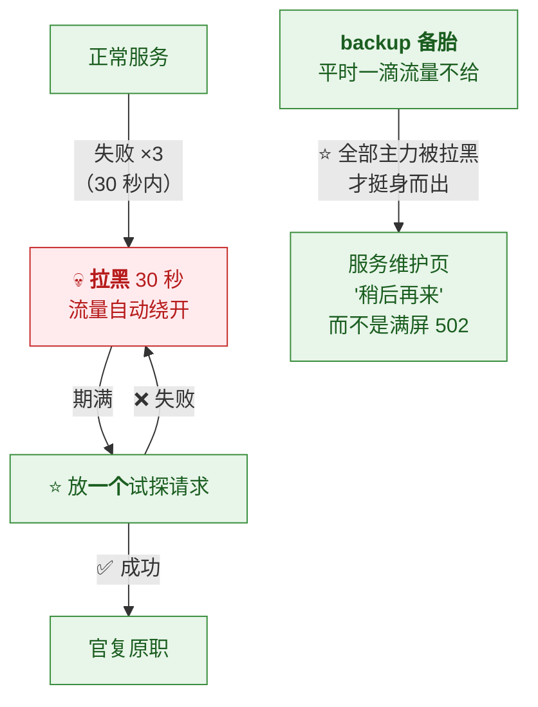

| 机制 | 说明 |
|---|---|
| **被动检查** | **靠真实请求的失败计数**（开源版没有主动探测；主动检查是商业版/三方模块） |
| **`max_fails` + `fail_timeout`** | **窗口内失败满 N 次 → 拉黑一个窗口** |
| ⭐ **`backup`** | **备胎节点：平时零流量，全部主力拉黑才顶上**——**至少给用户一个体面的"稍后再来"页** |

---

## 九、HTTPS 与提速三件套

> 视频原话："**上线前 leader 说必须上 HTTPS，最好顺便把首屏速度也提上来——三件套。**"

### 9.1 第一件：HTTPS / TLS

```nginx
server {
    listen 443 ssl;
    ssl_certificate     /etc/ssl/example.crt;   # ⭐ 证书
    ssl_certificate_key /etc/ssl/example.key;   # ⭐ 私钥：权限 600，永远不进代码仓库
}
# ⭐ 老用户无缝迁移：80 端口 301 跳 HTTPS
server { listen 80; return 301 https://$host$request_uri; }
```

> [!important] ⭐ 视频的三个实用点
> **① 证书不用花钱**：**Let's Encrypt 免费证书 + certbot 自动续期，零成本**。
> **② 私钥纪律**：**权限 600，永远不进代码仓库**（对应你 [[服务器巡检-192.168.0.106/Hive数据加载方案|巡检方案]] 里"密码不进明文配置"的同一条纪律）。
> **③ 迁移**：**单独留一个 80 端口的 server，`return 301` 跳 HTTPS**。

### 9.2 第二、三件：gzip 与 expires

| 手段 | 作用 | ⚠️ 边界 |
|---|---|---|
| ⭐ **gzip** | **文本类资源体积砍到 1/4** | **图片/视频别压——本身已压缩，白费 CPU** |
| ⭐ **expires** | **静态资源在浏览器本地存一份，回头客不打扰服务器** | 配合"文件名带 hash"的强缓存策略 |

---

## 十、rewrite/return 与 proxy_cache

### 10.1 ⭐ return vs rewrite（含 last/break）

> 视频原话："**简单跳转用 return 301——性能最好，语义最清晰，一行搞定。
> rewrite 支持正则和捕获组。结尾的 last 是什么意思？
> last 带着新 URL 重走一遍 location 匹配；break 就地停止不再匹配——
> 用错最容易写出死循环：rewrite 出来的新地址又命中自己，就在两个路标之间鬼打墙。**"

| 指令 | 用途 | 关键差异 |
|---|---|---|
| ⭐ **`return 301 URL`** | **简单跳转** | **性能最好、语义最清晰——首选** |
| **`rewrite regex target last;`** | **带正则/捕获组的改写** | **`last`：新 URL **重走 location 匹配** |
| **`rewrite … break;`** | 同上 | **`break`：就地停止，不再匹配** |
| ⚠️ **`location { if … }`** | —— | **官方文档原话 "if is evil"——能不用就不用，大多数场景 return/rewrite 都能做** |

```nginx
# 捕获组示例：/product/123 → /api/product?id=123
rewrite ^/product/(\d+)$ /api/product?id=$1 last;
#                          ↑ $1 = 捕获的 123
```

### 10.2 proxy_cache：门口的便利仓

> 视频原话："**商品列表每次都打到后端重新算——给这个路径配 proxy_cache：
> 第一次请求穿透到后端拿货，顺手在门口存一份副本（miss）；
> 之后同样的请求直接从便利仓取，毫秒级返回（hit）。**"

| 项 | 说明 |
|---|---|
| **`proxy_cache_valid 200 10m`** | **200 响应存 10 分钟，归零标记 expired 重新穿透** |
| ⭐ **`$upstream_cache_status`** | **日志里加这个变量 → hit/miss/expired 一目了然（看命中率）** |

> [!danger] ⭐⭐ 什么能缓存？（视频原话："那是事故，不是优化"）
> **"读多写少的才适合。带登录态的请求必须用 `proxy_cache_bypass` 绕开——
> 别让 A 用户看到 B 用户的缓存。"**
>
> 👉 **缓存按"URL+参数"做 key，不区分用户**——**一旦缓存了带个人数据的响应就是越权事故**。
> **这与 [[7-分布式/6-缓存一致性与高可用]] 的缓存语义一脉相承。**

---

## 十一、⭐ 限流与访问控制（Nginx 层的闸机）

> 视频原话："**limit_req_zone 先定义速率，比如 rate=10r/s，
> 再用 limit_req 把规则挂到 location 上——超的直接回 429，恶意流量被闸机拦在门外。
> 正常用户赶上高峰会被误伤吗？加 burst=20 排队缓冲，再配 nodelay——
> 就像银行柜台拿号：号还有余量就立刻办事，不用匀速干等。**"

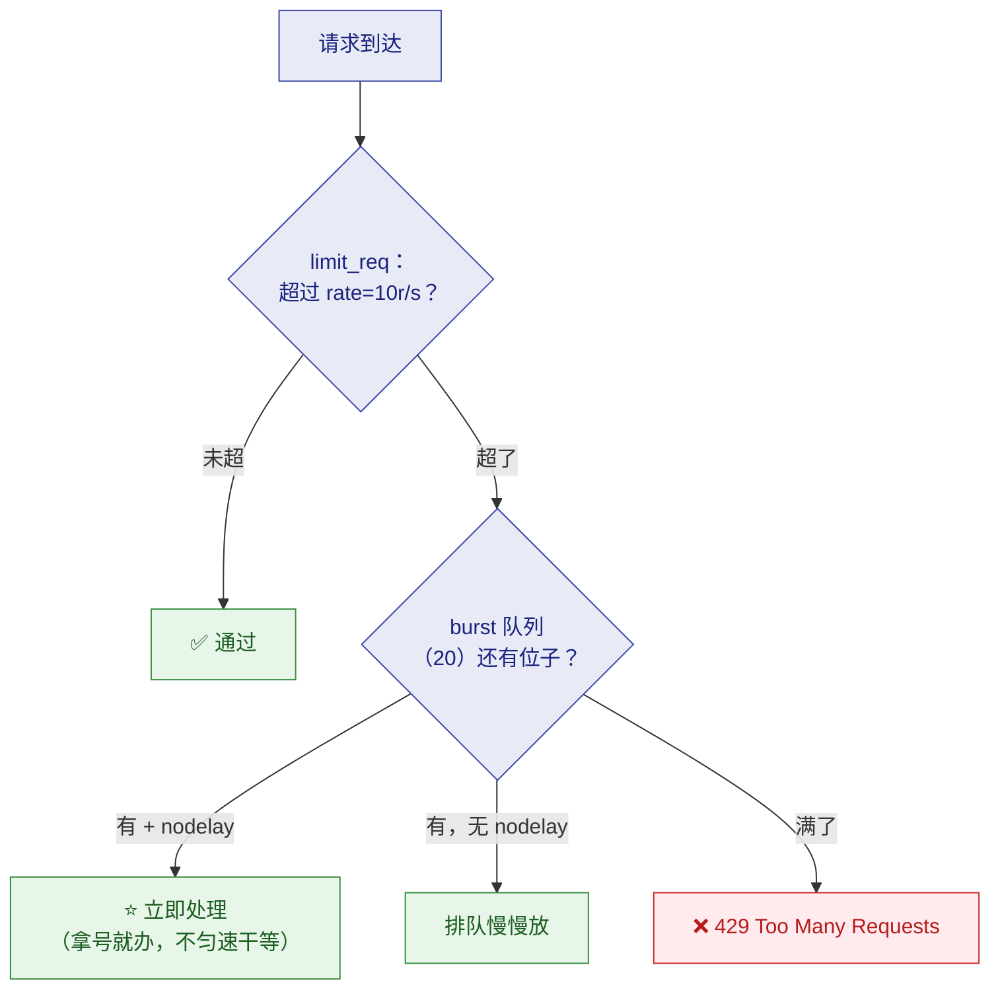

| 手段 | 防什么 | 配置 |
|---|---|---|
| ⭐ **`limit_req`（rate + burst + nodelay）** | **恶意刷接口** | `rate=10r/s` + `burst=20` + `nodelay` |
| **`limit_conn`** | **单 IP 开几百条连接耗资源** | 限单 IP 并发连接数 |
| **`allow / deny`** | **IP 黑白名单** | **内网监控、压测机走 VIP 通道** |

> [!success] ⭐ 这正是 [[高并发系统设计（详细整理版）]] "限流分级"的 Nginx 落地
> **接口级限流挂 location、IP 级限流按 `$remote_addr`（⭐ 记得先修好 §七的真实 IP）**——
> **闸机在门口，恶意流量根本进不了后端。**
> **算法层对比（令牌桶/漏桶）见 [[7-分布式/7-限流熔断降级]]。**

---

## 十二、⭐⭐ 热重载与 502/504 分诊

### 12.1 热重载：高速上不停车换轮胎

> 视频原话："**改配置要重启服务吧？那这几千个在线连接不就全断了？
> 所以永远先 `nginx -t` 验语法，再 `nginx -s reload` 热重载——
> master 校验通过后，拉起一批加载了新配置的 worker：新连接归新人管；
> 旧 worker 不接新活，只把手头存量连接优雅送完，然后自己退休。
> 全程流量零中断。如果新配置语法有错，reload 直接拒绝，老配置继续跑。**"

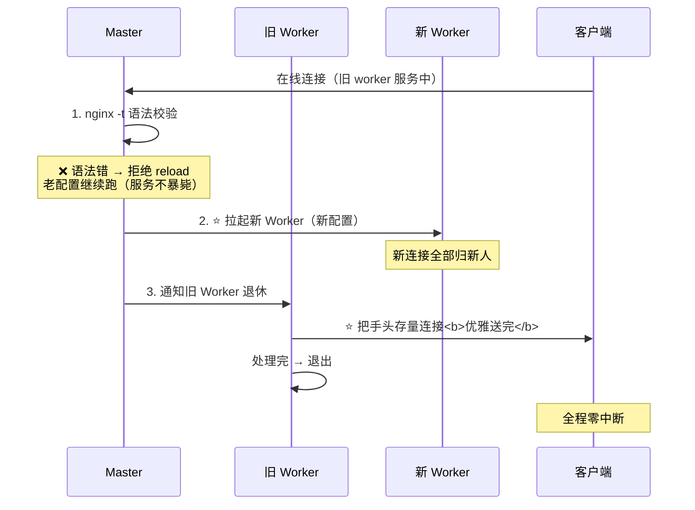

> [!danger] ⭐ 但 "nginx -t 通过" 只代表语法对，不代表逻辑对
> 视频原话："**upstream 地址写错照样是坑。**"
> 👉 **所以改配置三步（§十三锦囊 5）：备份 → `nginx -t` → reload——
> "这三步能拦住八成的线上事故"。**

### 12.2 ⭐⭐ 502 与 504：两种病，别一把梭调超时

> 视频原话："**告警群里天天喊 5xx，反正都是网关错误——我一般一把梭把超时调大然后重启。
> 这是最危险的直觉。502 和 504 是两种病：
> 502 是 Nginx 压根没从上游拿到有效响应——后端进程挂了、端口写错、连接被拒；
> 504 是连接建立了，但在 proxy_read_timeout 内没等到响应——后端活着，只是太慢。
> 所以 502 调超时根本没用——连接都被拒绝了，等多久都没意义。**"

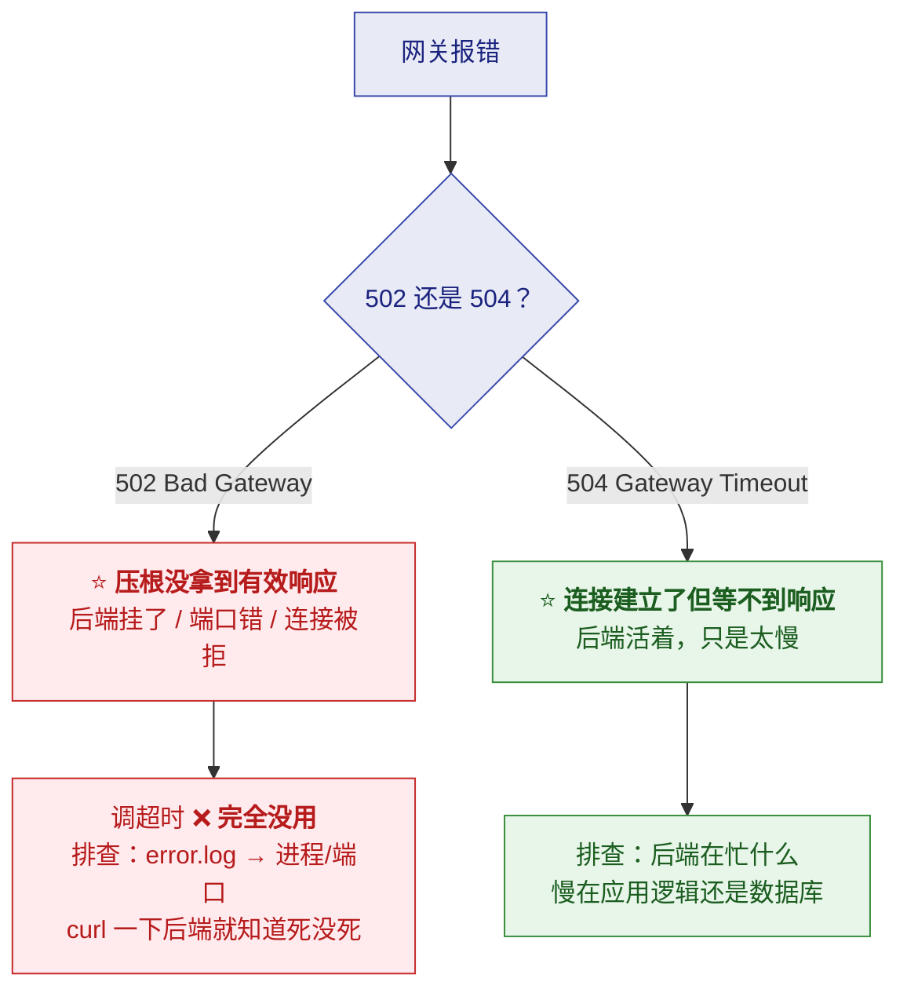

> [!important] ⭐ 分诊口诀（视频原话）
> **"先分诊再开药：先看 error.log 定位阶段——
> 502 查进程和端口连通性（curl 一下后端就知道死没死）；
> 504 查后端在忙什么——慢在应用逻辑还是数据库。"**
>
> ⚠️ **还有那句吓人的 `No live upstreams`**：**池子里所有后端同时被拉黑了**——
> **要么全挂了，要么 fail_timeout 配得太敏感**。
> **"看到它先救后端，别冤枉 Nginx——他多数时候只是报信的。"**

---

## 十三、⭐ 锦囊五条（一次性说完的坑）

> 视频原话："**我迟早会踩的坑，一次性说完——锦囊收好。**"

| ✅ | # | 坑 | 解法 |
|---|---|---|---|
| [ ] | 1 | ⭐ **上传大图报 413** | **`client_max_body_size`**（默认只有 **1M**），按业务放开 |
| [ ] | 2 | ⭐ **Vue/React history 路由刷新 404** | **Nginx 真去找 `/user/123` 这个文件了** → **`try_files $uri $uri/ /index.html;`** 让前端路由接管 |
| [ ] | 3 | ⭐ **后端拿到的 Host 是 upstream 名**，生成跳转链接全错 | **`proxy_set_header Host $host;`**；**HTTPS 场景补 `X-Forwarded-Proto`** |
| [ ] | 4 | ⭐ **upstream 重复握手开销大** | **给 upstream 配 `keepalive` 连接池** + **`proxy_http_version 1.1`** + **清掉 `Connection` 头** |
| [ ] | 5 | ⭐⭐ **肌肉记忆三步**：**改配置前备份 → `nginx -t` 通过 → reload** | **"这三步能拦住八成的线上事故"** |

> [!note] 锦囊 4 展开（为什么三行要一起）
> **Nginx 默认用 HTTP/1.0 转发上游请求**（无 keepalive，每请求新建 TCP）——
> **要吃上连接池红利必须三件同时做**：
> ```nginx
> upstream backend {
>     server 10.0.0.1:8080;
>     keepalive 32;                       # ① 连接池
> }
> location / {
>     proxy_http_version 1.1;             # ② 1.1 才支持长连接
>     proxy_set_header Connection "";     # ③ 清掉 close 头
> }
> ```
> **少任何一行，keepalive 都不生效**——这是典型的"三行缺一不可"。

---

## 十四、总结：三件事 + 三张后续卡

> [!success] ⭐ Nginx 就干三件事（视频原话）
> **① 自己发静态文件 ② 把请求转给别人 ③ 把流量分给一群人——
> 剩下的全是这三件事的放大和组合。**
>
> **串一遍（视频收束）**：
> **"master 加 worker 给了它以一敌万的底气；五层配置是它的骨架；
> location 优先级是它的判断力；反向代理让它成为后端的挡箭牌；
> 负载均衡让它成为流量的指挥官；HTTPS 三件套、rewrite、缓存、限流，
> 让它把安全和速度都攥在手里；reload 让它能不停车换轮胎；
> 而 502 和 504 的分诊，是你和他之间的信任底线。"**

| 后续卡 | 内容 | 关系 |
|---|---|---|
| **OpenResty + Lua** | **想在配置里写业务逻辑** | **Nginx + LuaJIT 的增强发行版** |
| **灰度发布** | **平滑放量、上新版本** | **用 Nginx 的 weight/split_clients 实现** |
| ⭐ **云原生 Ingress** | **K8s 的入口（Ingress Controller）** | **"他们脚下踩的全是 Nginx 的地基"** |

---

## 附录 A：语音转写（ASR）勘误对照

> 原稿是语音转写，错误较多。**阅读原始字幕稿时对照此表。**
> （本稿最典型：**Nginx 一个词被识别出 mix / NX / LINX / INX / ins / names / NANS / MEX 等 8 种写法**）

| 原稿（错） | 正确 | 说明 |
|---|---|---|
| ⭐ **mix / NX / LINX / INX / ins / names / NANS / MEX** | ⭐ **Nginx** | 全文多处（最典型） |
| **ego csoave** | ⭐ **Igor Sysoev** | Nginx 作者（2004 年公开发布） |
| **app l** | ⭐ **epoll** | 事件驱动 |
| **把 patch 要吃掉 GB 及内存** | **把 Apache 要吃掉 GB 级内存** | C10K 对比（注：指传统 prefork 模型） |
| **master进城** | **master 进程** | —— |
| **worker下划线connections** | ⭐ **`worker_connections`** | events 层参数 |
| **间号波浪 / 波浪号** | ⭐ **`^~` / `~`** | location 修饰符 |
| **斜杠API斜杠配proxy下划线pass** | **`location /api/` 配 `proxy_pass`** | 斜杠坑 |
| **X杠real guip** | ⭐ **`X-Real-IP`** | 请求头 |
| **X档forwarded杠four** | ⭐ **`X-Forwarded-For`** | 请求头 |
| **list下划线CN / list下划线com** | ⭐ **`least_conn`** | 负载均衡策略 |
| **HTTPSSTLS握手** | **HTTPS：TLS 握手** | —— |
| **let加号sn crept** | ⭐ **Let's Encrypt** | 免费证书 |
| **third beat** | ⭐ **certbot** | 自动续期工具 |
| **手屏速度** | ⭐ **首屏速度** | "顺便把首屏速度也提上来" |
| **VARI接号斜杠product** | **`rewrite ^/product/…`** | 正则改写 |
| **go首页商品列表** | **给首页商品列表** | proxy_cache 例子 |
| **wings pay** | **给商品页** | 同上 |
| **便利仓** | （原意：缓存仓，可保留） | —— |
| **CSH下划线摆PSS** | ⭐ **`proxy_cache_bypass`** | 登录态绕缓存 |
| **limit下划线RAQ下划线zone** | ⭐ **`limit_req_zone`** | 限流 |
| **weight等于12斜杠S** | **`rate=10r/s`** | 限流速率（数字亦有误） |
| **每秒只放十各请求** | **每秒只放 10 个请求** | —— |
| **加birds等于20** | ⭐ **`burst=20`** | 突发缓冲 |
| **node类** | **`nodelay`** | 限流参数 |
| **ALLOL和DNI** | ⭐ **`allow` 和 `deny`** | IP 黑白名单 |
| **压字机** | **压测机** | "内网监控、压测机走 VIP 通道" |
| **重启解决不了价格问题** | ⚠️ **重启解决不了架构问题**（按上下文推断） | 开场 |
| **innx第一大坑** | **Nginx 第一大坑** | 斜杠 |
| ** 武某某** | **5xx 某某** | "告警群里天天喊 5xx" |
| **一把缩把超时调大** | **一把梭把超时调大** | 最危险的直觉 |
| **维护业服务器** | **维护页服务器** | backup 节点 |
| **client下划线max下划线body底下划线size** | ⭐ **`client_max_body_size`** | 默认 1M |
| **wu react** | **Vue / React** | history 路由 |
| **b links空格杠T** | ⭐ **`nginx -t`** | 语法校验 |
| **max空格杠S空格reload** | ⭐ **`nginx -s reload`** | 热重载 |
| **minx空格杠T** | **`nginx -t`** | 结尾金句 |
| **配置千万条MEX空格杠T第一条** | ⭐ **"配置千万条，`nginx -t` 第一条"** | 结尾金句 |
| **open nasty和LUA** | **OpenResty 和 Lua** | 后续卡 |
| **com a p six** | ⚠️ **云原生相关（疑似"APISIX"）** | "上了云原生，APISIX 和 K8s 的 Ingress 是必修" |
| **图片JSCSS** | **图片、JS、CSS** | —— |
| **PBA的时候那个location斜杠兜底** | **配 API 的时候，那个 `location /` 兜底** | 最长前缀 |
| **linx收到请求先看清球头里的host** | **Nginx 收到请求，先看请求头里的 Host** | 虚拟主机 |

---

## 附录 B：30 秒速查

> [!abstract] 记住这 15 句
> 1. ⭐ **加机器没用，因为请求"全往一台上撞"——缺的是流量入口（Nginx）**。
> 2. ⭐ **Nginx 只干三件事：发静态（动静分离）、转发（反代）、分流（负载均衡）**。
> 3. ⭐ **正向代理替客户端出面；反向代理替服务端挡枪**（用户不知道背后哪台干活）。
> 4. **反向代理换来：后端 IP 隐藏 + SSL 统一终结 + 缓存/限流/分发的统一挂载点**。
> 5. ⭐⭐ **抗几万并发靠的不是线程——是 master-worker + epoll 事件驱动（C10K 的答案）**。
> 6. **Master 不处理请求（读配置/管 worker/收信号）；Worker 单线程干活（数量=CPU 核数）**。
> 7. **配置五层：main → events（worker_connections）→ http → server → location**。
> 8. ⭐⭐ **location 四道关卡：等号（`location =`）→ `^~` → 正则（**按书写顺序**）→ 最长前缀兜底**。
> 9. **虚拟主机按 Host 头分流；默认站点建议 444 掐断乱域名**。
> 10. ⭐⭐ **proxy_pass 带路径（哪怕一个斜杠）就会替换 location 前缀——"先在脑子里把 URL 拼一遍"**。
> 11. **X-Real-IP 一对一；X-Forwarded-For 是链——⭐ 都是明文可伪造，信任边界在最外层重置**。
> 12. **负载均衡口诀：默认轮询 / 异构加 weight / 会话粘住 ip_hash / 耗时差异大 least_conn**。
> 13. **被动健康检查（max_fails+fail_timeout）+ backup 备胎；主动检查是商业版**。
> 14. ⭐⭐ **502 = 没拿到响应（后端挂/端口错，调超时没用）；504 = 连上了但太慢——先分诊再开药**。
> 15. ⭐⭐ **改配置三步：备份 → `nginx -t` → reload（拦八成事故）；"配置千万条，`nginx -t` 第一条"**。

> [!tip] 三个最容易被追问的点
> ① **proxy_pass 斜杠规则**——让你现场拼 URL（本篇 §6.2 的替换图解要会画）
> ② **502 vs 504**——考你是否真排查过（502 调超时是"最危险的直觉"）
> ③ **为什么 Nginx 不开几万线程**——epoll/事件驱动/C10K，可连到 Java NIO 的 Selector（同一套 OS 机制）

---

> 关联：[[高并发系统设计（详细整理版）]]（五层架构之接入层/限流分级）·
> [[1-QPS卡在10万？拆解Java单机百万调优全流程，从JVM到Linux内核硬核突围！（详细整理版）]]（sendfile/fd/内核参数）·
> [[1-java/3-IO/3-IO与网络编程]]（epoll/零拷贝原理）· [[7-分布式/7-限流熔断降级]]（限流算法层）
> 原始字幕稿：[[2-单机被打爆后，我才读懂 Nginx]]
