# 🚀 50 万 QPS 实时推荐：延迟从小时压到毫秒（详细整理版）

> 本篇是对 [B 站视频《50万QPS实时推荐 延迟从小时压到毫秒》](https://www.bilibili.com/video/BV1oR316pE9M/)（约 10 分钟）的**逐段深度整理**。
> 视频用一个**双 12 大促事故现场**，串起了一整套**实时推荐系统的完整架构**：
> 从点击采集 → Kafka 缓冲 → Flink 计算 → 特征工程 → Redis 特征服务 → 模型推理 → 推送网关 → 全链路监控。
> （原稿是语音转写，错别字较多，尤其"**点击**"被识别成"**光点**"、"**RocksDB**"识别成"**rock dB**"，见 [附录 A](#附录-a语音转写asr勘误对照)）
>
> **定位**：本篇讲**"一条实时链路怎么搭"（架构与工程决策）**。
> Flink 自身的机制细节（Watermark 原理、状态后端、Checkpoint、反压）由 Flink 系列承担：
> [[5-bigdata/0-flink/2-时间与窗口|2-时间与窗口]]、[[5-bigdata/0-flink/3-状态管理|3-状态管理]]、
> [[5-bigdata/0-flink/5-Checkpoint与Savepoint|5-Checkpoint与Savepoint]]、[[5-bigdata/0-flink/6-背压与性能调优|6-背压与性能调优]]、
> [[5-bigdata/0-flink/7-FlinkCDC与实时数仓|7-FlinkCDC与实时数仓]]、[[5-bigdata/0-flink/8-FlinkSQL与TableAPI|8-FlinkSQL与TableAPI]]。
> **两处互补，不重复。**
>
> 原始字幕稿：[[50万QPS实时推荐 延迟从小时压到毫秒]]。
> 相关：[[2-redis/一次讲透Redis（详细整理版）|Redis]]、[[3-mq/2-Kafka/理解 kafka 基本盘（详细整理版）|Kafka]]。

---

## 〇、先看全貌：这条链路上有哪 7 个环节

> [!important] ⭐ 用一句话说清这套系统
> **"用户点一下，系统在 50ms 内算完，并把结果推回去。"**
>
> 难点不在任何单个环节，而在**把它们串起来、并让端到端延迟可控**。


> [!success] ⭐ 视频结尾的"核心三句话"（值得先记住）
> | 组件 | 职责 | 一句话 |
> |---|---|---|
> | **Kafka** | 抗住峰值 | ⭐ **"抗住"**（削峰缓冲） |
> | **Flink** | 算得够快 | ⭐ **"算快"**（实时计算） |
> | **Redis** | 查得够准 | ⭐ **"查准"**（特征服务） |
>
> **外加一句**：**"监控要从一开始就搭好"**——
> **没有监控的实时系统等于盲飞。**

---

## 一、问题定义：为什么"半小时前的推荐"不可接受

> [!example] 事故现场
> **双 12 峰值：每秒 50 万条点击行为。**
> - 推荐系统**完全跟不上**
> - 用户看到的还是**半小时前的"猜你喜欢"**
> - 老板要求：**"刚点了商品 A，下一秒就要推荐配套商品 B"**

### 1.1 流处理 vs 批处理

> [!important] ⭐ 视频的比喻很好记
> | | 比喻 | 含义 |
> |---|---|---|
> | **批处理** | **"等一桶水满了再倒"** | 攒一批数据统一处理（T+1 或小时级） |
> | ⭐ **流处理** | **"每滴水来就立刻处理"** | 数据一到就处理 |

| 维度 | 批处理 | ⭐ **流处理** |
|---|---|---|
| 延迟 | **小时级 / T+1** | ⭐ **毫秒~秒级** |
| 数据边界 | **有界**（一批） | ⭐ **无界**（不断到来） |
| 典型引擎 | Hive / Spark | ⭐ **Flink** |
| 适用 | 报表、离线训练 | ⭐ **实时推荐、风控、监控告警** |

> [!important] ⭐ 为什么这个场景"只能选流处理"
> **因为"实时推荐"的价值随延迟衰减**——
> **用户刚点了商品 A，此刻推送配套商品 B 的转化率最高；
> 半小时后再推，用户早就走了。**
>
> 👉 **这不只是"技术指标"问题，而是"业务价值"问题**——
> **延迟本身就是产品的一部分。**

---

## 二、① 采集网关：数据入口的三件事

> 视频原话："**得先过采集网关，就像机场安检**——先验票、再安检、再分检。
> 这里要做三件事：**协议统一、数据清洗、轻量格式化转成标准 JSON**。"


### 2.1 ⭐ 一条点击事件必须带的四个字段

> [!danger] ⚠️ 视频原话："**缺任何一个字段，后面就玩不转**"
> | 字段 | 作用 | 缺了会怎样 |
> |---|---|---|
> | ⭐ **`user_id`** | **关联用户、做 keyBy** | **算不出"谁的兴趣"** |
> | ⭐ **`item_id`** | **推荐对象** | **不知道推荐什么** |
> | **行为类型** | 点击/收藏/加购/购买 | **无法区分行为权重** |
> | ⭐ **时间戳** | **事件时间、窗口划分** | **无法做时间窗口**（见第五节） |

**标准事件结构示例**：

```json
{
  "user_id": "u_10086",
  "item_id": "p_2001",
  "action": "click",
  "timestamp": 1793620800000,
  "context": { "page": "detail", "device": "ios" }
}
```

> [!tip] ⭐ 为什么"网关"这一层不能省
> **因为上游是"不可控"的**——
> **多个端、多种协议、格式混乱、还有脏数据。**
>
> **如果让这些数据直接进 Flink**：
> - **Flink 作业里要写大量"兼容各种格式"的代码**（耦合严重）
> - **一条脏数据可能让作业抛异常、甚至重启**
>
> 👉 **网关的作用是"把脏活挡在系统之外"**，
> **让下游只面对"干净、标准"的数据。**

---

## 三、② Kafka：为什么要分区

> 视频原话："**所以要加一层缓冲带，也就是 Kafka。**
> **它就像高速公路的收费站——车再多也不会堵死，因为开了六条车道。**"

### 3.1 ⭐⭐ Kafka 的两个作用

| 作用 | 说明 |
|---|---|
| ⭐ **缓冲 / 削峰** | **上游 50 万 QPS，下游处理慢一点也不会被打垮**（数据先堆在 Kafka） |
| ⭐ **解耦** | 生产者不用等消费者（异步） |


### 3.2 ⭐⭐ 分区的两条规则（本节最重要）

> 视频原话："**一条道就串行，六条道就并行。
> 同一个用户的点击必须进同一个分区，保证顺序；
> 不同用户分散到不同分区，并行提速。**"
>
> **"所以分区数决定了并行度。"**

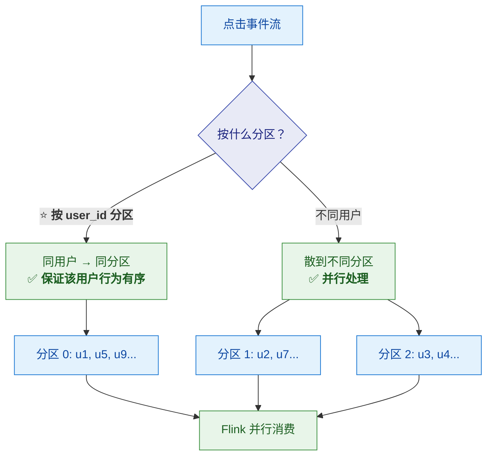

> [!important] ⭐⭐ 为什么"同用户必须同分区"
> **因为要算"某用户的实时兴趣"**——
> **如果同一用户的点击散在不同分区，每个分区只能看到"一部分行为"，
> 算出的兴趣向量就是错的（不完整）。**
>
> 👉 ⭐ **这就是 Flink 里 `keyBy(userId)` 的前提**：
> **Kafka 分区保证"同一 key 的数据聚集"，
> Flink 的 keyBy 才能在该分区内正确聚合。**
>
> ⚠️ **两者是配合关系**：**Kafka 分区键应与 Flink 的 keyBy 字段一致。**

### 3.3 ⚠️ 分区不是越多越好

> 视频原话："**分区不是越多越好，太多会增加管理开销。
> 一般按消费者数量来配，一比一或一比二最稳妥。**"

| 分区数 | 后果 |
|---|---|
| ⚠️ **太少** | **并行度上不去**（一个分区只能被一个消费者消费） |
| ⚠️ **太多** | **管理开销大**（每个分区有元数据、文件句柄、rebalance 成本） |
| ⭐ **建议** | ⭐ **与消费者数量 1:1 或 1:2** |

> [!warning] ⚠️ 分区数的两个硬约束
> **① 分区数 ≥ 消费者数**：否则有消费者闲着（**一个分区同时只能被一个消费者消费**）。
> **② 分区数是并行度的上限**：Flink 侧并行度调再高，**也不会超过 Kafka 分区数**（多出来的 subtask 会空闲）。
>
> 👉 **所以扩容时要"先扩分区、再扩并行度"**（见第九节的峰值应对）。

---

## 四、③ Flink：这套系统的心脏

> 视频原话："**FLINK 是这套框架的心脏，它的核心叫 DataFlow——
> 数据从一个算子流向下一个算子，每个算子只做一件事。**"

### 4.1 DataFlow：流水线工厂

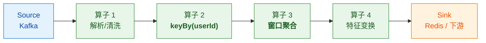

### 4.2 ⭐ `keyBy`：为什么要按用户分组

> 视频原话："**keyBy 按用户 ID 分组——
> 同一个用户的所有点击必须分到同一组，才能算准他的实时兴趣。**"

> [!important] ⭐ 一句话
> **"要算'某人的兴趣'，就必须把'这个人的所有行为'聚到一起。"**
>
> **这就是 `keyBy(userId)` 的全部理由。**

### 4.3 ⭐ 窗口：为什么是"最近 5 分钟 + 每 5 秒滑动"

> 视频原话："**window 是时间窗口，比如最近 5 分钟。
> 我们不可能等用户点一辈子再推荐，所以每五秒滑动一次窗口，增量计算兴趣变化。**"

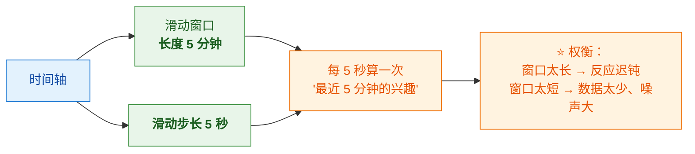

| 参数 | 值 | 为什么这么定 |
|---|---|---|
| **窗口长度** | **5 分钟** | ⭐ **够长**（能反映"当前兴趣"而不是单次误点） |
| **滑动步长** | **5 秒** | ⭐ **够短**（用户 5 秒内就能感受到兴趣更新） |

> [!important] ⭐ 这就是"延迟从小时压到毫秒"的关键设计
> **不是"等数据攒够再算"，而是"每 5 秒增量算一次"。**
>
> ⚠️ **但滑动窗口的代价是"重复计算"**：
> **5 分钟 / 5 秒 = 60 个窗口重叠**——
> **同一个事件会参与 60 次窗口计算。**
> 👉 **所以要用"增量聚合"（如 `aggregate`/`reduce`）而不是"全量缓存"**
> （详见 [[5-bigdata/0-flink/2-时间与窗口|2-时间与窗口]]）。

### 4.4 ⭐ 事件时间 vs 处理时间（视频讲得浅，这里补深）

> 视频原话："**这条时间轴歪歪扭扭的，这就是事件时间——用户实际点击的时间。
> 上面那条是处理时间——数据到达服务器的时间。中间这个差距就是网络延迟。**"

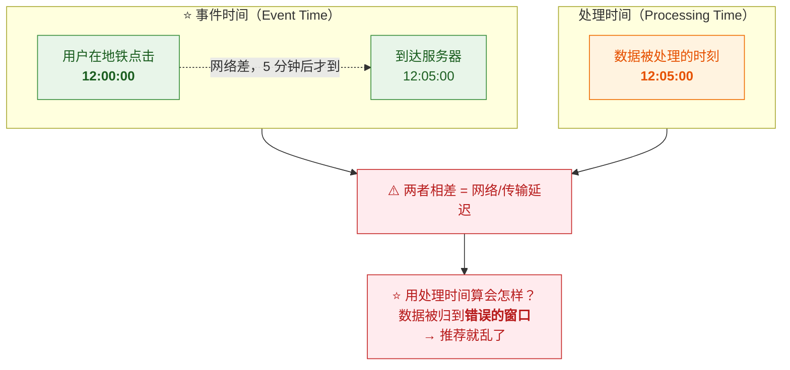

> [!danger] ⚠️ 为什么必须用事件时间
> **如果用处理时间**：
> - **地铁里那个点击（12:00 发生、12:05 到达）会被算进 12:05 的窗口**
> - **窗口内容就"错位"了** → **兴趣向量算错** → **推荐乱掉**
>
> **而且处理时间的结果"不可复现"**——
> **重跑同一批数据会得到不同结果**（因为到达顺序变了）。
>
> 👉 **详细原理见 [[5-bigdata/0-flink/2-时间与窗口|2-时间与窗口]]。**

### 4.5 ⭐⭐ Watermark：为什么是 5 秒

> 视频原话："**用 watermark 也叫水位线。我们允许等五秒——
> watermark 走到某个时刻，就认为之前的数据都到齐了，可以关窗计算。
> 迟到但在水位线之前的数据还能被正确处理。**"

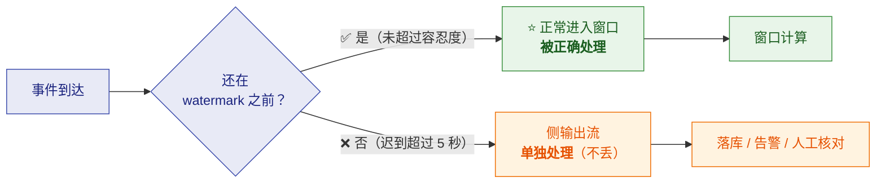

> [!important] ⭐⭐ 5 秒是一个"业务权衡"（视频说得很好）
> 视频原话："**工程就是权衡——等太久延迟高，等太短丢数据。
> 五秒是我们业务能接受的平衡点。**"
>
> | 容忍度 | 代价 |
> |---|---|
> | ⚠️ **设太大**（如 1 分钟） | **延迟变高**——要等 1 分钟才关窗，推荐变慢 |
> | ⚠️ **设太小**（如 100ms） | **大量数据被判定为"迟到"** → **丢进侧输出，正常窗口数据不全** |
> | ⭐ **5 秒** | ⭐ **业务可接受的平衡点** |
>
> 👉 **没有"最优值"，只有"业务可接受的值"**——
> **这个认知比记住"5 秒"更重要。**

> [!tip] 迟到数据的完整处理（三件套）
> | 手段 | 作用 |
> |---|---|
> | **Watermark 容忍度** | 挡住**常规乱序** |
> | **`allowedLateness`** | 窗口触发后**还能重算** |
> | ⭐ **侧输出流** | **绝不丢**（更晚的数据兜底） |
>
> **详见 [[5-bigdata/0-flink/2-时间与窗口|2-时间与窗口]]。**

### 4.6 ⭐ 状态：三层存储

> 视频原话："**状态的三级存储：热数据放内存读写快；
> 温数据是本地快照，做 checkpoint 时快速存盘；
> 冷数据是远程 HDFS，保证机器挂了数据不丢。**"

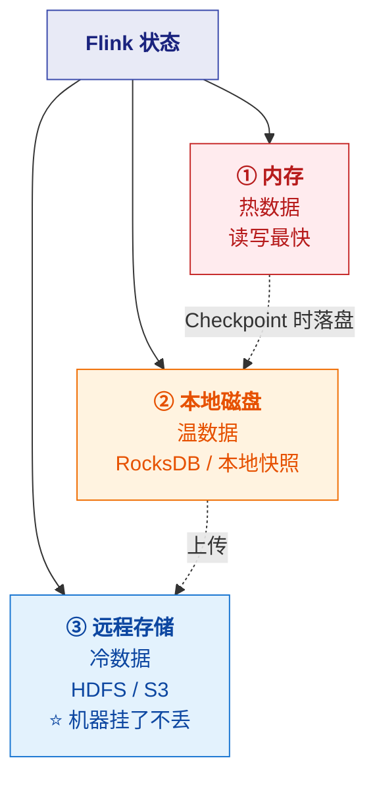

> [!note] 术语订正
> **视频说的"三级存储"更准确的说法是**：
> **状态后端（内存 / RocksDB）+ Checkpoint 存储（远程）。**
> **"本地快照"其实就是 RocksDB 的本地文件（也是 Checkpoint 的中间产物）。**
> **细节见 [[5-bigdata/0-flink/3-状态管理|3-状态管理]]。**

### 4.7 ⭐ Checkpoint：10 秒 vs 30 秒

> 视频原话："**Checkpoint 多久做一次？默认十秒，
> 但双 12 这种高峰期我们调到 30 秒。**"

| 间隔 | 好处 | 代价 |
|---|---|---|
| ⚠️ **太短（如 10s）** | **故障后重放数据少**（恢复快） | ⭐ **CK 频繁 → 抢占资源 → 吞吐下降** |
| ⭐ **太长（如 30s）** | ⭐ **给业务让路，吞吐高** | **故障后重放更多数据**（重复量大） |
| ⭐ **高峰期 30s** | ⭐ **吞吐优先**（大促时吞吐比恢复速度更重要） | —— |

> [!important] ⭐ 为什么"高峰期反而调长"
> **反直觉但合理**：**大促时最怕的是"吞吐不够导致积压"，而不是"宕机恢复慢一点"。**
> **CK 频繁会抢占资源** → **拉低吞吐** → **积压更严重**。
>
> 👉 **这是"可用性 vs 吞吐"的取舍**——**高峰期让位给吞吐。**
>
> ⚠️ **配套参数**：还应设 `execution.checkpointing.min-pause`（给数据留呼吸时间），
> 详见 [[5-bigdata/0-flink/5-Checkpoint与Savepoint|5-Checkpoint与Savepoint]]。

---

## 五、④ 实时特征工程：三步

> 视频原话："**原始点击数据怎么变成用户画像呢？这叫实时特征工程，分三步：
> 第一步提取、第二步关联、第三步变换。**"


### 5.1 ① 提取：从行为算统计

| 特征示例 | 说明 |
|---|---|
| **最近 5 分钟点击数** | 活跃度 |
| **浏览了哪些类目** | 兴趣方向 |
| **点击频次分布** | 兴趣强度 |

### 5.2 ⭐⭐ ② 关联：广播流（Broadcast）

> 视频原话："**这个蓝色线是什么？Broadcast 流——
> 用户维度表不大，我们把它广播到所有算子节点内存里，
> 直接查比连 MySQL 快 100 倍。**"

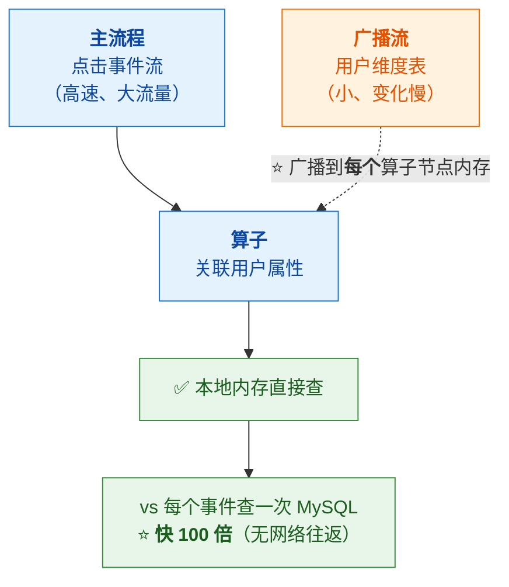

> [!important] ⭐⭐ 为什么广播比查 MySQL 快 100 倍
> **因为"每次事件都查一次数据库"是灾难**——
> **50 万 QPS 就是 50 万次数据库查询/秒**（数据库直接崩）。
>
> **广播的思路**：⭐ **把"小表"复制到每个算子节点的内存里，
> 变成"本地内存查找"**（无网络、无 IO）。
>
> **代价**：**维度表不能太大**（要装进每个节点的内存），
> **且更新有延迟**（广播是异步的）。
>
> 👉 **这就是 Flink 的"维表 Join"经典方案之一**——
> **详见 [[5-bigdata/0-flink/8-FlinkSQL与TableAPI|8-FlinkSQL与TableAPI]]。**

> [!tip] 维表 Join 的三种方案对比
> | 方案 | 适用 | 代价 |
> |---|---|---|
> | ⭐ **广播（Broadcast State）** | **小表**（几 MB~几十 MB） | 占用每个节点内存 |
> | **异步 IO 查外部**（Redis/MySQL） | 中大表、要求实时性 | 网络延迟、外部依赖 |
> | **本地缓存 + 定期刷新** | 变化慢的表 | 有更新延迟 |
>
> **选择关键**：**表的大小** + **对"属性新鲜度"的要求。**

### 5.3 ③ 变换：让模型能看懂

| 变换 | 说明 |
|---|---|
| **数值化** | 分类特征 → 数值（如类目 → embedding / one-hot） |
| ⭐ **归一化** | 把不同量纲的特征缩放到同一范围（如 [0,1]） |
| **离散化** | 连续值分桶（如年龄 → 年龄段） |

> [!important] ⭐ 为什么必须做
> **模型的输入必须是"数值向量"，而且量纲要一致**——
> **否则"点击数（0~100）"会淹没"是否 VIP（0/1）"这类特征。**
>
> 👉 **这一步决定了"模型能不能用"**，是特征工程的必要环节。

---

## 六、⑤ Redis：特征服务（P99 < 1ms）

> 视频原话："**REDIS 是特征服务的缓存层。推荐模型要查用户画像，
> 从 REDIS 读 P99 延迟一毫秒内。**"

> [!important] ⭐ 为什么用 Redis 而不是数据库
> | 维度 | Redis | MySQL |
> |---|---|---|
> | **延迟** | ⭐ **亚毫秒（内存）** | **毫秒~几十毫秒** |
> | **QPS** | ⭐ **十万级** | 千级 |
> | **定位** | ⭐ **在线特征服务** | 持久化存储 |
>
> 👉 **在线链路对延迟极其敏感**——**每 1ms 都要抠**（见第七节预算表）。
>
> **详见 [[2-redis/一次讲透Redis（详细整理版）|一次讲透 Redis]]。**

### 6.1 ⭐ 特征的生命周期

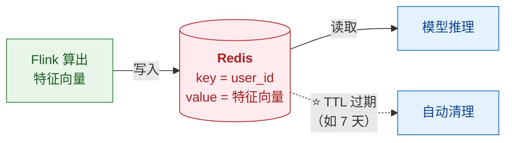

> [!warning] ⚠️ 注意"特征 TTL"与"Flink 状态 TTL"是两回事
> | | 位置 | 作用 |
> |---|---|---|
> | **Flink 状态 TTL** | **计算层** | 控制**状态大小**（防 OOM） |
> | **Redis 特征 TTL** | **服务层** | 控制**特征新鲜度 + 内存占用** |
>
> **两者都要设**，但目的不同。

---

## 七、⑥ 模型推理：50ms 的延迟预算

> 视频原话："**整个在线推断必须在 50ms 内完成，这是我们的 SLA。**"

### 7.1 ⭐⭐ 延迟预算表（本节最有价值）

| 环节 | 耗时 | 占比 |
|---|---|---|
| ⭐ **从 Redis 拉特征** | **2ms** | 5% |
| ⭐ **模型推理** | **30ms** | ⭐ **79%** |
| **结果排序** | **6ms** | 16% |
| ⭐ **总计** | **38ms** | ✅ **在 50ms SLA 内** |

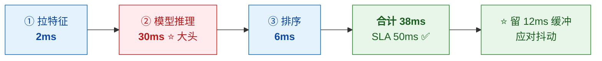

> [!success] ⭐⭐ "延迟预算"是这套设计最值得学的方法
> **先定 SLA（50ms），再把预算拆到每个环节**——
> **这样一超标就知道"该优化哪里"。**
>
> ⭐ **而且必须留缓冲**（38ms vs 50ms，留了 12ms）——
> **因为线上会有抖动（GC、网络、负载）。**
> **如果预算刚好卡满，稍一抖动就超标。**

### 7.2 ⭐⭐ 为什么在线用小模型

> 视频原话："**所以在线不能用大模型——
> 我们离线用 TensorFlow 训练深度模型，
> 但在线用轻量化的双塔模型，甚至逻辑回归。**"

| | **离线** | ⭐ **在线** |
|---|---|---|
| 模型 | **深度模型（TensorFlow）** | ⭐ **轻量（双塔 / LR）** |
| 约束 | **精度优先** | ⭐ **延迟优先（≤ 50ms）** |
| 模型大小 | 不限 | ⭐ **10MB 以内** |
| 数据 | **全量历史** | **实时特征** |

> [!important] ⭐⭐ 核心设计思想：离线训练、在线推理
> **"离线用大模型学出'知识'，在线用轻量模型快速'打分'。"**
>
> | 阶段 | 做什么 | 特点 |
> |---|---|---|
> | **离线** | **用深度模型训练**（数据全、算力足） | 慢但准 |
> | ⭐ **在线** | **轻量模型（双塔/LR）实时打分** | ⭐ **快** |
>
> **"双塔模型"的经典结构**：
> **用户塔（编码用户特征）+ 物品塔（编码商品特征）→ 向量相似度**
> ——**可以预先算好物品向量，在线只算用户塔 + 内积**（省时）。
>
> 👉 **模型控制在 10MB 以内 → 可以"常驻内存直接跑"**——
> **省掉了加载/网络开销。**

### 7.3 ⭐ 本地特征缓存（容灾设计）

> 视频原话："**所以我们做了本地特征缓存，REDIS 挂了也能顶 30 秒。**"

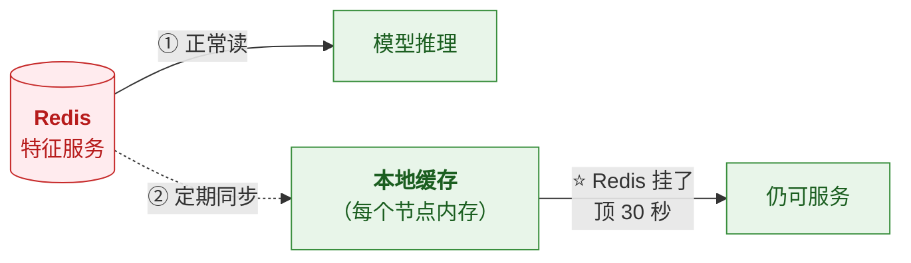

> [!success] ⭐ 这是很好的"降级"设计
> **Redis 是单点风险**（虽然可以集群，但仍可能故障）——
> **本地缓存提供了"30 秒的缓冲窗口"**，
> **让运维有时间恢复，而不是"Redis 一挂、推荐全挂"。**
>
> 👉 **思路可推广**：**任何外部依赖都要想"它挂了怎么办"**——
> **降级、缓存、兜底数据。**

---

## 八、⑦ 推送网关：送达率与防骚扰

### 8.1 多渠道与降级

> 视频原话："**推送网关就像快递分拣中心：先判断用户设备是 iOS 还是安卓，
> 再选择渠道——在线发站内信，离线发 push，紧急优惠才发短信。**"

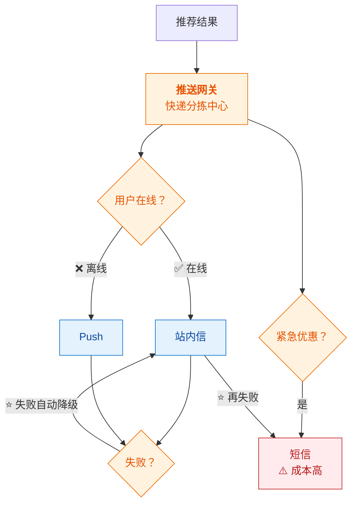

| 渠道 | 成本 | 可靠性 |
|---|---|---|
| **站内信** | 低 | 高（用户在线才看到） |
| **Push** | 低 | ⚠️ **98.5%**（iOS 常被杀） |
| **短信** | ⚠️ **高（一天限一次）** | 高 |

### 8.2 ⭐⭐ 推送风暴与防抖

> 视频原话："**如果用户一秒内点了十个商品，会不会收到十条推送？
> 好问题，这叫推送风暴。我们加了防抖窗口——
> 同一用户 30 秒内最多推一条，且只推权重最高的那个。**
> **骚扰用户等于自杀。**"

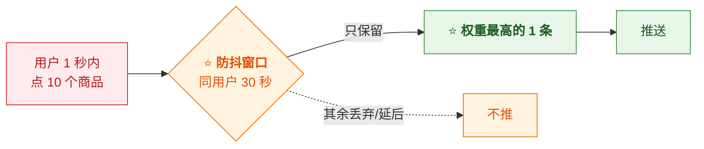

> [!important] ⭐⭐ 为什么这条是"产品红线"
> **"骚扰用户等于自杀"**——**过度推送会导致**：
> - 用户关闭通知权限（**以后再也推不到**）
> - 卸载 App
> - 投诉/负面评价
>
> 👉 **所以"防抖 + 取最高权重"不只是技术优化，而是产品策略。**
>
> ⭐ **技术手段**：**Flink 里用 KeyedProcessFunction + 定时器**实现
> （每个 user_id 一个定时器，窗口内只发最优的一条）。

---

## 九、全链路监控：三位一体

> 视频原话："**没有监控的实时系统，指标、日志、链路追踪三位一体，缺一不可。
> 监控不是摆设，是排雷地图。**"

### 9.1 ⭐ 要看的关键指标

| 环节 | 指标 | 异常含义 |
|---|---|---|
| **采集** | 吞吐量 | 上游异常 |
| ⭐ **Kafka** | ⭐ **Lag（消费积压）** | **下游处理跟不上** |
| ⭐ **Flink** | ⭐ **反压（Backpressure）** | **下游慢，上游被压** |
| **Flink** | Checkpoint 耗时/失败率 | 状态过大或资源不足 |
| ⭐ **端到端** | ⭐ **延迟** | **用户体验** |
| **推送** | 到达率 | 渠道质量 |

### 9.2 ⭐⭐ 排障链路（视频讲得很好）

> 视频原话："**Kafka Lag 高 → 往前追溯 → 发现 FLINK 反压高 →
> 反压是 FLINK 的自我保护：下游慢了，上游自动降速，不然内存会爆。**"

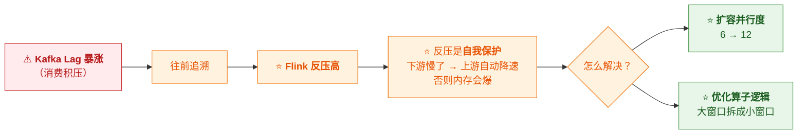

> [!important] ⭐⭐ 反压的本质（重要认知）
> **反压不是"故障"，而是"流系统的本能保护"**——
> **当下游处理不过来，上游必须降速，否则数据会在内存里堆积直到 OOM。**
>
> 👉 **所以看到反压，不要"消除反压"，而要问"下游为什么慢"。**
>
> **排查方法**：**从 Sink 往前找，第一个出现反压的上游算子，
> 它下游那个"正常"的算子就是瓶颈。**
> **详见 [[5-bigdata/0-flink/6-背压与性能调优|6-背压与性能调优]]。**

---

## 十、⭐⭐ 四个坑（每个都真实踩过）

> 视频原话："**这四个坑我们团队每个都摔过。**"

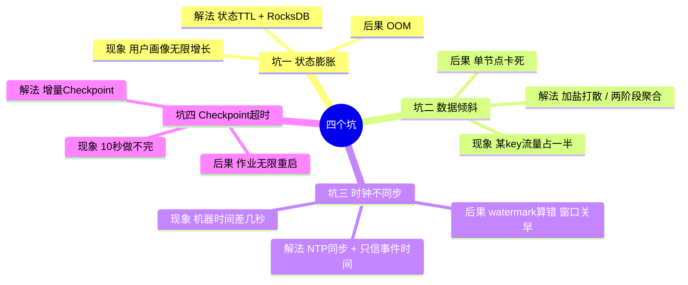

### 坑一：状态膨胀 → OOM

| 项 | 内容 |
|---|---|
| **现象** | ⭐ **用户画像无限增长，一个作业状态涨到 20GB** |
| **后果** | ⭐ **直接 OOM** |
| **解法** | ⭐ **状态 TTL**（如兴趣保留 7 天）+ ⭐ **RocksDB 状态后端**（大状态放磁盘，内存只放索引） |

### 坑二：数据倾斜

| 项 | 内容 |
|---|---|
| **现象** | ⭐ **某个 key 数据量暴增，单分区流量占一半** |
| **后果** | ⭐ **该节点卡死**（木桶效应） |
| **解法** | ⭐ **给 key 加随机盐打散** / ⭐ **两阶段聚合** |

> [!tip] 倾斜的定位与治理详见
> [[5-bigdata/4-hive/3-HQL与SQL优化|Hive SQL 优化]] §三（含完整的治理决策树）——
> **原理与 Flink 完全相通**（空值、热点 key、加盐、两阶段）。

### 坑三：时钟不同步

| 项 | 内容 |
|---|---|
| **现象** | ⭐ **集群里有几台机器时间差了几秒** |
| **后果** | ⭐ **Watermark 算错 → 窗口关早了 → 数据被误判为迟到** |
| **解法** | ⭐ **全集群 NTP 同步** + ⭐ **只信事件时间**（不信机器时间） |

> [!important] ⭐ 这个坑很隐蔽
> **因为它"不报错"**——**只是结果静默偏差**。
> **而且它"有时好有时坏"**（取决于哪台机器处理）。
>
> **根因**：**Watermark 的推进依赖"机器时间"来驱动**——
> **如果节点间时间不一致，watermark 就会算错。**
>
> 👉 **"只信事件时间"是根本解法**：**业务时间来自数据本身，不受机器时钟影响。**

### 坑四：Checkpoint 超时

| 项 | 内容 |
|---|---|
| **现象** | ⭐ **状态太大，10 秒做不完 Checkpoint** |
| **后果** | ⭐ **作业无限重启**（CK 一直失败 → 判定失败 → 重启 → 又失败） |
| **解法** | ⭐ **增量 Checkpoint**（只存变化的状态） |

> [!warning] ⚠️ 增量 CK 的前提
> **需要 RocksDB 状态后端** + **支持增量文件系统的存储**（HDFS/S3）——
> **两者缺一不可**（详见 [[5-bigdata/0-flink/5-Checkpoint与Savepoint|5-Checkpoint与Savepoint]]）。

---

## 十一、⭐⭐ 架构演进：不是一天建成的

> 视频原话："**架构不是一天建成的：第一版只有 Kafka + Storm，延迟五秒；
> 第二版换成 Flink，延迟降到一秒；
> 第三版加了特征工程和模型服务，才做到 50ms 内响应。
> 所以先跑通再优化，别一上来就追求极致。**"

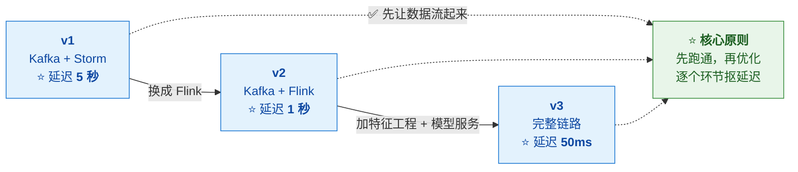

> [!success] ⭐⭐ 这个演进路径很值得学
> | 版本 | 技术 | 延迟 | 关键动作 |
> |---|---|---|---|
> | **v1** | Kafka + Storm | **5 秒** | ⭐ **先把链路跑通** |
> | **v2** | Kafka + Flink | **1 秒** | ⭐ **换引擎**（Storm → Flink） |
> | **v3** | + 特征工程 + 模型服务 | **50ms** | ⭐ **补齐"算得准"** |
>
> **注意：延迟是"逐个环节抠出来的"，不是一步到位。**
>
> 👉 **"先跑通再优化"** 是很实用的工程原则——
> **一上来追求极致架构，往往做不完。**

---

## 十二、峰值应对与未来优化

### 12.1 ⭐ 双 12 峰值：1.2 亿条/秒

> 视频原话："**峰值 1.2 亿条每秒，系统居然稳住了。**
> **Kafka 分区提前扩到 48 个，Flink 并行度加到 96，
> Redis 集群加了 20 个节点。预案做了八套，一个都没用上。**"

| 层 | 动作 | 说明 |
|---|---|---|
| **Kafka** | ⭐ **分区扩到 48** | 提升并行消费能力 |
| **Flink** | ⭐ **并行度加到 96** | 2 倍于分区数 |
| **Redis** | **集群加 20 节点** | 提升特征服务吞吐 |
| ⭐ **预案** | ⭐ **做了 8 套，一个没用上** | ⭐ **这就是"准备好了"的意义** |

> [!important] ⭐ 两点值得注意
> **① 扩容顺序有讲究**：
> **Kafka 分区数 → Flink 并行度**（因为分区数是并行度上限）。
> ⚠️ **Flink 并行度 96 vs Kafka 分区 48 = 2:1**（符合"1:1 或 1:2"的建议）。
>
> **② "预案做了八套，一个都没用上"是最好的结果**——
> **容灾的价值在于"准备好了"，而不在于"用上了"。**

### 12.2 ⭐ 三个优化方向

| 方向 | 说明 | 收益 |
|---|---|---|
| ⭐ **用 Flink SQL 替代部分代码** | 降低维护成本 | 可维护性 |
| ⭐ **模型推理放到边缘节点** | 离用户更近 | ⭐ **延迟再降 10ms** |
| ⭐ **引入流批一体** | 同一套代码跑实时 + 离线 | 降低开发成本 |

> [!tip] 三个方向的共性
> **都不是"让系统更快"，而是"让系统更好维护/更省成本"。**
> ——**说明性能已经够用，优化重心转向了工程效率。**

---

## 十三、⭐ 六个关键词（视频结尾的总结）

> 视频原话："**记住六个关键词。**"

| 关键词 | 含义 | 对应环节 |
|---|---|---|
| ⭐ **实时是生命线** | 延迟本身就是产品价值 | 全链路 |
| ⭐ **吞吐是防洪堤** | 抗住峰值 | Kafka |
| ⭐ **容错是安全带** | 故障不丢数据 | Checkpoint / 状态 |
| ⭐ **扩展是底气** | 能随流量扩容 | 分区 / 并行度 |
| ⭐ **状态是灵魂** | 流计算的核心是"记忆" | Flink 状态 |
| ⭐ **治理是眼睛** | 没有监控等于盲飞 | 监控三位一体 |

> [!success] ⭐ 以及一句工程哲学
> **"实时流计算本质上是一门关于时间的工程学：
> 它要求我们在数据产生的瞬间做出决策，
> 在系统崩溃的边缘保持优雅，在无限增长的数据面前保持弹性。"**
>
> **"工程没有银弹，但有方法。"**

---

## 附录 A：语音转写（ASR）勘误对照

> 原稿是语音转写，错误较多。**阅读原始字幕稿时对照此表。**

| 原稿（错） | 正确 | 说明 |
|---|---|---|
| **光点** | ⭐ **点击** | 全文多处（最典型） |
| **每天数11条点击** | **每天数十亿条点击** | 数量级描述 |
| **rock dB / RocksDB** | ⭐ **RocksDB** | 状态后端 |
| **home / OOM** | ⭐ **OOM**（内存溢出） | "直接 home" |
| **release** | ⭐ **Redis** | "最后存 release" |
| **REDIS** | ⭐ **Redis** | 全文多处 |
| **斯拉 / SLA** | ⭐ **SLA**（服务等级协议） | "这是我们的斯拉 50ms" |
| **TENSORFLOW** | **TensorFlow** | 离线训练框架 |
| **双塔模型** | 双塔模型 | 此处原文正确 |
| **逻辑回归** | 逻辑回归（LR） | 此处原文正确 |
| **cf a / kafka** | **Kafka** | "数据在 cf a 里积压" |
| **ccco lag** | ⭐ **Kafka Lag** | 消费积压指标 |
| **KAFKA / FLINK** | Kafka / Flink | 大小写 |
| **随基岩 / 随机盐** | ⭐ **随机盐**（加盐打散） | 倾斜解法 |
| **关键路径 / 关键** | —— | —— |
| **KEB** | ⭐ **keyBy** | "KEB 要记每个用户的实时兴趣向量" |
| **data flow** | **DataFlow** | Flink 核心概念 |
| **checkpoint / check point** | ⭐ **Checkpoint** | 全文多处 |
| **watermark** | **Watermark** | 水位线 |
| **侧输出流** | 侧输出流 | 此处原文正确 |
| **迫使失败** | ⭐ **Push 失败** | 推送降级逻辑 |
| **骚扰用户等于自杀** | 原意正确 | 产品红线 |
| **防抖窗口** | 防抖/去重窗口 | 此处原文正确 |
| **反压** | 反压（Backpressure） | 此处原文正确 |
| **NTP 同步** | **NTP 同步** | 此处原文正确 |
| **增量 check point** | ⭐ **增量 Checkpoint** | 坑四解法 |
| **流批一体** | 流批一体 | 优化方向 |
| **FLINK SQL** | **Flink SQL** | 优化方向 |
| **1.2 亿条每秒** | 峰值描述 | 注意：与开头"50 万 QPS"是**不同口径**（见下方说明） |

> [!note] ⚠️ 关于"50 万 QPS"与"1.2 亿条/秒"
> **视频开头说"每秒 50 万条点击"，结尾说"峰值 1.2 亿条每秒"**——
> **两者相差 240 倍，口径明显不同**（可能前者是"点击行为"，
> 后者是"全站所有事件"或含内部数据）。
>
> **本篇按视频原话保留，但请注意这个数字存疑**——
> **1.2 亿 QPS 对于单一推荐链路是极高的量级**（需要重新审视）。

---

## 附录 B：30 秒速查

> [!abstract] 记住这 12 句
> 1. ⭐ **核心三句话**：**Kafka 抗住峰值、Flink 算得够快、Redis 查得够准。**
> 2. **采集网关**三件事：**协议统一、数据清洗、转标准 JSON**。
> 3. **一条点击必须有**：`user_id`、`item_id`、**行为类型、时间戳**。
> 4. ⭐ **Kafka 按 `user_id` 分区**——**同用户保序，不同用户并行**。
> 5. ⭐ **分区数 = 并行度上限**；建议与消费者 **1:1 或 1:2**。
> 6. ⭐ **窗口：5 分钟长度 + 5 秒滑动** → 每 5 秒增量更新兴趣。
> 7. ⭐ **Watermark 容忍 5 秒**是**业务权衡**（等太久延迟高，等太短丢数据）。
> 8. ⭐ **特征工程三步**：**提取 → 关联（广播维表）→ 变换（向量化）**。
> 9. ⭐ **延迟预算**：**特征 2ms + 推理 30ms + 排序 6ms = 38ms**（SLA 50ms）。
> 10. ⭐ **推送防抖**：**同用户 30 秒最多一条，只推权重最高的**。
> 11. ⭐⭐ **四个坑**：**状态膨胀、数据倾斜、时钟不同步、Checkpoint 超时**。
> 12. ⭐ **演进路径**：**Storm 5s → Flink 1s → +特征工程 50ms**（先跑通再优化）。

> [!tip] 三个最值得复用的方法论
> ① ⭐ **延迟预算**：先定 SLA，再把预算拆到每个环节（留缓冲）。
> ② ⭐ **反压是保护不是故障**：看到反压要问"下游为什么慢"。
> ③ ⭐ **先跑通再优化**：别一上来追求极致架构。

---

> 关联：[[5-bigdata/0-flink/0-Flink总览|Flink 系列]]（机制细节）· [[2-redis/一次讲透Redis（详细整理版）|Redis]] · [[3-mq/2-Kafka/理解 kafka 基本盘（详细整理版）|Kafka]]
> 原始字幕稿：[[50万QPS实时推荐 延迟从小时压到毫秒]]
