# 从告警到百万 QPS —— Java 性能调优实战

> [!info] 场景设定
> **线上事故**：老马的订单接口炸了——**P99 延迟飙到 2 秒，错误率接近一半**。
> 老板说明天有大促预热，**扛不住就得回滚**。
>
> 这篇整理自一个 12 分钟的对话式视频，讲的就是**怎么从这种状态一步步调到 102 万 QPS**。
> 原文是逐字稿（口语 + 语音识别错误），本文重新组织成**分层结构**，方便理解和记忆。

---

## 〇、先看全局：一句话抓住这场调优

> [!important] 全篇最核心的一句
> **性能优化从来不是一招制胜，而是「十个 10% 的提升」叠加：1.1¹⁰ ≈ 2.6 倍。**
>
> 而这场实战更狠——**每个优化单看只有 2~5 倍，叠加起来是 85 倍。**


**实测结果对照**：

| 指标 | 调优前 | 调优后 | 变化 |
|---|---|---|---|
| 吞吐量 | 20,000 QPS | **1,020,000 QPS** | **↑ 51 倍** |
| P99 延迟 | ≈ 2000 ms | **3 ms** | **↓ 约 660 倍** |
| GC 停顿 | 450 ms | **0.8 ms** | **↓ 约 560 倍** |

> 视频强调：**这不是理论值，是经过 JMH 验证、压测确认的真实数据。**

---

## 一、本质：延迟 vs 吞吐（万法之源）

调优不是"让系统跑得更快"这么含糊。**"快"有两个完全不同的含义**：

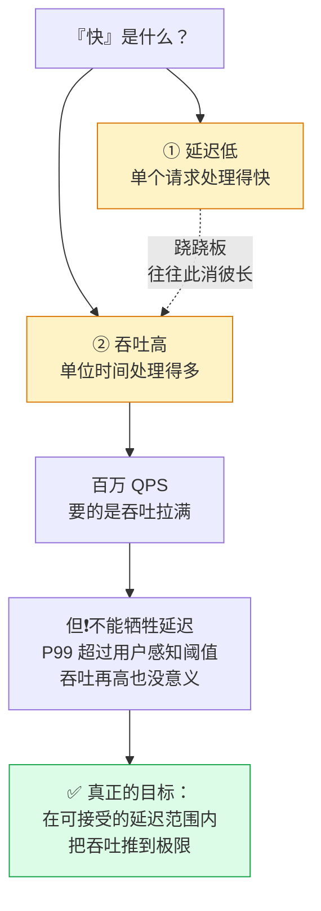

### 1.1 Little's Law：一个"小学乘法"解释一切

> [!tip] 记忆钩子
> **并发数 = 吞吐量 × 平均延迟**
>
> 这就是 **Little's Law（利特尔法则）**。朴素，但它是一条**铁律**。

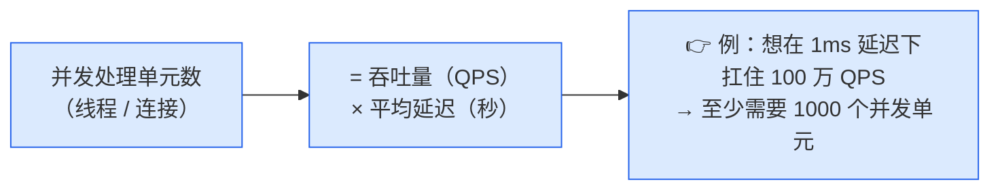

**由它推出的结论**：

| 现象 | 原因 |
|---|---|
| 线程数不够 → 延迟变高 | 请求排队，**排队时间算进延迟** |
| 为什么线程池大小、连接数这些参数如此关键 | 它们**直接决定了系统上限** |

> [!important] 记住这个因果链
> **并发度不足 → 排队 → 延迟上升 → P99 崩**
> 所以**线程池 / 连接池的参数，是吞吐量的天花板**。

### 1.2 第一步不是改代码

> 讲师开场第一句：**"调优第一步不是急着改代码，是先看清全局。"**

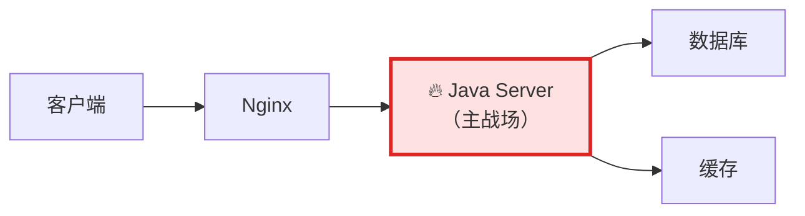

**百万级 QPS 单机抗住的关键战场，就在这台 Java Server 里**——所以今天所有优化都围绕它。

---

## 二、方法论：先观测，再动手

> [!warning] 铁律
> **调优最忌讳的是「我觉得这样会更快」。**
> **性能优化必须基于数据。**
>
> 讲师原话：**"没有 JMH 数据的优化都是耍流氓。"**
> **"调优的第一步永远是建立观测——你得先看见问题，才能解决问题。"**

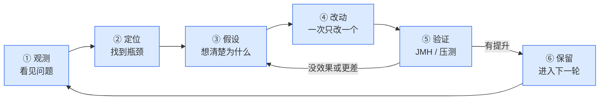

### 2.1 为什么必须用 JMH，不能自己掐表

| 做法 | 问题 |
|---|---|
| `System.currentTimeMillis()` 手动计时 | **JVM 还没热身完**（JIT 没编译、类没加载），测出来的数字没意义 |
| **JMH**（OpenJDK 官方微基准工具） | 帮你处理**预热、JIT 编译、统计误差、死代码消除**等坑 |

**用法**：每次改完代码跑一遍，用数据验证效果。

### 2.2 观测的四个维度

> [!tip] 记忆钩子：**CPU · 内存 · 线程 · IO**
> 四字口诀：**算、存、线、等**

| 维度 | 看什么 |
|---|---|
| **CPU** | 利用率、热点函数 |
| **内存** | 堆使用、**GC 频率** |
| **线程** | 状态分布、死锁 |
| **IO** | 等待时间、吞吐 |

### 2.3 观测的三板斧（够用很久）

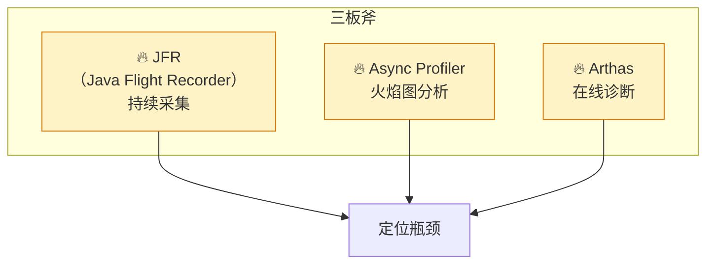

### 2.4 火焰图怎么读（三句话搞定）

> [!tip] 记住三句话，抽象画立刻变地图
> 1. **横轴 = CPU 占比**，**越宽说明吃得越多**
> 2. **纵轴 = 调用深度**，上面是子函数，下面是父函数
> 3. **找最宽的那块色块**，然后问：**它为什么这么宽？**

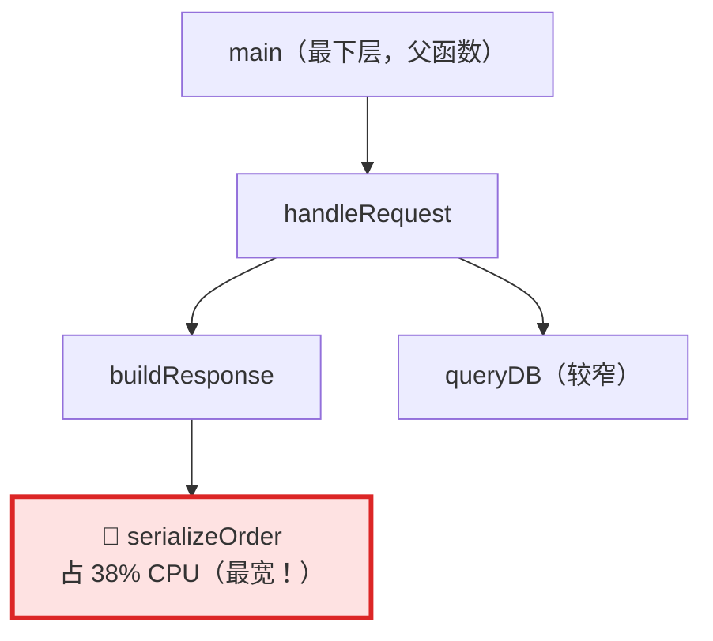

**本例的发现**：`serializeOrder` 一个方法**吃了近 40% CPU**。
**推论**：大概率是 **JSON 序列化太重**了。（这个线索后面专门解决 → 见 §3.5）

### 2.5 GC 日志 = JVM 的心电图

每次 GC 都会记录：**时间、类型、停顿、内存变化**。

**本例数据**：47 次 GC，总停顿 **823 ms**。

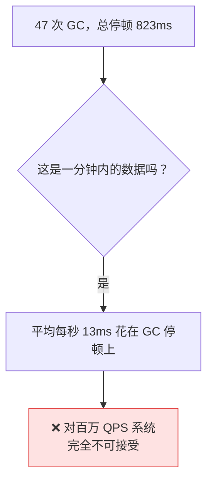

> [!important] GC 停顿的黄金法则
> **P99 停顿控制在 10 ms 以内。**

**怎么减少停顿？**

| 思路 | 说明 |
|---|---|
| 换垃圾收集器 | 只是一方面 |
| **✅ 减少对象分配，少产生垃圾** | **这是根本** —— GC 自然就轻了 |

---

## 三、七层调优塔（★ 全文主干）

这是全篇的**组织骨架**，也是视频最后总结的那套架构。**从下往上，一层层叠起来。**

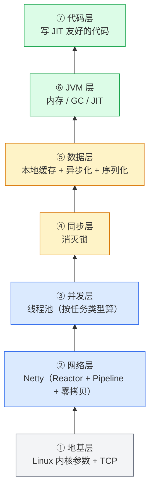

> [!important] 最关键的一句话
> **每一层都是乘法关系，少一层都到不了百万。**
> **不是某一个银弹，而是一层一层的叠加。**

下面逐层拆开。

---

### 🔻 第 1 层（地基）：Linux 内核与 TCP

> [!warning] 讲师原话
> **"Linux 默认参数是为桌面系统设计的，不是为百万 QPS 的服务器。"**
> **"这些不改，你的 Java 再怎么优化也白搭——内核就是那块最短的木板。"**

#### 1.1 必改的内核参数

| 参数 | 作用 | 不改的后果 |
|---|---|---|
| `somaxconn` | TCP 连接队列长度 | **默认 128，百万并发下瞬间溢出** |
| `tcp_tw_reuse` | 允许复用 `TIME_WAIT` 连接 | 端口耗尽 |
| `file-max` | 系统级文件描述符上限 | 连接数被卡死 |

**注意**：大部分可以 `sysctl` **热加载**，但**建议写进 `/etc/sysctl.conf` 持久化，不然重启就丢**。

#### 1.2 TCP 调优：为什么开发也要关心

> 有人问："TCP 调优不是运维的事吗？"
> 答：**"百万 QPS 下，每个 TCP 连接的建立和维护都是成本。"**

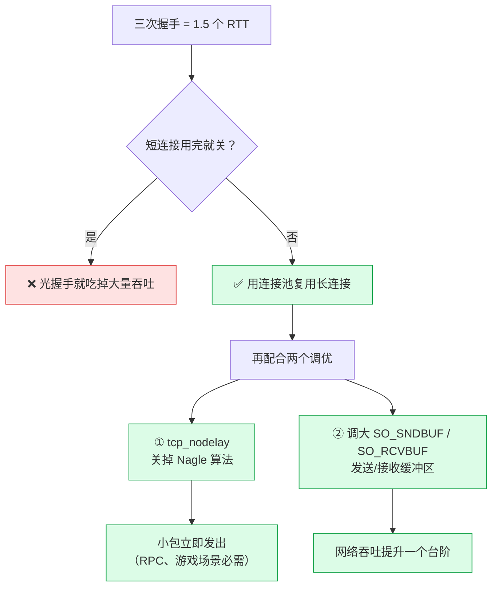

> [!tip] 为什么 Nagle 算法要关
> **Nagle 会等凑够一个 MSS 再发**。对**实时性要求高的场景（RPC、游戏）是灾难**。
> 设 `tcp_nodelay` 让**小包立即发出**。

---

### 🔻 第 2 层：网络 IO（Netty）

#### 2.1 IO 模型演进：BIO → NIO → AIO

```mermaid
graph TB
    subgraph BIO["❌ BIO（阻塞 IO）"]
        B1["一个请求占一个线程"] --> B2["线程大部分时间在<b>等</b><br/>等数据库、等网络包"]
        B2 --> B3["太浪费了"]
    end

    subgraph NIO["✅ NIO（多路复用）"]
        N1["Selector 机制"] --> N2["一个线程监听多个 Channel 的事件"]
        N2 --> N3["有数据来了才处理"]
    end

    subgraph AIO["⚠️ AIO（为什么不用）"]
        A1["Linux 上用的是<b>线程池回调</b>"] --> A2["并不是真正的内核异步"]
        A2 --> A3["Java 生态里 NIO + Netty<br/>已能把性能发挥到极致"]
        A3 --> A4["AIO 更适合文件 IO"]
    end

    classDef bad fill:#fee2e2,stroke:#dc2626
    classDef good fill:#dcfce7,stroke:#16a34a
    classDef warn fill:#fef3c7,stroke:#d97706
    class B1,B2,B3 bad
    class N1,N2,N3 good
    class A1,A2,A3,A4 warn
```

#### 2.2 Netty 设计：一句话概括

> [!tip] 记忆钩子
> **Netty = Reactor 模式 + Pipeline 责任链处理**

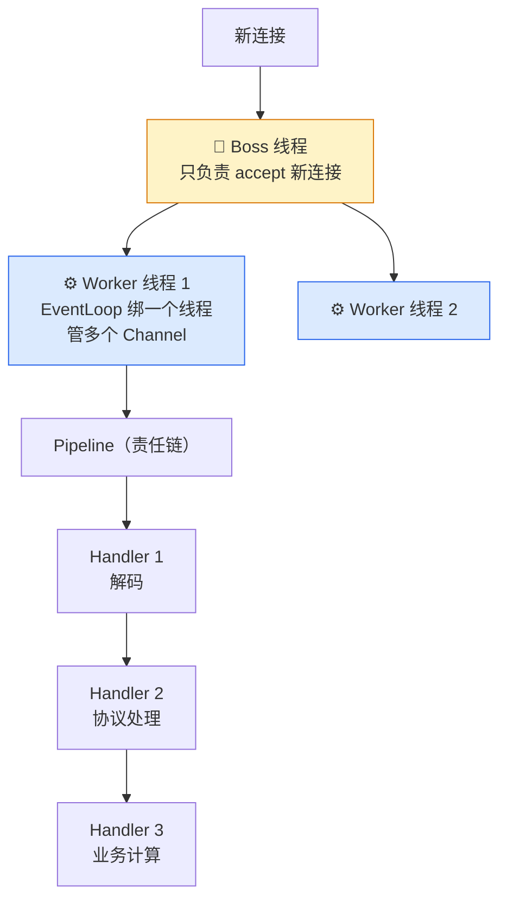

**Boss/Worker 分离的意义**：

| 角色 | 职责 | 为什么这么分 |
|---|---|---|
| **Boss** | 只负责 accept 新连接 | **这样 accept 不会被繁忙的请求阻塞** |
| **Worker** | 负责所有 IO 读写 + 业务处理 | 每个 Worker 用一个 EventLoop 绑一个线程，处理多个 Channel —— **和 NIO 的 Selector 一脉相承** |

**Pipeline 的妙处**：

- 把业务逻辑拆成一个个 **Handler**（编解码 / 协议处理 / 业务计算），串在 Pipeline 里，**Handler 可以自己写**
- **Netty 保证每个 Channel 的 Handler 只被一个线程调用 → 天然线程安全**
- **这比你自己管理线程和锁高效得多**

#### 2.3 零拷贝（名字有误导）

> [!note] "零拷贝"不是"一次都不拷贝"
> **数据还是要在内核缓冲区和网卡之间移动**（由 DMA 控制）。
> **真正的关键是：数据不需要从内核空间 → 用户空间 → 再拷贝回去。**
> **省掉这两次 CPU 拷贝和上下文切换，性能直接翻倍。**

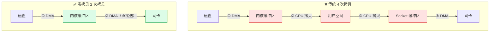

**Netty 怎么用零拷贝？**

| 手段 | 说明 |
|---|---|
| **`FileRegion`** | 底层调的就是 **`FileChannel.transferTo()`**，完全零拷贝 |
| **`Direct Buffer`** | 直接在**堆外**分配内存，**减少一次从堆内到堆外的拷贝** |

> **百万 QPS 下，这些细节的差距会被放大到数量级。**

---

### 🔻 第 3 层：并发（线程池）

#### 3.1 破除最大误区：线程不是越多越好

> 老马问："线程不是越多越好吗？多开几个线程不就能处理更多请求？"
> 答：**"这是最常见的误区。线程不是免费的。"**

| 成本 | 说明 |
|---|---|
| **内存** | 每个线程约占 **1 MB** |
| **切换开销** | 线程切换要保存/恢复上下文，导致 **CPU 缓存失效** |
| **极端情况** | 1000 个线程频繁切换，**CPU 时间一半都花在切换上** |

#### 3.2 高并发的两条出路

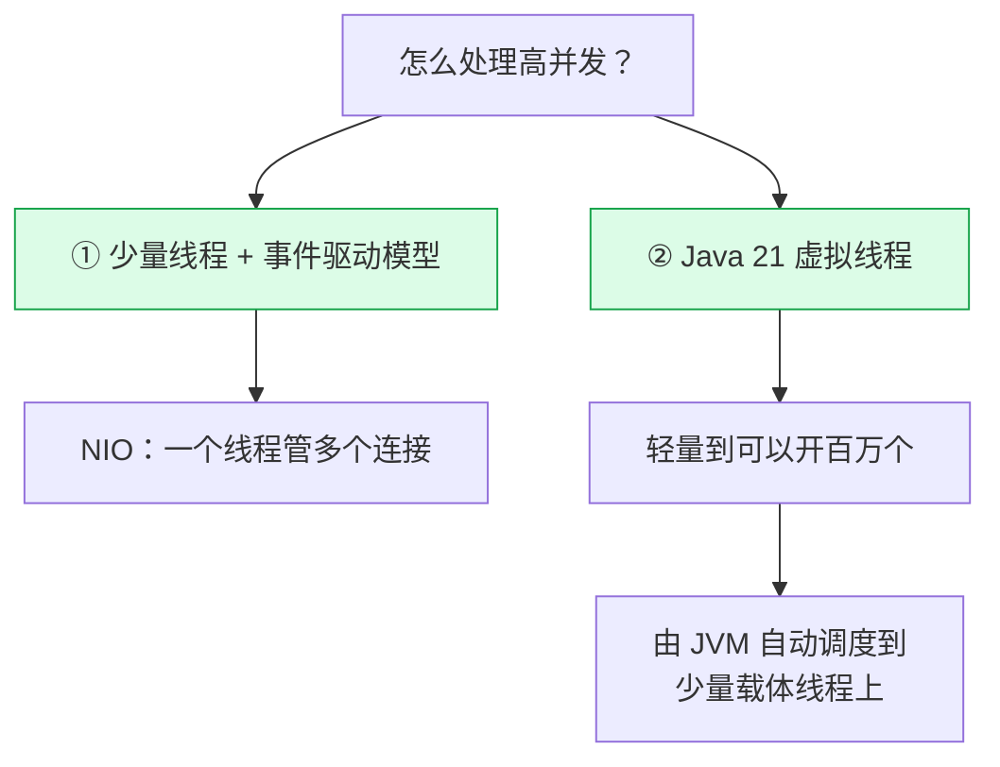

#### 3.3 线程池参数怎么算（★ 别抄网上的）

> 老马坦白："我每次都是网上抄一个 `coreSize=64, maxSize=256, queue=1000`，
> 这大概是全网最常用的配置。"
> 答：**"但它对不对，完全取决于你的任务是什么类型。"**

| 任务类型 | 线程数公式 | 原因 |
|---|---|---|
| **CPU 密集型** | **核数 + 1** | 多了**反而增加切换开销** |
| **IO 密集型** | **核数 × (1 + 等待时间 / 计算时间)** | 线程大部分时间在等，**可以开很多** |

#### 3.4 队列：无界队列是大忌

> [!warning] 必须记住
> **无界队列意味着任务可以无限堆积 → 内存会被撑爆。**
> **一定要用有界队列 + 合适的拒绝策略。**
> **百万 QPS 场景下，推荐 `SynchronousQueue` 或定制的有界队列——宁可快速失败，也不要无限等待。**

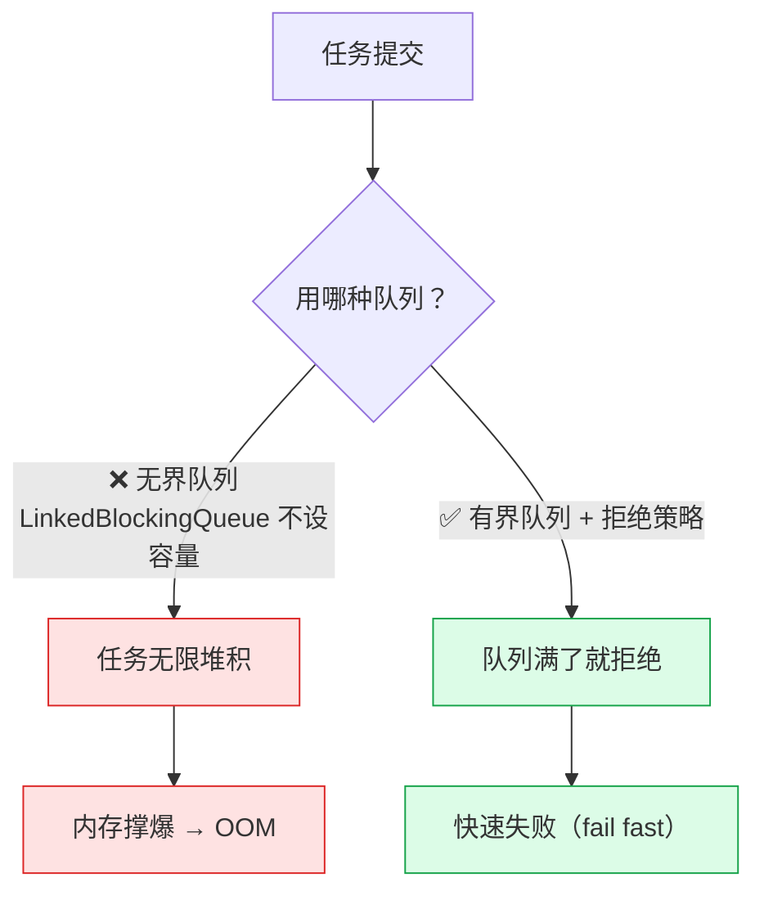

---

### 🔻 第 4 层：同步（锁）

#### 4.1 为什么 synchronized 在高并发下会拖后腿

> 老马问："`synchronized` 不是挺好的吗？JVM 会自动优化吧？"
> 答：**"JVM 确实做了锁升级——偏向锁 → 轻量级锁 → 重量级锁。
> 但在高并发下，一旦升级到重量级锁，线程阻塞、上下文切换的开销就来了。"**

> [!important] 一句狠话
> **百万 QPS 下，每多一个锁竞争，延迟就多一个量级。**

#### 4.2 三个"不用锁"的手段

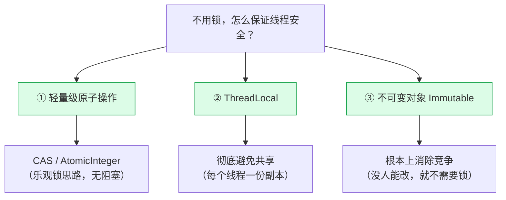

> [!tip] 记忆钩子
> **最高效的锁，就是没有锁。**
> 顺序记：**原子操作 → 线程私有 → 干脆不变**

#### 4.3 Disruptor：设计层面消灭锁

**背景**：传统 `BlockingQueue` 做消息处理是瓶颈——**加锁、阻塞、伪共享**。

**Disruptor 用三个设计打破天花板**：

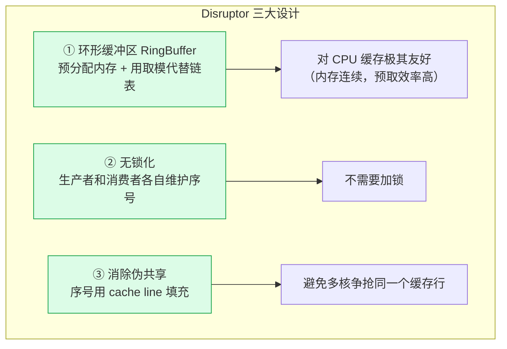

> [!important] Disruptor 的本质
> **它的核心是「设计层面消灭锁」，而不是「用更高级的锁」。**
> 这个区别想通了，很多性能问题就有解了。

---

### 🔻 第 5 层：数据（缓存 / 异步 / 序列化）

#### 5.1 序列化：ROI 极高

> 老马问："序列化不就是把对象变成 JSON 吗？这也要优化？"
> 答：**"百万 QPS 下，每个请求都序列化反序列化一次。"**

**为什么 JSON 慢？**

| 原因 | 说明 |
|---|---|
| 文本格式 | **字段名重复传输**（每个对象都带着 key） |
| 数字处理 | 数字要**转字符串再解析** |
| 对象创建 | 靠**反射**创建对象 |

**Protobuf 快在哪？**
- **二进制格式**
- 用 **schema 描述结构**（字段名只传一次、传的是编号）
- 编解码只需要**位运算**
- **差距可能是十倍**

**选型建议（★ 记住这张表）**：

| 场景 | 用什么 | 原因 |
|---|---|---|
| **外部 API** | **Protobuf** | 跨语言兼容好 |
| **内部 RPC** | **Kryo** | Java 最快，但**不跨语言** |
| **对外暴露 / 调试** | JSON | **只在需要人看的场景保留** |

> [!important] 为什么序列化值得优先优化
> **因为它影响每个请求的每个字节。ROI 极高。**

#### 5.2 本地缓存：Caffeine

> 老马："每次订单查询都要走一次 MySQL，太慢了。"
> **"本地缓存是最有效的优化之一。"**

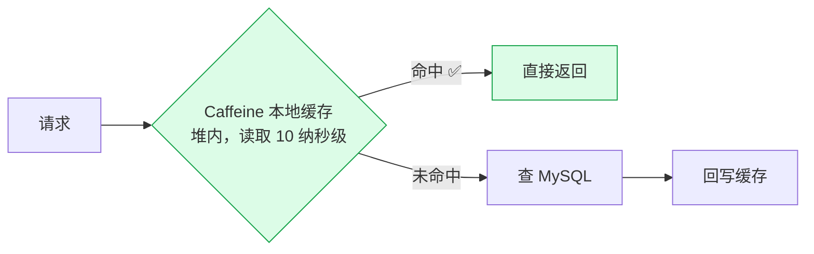

**为什么用 Caffeine？**
- 用了 **W-TinyLFU** 淘汰算法，**命中率比 LRU 高得多**
- 热点数据放在 **JVM 堆内**，读取是**十纳秒级**

**数据一致性怎么办？三种策略**：

| 策略 | 做法 |
|---|---|
| ① **写时失效** | 写数据库时**删除缓存** |
| ② **设置合理的 TTL** | 让缓存自己过期 |
| ③ **Canal 监听 binlog** | **异步更新缓存** |

> [!important] 讲师的取舍原则
> **"百万 QPS 下缓存是刚需，但要设计好更新策略。**
> **宁可短暂不一致，也不能放弃缓存。"**

#### 5.3 异步化：异步 ≠ 多线程

> 老马问："异步化不就是多线程吗？"
> 答：**"不完全一样。多线程是『多人同时干』，异步是『不等结果，就去做下一件事』。"**

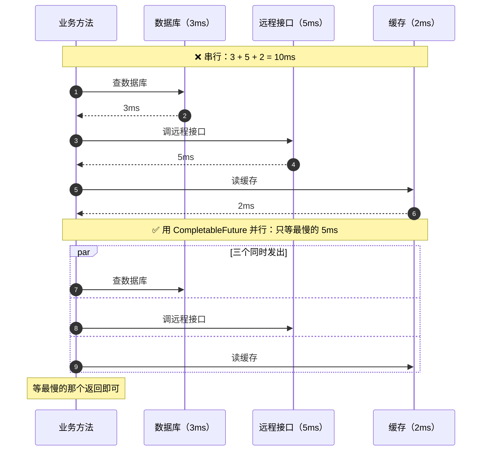

**收益**：`10ms → 5ms`，**省下来的一半时间，在百万 QPS 下就是巨大的吞吐提升**（回到 §1.1 的 Little's Law）。

---

### 🔻 第 6 层：JVM（内存 / GC / JIT）

#### 6.1 JVM 内存模型：用"工厂"来记

> [!tip] 记忆钩子：JVM 是一座三层工厂

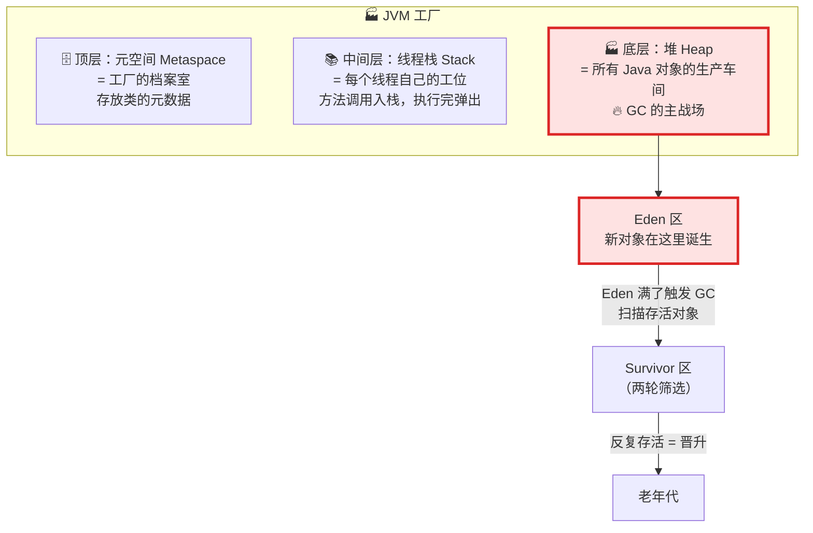

**一句话**：**GC 主要在堆里干活。**
对象流转：**Eden 诞生 → Eden 满 → 存活搬到 Survivor → 反复存活的晋升老年代**。

> **理解这个流转，是后面调 GC 参数的基础。**

#### 6.2 三个垃圾收集器怎么选

```mermaid
graph TB
    Q["选哪个收集器？"] --> G1["G1<br/>默认全能选手"]
    G1 --> G1a["适合大多数场景<br/>但停顿相对长"]

    Q --> Z["ZGC ⭐<br/>停顿亚毫秒级"]
    Z --> Za["几乎不影响业务<br/>但吃更多内存<br/>（染色指针 + 读屏障）"]

    Q --> S["Shenandoah<br/>类似 ZGC"]
    S --> Sa["Red Hat 主导<br/>生态略小"]

    classDef z fill:#dcfce7,stroke:#16a34a,stroke-width:3px
    class Z,Za z
```

> [!important] 选型口诀（★ 背下来）
> **堆 ≤ 16G → 首选 ZGC**
> **堆更大 或 内存紧张 → G1 配合合理参数也能胜任**
>
> **先选对收集器，再去调参数。**

#### 6.3 JVM 参数调优的四步顺序（★ 别在参数海洋里迷失）

> 老马："这些参数密密麻麻的，怎么知道该调哪个？"
> 答：**"我给你一个调优顺序。"**

```mermaid
flowchart TD
    A["第 1 步<br/>设好堆大小<br/>-Xmx / -Xms 设成一样"] --> A1["避免运行时动态扩缩<br/>（扩缩本身要 STW）"]
    A1 --> B["第 2 步<br/>选好收集器<br/>如 -XX:+UseZGC"]
    B --> C["第 3 步<br/>设目标停顿<br/>如 -XX:MaxGCPauseMillis"]
    C --> D["第 4 步<br/>根据 GC 日志微调<br/>区域大小 / 并发线程数"]

    D --> E["💡 80% 的效果来自前两步<br/>别在参数海洋里迷失"]

    classDef key fill:#fef3c7,stroke:#d97706,stroke-width:3px
    class A,B key
```

**调优方法**：先用 JMH 测基准 → **调一个参数测一次** → 用数据说话。

#### 6.4 JIT：让编译器帮你干活

> 老马："JIT 我知道，就是把热点代码编译成机器码。但这跟调优有什么关系？"
> 答：**"关系大了。"**

**JIT 的三个"隐藏技能"**：

| 技能 | 效果 |
|---|---|
| **逃逸分析** | 发现对象没逃出方法 → **直接在栈上分配，不进堆**（减少 GC 压力！） |
| **方法内联** | 消除方法调用的开销 |
| **循环展开** | 减少分支预测失败 |

> [!important] 写代码时要想的事
> **"写代码时想着 JIT 的胃口，编译器会帮你做很多优化——前提是你的代码要给它机会。"**
>
> 具体来说：
> - **小方法**更容易被内联
> - **短生命周期对象**更容易栈上分配

> 这直接呼应了 §1.1 的 GC 问题：**少产生垃圾，GC 自然就轻了。**

---

### 🔻 第 7 层：代码层

这一层没有新东西，就是把上面几层的要求**落到你写的每一行代码里**：

| 要求 | 来自哪一层 |
|---|---|
| 写**小方法**（利于内联） | JIT |
| 少创建**短命对象** / 让对象不逃逸 | JIT + GC |
| 用**不可变对象** | 锁 |
| 用 `ThreadLocal` 而不是共享变量 | 锁 |
| 用 `CompletableFuture` 并行化 IO | 异步 |
| 序列化选对格式 | 序列化 |
| `Handler` 拆细、保持无状态 | Netty |

---

## 四、系统化思维：为什么是 1.1¹⁰

> [!important] 全篇最提气的一段
> **"性能优化从来不是一招制胜，而是十个 10% 的提升。**
> **1.1 的 10 次方 = 2.6 倍。这就是系统化调优的力量。"**

```mermaid
graph LR
    A["起点 1.0"] --> B["×1.1"]
    B --> C["×1.1"]
    C --> D["..."]
    D --> E["1.1¹⁰ ≈ 2.6 倍"]
    E --> F["而实战中<br/>每层 2~5 倍<br/>叠加 = 85 倍"]

    classDef good fill:#dcfce7,stroke:#16a34a
    class E,F good
```

**所以**：
- **每一层都是乘法关系，少一层都到不了百万**
- **不是某一个银弹，而是一层一层的叠加**

---

## 五、十个坑（视频重点讲了 2 个）

> 视频说"我列了最常见的十个"，但逐字稿里**只详细展开了 2 个**，其余未提及。以下如实整理。

### 5.1 🥇 排名第一：过早优化

> [!quote] Knuth 的名言
> **"大约 97% 的时候，应该忘记小的效率提升。"**
>
> **你必须先用 Profiler 找到真正的瓶颈，而不是凭直觉下手。**

**真实惨案**：**"我见过有人花一周，优化一个只占 2% CPU 的函数。"**

```mermaid
flowchart LR
    A["凭直觉优化"] --> B["花一周<br/>优化 2% CPU 的函数"]
    B --> C["整体性能提升<br/>≈ 2%"]
    C --> D["❌ 一周白干"]

    E["用 Profiler 定位"] --> F["找到占 38% 的函数"]
    F --> G["优化它"]
    G --> H["✅ 立竿见影"]

    classDef bad fill:#fee2e2,stroke:#dc2626
    classDef good fill:#dcfce7,stroke:#16a34a
    class D bad
    class H good
```

### 5.2 🥈 伪共享（False Sharing）

**现象**：**两个线程改的是不同的变量，性能却很差。**

**原因**：**这两个变量在同一个缓存行（cache line）上**——
CPU 缓存以 cache line（通常 64 字节）为单位，一个核改了，其他核的这份缓存就失效了，**互相"假抢"**。

```mermaid
graph TB
    subgraph CL["同一个 cache line（64 字节）"]
        V1["变量 A<br/>（线程 1 在改）"]
        V2["变量 B<br/>（线程 2 在改）"]
    end
    T1["线程 1<br/>（核 1）"] -.->|"改 A"| V1
    T2["线程 2<br/>（核 2）"] -.->|"改 B"| V2
    V1 -.->|"❌ 导致整个 cache line 失效"| V2

    classDef bad fill:#fee2e2,stroke:#dc2626
    class CL bad
```

**解法**：**用 `@Contended` 注解做 cache line 填充**（Disruptor 就是这么干的，见 §3 第 4 层）。

> 讲师点评：**"这属于『懂了就简单，不懂就踩坑』的知识。"**

---

## 六、知识树：调优是网状的，不是线性的

```mermaid
graph TB
    ROOT["🎯 性能调优知识树"]

    ROOT --> A["① 基础认知<br/>（Little's Law）"]
    ROOT --> B["② JVM<br/>（内存/GC/JIT）"]
    ROOT --> C["③ 并发<br/>（线程池/锁）"]
    ROOT --> D["④ IO<br/>（NIO/Netty/零拷贝）"]
    ROOT --> E["⑤ 应用系统<br/>（缓存/异步/序列化）"]
    ROOT --> F["⑥ 监控定位<br/>（JFR/Profiler/Arthas）"]

    A -.-> B -.-> C -.-> D -.-> E -.-> F

    B -.->|"对象分配"| E
    E -.->|"序列化"| D
    C -.->|"线程模型"| D

    classDef root fill:#dcfce7,stroke:#16a34a,stroke-width:3px
    classDef branch fill:#dbeafe,stroke:#2563eb
    class ROOT root
    class A,B,C,D,E,F branch
```

> [!important] 讲师的洞察
> **"每个枝干之间其实是互相关联的：**
> **GC 调优 → 和对象分配有关；
> 对象分配 → 和序列化有关；
> 序列化 → 又和 IO 有关。"**
>
> **"调优不是线性的，是网状的。
> 理解了知识树，你就能在任何性能问题面前找到切入点，而不是盲人摸象。"**

---

## 七、一页总结

### 7.1 全图

```mermaid
graph BT
    subgraph TOWER["🏗️ 百万 QPS 调优七层塔"]
        direction BT
        L1["① 内核层<br/>somaxconn / tw_reuse / file-max<br/>tcp_nodelay / 缓冲区"]
        L2["② 网络层<br/>Netty：Reactor + Pipeline + 零拷贝"]
        L3["③ 并发层<br/>线程数按任务类型算<br/>有界队列 + 快速失败"]
        L4["④ 同步层<br/>CAS / ThreadLocal / Immutable<br/>Disruptor 消灭锁"]
        L5["⑤ 数据层<br/>Caffeine 缓存 / CompletableFuture 异步<br/>Protobuf 序列化"]
        L6["⑥ JVM 层<br/>堆≤16G 选 ZGC<br/>四步调参 / JIT 友好"]
        L7["⑦ 代码层<br/>小方法 / 少创建对象 / 无状态"]
        L1 --> L2 --> L3 --> L4 --> L5 --> L6 --> L7
    end
    OBS["🔍 观测贯穿始终<br/>JFR · Async Profiler · Arthas"] -.-> TOWER

    classDef obs fill:#fef3c7,stroke:#d97706
    class OBS obs
```

### 7.2 十句口诀（背这个就够）

| # | 口诀 | 含义 |
|---|---|---|
| 1 | **并发 = 吞吐 × 延迟** | Little's Law，万法之源 |
| 2 | **没有数据的优化都是耍流氓** | 先 JMH 基准，先观测 |
| 3 | **火焰图找最宽的色块** | 横轴 CPU 占比，越宽越可疑 |
| 4 | **GC 停顿 P99 ≤ 10ms** | 黄金法则；根本是少产生垃圾 |
| 5 | **堆 ≤ 16G 选 ZGC** | 先选收集器，再调参数 |
| 6 | **线程数按任务类型算** | CPU 密集 核数+1；IO 密集 核数×(1+等待/计算) |
| 7 | **最高效的锁就是没有锁** | CAS → ThreadLocal → Immutable |
| 8 | **内核是最短的那块木板** | sysctl 不改，Java 白优化 |
| 9 | **1.1¹⁰ = 2.6 倍** | 系统化叠加，不是银弹 |
| 10 | **先让单机跑到极致，再谈水平扩展** | 收尾寄语 |

### 7.3 面试速答

| 问题 | 一句话回答 |
|---|---|
| 延迟和吞吐什么关系？ | 跷跷板；用 Little's Law 量化：并发 = 吞吐 × 延迟 |
| 为什么要用 JMH？ | 手动计时受 JIT 预热/统计误差影响，JMH 是 OpenJDK 官方基准工具 |
| 火焰图怎么读？ | 横轴 CPU 占比，纵轴调用深度，找最宽的块 |
| GC 停顿怎么降？ | 先选收集器（堆≤16G 用 ZGC），**根本是减少对象分配** |
| JVM 参数怎么调？ | 四步：堆大小 → 收集器 → 目标停顿 → 微调；80% 效果在前两步 |
| 线程池大小怎么定？ | CPU 密集 核数+1；IO 密集 核数×(1+等待/计算)；别抄网上的 |
| 为什么不能用无界队列？ | 任务无限堆积 → OOM；要用有界队列 + 拒绝策略，宁可快速失败 |
| 怎么减少锁竞争？ | CAS 原子操作、ThreadLocal、不可变对象；极端场景用 Disruptor 从设计上消锁 |
| 零拷贝是什么意思？ | 省掉「内核→用户→内核」两次 CPU 拷贝，不是一次都不拷 |
| 为什么不用 AIO？ | Linux 上是线程池回调，非真内核异步；NIO + Netty 已够极致 |
| Java 21 虚拟线程解决什么？ | 线程太贵（1MB + 切换开销），虚拟线程可开百万个，JVM 调度到少量载体线程 |
| 序列化怎么选？ | 外部 API → Protobuf；内部 RPC → Kryo；JSON 只留调试 |
| 本地缓存怎么保证一致性？ | 写时失效、TTL、Canal 监听 binlog；**宁可短暂不一致也不放弃缓存** |
| 伪共享是什么？ | 两线程改不同变量但在同一 cache line，互相使缓存失效；用 `@Contended` 填充 |
| 调优最大的坑？ | **过早优化**——Knuth 说 97% 的小优化该忽略，先用 Profiler 定位 |

---

## 八、收尾：从"调参侠"到理解系统

> [!quote] 讲师最后的话
> **"从今天起，你不再是一个调参侠——你理解了每一层优化背后的原理。**
> **性能优化的本质不是记住一堆参数，而是理解系统运行的逻辑。"**
>
> **"单机有极限，但认知没有。**
> **掌握了单机调优，你就有了理解分布式性能问题的基础。**
> **记住：先让单机跑到极致，再去谈水平扩展。"**

```mermaid
graph LR
    A["调参侠<br/>记住参数"] --> B["理解者<br/>理解原理"]
    B --> C["单机极致"]
    C --> D["分布式性能问题<br/>理解了"]
    D --> E["水平扩展"]

    classDef good fill:#dcfce7,stroke:#16a34a
    class B,C,D,E good
```

---

## 附：逐字稿识别错误对照

原文是 ASR 自动转写，有大量同音错字。**阅读原始逐字稿时对照这张表**：

| 逐字稿里的 | 实际是 |
|---|---|
| NX / 恩 jinx | **Nginx** |
| little slow | **Little's Law** |
| GMH / JMH | **JMH** |
| system current time milli | `System.currentTimeMillis()` |
| **JF2** | **JFR**（Java Flight Recorder） |
| Asic profiler | **Async Profiler** |
| ARTHAS | **Arthas** |
| cg c / CDC / TC | **ZGC** |
| SHENANDOA | **Shenandoah** |
| 毒屏障 | **读屏障**（ZGC 用染色指针 + 读屏障） |
| 备战分配 | **栈上分配** |
| jet / jack | **JIT** |
| 原空间 | **元空间**（Metaspace） |
| 站 | **栈**（Stack） |
| 县城 | **线程** |
| 所 / 锁 | **锁** |
| ca as | **CAS** |
| fat local | **ThreadLocal** |
| DISRUPTOR | **Disruptor** |
| 无锁扣 | **无锁化** |
| cash line | **cache line**（缓存行） |
| 甲共享 | **伪共享** |
| NEO / NT / NATALIE | **NIO / Netty** |
| pipeline 电视处理 | **Pipeline 责任链处理** |
| file region | **FileRegion** |
| file channel transfer to | `FileChannel.transferTo()` |
| PROTOBB / PROTOBOB / PHOTOBOB | **Protobuf** |
| cro | **Kryo** |
| KFINE | **Caffeine** |
| WTANOFU | **W-TinyLFU** |
| canal | **Canal** |
| BINLOG | **binlog** |
| compleable future | **CompletableFuture** |
| So max co | **`somaxconn`** |
| TCP 下划线 TW 下划线 reuse | **`tcp_tw_reuse`** |
| file max | **`file-max`** |
| SYSTL | **sysctl** |
| etc s y s c t LCO n f | **`/etc/sysctl.conf`** |
| TCP 下划线 node l | **`tcp_nodelay`** |
| ENEGO | **Nagle**（算法） |
| SOO 下划线 森B 下划线 ring to BO | **`SO_SNDBUF` / `SO_RCVBUF`** |
| at contended | **`@Contended`** |
| KOS | **Knuth** |
| PROFILER | **Profiler** |
| 一点 20000 QPS | **2 万 QPS** |
| 450ms ss | **450 ms** |
| 0.8MS | **0.8 ms** |

---

## 延伸

- 原始逐字稿：[[从告警到百万QPS！Java性能调优实战，这12分钟全是干货🔥]]
- 原视频：<https://www.bilibili.com/video/BV1KqNb6uEJK/>
- 同系列（同目录）：
  - [[1-QPS卡在10万？拆解Java单机百万调优全流程，从JVM到Linux内核硬核突围！（详细整理版）]]
  - [[2-单机被打爆后，我才读懂 Nginx（详细整理版）]]
  - [[50万QPS实时推荐 延迟从小时压到毫秒（详细整理版）]]
- 相关专题：`7-分布式`（水平扩展）、`2-redis`（缓存）、`3-mq`（异步）

> [!summary] 一句话收束
> **百万 QPS 不是靠一个银弹，而是七层优化相乘：**
> **内核（地基）→ Netty（网络）→ 线程池（并发）→ 无锁（同步）→ 缓存/异步/序列化（数据）→ ZGC/JIT（JVM）→ 代码习惯。**
> **方法就三条：先观测（JMH/火焰图/GC 日志）、一次只改一个、用数据验证。**
> **最大的坑是过早优化——别凭直觉，先让 Profiler 告诉你瓶颈在哪。**
