# 🏛️ 高并发系统设计（详细整理版）

> 本篇是对 [B 站视频《高并发系统设计》](https://www.bilibili.com/video/BV1N5Vw6UEhr/)（约 12 分钟）的**逐段深度整理**。
> 视频用"**凌晨两点系统又挂了**"这个事故现场，把高并发问题梳理成一条完整主线：
> **五个维度（5W）→ 五层架构 → 六条因果链 → 缓存三兄弟 → 数据库 → 服务层 → 限流熔断降级 → MQ → 分布式锁 → 实战 Checklist**。
> （原稿是语音转写，错别字较多，尤其"**线程**"被识别成"**县城**"、"**级联**"识别成"**吉连**"，见 [附录 A](#附录-a语音转写asr勘误对照)）
>
> **定位**：本篇是**自包含的高并发全景**——从"问题出在哪一层"到"每一层怎么防"，
> 再到"上线前对着检查的清单"。
> **专题深化**（如需要更细的源码级/参数级内容）可见：
> [[7-分布式/6-缓存一致性与高可用|6-缓存一致性与高可用]]、
> [[7-分布式/7-限流熔断降级|7-限流熔断降级]]、
> [[7-分布式/3-分布式锁|3-分布式锁]]。
>
> 原始字幕稿：[[高并发系统设计]]。
> 相关：[[50万QPS实时推荐 延迟从小时压到毫秒（详细整理版）|50万QPS实时推荐]]、[[2-redis/一次讲透Redis（详细整理版）|Redis]]。

---

## 〇、本篇地图：一条从"事故"到"体系"的主线

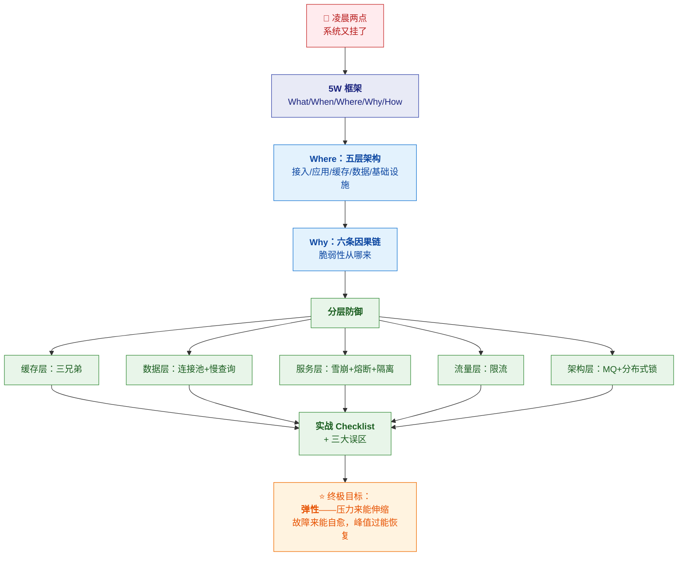

> [!important] ⭐ 全篇核心结论（先记住）
> **"高并发架构的终极目标不是抗住多少 QPS，
> 而是弹性——压力来了能伸缩，故障来了能自愈，峰值过了能恢复。"**
>
> **"就像太极借力打力，而不是硬碰硬。"**
>
> | 手段 | 本质 |
> |---|---|
> | **限流** | ⭐ **疏导** |
> | **熔断** | ⭐ **止损** |
> | **MQ** | ⭐ **缓冲** |
> | **缓存** | ⭐ **借力** |
>
> **"每一层都不硬扛，而是把压力化解掉。"**

---

## 一、⭐ 5W 框架：把"高并发"拆成五个问题

> 视频原话："**咱们今天要梳理清楚这五个维度：**
> **What 会出现哪些问题、When 什么时候触发、Where 在哪一层爆发、
> Why 根因是什么、How 怎么解决和避坑。**"

| 维度 | 问题 | 对应章节 |
|---|---|---|
| **What** | 高并发下会出**哪些问题** | §三 六条因果链 |
| **When** | **什么时候**触发 | §二（流量突增时） |
| **Where** | 在**哪一层**爆发 | ⭐ §二 五层架构 |
| **Why** | **根因**是什么 | §三 六条因果链 |
| **How** | 怎么**解决和避坑** | §四～§十 |

> [!success] ⭐ 这个框架本身就是最好的"答题结构"
> **面试被问"你怎么设计高并发系统"时，直接套 5W：**
> **"先看问题会出在哪一层（Where），再看根因（Why），
> 然后分层防御（How）。"**
>
> 👉 **比上来就罗列"要加缓存、要限流"有逻辑得多。**

---

## 二、⭐ 什么是"高并发"：一个关键认知

> 视频原话："**并发不是绝对数字，而是请求量超过了你系统设计容量的那一刻。
> 1000 QPS 对小系统是高并发，对淘宝可能就是日常。所以关键是相对压力。**"

### 2.1 高并发是"相对的"，不是"绝对的"

> [!important] ⭐⭐ 这个认知是全篇的地基
> **"高并发"不是"QPS 超过某个数字"，而是"请求量超过了系统容量的那一刻"。**
>
> | 场景 | 1000 QPS 意味着 |
> |---|---|
> | **小系统**（单机 + 单库） | ⭐ **已经是高并发**（可能被打挂） |
> | **淘宝** | ⭐ **日常水量**（毫无压力） |
>
> 👉 **所以"高并发设计"的本质是"容量设计"**——
> **关心的是"我的系统能扛多少"与"实际来多少"的比值。**

> [!warning] ⚠️ 由此推出的一个重要结论
> **脱离"系统容量"谈"高并发"是没有意义的。**
> **同一个架构，对 A 公司是"高并发方案"，对 B 公司可能是"过度设计"。**
>
> **所以面试时**：**先说"要看具体量级和容量"，再给方案**——
> **直接背"三高架构"反而显得没有判断力。**

### 2.2 ⭐ 压力不是均匀来的

> 视频原话："**而且压力不是均匀来的，它往往突然爆发——
> 就像刚才的告警（凌晨两点）。**"


> [!important] ⭐ 这就是"弹性"的由来
> **如果只按均值设计** → **峰值一来就挂**。
> **如果只按峰值设计** → **平时资源大量闲置**（成本无法接受）。
>
> **所以正解是"按常态设计 + 弹性扩容 + 限流兜底"**——
> **这也正是视频结尾"弹性"的含义。**

---

## 三、⭐ Where：问题出在哪一层（五层架构）

> 视频原话："**问题不是只在一个点爆发。看这张架构图：
> 接入层可能先扛不住，应用层线程池会耗尽，缓存层可能雪崩，
> 数据层连接池和磁盘 IO 最先报警，基础设施层还有带宽和 CPU 的硬上限。**"

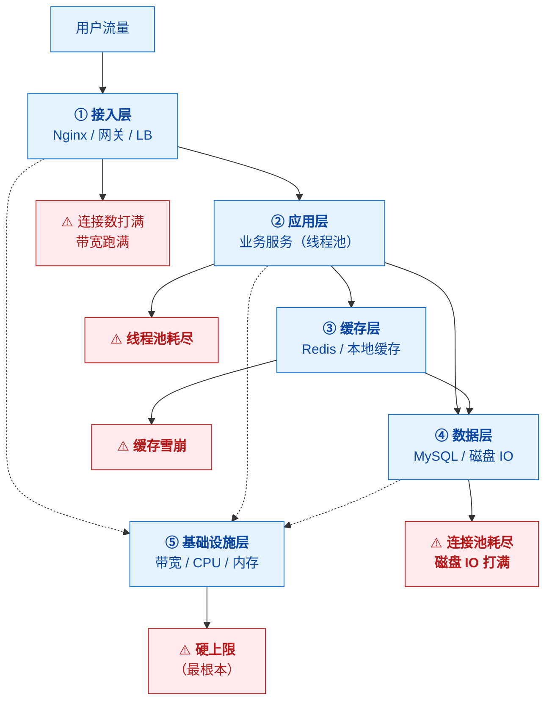

### 3.1 ⭐⭐ 木桶效应

> 视频原话："**所以高并发是全链路压力测试，每一层都可能成为短板。
> 这也叫木桶效应——最短的那块板决定容量。**"

> [!important] ⭐⭐ 这是"高并发排查"的第一原则
> **系统容量 = 最慢那一层的容量**（不是平均值）。
>
> **所以**：
> - ⭐ **只优化快的层没有意义**（瓶颈还在最慢的层）
> - ⭐ **必须"全链路压测"**才能找到真正的短板
> - ⭐ **优化后短板会转移**（所以要持续找新的瓶颈）
>
> 👉 **这就是"压测必须全链路"这条误区的来源**（见 §十）。**
>
> **如果你只压测单个服务**：
> **服务本身没问题，但一上生产就被下游数据库拖垮**——
> **因为"短板"在链路里，不在单个服务里。**

### 3.2 五层各自的典型故障

| 层 | 典型故障 | 防御手段 | 详见 |
|---|---|---|---|
| **① 接入层** | 连接数/带宽打满 | **限流、LB、CDN** | §七 |
| **② 应用层** | ⭐ **线程池耗尽** | **熔断、隔离、异步化** | §六 |
| **③ 缓存层** | ⭐ **穿透/击穿/雪崩** | **布隆过滤器、互斥锁、随机 TTL** | §四 |
| **④ 数据层** | ⭐ **连接池耗尽、慢查询** | **连接池调优、索引、读写分离** | §五 |
| **⑤ 基础设施** | ⭐ **CPU/带宽硬上限** | **扩容、容量规划** | §十 |

---

## 四、⭐ Why：六大致命因果链

> 视频原话："**高并发本身不是问题，问题是系统在高并发下的脆弱性。
> 我总结了六大致命因果链。**"

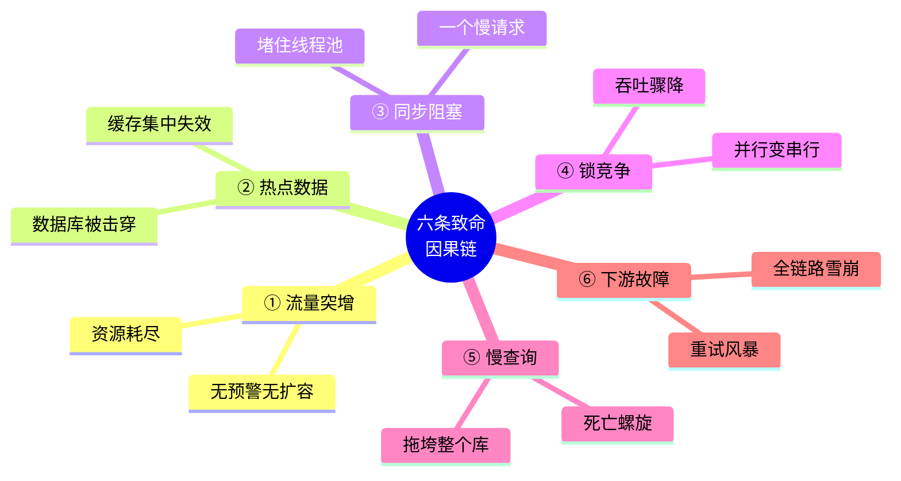

| # | 因果链 | 链路 |
|---|---|---|
| **①** | **流量突增** | 流量突增 → **无预警/无扩容机制** → **资源耗尽** |
| **②** | **热点数据** | 热点 key → **缓存集中失效** → ⭐ **数据库瞬间被击穿** |
| **③** | **同步阻塞** | 一个慢请求 → **堵住线程池** → 后面正常请求**饿死** |
| **④** | **锁竞争** | 竞争激烈 → **并行变串行** → 吞吐骤降 |
| **⑤** | **慢查询** | 一个慢 SQL → 占住连接 → ⭐ **死亡螺旋** → 拖垮整个库 |
| **⑥** | **下游故障** | 下游挂了 → **重试风暴** → **全链路雪崩** |

> [!danger] ⭐⭐ 最可怕的是"叠加出现"
> 视频原话："**但实战中最可怕的是它们叠加出现。**"
>
> **典型叠加链路**：
> **热点 key 过期（②）→ 请求打到 DB → 慢查询（⑤）→ 占满连接池（④）
> → 上游线程池被阻塞（③）→ 开始重试（⑥）→ 流量再翻倍（①）→ 全线崩溃**
>
> 👉 **这就是"雪崩"的完整形成过程**——
> **单个问题可能还能扛，叠加起来就是灾难。**


### 3.3 、接入层

#### 3.3.1、 连接数设计与参数调优

实际并发连接数估算
```latex
并发活跃连接 = QPS · 平均接口响应时间
```


---

## 五、⭐⭐ 缓存三兄弟（第一道防线）

> 视频原话："**缓存是高并发的第一道防线，防线破了，后面就是裸奔。**"

### 5.1 三兄弟总览

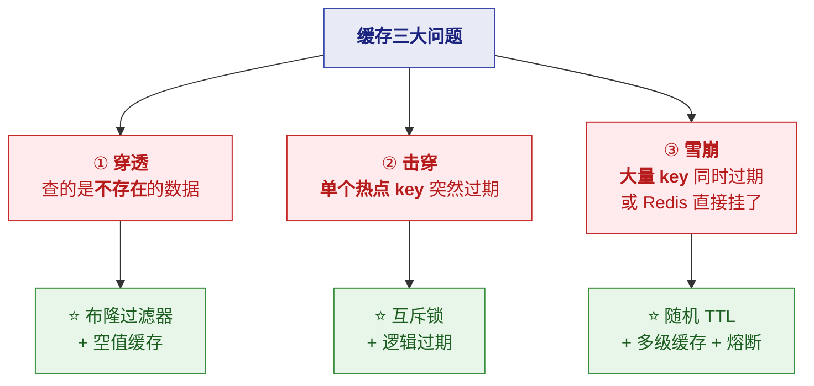

### 5.2 逐个说清

#### ① 缓存穿透

> 视频原话："**请求的是根本不存在的数据，缓存里没有，数据库也没有，
> 但攻击者用海量不存在的 key 直接把请求打到 DB 上，DB 就崩了。**"

| 项 | 内容 |
|---|---|
| **现象** | ⭐ **缓存和 DB 都没有** → 每次都查 DB |
| **根因** | **查询不存在的数据**（**恶意攻击**或业务 bug） |
| **危害** | ⭐ **绕过缓存，直击数据库** |
| **解法** | ⭐ **布隆过滤器** + ⭐ **空值缓存** |

> [!important] ⭐ 两种解法对比
> | 解法 | 原理 | 优点 | 缺点 |
> |---|---|---|---|
> | ⭐ **布隆过滤器** | **用位数组判断"一定不存在 / 可能存在"** | **内存极小、拦截率高** | ⚠️ **有误判**（说"存在"时可能实际不存在）；**不能删除** |
> | **空值缓存** | **查不到也存个空值**（**TTL 设短**，如 1 分钟） | 简单 | ⚠️ **占用缓存空间**；数据一致性有延迟 |
>
> **实践建议**：⭐ **两者结合**——
> **布隆过滤器挡掉大部分恶意请求，空值缓存兜住漏网的。**

#### ② 缓存击穿

> 视频原话："**某个热点 key 突然过期，海量请求同时去查 DB，
> 那一个点就被击穿了。**"

| 项 | 内容 |
|---|---|
| **现象** | ⭐ **单个超级热点 key 过期**的瞬间 |
| **根因** | **热点 key 过期 + 高并发同时到达** |
| **危害** | **该瞬间大量请求直达 DB** |
| **解法** | ⭐ **互斥锁** + ⭐ **逻辑过期** |

> [!important] ⭐ 两种解法对比
> | 解法 | 原理 | 优点 | 缺点 |
> |---|---|---|---|
> | ⭐ **互斥锁** | **只让一个请求去查 DB 重建缓存**，其他等待 | **保证一致性** | ⚠️ **其他请求要等待**（延迟增加） |
> | ⭐ **逻辑过期** | **物理不过期**，另存"逻辑过期时间"字段；发现逻辑过期就**返回旧值 + 异步更新** | ⭐ **不阻塞、可用性高** | ⚠️ **返回的是旧数据**（短暂不一致） |
>
> **怎么选**：**能接受短暂旧数据 → 逻辑过期（可用性优先）；
> 必须强一致 → 互斥锁。**
>
> 👉 **注意"击穿"和"雪崩"的区别**：**击穿是"一个 key"，雪崩是"大量 key"。**

#### ③ 缓存雪崩

> 视频原话："**最可怕——大量 key 同时过期，或者 Redis 挂了，
> 所有请求直接涌向 DB，那是真的雪崩。**"

| 项 | 内容 |
|---|---|
| **现象** | ⭐ **大量 key 同时失效** 或 **Redis 宕机** |
| **根因** | ① **批量设置了相同 TTL** ② **Redis 单点故障** |
| **危害** | ⭐⭐ **DB 瞬间被压垮**（最严重） |
| **解法** | ⭐ **随机 TTL + 多级缓存 + 熔断**（组合拳） |

> [!danger] ⭐⭐ 雪崩为什么"最可怕"
> **因为它是"面"的失效，不是"点"的**：
> - **穿透**：坏请求查不存在的数据（**可以用过滤器挡**）
> - **击穿**：**一个**热点 key（**影响面小**）
> - ⭐ **雪崩**：**大量 key 同时失效** 或 **整个 Redis 挂了**
>   → ⭐ **所有请求同时涌向 DB** → **DB 必崩**
>
> 👉 **"缓存是高并发的第一道防线，防线破了后面就是裸奔"** 说的就是雪崩。**

**组合拳三招**：

| 手段 | 作用 |
|---|---|
| ⭐ **随机 TTL** | **给过期时间加随机偏移**（如 30 分钟 ± 5 分钟）→ **避免同时失效** |
| ⭐ **多级缓存** | **本地缓存（Caffeine）+ Redis** → **Redis 挂了本地还能顶** |
| ⭐ **熔断降级** | **DB 压力过大时自动保护**（返回降级数据而不是打死 DB） |

> [!success] ⭐ "加随机偏移"是个很实惠的技巧
> ```java
> // ❌ 所有 key 同时过期
> redis.set(key, value, 30, MINUTES);
>
> // ✅ 加随机偏移（25~35 分钟）
> long ttl = 30 * 60 + ThreadLocalRandom.current().nextInt(-300, 300);
> redis.set(key, value, ttl, SECONDS);
> ```
> **一行代码，消灭"同时失效"这个根因。**

---

## 六、⭐ 数据层：为什么它最脆弱

> 视频原话："**数据库是不是最脆弱的？通常是的——
> 因为数据库是有状态的，扩容最难。**"

### 6.1 为什么数据库是"最难扩"的一层

> [!important] ⭐⭐ 核心原因：**有状态**
> | 层 | 状态 | 扩容难度 |
> |---|---|---|
> | **接入层 / 应用层** | ⭐ **无状态** | ✅ **加机器就行**（水平扩展） |
> | **缓存层** | 有状态，但**可重建** | 🟡 中等（丢了从 DB 重建） |
> | ⭐ **数据层** | ⭐ **有状态且是"真相来源"** | ❌ **最难**（要分库分表、迁移数据、保证一致性） |
>
> 👉 **"无状态好扩、有状态难扩"** 是高并发架构的基本规律。
> **所以设计原则是**：⭐ **尽量把压力挡在数据库之前**（缓存、MQ 缓冲）。**

### 6.2 ⭐⭐ 连接池：越大越好吗（经典误区）

> 视频原话："**我之前遇到过一个坑：连接池配得太大，结果数据库反而更慢。
> 这是个经典误区——连接池不是越大越好。**"

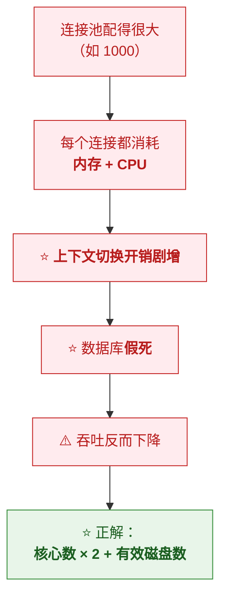

> [!important] ⭐⭐ 连接池大小的经验公式
> **`连接数 = CPU 核心数 × 2 + 有效磁盘数`**
>
> **这是 PostgreSQL 社区（HikariCP 文档常引用）给出的基准**，
> **MySQL 类似。**
>
> | 服务器 | 建议连接数 |
> |---|---|
> | 4 核 + 1 块 SSD | **4 × 2 + 1 = 9**（≈ 10） |
> | 8 核 + 2 块盘 | **8 × 2 + 2 = 18** |
> | 16 核 | **32 ~ 40** |
>
> ⚠️ **视频原话："一般几十到几百，别一上来就配 1000。"**

> [!danger] ⚠️ 为什么"连接多了反而慢"
> **因为数据库的瓶颈通常不是"连接数"，而是"CPU 和磁盘 IO"。**
>
> **连接过多会导致**：
> 1. **每个连接占用内存**（MySQL 每连接有会话缓冲区）
> 2. ⭐ **线程/上下文切换开销剧增**（CPU 都在切换，没在干活）
> 3. **锁竞争加剧**
> 4. ⭐ **结果：数据库"假死"**——**看起来在忙，实际吞吐极低**
>
> 👉 **所以"连接池调大"不是优化，可能是自残。**

### 6.3 ⭐⭐ 慢查询：死亡螺旋的触发器

> 视频原话："**一个慢 SQL 占住连接不释放，后面的请求排队；
> 排队越长系统越慢，越慢越多请求堆积，直到全崩。**"

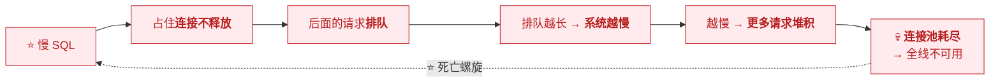

> [!important] ⭐⭐ 为什么慢查询是"触发器"而非"小问题"
> **因为它的危害是"放大"的**：
> **一条慢 SQL 不只慢它自己**——
> **它占着连接**，导致**其他请求排队**，
> **排队又让更多请求堆积** → **正反馈循环** → **崩溃。**
>
> 👉 **所以"SQL 质量"是数据层的第一道防线。**

**治理顺序（视频强调"先保证底线，再上后招"）**：

| 顺序 | 手段 | 层次 |
|---|---|---|
| ⭐ **第一步（底线）** | **慢查询日志** | **发现问题** |
| ⭐ **第二步（底线）** | **执行计划分析（EXPLAIN）** | **定位问题** |
| ⭐ **第三步（底线）** | **索引优化** | **解决问题** |
| 后招 | **读写分离** | 架构扩展 |
| 后招 | **分库分表** | 架构扩展 |

> [!warning] ⚠️ 视频强调的优先顺序很重要
> **"那是后招——先保证连接池和 SQL 质量，这是底线。"**
>
> **很多团队一遇到数据库瓶颈就想"分库分表"**——
> **但如果是"慢 SQL 没走索引"，分库分表只是把问题分散（且带来复杂度）。**
>
> 👉 **正确顺序**：**先把 SQL 和索引做好（成本低、收益大），
> 再考虑架构级扩展。**
> **SQL 优化详见 [[4-db/6-慢查询与调优|MySQL 慢查询与调优]]。**

---

## 七、⭐ 服务层：雪崩与三道防线

> 视频原话："**服务层的问题是不是最隐蔽？对，
> 因为微服务之间的调用像一张网，一个点出问题会级联拖垮全网。**"

### 7.1 ⭐ 级联故障（雪崩）的形成

> 视频原话："**我遇到过下游服务慢了，上游一直等，
> 最后所有线程都卡死——这就是级联。**"

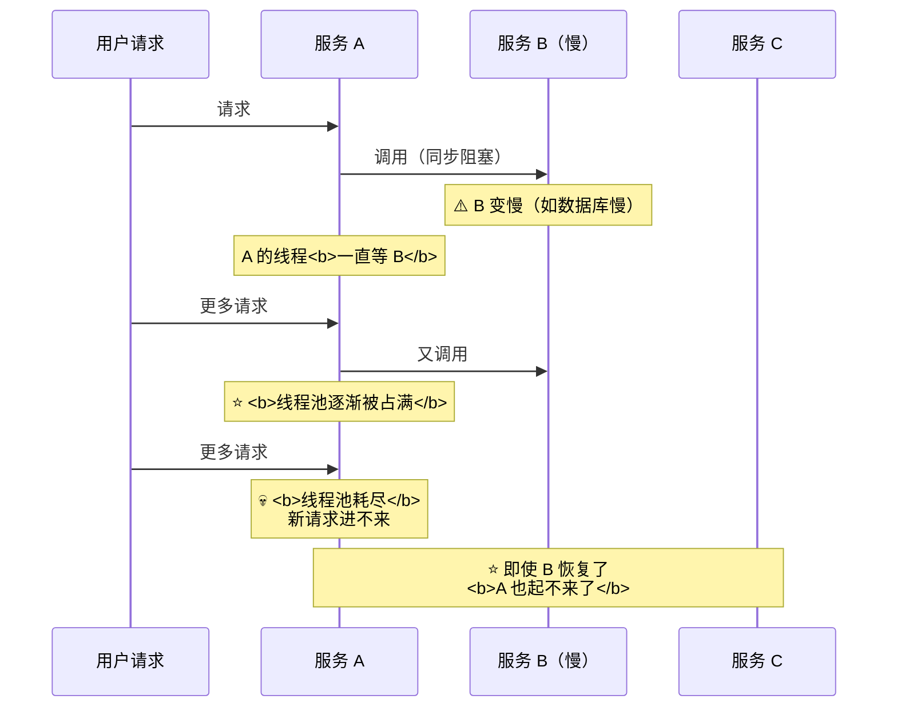

> [!danger] ⭐⭐ 级联故障的根源是"同步阻塞"
> **"等待下游的线程池被下游的慢响应占满，新的请求进不来。
> 即使下游恢复了，你的服务也起不来了。"**
>
> ⭐ **最后一句最可怕**：**"即使下游恢复了，你也起不来了"**——
> **因为你的线程池还是满的（堆积的请求还在等）。**
>
> 👉 **这就是"雪崩"的本质**：
> **故障从下游传导到上游，而且"恢复"比"故障"更难。**

### 7.2 三道防线

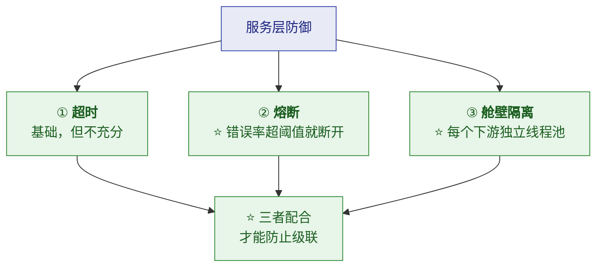

#### ① 超时

> 视频原话："**设置超时。超时是基础，但不够。**"

> [!important] ⭐ 为什么"超时不够"
> **超时只能"限制单次等待时间"**——
> **但如果并发很高，即使每次只等 1 秒，线程也会被迅速占满。**
>
> **举例**：**线程池 200，下游每次响应 1 秒（超时值），QPS 300**
> → **每秒有 300 个请求要占 1 秒** → **需要 300 个线程** → ⭐ **超了 → 排队 → 雪崩。**
>
> 👉 **所以超时必须配合"熔断"**——**熔断能让请求"快速失败"，不占线程。**

#### ② 熔断

> 视频原话："**关键是熔断——当下游错误率超过阈值，直接断开，
> 快速失败，保护自身线程池。**"

#### ③ 舱壁隔离

> 视频原话："**还有舱壁隔离——给不同下游配独立的线程池，
> 一个下游出问题不影响其他的。就像轮船的隔舱，一个进水不会全沉。**"

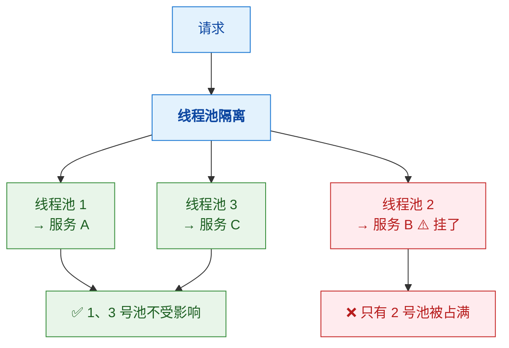

> [!success] ⭐ 舱壁隔离的比喻非常精准
> **轮船的隔舱：一个舱进水，船不会全沉。**
> **对应到系统：一个下游挂了，不会拖垮整个服务。**
>
> **对比**：
> 
> | | 无隔离 | ⭐ **有隔离** |
> |---|---|---|
> | 线程池 | **所有下游共用一个** | ⭐ **每个下游独立** |
> | 一个下游慢 | ⚠️ **占满所有线程** | ✅ **只占满它自己的池** |
> | 影响面 | ⭐ **整个服务不可用** | ⭐ **只有该下游的功能不可用** |
>
> **Hystrix / Sentinel 都是这个思路。**

---

## 八、⭐⭐ 限流：不是拒绝，是保护

> 视频原话："**限流不是无脑拒绝，而是有策略的保护。**"

### 8.1 四种限流算法

#### ① 令牌桶（Token Bucket）—— 最常用

> 视频原话："**令牌桶以固定速率往桶里放令牌，请求来了拿令牌，
> 有就通过，没有就拒绝或等待。好处是允许一定程度的突发。
> 就像地铁闸机，有票就进。**"

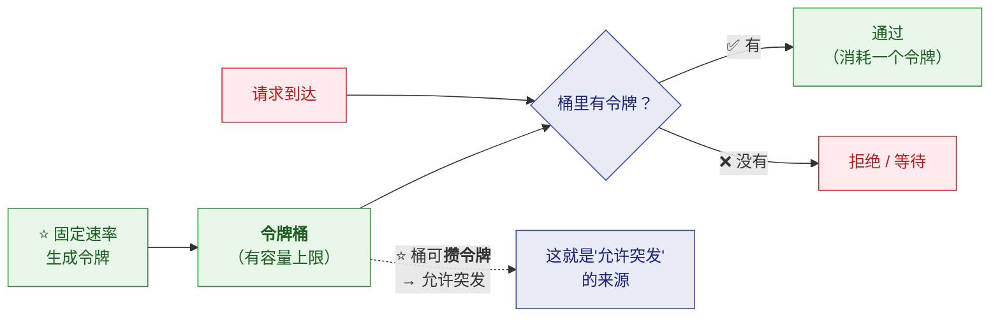

| 优点 | 缺点 |
|---|---|
| ⭐ **允许一定程度的突发**（桶里攒了令牌就能放行） | 需要维护桶状态 |

#### ② 漏桶（Leaky Bucket）

> 视频原话："**请求先进桶，以固定速率漏出处理，桶满了就拒绝。
> 好处是输出绝对平滑，但无法应对突发。**"

| 优点 | 缺点 |
|---|---|
| ⭐ **输出速率绝对平滑** | ⚠️ **无法应对突发**（即使系统有余力也不放行） |

> [!important] ⭐ 令牌桶 vs 漏桶（一句话）
> - **令牌桶**：**控制"平均速率"，但允许突发**（**关心"进来多少"**）
> - **漏桶**：**控制"流出速率恒定"**（**关心"出去多平滑"**）
>
> 👉 **令牌桶更常用**（因为业务通常"允许适度突发"）。

#### ③ 固定窗口计数器

> 视频原话："**最简单——比如每秒允许 1000 个请求，超过就拒绝。
> 实现容易，但边界可能有突刺。**"

> [!danger] ⚠️ 边界突刺问题（经典）
> **"第一秒末和第二秒初各发 1000 个，那一毫秒间隔内就有 2000 个请求。"**
>
> ```
> 时间轴:  |--- 第 1 秒 ---|--- 第 2 秒 ---|
> 请求:          ...1000 个 | 1000 个...
>                  ↑ 都在窗口边界附近
> 结果: 边界处 1ms 内涌入 2000 个 → ⭐ 瞬时是限制值的 2 倍
> ```
> **所以固定窗口"看起来限制 1000/秒，实际边界处可能承受 2000/秒"。**

#### ④ 滑动窗口

> **把时间切成小格，统计"最近 1 秒"的请求数**——**平滑了边界问题。**
> ⚠️ **代价**：**需要存储更多统计信息**（每小格的计数）。

### 8.2 ⭐ 四种算法对比（必背）

| 算法 | 平滑度 | 允许突发 | 实现复杂度 | 适用 |
|---|---|---|---|---|
| **固定窗口** | ⚠️ 差（边界突刺） | ❌ | ⭐ **最简单** | 要求不高的场景 |
| **滑动窗口** | ✅ 好 | ❌ | 中等 | 需要精确控制的场景 |
| **漏桶** | ⭐ **最好** | ❌ **不允许** | 中等 | **需要恒定输出速率** |
| ⭐ **令牌桶** | 好 | ⭐ **允许** | 中等 | ⭐ **生产最常用** |

> [!success] ⭐ 生产建议
> **视频原话："生产环境一般用令牌桶。Guava RateLimiter、Sentinel 都支持令牌桶。"**
>
> ⚠️ **注意**：**Guava `RateLimiter` 是单机的**——
> **分布式限流需要 Redis + Lua**（用 `INCR` + 过期时间，或 Redis 版的令牌桶）。

### 8.3 ⭐ 限流可以分级

> 视频原话："**而且限流可以分级——接口级、用户级，
> 也不拖垮（某个用户不能拖垮整体）。**"

| 级别 | 说明 | 场景 |
|---|---|---|
| ⭐ **接口级** | 每个接口独立限流 | **防止某个热点接口拖垮全局** |
| ⭐ **用户级** | 每个用户独立限流 | ⭐ **防止单个用户恶意刷接口** |
| **IP 级** | 每个 IP 限流 | 防爬虫/攻击 |
| **全局级** | 整个系统总限流 | 保护底层资源 |

> [!important] ⭐ "分级"才是限流的精髓
> **"不是拒绝服务，而是有策略的保护。"**
>
> **举例**：**如果只做"全局 1000 QPS"**——
> **一个恶意用户刷满额度，其他所有用户都被拒绝。**
> **如果有"用户级 10 QPS"**——⭐ **恶意用户只能占 10 QPS，影响面极小。**
>
> 👉 **这就是"分级"的价值：把伤害限制在局部。**

---

## 九、⭐⭐ 熔断与降级

### 9.1 熔断 vs 降级（最容易搞混）

> 视频原话："**降级是策略，熔断是机制。
> 降级是预案，熔断是触发预案的开关。**"

> [!important] ⭐⭐ 一句话分清楚
> 
> | | **熔断** | **降级** |
> |---|---|---|
> | 本质 | ⭐ **机制**（开关） | ⭐ **策略**（预案） |
> | 作用 | **检测到故障 → 断开调用** | **断开后 → 返回什么** |
> | 类比 | **保险丝** | **停电时的应急预案** |
>
> **关系**：⭐ **熔断触发降级**——**"熔断是触发降级的开关"。**

### 9.2 ⭐⭐ 熔断器三态状态机

> 视频原话："**熔断器有三个状态：关闭状态正常调用，但内部在统计错误率；
> 打开状态错误率超过阈值，直接熔断走降级逻辑；
> 半开状态过一段时间后放少量请求，试探下游恢复了没有。**"

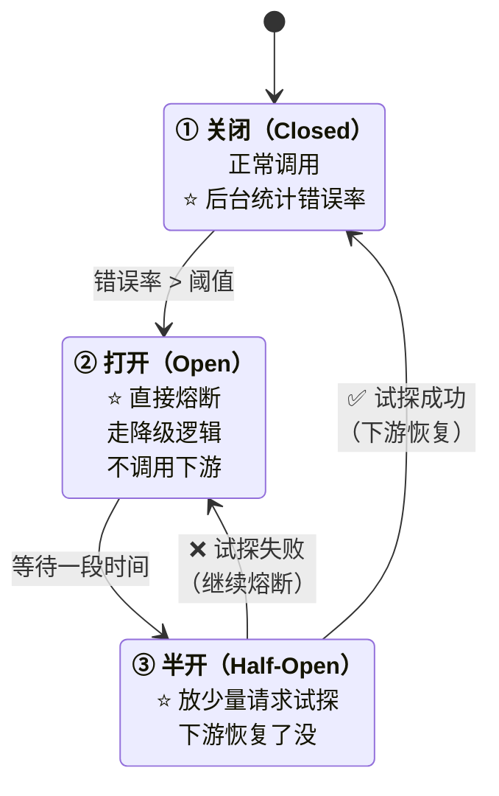

| 状态 | 行为 | 目的 |
|---|---|---|
| ⭐ **关闭（Closed）** | **正常调用**，**统计错误率** | 正常工作 + 监控 |
| ⭐ **打开（Open）** | ⭐ **直接快速失败**，**不调用下游** | ⭐ **保护自身线程池** |
| ⭐ **半开（Half-Open）** | ⭐ **放少量请求试探** | ⭐ **探测下游是否恢复** |

> [!important] ⭐⭐ 为什么"打开"状态要"快速失败"
> **因为"快速失败"不占线程**——
> **如果继续调用（即使是超时），线程还是会等** → **仍然会被占满。**
>
> 👉 **熔断的价值不在"少发请求"，而在"释放线程"。**
> **这是理解熔断的关键。**

> [!tip] 三个易被忽略的细节
> | 细节 | 说明 |
> |---|---|
> | **慢调用比例熔断** | ⭐ **不只是"错误率"**——**"慢调用占比"也能触发熔断**（下游变慢但没报错时很有用） |
> | **半开放多少请求** | 一般**放 1~10 个**（太少判断不准，太多可能压垮刚恢复的下游） |
> | **统计窗口** | 用**滑动窗口**统计，避免固定窗口的边界问题 |

### 9.3 ⭐⭐ 降级的几种套路

> 视频原话："**读场景返回缓存、返回默认值、返回简化版数据；
> 写场景异步化写入本地队列稍后同步、直接拒绝并提示。
> 核心思想：有损服务——保住核心功能，牺牲边缘体验。**"

| 场景 | 降级手段 |
|---|---|
| ⭐ **读场景** | **返回缓存** / **返回默认值** / **返回简化版数据**（如前 10 条而不是全部） |
| ⭐ **写场景** | **异步化**（写本地队列，稍后同步） / **直接拒绝并提示** |

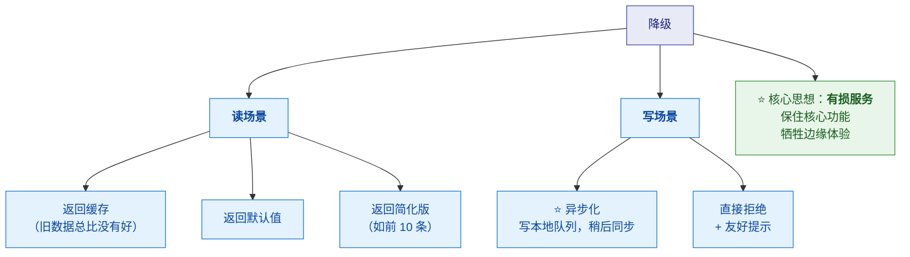

> [!success] ⭐⭐ "有损服务"的电梯比喻（视频讲得很好）
> **"就像电梯超载时报警不走，而不是硬拉导致钢缆断裂。"**
>
> **含义**：
> - ⭐ **"报警不走"** = 限流/降级（**主动拒绝一部分请求，保住整体**）
> - ⚠️ **"硬拉导致钢缆断裂"** = 硬扛（**全部一起崩**）
>
> 👉 **"熔断降级就是系统的安全气囊——平时看不见，关键时刻保命。"**

> [!warning] ⚠️ 关键前提：降级不能"无差别"
> **必须区分"哪些能降级、哪些绝对不能"。**
>
> | 能降级 | ⚠️ **绝不能降级** |
> |---|---|
> | **推荐列表**（返回热门兜底） | ⭐ **支付/扣款** |
> | **评论/点赞数**（显示"暂无"） | ⭐ **库存扣减**（会导致超卖） |
> | **非核心的个性化** | ⭐ **订单创建** |
>
> 👉 **降级的判断标准**：⭐ **"降级后会不会产生资损或数据错误？"**
> **会 → 不能降级（应该拒绝并报错）；不会 → 可以降级。**

---

## 十、⭐⭐ 消息队列：流量蓄水池

> 视频原话："**两个字：缓冲。它是流量洪峰和系统处理能力之间的蓄水池。
> 就像三峡大坝——洪水来了大坝蓄水，下游按固定流量泄洪，不会冲毁农田。**"

### 10.1 MQ 的三大作用

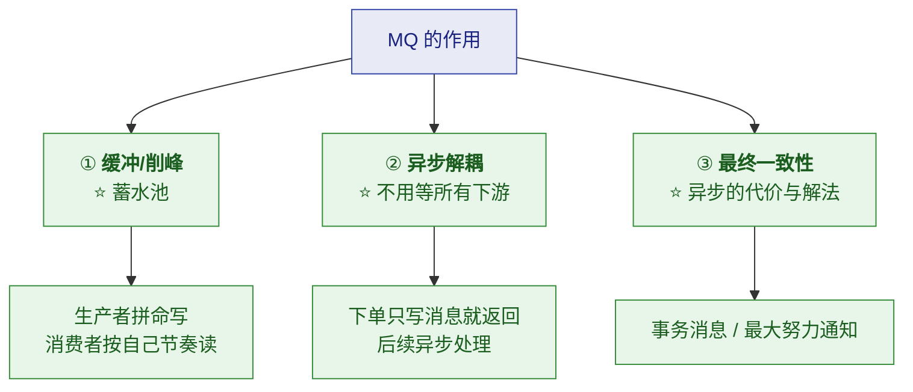

#### ① 削峰填谷

| 好处 | 说明 |
|---|---|
| ⭐ **抗住洪峰** | **生产者可以拼命写**（MQ 先收下） |
| ⭐ **按能力消费** | **消费者按自己节奏读**（不会被压垮） |

> [!warning] ⚠️ 但要知道"M1 也会满"
> **视频原话："那如果消费者跟不上消息会不会堆积？会。
> 所以 MQ 要监控堆积量，堆积超过阈值要告警，
> 必要时扩容消费者，或者降级生产者。"**
>
> ⭐ **所以 MQ 不是"无限缓冲"**——
> **它只是把"瞬时压力"变成"持续压力"**，
> **如果生产持续大于消费，堆积迟早会爆（磁盘满）。**
>
> 👉 **必须监控"堆积量（Lag）"并告警。**

#### ② 异步解耦

> 视频原话："**比如下单服务不用等库存服务、物流服务都完成才返回，
> 它只写消息到 MQ 立即返回'下单成功'，后续异步处理。
> 用户感觉很快，系统压力也分散了。**"

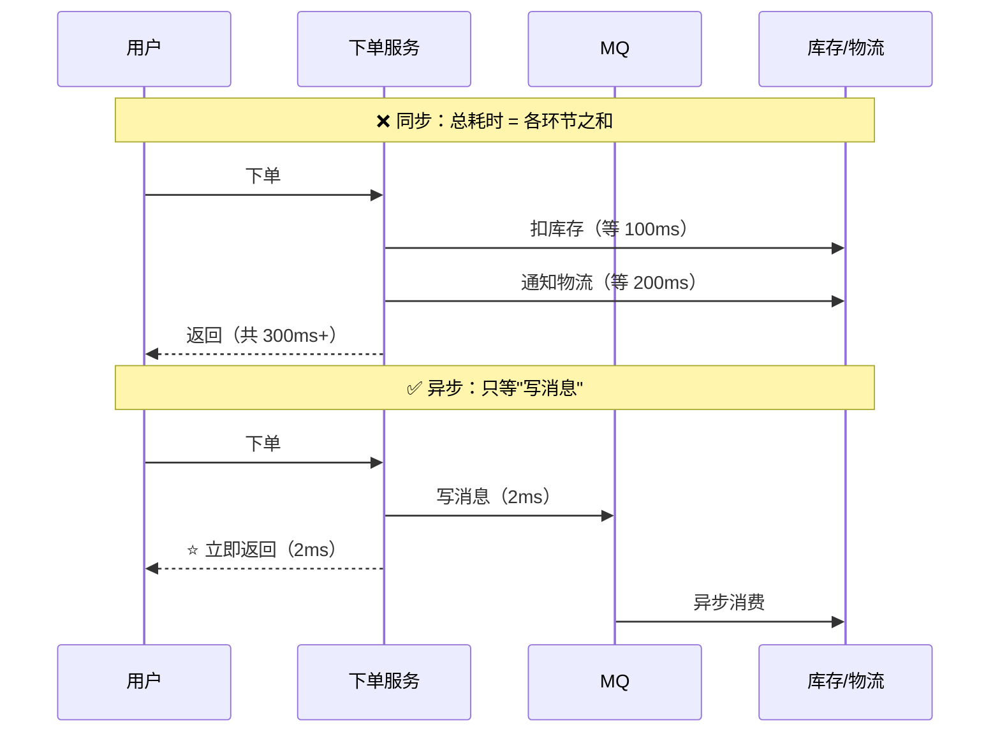

| | 同步 | ⭐ **异步（MQ）** |
|---|---|---|
| 响应时间 | ⭐ **各环节之和** | ⭐ **只等"写消息"** |
| 耦合度 | 高（下游挂了上游也挂） | ⭐ **低（下游挂了消息还在）** |
| 一致性 | **强一致** | ⚠️ **最终一致** |

#### ③ ⭐ 异步的代价：一致性问题

> 视频原话："**但异步会带来一致性问题吧？对，这是 trade-off。
> 异步 + 最终一致性，用事务消息或者最大努力通知来兜底。**"

> [!important] ⭐⭐ 一个重要的架构判断
> **视频原话："高并发架构里，强一致性往往是性能杀手，
> 最终一致性才是生存之道。"**
>
> | | 强一致性 | ⭐ **最终一致性** |
> |---|---|---|
> | 实现 | **同步、分布式事务** | **异步 + 补偿** |
> | 性能 | ⚠️ **差**（要等所有人） | ⭐ **好** |
> | 适用 | **支付、库存扣减** | ⭐ **通知、日志、推荐、积分** |
>
> 👉 **判断标准**：**"这个环节能不能容忍"短暂不一致"？"**
> **能 → 用异步 + 最终一致；不能 → 只能同步。**
>
> ⚠️ **但注意**：**不是所有场景都能"最终一致"**——
> **涉及"资损"的（如扣款）必须强一致。**

#### ④ ⭐ MQ 的三个必备配套（Checklist 第 6 项）

> 用 MQ 不只是"发消息收消息"——**生产上必须配好这三件事**，否则会出事故。

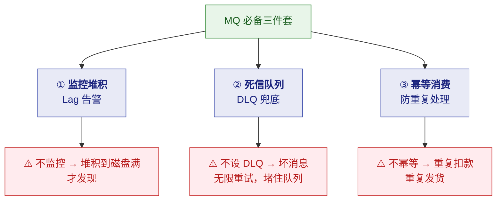

| # | 配套 | 为什么必须 | 怎么做 |
|---|---|---|---|
| **①** | ⭐ **监控堆积（Lag）** | **堆积到最后是"磁盘满"**——那时已经晚了 | **Lag 超阈值告警** + 消费者扩容预案 |
| **②** | ⭐ **死信队列（DLQ）** | ⚠️ **一条坏消息会无限重试**，堵住整个队列 | **重试 N 次后转入 DLQ**，人工介入 |
| **③** | ⭐⭐ **幂等消费** | ⚠️ **MQ 通常保证"至少一次"** → **消息会重复** | **业务幂等**（唯一键/去重表/状态机） |

> [!danger] ⭐⭐ 为什么"幂等消费"是硬要求
> **几乎所有的 MQ（Kafka/RocketMQ/RabbitMQ）默认都是"至少一次
> （at-least-once）"投递**——**即"消息可能重复"。**
>
> **如果不做幂等**：
> - **重复扣款**（用户投诉）
> - **重复发货**（资损）
> - **重复发券**（被薅羊毛）
>
> ⭐ **注意：幂等应该做在"业务侧"，而不是指望 MQ 不重复投递**——
> **"精确一次"在分布式下极难保证，而"幂等"是可控的。**
>
> 👉 **常见幂等方案**：**数据库唯一索引**（兜底）/ **去重表** /
> **Redis `SETNX` 标记** / **状态机**（只允许特定状态流转）。

> [!warning] ⚠️ 死信队列不设会怎样
> **一条"永远处理失败"的消息**（如格式错误、依赖数据缺失）：
> **会被反复重试** → **每次重试都占用消费者资源** →
> **严重时把正常消息全部堵在它后面** → ⭐ **队列"假死"。**
>
> **正确做法**：**设置最大重试次数（如 3 次），超过就转入 DLQ**，
> **让正常消息能继续流转，坏消息单独排查。**

---

## 十一、⭐⭐ 分布式锁：并发的交通警察

> 视频原话："**多个实例同时修改同一资源，数据就乱了——
> 超卖、重复提交、库存扣错都是这个问题。**"

### 11.1 为什么需要分布式锁

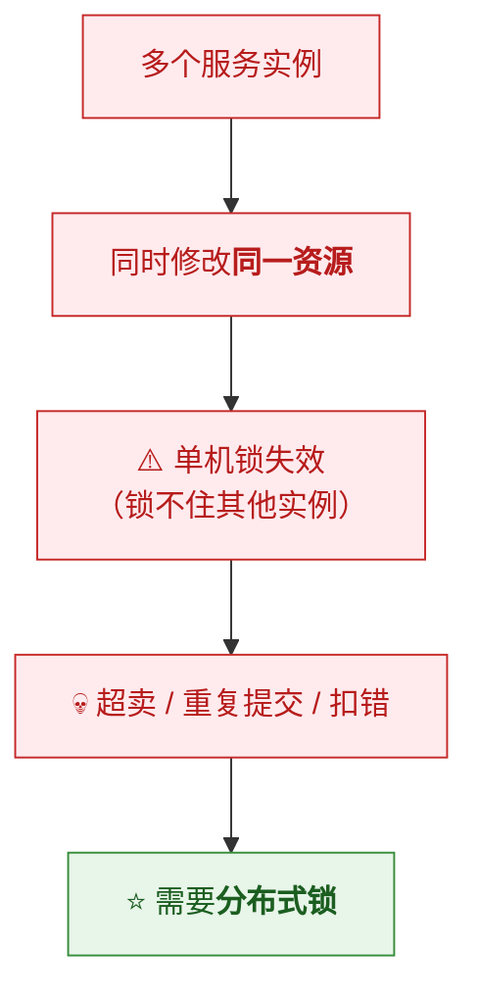

### 11.2 ⭐ Redis 做锁的四个坑

> 视频原话："**Redis 的 setnx 就能做锁吧？可以，但坑很多。**"

| # | 坑 | 说明 | 解法 |
|---|---|---|---|
| **1** | ⭐ **必须加过期时间** | **否则服务挂了锁永不释放**，别人进不来 | ⭐ **`SET key value NX EX seconds`**（**一条命令原子完成**） |
| **2** | ⭐ **过期时间要合理** | 太短：业务没跑完锁就丢了；太长：故障恢复慢 | **按业务耗时评估** |
| **3** | ⭐ **业务超时怎么办** | **业务执行时间 > 锁过期时间** → 锁被自动释放 → 别人进来 → **并发问题** | ⭐ **看门狗自动续期** |
| **4** | **释放锁要校验归属** | ⚠️ **直接 `DEL` 可能删掉别人的锁** | ⭐ **Lua 脚本原子校验并删除** |

> [!danger] ⚠️ 坑 3 是最危险的
> **场景**：
> ```
> T1: 拿到锁（TTL 10 秒），开始处理业务
> T1: 业务执行了 15 秒（超过 TTL）
>     ⚠️ 10 秒时锁自动过期
> T2: 拿到锁，开始处理同一资源
> T1: 15 秒时业务完成，释放锁（⚠️ 删掉的是 T2 的锁！）
> T2: 还在跑，但锁已经没了
>     → 💀 两个线程同时操作同一资源
> ```
>
> **这就是"锁过期但业务没执行完"的经典并发问题。**

### 11.3 ⭐ 看门狗机制（Watchdog）

> 视频原话："**看门狗机制——后台线程不断给锁续期，
> 只要业务还在跑，锁就不过期，业务完成再主动释放。**"

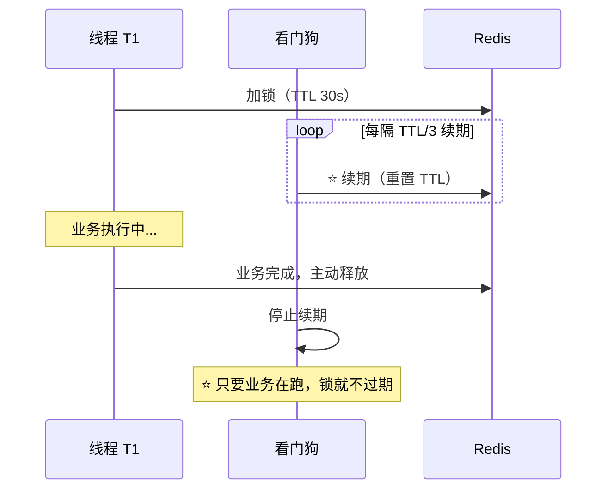

> [!important] ⭐ 看门狗的本质
> **"把'固定 TTL'变成'活期'"**——
> **租约在业务存活期间自动延长。**
>
> **Redisson 的实现**：**默认锁 TTL 30 秒，后台每 10 秒续期一次**（TTL/3）。
> ⚠️ **注意**：**看门狗只在"没有显式指定 leaseTime"时生效**——
> **如果你手动传了 `leaseTime`，Redisson 就不启动看门狗**（这是个常见坑）。

### 11.4 ⭐ 可重入与过期兜底（Checklist 第 7 项）

> 视频 Checklist 的三项：**"看门狗续期 + 可重入 + 过期兜底"**——
> 看门狗见上节，这里说另外两项。

#### ① ⭐ 可重入（Reentrancy）

> [!question] 什么是可重入
> **同一个线程，在持锁的情况下再次获取同一把锁，应该成功（而不是死锁）。**

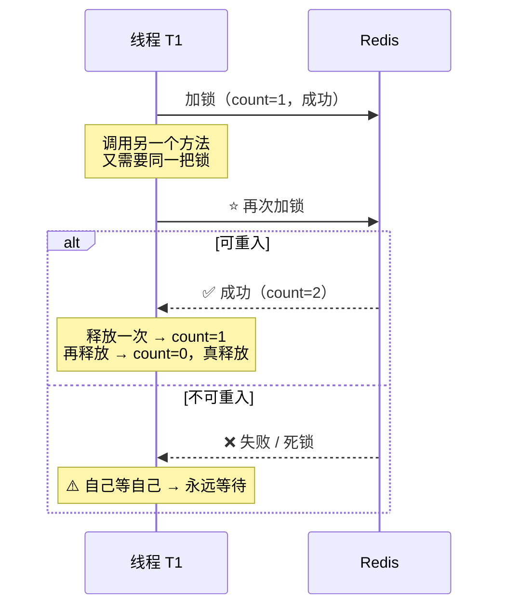

> [!important] ⭐ 为什么需要可重入
> **因为业务代码常常"嵌套调用"**：
> ```java
> public void methodA() {
>     lock.lock();
>     try {
>         methodB();     // ⚠️ methodB 里也要同一把锁
>     } finally { lock.unlock(); }
> }
> public void methodB() {
>     lock.lock();       // ⭐ 同一个线程再次获取
>     ...
> }
> ```
> **如果是不可重入锁** → **线程自己等自己 → 死锁。**
>
> **实现方式**：⭐ **用 Hash 结构记录"持有者 + 重入次数"**：
> ```
> key = 锁名
> field = 线程标识（uuid + threadId）
> value = 重入次数
> ```
> **Redisson 的 `RLock` 就是可重入的**（底层用 Hash + Lua）。

#### ② ⭐ 过期兜底

> [!important] ⭐ 为什么必须有 TTL
> **视频原话："必须加过期时间，否则服务挂了锁永远不释放，别人进不来。"**
>
> **场景**：**服务 A 拿到锁后进程崩溃（或机器宕机）**——
> **如果没有 TTL**：⭐ **这把锁永远存在** → **所有其他实例永远拿不到锁** → **业务永久阻塞。**
>
> 👉 **TTL 是"最后的兜底"**——**即使一切机制都失效，锁也终会释放。**

> [!success] ⭐ 三个机制的分工（要能讲清）
> | 机制 | 解决什么 | 层次 |
> |---|---|---|
> | ⭐ **过期兜底（TTL）** | **进程崩溃 → 锁最终能释放** | **兜底** |
> | ⭐ **看门狗续期** | **业务没跑完 → 锁不提前释放** | **正常保障** |
> | ⭐ **可重入** | **嵌套调用 → 不死锁** | **易用性** |
>
> **三者配合才是一个"生产可用"的锁**：
> **TTL 保证"最坏情况能恢复"，看门狗保证"正常情况不误释放"。**
>
> ⚠️ **注意 TTL 与看门狗的配合逻辑**：
> **TTL 是"默认值"（如 30 秒），看门狗在业务存活时不断续期**——
> **只有"续期也停了"（进程真挂了）时才真正走到 TTL 过期。**

### 11.5 RedLock 与 ZooKeeper

> 视频原话："**RedLock 是 Redis 作者提出的多节点锁方案，
> 在 N 个独立 Redis 实例上同时加锁，过半成功才算获取，容错性更好，
> 但复杂度高。**"

| 方案 | 原理 | 优点 | 缺点 |
|---|---|---|---|
| **单 Redis + Lua** | 一个实例 | ⭐ **简单、够用** | ⚠️ **单点** |
| ⭐ **RedLock** | **N 个独立实例，过半成功才加锁** | ⭐ **容错性好** | ⚠️ **复杂度高**；**有争议**（Martin Kleppmann 质疑过其安全性） |
| ⭐ **ZooKeeper** | **临时顺序节点** | ⭐ **天然支持等待队列 + 自动释放**（会话断开节点自动删除） | ⚠️ **性能比 Redis 差** |

> [!success] ⭐ 选型建议（视频原话）
> **"简单场景单 Redis + Lua 脚本保证原子性就够了；
> 读多写少用 Redis，强一致性场景用 ZK。"**
>
> | 场景 | 推荐 |
> |---|---|
> | ⭐ **绝大多数业务** | ⭐ **单 Redis + Lua**（Redisson） |
> | **要求极高容错** | RedLock（⚠️ 评估复杂度） |
> | ⭐ **要求强一致 + 公平排队** | ⭐ **ZooKeeper / etcd** |
>
> ⚠️ **一个重要的补充**：**能用"幂等设计"或"数据库唯一约束"解决的，
> 就不要引入分布式锁**——
> **锁是"最后手段"，不是"首选方案"。**
> **详见 [[7-分布式/3-分布式锁|3-分布式锁]]。**

---

## 十二、⭐⭐ 上线实战 Checklist

> 视频原话："**高并发问题 80% 是'知道但忘了做'，20% 是'不知道'。
> 这张清单帮你堵住 80%。**"

> [!important] ⭐⭐ 这个"80/20"判断很重要
> **大部分高并发事故不是"技术不会"，而是"上线前没检查"。**
> **所以 Checklist 的价值极高。**

### 12.1 九层 Checklist（逐层展开）

#### ① 接入层 （Nginx 连接数调优 + 防 DDOS）

- [ ] **限流已配置**（接口级 + 用户级）
- [ ] **LB/CDN 健康检查**
- [ ] **连接数上限已评估**
- [ ] **带宽水位监控 + 告警**

#### ② 应用层 （线程池隔离 +超时设置）

- [ ] ⭐ **线程池参数已评估**（不是默认值）
- [ ] ⭐ **超时时间已设置**（每个下游）
- [ ] ⭐ **熔断配置**（错误率 + 慢调用比例）
- [ ] ⭐ **舱壁隔离**（不同下游独立线程池）
- [ ] **异步化改造**（非核心链路）
- [ ] **无状态化**（可以随意扩容）

#### ③ 缓存层 （防穿透 / 击穿 / 雪崩  + 多级缓存）

- [ ] ⭐ **缓存穿透防护**（布隆过滤器 / 空值缓存）
- [ ] ⭐ **缓存击穿防护**（互斥锁 / 逻辑过期）
- [ ] ⭐ **缓存雪崩防护**（**随机 TTL** + 多级缓存 + 熔断）
- [ ] **热 key 探测与本地缓存**
- [ ] **Redis 高可用**（哨兵/集群）
- [ ] ⭐ **缓存与 DB 一致性方案**（延迟双删 / binlog 订阅）

#### ④ 数据层 （连接池调优 + 慢查询治理 + 读写分离）

- [ ] ⭐ **连接池大小合理**（**不是越大越好**）
- [ ] ⭐ **慢查询日志开启 + 告警**
- [ ] ⭐ **核心 SQL 都走索引**（EXPLAIN 验证过）
- [ ] **读写分离**（如需）
- [ ] **分库分表预案**（如需）
- [ ] **大事务拆分**

#### ⑤ 服务层 （熔断降级 + 限流 + 舱壁隔离）

- [ ] ⭐ **全链路超时传递**
- [ ] ⭐ **重试策略**（次数 + 退避，**防重试风暴**）
- [ ] ⭐ **降级开关**（可动态配置）
- [ ] **幂等设计**（防重复提交）
- [ ] ⭐ **分布式锁使用正确**（TTL + 校验归属 + 续期）

#### ⑥ 消息队列 （监控堆积 + 死信队列 + 幂等消费）

> 视频 Checklist：**"监控堆积 + 死信队列 + 幂等消费"**

- [ ] ⭐ **监控堆积量（Lag）+ 告警阈值**（堆积超阈值必须告警）
- [ ] ⭐ **死信队列（DLQ）**（消费失败的消息不能无限重试，要进死信）
- [ ] ⭐ **幂等消费**（消息可能重复投递，消费端必须幂等）
- [ ] **消费者扩容预案**（堆积时能快速扩容消费者）
- [ ] **消息积压时的降级**（必要时降级生产者）
- [ ] **消息顺序性**（按业务 key 分区，保证局部有序）

#### ⑦ 分布式锁 （看门狗续期 + 可重入 + 过期兜底）

> 视频 Checklist：**"看门狗续期 + 可重入 + 过期兜底"**

- [ ] ⭐ **看门狗续期**（业务没跑完，锁自动续期）
- [ ] ⭐ **可重入**（同一线程重复获取同一把锁不会死锁）
- [ ] ⭐ **过期兜底**（必须有 TTL，防止服务挂了锁永不释放）
- [ ] ⭐ **释放锁要校验归属**（Lua 脚本原子校验 + 删除）
- [ ] **加锁要原子**（`SET key value NX EX` 一条命令完成）
- [ ] **业务侧兜底**（锁失效时业务逻辑仍不能出错）

#### ⑧ 监控告警 （QPS / RT /错误率/饱和度全链路监控）

> 视频 Checklist：**"QPS / RT / 错误率 / 饱和度 全链路监控"**

- [ ] ⭐ **QPS**（流量水位，发现突增）
- [ ] ⭐ **RT（响应时间）**（P99 比平均值更能反映问题）
- [ ] ⭐ **错误率**（快速发现故障）
- [ ] ⭐ **饱和度**（CPU / 内存 / 连接池 / 线程池使用率）
- [ ] **监控三位一体**（指标 + 日志 + 链路追踪）
- [ ] ⭐ **告警阈值与值班机制**（告警要有人接）

> [!important] ⭐⭐ 为什么"饱和度"最关键
> **QPS / RT / 错误率是"已经出问题"的信号**（**滞后指标**）。
> ⭐ **饱和度是"即将出问题"的信号**（**先行指标**）——
> **线程池 80%、连接池 85%、CPU 70% 时就该预警。**
>
> 👉 **"在系统挂之前发现"** 才是监控的最高价值。

#### ⑨ 压测验证 （全链路压测 + 混沌工程演练）

> 视频 Checklist：**"全链路压测 + 混沌工程演练"**

- [ ] ⭐⭐ **全链路压测**（不是单接口，见 §12.3 误区三）
- [ ] ⭐ **混沌工程演练**（随机杀实例 / 注入延迟 / 模拟网络分区）
- [ ] ⭐ **预案演练**（扩容、降级、回滚都要练过）
- [ ] **压测数据与生产隔离**（防污染生产数据）
- [ ] **压测结论固化**（得出"容量水位"数字，供容量规划用）

### 12.2 ⭐ 九层 Checklist 总览（对照图）

> [!important] ⭐⭐ 视频原始 Checklist（9 项，⭐ 标记为最易忽略的三条）

| ✅ | # | 层 | 检查项 |
|---|---|---|---|
| [ ] | 1 | **接入层** | **Nginx 连接数调优 + 防 DDoS** |
| [ ] | 2 | **应用层** | **线程池隔离 + 超时设置** |
| [ ] | 3 | **缓存层** | **防穿透 / 击穿 / 雪崩 + 多级缓存** |
| [ ] | 4 | **数据层** | **连接池调优 + 慢查询治理 + 读写分离** |
| [ ] | 5 | **服务层** | **熔断降级 + 限流 + 舱壁隔离** |
| [ ] | 6 | **消息队列** | **监控堆积 + 死信队列 + 幂等消费** |
| [ ] | 7 | **分布式锁** | **看门狗续期 + 可重入 + 过期兜底** |
| [ ] | 8 | **监控告警** | **QPS / RT / 错误率 / 饱和度 全链路监控** |
| [ ] | 9 | **压测验证** | **全链路压测 + 混沌工程演练** |

> [!tip] ⭐ 两层视角别混淆
> **五层架构（§三）回答"问题出在哪"——是"观测视角"；
> 这 9 项回答"要准备什么"——是"行动视角"。**
>
> **注意 Checklist 比五层架构多了 4 项**：
> **消息队列、分布式锁、监控告警、压测验证**——
> **这四项不是"某一层"，而是"横跨全链路的保障机制"。**
>
> ⭐ **"Checklist 是死的，场景是活的"**（视频原话）——
> **每次大促前对着它过一遍，至少不会犯低级错误。**

### 12.3 ⭐⭐ 三大误区（视频特别强调）

> 视频原话："**特别记住三个误区。**"

| # | 误区 | 正解 |
|---|---|---|
| **1** | ⭐ **连接池越大越好** | ❌ **反而更慢**（上下文切换开销）→ **`CPU 核数 × 2 + 磁盘数`** |
| **2** | ⭐ **缓存能替代 DB 治理** | ❌ **缓存只是"推迟"问题**——**慢 SQL、索引缺失依然要治** |
| **3** | ⭐⭐ **压测单服务就够了** | ❌ **必须全链路压测**（木桶效应：短板在链路里） |

> [!danger] ⭐ 误区 2 值得展开
> **"缓存不能替代 DB 治理"**：
> **缓存能挡住大部分读请求，但**：
> - **缓存失效时（雪崩）DB 还是要扛**
> - **写请求缓存帮不上忙**
> - **慢 SQL 在有缓存时"看起来没问题"，一旦缓存失效就暴露**
>
> 👉 **缓存是"第一道防线"，不是"唯一防线"**——
> **DB 自身的健康（索引、SQL、连接池）必须独立治理。**

---

## 十三、⭐ 混沌工程：主动找 bug

> 视频原话："**故意搞破坏——随机杀实例、注入延迟、模拟网络分区，
> 验证系统容错。Netflix 的 Chaos Monkey 就是这个思路。
> 你不主动找 bug，大促时 bug 就会找你。**"

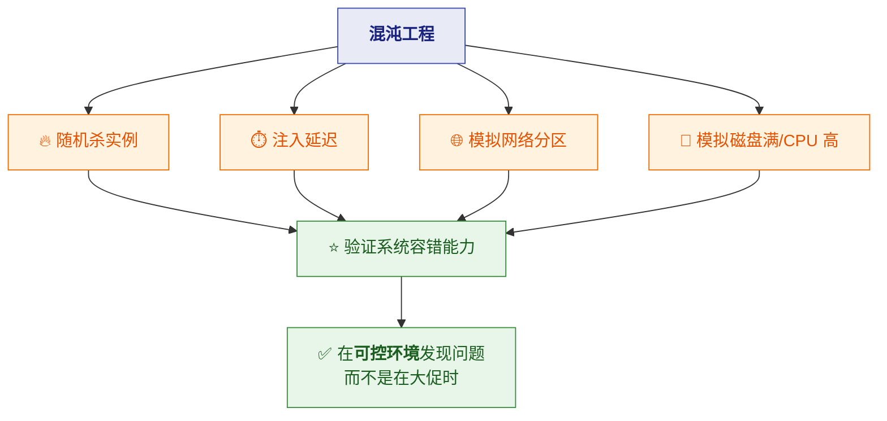

> [!important] ⭐ 为什么需要混沌工程
> **因为"容错设计"必须被"验证"才有意义。**
>
> **你写了熔断、降级、重试**——**但它们真的生效吗？**
> - 熔断阈值设对了吗？
> - 降级逻辑会不会抛异常？
> - 重试会不会引发风暴？
>
> 👉 **混沌工程就是"主动制造故障来验证预案"。**
>
> ⚠️ **前提**：**必须在"可控环境"或"有完善监控和回滚能力"时做**，
> **并且从"最小范围"开始**（如先杀 1 个实例）。

---

## 十四、⭐ 终极目标：弹性

> 视频原话："**高并发架构的终极目标不是抗住多少 QPS，
> 而是弹性——压力来了能伸缩，故障来了能自愈，峰值过了能恢复。
> 就像太极借力打力，而不是硬碰硬。**"

```mermaid
flowchart TB
  S["<b>弹性</b>"] --> S1["📈 <b>压力来了 → 能伸缩</b><br/>自动扩容"]
  S --> S2["🛡️ <b>故障来了 → 能自愈</b><br/>熔断/重试/摘除"]
  S --> S3["📉 <b>峰值过了 → 能恢复</b><br/>自动缩容"]
  S1 --> T["⭐ 像生命体一样自适应"]
  S2 --> T
  S3 --> T
  classDef s fill:#e8f5e9,stroke:#388e3c,color:#1b5e20
  classDef t fill:#fff3e0,stroke:#ef6c00,color:#e65100
  class S,S1,S2,S3 s
  class T t
```

> [!success] ⭐⭐ 三句比喻（很有价值）
> | 手段 | 太极类比 |
> |---|---|
> | **限流** | ⭐ **疏导** |
> | **熔断** | ⭐ **止损** |
> | **MQ** | ⭐ **缓冲** |
> | **缓存** | ⭐ **借力** |
>
> **"每一层都不硬扛，而是把压力化解掉。"**
>
> ⚠️ **对比"硬碰硬"**：**堆机器、加资源、撑住峰值**——
> **成本高、且总有扛不住的一天。**

### 14.1 ⭐ 后续三个学习方向

| 方向 | 内容 |
|---|---|
| **① 容量规划** | ⭐ **科学估算系统水位**（多少机器扛多少 QPS） |
| **② 混沌工程** | **主动故障演练** |
| **③ 云原生弹性** | ⭐ **K8s 自动扩缩容（HPA）+ Serverless 按需计算** |

> [!important] ⭐ 视频结尾的判断
> **"高并发的终极形态，是让系统像生命体一样自适应。"**
>
> 👉 **这就把"高并发设计"从"技巧集合"提升到了"架构哲学"**——
> **不是"把系统做得更强"，而是"让系统更会应对变化"。**

---

## 附录 A：语音转写（ASR）勘误对照

> 原稿是语音转写，错误较多。**阅读原始字幕稿时对照此表。**

| 原稿（错） | 正确 | 说明 |
|---|---|---|
| ⭐ **县城** | **线程** | 全文多处（最典型） |
| ⭐ **吉连** | **级联** | "这就是级联" |
| ⭐ **所竞争 / 所** | ⭐ **锁竞争 / 锁** | "锁竞争让并行变串行" |
| ⭐ **线城池** | **线程池** | "应用层线程池会耗尽" |
| ⭐ **SOL / SEQUO** | **SQL** | "一个慢 SQL" |
| ⭐ **POSTCOSQL** | ⭐ **PostgreSQL** | 连接池公式出处 |
| ⭐ **my SQL** | **MySQL** | —— |
| ⭐ **赔 1000** | ⭐ **配 1000** | "别一上来就配 1000" |
| ⭐ **重音 / 根音** | ⭐ **根因** | "根因是什么" |
| ⭐ **work / when / where / why / how** | **What / When / Where / Why / How** | 5W 框架 |
| ⭐ **REDIS** | ⭐ **Redis** | 全文多处 |
| ⭐ **dB / DB** | **DB（数据库）** | 全文多处 |
| ⭐ **历上** | **历史上** | —— |
| ⭐ **history sentinel** | ⭐ **Hystrix / Sentinel** | "Hystrix、Sentinel 都是这个思路" |
| ⭐ **red lock / red log** | ⭐ **RedLock** | 分布式锁方案 |
| ⭐ **ZOKEEPER / ZK** | ⭐ **ZooKeeper** | 分布式锁方案 |
| ⭐ **绘画断开 / 会话断开** | ⭐ **会话断开** | ZK 临时节点释放 |
| ⭐ **settings / setnx** | ⭐ **SET NX** | Redis 加锁命令 |
| ⭐ **看门狗机制** | **看门狗机制** | 此处原文正确 |
| ⭐ **令牌桶 / 漏桶** | 正确 | 限流算法 |
| ⭐ **以固定速去** | **以固定速率** | 令牌桶描述 |
| ⭐ **拿令牌有救** | ⭐ **拿令牌，有就** | "有就拿令牌通过" |
| ⭐ **Guava rate limited** | ⭐ **Guava RateLimiter** | 限流组件 |
| ⭐ **一不化** | ⭐ **异步化** | "或者降级，生产异步化" |
| ⭐ **亦步加最终一致性** | ⭐ **异步 + 最终一致性** | MQ 一致性方案 |
| ⭐ **所过期时间 / 锁过期时间** | ⭐ **锁过期时间** | 分布式锁 |
| ⭐ **NETFX** | ⭐ **Netflix** | Chaos Monkey 出处 |
| ⭐ **大素食 bug** | ⭐ **大促时 bug** | "大促时 bug 就会找你" |
| ⭐ **杀实力** | ⭐ **杀实例** | 混沌工程 |
| ⭐ **缓存穿套** | **缓存穿透** | —— |
| ⭐ **混沌工程** | 正确 | 此处原文正确 |
| ⭐ **太极大法** | **太极** | 结尾比喻 |
| ⭐ **故事现在新** | ⭐ **故事现在新**（语义不通） | 结尾口误，无实义 |
| ⭐ **一百 / 一百秒** | **一毫秒**（推测） | "那一毫秒间隔内就有 2000 请求" |

---

## 附录 B：30 秒速查

> [!abstract] 记住这 17 句
> 1. ⭐ **高并发是相对的**——"请求量超过系统容量的那一刻"，不是绝对 QPS。
> 2. ⭐ **5W 框架**：What/When/Where/Why/How（**也是最好的答题结构**）。
> 3. ⭐ **五层架构**：接入 / 应用 / 缓存 / 数据 / 基础设施。
> 4. ⭐⭐ **木桶效应**：容量由**最慢那层**决定 → **必须全链路压测**。
> 5. ⭐ **六条因果链**：流量突增、热点缓存、同步阻塞、锁竞争、慢查询、下游故障。
> 6. ⭐⭐ **缓存三兄弟**：**穿透**（布隆过滤器）/**击穿**（互斥锁）/**雪崩**（随机 TTL + 多级 + 熔断）。
> 7. ⭐ **数据库最难扩**（有状态）→ **尽量把压力挡在它之前**。
> 8. ⭐⭐ **连接池不是越大越好**——`CPU 核数 × 2 + 磁盘数`。
> 9. ⭐ **慢查询是死亡螺旋触发器**——先治 SQL 和索引，再谈分库分表。
> 10. ⭐ **超时不够，必须熔断**（**快速失败才能释放线程**）+ **舱壁隔离**。
> 11. ⭐ **限流四算法**：固定窗口（有突刺）/ 滑动窗口 / 漏桶（平滑）/ ⭐ **令牌桶（允许突发）**。
> 12. ⭐ **熔断是机制，降级是策略**——熔断三态：**关闭 / 打开 / 半开**。
> 13. ⭐ **MQ 是蓄水池**——但**堆积会爆**，必须监控 Lag；异步 = **最终一致性**。
> 14. ⭐⭐ **MQ 三件套**：**监控堆积 + 死信队列 + 幂等消费**（MQ 默认"至少一次"，**必须幂等**）。
> 15. ⭐⭐ **分布式锁三件套**：**看门狗续期 + 可重入 + 过期兜底**（TTL 是最后兜底）。
> 16. ⭐ **监控四指标**：**QPS / RT / 错误率 / 饱和度**——⭐ **饱和度是唯一"先行指标"**。
> 17. ⭐⭐ **终极目标是弹性**——**限流疏导、熔断止损、MQ 缓冲、缓存借力，不硬扛**。

> [!important] ⭐⭐ 九层 Checklist（上线前对照）
> **接入层**（Nginx + 防 DDoS）· **应用层**（线程池隔离 + 超时）·
> **缓存层**（三兄弟 + 多级缓存）· **数据层**（连接池 + 慢查询 + 读写分离）·
> **服务层**（熔断降级 + 限流 + 舱壁）· **消息队列**（堆积 + 死信 + 幂等）·
> **分布式锁**（续期 + 可重入 + 兜底）· **监控告警**（QPS/RT/错误率/饱和度）·
> **压测验证**（全链路压测 + 混沌工程）
>
> ⭐ **注意：后四项（MQ / 锁 / 监控 / 压测）不是"某一层"，
> 而是横跨全链路的保障机制**——这也是它们容易在 Checklist 里被漏掉的原因。

> [!tip] 三个最重要的"反直觉"
> ① ⭐ **连接池越大越慢**（上下文切换）。
> ② ⭐ **熔断的价值不是"少发请求"，而是"释放线程"**。
> ③ ⭐ **降级不是"降级一切"**——涉及资损的（支付/库存）**绝不能降级**。

---

> 关联：[[50万QPS实时推荐 延迟从小时压到毫秒（详细整理版）|50万QPS实时推荐]]（实时链路实践）
> 专题深化：[[7-分布式/6-缓存一致性与高可用|6-缓存一致性与高可用]] · [[7-分布式/7-限流熔断降级|7-限流熔断降级]] · [[7-分布式/3-分布式锁|3-分布式锁]]
> 相关：[[2-redis/一次讲透Redis（详细整理版）|Redis]] · [[4-db/6-慢查询与调优|MySQL 慢查询与调优]] · [[3-mq/2-Kafka/理解 kafka 基本盘（详细整理版）|Kafka]]
> 原始字幕稿：[[高并发系统设计]]
