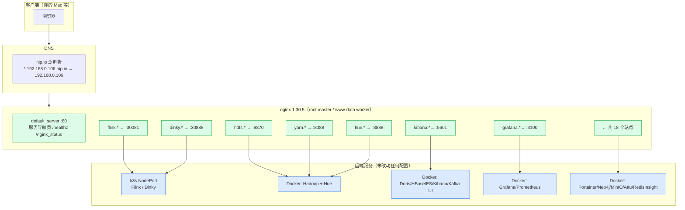
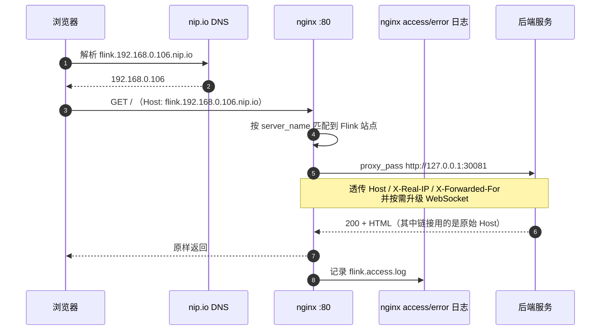
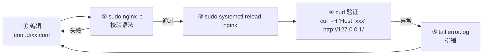
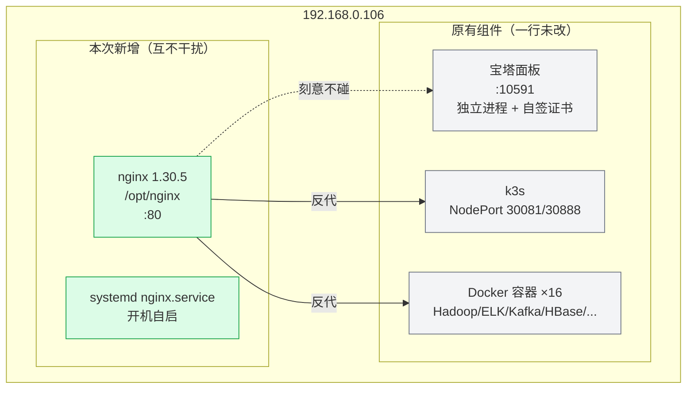

# 106 服务统一入口：nginx 1.30.5 配置手册

> [!info] 这份文档是什么
> 在 **192.168.0.106** 上用源码编译的方式装了 **nginx 1.30.5**，把机器上原本散落在 20 来个端口上的 Web 控制台，
> 统一收敛到一个 **80 端口的入口**，每个服务一个域名（`xxx.192.168.0.106.nip.io`）。
>
> **最大的好处：一个现有服务的配置都没改。** 因为用的是「主机名 vhost + 根路径反代」，
> 服务自己以为还在根路径上，所有链接、静态资源、跳转都不用动。
>
> 本文包含：安装过程（可复现）、配置设计、**实测结果**、日常运维、新增服务模板、以及**真实踩过的坑**。

---

## 一、成果速览

| 项目 | 值 |
|---|---|
| nginx 版本 | **1.30.5**（源码编译，`nginx_version 1030005`） |
| 安装路径 | `/opt/nginx`（可执行文件 `/opt/nginx/sbin/nginx`） |
| 监听 | `0.0.0.0:80` + `0.0.0.0:443`（均 IPv4 + IPv6，**HTTP/HTTPS 并行**） |
| 运行方式 | systemd `nginx.service`，**已设为开机自启** |
| 运行用户 | master = `root`，worker = `www-data` |
| 配置目录 | `/opt/nginx/conf/`（主配置 + `conf.d/*.conf` 分站点） |
| 日志目录 | `/opt/nginx/logs/` |
| 入口首页 | `http://192.168.0.106/`（服务导航页）；`https://192.168.0.106/` 亦可，**但需先导入内部 CA** |
| HTTPS | ✅ 已启用（443），内部 CA + 泛域名证书；详见 [[12-nginx/1-Nginx配置详解与HTTPS证书实践]] |
| 实测结果 | **18/18 个服务域名入口全部打通** |
| 磁盘占用 | 6.7 MB |

> [!tip] 一分钟上手
> 浏览器打开 **`http://192.168.0.106/`** —— 那是一个服务导航页，点哪个进哪个。
> 所有 `*.192.168.0.106.nip.io` 域名由 nip.io 泛解析到 `192.168.0.106`，**不需要改 hosts、不需要配 DNS**。

---

## 二、整体架构

### 2.1 入口拓扑



### 2.2 一个请求怎么走



**关键点**：`proxy_set_header Host $host;` —— 把浏览器原始域名透传给后端。
所以后端生成的**跳转和静态资源链接仍然是 `flink.192.168.0.106.nip.io`**，浏览器能继续访问。
这正是"不用改应用配置"的技术核心。

---

## 三、安装过程（可复现）

> 原目录 `/opt/nginx-1.30.5` 是**源码树**，从未编译过。以下是完整编译安装步骤。

### 3.1 前置条件

| 依赖 | 状态 | 说明 |
|---|---|---|
| gcc / make | ✅ gcc 15.2.0 / make 4.4.1 | 编译工具链 |
| **libpcre2-dev** | ⚠️ **原本缺失，已安装** | nginx 的 `rewrite`/正则依赖 PCRE2 |
| zlib1g-dev | ✅ 已装 | gzip 模块 |
| libssl-dev | ✅ 已装 | HTTPS / http_ssl_module |

```bash
# 补上缺失的 PCRE2 开发包
sudo apt-get install -y libpcre2-dev
ls -l /usr/include/pcre2.h      # 确认存在
```

### 3.2 编译与安装

```bash
cd /opt/nginx-1.30.5

./configure \
  --prefix=/opt/nginx \
  --sbin-path=/opt/nginx/sbin/nginx \
  --conf-path=/opt/nginx/conf/nginx.conf \
  --pid-path=/opt/nginx/logs/nginx.pid \
  --lock-path=/opt/nginx/logs/nginx.lock \
  --error-log-path=/opt/nginx/logs/error.log \
  --http-log-path=/opt/nginx/logs/access.log \
  --user=www-data --group=www-data \
  --with-http_ssl_module \
  --with-http_v2_module \
  --with-http_realip_module \
  --with-http_gzip_static_module \
  --with-http_stub_status_module \
  --with-http_sub_module \
  --with-stream --with-stream_ssl_module --with-stream_ssl_preread_module \
  --with-threads --with-pcre-jit \
  --with-cc-opt='-O2'

make -j6
sudo make install        # 装到 /opt/nginx
/opt/nginx/sbin/nginx -V # 验证
```

> [!note] 几个编译选项为什么这么选
> - `--prefix=/opt/nginx`：不污染 `/usr/local`，和系统包管理器彻底隔离。
> - `--with-stream*`：为将来做 **TCP/UDP 四层反代**预留（比如把 MySQL/Kafka 也收敛进来）。
> - `--with-http_realip_module`：将来前面再挂一层代理时，能拿到真实客户端 IP。
> - `--with-http_stub_status_module`：提供 `/nginx_status` 监控指标。
> - `--user=www-data`：worker 以非特权用户运行，符合安全基线。
> - 未启用 `--with-http_perl_module` 等重型模块，保持精简。

### 3.3 启动方式

```bash
# 手工方式（调试用）
sudo /opt/nginx/sbin/nginx           # 启动
sudo /opt/nginx/sbin/nginx -s reload # 平滑重载
sudo /opt/nginx/sbin/nginx -s quit   # 优雅停止
sudo /opt/nginx/sbin/nginx -t        # 只校验配置

# 日常方式（推荐）：systemd
sudo systemctl start nginx
sudo systemctl reload nginx          # ★ 改完配置用这个
sudo systemctl restart nginx
sudo systemctl status nginx
```

> [!warning] 为什么 `nginx -t` 要用 sudo
> `nginx -t` 会**真的尝试 bind 监听端口**。非 root 用户（`ip_unprivileged_port_start=1024`）绑不了 80，
> 会报 `bind() to 0.0.0.0:80 failed (13: Permission denied)`。
> **这不是配置错误**，用 `sudo nginx -t` 就能通过。

---

## 四、文件布局

```
/opt/nginx/
├── sbin/nginx                      可执行文件
├── conf/
│   ├── nginx.conf                  主配置（worker、gzip、日志、WebSocket map、include）
│   ├── mime.types                  官方自带
│   └── conf.d/
│       ├── 00-default.conf         默认站点：导航页 + /healthz + /nginx_status + /hue/ + /es/
│       ├── 10-k8s.conf             Flink、Dinky
│       ├── 20-hadoop.conf          HDFS、YARN、JobHistory、Hive、Hue
│       ├── 30-data.conf            Doris、HBase、Kibana、Kafka UI
│       ├── 40-monitoring.conf      Grafana、Prometheus
│       └── 50-tools.conf           Portainer、Neo4j、MinIO、Attu、RedisInsight
├── html/index.html                 服务导航首页（自包含，无外部依赖）
├── logs/                           访问日志、错误日志、pid
│   ├── error.log
│   ├── <站点>.access.log           每个站点一个
│   └── default.access.log
└── conf.orig-20261014-182203/      部署前的原始配置备份

/etc/systemd/system/nginx.service   systemd 单元
```

> [!tip] 为什么按"分组"而不是"每服务一个文件"
> 18 个服务如果拆 18 个文件太多且难对比；按**领域分组**（k8s / hadoop / data / monitoring / tools）
> 每组一个文件，既清晰又便于整体审阅。要单独改某个服务，直接在对应组里找 `server_name` 即可。

---

## 五、实测服务清单（2026-10-14 验证）

> 全部从 **Mac 端到端**实测（`curl -H "Host: ..." http://192.168.0.106/`），不是只看 nginx 配置。

### 5.1 域名入口

| 服务 | 域名 | 后端 | 状态 | 跳转行为 |
|---|---|---|---|---|
| Flink Web UI | `flink.192.168.0.106.nip.io` | `127.0.0.1:30081` | ✅ 200 | — |
| Dinky | `dinky.192.168.0.106.nip.io` | `127.0.0.1:30888` | ✅ 200 | — |
| HDFS NameNode | `hdfs.192.168.0.106.nip.io` | `127.0.0.1:9870` | ✅ 302 | → `http://hdfs.…nip.io/index.html` ✅ |
| **YARN RM** | `yarn.192.168.0.106.nip.io` | **`192.168.0.106:8088`** | ✅ 302 | → `http://yarn.…nip.io/cluster` ✅ |
| JobHistory | `jobhistory.192.168.0.106.nip.io` | `127.0.0.1:19888` | ✅ 302 | → `http://jobhistory.…nip.io/jobhistory` ✅ |
| HiveServer2 Web | `hive.192.168.0.106.nip.io` | `127.0.0.1:10002` | ✅ 200 | — |
| Hue | `hue.192.168.0.106.nip.io` | `127.0.0.1:8888` | ✅ 302 | → `/hue/accounts/login` ✅ |
| Doris FE | `doris.192.168.0.106.nip.io` | `127.0.0.1:18030` | ✅ 200 | — |
| HBase Master | `hbase.192.168.0.106.nip.io` | `127.0.0.1:16010` | ✅ 200 | — |
| Kibana | `kibana.192.168.0.106.nip.io` | `127.0.0.1:5601` | ✅ 302 | → `/spaces/enter` ✅ |
| Kafka UI | `kafka-ui.192.168.0.106.nip.io` | `127.0.0.1:28080` | ✅ 200 | — |
| Grafana | `grafana.192.168.0.106.nip.io` | `127.0.0.1:3100` | ✅ 302 | → `/login` ✅ |
| Prometheus | `prometheus.192.168.0.106.nip.io` | `127.0.0.1:9093` | ✅ 302 | → `/graph` ✅ |
| Portainer | `portainer.192.168.0.106.nip.io` | `127.0.0.1:9000` | ✅ 200 | — |
| Neo4j Browser | `neo4j.192.168.0.106.nip.io` | `127.0.0.1:7474` | ✅ 200 | — |
| MinIO Console | `minio.192.168.0.106.nip.io` | `127.0.0.1:9001` | ✅ 200 | — |
| Attu (Milvus) | `attu.192.168.0.106.nip.io` | `127.0.0.1:8000` | ✅ 200 | — |
| RedisInsight | `redisinsight.192.168.0.106.nip.io` | `127.0.0.1:5540` | ✅ 200 | — |

### 5.2 便捷入口（挂在默认站点的子路径上）

| 入口 | 说明 | 状态 |
|---|---|---|
| `http://192.168.0.106/` | 服务导航首页 | ✅ 200 |
| `http://192.168.0.106/healthz` | 健康检查，返回 `nginx-ok` | ✅ |
| `http://192.168.0.106/nginx_status` | stub_status（仅内网） | ✅ |
| `http://192.168.0.106/hue/` | Hue 快捷入口（**它原生就带 /hue/ 前缀**） | ✅ 302 |
| `http://192.168.0.106/es/_cluster/health` | ES REST API（前缀被剥掉后转发给 9200） | ✅ 返回 JSON |

**实测 ES 返回**：
```json
{"cluster_name":"elk-cluster","status":"yellow","number_of_nodes":1,...}
```

> [!important] 结论：零应用配置改动
> 上表 18 个服务的 **302 跳转目标全部是公网主机名或相对路径**，没有一个跳到容器内部主机名
> （如 `hadoop-namenode:9870`）。**证明 `Host` 透传方案对这些服务全部有效，不需要改任何服务的配置文件。**

### 5.3 未纳入反代的服务（直连端口）

这些不是 Web UI，或者代理没有意义，保持直连：

| 服务 | 端口 | 原因 |
|---|---|---|
| 宝塔面板 | 10591 | 有安全入口 + 自签证书，独立体系，**刻意不碰** |
| MySQL | 3306 | 数据库协议，客户端直连 |
| Redis | 6379 | 同上 |
| Kafka | 9092 | 同上 |
| Neo4j Bolt | 7687 | 图数据库协议 |
| Milvus gRPC | 19530 | 同上 |
| MinIO S3 API | 9002 | 对象存储 API |
| HiveServer2 Thrift | 10000 | JDBC 协议 |
| HBase RegionServer | 16030 | 内部组件 UI |
| Doris BE | 18040 | 内部组件 UI |
| node-exporter | 9100 | 指标端点，给 Prometheus 抓 |
| K8s NodePort 3xxxx | — | 已由域名入口覆盖 |

---

## 六、日常运维

### 6.1 常用命令

```bash
# ── 服务管理 ──
sudo systemctl status nginx          # 看状态
sudo systemctl reload nginx          # ★ 改配置后平滑重载（不断连接）
sudo systemctl restart nginx         # 重启
sudo systemctl stop nginx            # 停止

# ── 配置 ──
sudo /opt/nginx/sbin/nginx -t        # 校验（★ 改完必做）
sudo /opt/nginx/sbin/nginx -T        # 校验并打印完整生效配置（排错神器）

# ── 日志 ──
tail -f /opt/nginx/logs/error.log                 # 错误日志（排错第一站）
tail -f /opt/nginx/logs/flink.access.log          # 某站点访问日志
grep -i 'error\|warn' /opt/nginx/logs/error.log | tail -30

# ── 运行态 ──
ss -lntp | grep :80                   # 监听确认
ps -eo user,args | grep '/opt/nginx'  # 进程与用户
curl -s http://127.0.0.1/healthz      # 健康检查
curl -s http://127.0.0.1/nginx_status # 连接数状态
```

### 6.2 改动配置的标准流程



> [!tip] 永远不要跳过第 ② 步
> systemd 单元里配了 `ExecStartPre=/opt/nginx/sbin/nginx -t -q`，
> 所以**启动时**配错会被拦住；但 `reload` 不走 ExecStartPre，
> **必须手动 `nginx -t`**，否则可能 reload 后 nginx 仍用旧配置（或直接报错）。
> 好在 nginx 的 reload 是原子的：校验不过就不会替换工作进程，不会导致服务中断。

### 6.3 备份与恢复

```bash
# 备份（改动前做）
sudo tar czf /root/nginx-conf-$(date +%F).tgz -C /opt/nginx conf

# 恢复
sudo rm -rf /opt/nginx/conf && sudo tar xzf /root/nginx-conf-2026-10-14.tgz -C /opt/nginx
sudo /opt/nginx/sbin/nginx -t && sudo systemctl reload nginx

# 已经有的原始备份
ls /opt/nginx/conf.orig-*     # make install 后的默认配置
```

---

## 七、新增一个服务怎么配

### 7.1 最简模板

在对应分组的 `conf.d/*.conf` 末尾追加：

```nginx
server {
    listen       80;
    server_name  <名字>.192.168.0.106.nip.io;
    access_log   /opt/nginx/logs/<名字>.access.log main;

    location / {
        proxy_pass http://127.0.0.1:<端口>;
        # 需要 WebSocket 的服务（控制台/终端类）不用额外配置，
        # 主配置里的 Upgrade/Connection map 已全局生效。
    }
}
```

然后：

```bash
sudo /opt/nginx/sbin/nginx -t && sudo systemctl reload nginx
curl -s -o /dev/null -w '%{http_code}\n' -H 'Host: <名字>.192.168.0.106.nip.io' http://127.0.0.1/
```

### 7.2 后端只绑 LAN IP 怎么办

**这次就踩到了**：YARN RM 的 `webapp` 只监听 `192.168.0.106:8088`，没监听 `127.0.0.1`，
所以 `proxy_pass http://127.0.0.1:8088` 直接 `502`。

先确认后端绑在哪：

```bash
sudo ss -lntp | grep ':8088'
# LISTEN 0 128 192.168.0.106:8088   ← 只绑了 LAN IP
```

两种解法：

```nginx
# 方案 A：proxy_pass 直接用 LAN IP（简单，本次采用）
proxy_pass http://192.168.0.106:8088;

# 方案 B：让服务改绑 0.0.0.0（要改服务配置并重启，不推荐为反代改服务）
```

> [!tip] 判断口子：`502` 且 error.log 里有 `connect() failed (111: Connection refused)`
> 就是这种"后端没在你要连的那个地址上监听"的问题。
> 而 `502` 但日志是 `Connection timed out` 则通常是防火墙/网络问题。

### 7.3 需要 TLS 的服务

```nginx
server {
    listen       443 ssl;
    http2        on;
    server_name  xx.192.168.0.106.nip.io;

    ssl_certificate     /opt/nginx/conf/ssl/xx.crt;
    ssl_certificate_key /opt/nginx/conf/ssl/xx.key;

    location / { proxy_pass http://127.0.0.1:PORT; }
}
```

自签证书一条命令（★ 必须带 SAN，否则浏览器报域名不匹配）：

```bash
openssl req -x509 -nodes -newkey rsa:2048 -days 3650 \
  -keyout /opt/nginx/conf/ssl/xx.key \
  -out    /opt/nginx/conf/ssl/xx.crt \
  -subj "/CN=xx.192.168.0.106.nip.io" \
  -addext "subjectAltName=DNS:xx.192.168.0.106.nip.io,IP:192.168.0.106"
```

> [!warning] HTTPS 和"子路径"天生冲突
> 有些服务在 HTTPS 下会生成 `http://` 的绝对链接（混合内容被浏览器拦）。
> 生产做法是只在外层终止 TLS 并在服务端配 `X-Forwarded-Proto`（本配置已透传）。
> 学习环境如果只是自己用，继续用 HTTP 最省事。

---

## 八、常见问题（本次真实踩到的坑）

### 8.1 首页 403 Forbidden

**现象**：`http://192.168.0.106/` 返回 403，但 `/healthz` 正常。

**原因**：把 `index.html` 拷进去时是 `600` 权限（`-rw-------`），
nginx worker 以 `www-data` 运行，**读不了 vic 的私有文件** → 403。

```bash
ls -la /opt/nginx/html/index.html
# -rw------- 1 vic vic  ← 问题所在
```

**修复**：

```bash
sudo chmod 755 /opt/nginx /opt/nginx/html /opt/nginx/conf /opt/nginx/conf/conf.d
sudo chmod 644 /opt/nginx/html/index.html /opt/nginx/conf/nginx.conf /opt/nginx/conf/conf.d/*.conf
```

> [!tip] 记住这条
> **凡是 nginx worker（`www-data`）要读的文件，必须 `o+r`。**
> 从 Mac `scp`/`tar` 过去、或自己 `umask 077` 创建的文件，默认都是 `600`，最容易踩。

### 8.2 YARN 502 Bad Gateway

见 §7.2。根因是后端**只绑 LAN IP**。修复后实测 302 正常。

### 8.3 `bind() to 0.0.0.0:80 failed (13: Permission denied)`

**不是配置错误**。`nginx -t` 会真实 bind 端口，非 root 绑不了 80。
用 `sudo nginx -t` 即可（实测通过）。

### 8.4 error.log 里的 `upstream sent duplicate header line`

**无害警告**，可以忽略。Hadoop / HBase 的 Java Web UI 会重复发 `Date`、`Expires` 头，
nginx 直接忽略重复值。不影响功能。

```
[warn] upstream sent duplicate header line: "Date: ...", previous value: "Date: ...", ignored
```

### 8.5 macOS 打包带进来的 `._*` 垃圾文件

从 Mac 用 `tar`/`cp` 传文件，会带上 AppleDouble 元数据文件（`._xxx.conf`）。

- 实际**不会**被 `include conf.d/*.conf` 匹配——`glob(3)` 默认不匹配以 `.` 开头的文件。
- 但仍然建议清掉：`rm -f /opt/nginx/conf/conf.d/._*`
- 以后打包用：`COPYFILE_DISABLE=1 tar czf ...`

### 8.6 某些服务页面能开但功能异常

如果登录后跳回了 `localhost:3000` 之类的内网地址，是**该服务自己的 `root_url`/`basePath` 配置**问题，
不是反代问题。本机这几个的修复方式：

| 服务 | 症状 | 修复（需重启该容器） |
|---|---|---|
| Grafana | 点登录跳回 `localhost:3000` | 加环境变量 `GF_SERVER_ROOT_URL=http://grafana.192.168.0.106.nip.io`、`GF_SERVER_DOMAIN=grafana.192.168.0.106.nip.io` |
| Kibana | 卡在 "Kibana server is not ready" | 加 `server.publicBaseUrl: "http://kibana.192.168.0.106.nip.io"` |
| MinIO | 登录后跳转异常 | 加 `MINIO_BROWSER_REDIRECT_URL=http://minio.192.168.0.106.nip.io` |
| Prometheus | 想用子路径 `/prometheus/` | 启动加 `--web.external-url=/prometheus/` |

> 本次**实测这 4 个服务在根路径反代下都正常返回**（302 到相对路径），所以现在**不用改**。
> 只有你将来把它们挪到子路径时才会遇到。

### 8.7 怎么快速定位是 nginx 的问题还是服务的问题

```bash
# 第一步：绕过 nginx，直连服务端口
curl -s -o /dev/null -w '%{http_code}\n' http://192.168.0.106:<端口>/

# 直连也挂  → 服务自己的问题（查 docker ps / systemctl）
# 直连正常但域名挂 → nginx 问题（查 error.log + 后端监听地址）
```

---

## 九、和机器上其它组件的隔离关系



**三个明确的隔离保证**：

1. **宝塔面板完全没碰**。它在 10591，有自己的进程和自签证书；本 nginx 只用 80/443，两者零冲突。
   （顺带说明：机器上**从来就没有** `/www/server/nginx`，之前排查到的 nginx 进程全是容器里的。）
2. **现有 Docker/K8s 服务配置一行未改**。nginx 只是新增了一个"从 80 进来"的访问路径，
   原有的 `IP:端口` 直连方式**依然可用**，随时可以绕过 nginx 对比排查。
3. **端口无冲突**。装之前已确认 80/443 空闲（`ConnectionRefused`），装完也只占了这两个。

---

## 十、安全与后续

### 10.1 当前安全状态

| 项目 | 状态 | 说明 |
|---|---|---|
| UFW 放行 80/443 | ✅ 已放行 | 无需额外操作 |
| nginx worker 用户 | ✅ `www-data` | 非 root |
| `server_tokens off` | ✅ 已配 | 不回显版本号 |
| 隐藏文件访问 | ✅ 已 deny | `location ~ /\.` |
| `/nginx_status` | ✅ 限内网 | 仅 `127.0.0.1` 与 `192.168.0.0/24` |
| **全站无鉴权** | ⚠️ **风险** | 局域网内任何人可访问所有控制台 |
| **全站 HTTP** | ⚠️ 明文 | 含 Hue/Kibana 等登录页，密码明文传输 |

> [!warning] 最需要注意的一点
> 现在 nginx 把 18 个管理控制台**集中暴露在 80 端口**，其中 Portainer（可控制 Docker）、
> Grafana（可能含数据源密码）、Kibana、Hue 都是有价值的入口。
> 而你机器上 **Docker 端口本来就绕过 UFW 对局域网全开**（见巡检报告），
> nginx 只是让它更好用，并没有新增暴露面，但**集中化也确实放大了单点风险**。
>
> 建议按需加一层保护，见下。

### 10.2 后续可做的三件事（按优先级）

**① 加 Basic Auth（最简单，10 分钟）**

```bash
sudo apt-get install -y apache2-utils
sudo htpasswd -c /opt/nginx/conf/.htpasswd vic
# 然后在 nginx.conf 的 http 段统一加，或给敏感站点单独加：
```

```nginx
# 放在 server 块内
auth_basic           "106 服务入口";
auth_basic_user_file /opt/nginx/conf/.htpasswd;
```

**② 上 HTTPS（自签或内部 CA）**

见 §7.3。至少能让登录密码不明文。

**③ 只对内网放行 + 收敛直连端口**

```bash
# 已放行 80/443；考虑把 3306/6379/9200/9092 等从 UFW 收紧
# 并用 ufw-docker 解决"Docker 绕过 UFW"问题（巡检报告里的 P1 问题）
```

### 10.3 可选：把 TCP 服务也收敛进来

编译时已带 `--with-stream`，将来可以把 MySQL/Kafka 也做四层反代：

```nginx
stream {
    upstream mysql_backend { server 127.0.0.1:3306; }
    server {
        listen 13306;
        proxy_pass mysql_backend;
    }
}
```

> 注意 `stream` 块**必须放在 `http` 块外面**（与 `http` 同级），且需要单独 `include`。

---

## 十一、速查卡

```bash
# 状态
sudo systemctl status nginx
curl -s http://192.168.0.106/healthz

# 改配置
sudo vi /opt/nginx/conf/conf.d/xx.conf
sudo /opt/nginx/sbin/nginx -t && sudo systemctl reload nginx

# 看日志
tail -f /opt/nginx/logs/error.log
tail -f /opt/nginx/logs/<站点>.access.log

# 验证某站点（不依赖 DNS）
curl -s -o /dev/null -w '%{http_code}\n' -H 'Host: flink.192.168.0.106.nip.io' http://127.0.0.1/

# 看后端绑在哪（502 排错）
sudo ss -lntp | grep ':<端口>'

# 打印完整生效配置
sudo /opt/nginx/sbin/nginx -T | less
```

---

## 十二、延伸阅读

- 机器全貌与历史问题：[[服务器巡检-192.168.0.106/巡检报告]]
- 入口层架构（Nginx / Ingress / Gateway 的边界）：[[9-k8s/3-入口层-Nginx-Ingress-Gateway]]
- 系统架构总览：[[9-k8s/2-系统架构总览]]
- 服务梳理与端口全表：[[9-k8s/5-106服务梳理与K8s迁移规划]]
- Nginx 高并发调优：`11-高并发高可用/2-单机被打爆后，我才读懂 Nginx.md`
- nginx 官方文档：<https://nginx.org/en/docs/>

> [!summary] 一句话收束
> **nginx 1.30.5 已作为 80 端口统一入口上线（开机自启），18 个服务的 Web 控制台全部通过
> `*.192.168.0.106.nip.io` 域名访问，实测零应用配置改动。**
> 三个关键设计：主机名 vhost（不改应用）、`Host` 透传（跳转不跑偏）、按域分组配置（好维护）。
> 两个真实坑：**文件权限 600 导致 403**、**YARN 只绑 LAN IP 导致 502**。
> 最大待办：**加 Basic Auth + HTTPS**，因为现在全站无鉴权且明文。
