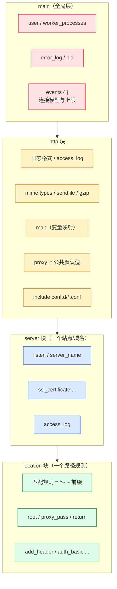
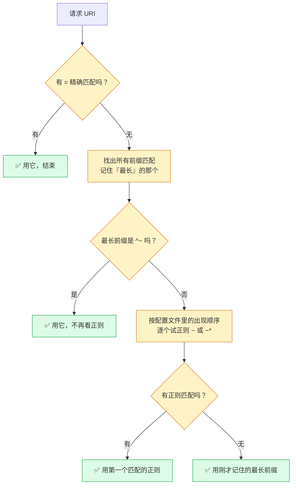
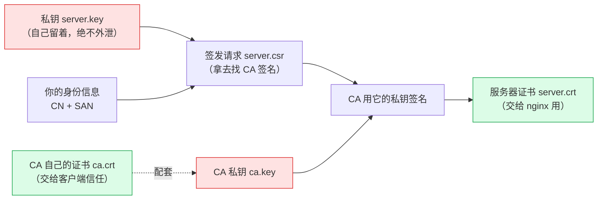
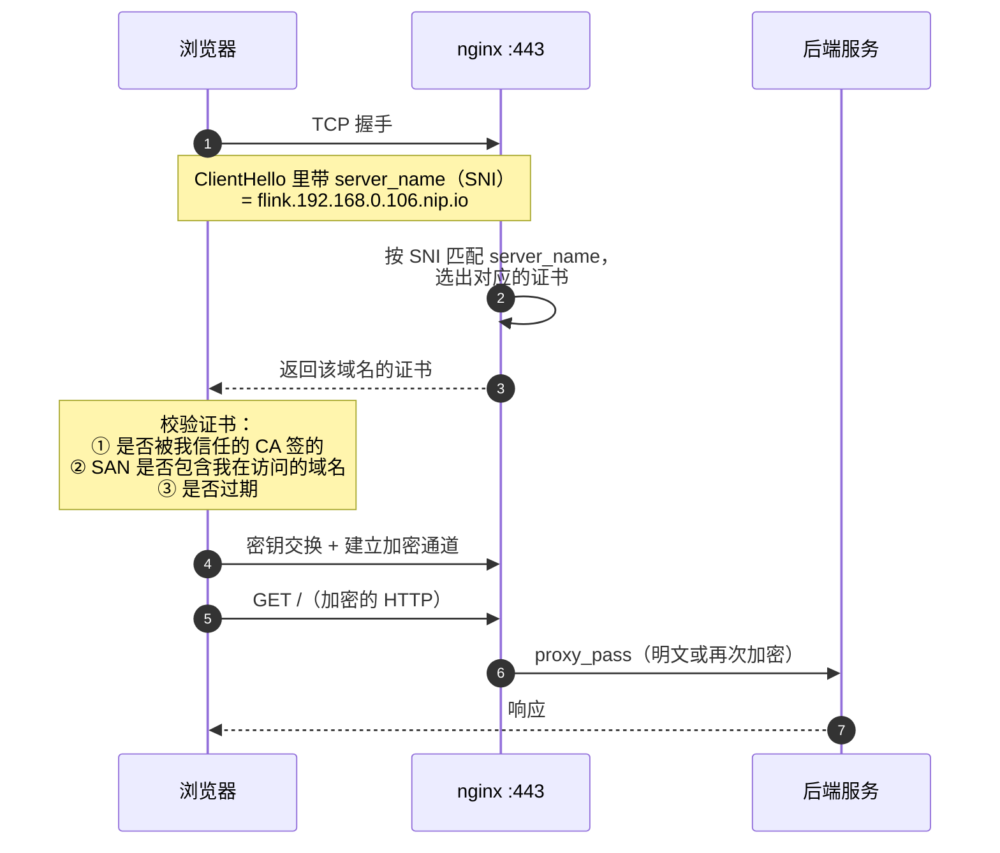
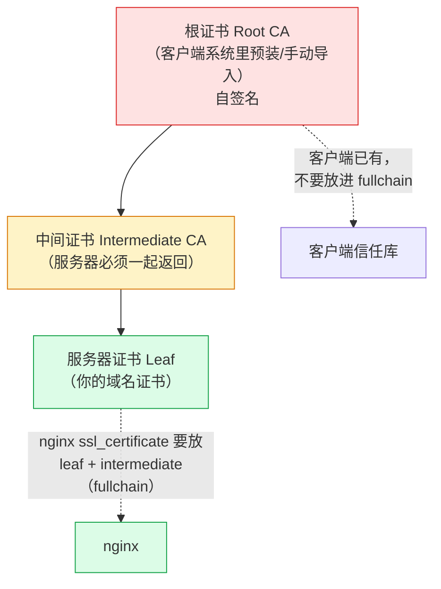
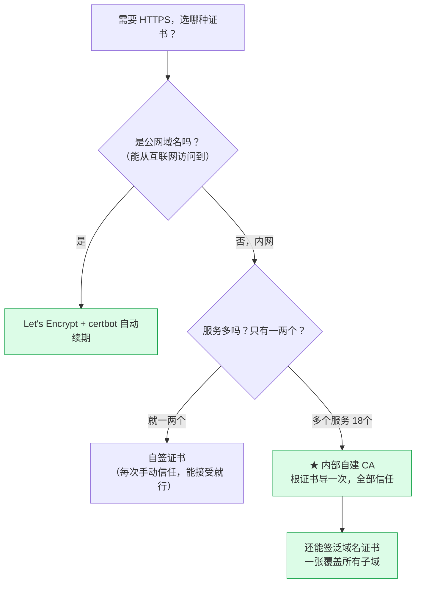
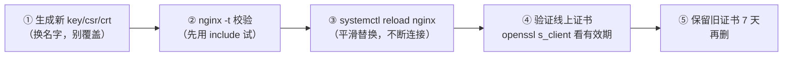

# Nginx 配置详解与 HTTPS 证书实践

> [!info] 这篇文档解决什么
> 上一篇 [[12-nginx/0-106服务统一入口配置手册]] 讲的是"**怎么把 18 个服务收敛到一个入口**"。
> 这一篇讲两件更底层、更容易踩坑的事：
> 1. **nginx 配置体系到底怎么组织的**（指令层级、`location` 匹配优先级、常见调优）
> 2. **HTTPS / 证书**：证书有哪几种、自签和内部 CA 怎么选、怎么生成、nginx 怎么写、怎么让浏览器信任、有哪些坑
>
> 所有证书命令和 nginx 配置**都在 106 上实测通过**（含临时启用 443 跑通 10 个服务再撤回）。

---

## 〇、先看结论：106 现在的 HTTPS 准备状态

| 项目 | 状态 |
|---|---|
| 内部根 CA | ✅ 已生成 `/opt/nginx/conf/ssl/ca.crt` + `ca.key`（RSA 4096，10 年） |
| 服务器证书 | ✅ 已生成 `/opt/nginx/conf/ssl/106.crt` + `106.key`（RSA 2048，825 天，2029-01 到期） |
| 证书 SAN | ✅ `*.192.168.0.106.nip.io` + `192.168.0.106.nip.io` + `IP:192.168.0.106` |
| SSL 参数片段 | ✅ `/opt/nginx/conf/snippets/ssl-common.conf` |
| 443 配置 | ✅ `/opt/nginx/conf/https-staged/99-https.conf`（**暂存，未启用**） |
| 语法验证 | ✅ `nginx -t` 通过 |
| 功能验证 | ✅ 临时启用实测：**10 个服务 200/302 全通，TLS 1.3 协商成功** |
| **当前线上** | ⚠️ **只开 80，443 未启用**（测完已撤回，`443 监听数 = 0`） |

### 一条命令启用 HTTPS

```bash
ssh vic@192.168.0.106
sudo cp /opt/nginx/conf/https-staged/99-https.conf /opt/nginx/conf/conf.d/ \
  && sudo /opt/nginx/sbin/nginx -t \
  && sudo systemctl reload nginx
```

停用（回到只有 80）：

```bash
sudo rm /opt/nginx/conf/conf.d/99-https.conf && sudo systemctl reload nginx
```

> [!warning] 启用前请先读完 §7（客户端信任 CA）
> 自签证书**浏览器默认不信任**。不先导入 CA 就启用 HTTPS，你会看到一片红色警告页。
> 而且**千万不要**在自签证书上开 HSTS（见 §9.3），否则证书出问题时你连降级回 HTTP 的机会都没有。

---

## 一、nginx 配置体系：三层结构



| 层级 | 作用 | 你在 106 的对应文件 |
|---|---|---|
| `main` | 进程级：worker 数、连接数上限、日志、pid | `/opt/nginx/conf/nginx.conf` 上半部 |
| `http` | HTTP 协议级：mime、gzip、日志格式、`map`、`proxy_*` 默认值 | `nginx.conf` 下半部 |
| `server` | 一个虚拟主机（一个域名一组配置） | `conf.d/10-k8s.conf` 里的每个 `server {}` |
| `location` | 一个路径的匹配与处理 | 每个 server 里的 `location / {}` |

> [!tip] 配置的"继承"直觉
> **内层覆盖外层，同级后者覆盖前者。**
> 比如 `proxy_set_header Host $host;` 写在 `http` 里，所有 `server`/`location` 都继承；
> 某个 location 想特殊处理，就自己在里面再写一遍覆盖掉。

---

## 二、`location` 匹配优先级（★ 最容易配错的地方）

这是 nginx 最经典的知识点，配错就会出现"我的规则怎么不生效"。



### 2.1 五种写法的含义

| 写法 | 类型 | 说明 |
|---|---|---|
| `location = /api {` | 精确 | URI **完全等于** `/api` 才匹配（`/api/` 不匹配） |
| `location ^~ /static/ {` | 前缀优先 | 前缀匹配，**命中后不再尝试正则** |
| `location ~ \.php$ {` | 正则（区分大小写） | 按出现顺序，第一个匹配的生效 |
| `location ~* \.(png\|jpg)$ {` | 正则（不区分大小写） | 同上 |
| `location /api/ {` | 普通前缀 | 记住最长的那个，最后才用它 |

### 2.2 实测一下它有多"反直觉"

```nginx
server {
    server_name t.local;

    location = /              { return 200 "A: 精确 /\n"; }
    location /                { return 200 "B: 前缀 /\n"; }
    location ^~ /img/         { return 200 "C: ^~ /img/\n"; }
    location ~ \.gif$         { return 200 "D: 正则 .gif\n"; }
    location /img/photo.gif   { return 200 "E: 长前缀 /img/photo.gif\n"; }
}
```

| 请求 | 命中的是 | 为什么 |
|---|---|---|
| `/` | **A** | 精确匹配优先级最高 |
| `/abc` | **B** | 只有普通前缀 `/` 匹配 |
| `/img/photo.gif` | **C** | `^~ /img/` 命中后**直接终止**，不再看正则 D，也不看更长的前缀 E |
| `/other/x.gif` | **D** | 无 `^~` 命中，才轮到正则 |

> [!warning] 三条实战教训
> 1. **`^~` 会截断正则**。你写了 `^~ /static/` 又写了 `~ \.css$`，静态目录里的 css **不会**走正则规则。
> 2. **正则按配置文件顺序**，不是按"谁更具体"。所以 `include` 多个文件时，文件名排序会决定正则优先级——这就是为什么 106 上用 `00-`、`10-`、`20-` 前缀编号。
> 3. **`location /` 配了 `return`，`try_files` 就不生效**。导航页用的是 `try_files $uri $uri/ /index.html;`，靠的是没有更具体规则命中的兜底。

---

## 三、证书基础：五个必须先搞清的概念

### 3.1 一套证书包含什么



| 文件 | 是什么 | 能不能公开 |
|---|---|---|
| `*.key` | **私钥**。TLS 握手的核心，泄露=别人能冒充你 | ❌ **绝不**（权限 600） |
| `*.crt` / `*.pem` | 证书（PEM 格式，base64） | ✅ 可以 |
| `*.csr` | 证书签名请求（含公钥+身份信息） | ✅ 可以 |
| `ca.crt` | CA 的根证书（用于客户端信任） | ✅ 必须给客户端 |
| `*.pfx` / `*.p12` | PKCS#12 把证书+私钥打包（Windows/Java 常用） | ❌ 含私钥 |

### 3.2 SAN：为什么 CN 已经没用了

> [!important] 现代浏览器**只看 SAN，不看 CN**
> Chrome 58+、Safari、Firefox 都移除了对 CN（Common Name）的回退。
> 也就是说：**证书里不写 SAN，哪怕 CN 完全正确，浏览器也一定报错**
> `NET::ERR_CERT_COMMON_NAME_INVALID`。
>
> 这是生成自签证书**最常踩的坑**——很多人用老教程只填了 CN，结果部署完一脸懵。

```bash
# ✅ 正确的生成方式（★ -addext 或 -extfile 指定 SAN）
openssl req -x509 -nodes -newkey rsa:2048 -days 825 \
  -keyout server.key -out server.crt \
  -subj "/CN=example.local" \
  -addext "subjectAltName=DNS:example.local,DNS:*.example.local,IP:192.168.0.106"

# 验证（一定要看这一步的输出）
openssl x509 -in server.crt -noout -ext subjectAltName
# X509v3 Subject Alternative Name:
#     DNS:example.local, DNS:*.example.local, IP Address:192.168.0.106
```

**SAN 里为什么要写 IP？** 因为 `https://192.168.0.106/` 这种"直接用 IP 访问"的场景，
浏览器会去 SAN 里找 **IP 类型的条目**，DNS 条目不算数。

**通配符能覆盖几层？** `*.example.com` 只匹配**一层**：
- ✅ `a.example.com`
- ❌ `a.b.example.com`（两层，不匹配）
- ❌ `example.com`（apex 不匹配，要单独写一条）

### 3.3 SNI：一个 IP 怎么挂多张证书



- **SNI（Server Name Indication）**：客户端在握手最开始就把"我要访问哪个域名"告诉服务器，
  服务器据此选证书。没有 SNI 时，一个 IP 只能配一张证书。
- **这正是"泛域名证书"好用的原因**：一张 `*.192.168.0.106.nip.io` 覆盖全部 18 个站点，
  不管浏览器用哪个子域名来，SNI 匹配到的都是同一个 `server` 块，证书永远对得上。

### 3.4 证书链：为什么有时"浏览器说不安全但证书没错"



| 情况 | `ssl_certificate` 该放什么 |
|---|---|
| 公网 CA（Let's Encrypt 等） | **fullchain.pem**（服务器证书 + 中间证书），**不放根证书** |
| **我们的内部单层 CA** | `106.crt` 就够（CA 直接签服务器证书，没有中间层） |

> [!note] 为什么根证书不要放进链里
> 根证书应该存在客户端信任库里。服务器返回根证书既浪费握手字节，也可能引起部分老客户端的链验证错误。

### 3.5 有效期与时间

- **服务器时间必须准**。时间偏差超过证书有效期范围，直接校验失败。
  （106 上有 `chrony` 在跑，无需担心；可用 `timedatectl` 确认。）
- 公网 CA 现在最长 398 天（Apple/Chrome 政策），所以**必须自动化续期**。
- 自签证书想签多久签多久（我们签了 825 天；CA 签了 10 年）。

---

## 四、证书从哪来：四种方式对比

| 方式 | 适用场景 | 浏览器是否自动信任 | 成本 | 续期 |
|---|---|---|---|---|
| **① 自签（自己签自己）** | 单个服务、临时测试 | ❌ 每次都要手动点"继续访问" | 免费 | 手动 |
| **② 内部自建 CA** ✅ **推荐** | 内网多服务、长期使用 | ❌ 但**导入一次根证书后全部信任** | 免费 | 手动（或脚本） |
| ③ Let's Encrypt | 公网域名 | ✅ 自动 | 免费 | 90 天，需自动化 |
| ④ 商业 CA | 公网、需要保障 | ✅ 自动 | 付费 | 1 年 |



> [!tip] 为什么 106 选「内部 CA」
> 18 个服务如果各自自签，你得往系统信任库里塞 18 张证书，而且每张都要单独点"始终信任"。
> 自建一个 CA，**只需导入一次 `ca.crt`**，之后它签发的所有证书（现在 18 张、将来更多）自动被信任。
> 这是内网多服务场景的**标准做法**，也是企业内网 PKI 的雏形。

---

## 五、实操：自建内部 CA 并签发泛域名证书（106 已验证）

### 5.1 完整步骤

```bash
cd /opt/nginx/conf/ssl
```

**第 1 步：建根 CA**（只做一次，十年有效期）

```bash
openssl req -x509 -nodes -newkey rsa:4096 -days 3650 -sha256 \
  -keyout ca.key -out ca.crt \
  -subj "/C=CN/O=Vic Internal CA/CN=Vic Root CA"
```

**第 2 步：写 SAN 配置**（★ 关键，决定证书能用在哪）

```bash
cat > 106-san.cnf <<'EOF'
[req]
distinguished_name = dn
req_extensions = v3_req
prompt = no
[dn]
C  = CN
O  = Vic Lab
CN = *.192.168.0.106.nip.io
[v3_req]
keyUsage = critical, digitalSignature, keyEncipherment
extendedKeyUsage = serverAuth
subjectAltName = @alt
[alt]
DNS.1 = *.192.168.0.106.nip.io
DNS.2 = 192.168.0.106.nip.io
IP.1  = 192.168.0.106
EOF
```

**第 3 步：生成私钥 + CSR**

```bash
openssl req -nodes -newkey rsa:2048 -sha256 \
  -keyout 106.key -out 106.csr -config 106-san.cnf
```

**第 4 步：CA 签发**（★ 必须用 `-extfile` 带扩展，否则 SAN 不会进最终证书）

```bash
cat > 106-ext.cnf <<'EOF'
keyUsage = critical, digitalSignature, keyEncipherment
extendedKeyUsage = serverAuth
subjectAltName = @alt
[alt]
DNS.1 = *.192.168.0.106.nip.io
DNS.2 = 192.168.0.106.nip.io
IP.1  = 192.168.0.106
EOF

openssl x509 -req -in 106.csr -CA ca.crt -CAkey ca.key -CAcreateserial \
  -out 106.crt -days 825 -sha256 -extfile 106-ext.cnf
```

**第 5 步：权限 + 校验**

```bash
chmod 600 ca.key 106.key    # ★ 私钥绝不能是 644
chmod 644 ca.crt 106.crt

openssl verify -CAfile ca.crt 106.crt        # 期望：106.crt: OK
openssl x509 -in 106.crt -noout -ext subjectAltName   # 确认 SAN
openssl x509 -in 106.crt -noout -dates                # 确认有效期
```

**106 上的实际结果**：

```
106.crt: OK
SAN: DNS:*.192.168.0.106.nip.io, DNS:192.168.0.106.nip.io, IP Address:192.168.0.106
有效期至: Jan 16 11:15:49 2029 GMT
subject=C=CN, O=Vic Lab, CN=*.192.168.0.106.nip.io
issuer =C=CN, O=Vic Internal CA, CN=Vic Root CA
```

> [!warning] 三个必错的点
> 1. **忘了 `-extfile`** → SAN 不进证书 → 浏览器报错。第 4 步最容易漏。
> 2. **`-subj` 里写 CN 就以为够了** → 见 §3.2，CN 已失效。
> 3. **私钥权限 644** → 同机器任何用户都能读走你的私钥。

### 5.2 给新服务再签一张（复用同一个 CA）

```bash
# 换掉 SAN 里的域名即可，其余步骤一样
sed 's/192\.168\.0\.106\.nip\.io/newsvc.lab/' 106-san.cnf > newsvc-san.cnf
openssl req -nodes -newkey rsa:2048 -sha256 -keyout newsvc.key -out newsvc.csr -config newsvc-san.cnf
openssl x509 -req -in newsvc.csr -CA ca.crt -CAkey ca.key -CAcreateserial \
  -out newsvc.crt -days 825 -sha256 -extfile <(sed 's/192\.168\.0\.106\.nip\.io/newsvc.lab/' 106-ext.cnf)
```

---

## 六、nginx 的 SSL 配置怎么写

### 6.1 SSL 参数片段（DRY 的关键）

`/opt/nginx/conf/snippets/ssl-common.conf`：

```nginx
# ── 证书 ──
ssl_certificate         /opt/nginx/conf/ssl/106.crt;
ssl_certificate_key     /opt/nginx/conf/ssl/106.key;
ssl_trusted_certificate /opt/nginx/conf/ssl/ca.crt;

# ── 协议：只留 TLS 1.2 / 1.3（SSLv3、TLS1.0/1.1 已不安全）──
ssl_protocols           TLSv1.2 TLSv1.3;

# ── 套件：只要前向保密(ECDHE) + AEAD(GCM/ChaCha20) ──
ssl_ciphers             ECDHE-ECDSA-AES128-GCM-SHA256:ECDHE-RSA-AES128-GCM-SHA256:ECDHE-ECDSA-AES256-GCM-SHA384:ECDHE-RSA-AES256-GCM-SHA384:ECDHE-ECDSA-CHACHA20-POLY1305:ECDHE-RSA-CHACHA20-POLY1305:DHE-RSA-AES128-GCM-SHA256:DHE-RSA-AES256-GCM-SHA384;
ssl_prefer_server_ciphers off;

# ── 会话复用：省掉重复握手 ──
ssl_session_cache       shared:SSL:10m;
ssl_session_timeout     1d;
ssl_session_tickets     off;    # ticket 密钥泄露会影响历史会话，内网也建议关

# ── OCSP Stapling：自建 CA 没有 OCSP 服务，关闭 ──
ssl_stapling            off;
```

| 指令 | 为什么这么配 |
|---|---|
| `ssl_protocols TLSv1.2 TLSv1.3` | TLS 1.0/1.1 有 BEAST/POODLE 等已知问题，现代客户端都支持 1.2+ |
| `ssl_ciphers` 只留 ECDHE + GCM/ChaCha20 | 前向保密（密钥泄露不回溯） + AEAD（抗篡改），剔除 CBC 和 RC4 |
| `ssl_prefer_server_ciphers off` | 让客户端选：它更清楚自己有没有 AES-NI/ChaCha 硬件加速 |
| `ssl_session_cache shared:SSL:10m` | 10 MB ≈ 4 万会话，避免每次请求都完整握手 |
| `ssl_session_tickets off` | ticket 用固定密钥加密，密钥泄露则历史会话可解 |
| TLS 1.3 不在 `ssl_ciphers` 里配 | 1.3 的套件由 OpenSSL 内置默认（已是安全集），`ssl_ciphers` 只管 1.2 |

> [!note] `http2 on;` 的写法变了
> nginx **1.25.1 起**，`http2` 从 `listen` 参数独立成指令：
> - 老写法（已废弃，会 warn）：`listen 443 ssl http2;`
> - **新写法**：`listen 443 ssl;` + `http2 on;`
>
> 106 用的是 1.30.5，所以配置里写的是新写法。

### 6.2 单个站点启用 HTTPS

```nginx
server {
    listen      443 ssl;
    listen      [::]:443 ssl;
    http2       on;
    server_name flink.192.168.0.106.nip.io;

    include     snippets/ssl-common.conf;   # 相对 /opt/nginx/conf/ 解析

    access_log  /opt/nginx/logs/flink.access.log main;

    location / {
        proxy_pass http://127.0.0.1:30081;
    }
}
```

### 6.3 批量启用：两种方案对比

| | 方案 A：每个站点加 `listen 443 ssl` | **方案 B：单 443 + `map` 分发** ✅ 106 采用 |
|---|---|---|
| 代码量 | 18 个 server 块各加 5 行 | 1 个文件 ~80 行 |
| 加新服务要改 | HTTPS 和 HTTP 两处 | HTTPS 的 map 一处 |
| 每站点独立调优 | ✅ 可以 | ❌ 共用一套 |
| 可读性 | 分散，改配置要翻多个文件 | 集中，一眼看全 |
| 适合 | 站点少、需要差异化配置 | **站点多、配置高度同质**（我们的情况） |

**方案 B 的实现**（`/opt/nginx/conf/https-staged/99-https.conf`）：

```nginx
# 1) 域名 → 后端 的分发表
map $host $https_backend {
    default                           "";
    flink.192.168.0.106.nip.io        127.0.0.1:30081;
    dinky.192.168.0.106.nip.io        127.0.0.1:30888;
    yarn.192.168.0.106.nip.io         192.168.0.106:8088;   # ★ 只绑 LAN IP
    # ... 其余 16 个
}

# 2) 443 默认站点：导航页
server {
    listen 443 ssl default_server;
    listen [::]:443 ssl default_server;
    http2  on;
    server_name _;
    include snippets/ssl-common.conf;
    root /opt/nginx/html;
    location / { try_files $uri $uri/ /index.html; }
    location = /healthz { return 200 'nginx-ok-https\n'; }
}

# 3) 443 服务分发：一个 location 搞定 18 个服务
server {
    listen 443 ssl;
    listen [::]:443 ssl;
    http2  on;
    server_name 192.168.0.106.nip.io *.192.168.0.106.nip.io;
    include snippets/ssl-common.conf;

    location / {
        if ($https_backend = "") { return 404; }   # 未登记域名给 404 而非 500
        proxy_pass http://$https_backend;          # 变量形式：保留原始 URI
    }
}
```

> [!tip] `proxy_pass http://$变量;` 的两个要点
> 1. **用变量时 nginx 保留原始 URI**（不做路径替换）——正是我们要的行为。
> 2. **变量若是"域名"则需要 `resolver`**；这里是 IP 字面量，所以不用配 resolver。
> 3. 代价：用变量时**不能用 upstream 的 keepalive 长连接池**，每请求重新连一次上游。
>    内网延迟极低（本机），影响可忽略；公网高并发场景应改用 upstream。

### 6.4 HTTP → HTTPS 跳转

**方案一：全局跳（推荐，一处生效）** —— 在 `nginx.conf` 的 `http` 段加：

```nginx
server {
    listen 80 default_server;
    server_name _;
    return 301 https://$host$request_uri;
}
```

**方案二：逐站点跳**（只跳某些服务）

```nginx
server {
    listen 80;
    server_name flink.192.168.0.106.nip.io;
    return 301 https://$host$request_uri;
}
```

> [!warning] 自签证书下不要急着全局跳
> 证书还没被客户端信任时，全局 301 会让用户**一头撞进证书警告页**，而且因为重定向发生在证书校验之后，
> 用户会觉得"网站坏了"。**建议：先只用 HTTPS 手动访问验证通过、CA 也导入信任了，再考虑全局跳。**
> 更稳的做法是**保留 80 可用**，HTTPS 作为"可选升级"。

---

## 七、让客户端信任你的 CA（启用 HTTPS 的前提）

### 7.1 macOS

```bash
# 1) 把 CA 证书从服务器拷到本地
scp vic@192.168.0.106:/opt/nginx/conf/ssl/ca.crt ~/Downloads/vic-ca.crt

# 2) 导入系统钥匙串并标记为受信任根证书（需要输 Mac 密码）
sudo security add-trusted-cert -d -r trustRoot \
  -k /Library/Keychains/System.keychain ~/Downloads/vic-ca.crt

# 3) 验证（应该输出 OK）
security verify-cert -c ~/Downloads/vic-ca.crt
```

图形化替代：双击 `vic-ca.crt` → 加入"系统"钥匙串 → 双击该证书 → 展开"信任" → 把"使用此证书时"设为**始终信任**。

### 7.2 Windows

```
双击 ca.crt → 安装证书 → 本地计算机 → 受信任的根证书颁发机构 → 完成
```
或命令行（管理员）：`certutil -addstore -f "ROOT" ca.crt`

### 7.3 Linux

```bash
sudo cp ca.crt /usr/local/share/ca-certificates/vic-ca.crt
sudo update-ca-certificates
```

### 7.4 Java 应用（重要，容易被忽略）

Java 有自己的信任库，**不认系统钥匙串**。如果 Java 程序要调你的 HTTPS 接口：

```bash
sudo keytool -importcert -noprompt -trustcacerts \
  -alias vic-ca -file ca.crt \
  -keystore $JAVA_HOME/lib/security/cacerts \
  -storepass changeit
```

> [!note] 浏览器 vs 命令行工具
> 导入系统信任库后：**浏览器、curl、wget 都正常**；
> 但 `openssl s_client` 默认仍不校验（它需要 `-CAfile ca.crt` 显式指定）。
> 排查时用 `curl -v https://...` 看更准。

---

## 八、证书续期与轮换

### 8.1 查看到期时间

```bash
# 服务器证书
openssl x509 -in /opt/nginx/conf/ssl/106.crt -noout -enddate

# 通过 TLS 连接看（验证线上真正在用的那张）
echo | openssl s_client -connect 192.168.0.106:443 \
  -servername flink.192.168.0.106.nip.io 2>/dev/null \
  | openssl x509 -noout -enddate -subject
```

### 8.2 轮换流程（无缝，不断连接）



```bash
cd /opt/nginx/conf/ssl
# 用同一套 cnf 重新签发（比如换域名或快到期）
openssl req -nodes -newkey rsa:2048 -sha256 -keyout 106-2027.key -out 106-2027.csr -config 106-san.cnf
openssl x509 -req -in 106-2027.csr -CA ca.crt -CAkey ca.key -CAcreateserial \
  -out 106-2027.crt -days 825 -sha256 -extfile 106-ext.cnf

# 改 ssl-common.conf 指向新证书，然后
sudo /opt/nginx/sbin/nginx -t && sudo systemctl reload nginx
```

> [!tip] reload 是平滑的
> nginx 的 `reload` = 启动新 worker + 优雅关闭旧 worker，**在途请求不受影响**。
> 所以换证书不需要停服务。只有 `restart` 才会短暂中断。

---

## 九、常见坑（按踩到的概率排序）

### 9.1 坑一：SAN 没写对 → 浏览器一直报不安全

**症状**：`NET::ERR_CERT_COMMON_NAME_INVALID`
**原因**：只写了 CN，或 SAN 里没有你实际访问的那个名字（比如用 IP 访问但 SAN 里只有 DNS）。

```bash
# 永远先自检
openssl x509 -in server.crt -noout -ext subjectAltName
openssl s_client -connect host:443 -servername 你访问的域名 </dev/null 2>/dev/null | grep -i 'verify\|subject'
```

### 9.2 坑二：混合内容（Mixed Content）—— HTTPS 页面上加载 HTTP 资源

**症状**：页面能打开但样式全丢、功能异常，F12 Console 一片红：
`Mixed Content: The page at 'https://...' was loaded over HTTPS, but requested an insecure ...`

**原因**：后端服务在 HTML 里**硬编码了 `http://` 的绝对地址**（CSS/JS/API/AJAX）。
这在 Hadoop/HBase/Doris 这类 Java 控制台里很常见。

| 处理方式 | 说明 |
|---|---|
| ① 改服务的配置 | 让它们生成 https 链接（有些支持 `webapp.https` 之类参数） |
| ② 用 `sub_filter` 重写响应体 | 见下，通用但要知道代价 |
| ③ **内网就用 HTTP** ✅ | 最省事，也是 106 当前的选择 |

```nginx
# ② 的做法（通用兜底，但会略微增加 CPU，且只对文本响应有效）
location / {
    proxy_pass http://127.0.0.1:9870;
    sub_filter 'http://hdfs.192.168.0.106.nip.io' 'https://hdfs.192.168.0.106.nip.io';
    sub_filter_once off;
    sub_filter_types text/html text/css application/javascript;
}
```

### 9.3 坑三：给自签证书加 HSTS —— 最危险的一个

> [!danger] 自签证书 + HSTS = 可能把自己锁在门外
> HSTS（`Strict-Transport-Security`）会让浏览器**强制**以后只用 HTTPS 访问该域名，
> 而且**没有"忽略"按钮**（`max-age` 生效期间无法降级回 HTTP）。
>
> 如果证书后来过期/换错/CA 没导入，用户会看到无法跳过的错误页，**只能手动清 HSTS 缓存**
> （Chrome: `chrome://net-internals/#hsts` 删除域名，或等 max-age 过期）。

**结论**：内网自签环境**不要加 HSTS**。等将来用上公网 CA 再考虑。

```nginx
# ❌ 自签环境不要写
add_header Strict-Transport-Security "max-age=31536000" always;
```

### 9.4 坑四：WebSocket 升级失败（控制台/终端打不开）

**症状**：页面正常，但点"终端/控制台"没反应，F12 显示 WebSocket 连接失败。

**原因**：没配 `Upgrade` / `Connection` 头透传。

106 的主配置里已经全局配好（`map $http_upgrade $connection_upgrade`），新加站点**不用重复写**。
但如果你在某个 `location` 里**自己写了 `Connection` 头**，就会把公共配置覆盖掉——小心。

### 9.5 坑五：私钥权限过松

```bash
ls -la /opt/nginx/conf/ssl/*.key
# 必须是 600 或 640；644 意味着同机任何用户都能读走私钥
sudo chmod 600 /opt/nginx/conf/ssl/*.key
```

### 9.6 坑六：`ssl_certificate` 没放 fullchain

公网 CA 的证书如果不带中间证书，部分客户端（尤其 Android、老 Java）会报"证书链不完整"。
自建单层 CA 没这个问题，但**养成习惯**：公网证书一律用 `fullchain.pem`。

### 9.7 坑七：服务器时间不对

```bash
timedatectl status          # 看 System clock synchronized
sudo systemctl restart chrony
```
证书有效期的判断基于客户端本地时间，但**服务端证书的 notBefore/notAfter 是绝对时间**，
服务端时间错乱会导致签发出的证书直接无效。

---

## 十、106 落地清单

### 10.1 已就位的文件

| 文件 | 作用 |
|---|---|
| `/opt/nginx/conf/ssl/ca.crt` | 内部根 CA 证书（**要分发给客户端信任**） |
| `/opt/nginx/conf/ssl/ca.key` | 根 CA 私钥（**最高机密**，权限 600） |
| `/opt/nginx/conf/ssl/106.crt` | 泛域名服务器证书（nginx 用） |
| `/opt/nginx/conf/ssl/106.key` | 服务器私钥（权限 600） |
| `/opt/nginx/conf/snippets/ssl-common.conf` | SSL 参数片段（所有 HTTPS 站点 include 它） |
| `/opt/nginx/conf/https-staged/99-https.conf` | 443 站点配置（**暂存，未启用**） |

### 10.2 启用步骤

```bash
# ① 启用 443
sudo cp /opt/nginx/conf/https-staged/99-https.conf /opt/nginx/conf/conf.d/
sudo /opt/nginx/sbin/nginx -t && sudo systemctl reload nginx

# ② 先手动验证（忽略证书错误）
curl -k https://192.168.0.106/healthz
curl -k --resolve flink.192.168.0.106.nip.io:443:192.168.0.106 \
     https://flink.192.168.0.106.nip.io/ -o /dev/null -w '%{http_code}\n'

# ③ 在客户端导入 CA（见 §7），然后浏览器访问
open https://flink.192.168.0.106.nip.io/
```

### 10.3 实测验证结果（临时启用后测得）

| 项目 | 结果 |
|---|---|
| `nginx -t` | ✅ 通过 |
| 443 监听 | ✅ 2 socket（IPv4 + IPv6） |
| `/healthz`（HTTPS） | ✅ `nginx-ok-https` |
| 导航页（apex 域名） | ✅ 200 |
| flink / dinky / doris / portainer / minio | ✅ 200 |
| hdfs / yarn / hue / kibana / grafana | ✅ 302（正常跳转） |
| TLS 版本 | ✅ **TLSv1.3**，套件 `TLS_AES_256_GCM_SHA384` |
| 证书 subject | `CN=*.192.168.0.106.nip.io` |
| 证书 issuer | `CN=Vic Root CA` |
| 验证后状态 | ✅ 已撤回，`443 监听数 = 0`，80 服务正常 |

> [!important] 关于"已验证但未启用"
> 我把 HTTPS **完整跑通验证了一遍再撤回**，是为了给你一个"确认可用"的结论，
> 同时**不改变你当前能正常使用的 80 访问方式**。
> 启用/停用都是一条命令，随时切换。

### 10.4 还需要注意的

| 项 | 说明 |
|---|---|
| ⚠️ 混合内容 | Hadoop/HBase/Doris 的 UI 可能硬编码 http 链接，启用 HTTPS 后部分功能可能异常。**建议先在 80 上用，需要加密时再逐个服务验证** |
| ⚠️ 全站无鉴权 | nginx 入口目前**没有 Basic Auth**，18 个控制台局域网内谁都能进（见上一篇 §10.1） |
| ⚠️ `ca.key` 保管 | 根 CA 私钥泄露 = 任何人都能签出被你信任的证书。权限 600，别拷来拷去 |
| 💡 建议顺序 | 先 **Basic Auth**（10 分钟，收益最大）→ 再 **HTTPS** → 最后考虑 HSTS/强制跳转 |

---

## 十一、速查卡

```bash
# ── 证书信息 ──
openssl x509 -in /opt/nginx/conf/ssl/106.crt -noout -subject -issuer -dates -ext subjectAltName
openssl verify -CAfile /opt/nginx/conf/ssl/ca.crt /opt/nginx/conf/ssl/106.crt

# ── 线上实际生效的证书 ──
echo | openssl s_client -connect 192.168.0.106:443 \
  -servername flink.192.168.0.106.nip.io 2>/dev/null \
  | openssl x509 -noout -subject -dates

# ── 看协商到的协议与套件 ──
echo | openssl s_client -connect 192.168.0.106:443 -servername flink.192.168.0.106.nip.io 2>/dev/null \
  | grep -E 'Protocol|Cipher'

# ── nginx 证书相关排错 ──
sudo /opt/nginx/sbin/nginx -t
sudo /opt/nginx/sbin/nginx -T | grep -A5 'ssl_certificate'
tail -f /opt/nginx/logs/error.log

# ── 换证书后平滑生效 ──
sudo systemctl reload nginx

# ── 客户端信任（macOS）──
sudo security add-trusted-cert -d -r trustRoot \
  -k /Library/Keychains/System.keychain ~/Downloads/vic-ca.crt
```

---

## 十二、延伸阅读

- 统一入口的搭建与运维：[[12-nginx/0-106服务统一入口配置手册]]
- 入口层架构（Nginx / Ingress / Gateway 边界）：[[9-k8s/3-入口层-Nginx-Ingress-Gateway]]
- K8s 里的证书管理（Secret / cert-manager）：`9-k8s/1-SpringBoot上K8s与入口证书管理.md`
- 机器现状与安全遗留问题：[[服务器巡检-192.168.0.106/巡检报告]]
- nginx 官方 SSL 文档：<https://nginx.org/en/docs/http/ngx_http_ssl_module.html>
- SSL Labs 测试（公网站点可用）：<https://www.ssllabs.com/ssltest/>

> [!summary] 一句话收束
> **证书三件事：SAN 必须写（CN 已废）、私钥权限 600、自签别开 HSTS。**
> nginx 配置三件事：`location` 匹配是"精确 → `^~` → 正则 → 最长前缀"、
> SSL 参数抽成 snippet 避免抄 18 遍、`http2 on` 要独立成指令（新版语法）。
> 106 现状：**内部 CA + 泛域名证书已生成并实测跑通，443 配置暂存未启用，一条命令可开关。**
