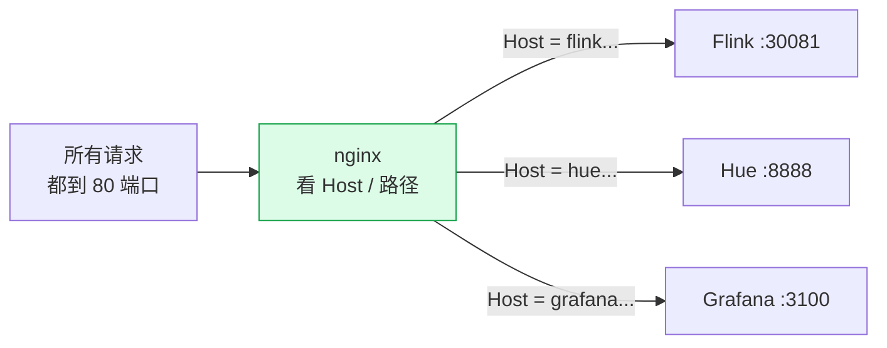
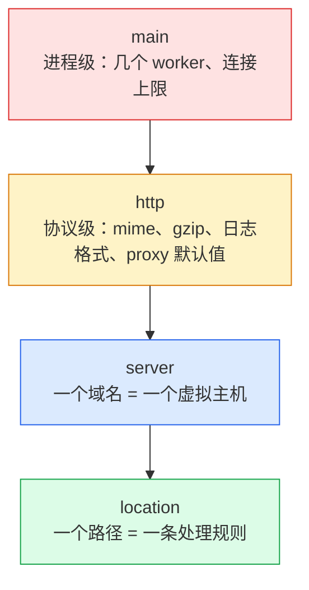
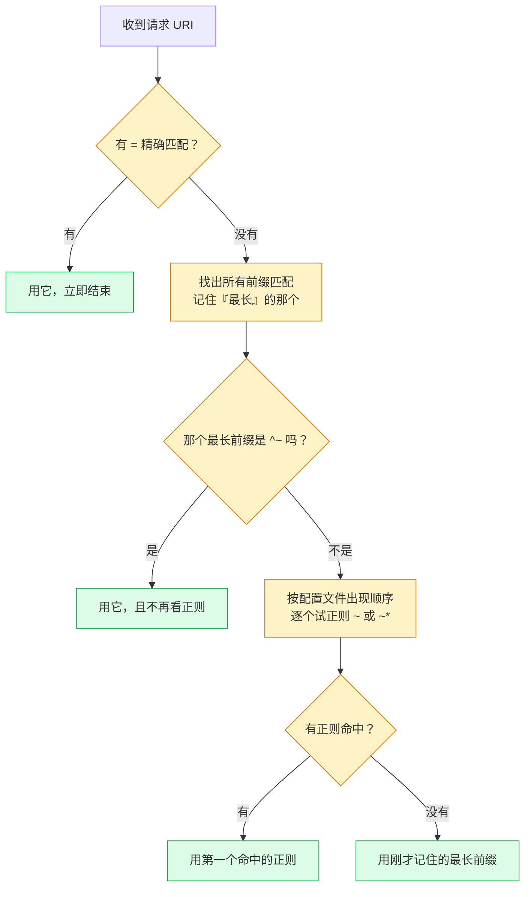
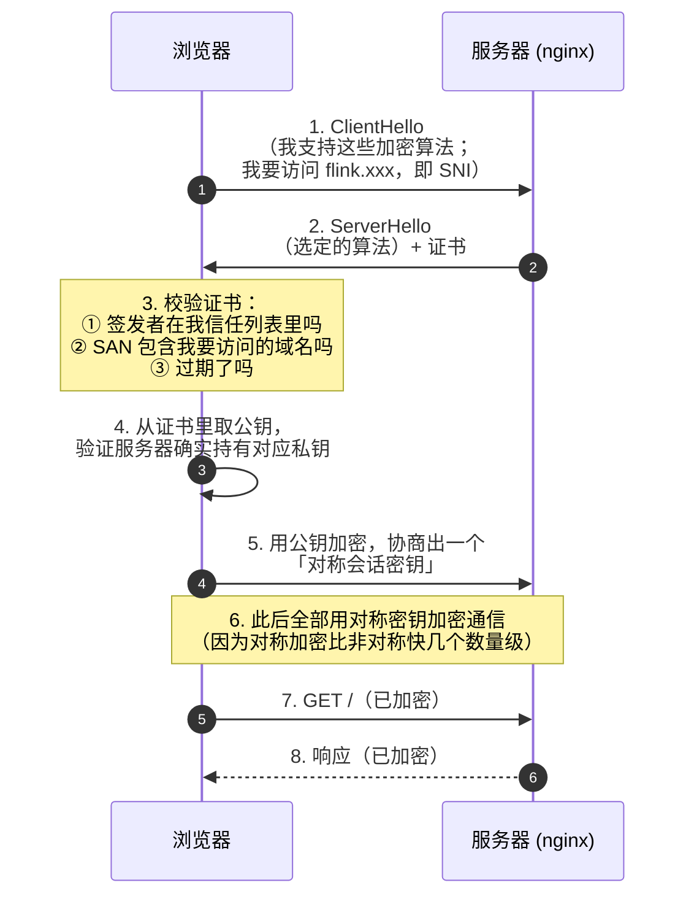
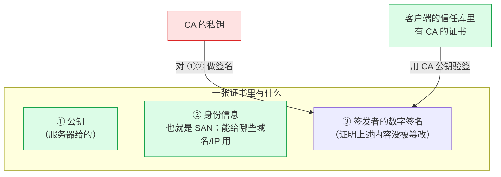
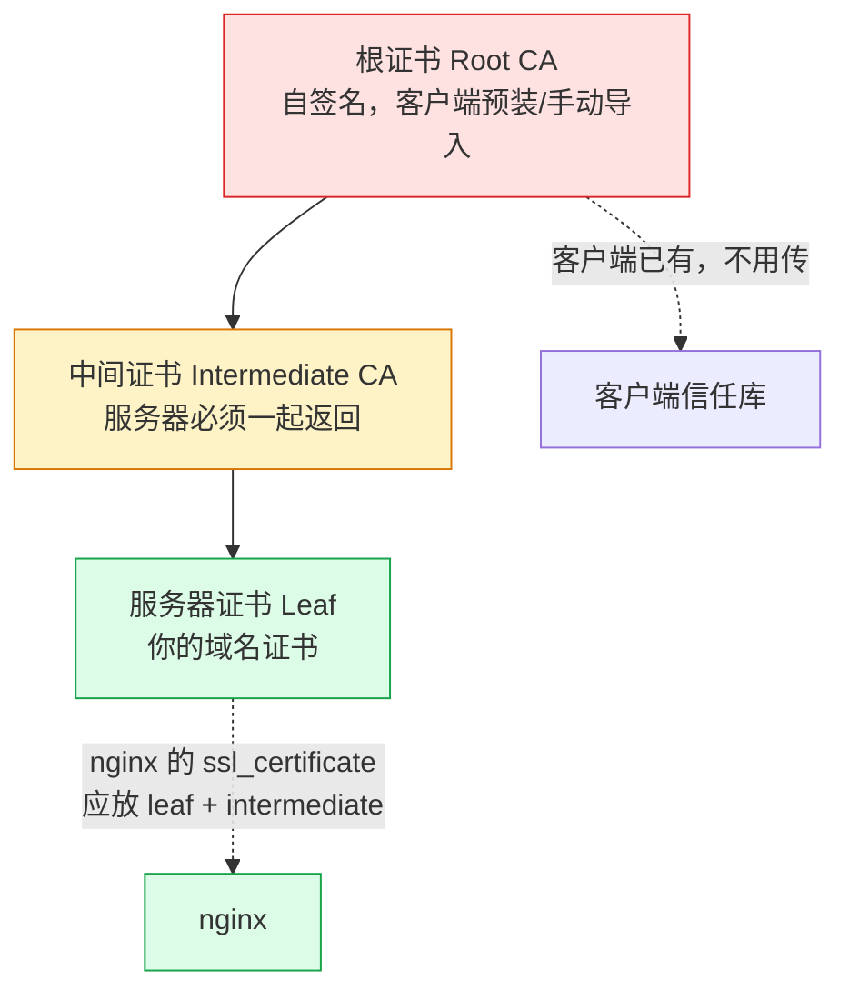
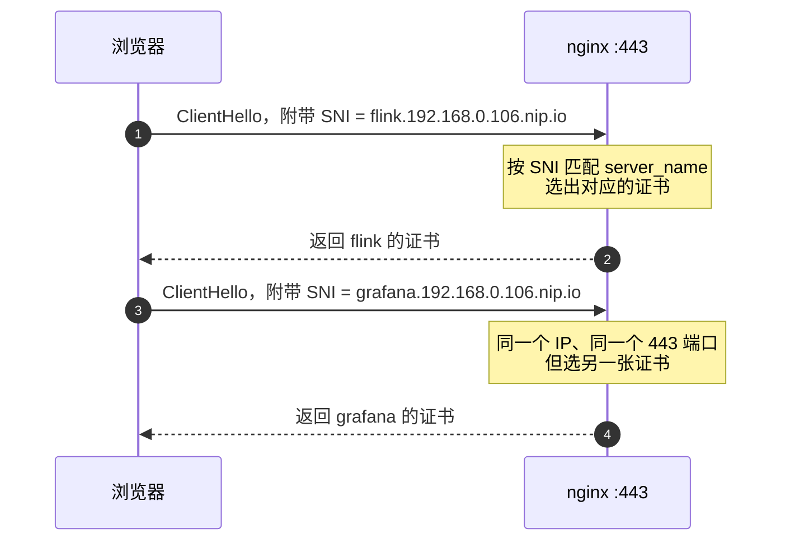
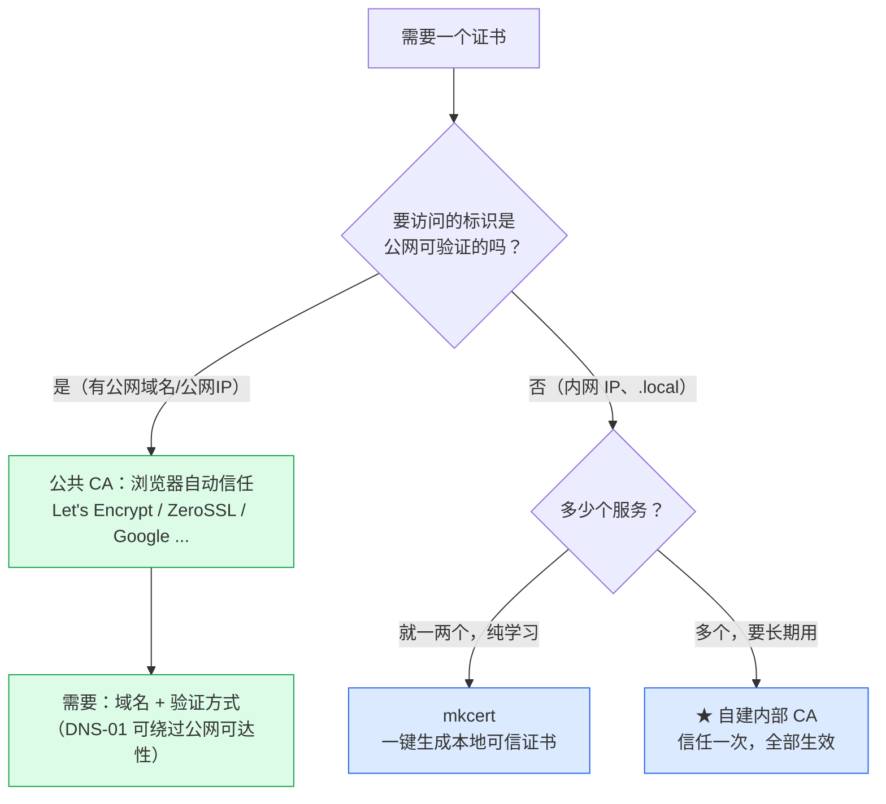
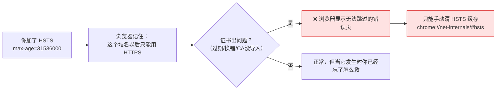
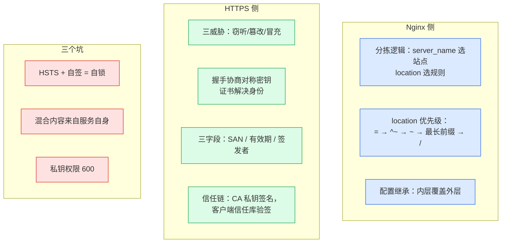

# 理论篇：理解 Nginx 与 HTTPS

> [!info] 这篇只回答"为什么"
> 不讲怎么敲命令（那些在 [[2-实践篇-HTTPS证书落地]]）。
> 目标是把两件事讲明白：**nginx 怎么决定把请求给谁**、**HTTPS 凭什么保证安全**。

---

## 一、Nginx 是什么：一个"流量的分拣员"

想象一栋大楼只有一个前台（一个 IP、一个 80 端口），但里面有 18 个部门。
nginx 就是那个前台：**看你的来意，把你指到正确的部门。**



它靠两个线索分拣：
- **`server_name`**（看域名叫什么）→ 决定去哪个 `server` 块
- **`location`**（看路径是什么）→ 决定在 `server` 里走哪条规则

### 1.1 配置的四层模型



**一句话记住继承关系：内层覆盖外层。**
`proxy_set_header` 写在 `http` 里，所有 server 都继承；某个 location 想不一样，就在里面再写一遍。

---

## 二、`location` 匹配优先级：唯一需要死记的规则

nginx 请求转发最容易配错的地方，因为它**不是"越具体越优先"**。



记住这个顺序：**精确 `=` → 前缀 `^~` → 正则 `~` → 最长前缀 → `/` 兜底**

### 2.1 五种写法

| 写法 | 类型 | 关键行为 |
|---|---|---|
| `location = /api {}` | 精确 | URI **完全相等**才匹配 |
| `location ^~ /img/ {}` | 前缀优先 | 命中后**直接终止**，不再看正则 |
| `location ~ \.php$ {}` | 正则（区分大小写） | 按**出现顺序**，第一个命中者胜 |
| `location ~* \.jpg$ {}` | 正则（忽略大小写） | 同上 |
| `location /api/ {}` | 普通前缀 | 记住最长的，**最后**才用它 |

### 2.2 两个"反直觉"，理解了这个规则就通了

**反直觉一：`^~` 会"截断"正则。**

```nginx
location ^~ /img/    { }    # ← 命中这个
location ~ \.gif$    { }    # ← 不会执行
location /img/a.gif  { }    # ← 更长的前缀也不看
```
请求 `/img/a.gif` → 走 `^~ /img/`。因为 `^~` 的语义是"**确定用我，别再看正则了**"。

**反直觉二：正则之间比的是"顺序"，不是"具体程度"。**

```nginx
location ~ \.gif$         { }   # 先写，先赢
location ~ /img/photo\.gif$ { }  # 更具体，但写了也没用
```

> [!warning] 这解释了一个常见现象
> "我明明写了更精确的规则，为什么不生效？" —— 因为你的规则是**正则**，而前面有别的正则先命中了。
> 反过来，如果你的规则是**精确匹配 `=`**，那就谁也别想抢。

> [!tip] 为什么 106 的配置文件名是 `00-`、`10-`、`20-`
> 因为正则按**文件 include 的顺序**决定优先级，而 nginx 的 `include conf.d/*.conf` 按**文件名字典序**加载。
> 编号前缀 = 显式控制优先级。

---

## 三、HTTPS 解决什么问题

HTTP 是**明文**传输，等于用明信片寄信——路上谁都能看、能改、能冒充。

| 威胁 | HTTP 下的后果 | HTTPS 怎么解决 |
|---|---|---|
| **窃听** | 密码、Token 明文可见 | 加密：传输内容无法解读 |
| **篡改** | 中间人往里插广告/改金额 | 完整性校验：改动会被发现 |
| **冒充** | 你连的其实是假网站 | 证书：证明"服务器确实是它自称的那个" |

**加密**靠的是 TLS 握手协商出的对称密钥；**防冒充**靠的是证书。两者是两件事，别混。

---

## 四、TLS 握手：一次 HTTPS 请求到底发生了什么



**三个要点**：

1. **握手只有一次**，之后用对称密钥（快）。非对称加密（RSA/ECDHE）只用来"安全地协商出对称密钥"。
2. **第 3 步的校验是浏览器的活**，不是服务器的。所以证书不被信任时，报错来自浏览器。
3. **第 1 步的 SNI 很关键** —— 见第七节。

---

## 五、证书的本质：一张"数字身份证"

证书不是"加密文件"，它只做一件事：**证明公钥属于某个身份**。



**为什么这样就能防冒充？**
因为**签名的私钥只有 CA 有**。你想伪造一张 `flink.xxx` 的证书，就必须拿到 CA 的私钥去签名——拿不到。

**那为什么自签证书浏览器会警告？**
因为你自己当 CA 签的证书，浏览器的信任库里**没有你这个 CA**，所以无法验证签名。解决办法就是**把你的 CA 装进信任库**（一次即可，之后它签发的所有证书都被信任）。

---

## 六、证书链：为什么有时"证书没错却报不安全"



| 情况 | nginx 的 `ssl_certificate` 该放什么 |
|---|---|
| 公网 CA（Let's Encrypt 等） | **fullchain**（服务器证书 + 中间证书），**不放根证书** |
| **内部单层 CA**（106 现在） | 服务器证书本身即可（CA 直签，没有中间层） |

**为什么根证书不放进去？** 它本该在客户端信任库里；服务器再返回一遍是浪费，还可能引起部分老客户端报错。

---

## 七、三个必须懂的字段

### 7.1 SAN：证书"能用在哪"

> [!important] 现代浏览器**只看 SAN，完全不看 CN**
> Chrome 58+、Firefox、Safari 都移除了 CN 回退。
> 证书里不写 SAN，**哪怕 CN 完全正确**，浏览器也一定报 `NET::ERR_CERT_COMMON_NAME_INVALID`。

这是自签证书**第一大坑**——很多老教程还在教你只填 CN。

**SAN 能写什么**：
- `DNS:example.com` —— 域名
- `DNS:*.example.com` —— 通配符，**只匹配一层**（`a.example.com` ✅，`a.b.example.com` ❌，`example.com` 本身 ❌ 要另写一条）
- `IP:192.168.0.106` —— IP 地址

**为什么 IP 要单独写？** 用 `https://192.168.0.106/` 访问时，浏览器去 SAN 里找的是 **IP 类型**的条目，DNS 条目不算。

### 7.2 有效期

- 服务器**时间必须准**，否则证书直接无效。
- 公网 CA 现在越来越短：Let's Encrypt 已从 90 天降到计划 45 天，还推出了 **6 天（160 小时）** 的短命证书 [^1]。
- **越短的证书越依赖自动化**——手动续期必然忘记。这就是 ACME 协议和 certbot 存在的原因。
- 自签证书想签多久签多久（106 签了 825 天，CA 签了 10 年）。

### 7.3 签发者（Issuer）

浏览器不关心证书"好不好"，只关心**签发者是不是我信任的 CA**。
所以"自签证书不安全"的本质不是技术不安全，而是**你的 CA 不在别人的信任列表里**。

---

## 八、SNI：一个 IP 怎么同时挂 18 张证书



**SNI（Server Name Indication）** = 客户端在握手最开始就告诉服务器"我要访问哪个域名"。
没有它，一个 IP + 443 只能配一张证书。

> [!tip] 这也解释了"泛域名证书"为什么好用
> 一张 `*.192.168.0.106.nip.io` 覆盖所有子域名，**18 个站点只用一张证书**，
> 省去了"每个服务一张证书 + 每张都要单独信任"的麻烦。

---

## 九、证书从哪来：五种途径



| 途径 | 浏览器自动信任 | 能用于 `192.168.0.106` | 详见 |
|---|---|---|---|
| 公共 CA（Let's Encrypt 等） | ✅ | ❌ **不能**（私网 IP 不可签发） | [[3-免费SSL证书全览]] |
| 自建内部 CA | ❌（需导入一次） | ✅ **可以** | [[2-实践篇-HTTPS证书落地]] |
| mkcert（本地开发 CA） | ❌（需导入一次） | ✅ 可以，最省事 | [[3-免费SSL证书全览]] |
| Cloudflare Origin CA | ❌（只对 CF 回源有效） | ⚠️ 需配合 Cloudflare | [[3-免费SSL证书全览]] |
| 纯自签（自己签自己） | ❌ | ✅ 可以，但不推荐 | — |

> [!important] 这是理解你处境的关键
> **公共免费 CA 签不了 `192.168.0.106` 这种私网 IP。** 不是"配置问题"，是 CA 的规则限制。
> 详见 [[3-免费SSL证书全览#五、为什么公网 CA 签不了 192.168.0.106]]。

---

## 十、三个反模式（都是"看着对、实际会出事")

### 10.1 给自签证书开 HSTS —— 最危险的一个



**HSTS 的语义是"强制 HTTPS，且不允许降级"**。它和"临时自签证书"天生冲突。
**结论：内网自签环境不要开 HSTS。**

### 10.2 混合内容（Mixed Content）

HTTPS 页面里如果加载了 `http://` 的资源，浏览器会拦截。
Hadoop / HBase / Doris 这些 Java 控制台**经常在 HTML 里硬编码 http 地址**，所以启用 HTTPS 后可能出现"页面能开但样式丢失/按钮点不动"。

**这是服务自己的问题，不是 nginx 的。** 处理办法：换回 HTTP、改服务配置、或用 `sub_filter` 重写响应体（有代价）。

### 10.3 把私钥当成普通文件

`*.key` 泄露 = 别人能冒充你的服务器。权限必须 `600`。
在 nginx 场景下尤其要注意：**从 Mac `scp`/`tar` 过去的文件默认是 `600` 或 `644`**，
而 nginx 的 worker 用户（`www-data`）需要读证书文件——所以证书要 `644`，私钥要 `600`。

---

## 十一、一页总结



**看完这篇，你应该能回答：**
1. 请求进来了，nginx 先看什么后看什么？
2. 为什么写了更具体的 location 却不生效？
3. HTTPS 到底防住了什么？证书在其中扮演什么角色？
4. 为什么浏览器会警告"证书不受信任"？它到底在校验什么？
5. 为什么 `192.168.0.106` 拿不到公共免费证书？

---

## 延伸

- **动手**：[[2-实践篇-HTTPS证书落地]] —— 生成、配置、导入、排错
- **专题**：[[3-免费SSL证书全览]] —— 网上免费证书的全貌与坑
- 106 的服务入口运维：[[0-106服务统一入口配置手册]]
- Let's Encrypt 官方：<https://letsencrypt.org/docs/>

[^1]: 来源：Let's Encrypt 官方公告 [Announcing Six Day and IP Address Certificate Options in 2025](https://letsencrypt.org/2025/01/16/6-day-and-ip-certs) 与 [6-day and IP Address Certificates are Generally Available](https://letsencrypt.org/2026/01/15/6day-and-ip-general-availability)（2026-01-15 起一般可用，有效期 160 小时）。
