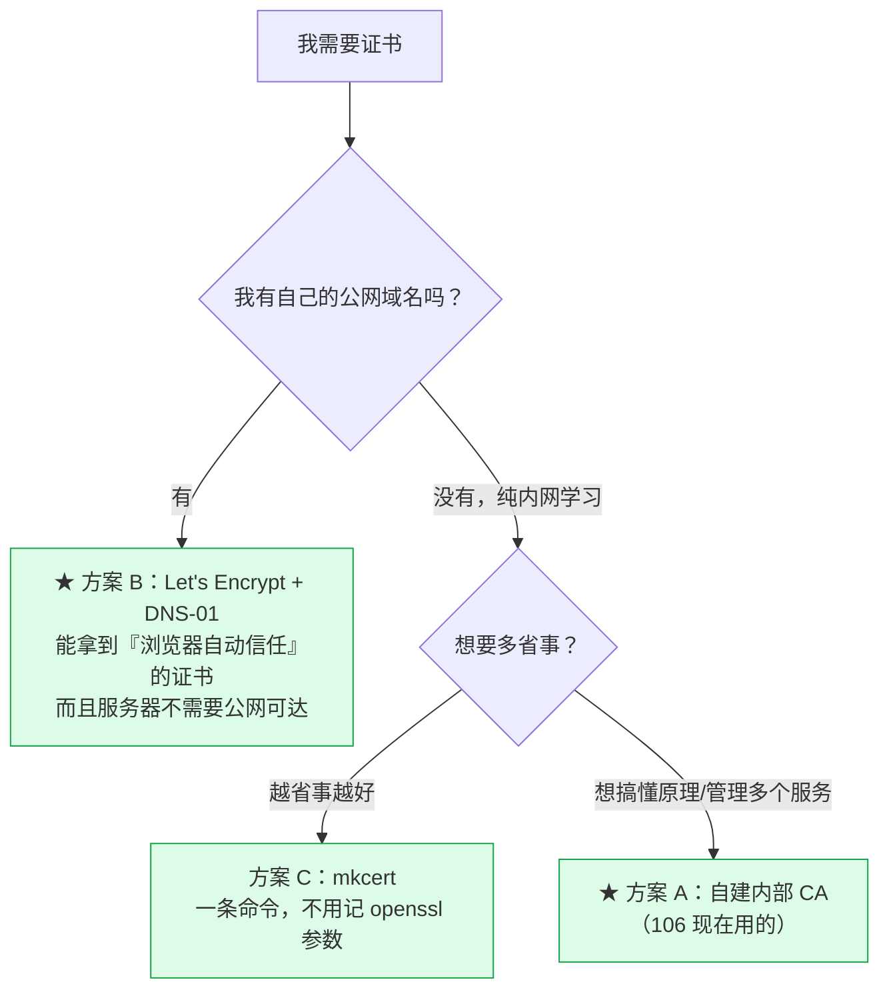
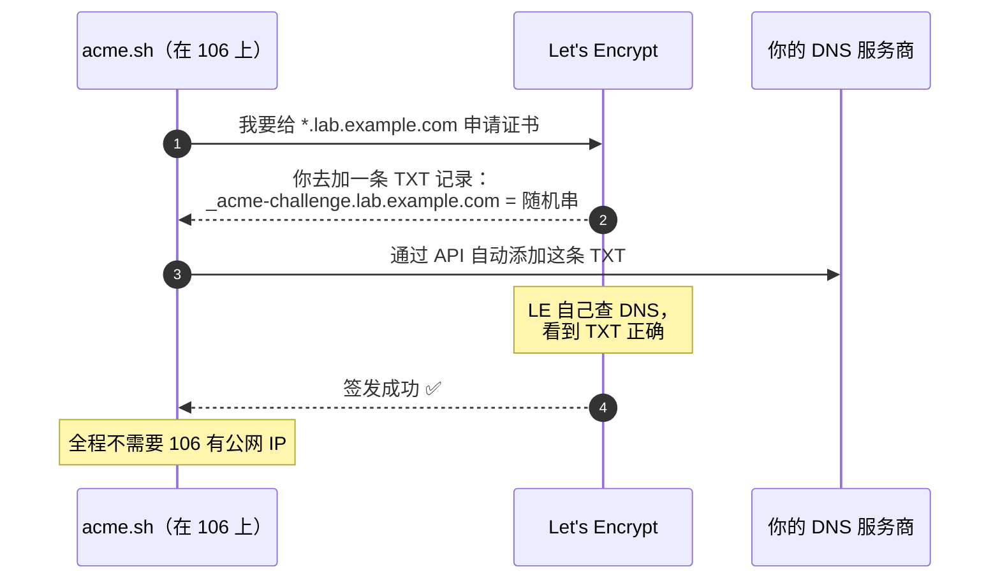

# 实践篇：HTTPS 证书落地

> [!info] 这篇只讲怎么做
> 原理（为什么）在 [[1-理论篇-理解Nginx与HTTPS]]。这篇给可复制的命令。

---

## 〇、先处理 106 的当前状态：还差最后一步

服务端已经全部就绪，**唯一没做的是把 CA 导入你的 Mac**。

```bash
# 这一步必须在 Mac 上手动执行（需要输密码，且钥匙串在工作区外）
sudo security add-trusted-cert -d -r trustRoot \
  -k /Library/Keychains/System.keychain \
  "/Users/vic/workspace-obsidian/Deliberate/服务器巡检-192.168.0.106/deploy/nginx/ca/106-internal-ca.crt"

# 验证：不再报 (60) 就成功了
curl -sS https://192.168.0.106/healthz
```

**当前状态对照**：

| | 导入前（现在） | 导入后 |
|---|---|---|
| 浏览器 | 红色警告页，每个域名都要点"继续访问" | ✅ 直接打开，绿锁 |
| `curl` | `(60) unable to get local issuer certificate` | ✅ 正常 |
| 18 个域名 | 要挨个忽略警告 | ✅ **一次导入，全部信任** |

> HTTP（80）一直可用，不导入也能正常干活。

---

## 一、我该用哪种证书：决策树



| 方案 | 浏览器自动信任 | 服务器需公网可达 | 命令复杂度 | 适合 |
|---|---|---|---|---|
| **A. 自建内部 CA** | ❌ 需导入一次 | 否 | 中（openssl 参数多） | 内网多服务、想懂原理 |
| **B. Let's Encrypt** | ✅ **是** | **否**（用 DNS-01） | 中（要装 acme.sh） | **有域名**的人 |
| **C. mkcert** | ❌ 需导入一次 | 否 | **极低** | 纯学习、快速见效 |

> [!tip] 如果只是学习用，我建议
> **想要"最接近真实生产"的体验 → 方案 B**（有域名的话）。它是唯一能让浏览器**自动信任**、
> 且不用在每台客户端导入 CA 的方案。
> **只是想让浏览器别报警告、少折腾 → 方案 C（mkcert）**，一条命令的事。

---

## 二、方案 A：自建内部 CA（106 采用）

### 2.1 建根 CA（只做一次）

```bash
cd /opt/nginx/conf/ssl

openssl req -x509 -nodes -newkey rsa:4096 -days 3650 -sha256 \
  -keyout ca.key -out ca.crt \
  -subj "/C=CN/O=Vic Internal CA/CN=Vic Root CA"
```

### 2.2 签发泛域名证书

**★ 关键是 SAN**（原理见 [[1-理论篇-理解Nginx与HTTPS#7.1 SAN：证书"能用在哪"]]）。

```bash
# ① 写 SAN 配置
cat > 106-san.cnf <<'EOF'
[req]
distinguished_name = dn
req_extensions = v3_req
prompt = no
[dn]
C  = CN
O  = Vic Lab
CN = *.192.168.0.106.nip.io
[v3_req]
keyUsage = critical, digitalSignature, keyEncipherment
extendedKeyUsage = serverAuth
subjectAltName = @alt
[alt]
DNS.1 = *.192.168.0.106.nip.io
DNS.2 = 192.168.0.106.nip.io
IP.1  = 192.168.0.106
EOF

# ② 生成私钥 + CSR
openssl req -nodes -newkey rsa:2048 -sha256 \
  -keyout 106.key -out 106.csr -config 106-san.cnf

# ③ ★ 签发时必须带 -extfile，否则 SAN 不会进最终证书
cat > 106-ext.cnf <<'EOF'
keyUsage = critical, digitalSignature, keyEncipherment
extendedKeyUsage = serverAuth
subjectAltName = @alt
[alt]
DNS.1 = *.192.168.0.106.nip.io
DNS.2 = 192.168.0.106.nip.io
IP.1  = 192.168.0.106
EOF

openssl x509 -req -in 106.csr -CA ca.crt -CAkey ca.key -CAcreateserial \
  -out 106.crt -days 825 -sha256 -extfile 106-ext.cnf

# ④ 权限（证书 644，私钥 600）
chmod 644 ca.crt 106.crt
chmod 600 ca.key 106.key

# ⑤ 自检
openssl verify -CAfile ca.crt 106.crt
openssl x509 -in 106.crt -noout -ext subjectAltName
```

> [!warning] 三个必错点
> 1. **忘了 `-extfile`** → SAN 没进证书 → 浏览器必报错。第 ③ 步最容易漏。
> 2. **只写 CN 不写 SAN** → 现代浏览器直接不认。
> 3. **私钥 644** → 同机任何用户都能读走。

### 2.3 给新服务再签一张

复用同一个 CA，只改 SAN 里的域名：

```bash
sed 's/192\.168\.0\.106\.nip\.io/newsrv.lab/g' 106-san.cnf > newsrv-san.cnf
sed 's/192\.168\.0\.106\.nip\.io/newsrv.lab/g' 106-ext.cnf > newsrv-ext.cnf
openssl req -nodes -newkey rsa:2048 -sha256 -keyout newsrv.key -out newsrv.csr -config newsrv-san.cnf
openssl x509 -req -in newsrv.csr -CA ca.crt -CAkey ca.key -CAcreateserial \
  -out newsrv.crt -days 825 -sha256 -extfile newsrv-ext.cnf
```

**好处**：客户端只信任了你的 CA 一次，之后签多少张都自动被信任。

---

## 三、方案 B：Let's Encrypt + 自己的域名（推荐给有域名的人）

> [!important] 这是最容易被误解的一点
> **Let's Encrypt 不需要你的服务器有公网 IP！**
> 用 **DNS-01 验证**，你只需要能修改自己域名的 DNS 解析记录——
> 证书照样是"浏览器自动信任"的，服务器可以藏在纯内网。

### 3.1 原理



### 3.2 步骤

```bash
# ① 装 acme.sh
curl https://get.acme.sh | sh -s email=你的邮箱@example.com
source ~/.bashrc

# ② 配置 DNS 服务商的 API 凭证（以 Cloudflare 为例）
export CF_Token="你的CloudflareAPI令牌"
export CF_Account_ID="你的AccountID"

# ③ 申请泛域名证书（DNS 模式）
~/.acme.sh/acme.sh --issue --dns dns_cf \
  -d '*.lab.example.com' -d 'lab.example.com' \
  --keylength ec-256

# ④ 安装到 nginx 用的位置
~/.acme.sh/acme.sh --install-cert -d '*.lab.example.com' \
  --key-file       /opt/nginx/conf/ssl/lab.key \
  --fullchain-file /opt/nginx/conf/ssl/lab.crt \
  --reloadcmd      "sudo systemctl reload nginx"
```

**证书会自动续期**（acme.sh 装了 cron）。

### 3.3 然后怎么在内网用

把域名解析到内网 IP：

| 方式 | 做法 |
|---|---|
| 最省事 | 每台客户端 `/etc/hosts` 加：`192.168.0.106 flink.lab.example.com` |
| 较正规 | 在路由器/内网 DNS 上加一条泛解析 `*.lab.example.com → 192.168.0.106` |
| 已有 | 如果域名本来就解析到这个内网 IP，直接用 |

nginx 侧只需把 `server_name` 从 `*.192.168.0.106.nip.io` 换成 `*.lab.example.com`。

> [!note] 为什么这个是"最接近生产"的方案
> 生产环境就是这么干的：**公网域名 + DNS-01 + 内网服务器**。
> 你学会了这个，等于学会了企业里 90% 的内部服务 HTTPS 做法。

---

## 四、方案 C：mkcert（纯学习最省事）

```bash
# ① 安装（Ubuntu）
sudo apt-get install -y libnss3-tools
curl -JLO "https://dl.filippo.io/mkcert/latest?for=linux/amd64"
chmod +x mkcert-v*-linux-amd64 && sudo mv mkcert-v*-linux-amd64 /usr/local/bin/mkcert

# ② 安装本地 CA（写入系统信任库）
mkcert -install

# ③ 一条命令生成证书（自动带好 SAN）
mkcert -key-file 106.key -cert-file 106.crt \
  "*.192.168.0.106.nip.io" "192.168.0.106.nip.io" "192.168.0.106"

# ④ 找到它的 CA，拷到 Mac 上导入
echo "CA 位置: $(mkcert -CAROOT)/rootCA.pem"
```

**mkcert 和方案 A 的区别**：它帮你把 openssl 那一堆参数封装好了，**自动处理 SAN**，
生成的 CA 也能一键装进系统信任库。缺点是定制性差一些（比如证书有效期、密钥长度）。

> 它的 CA 是**每台机器独立生成**的，所以客户端仍然要导入一次 `rootCA.pem`。

---

## 五、nginx 的 SSL 配置

### 5.1 SSL 参数片段（DRY）

`/opt/nginx/conf/snippets/ssl-common.conf`：

```nginx
ssl_certificate         /opt/nginx/conf/ssl/106.crt;
ssl_certificate_key     /opt/nginx/conf/ssl/106.key;
ssl_trusted_certificate /opt/nginx/conf/ssl/ca.crt;

ssl_protocols           TLSv1.2 TLSv1.3;      # SSLv3/TLS1.0/1.1 已不安全
ssl_ciphers             ECDHE-ECDSA-AES128-GCM-SHA256:ECDHE-RSA-AES128-GCM-SHA256:ECDHE-ECDSA-AES256-GCM-SHA384:ECDHE-RSA-AES256-GCM-SHA384:ECDHE-ECDSA-CHACHA20-POLY1305:ECDHE-RSA-CHACHA20-POLY1305;
ssl_prefer_server_ciphers off;                # 让客户端选套件（它更懂自己硬件）

ssl_session_cache       shared:SSL:10m;       # 会话复用，省掉重复握手
ssl_session_timeout     1d;
ssl_session_tickets     off;                  # ticket 固定密钥，泄露影响历史会话
ssl_stapling            off;                  # 自建 CA 没有 OCSP 服务
```

**为什么要抽成片段？** 18 个站点各抄一遍，将来换证书要改 18 处。

### 5.2 单个站点

```nginx
server {
    listen      443 ssl;
    listen      [::]:443 ssl;
    http2       on;                          # ★ nginx 1.25.1+ 的写法
    server_name flink.192.168.0.106.nip.io;

    include     snippets/ssl-common.conf;    # 相对 /opt/nginx/conf/ 解析

    location / { proxy_pass http://127.0.0.1:30081; }
}
```

> [!note] `http2 on;` 是**新语法**
> 老写法 `listen 443 ssl http2;` 在 nginx 1.25.1 起已废弃。
> 106 用的是 1.30.5，所以必须写新语法。

### 5.3 批量启用：`map` 分发（106 采用）

18 个站点如果每个都写一遍 HTTPS，等于把所有 upstream 抄两遍。改用"域名 → 后端"映射表：

```nginx
# ① 分发表
map $host $https_backend {
    default                       "";
    flink.192.168.0.106.nip.io    127.0.0.1:30081;
    dinky.192.168.0.106.nip.io    127.0.0.1:30888;
    # ... 其余 16 个
}

# ② 一个 location 搞定全部
server {
    listen 443 ssl;  listen [::]:443 ssl;  http2 on;
    server_name 192.168.0.106.nip.io *.192.168.0.106.nip.io;
    include snippets/ssl-common.conf;

    location / {
        if ($https_backend = "") { return 404; }   # 未登记域名给 404，不要 500
        proxy_pass http://$https_backend;          # 变量形式：保留原始 URI
    }
}
```

### 5.4 HTTP → HTTPS 跳转（**先别加**）

```nginx
# 加在 http 段即可全局生效
server {
    listen 80 default_server;
    server_name _;
    return 301 https://$host$request_uri;
}
```

> [!warning] 自签证书下加了会自锁
> CA 没导入客户端前，全局 301 会让用户**一头撞进证书警告页**。
> **建议**：先保留 80 可用，HTTPS 作为"可选升级"，等确认没问题再加跳转。

---

## 六、客户端信任 CA

### 6.1 macOS

```bash
# 命令行（推荐，对所有浏览器 + curl 生效）
sudo security add-trusted-cert -d -r trustRoot \
  -k /Library/Keychains/System.keychain /path/to/ca.crt

# 验证
security verify-cert -c /path/to/ca.crt
```

图形化：双击 `ca.crt` → 加入「系统」钥匙串 → 找到该证书 → 双击 → 「信任」→「使用此证书时」设为**始终信任**。

### 6.2 Windows

```
双击 ca.crt → 安装证书 → 本地计算机 → 受信任的根证书颁发机构 → 完成
```
命令行（管理员）：`certutil -addstore -f "ROOT" ca.crt`

### 6.3 Linux

```bash
sudo cp ca.crt /usr/local/share/ca-certificates/my-ca.crt
sudo update-ca-certificates
```

### 6.4 Java（容易漏）

Java 有**独立的信任库**，不认系统钥匙串：

```bash
sudo keytool -importcert -noprompt -trustcacerts \
  -alias my-ca -file ca.crt \
  -keystore "$JAVA_HOME/lib/security/cacerts" \
  -storepass changeit
```

---

## 七、续期与轮换

```bash
# 查到哪天到期
openssl x509 -in /opt/nginx/conf/ssl/106.crt -noout -enddate

# 看线上真正生效的那张
echo | openssl s_client -connect 192.168.0.106:443 \
  -servername flink.192.168.0.106.nip.io 2>/dev/null \
  | openssl x509 -noout -subject -dates
```

**轮换流程**（无中断）：

```bash
# ① 用新名字生成新证书（别覆盖旧的）
# ② 改 ssl-common.conf 指向新证书
# ③ 校验 + 平滑重载
sudo /opt/nginx/sbin/nginx -t && sudo systemctl reload nginx
# ④ 保留旧证书 7 天再删
```

> `reload` 是**平滑**的：起新 worker、优雅关闭旧 worker，在途请求不断。

---

## 八、排错速查

| 现象 | 原因 | 处理 |
|---|---|---|
| `NET::ERR_CERT_COMMON_NAME_INVALID` | SAN 没写对 / 缺 SAN | `openssl x509 -in x.crt -noout -ext subjectAltName` |
| `unable to get local issuer certificate` | 客户端没导入 CA | 见 §6 |
| 浏览器点"继续访问"也没用 | 可能开了 HSTS | 清 `chrome://net-internals/#hsts` |
| 用 IP 访问报错、域名正常 | SAN 里缺 `IP:192.168.0.106` | 重新签发，加上 IP 条目 |
| 页面能开但样式全丢 | 混合内容（服务硬编码 http） | 换回 80，或改服务配置 |
| `nginx -t` 报 `bind() failed (13: Permission denied)` | 非 root 绑不了 80/443 | 用 `sudo nginx -t`，**不是配置错误** |
| 私钥告警 | key 权限太松 | `chmod 600 *.key` |
| 证书突然全失效 | 服务器时间错乱 | `timedatectl status`，重启 chrony |

---

## 九、速查卡

```bash
# ── 106 上的证书位置 ──
ls -l /opt/nginx/conf/ssl/
#   ca.crt / ca.key    内部根 CA
#   106.crt / 106.key  泛域名服务器证书
#   snippets/ssl-common.conf   SSL 参数片段
#   conf.d/99-https.conf       443 站点

# ── 常用自检 ──
openssl x509 -in /opt/nginx/conf/ssl/106.crt -noout -subject -issuer -dates -ext subjectAltName
openssl verify -CAfile /opt/nginx/conf/ssl/ca.crt /opt/nginx/conf/ssl/106.crt

# ── 线上实际证书 / 协议 ──
echo | openssl s_client -connect 192.168.0.106:443 -servername flink.192.168.0.106.nip.io 2>/dev/null \
  | openssl x509 -noout -subject -dates
echo | openssl s_client -connect 192.168.0.106:443 -servername flink.192.168.0.106.nip.io 2>/dev/null \
  | grep -E 'New,|Protocol'

# ── 改配置 ──
sudo /opt/nginx/sbin/nginx -t && sudo systemctl reload nginx

# ── HTTPS 启停 ──
sudo rm /opt/nginx/conf/conf.d/99-https.conf && sudo systemctl reload nginx   # 停
sudo cp /opt/nginx/conf/https-staged/99-https.conf /opt/nginx/conf/conf.d/ \
  && sudo /opt/nginx/sbin/nginx -t && sudo systemctl reload nginx             # 起
```

---

## 延伸

- 原理：[[1-理论篇-理解Nginx与HTTPS]]
- 免费证书全貌：[[3-免费SSL证书全览]]
- **真实域名落地（本篇方案 B 的完整实操）**：[[4-域名与公网证书实战-vic868.888.moe]]
- 106 入口运维：[[0-106服务统一入口配置手册]]
- acme.sh 文档：<https://github.com/acmesh-official/acme.sh>
- mkcert：<https://github.com/FiloSottile/mkcert>
