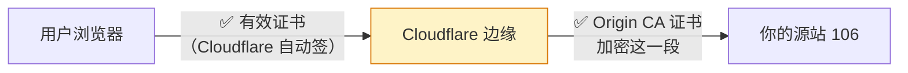
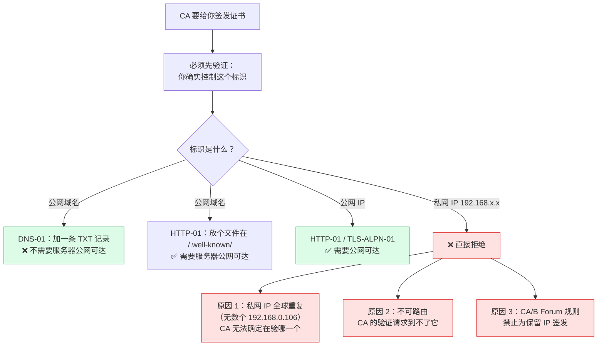
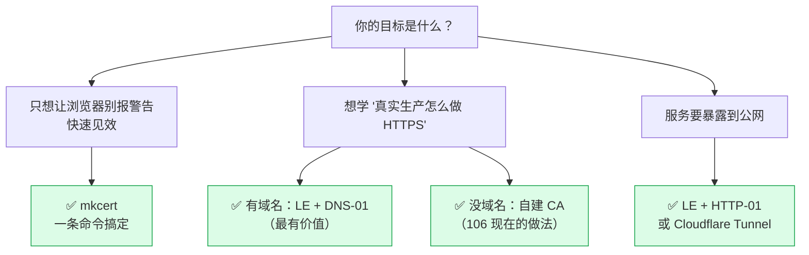

# 免费 SSL 证书全览

> [!info] 这篇解决什么
> "网上不是有免费的证书吗？" —— 有，但**绝大多数用不到你的内网服务器上**。
> 这篇把免费证书分成三类讲清楚，并标出**哪些说法已经过时了**（网上很多老文章还在推荐已停服的服务）。

---

## 〇、先给结论：对 `192.168.0.106` 的适用性

| 免费方案 | 浏览器自动信任 | **能用于 192.168.0.106** | 学习价值 |
|---|---|---|---|
| Let's Encrypt | ✅ | ❌ **不能**（私网 IP 不予签发） | ⭐⭐⭐ 最主流，值得学 |
| ZeroSSL / Google Trust Services / SSL.com | ✅ | ❌ 同上 | ⭐⭐ 备选 |
| ~~Buypass Go SSL~~ | — | — | ❌ **已停服，别再找了** |
| Cloudflare Origin CA | ❌（仅 CF 回源） | ⚠️ 需配合 Cloudflare 代理 | ⭐ |
| Cloudflare Tunnel | ✅ | ✅ **可以**（但暴露到公网） | ⭐⭐ |
| Tailscale 证书 | ✅ | ✅ 可以（需装 Tailscale） | ⭐⭐ |
| **mkcert** | ❌（需导入一次） | ✅ **可以，最省事** | ⭐⭐⭐ **纯学习首选** |
| **自建内部 CA** | ❌（需导入一次） | ✅ **可以**（106 现在用的） | ⭐⭐⭐ 最接近生产 |

> [!important] 核心结论
> **浏览器自动信任的免费证书，全都签不了 `192.168.0.106`。**
> 这不是操作问题，是 CA 的规则限制（原因见 §5）。
> 学习用途的话，**mkcert 或自建 CA 就够了**——反正只是让浏览器别报警告。

---

## 一、第一类：公共 CA（浏览器自动信任）

这类是"真证书"：任何浏览器开箱即认，不用在客户端装任何东西。

### 1.1 Let's Encrypt（事实标准）⭐⭐⭐

| 项目 | 说明 |
|---|---|
| 费用 | 完全免费，非营利组织 ISRG 运营 |
| 有效期 | 默认 90 天 → 官方已宣布**逐步降到 45 天** |
| 短命证书 | **6 天（160 小时）** profile，2026-01-15 起一般可用 |
| **IP 证书** | ✅ **已支持**（IPv4 + IPv6），但**必须是短命证书**，只能用 http-01 / tls-alpn-01 验证 |
| 验证方式 | HTTP-01 / DNS-01 / TLS-ALPN-01 |
| 通配符 | ✅ 支持，但**必须用 DNS-01** |
| 速率限制 | 有（如每域名每周 50 张），学习用途基本碰不到 |

**2026 年的两个新变化**（很多老文章还没更新）：

1. **支持 IP 地址证书**了 —— 但仅限**公网可路由的 IP**，因为验证要从公网访问到它。
   `192.168.0.106` 是私网 IP，**依然不行**。
2. **有效期要缩短**：90 天 → 45 天逐步过渡。这意味着**手动续期彻底不可行**，必须自动化。

> 官方原文：[Announcing Six Day and IP Address Certificate Options in 2025](https://letsencrypt.org/2025/01/16/6-day-and-ip-certs)
> · [6-day and IP Address Certificates are Generally Available](https://letsencrypt.org/2026/01/15/6day-and-ip-general-availability)

### 1.2 其他公共 CA

| 服务 | 特点 | 备注 |
|---|---|---|
| **ZeroSSL** | 免费 90 天证书，有 ACME 接口，也有网页版 | 免费额度有限，**政策以官网为准** |
| **Google Trust Services** | 官方博客明确说明 **ACME API 对所有人免费开放** | 需要 ACME 客户端，比较新 |
| **SSL.com** | 提供免费 DV 证书 | 通常要注册账号 |
| ~~**Buypass Go SSL**~~ | 曾提供免费 180 天证书，**现已停止签发** | ❌ **网上老教程还在推荐，别找了** |

> Buypass 停服公告：<https://www.buypass.com/products/tls-ssl-certificates/discontinues-issuance-of-tls-ssl-certificates>
> Google Trust Services 免费 ACME：<https://security.googleblog.com/2023/05/google-trust-services-acme-api_0503894189.html>

> [!warning] 免费 CA 的通病
> **有效期短 + 有速率限制 → 必须自动化**。
> 一旦你手工申请，三个月后必然忘记续期，然后服务就"莫名其妙"炸了。
> 所以**用公共 CA = 必须配 acme.sh / certbot 自动续期**。

---

## 二、第二类：受限信任的"免费证书"

这类能拿到更长的有效期，但**只有特定对象信任它**，浏览器不认。

### 2.1 Cloudflare Origin CA

| 项目 | 说明 |
|---|---|
| 有效期 | **最长 15 年**（是的，15 年） |
| 信任范围 | **只有 Cloudflare 回源时信任**，浏览器直接访问会报警告 |
| 用途 | 你已经用 Cloudflare 代理流量，想加密 "Cloudflare → 你的源站" 这一段 |
| 对 106 适用性 | ⚠️ 需要把域名接入 Cloudflare 并开启代理 |

**典型架构**：



**注意**：这解决的是"Cloudflare 到源站"的加密，**不是给你局域网内直接访问用的**。

### 2.2 Cloudflare Tunnel

| 项目 | 说明 |
|---|---|
| 免费 | ✅ |
| 效果 | 把你的内网服务**发布到公网**，自动获得 Cloudflare 签发的有效证书 |
| 不需要 | 公网 IP、开放端口、域名备案 |
| 副作用 | ⚠️ **服务变成公网可访问了**，安全性要自己兜住 |

对学习来说这是个"能拿到真证书"的捷径，但**它和"内网服务"的目标是矛盾的**。

### 2.3 Tailscale（组网 + 证书）

如果你用 Tailscale 组了虚拟内网，它能为 `机器名.你的tailnet.ts.net` **免费签发 Let's Encrypt 证书**。

```bash
sudo tailscale cert 你的机器名.你的tailnet.ts.net
```

**优点**：证书是浏览器自动信任的正规 LE 证书。
**代价**：客户端必须装并登录 Tailscale。

---

## 三、第三类：内网 / 本地方案（不是"公共 CA"，但免费且最实用）

### 3.1 mkcert ⭐⭐⭐（纯学习首选）

```bash
mkcert -install                                  # 装本地 CA 到系统信任库
mkcert -key-file k.key -cert-file k.crt \
  "*.192.168.0.106.nip.io" "192.168.0.106"      # 一条命令出证书，SAN 自动带好
```

| 优点 | 缺点 |
|---|---|
| **一条命令**，不用记 openssl 参数 | 定制性差（有效期/密钥长度不可调） |
| **自动处理 SAN**（避开最大的坑） | CA 是每台机器独立生成的，客户端要各导一次 |
| 一键装进系统信任库 | 定位是"本地开发"，不是生产 PKI |

**适合你**：只是想本地搞个不报警告的 HTTPS，不想研究证书体系。

### 3.2 自建内部 CA（106 现在用的）⭐⭐⭐

| 优点 | 缺点 |
|---|---|
| 完全可控（有效期、密钥长度、SAN 随便定） | openssl 参数多，容易漏 `-extfile` |
| **一次信任，之后签多少张都自动生效** | 需要自己管 CA 私钥 |
| 最接近企业内网 PKI 的做法 | 手动续期（除非上 step-ca 自动化） |

**适合你**：想搞懂原理、内网服务多、将来可能真的管一个内网 PKI。

### 3.3 step-ca（进阶）

`step-ca` 是开源的 ACME 服务器，可以**在你内网跑一个 CA**，
然后让 nginx 用 ACME 协议自动申请/续期内网证书。

**这相当于"自建了一个 Let's Encrypt"** —— 学习价值很高，但配置成本也高。等你有 10+ 个服务时值得考虑。

---

## 四、ACME 客户端对比（用公共 CA 必须选一个）

| 客户端 | 语言 | 特点 | 适合 |
|---|---|---|---|
| **certbot** | Python | Let's Encrypt 官方推荐，文档最全 | 入门、单机 |
| **acme.sh** | Shell | 纯 shell 无依赖，DNS API 支持最广，**国内常用** | 服务器、自动化 |
| **lego** | Go | 单二进制，轻量 | 容器、脚本 |
| **Caddy** | Go | **内置自动 HTTPS**，零配置 | 新项目（连 nginx 都不用） |
| **Traefik** | Go | 容器/ K8s 环境自动签发 | 云原生 |

> [!tip] 给你的建议
> 在 106 这种裸机场景：**acme.sh**（DNS-01 支持最全）或 **certbot**。
> 如果哪天上 K8s：**Traefik** 或 **cert-manager**。

---

## 五、为什么公网 CA 签不了 `192.168.0.106`

这是理解整件事的关键。



**同样的道理，这些标识也签不了**：
- `localhost` / `*.local`（mDNS 保留）
- `.internal`、`.test`、`.example`、`.invalid`（RFC 保留）
- 任何 RFC1918 私网地址（`10.x`、`172.16-31.x`、`192.168.x`）

> [!important] 但有个"绕过"办法（正经做法）
> **你不一定需要给 IP 签证书 —— 你可以给"域名"签，然后让域名解析到内网 IP。**
>
> 用 **DNS-01 验证**：
> 1. 你有一个自己的域名（比如 `example.com`）
> 2. 把 `_acme-challenge.lab.example.com` 的 TXT 记录加上（acme.sh 自动做）
> 3. LE 签发 `*.lab.example.com` 的证书 ✅
> 4. 然后把 `flink.lab.example.com` **解析到 `192.168.0.106`**（内网 DNS 或 hosts）
>
> 结果：**服务器全程没有公网 IP，却拿到了浏览器自动信任的正规证书。**
> 这就是企业内网 HTTPS 的标准做法。详见 [[2-实践篇-HTTPS证书落地#三、方案 B：Let's Encrypt + 自己的域名（推荐给有域名的人）]]。

---

## 六、免费证书的隐藏成本

免费不等于没成本，这些坑要提前知道：

| 隐藏成本 | 说明 | 对策 |
|---|---|---|
| **90 天要续期**（还要降到 45 天） | 手动必忘，服务到期就炸 | **必须自动化**（acme.sh/certbot + cron） |
| **速率限制** | 频繁重试会被限流，可能要等一周 | 用 `--staging` 测试，别拿生产额度试错 |
| **通配符要 DNS-01** | HTTP-01 拿不到通配符 | 需要 DNS 服务商的 API Token |
| **DNS API 权限** | Token 泄露 = 别人能改你的解析 | 用最小权限的 Token，别用全局 Key |
| **续期后要 reload** | 证书换了但 nginx 没重载 = 还是旧证书 | 在 acme.sh 里配 `--reloadcmd` |
| **多机同步** | 10 台机器各有各的证书，续期要各管各的 | 集中签发 + 分发，或上内部 ACME |

---

## 七、给你的建议（学习用）



| 你的情况 | 建议 |
|---|---|
| 就是学习、不想折腾 | **mkcert**（但你要先有个域名解析，或者直接用 IP —— mkcert 支持 IP SAN） |
| 想搞懂原理 + 服务多 | **自建内部 CA**（就是 106 现在的做法，继续用） |
| **有域名、想学真本事** | **LE + DNS-01** ⭐ 强烈推荐，这是企业标准做法 |
| 想让服务公网可访问 | LE + HTTP-01，但**先想清楚安全**（你机器上 18 个控制台现在都无鉴权） |

> [!tip] 我的实际建议
> 你说"只做学习用"——那**106 当前的内部 CA 方案就已经够了**，不用折腾。
> 真正值得花时间的是：**注册一个便宜域名（一年几十块），然后用 DNS-01 走通 Let's Encrypt 泛域名证书**。
> 这件事能一次性学到：ACME 协议、DNS 验证、通配符证书、自动续期、内网 DNS 分流——
> **比证书本身的配置有价值得多**，而且和公司里的真实做法完全一致。

---

## 八、速查：常见说法的事实核查

| 你可能听过的说法 | 事实 |
|---|---|
| "用 Let's Encrypt 就不用买证书了" | ✅ 基本对，公网场景足够 |
| "Let's Encrypt 也能签 IP 了" | ⚠️ **对，但只限公网 IP**，私网 IP 依然不行（2026-01 GA） |
| "Buypass 免费 180 天证书不错" | ❌ **已停止签发**，别照着老教程找 |
| "自签证书不安全" | ⚠️ 不准确。技术上是安全的，只是**你的 CA 不在别人信任列表里** |
| "证书要一年一换" | ❌ 现在公网 CA 最长 **398 天**，LE 是 90 天且**在往 45 天降** |
| "通配符证书很贵" | ⚠️ 商业 CA 贵，但 **LE 免费给通配符**（要 DNS-01） |
| "内网服务只能自签" | ⚠️ 不一定 —— 有域名的话 **DNS-01 能拿到正规证书** |

---

## 延伸

- 原理：[[1-理论篇-理解Nginx与HTTPS]]
- 动手：[[2-实践篇-HTTPS证书落地]]
- **真的拿一个域名跑通 DNS-01**：[[4-域名与公网证书实战-vic868.888.moe]]
- 106 入口运维：[[0-106服务统一入口配置手册]]
- Let's Encrypt 文档：<https://letsencrypt.org/docs/>
- acme.sh：<https://github.com/acmesh-official/acme.sh>
- mkcert：<https://github.com/FiloSottile/mkcert>
- step-ca：<https://smallstep.com/docs/step-ca/>

> [!note] 关于本文的时效性
> 证书行业的政策变化很快（有效期、免费额度、服务停运）。
> 本文核对于 **2026-10-14**。涉及具体免费额度的，**以各 CA 官网为准**。
