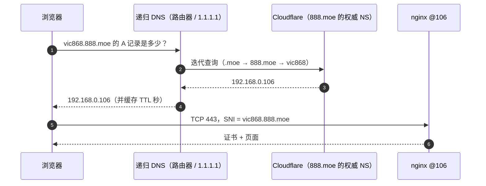
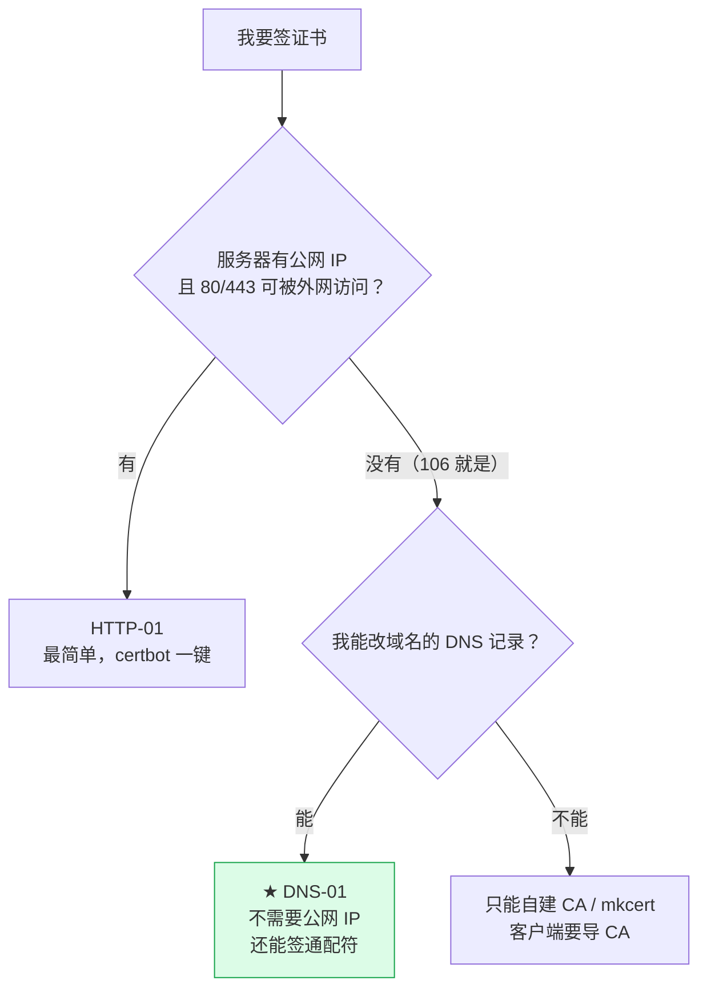
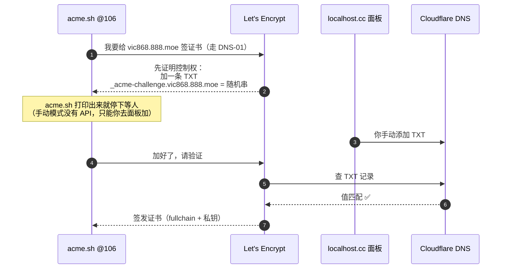
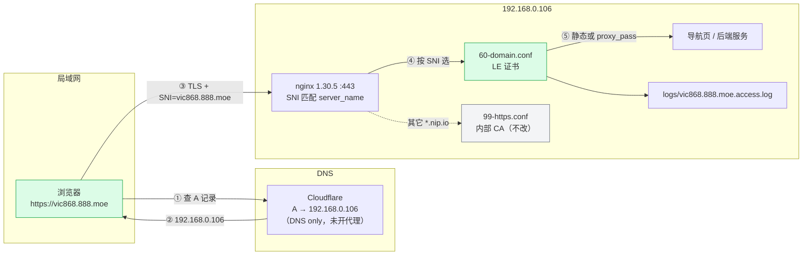

# 域名与公网证书实战：vic868.888.moe → 106

> [!info] 这份文档解决什么
> 你已经在 localhost.cc 认领了 **`vic868.888.moe`**，106 上 **nginx 1.30.5** 正在跑（80/443 都通）。
> 现在把两件事接起来：**让域名解析到 106**，再给域名签一张**浏览器自动信任**的 Let's Encrypt 证书。
>
> 读完你会搞清：域名到底归谁管、DNS 是怎么把名字变成 IP 的、CA 在验证什么、
> 为什么"私网服务器"也能拿"公网证书"，以及每一步在 106 上怎么敲。
>
> 前置阅读：[[12-nginx/1-理论篇-理解Nginx与HTTPS]]（TLS 握手 / 证书链 / SNI）、
> [[12-nginx/2-实践篇-HTTPS证书落地]]（三种证书方案）、
> [[12-nginx/3-免费SSL证书全览]]（为什么公网 CA 签不了 `192.168.0.106`）。

---

## 〇、一句话结论

| | 现状 | 目标 |
|---|---|---|
| 域名 | `vic868.888.moe` 已认领，**当前没有任何解析记录**（实测 `dig` 为空） | A 记录 → `192.168.0.106` |
| DNS 托管 | 根域 `888.moe` 的 NS 在 **Cloudflare**（由 localhost.cc 平台代管） | 你在平台面板里加记录 |
| 证书 | 106 上已有**内部 CA** 证书（`*.192.168.0.106.nip.io`），客户端要导 CA | 换成 **Let's Encrypt** 证书，**零客户端配置** |
| nginx | 80/443 已上线，18 个站点走 nip.io | 新增一个独立 server 块，**不动现有站点** |
| 访问范围 | 仅局域网 | 仍仅局域网（域名在公网 DNS，服务器在私网）——这是特性，不是缺陷 |

**最终形态**：在局域网里打开 `https://vic868.888.moe`，浏览器绿锁、无警告；
证书的签发者显示 `Let's Encrypt`，90 天后需要续期。

> [!tip] 这件事最大的学习价值
> 不是"配个证书"，而是走通 **DNS-01 验证**——这是企业内部服务上 HTTPS 的标准做法：
> **服务器没有任何公网入口，却拿到了全球浏览器都信任的证书**。
> 学会这一个模式，等于学会了 90% 的内网 HTTPS 场景。

---

## 一、域名到底是什么：四个角色 + 一次解析

### 1.1 从右往左读域名

```
vic868 . 888 . moe
  ③      ②     ①
```

| 层级 | 名字 | 谁管 | 你能否改 |
|---|---|---|---|
| ① 顶级域 TLD | `.moe` | 注册局（Registry） | ❌ |
| ② 二级域 | `888.moe` | **localhost.cc 平台**（它的 Cloudflare 账号） | ❌ |
| ③ 三级域 | `vic868.888.moe` | **你**（在平台面板里管记录） | ✅ 只能改解析记录 |

**结论：你是"租客"，不是"业主"。** 你能决定 `vic868.888.moe` 指向哪、加什么 TXT；
但**不能**改 NS、不能迁注册商、不能给 `888.moe` 加 CAA、平台哪天不做了域名也就没了。

> [!warning] 这条直接决定了你的技术选型
> 平台面板只给 **A / AAAA / CNAME / TXT** 四类记录，**不能加 NS 记录**。
> 所以没法把 `_acme-challenge.vic868.888.moe` 这个子域用 NS 委派给自己控制的 DNS
> （那是自动化续期最干净的常规做法）。变通办法是 **CNAME 到 acme-dns**（见 [[#8.2 自动续期的三条路]]），
> 或者就像本篇这样，老老实实手动加 TXT。
> 免费域名拿来学习、做实验完全够，但**别挂生产业务**。

### 1.2 四个角色，别混

| 角色 | 干什么 | 你这里的对应 |
|---|---|---|
| **注册局** | 管 TLD，批发域名 | `.moe` 的注册局 |
| **注册商** | 零售域名、收钱、实名 | 无（你是平台送的子域） |
| **DNS 托管商** | 存解析记录、回答查询 | Cloudflare（平台代管） |
| **你的面板** | 让你增删改记录 | `https://localhost.cc/domains/vic868.888.moe` |

> [!note] 一个常见误解
> "我在 localhost.cc 注册了域名" —— 严格说不是注册，是**在别人已注册的 `888.moe` 下认领了一个子域**。
> 所以你不会收到"域名到期续费"邮件，也不存在 WHOIS 里的你。

### 1.3 实测：你的域名现在是什么状态

在 Mac 上直接查（**这是排错的第一步，永远先看真实 DNS，不要凭面板界面猜**）：

```bash
# 根域的权威 NS —— 看到 cloudflare 就说明记录最终落在 Cloudflare
dig +short NS 888.moe
# amit.ns.cloudflare.com.
# zariyah.ns.cloudflare.com.

# 你的子域当前解析 —— 现在是空的，因为你还没加记录
dig +short A vic868.888.moe
# （无输出）

# 有没有 CAA 限制（影响 Let's Encrypt 能否签发）
dig +short CAA 888.moe
# （无输出 → 没有限制，LE 可以签）
```

> [!important] 为什么先查 CAA
> CAA 记录是"只允许这些 CA 给我签证书"的白名单。如果 `888.moe` 上有一条
> `CAA 0 issue "digicert.com"`，那 Let's Encrypt **会被拒绝签发**，你在 nginx 上怎么折腾都没用。
> **你现在是空的，所以没这个坑**；但平台将来加了就会影响续期，记在心里。

### 1.4 一次访问，DNS 到底做了什么



两个关键点：

1. **DNS 只负责"名字 → IP"**，它不关心那个 IP 是公网还是私网。
2. **浏览器连的是 IP，但告诉服务器"我要访问哪个名字"**（SNI）。nginx 靠 SNI 选证书、选 server 块。
   这正是 [[12-nginx/1-理论篇-理解Nginx与HTTPS#八、SNI：一个 IP 怎么同时挂 18 张证书]] 讲的东西。

### 1.5 记录类型速查（你只会用到两个）

| 类型 | 作用 | 本例用途 |
|---|---|---|
| **A** | 名字 → IPv4 | ✅ 把 `vic868.888.moe` 指到 `192.168.0.106` |
| **AAAA** | 名字 → IPv6 | 可选（106 有 v6 就加） |
| **CNAME** | 名字 → 另一个名字 | 可选（别名） |
| **TXT** | 任意文本 | ✅ **DNS-01 验证**（`_acme-challenge`） |
| MX | 邮件服务器 | 不用 |
| NS | 委派子域给别的 DNS | 你改不了 |
| CAA | 限制哪些 CA 可签发 | 现在是空 |
| SRV / PTR / SOA | 服务发现 / 反查 / 区域元信息 | 不用 |

### 1.6 最重要的一个认知

> [!important] "域名解析"和"服务器在哪"是两件独立的事
> `vic868.888.moe` 的 A 记录可以指向 `192.168.0.106`——一个**公网 DNS 里的私网地址**。
> 这在全球 DNS 里完全合法，Cloudflare 也不会拒绝。
>
> 结果是：
> - **局域网设备**解析到 `192.168.0.106`，能直接访问 ✅
> - **外网设备**也解析到 `192.168.0.106`，但那个地址在它自己的网络里没有意义 → 打不开 ❌
>
> 所以这张证书**不是给外网用户用的**，是给"局域网里想用正经 HTTPS"的你自己用的。

---

## 二、证书在证明什么（补齐原理篇没展开的部分）

### 2.1 CA 验证的是"控制权"，不是"服务器位置"

证书的本质是 CA 给你背书：**"我确认这个域名归他管"**。
所以签发前 CA 必须让你证明一次控制权。它**不关心**你的服务器在哪、有没有公网 IP、能不能被访问到。

### 2.2 三种验证方式，你只能用第二种

| 方式 | CA 怎么验 | 需要什么 | 你能用吗 |
|---|---|---|---|
| **HTTP-01** | 从公网访问 `http://你的域名/.well-known/acme-challenge/<token>`，看内容对不对 | 域名解析到**公网可达**的 80 端口 | ❌ 106 是私网，外网进不来 |
| **DNS-01** | 查 `_acme-challenge.你的域名` 的 **TXT 记录**，看值对不对 | **只要能改 DNS 记录** | ✅ **就是它** |
| TLS-ALPN-01 | 在 443 上用特殊 TLS 握手应答 | 公网可达 443 | ❌ 同上 |



### 2.3 DNS-01 的完整过程（你要手动做的那一步在哪）



> [!warning] 为什么这一篇是"手动"的
> localhost.cc 有个人 API Key（官方 README 提到），但**目前没有现成的 acme.sh DNS 插件**，
> API 文档在站内知识库里（需要登录后自己看）。
> 所以学习阶段用 **acme.sh 的 manual 模式**：每次签发/续期，你手动去面板加一条 TXT。
>
> 代价：**90 天续期要手动做一次**（约 5 分钟）。收益：完整看懂 DNS-01 的每一步。
> 想要全自动，看 [[#8.2 自动续期的三条路]]。

### 2.4 你会拿到什么规格的证书

| 项目 | 值 | 说明 |
|---|---|---|
| 签发者 | **Let's Encrypt**（ISRG） | 全球浏览器/系统默认信任 |
| 类型 | **DV**（域名验证） | 只验证域名控制权，不验证公司身份 |
| 覆盖 | `vic868.888.moe` 单域名 | 通配符要另签，见进阶 |
| 有效期 | **90 天**（LE 正在推进更短周期） | 到期前 30 天续 |
| 密钥 | **EC P-256**（`ec-256`） | 比 RSA 更小更快；也可用 `rsa-2048` |
| 证书链 | leaf + 中间证书（`fullchain.cer`） | **nginx 必须配 fullchain**，只配 leaf 会在部分客户端报错 |
| 可吊销 | 是（CRL） | LE 已停用 OCSP，所以不配 stapling |

---

## 三、方案选择：三条路，为什么选 B

| 方案 | 浏览器自动信任 | 需要公网入口 | 续期 | 适合 |
|---|---|---|---|---|
| **A. 内部 CA + 域名**（106 现状的延伸） | ❌ 每台设备导一次 CA | 否 | 手动/自建 | 纯内网、设备少 |
| **B. Let's Encrypt + DNS-01** ★ | ✅ **是** | **否** | 手动（可自动化） | **有域名，就是你现在** |
| **C. Cloudflare Tunnel** | ✅ | 否（但要装 cloudflared） | 自动 | 想从公网访问 |

> [!tip] 为什么这次不用内部 CA
> 你已经有域名了。内部 CA 的证书**只有导入过 CA 的设备才认**——手机、平板、同事的电脑都要挨个导。
> Let's Encrypt 的证书是"开箱即认"，**这才是真实生产的体验**，也是这张免费域名最值钱的用法。
>
> 内部 CA 不用删，继续服务 `*.192.168.0.106.nip.io` 那 18 个站点，两者**并行不冲突**。

---

## 四、动手前：5 分钟确认清单

在 **Mac** 上执行（不需要登录 106）：

```bash
# ① 域名当前无解析（预期：空）
dig +short A vic868.888.moe

# ② 没有 CAA 限制（预期：空）
dig +short CAA 888.moe

# ③ 106 的 nginx 活着
curl -s -m 5 http://192.168.0.106/healthz
# 预期：nginx-ok
```

在 **106** 上执行：

```bash
# ④ nginx 版本与配置目录
sudo /opt/nginx/sbin/nginx -v
# 预期：nginx/1.30.5

# ⑤ 80/443 都在监听
sudo ss -lntp | grep -E ':80|:443'

# ⑥ 证书目录现状（内部 CA 那套还在）
ls -l /opt/nginx/conf/ssl/
# ca.crt ca.key 106.crt 106.key
```

> [!note] 先明确一个决策：这个域名指向什么？
> 文档默认指向**导航首页**（`/opt/nginx/html`）。你也可以指向某个服务：
> - 指向 Flink → `proxy_pass http://127.0.0.1:30081;`
> - 指向 Portainer → `proxy_pass http://127.0.0.1:9000;`
> - 想要"每个服务一个三级域名" → 看 [[#8.1 想要 flink.vic868.888.moe 这种]]（要通配符证书）
>
> 下面 Step 4 给了三种写法，选一个即可。

---

## 五、六步落地（第 6 步是长期任务）

### Step 1｜加 A 记录（关键：**必须关掉 CDN 代理**）

登录 `https://localhost.cc/domains/vic868.888.moe` → DNS 记录 → 添加：

| 字段 | 填什么 |
|---|---|
| 记录类型 | `A` |
| 主机记录 / 名称 | `@`（或留空；如果面板要全名就填 `vic868.888.moe`） |
| 记录值 | `192.168.0.106` |
| TTL | 最低档（60 / Auto） |
| **CDN 代理 / 小云朵** | **关闭（灰色 / DNS only）** ← 最重要 |

> [!warning] 为什么必须关代理
> 平台底层是 Cloudflare。开了代理（橙色云），会发生两件事：
> 1. 公网解析返回的是 **Cloudflare 的 IP**，不是 `192.168.0.106` —— 局域网里访问会绕到公网再回源，直接失败；
> 2. TLS 在 Cloudflare 边缘就终止了，**你 106 上的 LE 证书根本用不上**，浏览器看到的是 CF 的证书。
>
> 判断方法：`dig +short A vic868.888.moe` 返回 `104.x` / `172.67.x` 就是开了代理；
> 返回 `192.168.0.106` 才是对的。

> [!tip] 万一平台不允许 A 记录填私网地址
> 有的平台会做校验。真遇到的话，**证书照样能签**（DNS-01 只看 TXT，不看 A 记录），
> 只是局域网客户端解析不到这个域名。解决办法二选一：
> ```bash
> # 方案 1：每台客户端 hosts（Mac）
> sudo sh -c 'echo "192.168.0.106 vic868.888.moe" >> /etc/hosts'
>
> # 方案 2：在内网 DNS（路由器/AdGuard/ dnsmasq）里加一条本地解析
> # vic868.888.moe → 192.168.0.106
> ```
> 这样 HTTPS 依然是绿锁，只是"域名 → IP"这一步不走公网 DNS 而已。

### Step 2｜验证解析真的生效了

```bash
# 直接问权威 NS（绕开本地缓存，最快看到真相）
dig +short A vic868.888.moe @amit.ns.cloudflare.com

# 问公共 DNS
dig +short A vic868.888.moe @1.1.1.1
dig +short A vic868.888.moe @8.8.8.8

# 本地递归
dig +short A vic868.888.moe
```

全部应返回 `192.168.0.106`。

> [!tip] 本地还返回旧值/空？
> DNS 有缓存（TTL）。之前查过空记录，解析器会缓存"不存在"这个结果。
> 换 `@1.1.1.1` 查、或者等 TTL 过期。**这一步不通过就别往下走**，证书签发不看 A 记录，但后面浏览器访问一定失败。

### Step 3｜装 acme.sh，签证书

#### 3.1 安装（在 106 上，用你的普通用户 `vic`，不要用 root）

```bash
# 官方安装脚本
curl https://get.acme.sh | sh -s email=你的邮箱@example.com

# 让命令生效
source ~/.bashrc

# ★ 关键：acme.sh 3.x 默认 CA 是 ZeroSSL，改成 Let's Encrypt
~/.acme.sh/acme.sh --set-default-ca --server letsencrypt

# 确认
~/.acme.sh/acme.sh --version
```

> [!warning] 国内网络常见问题
> `get.acme.sh` 走 Cloudflare，偶尔连不上。备选：
> ```bash
> git clone https://github.com/acmesh-official/acme.sh.git
> cd acme.sh && ./acme.sh --install -m 你的邮箱@example.com
> ```
> 装完检查：`ls ~/.acme.sh/` 里有 `acme.sh` 可执行文件，`crontab -l` 里会多一条自动检查任务。

#### 3.2 发起申请（会打印 TXT，然后停下来）

```bash
~/.acme.sh/acme.sh --issue \
  --server letsencrypt \
  --dns \
  -d vic868.888.moe \
  --keylength ec-256 \
  --yes-I-know-dns-manual-mode-enough-go-ahead-please
```

输出里会有类似这样一段（**值每次都不一样，不要抄这篇文档里的**）：

```
Add the following TXT record:
Domain: '_acme-challenge.vic868.888.moe'
TXT value: 'aBcD...随机长串...'
...
Please add the TXT records to the domains, and re-run with --renew.
```

> [!note] 那个很长的 `--yes-I-know...` 是什么
> acme.sh 在提醒你："手动模式无法自动续期，你确定吗？"
> 这是**免责声明**，不是咒语。写全了才能继续。

> [!important] 第一次 `--issue` 会"失败"，这是正常的
> 手动模式的设计就是**跑两遍**：第一遍只负责把要加的 TXT 打印出来然后退出（退出码非 0），
> 你加完记录再跑第二遍（`--renew`）才真正验证和签发。
> **看到报错不要慌，先看它打印的 TXT 是否已经出现在你的面板里。**

#### 3.3 去面板加 TXT

回到 localhost.cc 面板，**不要删 A 记录**，再加一条：

| 字段 | 填什么 |
|---|---|
| 类型 | `TXT` |
| 主机记录 | `_acme-challenge`（如果面板要全名：`_acme-challenge.vic868.888.moe`） |
| 记录值 | 上一步打印的随机串（**去掉两边的单引号**） |
| TTL | 最低档 |

#### 3.4 等生效，再验证

```bash
# 权威 NS 上能看到才算数
dig +short TXT _acme-challenge.vic868.888.moe @amit.ns.cloudflare.com

# 公共 DNS
dig +short TXT _acme-challenge.vic868.888.moe @1.1.1.1
```

输出里要包含**完整的那串值**（可能带引号，正常）。

> [!tip] 等多久
> Cloudflare 通常几十秒。如果 `dig` 还没有，**别急着敲下一步**——
> LE 验证失败会消耗失败额度，重试多了会被限流。
> 先解决 DNS，再继续。

#### 3.5 完成签发

```bash
~/.acme.sh/acme.sh --renew \
  -d vic868.888.moe \
  --ecc \
  --yes-I-know-dns-manual-mode-enough-go-ahead-please
```

看到 `Cert success` 就成了。证书存放在：

```bash
ls -l ~/.acme.sh/vic868.888.moe_ecc/
# vic868.888.moe.cer      叶子证书
# fullchain.cer           ★ 叶子 + 中间证书（nginx 用这个）
# vic868.888.moe.key      ★ 私钥
# ca.cer                  中间证书
```

> [!warning] 申请成功后的两件事
> 1. **TXT 记录可以先留着**，续期时还要用；也可以删掉，下次再加。
> 2. **`~/.acme.sh/` 目录千万别删**——里面有你的 ACME 账号和证书。删了要重新注册，
>    而且 Let's Encrypt 有速率限制（同一域名每周签发次数有限），折腾多了会被卡住。

#### 3.6 装到 nginx 的目录

```bash
# 建目录（/opt/nginx 是 root 的，这一步要 sudo）
sudo mkdir -p /opt/nginx/conf/ssl/live/vic868.888.moe
sudo chown vic:vic /opt/nginx/conf/ssl/live/vic868.888.moe
sudo chmod 750 /opt/nginx/conf/ssl/live/vic868.888.moe

# 用 install-cert 建立"固定路径"，以后续期自动同步到这里
~/.acme.sh/acme.sh --install-cert -d vic868.888.moe --ecc \
  --key-file       /opt/nginx/conf/ssl/live/vic868.888.moe/privkey.pem \
  --fullchain-file /opt/nginx/conf/ssl/live/vic868.888.moe/fullchain.pem \
  --reloadcmd      "sudo systemctl reload nginx"

# 检查
ls -l /opt/nginx/conf/ssl/live/vic868.888.moe/
# fullchain.pem  644
# privkey.pem    600
```

> [!note] `--install-cert` 的意义
> 它把证书从 `~/.acme.sh/` **复制**到 nginx 读的固定路径，并记住这个映射。
> 以后续期成功，acme.sh 会自动再复制一次并执行 `reloadcmd`。
> 这样 nginx 配置里写的是稳定路径，不用改来改去。
>
> 如果 `reloadcmd` 报 sudo 需要密码（`vic` 没配免密），**不影响证书安装**，
> 只是不会自动 reload —— 手动 `sudo systemctl reload nginx` 即可。

### Step 4｜nginx 配置

新建两个文件。**不要改 `snippets/ssl-common.conf`**——那个写死了内部 CA 的 `106.crt`，18 个站点还在用。

#### 4.1 证书片段：`/opt/nginx/conf/snippets/ssl-public.conf`

```nginx
# ============================================================================
#  公网可信证书（Let's Encrypt）参数片段
#  只给 vic868.888.moe 用；内部 CA 的 ssl-common.conf 保持不动
# ============================================================================

ssl_certificate         /opt/nginx/conf/ssl/live/vic868.888.moe/fullchain.pem;
ssl_certificate_key     /opt/nginx/conf/ssl/live/vic868.888.moe/privkey.pem;
# 用 fullchain 作为信任链（LE 的中间证书就在里面）
ssl_trusted_certificate /opt/nginx/conf/ssl/live/vic868.888.moe/fullchain.pem;

ssl_protocols           TLSv1.2 TLSv1.3;
ssl_ciphers             ECDHE-ECDSA-AES128-GCM-SHA256:ECDHE-RSA-AES128-GCM-SHA256:ECDHE-ECDSA-AES256-GCM-SHA384:ECDHE-RSA-AES256-GCM-SHA384:ECDHE-ECDSA-CHACHA20-POLY1305:ECDHE-RSA-CHACHA20-POLY1305;
ssl_prefer_server_ciphers off;

ssl_session_cache       shared:SSL:10m;
ssl_session_timeout     1d;
ssl_session_tickets     off;

# LE 已停止提供 OCSP（改用 CRL），stapling 没有意义
ssl_stapling            off;
```

#### 4.2 站点：`/opt/nginx/conf/conf.d/60-domain.conf`

```nginx
# ============================================================================
#  vic868.888.moe —— 真实域名 + Let's Encrypt 证书
#  80 只做跳转；443 是主入口
#  和 99-https.conf（nip.io 内部 CA）互不影响
# ============================================================================

# ── 80：HTTP → HTTPS（只针对这个域名，不影响其它站点）──────────────────
server {
    listen       80;
    listen       [::]:80;
    server_name  vic868.888.moe;

    access_log   /opt/nginx/logs/vic868.888.moe.access.log main;

    # 留个口子：将来若改用 HTTP-01 验证，token 文件放这里
    location ^~ /.well-known/acme-challenge/ {
        root /opt/nginx/html;
    }

    location / {
        return 301 https://$host$request_uri;
    }
}

# ── 443：主站 ─────────────────────────────────────────────────────────────
server {
    listen       443 ssl;
    listen       [::]:443 ssl;
    http2        on;                 # nginx >= 1.25.1 的新写法
    server_name  vic868.888.moe;

    include      snippets/ssl-public.conf;

    access_log   /opt/nginx/logs/vic868.888.moe.access.log main;

    # ── 写法 A：静态页（默认，指向导航首页）──
    root         /opt/nginx/html;
    index        index.html;

    location / {
        try_files $uri $uri/ /index.html;
    }

    location = /healthz {
        access_log off;
        add_header Content-Type text/plain;
        return 200 'nginx-ok-vic868\n';
    }
}
```

**如果你想让它指向某个服务**，把上面 `root / index / location /` 三段换成下面任意一种：

```nginx
# ── 写法 B：反代单个服务（示例：Flink）──
location / {
    proxy_pass http://127.0.0.1:30081;
    # Host / X-Real-IP / X-Forwarded-For / Upgrade 已在 nginx.conf 的 http 段全局设好，
    # 这里不用重复写
}
```

```nginx
# ── 写法 C：根路径挂着导航页，另开一个子路径反代（示例 /grafana/）──
location / {
    try_files $uri $uri/ /index.html;
}
location /grafana/ {
    proxy_pass http://127.0.0.1:3100/;
}
```

> [!warning] 写法 C 的前提
> 目标服务必须**原生支持子路径**（Grafana 要配 `GF_SERVER_SERVE_FROM_SUB_PATH=true` 和 `root_url`）。
> 否则页面能开、静态资源全 404。106 上只有 Hue 和 ES 是原生支持子路径的，
> 其它服务**建议一个域名一个服务**，别硬塞子路径。

#### 4.3 权限（不修必 403）

```bash
sudo chmod 644 /opt/nginx/conf/snippets/ssl-public.conf \
              /opt/nginx/conf/conf.d/60-domain.conf
sudo chmod 644 /opt/nginx/conf/ssl/live/vic868.888.moe/fullchain.pem
sudo chmod 600 /opt/nginx/conf/ssl/live/vic868.888.moe/privkey.pem
```

> [!tip] 这条是 106 上最常踩的坑
> 从 Mac `scp` 过去的文件默认 `600`，nginx worker 是 `www-data`，读不了 → **403**。
> 详见 [[12-nginx/0-106服务统一入口配置手册#8.1 首页 403 Forbidden]]。

#### 4.4 校验 + 重载

```bash
sudo /opt/nginx/sbin/nginx -t
# 预期：syntax is ok / test is successful

sudo systemctl reload nginx
```

### Step 5｜验收（4 条命令 + 浏览器）

**在 Mac 上**执行。`--resolve` 的意思是"把这个域名强制解析到 106"，用来验证 nginx 和证书，
**不依赖你本地 DNS 有没有生效**：

```bash
# ① 证书是否被系统信任（不是 -k！-k 就等于没验）
curl -sS --resolve vic868.888.moe:443:192.168.0.106 \
  https://vic868.888.moe/healthz
# 预期：nginx-ok-vic868

# ② HTTP 是否 301 到 HTTPS
curl -sI --resolve vic868.888.moe:80:192.168.0.106 http://vic868.888.moe/ | head -3
# 预期：HTTP/1.1 301 / Location: https://vic868.888.moe/

# ③ 线上实际是哪张证书、谁签的、什么时候到期
echo | openssl s_client -connect 192.168.0.106:443 \
  -servername vic868.888.moe 2>/dev/null \
  | openssl x509 -noout -subject -issuer -dates
# 预期：
# subject=CN = vic868.888.moe
# issuer=C=US, O=Let's Encrypt, CN=E5（或 E6 —— ec-256 走 ECDSA 中间证书；用 RSA 则是 R10/R11）
# notAfter=...（约 90 天后）

# ④ 确认 nginx 真的按 SNI 选了这张证书，而不是内部 CA 那张
echo | openssl s_client -connect 192.168.0.106:443 \
  -servername vic868.888.moe 2>/dev/null | grep -E 'Protocol|Cipher'
```

最后在**浏览器**里打开：

```
https://vic868.888.moe
```

预期：**地址栏绿锁，点开证书显示 Let's Encrypt，没有任何警告页**。

> [!important] 如果浏览器打不开，先分清是哪一层的问题
> ```bash
> # 域名解析对不对？
> dig +short A vic868.888.moe          # 应 192.168.0.106
> # 能连上吗？
> nc -z -G 3 192.168.0.106 443         # 应成功
> # 证书对不对？（绕开 DNS）
> curl -sS --resolve vic868.888.moe:443:192.168.0.106 https://vic868.888.moe/healthz
> ```
> 第 3 条通、浏览器不通 → **DNS 或缓存问题**，不是 nginx 问题。

### Step 6｜续期（90 天，手动）

**什么时候续**：到期前 30 天。查到期时间：

```bash
openssl x509 -in /opt/nginx/conf/ssl/live/vic868.888.moe/fullchain.pem \
  -noout -enddate
```

**怎么续**（和第一次几乎一样）：

```bash
# ① 发起续期，会打印新的 TXT
~/.acme.sh/acme.sh --renew -d vic868.888.moe --ecc \
  --yes-I-know-dns-manual-mode-enough-go-ahead-please

# ② 去面板把 _acme-challenge 的值改成新的（同一条记录，改值）

# ③ 确认生效
dig +short TXT _acme-challenge.vic868.888.moe @1.1.1.1

# ④ 再跑一次，完成续期
~/.acme.sh/acme.sh --renew -d vic868.888.moe --ecc \
  --yes-I-know-dns-manual-mode-enough-go-ahead-please

# ⑤ 同步到 nginx 并重载（如果配了 reloadcmd 且免密 sudo，第 ④ 步会自动做）
~/.acme.sh/acme.sh --install-cert -d vic868.888.moe --ecc \
  --key-file       /opt/nginx/conf/ssl/live/vic868.888.moe/privkey.pem \
  --fullchain-file /opt/nginx/conf/ssl/live/vic868.888.moe/fullchain.pem \
  --reloadcmd      "sudo systemctl reload nginx"
```

> [!tip] 给自己设个提醒
> 手动续期最怕"忘了"。在日历里设一个 **每 80 天** 的重复提醒，标题写
> "续期 vic868.888.moe"，备注里贴上面 5 条命令。
> 证书过期后，浏览器会直接拦页面（`NET::ERR_CERT_DATE_INVALID`），不是"点一下继续"就能过。

---

## 六、请求全链路复盘



**和之前 18 个站点的关系**：完全并行。
- 访问 `https://flink.192.168.0.106.nip.io` → SNI 匹配 `*.192.168.0.106.nip.io` → 走内部 CA（还是老样子，要导 CA）
- 访问 `https://vic868.888.moe` → SNI 精确匹配 → 走 LE 证书（浏览器直接信任）

---

## 七、踩坑速查

| 现象 | 根因 | 处理 |
|---|---|---|
| `dig` 返回 `104.x` / `172.67.x` | 面板开了 **CDN 代理** | 关掉（灰云 / DNS only），等 TTL |
| 局域网里解析不到 / 解析到 192.168.0.106 但打不开 | 路由器 **DNS 重绑定保护**，丢弃"公网域名指向私网 IP"的答案 | 换 `1.1.1.1`，或客户端 `/etc/hosts` 加一行 |
| `dig TXT` 查不到 | 记录名写错（多了/少了 `_acme-challenge`）、TTL 缓存 | 用 `@amit.ns.cloudflare.com` 直查权威 |
| LE 报 `Incorrect TXT record found` | 值带了引号/空格；或还留着旧值 | 值只填随机串本体；删掉旧 TXT |
| LE 报 `CAA record forbids` | `888.moe` 上加了 CAA 白名单 | 你改不了根域 → 联系平台，或换方案 |
| `Too many failed authorizations` | 短时间内反复失败触发限流 | 等 1 小时；先用 `--staging` 练手 |
| 浏览器 `ERR_CERT_AUTHORITY_INVALID` | 实际返回的是**内部 CA 那张**（SNI 没匹配上） | `openssl s_client` 看 issuer；检查 `server_name` 拼写 |
| 浏览器 `ERR_CERT_COMMON_NAME_INVALID` | 证书 SAN 里没有这个域名 | `openssl x509 -ext subjectAltName` 确认 |
| 某些客户端/App 报证书错误，浏览器正常 | 只配了 `cert.pem`，**缺中间证书** | 必须用 `fullchain.pem` |
| 配置改了没生效 | 忘了 reload，或 `nginx -t` 没过 | `sudo nginx -t && sudo systemctl reload nginx` |
| `nginx -t` 报 `bind() ... Permission denied` | 非 root 绑不了 80/443 | 加 `sudo`，**不是配置错** |
| 403 Forbidden | 文件是 `600`，worker 读不了 | `chmod 644`（私钥除外） |
| 502 Bad Gateway | 后端没在 `127.0.0.1:端口` 监听 | `sudo ss -lntp \| grep :端口`；必要时写 LAN IP |
| 证书 `not yet valid` | 服务器时间不对 | `timedatectl status`，重启 chrony |
| 续期后还是旧证书 | 没 reload；或 nginx 指向的路径没更新 | `openssl s_client` 对比序列号 |

> [!warning] 别用 `curl -k` 验收
> `-k` 等于"跳过证书校验"，那测的就只是"nginx 活着"，**证书错没错完全看不出来**。
> 验收一律用 `--resolve`（保留校验），或者直接看浏览器地址栏。

---

## 八、进阶

### 8.1 想要 `flink.vic868.888.moe` 这种

一张 `*.vic868.888.moe` 通配符证书能覆盖所有三级子域，浏览器同样自动信任。代价：

1. **只能用 DNS-01**（HTTP-01 不支持通配符）——你本来就是 DNS-01，没损失；
2. **要加两条 TXT**（`vic868.888.moe` 和 `*.vic868.888.moe` 的验证值都放在
   `_acme-challenge.vic868.888.moe` 这一条名字下，**两个不同的值，都要加**）；
3. **手动模式下比较难受**：acme.sh 会逐个验证，你得在两个值都就位后再继续。
   **强烈建议先有 API 自动化再上通配符**，否则每 90 天手工搞两条记录很容易出错。

```bash
# 申请通配符（手动模式下会要求两条 TXT）
~/.acme.sh/acme.sh --issue --server letsencrypt --dns \
  -d 'vic868.888.moe' -d '*.vic868.888.moe' \
  --keylength ec-256 \
  --yes-I-know-dns-manual-mode-enough-go-ahead-please
```

> [!note] 通配符**不覆盖** `vic868.888.moe` 本身
> `*.vic868.888.moe` 只匹配 `flink.vic868.888.moe` 这类子域，不匹配 apex。
> 所以要 `-d vic868.888.moe -d '*.vic868.888.moe'` 两个都带上。

### 8.2 自动续期的三条路

| 方案 | 原理 | 工作量 | 适合 |
|---|---|---|---|
| **A. 自写 acme.sh DNS 插件** | 用 localhost.cc 的 API Key 调接口增删 TXT | 中（要读它的 API） | 长期用这个域名 |
| **B. acme-dns + CNAME** | 把 `_acme-challenge` CNAME 到一个专门跑 ACME DNS 的服务 | 中高 | 不想碰平台 API |
| **C. 换一个支持 API 的域名商** | 直接 `dns_cf` 等现成插件 | 低（但要花钱/迁移） | 想要生产级 |

**方案 A 的插件骨架**（放到 `~/.acme.sh/dnsapi/dns_localhostcc.sh`，具体接口要查平台文档）：

```bash
#!/usr/bin/env bash
# 约定：acme.sh 会调用 dns_localhostcc_add / dns_localhostcc_rm
# 入参：$1 = 完整域名（_acme-challenge.vic868.888.moe），$2 = TXT 值
dns_localhostcc_add() {
  fulldomain="$1"
  txtvalue="$2"
  LCC_API_KEY="${LCC_API_KEY:-$(_readaccountconf_mutable LCC_API_KEY)}"
  # TODO: 调平台 API 创建 TXT 记录
  # curl -s -X POST "https://localhost.cc/api/..." \
  #      -H "Authorization: Bearer $LCC_API_KEY" \
  #      -d "{\"name\":\"$fulldomain\",\"type\":\"TXT\",\"content\":\"$txtvalue\",\"ttl\":60}"
}

dns_localhostcc_rm() {
  # TODO: 调平台 API 删除对应 TXT
  :
}
```

写好后就能去掉 `--yes-I-know...`，用标准流程自动续期：

```bash
LCC_API_KEY=xxx ~/.acme.sh/acme.sh --issue --dns dns_localhostcc \
  -d vic868.888.moe -d '*.vic868.888.moe' --keylength ec-256
```

> [!warning] API Key 的权限
> 用**最小权限**的 Key，别把账号主密码塞进脚本。Key 泄露 = 别人能改你的解析，
> 可以把域名指到他的服务器上（钓鱼/挂马）。

### 8.3 要不要开 HSTS

**这次可以开**（和 [[12-nginx/1-理论篇-理解Nginx与HTTPS#10.1 给自签证书开 HSTS —— 最危险的一个]] 的情况不同）：
证书是公共信任的，不存在"用户被锁在证书警告页"的风险。

```nginx
add_header Strict-Transport-Security "max-age=31536000" always;
```

但建议**先跑一周**确认没问题再加，且**别加 `includeSubDomains` 和 `preload`**——
免费域名随时可能不用了，HSTS 在浏览器里是"记住一年"的，撤不回来。

### 8.4 公网暴露的风险（重要）

现在这个域名**只在内网可达**，因为 A 记录指向私网 IP。但你要清楚：

- 一旦你在路由器上做了 **80/443 端口映射**，这台机器上**所有** nip.io 入口和
  `vic868.888.moe` 就同时对公网开放了；
- 那 18 个控制台**目前全部没有鉴权**（[[12-nginx/0-106服务统一入口配置手册#10.1 当前安全状态]]），
  包括 Portainer（能控 Docker）、Grafana、Kibana、Hue；
- 有了公信证书后，浏览器不再有"证书警告"这一层心理阻挡，扫到就能直接登录页。

> [!danger] 如果要做公网访问
> **先**加 Basic Auth 或接 SSO/VPN，**再**开端口映射。顺序反了就是给别人开门。
> 更稳的做法是用 Cloudflare Tunnel + Access（零信任），而不是端口映射。

---

## 九、回滚（出问题 30 秒退回原状）

```bash
# 停用新站点（现有 18 个 nip.io 站点完全不受影响）
sudo mv /opt/nginx/conf/conf.d/60-domain.conf /root/60-domain.conf.bak
sudo /opt/nginx/sbin/nginx -t && sudo systemctl reload nginx

# 恢复
sudo mv /root/60-domain.conf.bak /opt/nginx/conf/conf.d/60-domain.conf
sudo /opt/nginx/sbin/nginx -t && sudo systemctl reload nginx
```

DNS 侧：把 A 记录删掉或改回即可，**证书本身不依赖 A 记录**，删了解析也不影响已签发的证书。

---

## 十、速查卡

```bash
# ── 域名/解析 ──────────────────────────────────────────────
dig +short A vic868.888.moe                  # 应 192.168.0.106
dig +short A vic868.888.moe @1.1.1.1         # 绕本地缓存
dig +short NS 888.moe                        # Cloudflare
dig +short CAA 888.moe                       # 空 = 没限制
dig +short TXT _acme-challenge.vic868.888.moe @amit.ns.cloudflare.com

# ── 证书 ──────────────────────────────────────────────────
~/.acme.sh/acme.sh --list                     # 已签的证书与到期日
openssl x509 -in /opt/nginx/conf/ssl/live/vic868.888.moe/fullchain.pem \
  -noout -subject -issuer -dates -ext subjectAltName
openssl verify -CAfile /etc/ssl/certs/ca-certificates.crt \
  -untrusted ~/.acme.sh/vic868.888.moe_ecc/ca.cer \
  ~/.acme.sh/vic868.888.moe_ecc/vic868.888.moe.cer

# ── 线上真实生效的证书 ─────────────────────────────────────
echo | openssl s_client -connect 192.168.0.106:443 \
  -servername vic868.888.moe 2>/dev/null \
  | openssl x509 -noout -subject -issuer -dates

# ── nginx ─────────────────────────────────────────────────
sudo /opt/nginx/sbin/nginx -t
sudo systemctl reload nginx
tail -f /opt/nginx/logs/vic868.888.moe.access.log
tail -f /opt/nginx/logs/error.log

# ── 验收（Mac 上，绕开 DNS）────────────────────────────────
curl -sS --resolve vic868.888.moe:443:192.168.0.106 https://vic868.888.moe/healthz
curl -sI --resolve vic868.888.moe:80:192.168.0.106 http://vic868.888.moe/

# ── 续期 ──────────────────────────────────────────────────
~/.acme.sh/acme.sh --renew -d vic868.888.moe --ecc \
  --yes-I-know-dns-manual-mode-enough-go-ahead-please
```

---

## 十一、验收清单

- [ ] `dig +short A vic868.888.moe` → `192.168.0.106`（且不是 Cloudflare IP）
- [ ] 面板里 A 记录的 **CDN 代理已关闭**
- [ ] `dig +short CAA 888.moe` → 空
- [ ] `~/.acme.sh/acme.sh --list` 里能看到 `vic868.888.moe`，且 `Renew` 时间正确
- [ ] `/opt/nginx/conf/ssl/live/vic868.888.moe/` 下 `fullchain.pem`(644) + `privkey.pem`(600)
- [ ] `sudo /opt/nginx/sbin/nginx -t` 通过
- [ ] `curl --resolve ... https://vic868.888.moe/healthz` → `nginx-ok-vic868`（**不带 `-k`**）
- [ ] `openssl s_client` 的 issuer 是 **Let's Encrypt**
- [ ] 浏览器打开**绿锁**，点开证书 issuer 正确
- [ ] `http://` 访问返回 **301** 到 `https://`
- [ ] 原有 `https://flink.192.168.0.106.nip.io` 等站点**不受影响**
- [ ] 日历已设 **每 80 天** 的续期提醒

---

## 延伸

- 原理篇：[[12-nginx/1-理论篇-理解Nginx与HTTPS]]
- 证书三种方案：[[12-nginx/2-实践篇-HTTPS证书落地]]
- 免费证书全貌：[[12-nginx/3-免费SSL证书全览]]
- 106 入口运维：[[12-nginx/0-106服务统一入口配置手册]]
- 平台：<https://localhost.cc> · 面板：<https://localhost.cc/domains/vic868.888.moe>
- acme.sh：<https://github.com/acmesh-official/acme.sh>
- Let's Encrypt 验证方式：<https://letsencrypt.org/docs/challenge-types/>
- Let's Encrypt 速率限制：<https://letsencrypt.org/docs/rate-limits/>

> [!summary] 一句话收束
> 域名解决"叫什么"，DNS 解决"指向哪"，证书解决"别人凭什么信你"。
> 你这套的关键是 **DNS-01**：**服务器不出内网，也能拿到全球信任的证书**。
> 真正要记住的只有三件事：**A 记录关代理**、**TXT 记录必须是完整值**、**nginx 配 fullchain 而不是单证书**。
