# 领域驱动设计 DDD —— 白话详解

> [!info] 这篇是什么
> 整理自 B 站一个讲得很实在的视频（[原视频](https://www.bilibili.com/video/BV11u411176h/)）。
> 作者的出发点很有意思：他公司内部搞了一次 DDD 分享会，**讲了一堆 Repository / Entity / Aggregate，
> 结果全场安静——没人听懂**。他不服气，自己研究后发现 **DDD 确实是个好东西**，于是做了这期"说人话"的讲解。
>
> 本文按他的思路重新组织，把逐字稿里的口语和转写错误理顺，配上图。
> 原始逐字稿保留在 [[白话讲解领域驱动设计domain driven design (DDD)]]。

---

## 〇、先给结论：DDD 没那么玄

如果只看一句话：

> **DDD 的本质就是「模块化」（modularize）——
> 把一个复杂的软件系统做好的拆解和封装，达到高内聚、低耦合。**

就这样。作者说得很直白：

> "你如何 modularize 你的软件系统，说白了就是把一个复杂的软件应用系统的其中各个部分，
> 更加进行很好的拆解和封装，以达到高内聚低耦合这样的效果。"

所以如果你看到某篇文章把 DDD 讲得云山雾罩（"基于领域专家的领域设计"之类），
**那大概率是在用名词堆砌掩盖没想清楚**。DDD 的价值在于**它把大家平时零散在做的好设计规律，系统化地总结成了一套体系**。

---

## 一、你到哪个阶段了？—— 为什么需要 DDD

作者把程序员的成长分成四个阶段。**DDD 是第四个阶段才需要的东西**，前三个阶段用不上。

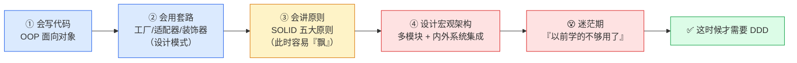

**每个阶段的特征**（作者原话的意思）：

| 阶段      | 你会什么                      | 心里状态                |
| ------- | ------------------------- | ------------------- |
| ① OOP   | 会写类、会封装继承多态               | 觉得自己有点不得了           |
| ② 设计模式  | 天天捧着 Design Pattern 的书找模板 | 能写出更好的代码            |
| ③ SOLID | 用好这五条，**还能轻松给别人挑出一堆毛病**   | **有点飘了，觉得别人代码都是垃圾** |
| ④ 宏观架构  | 开始设计多模块、内外部系统集成           | **陷入迷茫，发现以前学的不够用**  |

> [!important] 关键区分
> 阶段 ①②③ 解决的都是**项目细节层的设计**（几个类怎么设计）。
> 到了阶段 ④，你要设计的是**宏观项目层的架构**（模块之间怎么切、系统之间怎么集成）——
> **工具不一样了，所以要学新东西。**
> "不是不好使，是不够用了。"

---

## 二、传统三层架构：长什么样，为什么会出问题

### 2.1 三层的分工

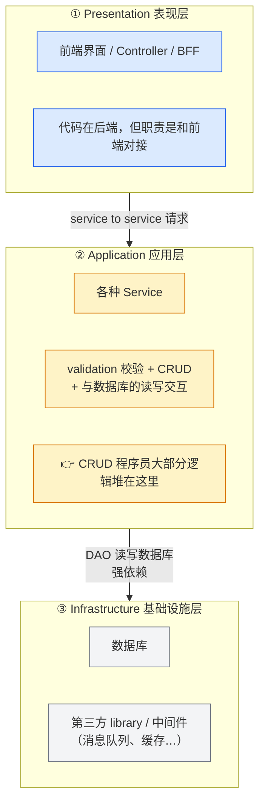

**依赖方向很关键：自上而下，一条直线。** 上层直接依赖下层。

### 2.2 这套架构的三个致命问题

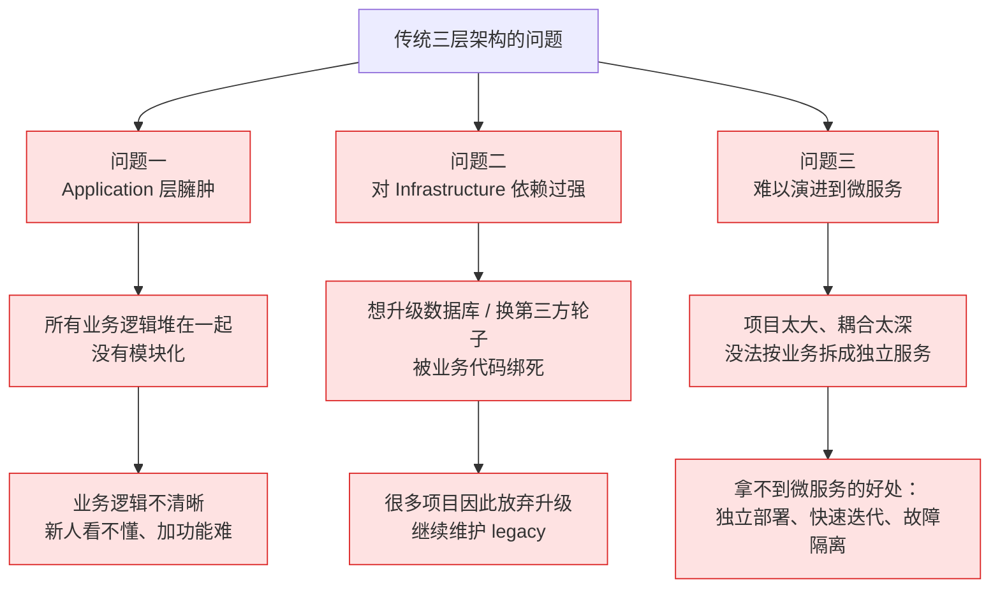

| # | 问题 | 后果 |
|---|---|---|
| 1 | **Application 层过于庞大臃肿** | 业务逻辑不清晰，维护困难；新人和新增功能都很难看清业务全貌 |
| 2 | **Infrastructure 依赖过强** | 想升级数据库或第三方轮子时处处受阻，**很多项目因此放弃升级、继续维护 legacy** |
| 3 | **难以演进到微服务** | 耦合太深，无法按业务拆成可独立运行/升级的微服务 |

> 作者原话大意："我相信大家在项目里或多或少都见过这个问题。"

---

## 三、DDD 的第一刀：在中间插一个「领域层」

### 3.1 改造思路

DDD 说：Application 和 Infrastructure 之间，**要再加一层——Domain（领域）层**。

判断一个逻辑该放哪层，只需问一句话：

> **"这个逻辑会随着使用场合变化吗？"**

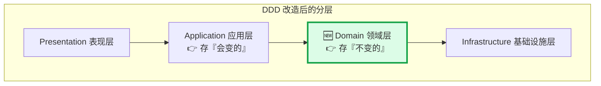

### 3.2 什么算"不变"，什么算"会变"

| | **Domain 领域层** | **Application 应用层** |
|---|---|---|
| 存什么 | **固定不变、通用的核心业务逻辑** | **接入不同 use case（应用场合）的逻辑** |
| 例子 | "订单正常下单"的核心规则 | 手机端接入 vs 网页端接入（逻辑有差异）； 用户登录 vs 店家登录（逻辑完全不同） |
| 特点 | 相对稳定，**甚至完全不会变动** | 随场景不同而不同 |

> [!tip] 一句话归纳
> **Domain 存"规矩"，Application 存"场合"。**
> 不管谁从哪个端进来，下单的规矩都是一样的（Domain）；
> 但手机端和网页端走的路不一样（Application）。

---

## 四、DDD 的第二刀：把基础设施「翻」上去

这是最容易颠覆直觉的一步。

### 4.1 依赖方向反转

原本 Infrastructure 在最底下、被所有人依赖。DDD 把它**挪到和三层并行的位置**，
让依赖方向反过来：**Infrastructure 依赖其它层，其它层不依赖它。**

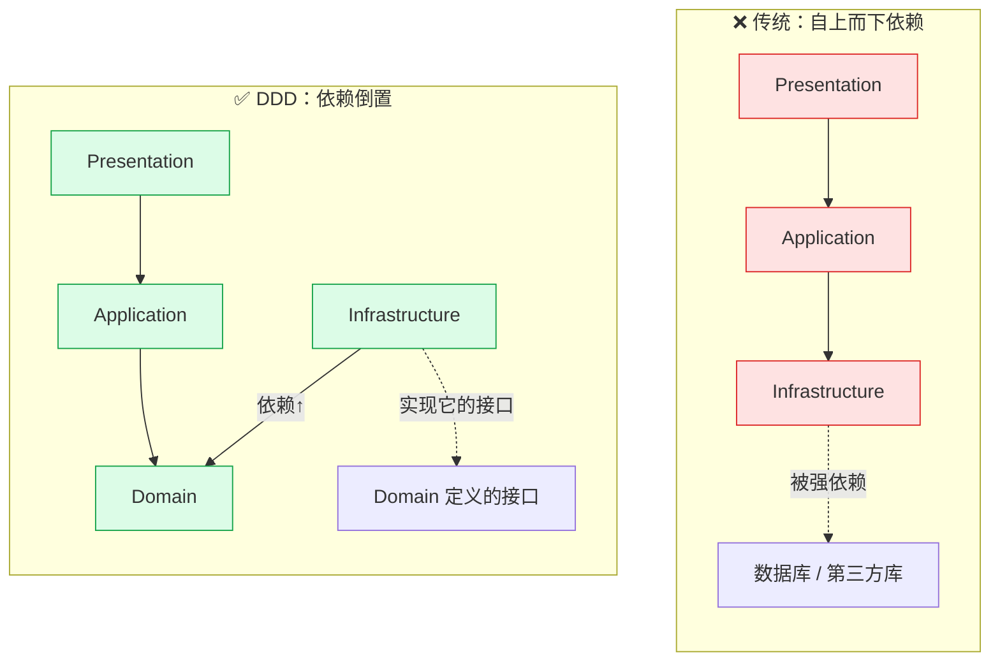

### 4.2 靠什么做到？—— 防腐层

**手段是"防腐层"**：Domain 层只定义**接口**（我不关心你怎么实现），
Infrastructure 层去**实现这些接口**。

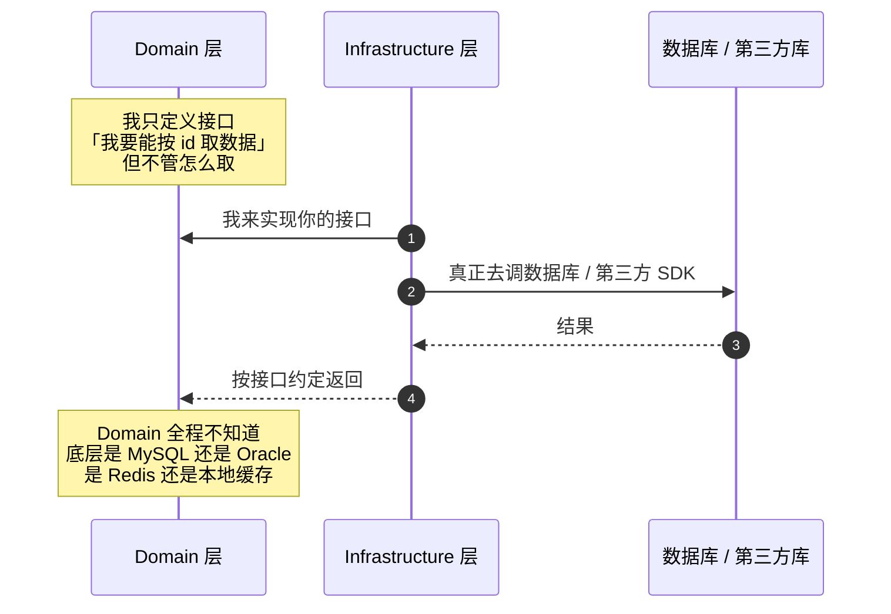

**好处**：将来把 MySQL 换成别的、把第三方库换掉，**只要新实现还满足接口，Domain 层一行都不用改**。

> 这就直接解决了传统架构的「问题二」。

---

## 五、层与层之间传什么？—— 三种 DTO

这是 DDD 里非常实用、但经常被忽略的一环。**每两层之间传的数据结构是不一样的，而且必须不一样。**

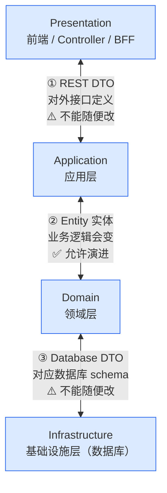

| # | 层间 | 数据结构 | 能随便改吗 | 为什么 |
|---|---|---|---|---|
| ① | Presentation ↔ Application | **REST DTO** | ❌ **不能** | 这是和用户（外部）的约定。每次增删字段都要**严格的 API 版本控制** |
| ② | Application ↔ Domain | **Entity** | ✅ **可以** | 业务逻辑随时可能变（entity 承载更多状态、某段逻辑改了…），定义自然会变 |
| ③ | Domain ↔ Infrastructure | **Database DTO** | ❌ **不能** | 对应数据库 schema，改一次就是一次 migration，必须保持稳定 |

### 5.1 为什么①和②必须是两种结构？

因为它们的变化频率天差地别：

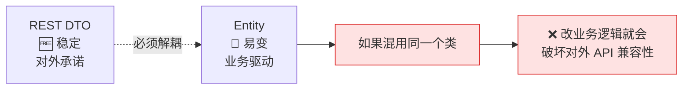

> **为了解耦，就必须定义成两种不同的数据结构。**

### 5.2 转换工作发生在哪

**Application 层的第一件事**：把 REST DTO 转成 Entity。

> [!important] 转换时顺手做一件事：校验
> 作者强调：转换过程中，**把 entity 的数据结构校验和合法性检查一起封装进去**。
> 这样 entity 一初始化，就能**最大程度保证数据的合理合法性**。

**Domain 层读写数据库时**：在 Entity 和 Database DTO 之间做转换。

---

## 六、模块怎么切（作者认为这是全篇最重要的部分）

前面讲的是"分层"，这一节讲**真正落到代码目录结构上，包怎么建、依赖怎么走**。

> 作者原话："当你开始一个软件项目的时候，你最需要设计好的是：这个项目有哪几个 module、
> 它们处于什么关系、依赖关系是什么、甚至命名和放在哪些文件夹。
> **只有这些框架搭好之后，项目才能分发给不同开发人员并行开发。**"

### 6.1 模块总览与依赖图（★ 核心图）

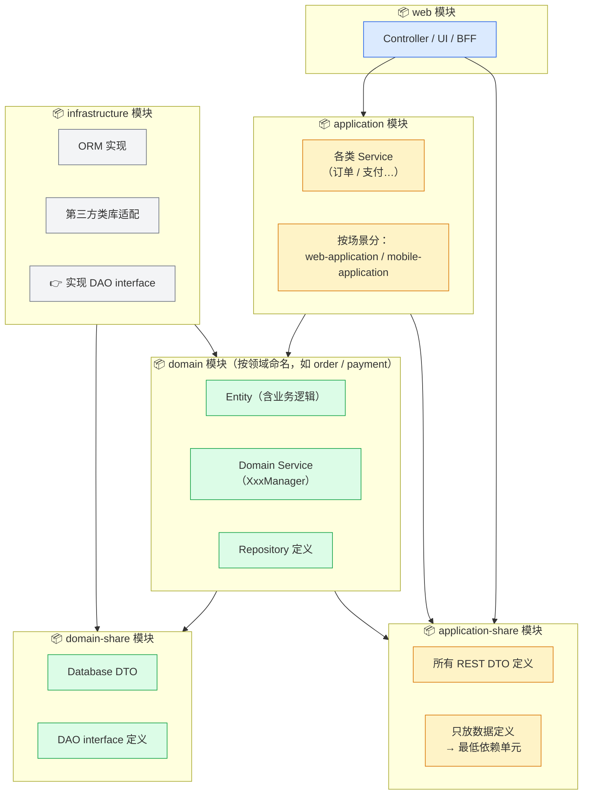

### 6.2 逐个模块说明

| 模块 | 装什么 | 关键点 |
|---|---|---|
| **web** | Controller、UI、BFF | 表现层，直接面向调用方 |
| **application** | 各类 Service；按**场景**再分（web-application、mobile-application） | 放"因场合而变"的逻辑 |
| **application-share** | **所有 REST DTO** | ★ **必须单独一个包**，因为它是**最低依赖单元**——所有包都要引用它，单独放才能**避免循环引用** |
| **domain** | Entity、Domain Service（`XxxManager`）、Repository 定义 | 按**领域**命名（order / payment），放"不变的规矩" |
| **domain-share** | Database DTO、**DAO interface** | ★ 接口放这里，实现放 infrastructure |
| **infrastructure** | ORM、第三方库适配，**实现 DAO interface** | 依赖 domain-share，**反向实现** |

> [!tip] 为什么 share 包要单独拆出来？
> 因为 `application-share` 和 `domain-share` 装的是**最底层、最基础的数据定义**，
> **几乎所有模块都要引用它们**。
> 如果把这些定义混在 application / domain 主包里，就会出现
> **A 依赖 B、B 又依赖 A 的循环引用（circular dependency）**。
> 拆成独立的 share 包，依赖关系就变成单向的了。

> [!note] 视频里作者自己修正过一处
> 讲到一半他说"entity 放在 domain-share 里"，后面又更正：
> **entity 应该放在 `domain` 包里**——因为 **entity 承载了业务逻辑**，
> 而 `domain-share` 只放**纯数据定义和接口**。
> 这个区分很重要，别被前面的口误带偏。

### 6.3 一条完整的依赖链（从下往上读）

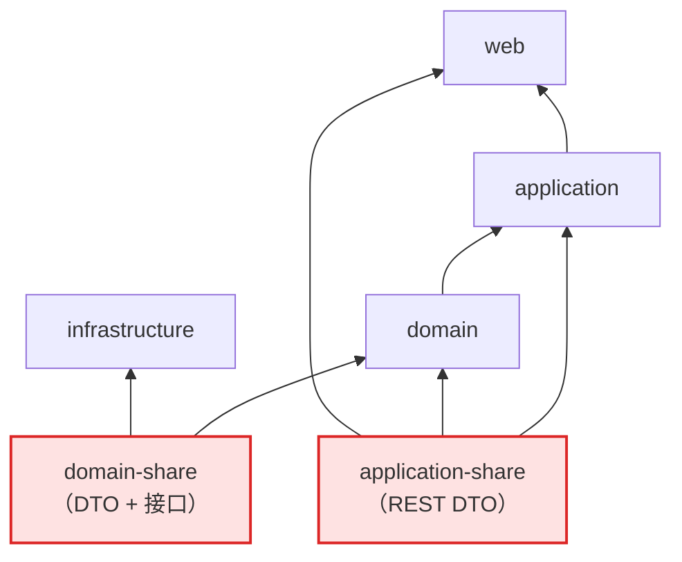

**记住两条**：
1. `domain-share` 和 `application-share` 是**地基**，被大家依赖。
2. **箭头方向都是"依赖方 → 被依赖方"**，`infrastructure` 在上面，说明它是**来适配的，不是被依赖的**。

---

## 七、Domain 层的三剑客：Repository / Entity / Manager

Domain 层是 DDD 的**核心中的核心**，里面最重要的三个东西是：
**Repository、Entity、Domain Service（建议命名 `XxxManager`）**。

### 7.1 它们的职责边界

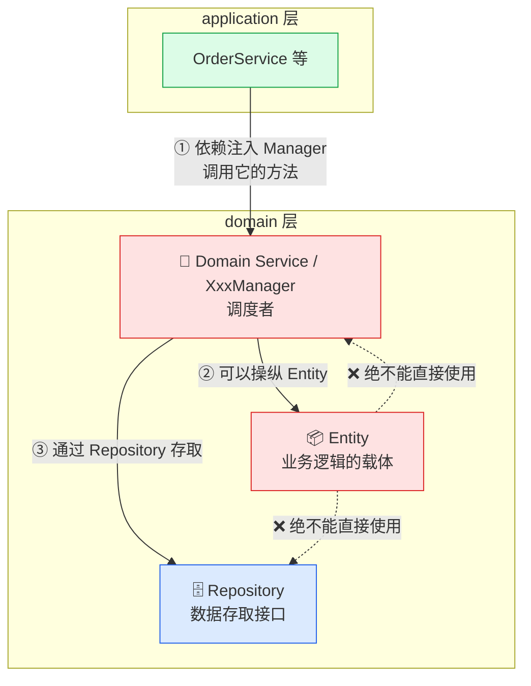

### 7.2 三者的规矩（重要）

| 角色 | 职责 | 硬性约束 |
|---|---|---|
| **Repository** | **纯数据操作接口**。只做"返回 id=X 的资源"、"更新 id=X 的某属性"这类事 | **逻辑越少越好**，绝不能塞业务逻辑 |
| **Entity** | **真正承载业务逻辑的地方**。只封装**与自己本身相关**的逻辑（如名称检查、基本数值计算） | **永远不应该直接使用 Manager 或 Repository** |
| **Domain Service（`XxxManager`）** | **调度者**：处理**多个 Entity 之间**、以及 **Entity 与外部操作**交互所需的业务逻辑 | 它是唯一能操纵 Entity 的角色 |

> [!important] 两个最容易搞错的地方
> 1. **只有 Manager 能操纵 Entity。** Entity 是被管理的对象，不能自己去调仓库或调度器。
> 2. **Repository 要"傻"。** 它只是数据访问的通道，业务逻辑一律不放在这里。

### 7.3 一次"创建订单"的调用链

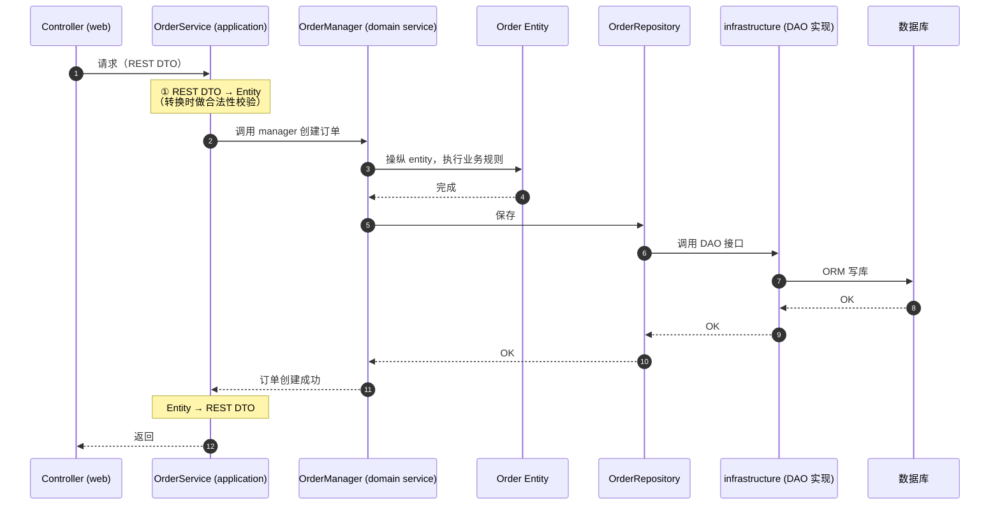

> [!tip] 为什么用 `Manager` 而不是 `Domain Service` 这个名字
> 作者的建议：**"service" 这个词和 Application 层的 "Service" 重叠了**，
> 容易混淆。用 `XxxManager` 命名能一眼区分：
> - `OrderService` → application 层的**应用服务**（面向场景）
> - `OrderManager` → domain 层的**领域服务**（面向业务规则）

---

## 八、三个必懂的术语：Entity / Value Object / Aggregate

前面讲的是**怎么组织代码**，这三个是**怎么给业务建模**。

### 8.1 Entity 与 Value Object：有没有"身份证"

```mermaid
graph TB
    Q{"这个东西有<br/>唯一 ID 吗？"}
    Q -->|"有"| E["✅ Entity 实体<br/>有 ID + 独立生命周期 + 状态"]
    Q -->|"没有"| V["✅ Value Object 值对象<br/>只有属性，靠属性值确定身份"]

    E --> E1["例：订单、一次银行转账"]
    V --> V1["例：地址信息<br/>（国家+省+市+街道<br/>就能确定一个地址）"]

    classDef e fill:#dbeafe,stroke:#2563eb
    classDef v fill:#dcfce7,stroke:#16a34a
    class E,E1 e
    class V,V1 v
```

| | Entity 实体 | Value Object 值对象 |
|---|---|---|
| **ID** | 有唯一 ID | 没有 ID |
| **生命周期** | 有独立生命周期和状态 | 没有 |
| **怎么认它** | 靠 ID | 靠**属性值** |
| **例子** | 订单、银行转账记录 | 地址（国家/省/市/街道） |
| **关系** | — | 一般**包含于 Entity**，或独立使用 |

> **判断口诀**：换个 ID 还是不是同一个东西？是 → Value Object；不是 → Entity。

### 8.2 Aggregate 聚合：Entity 里的"老板"

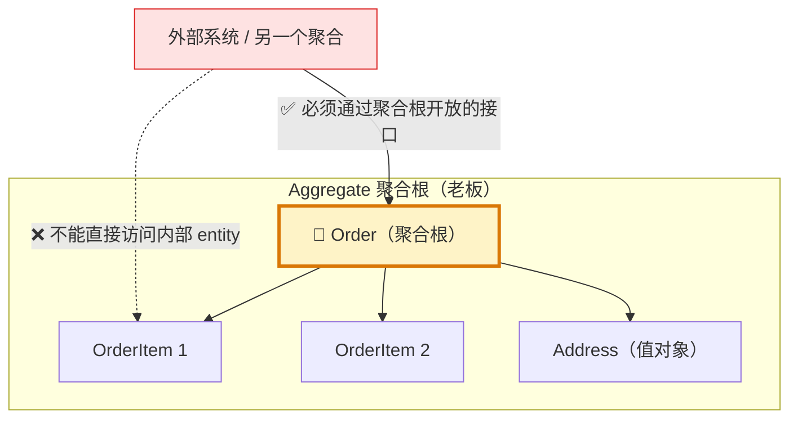

**作者的比喻**：Aggregate 就像一个公司里的**老板**，管理着底下的一到多个 Entity。

**两条规则**：

1. **外部想访问聚合内部的某个 Entity，必须通过聚合根（老板）开放的接口。** 不能绕过老板直接找员工。
2. **Aggregate 是「数据一致性」的边界。** 每次操作，聚合这一层要**保证内部数据的一致性**。

> [!important] 为什么聚合这么重要
> DDD 推荐的建模方式：**先把复杂系统拆解成几个独立的聚合，再在每个聚合里定义 Entity。**
> 好的设计标准是：**只需要保证「聚合内部」的一致性，不需要跨多个聚合同步协调。**
> （作者也承认这是理想情况。）

### 8.3 聚合 → 微服务：天然的拆分依据

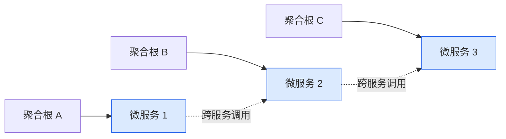

**理想状态下：每一个 Aggregate 就应该是一个微服务。**

- **微服务内部**：保证自己内部的数据一致性
- **微服务之间**：通过**服务与服务之间的请求**来修改彼此 Entity 的状态

> 所以 **Aggregate 是微服务划分的一个很好的理论依据。**

---

## 九、作者的实践建议（★ 别教条）

这部分是全篇最"接地气"的，也是和很多 DDD 布道文最不一样的地方。

### 9.1 聚合不要切得太碎

> 作者原话大意："**这个聚合部分，其实我觉得对于大多数的实际项目，要求他们这么严格的划分是有一些苛刻的。**"

他的实际经验：

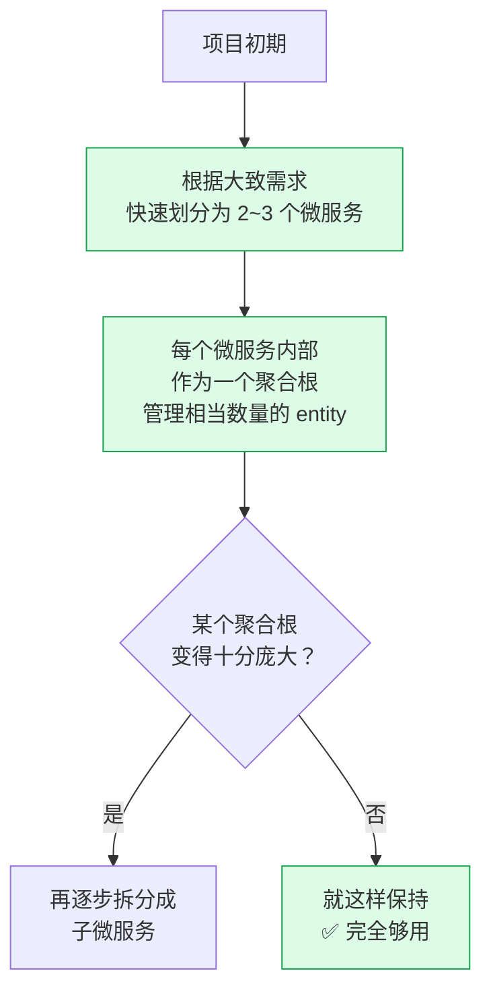

**结论**：**Aggregate 的思想不一定非要严格遵循，只要在微服务中能保证彼此数据一致性就行。**

### 9.2 DDD 是"指导"，不是"教条"

| 场景 | 建议 |
|---|---|
| 项目初期 | **不需要**把每个类都分得特别清楚 |
| 但 | **永远从这个角度开始划分模块** |
| 随着项目变复杂 | 这些模块**一定会逐一出现** |
| 具体架构 | 要**依赖你项目的实际情况**来设计 |

> [!important] 全篇最重要的一句话（作者反复强调）
> **数据一致性，一定是所有项目最重要的部分。**
> 不管你怎么用 DDD、怎么拆微服务，**保证好数据一致性**才是第一位的。

---

## 十、一页总结

### 10.1 整张图

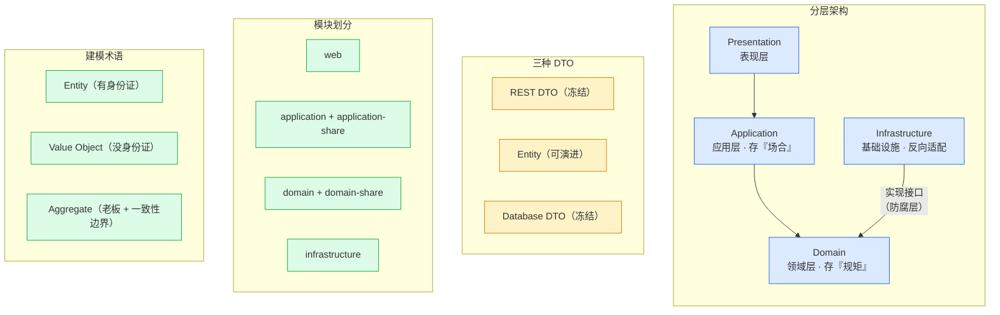

### 10.2 五句话记住 DDD

1. **DDD 的本质是模块化**，目标是高内聚低耦合，不是什么玄学理论。
2. **加一层 Domain**：把"不变的业务规矩"从"多变的场景逻辑"里拆出来。
3. **把 Infrastructure 翻上去**：用接口（防腐层）让领域层不依赖具体实现。
4. **三种 DTO 各司其职**：对外的 REST DTO 和数据库的 Database DTO 要冻结，中间的 Entity 可以演进。
5. **聚合是拆分依据，但别教条**：2~3 个微服务起步，**数据一致性永远第一**。

### 10.3 面试速答

| 问题 | 一句话回答 |
|---|---|
| DDD 是什么？ | 一套模块化思想，通过分层和边界划分做到高内聚低耦合 |
| 为什么加 Domain 层？ | 把稳定不变的核心业务逻辑，和多变的场景逻辑分开 |
| 防腐层是什么？ | 领域层只定接口、基础设施层去实现，从而让领域层不依赖具体技术 |
| 为什么 REST DTO 和 Entity 要分开？ | 对外接口必须稳定（版本控制），而业务模型会演进，混用会导致改业务就破坏 API |
| Repository 该有多厚？ | 越薄越好，只做数据存取，不放业务逻辑 |
| Entity 和 Value Object 区别？ | 有没有唯一 ID 和独立生命周期（订单 vs 地址） |
| Aggregate 是什么？ | 一组相关对象的边界，有聚合根做统一入口，也是**数据一致性边界** |
| Aggregate 和微服务关系？ | 理想状态下每个聚合就是一个微服务，是拆分的理论依据 |
| 落地要注意什么？ | 别教条，初期 2~3 个微服务即可，**数据一致性最重要** |

---

## 十一、我的一点补充

视频讲的是**思想层面的框架**，实际落地时还有几个绕不开的问题，原视频没展开，值得你自己继续想：

| 议题 | 提示 |
|---|---|
| **领域事件** | 聚合之间如何通信？跨聚合的一致性怎么做？（最终一致性 / Saga / 事件驱动） |
| **CQRS** | 读写模型分离，和 DDD 常搭配使用 |
| **Repository 与 ORM** | JPA/Hibernate 的 `Repository` 和 DDD 的 Repository 概念不完全一样，别混 |
| **贫血模型 vs 充血模型** | 视频讲的 "业务逻辑放 Entity" 就是**充血模型**；而大部分 CRUD 项目是贫血模型 |
| **2~3 个微服务起步** | 但**怎么确定是哪 2~3 个**？这才是真功夫——靠的是对业务的理解，不是技术 |

> 想看这些延伸，参考 [[2-分布式事务]]（跨聚合一致性怎么做）、[[8-微服务架构与注册配置中心]]（怎么拆服务）。

---

## 延伸

- 原始逐字稿：[[白话讲解领域驱动设计domain driven design (DDD)]]
- 原视频：<https://www.bilibili.com/video/BV11u411176h/>
- 相关：微服务拆分、分层架构、防腐层（ACL）、聚合根与一致性

> [!summary] 一句话收束
> **DDD = 模块化。** 加一层领域层分开了"规矩"和"场合"，
> 用防腐层把基础设施的依赖倒置，用三种 DTO 隔开稳定与易变，
> 用聚合作为微服务的拆分依据—— **但别教条，数据一致性永远排在第一位。**
