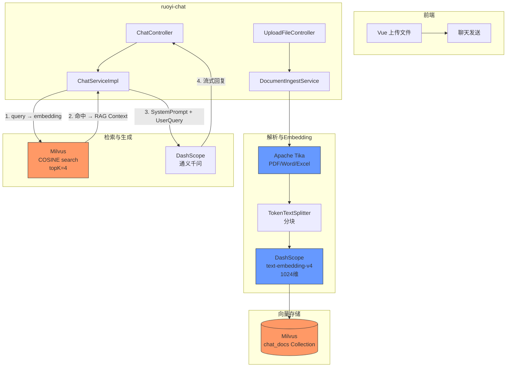
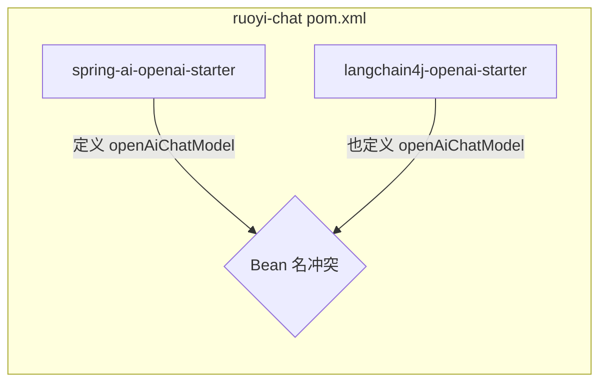
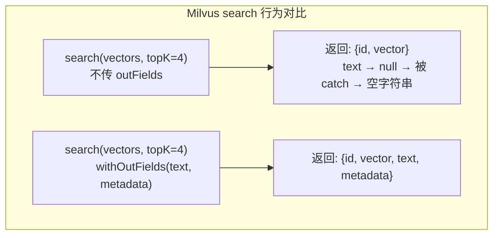
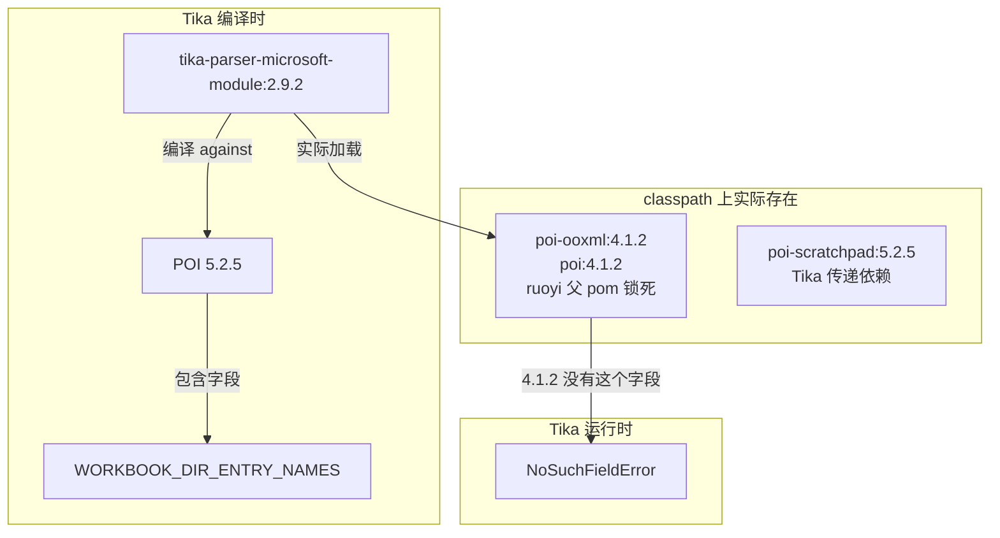
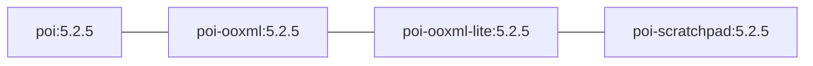
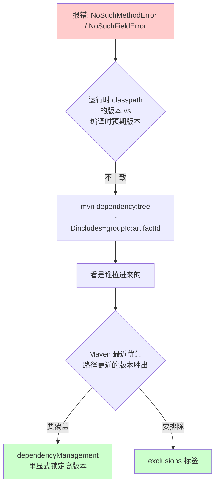

---
tags:
  - ruoyi
  - rag
  - milvus
  - spring-ai
  - troubleshooting
created: 2026-10-29
status: completed
source: ruoyi-chat RAG 全链路排障
---

# Ruoyi RAG 全链路排障手册

> **场景**：在若依 (RuoYi-Vue) 单体项目中集成 Spring AI + DashScope Embedding + Milvus VectorDB，实现文件上传 → 向量化 → 知识库问答的完整 RAG 链路。
>
> **结论先行**：共遇到 **7 个独立报错**，分属两类 —— **Maven 传递依赖版本冲突**（4 个）和 **Milvus Collection schema/metric 不匹配**（3 个）。核心修复集中在父 pom 版本锁定 + 删除旧 Collection 重建。

---

## 架构总览



---

## 问题时间线

```mermaid
timeline
    title Ruoyi RAG 集成 报错时间线
    17:30 : bean 'openAiChatModel' already defined
          : → 删除 ruoyi-chat 多余的 LangChain4j starter
    17:35 : NoSuchMethodError TarArchiveInputStream.getNextEntry()
          : → 父 pom 锁 commons-compress 1.26.1
    17:40 : 首次启动 + 上传文件
          : Milvus Collection 自动创建
    17:45 : field id not exist (Milvus search)
          : → outFields 不能包含主键，移除
    17:47 : field metadata not exist (Milvus search)
          : → 移除硬编码 outFields 列表
    17:53 : metric type not match expected=L2 actual=COSINE
          : → pymilvus 删除旧 Collection 重建
    17:57 : RAG 命中但 text 字段全空
          : → outFields 不传时 Milvus 默认不返回标量字段
          : → 加回 .withOutFields(["text","metadata"])
    18:02 : NoSuchFieldError WORKBOOK_DIR_ENTRY_NAMES
          : → poi.version 4.1.2 → 5.2.5
    18:10 : ✅ 全链路打通
```

---

## 问题详解

### 问题 1：Bean 名称冲突

| 项 | 值 |
|---|---|
| **报错** | `bean 'openAiChatModel' already defined in AutoConfig.class` |
| **位置** | Spring Boot 启动 |

#### 根因

`ruoyi-chat/pom.xml` 同时引入了 **Spring AI** 和 **LangChain4j** 两套 AI 框架：



两个 starter 都有自动配置类注册同名 Bean，后加载的覆盖前加载的失败。

#### 修复

删除 `ruoyi-chat/pom.xml` 里多余的 LangChain4j 全套依赖，只保留 Spring AI。

---

### 问题 2：commons-compress 版本冲突

| 项 | 值 |
|---|---|
| **报错** | `NoSuchMethodError: TarArchiveInputStream.getNextEntry()` |
| **位置** | Tika 解析 `.tar.gz` 文件时 |

#### 根因

```mermaid
flowchart TD
    subgraph ruoyi 父 pom 锁死
        P[poi-ooxml:4.1.2] -->|传递依赖| C1[commons-compress:1.19]
    end

    subgraph Tika 2.9.2 需要
        T[tika-parsers-standard-package] -->|运行时调用| API["TarArchiveInputStream.getNextEntry()"]
        T -->|编译时| C2[commons-compress:1.26.1]
    end

    C1 -- "Maven 最近优先" -->|选中 1.19| B[运行时 classpath]
    B -->|缺少该方法| X[NoSuchMethodError]
```

ruoyi 父 pom 里 `poi-ooxml:4.1.2` 传递进来 `commons-compress:1.19`（2019 年），而 Tika 2.9.2 编译时 against 1.26.1。Maven 依赖树里 `poi-ooxml` 路径更近 → 选中 1.19 → 方法不存在。

#### 修复

在父 pom 的 `<dependencyManagement>` 里**强制锁定**高版本：

```xml
<dependency>
    <groupId>org.apache.commons</groupId>
    <artifactId>commons-compress</artifactId>
    <version>1.26.1</version>
</dependency>
```

---

### 问题 3~5：Milvus Collection Schema/Metric 不匹配

这三个问题的根因**都是旧 Collection**。Milvus Collection 是**一次性创建**的 schema 对象 —— 创建时定了字段、主键、向量维度、索引 metricType，后续代码升级不会自动迁移。

#### 旧 Collection 状态 vs 新代码期望

```mermaid
flowchart LR
    subgraph 旧 Collection (首次上传时创建)
        direction TB
        S1[字段: id vector text]
        S2[索引 metricType: L2]
        S3[无 metadata 字段]
    end

    subgraph 新代码期望
        direction TB
        E1[字段: id vector text metadata]
        E2[metricType: COSINE]
        E3[outFields: text, metadata]
    end

    S1 -.->|缺字段| X1[field metadata not exist]
    S2 -.->|类型不匹配| X2[metric type not match]
```

#### 三个报错的对应关系

| # | 报错 | 根因 | 修复 |
|---|------|------|------|
| 3 | `field id not exist` | `outFields` 里包含了主键 `id`，Milvus 主键字段不能在 outFields 里显式请求 | `outFields` 列表去掉 `id` |
| 4 | `field metadata not exist` | 旧 Collection 没有 `metadata` 字段 | 移除硬编码 `outFields` 列表，让 Milvus 返回所有字段 + try-catch 兜底 |
| 5 | `metric type not match: expected=L2, actual=COSINE` | 旧 Collection 索引用 L2，search 参数用 COSINE | **删除旧 Collection 让代码重建** |

#### 问题 5 的特殊之处

这是**唯一无法靠代码修复**的 Milvus 问题 —— 索引 metricType 写死在 Collection 的 index 里，没有 alter API 能改。必须：

```python
# pymilvus 命令
from pymilvus import utility, connections
connections.connect(host="localhost", port="19530")
utility.drop_collection("chat_docs")
```

重启应用后，`DocumentIngestService` 检测不到 Collection → 自动按最新 schema 创建。

---

### 问题 6：RAG 命中但 text 全空

| 项 | 值 |
|---|---|
| **现象** | Milvus search 返回 4 条结果，score 都 > 0.5，但 `text=` 全部为空字符串 |
| **位置** | `ChatServiceImpl.buildRagContext()` |

#### 根因

上次为了解决 `field metadata not exist`，移除了 `.withOutFields()`。但 Milvus 有一个关键行为：

> **search 不传 `outFields` 时，默认只返回向量 + 主键，不返回任何标量字段。**



所以 `getFieldData("text")` 内部拿到 null → 抛异常 → 被 catch 吞掉 → 返回空字符串。AI 收到空文本 → 答"资料 1-4 都是空的"。

#### 修复

新 Collection 重建后 schema 完整（`metadata` 字段已存在），可以安全加回 `outFields`：

```java
// MilvusService.java - search 方法
SearchParam param = SearchParam.newBuilder()
    .withCollectionName(collectionName)
    .withMetricType(MetricType.COSINE)
    .withOutFields(List.of("text", "metadata"))
    .withVectorFieldName("vector")
    .withVectors(queryVectors)
    .withTopK(topK)
    .withConsistencyLevel(ConsistencyLevelEnum.STRONG)
    .build();
```

同时在 `ChatServiceImpl` 里加防御：跳过 `text.isBlank()` 的结果，不塞空资料给 AI。

---

### 问题 7：POI 版本冲突

| 项 | 值 |
|---|---|
| **报错** | `NoSuchFieldError: WORKBOOK_DIR_ENTRY_NAMES` |
| **位置** | Tika 解析 Excel/Word 文件时 |

#### 根因



**同一个 POI 家族，classpath 上混合版本** —— 主 jar 4.1.2，Tika 带进来的 `poi-scratchpad` 5.2.5。Tika 2.9.2 编译时 against POI 5.2.5（Tika 父 pom 自己就用 5.2.5），但 ruoyi 的 `dependencyManagement` 把主 POI 锁在了 4.1.2。

#### 修复

升级父 pom 的 `poi.version` 到 5.2.5：

```xml
<!-- pom.xml -->
<poi.version>5.2.5</poi.version>  <!-- 原来是 4.1.2 -->
```

验证全家族版本统一：



POI 4 → 5 API 完全向后兼容，ruoyi 没有任何代码 break。

---

## Maven 依赖冲突排查技巧



关键命令：

```bash
# 看某个 artifact 的完整依赖链
mvn dependency:tree -pl ruoyi-chat -Dincludes=org.apache.poi

# 清理所有 target 目录（IDE 缓存旧 class 时必用）
rm -rf ruoyi-*/target && mvn clean compile -q
```

---

## Milvus Collection Schema 变更清单

> 经验教训：Milvus Collection 创建后不可修改 schema。版本迭代时务必 drop 重建。

| 变更类型 | 能否靠代码修复 | 处理方式 |
|----------|---------------|---------|
| 增加/删除字段 | 不能 | `utility.drop_collection()` + 代码重建 |
| 修改向量维度 | 不能 | 同上 |
| 修改索引 metricType | 不能 | 同上 |
| `outFields` 参数调整 | 能 | 改代码即可，不影响 Collection |
| 主键字段名 | 不能 | 必须重建 |

重建后旧数据会清空，需要重新上传文件触发向量化入库。

---

## 最终工作的依赖版本

```yaml
# pom.xml 关键版本锁定
commons-compress: 1.26.1      # 覆盖 poi-ooxml 4.1.2 传递的 1.19
poi.version: 5.2.5            # 全家族统一，Tika 2.9.2 所需
spring-ai: 1.0.0-M4           # 只有 Spring AI，无 LangChain4j
milvus-sdk-java: 2.4.1
tika-core + tika-parsers-standard-package: 2.9.2
```

```sql
-- Milvus chat_docs Collection (最终正确 schema)
-- 字段: id (Int64 PK, auto), vector (FloatVector, dim=1024), text (VarChar), metadata (VarChar)
-- 索引 metricType: COSINE
-- 向量来源: DashScope text-embedding-v4
```

---

## 一句话总结

> **Maven 传递依赖像野草** —— 你只显式写了一个 jar，它会拉一串版本不匹配的亲戚。`mvn dependency:tree` 是唯一能看清全貌的工具。**Milvus Collection 像数据库表** —— 创建了就不能改 schema，升级要 drop 重建。
