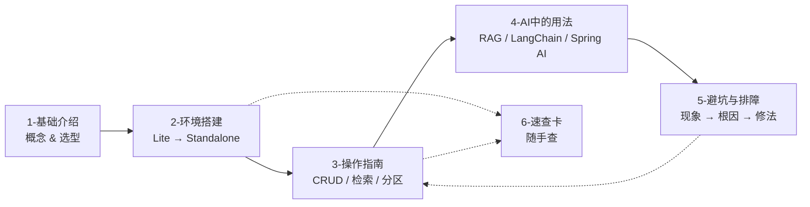

# Milvus × AI 知识库

> [!info] 这份索引管什么
> `3-Milvus` 目录的入口。整个系列按「**是什么 → 装起来 → 会操作 → 用在 AI 里 → 少踩坑**」五段组织，全部以 **pymilvus 3.0.2 / Milvus 3.0** 为基线，关键代码在本机 **Milvus Lite** 上实跑过。
> 素材来源：手上的 [[0-Milvus.drawio]]（版本演进笔记）+ [[【2026最新版】Milvus3.0向量数据库-新特性+RAG企业知识库教程！把AI大模型面试必备技能+简历+面试题+面试复盘一次性给大家讲明白！-码士集团|码士集团 Milvus 3.0 视频转录]] + 官方文档核对 + 本机实测。

---

## 0. 阅读路线

| 时长 | 目标 | 读什么 |
|---|---|---|
| 10 分钟 | 知道 Milvus 是什么、要不要用 | [[1-基础介绍]] §1~§3 |
| 30 分钟 | 在本地把检索跑通 | [[2-环境搭建]] §2 + [[6-速查卡]] §1 |
| 半天 | 能独立建一张生产级表 | [[3-操作指南]] §2~§6 |
| 一天 | 接出一个最小 RAG | [[4-AI中的用法]] §3.1 骨架 |
| 持续 | 排障 / 调优 | [[5-避坑与排障]] |

---

## 1. 笔记清单

### [[1-基础介绍]] — 是什么、凭什么、怎么选
- 一句话定位 + 和 FAISS / ES / PGVector / Chroma 的边界
- 相似度度量（COSINE / IP / L2）与 ANN 索引选型表（HNSW / IVF / DiskANN / GPU / 稀疏）
- 数据模型：Database → Collection → Partition → Entity，字段类型
- 架构：四类协调者 + 四类节点 + etcd / WAL / 对象存储，存算分离
- 版本时间线（2.0 存算分离 → **3.0 湖原生**）与 3.0 新特性
- 规模粗算（**100 万 × 1024 维 ≈ 8~10 GB 内存**）与部署选型

### [[2-环境搭建]] — 四种形态都能跑
- 选型决策图 → Milvus Lite / Docker Standalone / Compose / Distributed
- ⭐ 本机实测的 pip 依赖版本、Lite 最小代码与真实输出
- `standalone_embed.sh` 读源码定位：`COMMON_STORAGETYPE=local`、端口 19530/9091/2379、数据目录
- 国内网络：pip 镜像、Docker 镜像加速、`quay.io` 拉取失败处理
- ⭐ **Lite 能力边界矩阵**（BM25 ✅ / 分区 key ✅ / 在线加字段 ❌ / 快照 ❌）
- 集群：Ansible 角色拆分 + K8s Operator；客户端生态版本一览

### [[3-操作指南]] — 日常 90% 的操作
- 速查表（30+ 方法对应表）→ 连接 / Database → 建表（生产模板）→ 索引
- ⭐ 幂等写入（查重）、upsert 两种语义、按条件删除
- query 与过滤表达式语法；⭐ `query_iterator` 全量导出
- ⭐ 向量搜索 / 分页 / 按文档聚合 / **混合检索 RRF·Weighted** / Rerank
- 分区与多租户两种打法；load / flush / 一致性级别
- 性能清单 → 迁移（导出 + alias 切换）→ 快照 → 备份 → 运维命令

### [[4-AI中的用法]] — 向量库在 AI 系统里的位置
- 定位：召回层 / 语义缓存 / Agent 记忆 / 推荐 / 去重，**Milvus 不是 RAG 本身**
- ⭐ **LangChain 集成**：最小用法、双向量混合检索、`reranker` 新写法，以及 3 个实测踩坑
- ⭐ **RAG 全链路骨架**：建表 → 切分 → 幂等入库 → 混合检索 → 拼 Prompt（可直接改生产）
- 每个环节的可调项与「怎么判断调好了」；中文 BM25 与混合检索的收益逻辑
- **Spring AI 集成**：官方 VectorStore 路线 vs 自封装 SDK 路线 + RuoYi 的 5 条硬经验
- 多租户与 RBAC、Agent 长期记忆（写入节制 / 去重 / 时间衰减）、语义缓存、上线 checklist

### [[5-避坑与排障]] — 现象 → 根因 → 修法
- 先记住 **6 条铁律**
- 建表期 ⭐：无主键、隐式开动态字段、`chinese` 分词器、链式 `add_index` 返回 None
- 查询期 ⭐：**`output_fields` 不传 → 文本全空**、`anns_field`、`filter_params`、`released` 未加载、刚写搜不到
- 应用层 ⭐：langchain `search_params` 必填、`field_name` 冲突、weighted 权重报错、MMR 断言
- 环境排障速查 + 排障方法论（先证明 Milvus 没问题，再证明数据没问题）

### [[6-速查卡]] — 一页纸
30 秒跑起来 · 常用命令表 · 参数默认/推荐值 · 表达式速查 · **报错一句话修法** · 选型速记 · 上线 checklist

---

## 2. 素材与关联

| 素材 | 说明 |
|---|---|
| [[0-Milvus.drawio]] | 你整理的 2.0→3.0 版本时间线 + 3.0 十二项新特性（本系列 §6 已结构化吸收） |
| [[【2026最新版】Milvus3.0向量数据库-新特性+RAG企业知识库教程！把AI大模型面试必备技能+简历+面试题+面试复盘一次性给大家讲明白！-码士集团\|码士集团视频转录]] | 视频字幕原文，核心观点：3.0 **不是升级而是换代**，湖原生是核心定位；面试要讲「新版本解决了什么问题」 |

**跨目录关联**

| 笔记 | 与本系列的关系 |
|---|---|
| [[1-LangChain/2-LangChain学习地图\|LangChain 学习地图]] | 其 §1.3（Hybrid + Rerank）、§3.2（Milvus Lite → Docker Standalone）、§1.6（自建评估）正是本系列 [[3-操作指南]] §6 与 [[4-AI中的用法]] §3.4 的另一种讲法 |
| [[2-spring ai/RuoYi-Spring-AI-面试题\|RuoYi × Spring AI 面试题]] | §4 Milvus 部分（选型、schema、双保险降级）→ 对应本系列 [[4-AI中的用法]] §4 |
| [[2-spring ai/Ruoyi RAG 全链路排障手册\|RuoYi RAG 全链路排障手册]] | 真实事故（outFields、metric 不匹配、schema 不可改）→ 已收录进 [[5-避坑与排障]] §2、§3.1 |

---

## 3. 写作时确认过的版本事实（截至 2026-10-29）

| 项目 | 版本 | 来源 |
|---|---|---|
| Milvus 服务端 | **v3.0.4**（3.0 线）/ **v2.6.26**（2.6 线），同日发布 | GitHub Releases |
| Milvus 3.0 GA | 2026-07-29 | Release Notes |
| pymilvus | **3.0.2** | PyPI |
| milvus-lite | **3.2.2**（纯 Python 重写；本机安装为 0.5.8） | PyPI |
| pymilvus-model | 0.3.4 | PyPI |
| langchain-milvus | **0.4.0**（要求 `pymilvus>=3.0`、`langchain-core>=1.4.9`） | PyPI |
| Spring AI | `spring-ai-autoconfigure-vector-store-milvus` 已到 2.1.x，API 已迁 builder | Maven Central |

> [!warning] 一个容易抄错的数字
> 「Milvus 3.0 发布于 2026-07-29」和「1.0 发布于 2019」这两条时间点，在部分二手资料里会被写错或含糊。本系列以 Release Notes 为准。

---

## 4. 待办 / 可继续扩展

- [ ] 在 Docker Standalone 上补跑 [[2-环境搭建#3. Docker Standalone（单机生产 / 团队共享）]] 并补真实输出（本机无 Docker）
- [ ] 升级本机 `milvus-lite` 到 3.2.2，重测 [[2-环境搭建#4. Milvus Lite 能力边界（本机实测 · pymilvus 3.0.2 + milvus-lite 0.5.8）]] 矩阵
- [ ] 补 3.0 的 External Collection / 在线加字段回填 / Snapshot 的独立落地实验
- [ ] 把 [[4-AI中的用法#3.1 完整骨架（可直接改造成生产脚本）⭐]] 落成仓库里的可执行脚本 + 评测集
- [ ] 面试速答卡：Milvus 为什么选它 / schema 怎么设计 / metric 区别 / 3.0 新特性（可从 [[1-基础介绍]] §6、[[6-速查卡]] §6 抽取）
