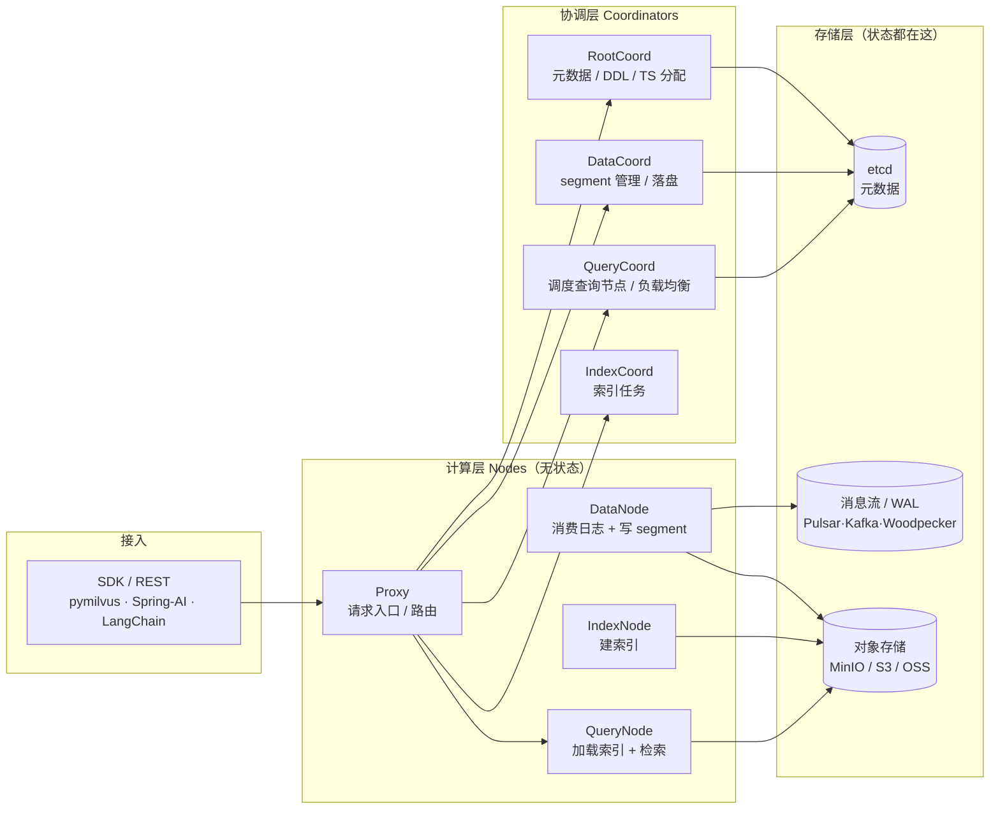
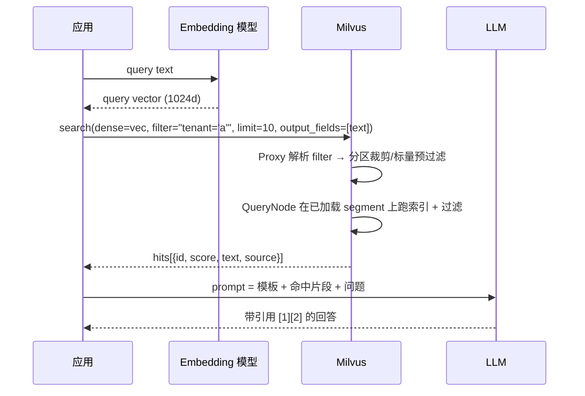

# Milvus 基础介绍

> [!info] 这份笔记管什么
> 回答「Milvus 是什么、凭什么用它、内部怎么转、数据长什么样、索引和度量怎么选」。
> 只讲**概念 + 决策依据**，动手代码去 [[3-操作指南]]，装环境去 [[2-环境搭建]]，AI 落地去 [[4-AI中的用法]]。
> 配套图：[[0-Milvus.drawio]]（版本演进 + 3.0 新特性）

---

## 1. 一句话定位

**Milvus 是一个开源的、为向量（Embedding）设计的分布式数据库**：负责把高维向量存下来、建索引、在毫秒级内找出「最相似」的 N 条记录，并且支持标量过滤、混合检索、多租户、增量更新——这些 SQL 数据库都不擅长的事。

更准确的说法不是「数据库」，而是**向量检索层**：

| 对比对象 | 本质上是什么 | 缺少什么 |
|---|---|---|
| **FAISS** | 一个 C++ / Python 的**索引库** | 不存原始数据、无持久化、无增删改 API、无过滤、无并发服务 |
| **Milvus** | 一个**分布式服务**（存储 + 计算 + 协调 + 网关） | 需要自己部署运维（或用 Zilliz Cloud） |
| **Elasticsearch** | 倒排/BM25 引擎，向量检索是后来加的插件能力 | 稠密向量召回效率、大规模向量存储成本不如专业库 |
| **PGVector / Oracle 23ai** | 关系库里的向量类型 + 索引 | 数据量到千万级、并发高时容易被拖累 |
| **LanceDB / Chroma** | 嵌入式向量库 | 没有独立的分布式服务形态，扩展性有限 |

> [!tip] 什么时候该上 Milvus
> - 向量条数预计 **> 100 万**，或未来要猛涨
> - 需要**标量过滤 + 向量检索**混用（`WHERE tenant = 'x' AND 语义相似`）
> - 需要**稠密 + 稀疏（BM25）混合检索**、多向量、多租户（partition key）
> - 数据要**增量增删改**、要长期跑在服务端
>
> 否则：本地验证用 **Milvus Lite**，几个人的内部工具 Chroma / PGVector 也行，别为了架构图好看背个集群。

---

## 2. 为什么 AI 需要它：从「关键词」到「语义」

### 2.1 问题：Embedding 是一串浮点数

任何文本/图片经过 Embedding 模型都会变成定长向量，例如 `bge-m3` 输出 1024 维：

```
"Milvus 是什么"      → [0.012, -0.334, 0.887, ..., 0.045]   # 1024 个 float32 = 4KB
"那个开源向量数据库"  → [0.010, -0.301, 0.902, ..., 0.051]   # 距离很近
"今天天气不错"       → [-0.442, 0.128, -0.077, ..., 0.701]   # 距离很远
```

「相似」= **向量距离近**。检索就是「在几百万个 1024 维点里找离查询点最近的 K 个」——暴力算一遍是 O(N·d)，100 万 × 1024 就是 10 亿次乘加，没法在线做。所以需要**近似最近邻（ANN）索引**。

### 2.2 三种相似度度量（metric type）

| metric | 含义 | 范围 | 适用 |
|---|---|---|---|
| `COSINE` | 余弦相似度，只看夹角不看长度 | 搜出来 score ∈ [-1, 1]，**越大越相似** | **文本 Embedding 默认选它**（模型通常按 cosine 训练） |
| `IP` | 内积，受向量长度影响 | 无界，越大越相似 | 向量已归一化时 IP ≡ COSINE，且更快 |
| `L2` | 欧氏距离 | ≥ 0，**越小越相似** | 图像特征、未归一化的 embedding、坐标类数据 |
| `HAMMING` / `JACCARD` | 二进制向量（`BINARY_VECTOR`） | — | 哈希指纹、去重 |

> [!warning] COSINE 下「分数」不是相似概率
> Milvus 返回的是 `1 - cosine_distance`，所以完全同向是 1.0，完全反向是 -1 或 -2 视实现而定。**别把 0.8 理解成「80% 把握」**，阈值只能拿自己的一批 query 标定。
> 另外：**metric 写在索引里，建好后不能改**（只能重建 collection）→ 见 [[5-避坑与排障#2. 建库阶段的错，后期只能重建]]。

### 2.3 ANN 索引 ≈ 用少量精度换速度

| 索引 | 原理一句话 | 建索引 | 查询 | 内存 | 增量删除 | 适合 |
|---|---|---|---|---|---|---|
| `FLAT` | 不建索引，暴力算 | 无 | 慢 | 高 | ✓ | 精确基线、< 1 万条 |
| `IVF_FLAT` | k-means 把向量分成 `nlist` 个簇，查最近的 `nprobe` 个簇 | 快 | 中 | 中 | ✓ | 中大规模、要省内存 |
| `IVF_PQ` | 在 IVF 基础上把向量压缩成 PQ 码 | 中 | 快 | **低** | ✓ | 内存敏感、可以容忍损失 |
| `IVF_SQ8` | IVF + 标量量化到 int8 | 中 | 快 | 低 (~1/4) | ✓ | 内存省一半以上，精度损 <1% |
| **`HNSW`** | 多层可导航小世界图，贪心地往「更近」的邻居走 | **慢、占内存** | **最快、召回最高** | 高（常需 &gt;1.5× 原数据） | ✓（2.4+） | **在线检索默认选它** |
| `DiskANN` | 向量放 SSD，内存只放关键点 | 慢 | 中 | **最低** | ✓（2.4+） | 亿级、内存装不下 |
| `AUTOINDEX` | 服务端按数据量/资源自动挑 | 自动 | 自动 | 自动 | ✓ | 不想调参的人（含 Lite） |
| `GPU_CAGRA` / `GPU_IVF_*` | 图/倒排在 GPU 上跑 | — | **极快** | GPU 显存 | ✓ | 高 QPS 批处理 |
| `SPARSE_INVERTED_INDEX` | 稀疏向量倒排（BM25 / SPLADE） | 快 | 快 | 中 | ✓ | 关键词、混合检索 |

关键参数：

- **HNSW**：`M`（每个节点连边数，16~64，越大越准越占内存）、`efConstruction`（建图时候选队列，200~500）、查询时 `ef`（候选队列，**≥ limit**，一般 64~256；调大→召回↑、延迟↑）
- **IVF**：`nlist`（簇数，通常 `4·√N` 或 `N/10000` 量级，上限 65536）、查询 `nprobe`（扫多少簇，8~64；调大→召回↑、延迟↑）
- 经验：**调参只调查询侧**（`ef` / `nprobe`），建索引参数改一次成本很高。

> [!note] 召回率怎么验
> 用 `FLAT` 跑同一批 query 得到 ground truth，再对比目标索引的 `Recall@K`。**线上 95% 召回 + 50% 延迟下降**通常比 100% 召回更有价值。

---

## 3. 数据模型：从「表」到「Collection」

### 3.1 四层结构

```
Database（数据库，命名空间）
└── Collection（≈ 表；一个 Collection 只存一种"实体"）
    ├── Schema（字段定义，创建后基本不可改）
    │   ├── id        Int64 / VarChar  (主键)
    │   ├── dense     FloatVector(1024)
    │   ├── sparse    SparseFloatVector
    │   ├── text      VarChar  (开 analyzer → 可被 BM25 函数消费)
    │   ├── tenant    VarChar  (is_partition_key)
    │   └── metadata  JSON     (动态字段/半结构化)
    ├── Partition（物理分区，按业务维度切，不是索引）
    ├── Index（每个字段可建标量/向量索引）
    └── Entities（一行一条"知识块"/"商品"/"记忆"）
```

关系类比：**Database ≈ schema，Collection ≈ table，Entity ≈ row，Field ≈ column**。
但有个关键差异：**表结构（Schema）创建后字段类型/维度/主键**原则上不能改。Milvus 3.0 才开始支持在线加字段 / 回填 / 删字段（详见 §7）。

### 3.2 字段类型清单

| 类别 | 类型 | 说明 |
|---|---|---|
| 主键 | `INT64` / `VARCHAR` | 必须且仅一个；`auto_id=True` 可让服务端生成 |
| 标量 | `BOOL` / `INT8/16/32/64` / `FLOAT` / `DOUBLE` / `VARCHAR` / `JSON` / `ARRAY` | 可建 `INVERTED` / `BITMAP` / `TRIE` 等标量索引加速过滤 |
| 稠密向量 | `FLOAT_VECTOR`（float32）/ `FLOAT16_VECTOR` / `BFLOAT16_VECTOR` / `INT8_VECTOR` / `BINARY_VECTOR` | 维度 1~32768 |
| 稀疏向量 | `SPARSE_FLOAT_VECTOR` | 存 `{token_id: weight}`，用于 BM25 / SPLADE |
| 复合 | `ARRAY<STRUCT>`（StructArray，3.0 完整） | 一个实体多向量/多属性，如一篇文档多个 chunk |
| 动态字段 | 打开 `enable_dynamic_field=True` | 插入未声明字段会自动进 `$meta`，**牺牲类型校验，慎用于生产** |

### 3.3 分区（Partition）

- 表级「物理切片」，检索只在指定分区内进行 → **缩小搜索范围、加速过滤、方便按分区删除**
- 分区名、数量有上限（旧版本约 1024 个），**不是**按用户 ID 建分区的好方案（用户多会爆）
- 分区是**手动** `create_partition` 并指定插入的；**Partition Key** 才是自动的：

```
is_partition_key=True 的字段（如 tenant_id）
→ Milvus 按哈希把数据自动散到 N 个内部分区（partition_num，默认 16）
→ 查询时 WHERE tenant_id = 'x' 能直接裁剪到 1 个分区
```

> [!success] 多租户首选 Partition Key
> 理由：租户数可以几千上万而不爆分区上限、隔离性好、过滤走分区裁剪。
> 校验：同一租户的所有数据必须落在同一个 partition key 值上，不支持跨租户共享实体。

### 3.4 「一致性级别」

写入后多久能查到？Milvus 写入是**异步落盘 + 异步建索引**的，所以提供了：

| 级别 | 语义 | 代价 |
|---|---|---|
| `Strong` | 一定读到最新（内部等一段时间/flush） | 慢 |
| **`Bounded`（默认）** | 有界延迟（默认 5s 内） | 平衡 |
| `Session` | 自己写的一定能读到 | 快，最常用 |
| `Eventually` | 尽量快，不保证 | 最快 |

排查「刚插入搜不到」时，先想是不是这里 → [[5-避坑与排障]]。

---

## 4. 架构：存算分离与四个角色



要点：

1. **计算层无状态**：Proxy / QueryNode / DataNode 挂了可以随便加、随便重启，状态全在 etcd + 对象存储 + 日志流。
2. **写路径是异步的**：客户端 insert → Proxy 写入 WAL（日志流）→ DataNode 消费 → 攒成 `segment` 落对象存储 → IndexNode 建索引 → QueryCoord 把「已 sealed + 有索引」的 segment 加载到 QueryNode。
3. **读路径只读已加载的 segment**：`growing`（内存里没收尾）和 `sealed`（已落盘）都能查，但一致性级别决定了等不等。
4. **Standalone = 上面所有角色塞进一个进程**（`milvus run standalone`），Distributed = 每个角色独立部署。

> [!note] V2.6 / 3.0 的变化
> 消息流原本依赖 **Pulsar / Kafka**；2.6 之后引入并默认可用的 **Woodpecker**（基于对象存储的轻量 WAL）让分布式部署不再必须维护 Pulsar。这也是"湖原生"方向的铺垫之一。

### 4.1 Standalone 与 Distributed 的差别

| 维度 | Standalone | Distributed |
|---|---|---|
| 进程 | 1 个 milvus 容器 + etcd + MinIO（或本地存储） | 每个组件独立容器/机器 |
| 规模 | 千万级~亿级（单机内存为准） | 十亿级及以上 |
| 高可用 | 无（进程挂了就挂） | 多副本，可滚动升级 |
| 运维成本 | 低 | 高（或交给 K8s Operator / Zilliz Cloud） |
| 适用 | **个人/团队/中小型生产** | 大规模生产 |

> 结论：**90% 的场景 Standalone 就够**。除非单机能放下的向量索引装不下，或者要求 SLA。

---

## 5. 一次检索的完整生命周期



每一步都是可优化点，也是排障定位点：

| 环节 | 常见问题 | 优化方向 |
|---|---|---|
| Embedding | 模型与建库时不一致 | **把模型版本写进 collection 名/metadata** |
| 过滤 | 过滤条件把候选杀光（`filter` + `limit` 语义） | 用 partition key / 标量索引；必要时 `SPARSE`/扩大 `limit` |
| 索引 | `limit` 小但 recall 差 | 调大 `ef`/`nprobe`，或换 HNSW |
| 返回字段 | 忘了 `output_fields` 导致拿不到 text | **search 默认不返回标量字段** |
| 拼 prompt | 片段太碎、无来源 | [[4-AI中的用法#3. RAG 全流程：从文档到回答]] |

---

## 6. 关键特性 + 版本演进

### 6.1 能力地图（选型时对照）

| 能力 | 从哪个版本开始 | 用途 |
|---|---|---|
| 稀疏向量 + SPLADE | 2.4 | 学习型稀疏检索 |
| **BM25 内置函数**（服务端自己算稀疏向量） | 2.5 | 关键词精确匹配，不用自己跑分词+IDF |
| 全文检索 + 中文 analyzer（`jieba`） | 2.5 | 中文关键词检索 |
| `partition_key` 多租户 | 2.2.9 | SaaS 隔离 |
| Hybrid Search（RRF / Weighted Ranker） | 2.4 | 稠密+稀疏融合 |
| Rerank Function（服务端调用模型） | 2.4 | 命中后二次排序 |
| DiskANN / mmap | 2.2 / 2.3 | 省内存 |
| GPU 索引 | 2.3 / 2.4 | 高吞吐 |
| `Milvus Lite` | 2.4 | 本地 `.db` 文件开发 |
| **在线加/删字段、回填** | **3.0** | Schema 演进不再必须重建 |
| **External Collection**（直接读 Lance/Iceberg/Parquet） | 3.0 | 湖仓一体，不搬数据 |
| **Snapshot** | 3.0 | 低成本数据视图/回滚 |
| **StructArray、分面聚合、服务端 ORDER BY** | 3.0 | 复杂结构化检索 |
| S3 存储 v3（Manifest 列式存储） | 3.0 | 更省的存储引擎 |

### 6.2 时间线（来自 [[0-Milvus.drawio]] 与官方发布说明）

| 版本 | 时间 | 里程碑 |
|---|---|---|
| 1.0 | 2019 | 单一进程的向量检索系统，不能算真数据库 |
| **2.0** | 2022-01 | **存算分离的云原生架构**，从此是「数据库」 |
| 2.1 | 2022-04 | 百万级数据集检索延迟 ≤ 5ms |
| 2.2 | 2022-11 | DiskANN：索引可不必全放内存 |
| 2.3 | 2023-08 | 支持 GPU，性能比纯 CPU 快约 10 倍 |
| 2.4 | 2024-03 | GPU CAGRA 再提速约 50 倍；Milvus Lite；Multi-vector |
| 2.5 | 2024-12 | BM25 内置、全文检索、中文分词、稀疏索引轻量化 |
| 2.6 | 2025-06 | 架构升级 / 存储精简，为数据湖做铺垫 |
| **3.0（GA）** | **2026-07-29** | **湖原生（Lake-Native）**：External Collection、在线 Schema 变更、SINDI 稀疏索引、多语言分析器、运行时可换 embedding、Snapshot、StructArray |

> [!warning] 版本怎么写进笔记/简历
> 核对时间线时以 [Milvus Release Notes](https://milvus.io/docs/release_notes.md) 为准：`3.0.0` 发布于 2026-07-29，截至 2026-10-28 最新补丁为 **`v3.0.4`**（同时 `v2.6.26` 仍在维护）。
> 两条线并存是常态：**求稳用 2.6 LTS 思维**，**尝鲜/写简历讲湖原生用 3.0**。

### 6.3 Milvus 3.0 的核心变化（写进面试答案的版本）

一句话：**从「数据孤岛」走向「湖仓一体」，从「单一检索」走向「全链路检索平台」**。

1. **External Collection**：直接引用数据湖里的 Lance / Iceberg / Parquet 文件建索引并检索，**不复制数据**；表新增列时可增量修补 segment，不必重建。
2. **在线 Schema 演进**：`add_collection_field` / 回填 / `drop_collection_field` 在服务运行中完成（**换 embedding 模型的大杀器**）。
3. **SINDI + Block-Max WAND / MaxScore**：稀疏索引重写，压缩后的 BM25 索引约是 2.6 的 **1/3**，学习型稀疏检索 QPS 最高约 **10×**。
4. **运行时可换 embedding / 多语言 analyzer**：文本字段可服务端生成 embedding，模型升级不必重建库。
5. **StructArray**：一个实体挂多条结构体（多 chunk/多模态），支持嵌套过滤与元素级混合检索。
6. **Snapshot / S3 Storage v3 / Spark Connector / 服务端 ORDER BY / 聚合与分面检索**：让 Milvus 更像一个能直接干活的数仓组件。

---

## 7. 选型与规模估算

### 7.1 存储粗算（很容易算错）

```
原始向量大小 ≈ 向量条数 × 维度 × 4B（float32）
索引额外开销 ≈ HNSW 约原始大小的 1~1.5 倍（图结构 + 邻接表）
标量字段     ≈ 文本原文大小（VARCHAR 按实际长度，不是 max_length）
```

例：**100 万条 × 1024 维 float32** → 原始 4.0 GB，HNSW 索引后约 **8~10 GB**，加原文和元数据大约 **12 GB 内存**才能全部加载。所以「1000 万条 1024 维」就要考虑 `IVF_SQ8` / `DiskANN` / mmap，或者老实上集群。

### 7.2 部署形态选型

| 场景 | 选 |
|---|---|
| 本地开发 / 单元测试 / 笔记本 demo | **Milvus Lite**（`MilvusClient("./x.db")`） |
| 团队共享 / 单机生产 / RAG 知识库 | **Docker Standalone**（`standalone_embed.sh` 或 docker-compose） |
| 千万级+、需 HA | **Milvus Distributed**（K8s Operator / Ansible / 云） |
| 不想运维 | **Zilliz Cloud** / 阿里云/腾讯云等托管 |
| 只是几万条、已用 PG | PGVector 也可以，别过度设计 |

> [!tip] 一条铁律
> **开发环境和生产环境必须同版本、同 metric、同 embedding 模型**。Lite 的表现不能代表生产（Lite 只支持部分能力，见 [[2-环境搭建#4. Milvus Lite 能力边界（本机实测 · pymilvus 3.0.2 + milvus-lite 0.5.8）]]）。

---

## 8. 术语对照 & 常见困惑

| 你会听到 | 实际含义 |
|---|---|
| Collection | 表 |
| Entity / Row | 一行数据（一个 chunk / 商品 / 记忆） |
| Segment | **内部存储单元**，写入攒够或 flush 后 sealed；`growing` vs `sealed` |
| Load / Release | 把索引加载到 QueryNode 内存 / 卸载（**不 load 不能 search**） |
| Flush | 强制把 growing segment 落盘（**不是必需的**，一般是等待一致性用，别频繁调） |
| Alias | Collection 的别名，**替换索引/迁移时用来平滑切换**，客户端只认 alias |
| Dynamic Field | 不声明直接塞字段进 `$meta` JSON |
| `$meta` | 动态字段的存储位置 |
| Partition vs Segment vs Shard | 用户视角的物理切片 / 内部存储单元 / 按哈希分的写入通道 |
| Query vs Search | 按条件查行（=SQL SELECT，不走向量）/ 按向量找最近邻 |

> [!question] 高频面试/自问自答
> **Q：Milvus 为什么比 FAISS 慢那么一点点？**
> A：FAISS 是单机内存库，Milvus 多了 RPC、一致性检查、过滤、元数据与 IO；但 Milvus 提供了你在生产里真正需要的东西——持久化、并发、过滤、水平扩展。
>
> **Q：新插入的数据为什么搜不到？**
> A：写日志 → DataNode 消费 → unseal → 建索引 → load 到 QueryNode。默认 `Bounded` 一致性有延迟；测试里用 `consistency_level="Strong"` 或 `client.flush()` + `Session` 读。
>
> **Q：能不能直接改向量维度？**
> A：不行。维度写在 schema 里。方案：新 Collection → 重灌 → 用 alias 切换。

---

## 9. 延伸

- 下一步：[[2-环境搭建]] → [[3-操作指南]] → [[4-AI中的用法]]
- 实战踩坑：[[5-避坑与排障]]
- 官方文档：<https://milvus.io/docs> · 发布说明：<https://milvus.io/docs/release_notes.md> · 3.0 博客：<https://zilliz.com.cn/blog/milvus-3-0-release>
- 关联笔记：[[1-LangChain/2-LangChain学习地图|LangChain 学习地图]] · [[2-spring ai/RuoYi-Spring-AI-面试题|RuoYi × Spring AI 面试题]] · [[2-spring ai/Ruoyi RAG 全链路排障手册|RuoYi RAG 全链路排障手册]]
