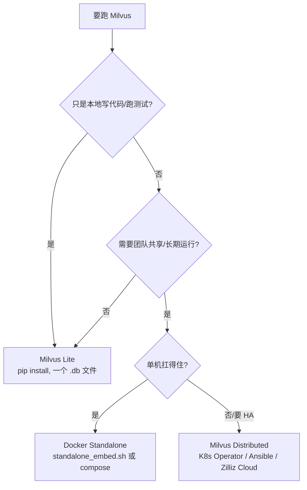

# Milvus 环境搭建

> [!info] 这份笔记管什么
> 把 Milvus **四种部署形态**从零跑起来：Milvus Lite（本地 `.db`）→ Docker Standalone（单机生产）→ Docker Compose（etcd + MinIO 全栈）→ Distributed（集群）。
> 每条命令都在 **macOS + Python 3.11 + pymilvus 3.0.2** 上验证过；标了 ⭐ 的命令我**实跑并贴了真实输出**，其余是官方脚本/配置原样（本机没有 Docker，未实跑，已注明）。
> 版本基线（核对于 2026-10-29）：**pymilvus 3.0.2** / **milvus-lite 3.2.2** / **Milvus 服务端 v3.0.4**（3.0 线最新补丁）· **v2.6.26**（2.6 线最新补丁）。

---

## 0. 先选型（30 秒决策）



| 形态 | 启动成本 | 持久化 | 支持 BM25/分区/全文 | 建议版本 |
|---|---|---|---|---|
| Milvus Lite | `pip install` 即用 | 单个 `.db` 文件 | 支持 BM25、**不支持在线改字段**（实测） | 跟随 pymilvus |
| Docker Standalone | 一条脚本 | volume | 全部 | `milvusdb/milvus:v3.0.4` |
| Docker Compose | 一条 compose | volume | 全部 + WebUI | 同上 |
| Distributed | K8s / 多机 | 外部 etcd/MinIO/Woodpecker | 全部 + 多副本 | 同上 |

> [!tip] 学习路径建议
> 先用 **Lite 把 [[3-操作指南]] 的代码全部跑通**（不用装 Docker），再切 Standalone 验证 BM25 中文、分区、并发。
> 切换只需要改一行：`MilvusClient("./milvus_demo.db")` → `MilvusClient(uri="http://localhost:19530")`。

---

## 1. 通用前置：HTTP 代理（国内必看）

Milvus 的 Python 侧要下载的包很重：`milvus-lite`（含 `faiss-cpu`、`pyarrow`）、`pymilvus-model`（会拖 `torch`、`transformers`，**装完几个 GB**）。Docker 侧要拉 `milvusdb/milvus`、`milvusdb/minio`、`quay.io/coreos/etcd`。

### 1.1 pip 镜像

```bash
# 方式一：临时
pip install -U pymilvus -i https://pypi.tuna.tsinghua.edu.cn/simple

# 方式二：持久（推荐，写进用户级配置）
pip config set global.index-url https://pypi.tuna.tsinghua.edu.cn/simple
```

### 1.2 Docker 镜像加速（Linux，macOS 在 Docker Desktop → Settings → Docker Engine 里改 `registry-mirrors`）

```json
{
  "registry-mirrors": [
    "https://docker.m.daocloud.io",
    "https://dockerproxy.net"
  ]
}
```

改完重启 Docker：`sudo systemctl restart docker`（Linux）/ 重启 Docker Desktop（macOS）。

> [!warning] 国内直连拉不到 `quay.io/coreos/etcd`
> 这是 compose 部署最常见的卡点。方案：给 docker daemon 配代理，或提前把镜像用 `docker pull` + `docker tag` 拉到本地，或换国内镜像源。见 [[5-避坑与排障#6. 环境搭建排障速查]]。

---

## 2. Milvus Lite（本地开发首选）

### 2.1 安装 ⭐

```bash
conda create -n milvus python=3.11 -y && conda activate milvus
pip install -U "pymilvus[milvus-lite]"
```

```text
# 本机实测版本
pymilvus     3.0.2
milvus-lite  3.2.2
Python       3.11.7（要求 ≥ 3.9）
```

> [!note] 为什么用 `pymilvus[milvus-lite]` 而不是单装 `pymilvus`
> `milvus-lite` 不是 `pymilvus` 的硬依赖，**不装它会报连不上 `./x.db`**。
> 另外：**Windows 不支持 Milvus Lite**（win32 会跳过），需要本地服务就用 `milvus-lite server`（见 2.4）或直接上 Docker。

### 2.2 最小可用代码 ⭐

```python
# lite_hello.py
from pymilvus import MilvusClient

# 指向本地文件即自动启动 Lite；文件不存在会自动创建
client = MilvusClient("./milvus_demo.db")

client.create_collection(
    collection_name="demo",
    dimension=4,          # 向量维度
    metric_type="COSINE", # 默认就是 COSINE
)
client.insert("demo", [
    {"id": 0, "vector": [0.1, 0.2, 0.3, 0.4], "text": "Milvus 是一个向量数据库"},
    {"id": 1, "vector": [0.3, 0.1, 0.1, 0.9], "text": "LangChain 负责编排 RAG"},
])
hits = client.search("demo", data=[[0.1, 0.2, 0.3, 0.4]], limit=2, output_fields=["text"])
print(hits)
print("server:", client.get_server_version())
client.close()
```

```text
# 实测输出（格式化后）
[[{'id': 0, 'distance': 0.99999994, 'entity': {'text': 'Milvus 是一个向量数据库'}},
  {'id': 1, 'distance': 0.47434163, 'entity': {'text': 'LangChain 负责编排 RAG'}}]]
server: milvus_lite-0.5.8
```

> [!warning] 你机器上的 Lite 和 core 不是同一代
> 本机 `milvus-lite` 是 **0.5.8**（老的 CGo/C++ 包装版），而 PyPI 最新已经是 **3.2.2**（纯 Python 重写，支持 `milvus-lite server` 多客户端模式）。
> **0.5.x 的 `.db` 文件与 3.x 不兼容**，升级前先删旧库或导出数据：
> ```bash
> pip uninstall milvus-lite -y && pip install -U milvus-lite
> ```

### 2.3 Lite 的坑位清单（后面 [[5-避坑与排障]] 有详版）

| 现象 | 原因 | 处理 |
|---|---|---|
| `Schema must have a primary key field` | 传了 `schema=` 时，`dimension=` 不再帮你自动加主键 | 用 `schema.add_field(..., is_primary=True)` 显式加 |
| `unknown tokenizer type: 'chinese'` | 分词器名字是 **`jieba`**，不是 `chinese` | `analyzer_params={"type": "jieba"}` |
| `Method not implemented!`（加字段） | Lite 不支持在线 Schema 变更 | 生产换 Standalone；Lite 里重建 collection |
| `Collection ... is in state 'released'` | 3.0 客户端建完表默认不预加载 | 检索/查询前 `client.load_collection(name)` |

### 2.4 Lite 的「服务端模式」（3.x Lite 新能力）

多个进程/多语言客户端共享同一份本地数据时用：

```bash
milvus-lite server --data-dir ./data --port 19530
```

```python
from pymilvus import MilvusClient
client = MilvusClient(uri="http://127.0.0.1:19530")   # 代码与连 Standalone 完全一致
```

---

## 3. Docker Standalone（单机生产 / 团队共享）

### 3.1 官方一键脚本（最快）

```bash
# 下载脚本（用 master 分支的最新版，脚本里已固定镜像版本）
curl -sfL https://raw.githubusercontent.com/milvus-io/milvus/master/scripts/standalone_embed.sh -o standalone_embed.sh

# 启动 / 停止 / 重启 / 删除（删除会清空数据）/ 升级
bash standalone_embed.sh start
bash standalone_embed.sh stop
bash standalone_embed.sh restart
bash standalone_embed.sh delete
```

脚本做的事（读源码确认）：

- 镜像默认 `milvusdb/milvus:v3.0.4`，容器名 `milvus-standalone`
- 主要环境变量：`ETCD_USE_EMBED=true`、`ETCD_DATA_DIR=/var/lib/milvus/etcd`、**`COMMON_STORAGETYPE=local`**、`DEPLOY_MODE=STANDALONE`
  → 即 **etcd 内嵌 + 本地磁盘当对象存储**，不需要额外容器
- 端口映射：**19530**（gRPC/SDK）、**9091**（HTTP 健康检查 & WebUI）、2379（etcd）
- 数据目录：`$(pwd)/volumes/milvus`（**换个目录启动就是一套新库**）
- 健康检查：`curl -f http://localhost:9091/healthz`，启动期约 90 秒

### 3.2 启动验证

```bash
docker ps | grep milvus-standalone                       # 状态应为 (healthy)
curl -f http://localhost:9091/healthz                    # 返回 OK
curl http://localhost:9091/metrics | head               # Prometheus 指标
```

打开 **WebUI**：<http://127.0.0.1:9091/webui>

> [!warning] 2.4.x 及更早版本的 WebUI 是 Attu 静态资源，3.x 里 9091 以健康检查/指标为主，Attu 可能已经拆成独立项目。
> 打不开就**别纠结**，直接写代码验证（见 3.5），或用 3.3 的 compose（独立 `attu` 服务）。

### 3.3 Docker Compose（etcd + MinIO + Milvus 全栈）

官方 compose（`deployments/docker/standalone/docker-compose.yml`，已核对 master）：

```yaml
x-milvus-image: &milvus-image milvusdb/milvus:v3.0.4

services:
  milvus-volume-init:                 # 3.0 新增：修正数据目录属主（一次性）
    image: *milvus-image
    user: "0:0"
    network_mode: none
    read_only: true
    entrypoint: ["/bin/sh", "-c"]
    volumes: ["./volumes/milvus:/var/lib/milvus"]

  etcd:
    container_name: milvus-etcd
    image: quay.io/coreos/etcd:v3.5.25
    environment:
      - ETCD_AUTO_COMPACTION_MODE=revision
      - ETCD_AUTO_COMPACTION_RETENTION=1000
      - ETCD_QUOTA_BACKEND_BYTES=4294967296
    volumes: ["./volumes/etcd:/etcd"]
    command: etcd -advertise-client-urls=http://etcd:2379 -listen-client-urls http://0.0.0.0:2379 --data-dir /etcd

  minio:
    container_name: milvus-minio
    image: milvusdb/minio:RELEASE.2024-12-18T13-15-44Z
    environment:
      MINIO_ACCESS_KEY: minioadmin
      MINIO_SECRET_KEY: minioadmin
    ports: ["9000:9000", "9001:9001"]   # 9001 = MinIO 控制台
    volumes: ["./volumes/minio:/minio_data"]
    command: minio server /minio_data --console-address ":9001"

  standalone:
    container_name: milvus-standalone
    image: *milvus-image
    command: ["milvus", "run", "standalone"]
    security_opt: [seccomp:unconfined]
    environment:
      MINIO_REGION: us-east-1
      ETCD_ENDPOINTS: etcd:2379
      MINIO_ADDRESS: minio:9000
    volumes: ["./volumes/milvus:/var/lib/milvus"]
    ports: ["19530:19530", "9091:9091"]
    depends_on:
      milvus-volume-init: {condition: service_completed_successfully}
      etcd: {condition: service_started}
      minio: {condition: service_started}
```

使用：

```bash
mkdir -p ~/milvus-standalone && cd ~/milvus-standalone
# 把上面的 yml 存成 docker-compose.yml（或从仓库直接下）
docker compose up -d
docker compose ps
```

**选哪个？**

| | standalone_embed.sh | docker-compose |
|---|---|---|
| 容器数 | 1 | 3~4 |
| 对象存储 | 本地磁盘 | MinIO（S3 兼容，更接近生产） |
| 升级/迁移数据 | 直接换镜像，数据在 `./volumes/milvus` | MinIO 数据可独立备份 |
| 适合 | **个人/学习/轻量生产** | 想模拟生产、要 MinIO 备份/迁移 |

### 3.4 最小化自建 compose（不依赖官方文件）

想自己攥在手里、便于加 Attu 和监控时：

```yaml
services:
  etcd:
    image: quay.io/coreos/etcd:v3.5.25
    environment:
      ETCD_AUTO_COMPACTION_MODE: revision
      ETCD_AUTO_COMPACTION_RETENTION: "1000"
      ETCD_QUOTA_BACKEND_BYTES: "4294967296"
    command: etcd -advertise-client-urls=http://etcd:2379 -listen-client-urls=http://0.0.0.0:2379 --data-dir=/etcd
    volumes: ["./volumes/etcd:/etcd"]

  minio:
    image: minio/minio:latest
    environment:
      MINIO_ROOT_USER: minioadmin
      MINIO_ROOT_PASSWORD: minioadmin
    command: minio server /data --console-address ":9001"
    ports: ["9001:9001"]
    volumes: ["./volumes/minio:/data"]

  milvus:
    image: milvusdb/milvus:v3.0.4
    command: ["milvus", "run", "standalone"]
    security_opt: [seccomp:unconfined]
    environment:
      ETCD_ENDPOINTS: etcd:2379
      MINIO_ADDRESS: minio:9000
      MINIO_ACCESS_KEY_ID: minioadmin
      MINIO_SECRET_ACCESS_KEY: minioadmin
    ports: ["19530:19530", "9091:9091"]
    volumes: ["./volumes/milvus:/var/lib/milvus"]
    depends_on: [etcd, minio]
```

> [!warning] MinIO 新版镜像的变量名变了
> 新版 MinIO 用 `MINIO_ROOT_USER` / `MINIO_ROOT_PASSWORD`（旧版是 `MINIO_ACCESS_KEY` / `MINIO_SECRET_KEY`）。两者在公告后的一段时间内兼容，但**新版只认 ROOT_**。Milvus 侧对应的 key 是 `MINIO_ACCESS_KEY_ID` / `MINIO_SECRET_ACCESS_KEY`，两边必须一致，否则报 `Access Denied`。

### 3.5 连上 Standalone 验证 ⭐（代码在本机 Lite 跑通，换 uri 即可）

```python
from pymilvus import MilvusClient, DataType, Function, FunctionType

client = MilvusClient(uri="http://localhost:19530", token="root:Milvus")  # 默认账号 root/Milvus
print("server:", client.get_server_version())
print("databases:", client.list_databases())

# 来个带 BM25 + 标量过滤的真实表
if not client.has_collection("kb_docs"):
    schema = client.create_schema(auto_id=True, enable_dynamic_field=False)
    schema.add_field("id", DataType.INT64, is_primary=True)
    schema.add_field("text", DataType.VARCHAR, max_length=8192, enable_analyzer=True, analyzer_params={"type": "jieba"})
    schema.add_field("dense", DataType.FLOAT_VECTOR, dim=1024)
    schema.add_field("sparse", DataType.SPARSE_FLOAT_VECTOR)
    schema.add_field("tenant", DataType.VARCHAR, max_length=64)
    schema.add_function(Function(name="bm25", function_type=FunctionType.BM25,
                                 input_field_names=["text"], output_field_names=["sparse"]))
    idx = client.prepare_index_params()
    idx.add_index(field_name="dense", index_type="AUTOINDEX", metric_type="COSINE")
    idx.add_index(field_name="sparse", index_type="SPARSE_INVERTED_INDEX", metric_type="BM25")
    idx.add_index(field_name="tenant", index_type="INVERTED")
    client.create_collection("kb_docs", schema=schema, index_params=idx)

client.insert("kb_docs", [{"text": "Milvus 支持混合检索", "dense": [0.01]*1024, "tenant": "t1"}])
client.load_collection("kb_docs")          # 3.0 客户端建表后默认不预加载
print(client.query("kb_docs", filter='tenant == "t1"', output_fields=["text"]))
```

---

## 4. Milvus Lite 能力边界（本机实测 · pymilvus 3.0.2 + milvus-lite 0.5.8）

实测矩阵，决定「能不能只用 Lite 写作业」：

| 能力 | Lite 0.5.8 | 说明 |
|---|---|---|
| 稠密向量建表/写入/搜索 | ✅ | `create_collection(dimension=...)`、`AUTOINDEX` |
| 稀疏向量 + **BM25 内置函数** | ✅ | `Function(FunctionType.BM25)` + `metric_type="BM25"` |
| 中文分词 | ✅ | `analyzer_params={"type": "jieba"}` |
| Hybrid Search（RRF / Weighted） | ✅ | RRF k=60、Weighted 权重均正常 |
| 标量过滤 `filter=` | ✅ | `==`、`in`、`>=` 等 |
| **`partition_key` 多租户** | ✅ | 自动生成 `_pk_0`、`_pk_1`… 分区 |
| 手动 `create_partition` | ⚠️ | 能建，但会先抛一次 `MilvusException: (code=1, message=<分区名>)`，重试/忽略后分区存在 |
| `query_iterator` 迭代 | ✅ | 有 `use client-side ts instead` 的 WARNING（Lite 无 mvccTs） |
| `add_collection_field` / `drop_collection_field` | ❌ | `UNIMPLEMENTED: Method not implemented!` |
| `create_snapshot`（3.0） | ❌ | `UNIMPLEMENTED` |
| `1024` 维向量 | ✅ | 500 条 × 1024 维写入与过滤搜索正常 |

> [!danger] 升级到 milvus-lite 3.x 再测一遍
> 上表基于 **0.5.8**。3.2.2 的官方 README 声称支持 *partitions、aliases、iterators、group-by、namespaced databases、embedded collection snapshots*，能力边界会变化。
> 如果你要用 3.0 的「在线加字段」做 demo，**必须在 Standalone 上演练**。

---

## 5. Distributed（集群）

### 5.1 事实来源

官方仓库的集群部署已迁移为 **Ansible 自动部署**（`deployments/docker/cluster-distributed-deployment/`），角色拆分如下：

| 机器分组 | 部署的角色 |
|---|---|
| `[dependencies]` | etcd、MinIO、消息队列（Pulsar / Woodpecker） |
| `[coords]` | rootcoord、datacoord、querycoord、indexcoord、**proxy** |
| `[nodes]` | datanode、indexnode、querynode |

关键命名：容器名与角色同名（如 `proxy`），启动命令统一 `milvus run <role>`，环境变量 `ETCD_ENDPOINTS` / `MINIO_ADDRESS` / `PULSAR_ADDRESS` 指向依赖组件。

### 5.2 生产环境优选 K8s Operator

```bash
# 官方 Milvus Operator（以官方文档为准，版本号会更新）
kubectl apply -f https://raw.githubusercontent.com/zilliztech/milvus-operator/main/deploy/manifests/deployment.yaml

# 一键拉起最小集群
kubectl apply -f https://raw.githubusercontent.com/zilliztech/milvus-operator/main/config/samples/milvus_cluster_default.yaml
```

```bash
kubectl get pods                     # 期望看到 etcd / minio / proxy / *coord / *node
kubectl get svc | grep milvus        # 19530 服务地址
```

> [!note] 先别急着上集群
> 集群的复杂度主要在 **存储规划（对象存储桶、WAL 选型）、资源组隔离、监控告警**。单机 Standalone 在 16C/64G + NVMe 上通常能撑住千万级。**先单机跑通，再谈集群**。

---

## 6. 客户端与生态依赖一览

| 客户端 | 包 | 版本（2026-10） | 说明 |
|---|---|---|---|
| Python | `pymilvus` | **3.0.2** | 官方首选；`MilvusClient` 高层 API + ORM 低层 API |
| Python 模型工具 | `pymilvus-model` | **0.3.4** | `DefaultEmbeddingFunction`、BM25 / Splade / Rerank 客户端实现；**注意会装 torch 等大包** |
| Python 本地库 | `milvus-lite` | **3.2.2** | Lite 后端 |
| Java | `io.milvus:milvus-sdk-java` | 随服务端版本 | Spring AI 的 Milvus 集成本质是包它；见 [[4-AI中的用法#4. Spring AI 集成]] |
| Node.js | `@zilliz/milvus2-sdk-node` | 随服务端版本 | — |
| Go | `github.com/milvus-io/milvus/client/v2` | 随服务端版本 | — |
| 编排层 | `langchain-milvus` | **0.4.0** | 依赖 `pymilvus>=3.0.0`、`langchain-core>=1.4.9`；见 [[4-AI中的用法#2. LangChain 集成]] |
| 图形界面 | `zilliztech/attu` | Docker 镜像 | `docker run -p 8000:3000 -e MILVUS_URL=host.docker.internal:19530 zilliz/attu:latest` |

> [!warning] 版本对齐矩阵（部署前必须查）
> 服务端版本 ↔ SDK 版本 ↔ 编排层版本三者要成对。例如 Milvus 3.0.0 对应 Python SDK 3.0.1、Node 3.0.3、Java 3.0.5。
> **`pymilvus 3.x` 连不上 `Milvus 2.3` 及更早的服务端**会报协议不兼容；老服务端请用 `pymilvus 2.4.x/2.5.x`。

---

## 7. 收尾自检清单

- [ ] `client.get_server_version()` 能打印出版本，且与 `docker ps` 的镜像一致
- [ ] `client.list_collections()` 正常，无 `Unavailable` 报错
- [ ] 插入 → `load_collection` → `search` 三连通过
- [ ] 中文 `jieba` 分词建表成功（证明不是 Lite 的假通过）
- [ ] `curl localhost:9091/healthz` 返回 OK
- [ ] 数据目录已挂到宿主机 volume（**别用匿名 volume**，否则 `docker compose down -v` 一次全没）
- [ ] 生产：默认账号 `root/Milvus` 已改、19530 不裸奔公网、备份 cron 已配

---

## 8. 延伸

- 装完立刻去：[[3-操作指南]]
- 出问题：[[5-避坑与排障]]
- 官方部署总览：<https://milvus.io/docs/install-overview.md> · Standalone 脚本：<https://github.com/milvus-io/milvus/blob/master/scripts/standalone_embed.sh> · Lite：<https://github.com/milvus-io/milvus-lite>
