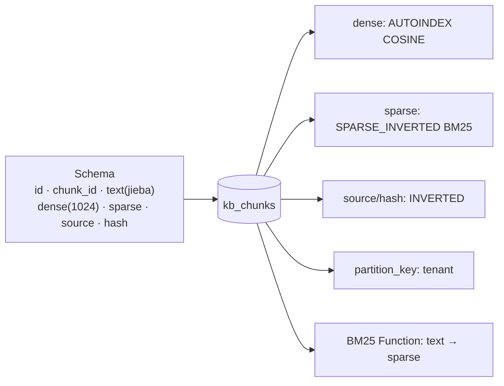

# Milvus 操作指南（pymilvus 版）

> [!info] 这份笔记管什么
> **日常 90% 的 Milvus 操作**：建库建表 → 建索引 → 增删改查 → 向量搜索 / 混合检索 / 过滤 / 分页 → 分区多租户 → 运维观测 → 备份迁移。
> 全部用 **`MilvusClient` 高层 API（pymilvus 3.0.2）**，代码在本机 **Milvus Lite** 上逐段实跑过，标 ⭐ 的贴了真实输出。
> 概念不懂先回 [[1-基础介绍]]；环境没装看 [[2-环境搭建]]；报错看 [[5-避坑与排障]]。
>
> 约定：`client = MilvusClient(uri="./milvus_demo.db")`（Lite）或 `MilvusClient(uri="http://localhost:19530", token="root:Milvus")`（Standalone），下文不再重复。

---

## 0. 操作速查表

| 想做的事 | 方法 | 备注 |
|---|---|---|
| 列出所有表 | `client.list_collections()` | 返回 `list[str]` |
| 建表（两字段极简） | `client.create_collection(name, dimension=1024)` | 自测/原型用，**生产不用** |
| 建表（自定义 schema） | `client.create_schema()` + `add_field` + `create_collection(schema=, index_params=)` | 主路径 |
| 表是否存在 | `client.has_collection(name)` | |
| 描述表结构 | `client.describe_collection(name)` | 含 fields / functions |
| 列出索引 | `client.list_indexes(name)` / `describe_index` | |
| 写入 | `client.insert(name, data=[dict, ...])` | 返回 `insert_count` + `ids` |
| 覆盖写 | `client.upsert(name, data=[...])` | **按主键覆盖整行** |
| 局部更新 | `client.upsert(..., partial_update=True)`（需开 dynamic field） | 只写想改的字段 |
| 按主键读 | `client.get(name, ids=[1, 2])` | |
| 条件查询 | `client.query(name, filter="...", output_fields=[...])` | ≈ `SELECT` |
| 全量迭代 | `client.query_iterator(name, batch_size=1000)` | 大表导出/重建用 |
| 向量搜索 | `client.search(name, data=[vec], limit=10, output_fields=[...])` | |
| 混合检索 | `client.hybrid_search(name, reqs, ranker, limit)` | 稠密+稀疏 |
| 删除（按主键） | `client.delete(name, ids=[...])` | |
| 删除（按条件） | `client.delete(name, filter="...")` | 支持表达式 |
| 加载 / 卸载 | `client.load_collection` / `release_collection` | **搜索前必须 load** |
| 落盘 | `client.flush(name)` | 写完立刻可见/备份前用 |
| 统计 | `client.get_collection_stats(name)` | `{'row_count': N}` |
| 清空数据 | `client.truncate_collection(name)` | 保留 schema |
| 改名 | `client.rename_collection(old, new)` | |
| 别名切换 | `client.create_alias` / `alter_alias` / `drop_alias` | 平滑换索引 |
| 删表 | `client.drop_collection(name)` | **不可恢复** |

> [!tip] 3.0 新增（版本门槛 `pymilvus>=3.0`、服务端 `>=3.0`）
> `add_collection_field` / `alter_collection_field` / `drop_collection_field`（在线改 schema）
> `create_snapshot` / `list_snapshots` / `restore_snapshot`（快照）
> `refresh_external_collection`（External Collection）、`add_file_resource`（模型/UBJ 文件）、`optimize`（强制 compaction）

---

## 1. 连接与命名空间

```python
from pymilvus import MilvusClient

# Lite：传本地路径
client = MilvusClient(uri="./milvus_demo.db")

# Standalone / Distributed
client = MilvusClient(
    uri="http://localhost:19530",
    token="root:Milvus",          # 或用 Zilliz Cloud 的 api-key
    # db_name="prod",             # 直接连指定 database
    timeout=10,
)
client.use_database("prod")       # 或建连后再切
```

```python
# 多库（隔离不同应用/环境）
client.create_database("kb_prod")
print(client.list_databases())     # ['default', 'kb_prod']
```

> [!note] Database vs 前缀命名
> 小团队可以图省事用 `kb_prod_docs` 这种前缀，但 **Database 有真正的权限隔离**（角色/授权可以按库来），多应用共用一套 Milvus 时优先用 database。

---

## 2. 建表（Schema 设计）

### 2.1 最简版：原型用 ⭐

```python
client.create_collection(
    collection_name="quick",
    dimension=4,
    metric_type="COSINE",        # 默认就是 COSINE
    primary_field_name="id",     # 默认 id
    id_type="int",               # "int" | "string"
    vector_field_name="vector",
    auto_id=True,
)
```

> [!warning] 这个版本会打开 dynamic field
> 源码里 `_fast_create_collection` 在没传 `enable_dynamic_field` 时会**自动设为 True**。原型无所谓，**生产一律显式传 `enable_dynamic_field=False`**，否则脏字段会静默进 `$meta`，类型错误推迟到检索阶段才暴露。

### 2.2 生产版：RAG 知识库 schema（推荐模板）⭐

```python
from pymilvus import MilvusClient, DataType, Function, FunctionType

DIM = 1024            # = embedding 模型输出维度，必须一致

schema = client.create_schema(
    auto_id=True,                 # 主键由服务端生成
    enable_dynamic_field=False,   # 生产关掉
)
schema.add_field("id",        DataType.INT64,   is_primary=True)
schema.add_field("chunk_id",  DataType.VARCHAR, max_length=64)     # 业务主键，用于幂等
schema.add_field("text",      DataType.VARCHAR, max_length=8192,
                 enable_analyzer=True, analyzer_params={"type": "jieba"})   # 中文分词
schema.add_field("dense",     DataType.FLOAT_VECTOR, dim=DIM)
schema.add_field("sparse",    DataType.SPARSE_FLOAT_VECTOR)        # BM25 输出字段
schema.add_field("source",    DataType.VARCHAR, max_length=512)    # 文件路径
schema.add_field("section",   DataType.VARCHAR, max_length=512, default_value="")
schema.add_field("chunk_idx", DataType.INT64,   default_value=0)
schema.add_field("content_hash", DataType.VARCHAR, max_length=64)  # 去重
schema.add_field("embed_model",  DataType.VARCHAR, max_length=64, default_value="bge-m3")

# 服务端自动从 text 生成稀疏向量（不用自己算 IDF）
schema.add_function(Function(
    name="bm25",
    function_type=FunctionType.BM25,
    input_field_names=["text"],
    output_field_names=["sparse"],
))

index_params = client.prepare_index_params()
index_params.add_index(field_name="dense",  index_type="AUTOINDEX", metric_type="COSINE")
index_params.add_index(field_name="sparse", index_type="SPARSE_INVERTED_INDEX", metric_type="BM25")
index_params.add_index(field_name="content_hash", index_type="INVERTED")   # 去重查询加速
index_params.add_index(field_name="source",       index_type="INVERTED")   # 按文件删/查

client.create_collection("kb_chunks", schema=schema, index_params=index_params)
print([f["name"] for f in client.describe_collection("kb_chunks")["fields"]])
```

```text
# 实测输出
['id', 'chunk_id', 'text', 'dense', 'sparse', 'source', 'section', 'chunk_idx', 'content_hash', 'embed_model']
```

> [!danger] 三个「必须一致/必须对」的坑
> 1. **`dim` = Embedding 模型维度**。改模型 = 改维度 = 重建表（3.0 可在线加字段，但换维度仍要走新表）。
> 2. **`analyzer_params={"type": "jieba"}`**：写了 `"chinese"` 会报 `unknown tokenizer type: 'chinese' (supported: 'standard', 'jieba')`。
> 3. **`metric_type` 写在索引里，事后改不了**。`COSINE` 与 `L2` 搞混 → 搜出来的"最相似"其实是"最不相似"。

### 2.3 常见字段类型写法

```python
schema.add_field("price",   DataType.DOUBLE)                       # 数值
schema.add_field("tags",    DataType.ARRAY, element_type=DataType.VARCHAR, max_capacity=16, max_length=64)
schema.add_field("meta",    DataType.JSON)                          # 半结构化（有上限，别当地址薄）
schema.add_field("ok",      DataType.BOOL,  default_value=True)      # 带默认值
schema.add_field("note",    DataType.VARCHAR, max_length=256, nullable=True)  # 允许为空
```

### 2.4 多租户：partition key（强烈推荐）

```python
schema.add_field("tenant", DataType.VARCHAR, max_length=64, is_partition_key=True)
```

- Milvus 按 `tenant` 哈希把数据自动散进 `partition_num` 个内部分区（默认 16，建表时可用 `kwargs` 调）
- 查询时 `filter='tenant == "acme"'` 能**裁剪到 1 个分区**，比全表过滤快一个数量级
- 实测（Lite）：插入 `tenant=t0..t19` 后分区列表自动出现 `_pk_0`、`_pk_1`…

> [!warning] partition key 的硬限制
> ① 一个 collection **只能有 1 个 partition key**；② 同一个租户的数据必须**同值**；③ 用 partition key 后**不建议再手动 create_partition 混用**。
> 租户数 < 100 且要「按租户物理删除」时，手动分区也未尝不可，但上限约 1024 个。

### 2.5 数据模型决策速查

| 你的情况 | 建议 schema |
|---|---|
| 单一知识库，< 1000 万 chunk | 2.2 模板 |
| SaaS 多租户 | 2.2 + `is_partition_key=True` |
| 一篇文档多个 chunk，要按文档聚合 | 加 `doc_id`（INVERTED 索引）+ 用 `group_by_field="doc_id"` 搜索 |
| 商品多张图/多模态 | 用 StructArray 或独立 collection，别塞一个 JSON |
| 稀疏检索用 SPLADE（自己算权重） | `SPARSE_FLOAT_VECTOR` 字段**不挂 Function**，客户端写入 `{token_id: weight}` |

---

## 3. 索引

```python
# 单字段
client.create_index("kb_chunks", index_name="dense_idx",
                    field_name="dense", index_type="HNSW",
                    metric_type="COSINE", params={"M": 32, "efConstruction": 200})

# 批量（推荐统一在 prepare_index_params 里做）
#  ⚠️ add_index() 返回值是 None，不能链式 .add_index().add_index()
index_params = client.prepare_index_params()
index_params.add_index(field_name="dense", index_type="IVF_SQ8",
                       metric_type="L2", params={"nlist": 1024, "nprobe": 16})
```

| 字段类型 | 可选索引 | 常用参数 |
|---|---|---|
| Float/BFloat16 向量 | `AUTOINDEX` / `HNSW` / `IVF_FLAT` / `IVF_SQ8` / `IVF_PQ` / `SCANN` / `DiskANN` / GPU 系列 | HNSW: `M`, `efConstruction`；IVF: `nlist` |
| Sparse 向量 | `SPARSE_INVERTED_INDEX` / `SPARSE_WAND` | `drop_ratio_build` |
| Float/Binary 向量 | `FLAT` / `BIN_IVF_FLAT` | — |
| 标量 | `INVERTED`（通用）/ `BITMAP`（低基数，如状态/租户）/ `TRIE`、`STL_SORT`（特定类型） | INVERTED 默认够用 |

索引运维：

```python
client.list_indexes("kb_chunks")               # 列出
client.describe_index("kb_chunks", "dense_idx")# 详情
client.drop_index("kb_chunks", "dense_idx")    # 删
client.alter_index_properties("kb_chunks", "dense_idx", properties={"mmap.enabled": True})  # 调属性
```

> [!tip] 索引调参与召回验证
> **建索引参数改一次很贵，调 recall 只调查询参数**：HNSW 用 `search_params={"ef": 128}`，IVF 用 `search_params={"nprobe": 32}`。
> 验证方法：`FLAT` 跑 ground truth → 目标索引跑同批 query → 算 `Recall@K`。见 [[1-基础介绍#2.3 ANN 索引 ≈ 用少量精度换速度]]。

---

## 4. 写入与更新 ⭐

### 4.1 基本写入

```python
rows = [
    {"chunk_id": "a.md#0", "text": text, "dense": vec, "source": "a.md",
     "content_hash": h, "chunk_idx": 0},
    ...
]
res = client.insert("kb_chunks", rows)
print(res["insert_count"], len(res["ids"]))
```

- **千万别每插入一条就 flush**：Milvus 按 segment 攒批，频繁 flush 会产生海量小 segment，检索变慢。**整批写完 flush 一次**即可。
- Lite 实测：2 行 insert + flush 共 **0.62s**（含冷启动开销）；批量 500 行 × 1024 维写入正常。

### 4.2 批量写入要点

| 任务 | 做法 |
|---|---|
| 大批量导入（千万级） | 用 **BulkWriter**（`pymilvus.bulk_writer`）生成 Parquet 到对象存储，再 `import`，比逐条 insert 快一个数量级；需 `pip install "pymilvus[bulk-writer]"` |
| 普通批量（万级） | 每批 **500~2000 条**循环 insert，最后 flush 一次；`embedding` 按 batch 调用模型 |
| 幂等重灌 | 用 `chunk_id` 做业务主键 + 查重，或先 `delete(filter='source == "x.md"')` 再插入 |

### 4.3 幂等：查重后再写 ⭐

```python
h = "3f2a...c9"
exist = client.query("kb_chunks", filter=f'content_hash == "{h}"', output_fields=["chunk_id"])
if not exist:
    client.insert("kb_chunks", [row])
```

```text
# 实测输出
data: ["{'id': 1, 'chunk_id': 'a.md#0'}"], extra_info: {}
```

### 4.4 更新：upsert 两种语义

```python
# ① 整行覆盖：必须提供主键 + 全部非空字段，未提供的字段会被置空/默认值
client.upsert("kb_chunks", [{"id": 1, "chunk_id": "a.md#0", "text": "新文本",
                             "dense": new_vec, "source": "a.md", "content_hash": h2}])

# ② 局部更新（只改一个字段，需要 enable_dynamic_field=True）
client.upsert("kb_chunks",
              [{"id": 1, "text": "新文本"}],
              partial_update=True)
```

> [!warning] upsert ≠ SQL UPDATE
> - upsert 本质是 **delete + insert** 在服务端合并，**代价高于 insert**
> - 主键必须给（`auto_id=True` 时主键由你反查得到才能 upsert）
> - 向量变了要**同时**重算 `dense`；BM25 的 `sparse` 由服务端自动重算，**不要手写**
> - 实测 Lite：`upsert` 返回 `{'upsert_count': 1, 'ids': [1]}`，随后 `query` 立刻读到新文本

### 4.5 删除

```python
client.delete("kb_chunks", ids=[1, 2])                       # 按主键
client.delete("kb_chunks", filter='source == "b.md"')        # 按条件（实测返回 [2] 条）
```

已删数据在 compaction 后才真正回收磁盘 → 大批量删除后手动 `client.compact("kb_chunks")`。

---

## 5. 查询（标量过滤）⭐

`query` 只走标量/表达式，**不参与向量相似度**，相当于 SQL 的 SELECT。

```python
# 条件 + 指定返回字段
client.query("kb_chunks", filter='source == "a.md"', output_fields=["chunk_id", "text"])

# 按主键
client.get("kb_chunks", ids=[1, 2])

# 导出全部行（不返回向量，除非显式写 dense）
client.query("kb_chunks", filter="", output_fields=["chunk_id", "source"])

# 行数
client.get_collection_stats("kb_chunks")     # {'row_count': 2}
```

### 5.1 表达式语法速查

| 目的 | 写法 |
|---|---|
| 等于 / 不等 | `tenant == "acme"` / `tenant != "acme"` |
| 范围 | `price >= 10 and price < 100` |
| 集合 | `status in ["active", "trial"]` / `not in [...]` |
| 前缀 | `source like "docs/%"`（只支持前缀通配） |
| JSON 字段 | `meta["lang"] == "zh"` 或 `JSON_CONTAINS(meta["tags"], "rag")` |
| 数组包含 | `ARRAY_CONTAINS(tags, "ai")` |
| 数组长度 | `ARRAY_LENGTH(tags) > 2` |
| 时间 | 存 int64 毫秒：`ts >= 1700000000000` |
| 文本匹配（需开 analyzer） | `TEXT_MATCH(text, "向量数据库")` |

> [!warning] 参数化过滤：`filter_params` 本机实测不支持 `{name}` 占位符（pymilvus 3.0.2 + Lite 0.5.8）
> 传 `filter="source == {s}", filter_params={"s": '"a.md"'}` 会报
> `MilvusException: (code=6, message=unexpected character '{' at column 11)`。
> 稳妥做法：**自己转义单/双引号后 f-string 拼接**，或干脆**在应用层用白名单校验**要拼进表达式的值。
> 值只来自自己的系统（tenant_id、doc_id）时风险可接受；来自用户输入时必须校验。

```python
def safe(v: str) -> str:
    assert '"' not in v and "\n" not in v, "非法过滤值"
    return f'"{v}"'

client.query("kb_chunks", filter=f"source == {safe(user_input)}", output_fields=["chunk_id"])
```

### 5.2 大表导出：query_iterator ⭐

```python
it = client.query_iterator("kb_chunks", batch_size=1000, output_fields=["chunk_id", "text"])
while True:
    batch = it.next()
    if not batch:
        it.close()
        break
    for row in batch:
        ...  # 写入文件 / 换库重建 / 重算 embedding
```

> Lite 下会打一条 `failed to get mvccTs from milvus server, use client-side ts instead` 的 WARNING，属正常。

---

## 6. 向量搜索 ⭐

### 6.1 基础搜索

```python
results = client.search(
    collection_name="kb_chunks",
    data=[query_vec],              # 可以一次传多个 query 向量 → 返回多个 list
    limit=5,
    filter='source != ""',         # 可选：标量预过滤
    output_fields=["text", "source", "chunk_idx"],   # 必须显式写，否则只返回主键+距离
    search_params={"ef": 64},      # HNSW 查询参数
)
for hit in results[0]:
    print(hit["id"], hit["distance"], hit["entity"]["text"][:40])
```

```text
# 实测输出（结构化后）
[(0, 0.99999994, 'Milvus 是一个向量数据库'),
 (1, 0.47434163, 'LangChain 负责编排 RAG')]
```

> [!warning] 两个高频翻车点
> ① **不写 `output_fields` 就拿不到 `text`** —— 这是本仓库 [[2-spring ai/Ruoyi RAG 全链路排障手册|RuoYi 排障手册]] 里"命中但 text 全空"的根因。
> ② **`limit` 与 `filter` 的关系**：`filter` 先裁剪候选再算近邻；过滤条件太苛刻（命中 < limit）时结果会变少甚至为空，可以先放宽 filter 再在应用层二次过滤。

### 6.2 分页（offset vs 游标）

```python
# 小数据量：offset（3.0 客户端在 search/hybrid_search 的 kwargs 里支持）
client.search("kb_chunks", data=[v], limit=10, offset=20, output_fields=["text"])

# 大数据量：search_iterator（主键有序翻页，深层分页不退化）
#  ⚠️ 表里有多个向量字段时**必须**显式传 anns_field，否则报
#     "must specify anns_field when there are more than one vector field"（本机实测）
it = client.search_iterator("kb_chunks", data=[v], anns_field="dense", batch_size=100,
                            limit=1000, output_fields=["text"])
while True:
    page = it.next()
    if not page:
        it.close(); break
```

### 6.3 按文档聚合 / 分面（3.0）

```python
# 同一文档只返回最相似的一条（"每个 source 出一篇"）
client.search("kb_chunks", data=[v], limit=10, group_by_field="source",
              output_fields=["text", "source"])

# 3.0 分面：按某字段分组并给出每组统计（如"每个来源命中的最佳结果"）
from pymilvus import SearchAggregation
client.search("kb_chunks", data=[v], output_fields=["source"],
              search_aggregation=SearchAggregation(fields=["source"], size=10,
                                                   metrics=[], top_hits=None))
```

> [!warning] 3.0 分面搜索的实测要点（pymilvus 3.0.2）
> - 构造签名是 `SearchAggregation(fields, size, metrics=None, order=None, top_hits=None, sub_aggregation=None)`，**`fields` / `size` 必填**
> - 一旦传了 `search_aggregation`，**`limit` 会被忽略**，返回桶数由 `size` 决定（客户端会打 WARNING）
> - 本机 Lite 返回的是每个桶里**最相似的那条命中**，统计指标的写法以服务端版本为准

### 6.4 混合检索（稠密 + BM25）⭐

```python
from pymilvus import AnnSearchRequest, RRFRanker, WeightedRanker

def hybrid_search(q_vec, q_text, topk=5, flt=None):
    reqs = [
        AnnSearchRequest(data=[q_vec],  anns_field="dense",
                         param={"metric_type": "COSINE"}, limit=topk * 5, expr=flt or None),
        AnnSearchRequest(data=[q_text], anns_field="sparse",
                         param={"metric_type": "BM25"},   limit=topk * 5, expr=flt or None),
    ]
    return client.hybrid_search(
        "kb_chunks", reqs,
        ranker=RRFRanker(k=60),                     # 或 WeightedRanker(0.6, 0.4)
        limit=topk,
        output_fields=["text", "source"],
    )
```

```text
# 实测输出（Lite，RRF）
[(1, 0.0328, 'a.md'), (2, 0.0161, 'b.md')]
# 实测输出（Lite，WeightedRanker(0.6, 0.4)）
[(1, 0.664), (2, 0.241)]
```

| 融合方式 | 特点 | 什么时候用 |
|---|---|---|
| `RRFRanker(k=60)` | 只看**排名**不看分数，天然屏蔽两种分数的量纲差异 | **默认首选**，稳健 |
| `WeightedRanker(w_dense, w_sparse)` | 直接加权；需要先把两边分数归一化 | 明确知道哪路更可信时 |

> [!danger] 稀疏那一路的检索输入是**原始文本**，不是向量
> `AnnSearchRequest(data=["你的 query"], anns_field="sparse", param={"metric_type": "BM25"})`
> 这是 BM25 Function 的特性：服务端用同一个 analyzer 现场分词。若误传 `sparse` 向量会报维度/类型错。

### 6.5 Rerank（服务端精排，可选）

```python
# 2.4+：需要给模型文件注册一个 File Resource（3.0 用 add_file_resource），再挂 RERANK Function
schema.add_function(Function(
    name="rerank",
    function_type=FunctionType.RERANK,
    input_field_names=["text"],
    params={
        "reranker": "model",
        "provider": "local",              # 或 "tei" / "vllm" 等
        "model_name": "bge-reranker-base",
        "queries": [query_text],
        "model_deployment_name": "bge-reranker",
    },
))
```

```python
# hybrid_search 用 ranker=FunctionScore(...) 触发 → 见 pymilvus 文档 examples
```

> 更省事的做法：**在应用层做 rerank**（bge-reranker / Cohere Rerank），Milvus 只管召回 top 30~50，代码更直观、便于替换模型。见 [[4-AI中的用法#3. RAG 全流程：从文档到回答]]。

---

## 7. 分区与多租户

```python
client.create_partition("kb_chunks", "p2026")             # 手动分区（Lite 会先抛一次 code=1 再成功）
client.list_partitions("kb_chunks")                       # ['_default', 'p2026']
client.insert("kb_chunks", rows, partition_name="p2026")  # 写入指定分区
client.get_partition_stats("kb_chunks", "p2026")

# 检索时限定分区（比 filter 更快，因为不参与向量计算）
client.search("kb_chunks", data=[v], limit=5, partition_names=["p2026"])
client.load_partition("kb_chunks", "p2026")               # 只加载某分区，省内存
client.drop_partition("kb_chunks", "p2026")               # 整分区删除，比按条件删快
```

**多租户两种打法**：

| 方案 | 优点 | 缺点 |
|---|---|---|
| **partition key**（`is_partition_key=True`） | 租户数无上限、自动分散、查询自动裁剪 | 只能一个 key 字段、租户隔离是逻辑级 |
| 每租户一个 Collection | 物理隔离、可按租户备份/删除/不同 schema | 表数量爆炸（几千租户不可维护） |

> 决策：< 50 个租户且定制化强 → 每租户一表；否则 → partition key + `filter` 兜底。

---

## 8. 加载、一致性与 flush

```python
client.load_collection("kb_chunks")        # 检索前必须（3.0 客户端建表后默认不预加载）
client.get_load_state("kb_chunks")         # 看 Loaded / NotLoad
client.release_collection("kb_chunks")     # 释放内存（省资源，但检索不可用）
client.refresh_load("kb_chunks")           # 新数据/新分区加载后刷新

client.insert(...)
client.flush("kb_chunks")                  # 强制落盘（整批一次即可）
client.search(..., consistency_level="Strong")   # 测试/刚写完马上查时用
```

> [!tip] 一致性级别怎么选
> 服务端默认 `Bounded`（秒级延迟可见）。**生产别用 `Strong`**（会拖慢写；它其实是等一个"确定性安全时间点"）。
> **写入后立刻要能查**：同一客户端用 `Session`（能读到自己写的），跨客户端用 `flush` 或稍等。

---

## 9. 性能调优清单

| 层面 | 动作 |
|---|---|
| schema | 只存必要字段；`VARCHAR` 别开 65535 浪费元数据；向量用 `FLOAT16`/`INT8` 可省一半内存（精度损失需测） |
| 写入 | 攒批 500~2000 条；**一次 flush**；大批量走 BulkWriter；避免频繁 upsert |
| 索引 | 在线用 HNSW；内存紧用 `IVF_SQ8` 或 `DiskANN`；标量过滤多的字段建 `INVERTED` |
| 查询 | `limit` 别开太大（50 足够召回，后面 rerank 收敛到 3~5）；`ef` 取 `2×limit` 起步；`output_fields` 只取需要的 |
| 过滤 | 高基数字段做 partition key / 开标量索引；避免 `not in` 大名单、`like "%x"` |
| 资源 | 分布式用 Resource Group 把 QPS 密集应用与批量导入隔离 |
| 运维 | 定期 `compact`；监控 9091 `/metrics` 的 `milvus_querynode_search_*`、`milvus_proxy_*` |

```python
# 分组资源隔离（分布式）
client.create_resource_group("rg_batch")
client.describe_resource_group("rg_batch")
```

---

## 10. 数据迁移 / 备份

### 10.1 结构性迁移（换维度、换 metric、换版本）


```python
client.create_alias("kb_chunks", "kb_chunks_v2")   # 客户端只连 alias
client.alter_alias("kb_chunks", "kb_chunks_v3")    # 原子切换
```

### 10.2 快照（3.0，Standalone/Distributed）

```python
client.create_snapshot(collection_name="kb_chunks", snapshot_name="before_reindex", description="上线前")
client.list_snapshots("kb_chunks")
client.describe_snapshot("kb_chunks", "before_reindex")
# 恢复流程：restore_snapshot → get_restore_snapshot_state 轮询
```

> **Lite 实测：`create_snapshot` 抛 `UNIMPLEMENTED`**，需要 Standalone。

### 10.3 物理备份

| 部署方式 | 备份什么 | 怎么备 |
|---|---|---|
| Standalone (`standalone_embed.sh`) | `./volumes/milvus` 目录 | 停容器后 `tar czf`；或在线用 `query_iterator` 导出 |
| Docker Compose | `volumes/milvus` + `volumes/minio` + `volumes/etcd` | 三者**必须一致备份**，单独恢复会元数据错乱 |
| Distributed / K8s | 对象存储桶 + etcd 快照 | 在对象存储侧开版本控制，定期备份 etcd |
| Zilliz Cloud | — | 控制台快照/备份 |

> [!warning] 别用「docker 镜像导出」冒充备份
> 数据在 volume 里，镜像里没有。`docker commit` 备份是无效操作。

---

## 11. 日常运维命令

```python
client.get_server_version()
client.get_collection_stats("kb_chunks")
client.list_collections()
client.describe_collection("kb_chunks")
client.compact("kb_chunks")                 # 合并 segment，回收已删数据
client.get_compaction_state("kb_chunks")    # 轮询直到 Completed
client.optimize("kb_chunks")                # 3.0：一步做完 compaction 等优化
client.truncate_collection("kb_chunks")     # 清空数据保留结构
```

```bash
# 容器侧
docker logs -f milvus-standalone | tail -100      # 看启动/报错
docker exec -it milvus-standalone /bin/bash       # 进容器看配置 /var/lib/milvus/configs
curl -s localhost:9091/metrics | grep milvus_querynode_search_latency
```

---

## 12. 一张图记住数据结构



---

## 13. 延伸

- 概念回顾：[[1-基础介绍]]
- 接进 AI 应用：[[4-AI中的用法]]
- 报错排查：[[5-避坑与排障]]
- 官方文档：<https://milvus.io/docs/manage-collections.md> · <https://milvus.io/docs/multi-vector-search.md> · Python SDK：<https://github.com/milvus-io/pymilvus>
