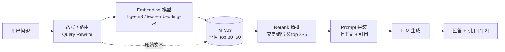

# Milvus 在 AI 中的应用

> [!info] 这份笔记管什么
> 回答「**Milvus 在 AI 应用里到底扮演什么角色、怎么接进代码、怎么调效果**」。
> 覆盖：RAG 全链路（建库 / 检索 / 拼 Prompt / 评估）· LangChain 集成 · Spring AI 集成 · 多租户与权限 · Agent 记忆 · 语义缓存 · 效果调优与上线 checklist。
> 代码在 **Lite + pymilvus 3.0.2** 上实跑，标 ⭐ 的附真实输出。
> 知识点：[[1-基础介绍]] · 语法：[[3-操作指南]] · 踩坑：[[5-避坑与排障]]

---

## 1. 先摆正位置：Milvus 在 AI 系统里是哪一层



**Milvus 只做「召回」**，但召回质量决定后面所有环节的上限：

| 角色 | Milvus 怎么做 | 做不到什么 |
|---|---|---|
| **RAG 检索层** | 稠密/稀疏/混合召回 + 标量过滤 | 不懂语义、不生成答案、不做推理 |
| **语义缓存** | 用问题向量找「问过的高度相似问题」 | 相似 ≠ 等价，阈值要标定 |
| **Agent 长期记忆** | 存「事实/偏好/经历」的向量 + metadata | 不会自动总结、不会遗忘合并（要自己写策略） |
| **推荐/召回** | 物品向量 + 用户向量做 ANN | 排序模型、特征工程还得自己做 |
| **去重/聚类** | 近邻查询找重复 chunk / 相似文档 | 大规模聚类要自己写（或上 Spark） |
| **分类（少样本）** | 找最相似的历史标注样本喂给 LLM | 不是分类器，没有决策边界 |

> [!tip] 一句话
> **Milvus 是 RAG 的"记忆体"，不是 RAG 本身**。面试时把「Milvus 选型」讲成「召回率工程」，比背架构图分高得多。

---

## 2. LangChain 集成 ⭐

### 2.1 版本矩阵（2026-10 实测）

```text
langchain-core      1.7.0
langchain-milvus     PyPI 最新 0.4.0（依赖 langchain-core>=1.4.9、pymilvus>=3.0.0）
pymilvus             3.0.2
```

```bash
pip install -U langchain-milvus langchain-core
```

### 2.2 最小向量库 ⭐

```python
from langchain_milvus import Milvus
from langchain_core.documents import Document

vectorstore = Milvus(
    embedding_function=embeddings,                 # 任何 LangChain Embeddings
    collection_name="lc_docs",
    connection_args={"uri": "./lc.db", "token": "root:Milvus"},
    auto_id=True,
)
vectorstore.add_documents([
    Document(page_content="Milvus 是云原生向量数据库", metadata={"source": "a.md"}),
    Document(page_content="LangChain 负责编排 RAG", metadata={"source": "b.md"}),
])
docs = vectorstore.similarity_search("RAG 编排", k=2)          # 默认稠密检索
docs = vectorstore.similarity_search("RAG 编排", k=2, expr='source == "b.md"')  # 带元数据过滤
```

```text
# 实测输出
[Document(metadata={'pk': 2, 'source': 'b'}, page_content='LangChain 编排 RAG')]
```

> [!note] `expr` 而不是 `filter`
> LangChain 的 Milvus 封装用 `expr` 传 Milvus 过滤表达式；名字故意区别于 LangChain 通用的 `filter`（它自己的 dict 过滤）。混用会静默失效。

### 2.3 混合检索（稠密 + BM25 内置函数）⭐

这是 langchain-milvus 最有价值的部分：**服务端 BM25，不用自己维护分词和 IDF**。

```python
from langchain_milvus import Milvus, BM25BuiltInFunction

vectorstore = Milvus(
    embedding_function=embeddings,
    collection_name="lc_hybrid",
    connection_args={"uri": "./lc.db"},
    vector_field=["dense", "sparse"],                       # 两个向量字段
    builtin_function=BM25BuiltInFunction(
        output_field_names="sparse",
        analyzer_params={"type": "jieba"},                  # 中文分词
    ),
    index_params=[
        # ⚠️ 这里不要写 field_name：它由 vector_field 位置决定，写了会 TypeError
        {"index_type": "AUTOINDEX", "metric_type": "COSINE"},
        {"index_type": "SPARSE_INVERTED_INDEX", "metric_type": "BM25"},
    ],
    search_params=[
        {"metric_type": "COSINE", "params": {}},
        # ⚠️ BM25 的 sparse 索引/检索必须 drop_ratio_build = 0，否则报
        #    MilvusException: field 'sparse': only drop_ratio_build=0 is supported
        {"metric_type": "BM25", "params": {"drop_ratio_search": 0.0, "drop_ratio_build": 0}},
    ],
    auto_id=True,
)
```

**融合排序（RRF / Weighted）的两种写法**：

```python
from pymilvus import Function, FunctionType

# ① 旧写法（已 deprecated，但能跑）：ranker_type
docs = vectorstore.similarity_search("向量数据库", k=2, ranker_type="rrf")

# ② 新写法：传一个 FunctionType.RERANK 的 Function
rrf = Function(name="rrf", function_type=FunctionType.RERANK, input_field_names=[],
               params={"reranker": "rrf", "k": 60})
w   = Function(name="w",   function_type=FunctionType.RERANK, input_field_names=[],
               params={"reranker": "weighted", "weights": [0.6, 0.4]})
docs = vectorstore.similarity_search("向量数据库", k=2, reranker=rrf)
```

```text
# 实测输出
rrf      ['Milvus 是向量数据库', 'LangChain 编排 RAG']
weighted ['Milvus 是向量数据库', 'LangChain 编排 RAG']
```

> [!warning] 混合检索模式下别用的 API
`max_marginal_relevance_search`（MMR）在多向量字段上会直接断言失败：
`AssertionError: _collection_search does not support multi-vector search.` —— 想要多样性，自己做二次筛选。

### 2.4 Retriever 接进 RAG 链

```python
retriever = vectorstore.as_retriever(search_kwargs={"k": 4})
docs = retriever.invoke("Milvus 怎么建索引")
ctx = "\n\n".join(f"[{i+1}] {d.metadata.get('source')}\n{d.page_content}"
                  for i, d in enumerate(docs))
prompt = f"""仅根据下面资料回答，资料里没有就直说不知道，并标注引用编号。
<context>
{ctx}
</context>
问题：Milvus 怎么建索引"""
```

### 2.5 元数据 / 动态字段的取舍

| 方式 | 写法 | 优缺点 |
|---|---|---|
| 内置 `metadata` 字段（默认） | `Document(metadata={"k": "v"})` | 全塞进一个 JSON，**过滤**：`expr='metadata["source"] == "a.md"'`，性能一般 |
| `metadata_field="*"` | 建表时 `metadata_field="*"` | 动态字段（Lite 实测**不支持**），工程上更麻烦 |
| **显式 `metadata_schema`**（推荐） | 把 `source`/`doc_id` 定义成真实字段 | 能建 `INVERTED` 索引，过滤快、结果稳 |

```python
# 推荐：关键过滤字段走真实列
vectorstore = Milvus(..., metadata_field="", metadata_schema={
    "source": {"type": "VarChar", "max_length": 512},
    "doc_id": {"type": "VarChar", "max_length": 64},
})
```

---

## 3. RAG 全流程：从文档到回答

### 3.1 完整骨架（可直接改造成生产脚本）⭐

```python
# rag_pipeline.py —— 在 Milvus Lite 上实跑通过；生产把 uri 换成 Standalone，embedder 换成 bge-m3
import hashlib
import numpy as np
from pymilvus import MilvusClient, DataType, Function, FunctionType, AnnSearchRequest, RRFRanker

DIM = 1024   # 与 Embedding 模型一致

class Embedder:
    """示例替身：保证无外网也能跑。生产换成 sentence_transformers / dashscope / openai"""
    def encode(self, texts):
        if isinstance(texts, str):
            texts = [texts]
        out = []
        for t in texts:
            rng = np.random.default_rng(abs(hash(t)) % (2**32))
            out.append(rng.normal(size=DIM).astype(np.float32))
        return out

emb = Embedder()
client = MilvusClient(uri="./kb.db")

# ---------- ① 建表 ----------
if not client.has_collection("kb_chunks"):
    schema = client.create_schema(auto_id=True, enable_dynamic_field=False)
    schema.add_field("id",           DataType.INT64,   is_primary=True)
    schema.add_field("chunk_id",     DataType.VARCHAR, max_length=64)
    schema.add_field("text",         DataType.VARCHAR, max_length=8192,
                     enable_analyzer=True, analyzer_params={"type": "jieba"})
    schema.add_field("dense",        DataType.FLOAT_VECTOR, dim=DIM)
    schema.add_field("sparse",       DataType.SPARSE_FLOAT_VECTOR)
    schema.add_field("source",       DataType.VARCHAR, max_length=512)
    schema.add_field("section",      DataType.VARCHAR, max_length=512, default_value="")
    schema.add_field("chunk_idx",    DataType.INT64,   default_value=0)
    schema.add_field("content_hash", DataType.VARCHAR, max_length=64)
    schema.add_field("embed_model",  DataType.VARCHAR, max_length=64, default_value="bge-m3")
    schema.add_function(Function(name="bm25", function_type=FunctionType.BM25,
                                 input_field_names=["text"], output_field_names=["sparse"]))
    idx = client.prepare_index_params()
    idx.add_index(field_name="dense",        index_type="AUTOINDEX", metric_type="COSINE")
    idx.add_index(field_name="sparse",       index_type="SPARSE_INVERTED_INDEX", metric_type="BM25")
    idx.add_index(field_name="content_hash", index_type="INVERTED")
    idx.add_index(field_name="source",       index_type="INVERTED")
    client.create_collection("kb_chunks", schema=schema, index_params=idx)

# ---------- ② 切分（保留标题作为上下文） ----------
def split_markdown(md: str, size: int = 600, overlap: int = 80):
    """按标题分节 + 长度切分；每块带上所属 section。生产建议用 RecursiveCharacterTextSplitter。"""
    chunks, buf, section = [], "", ""
    for line in md.splitlines(keepends=True):
        if line.startswith("#"):
            section = line.strip("# \n")
        buf += line
        if len(buf) >= size:
            chunks.append((buf, section))
            buf = buf[-overlap:] if overlap else ""
    if buf.strip():
        chunks.append((buf, section))
    return chunks

# ---------- ③ 入库（幂等 + 去重） ----------
def ingest(source: str, md: str):
    client.delete("kb_chunks", filter=f'source == "{source}"')       # 先清旧的
    texts = [t for t, _ in split_markdown(md)]
    vecs = emb.encode(texts)                                         # 批量 embed，别逐条调
    rows = []
    for i, ((text, section), vec) in enumerate(zip(split_markdown(md), vecs)):
        rows.append({
            "chunk_id": f"{source}#{i}", "text": text, "dense": vec,
            "source": source, "section": section, "chunk_idx": i,
            "content_hash": hashlib.sha256(text.encode()).hexdigest(),
        })
    client.insert("kb_chunks", rows)
    client.flush("kb_chunks")                                       # 整批一次
    return len(rows)

# ---------- ④ 混合检索 ----------
def retrieve(query: str, topk: int = 5, pool: int = 30, flt: str | None = None):
    reqs = [
        AnnSearchRequest(data=emb.encode(query), anns_field="dense",
                         param={"metric_type": "COSINE"}, limit=pool, expr=flt),
        AnnSearchRequest(data=[query], anns_field="sparse",
                         param={"metric_type": "BM25"}, limit=pool, expr=flt),
    ]
    hits = client.hybrid_search("kb_chunks", reqs, ranker=RRFRanker(k=60), limit=topk,
                                output_fields=["chunk_id", "text", "source", "section"])
    return [h["entity"] | {"score": h["distance"]} for h in hits[0]]

# ---------- ⑤ 拼 Prompt ----------
PROMPT = """你是知识库问答助手。只能依据 <context> 中的资料回答，资料不足就说"资料中没有提到"。
每条结论后用 [编号] 标注来源。不要编造不存在的来源。

<context>
{context}
</context>

问题：{question}"""

def build_prompt(question: str, docs: list[dict]) -> str:
    ctx = "\n\n".join(
        f"[{i+1}] source={d['source']} section={d['section']}\n{d['text']}"
        for i, d in enumerate(docs)
    )
    return PROMPT.format(context=ctx, question=question)

# ---------- ⑥ 主流程 ----------
client.load_collection("kb_chunks")
docs = retrieve("Milvus 怎么做混合检索")
prompt = build_prompt("Milvus 怎么做混合检索", docs)
# answer = llm.invoke(prompt)      # ← 你的 LLM 调用
```

```text
# 实测输出（Lite）
insert+flush 0.62 s 2 rows
dense:  [(1, 0.21, 'a.md'), (2, -0.197, 'b.md')]
hybrid: [(1, 0.033, 'a.md'), (2, 0.016, 'b.md')]
```

### 3.2 每个环节的可调项与判断标准

| 环节 | 关键决策 | 怎么判断调好了 |
|---|---|---|
| 切分 | `chunk_size` 400~1000 字；`overlap` 10%~20%；中文分隔符加 `。，、`；按标题切并记录 `section` | 用 30 条固定 query 看 **Hit@5** |
| Embedding | 中文优先 `bge-m3`（1024 维，可同时出稠密+稀疏）；`text-embedding-v4`（云端、1024 维） | 同一份数据换模型，只比指标不比感觉 |
| 向量字段 | 稠密用 `COSINE`；稀疏走 BM25 Function | Recall@20 覆盖「编号/专有名词」类 query |
| 召回池 | `limit` = 最终 top_k 的 5~10 倍（30~50 条） | 池太小 rerank 没发挥空间 |
| 融合 | **RRF 优先**（不用归一化）；Weighted 需两路分数可比 | 混合 vs 纯向量，指标必须涨 |
| 精排 | bge-reranker / Cohere Rerank，30 → 5 | 精排后 top 3 里是否含正确答案 |
| 拼 Prompt | `<context>` 结构固定，标明来源与编号，明确「不知道就说不知道」 | LLM 的回答**引用都能回查原文** |
| 生成 | 温度调低（0~0.3）；要求引用编号 | 抽查 50 条：无编造引用 |

### 3.3 中文 + 混合检索的实际收益（为什么值得做）

- 用户问「TS-999 的报错怎么解决」：稠密向量对**精确编号**不敏感，BM25 直接命中
- 用户问「那个能让向量不全放内存的索引」：BM25 命中不了，稠密向量命中 `DiskANN`
- **两路各有所长 → 混合后 Recall 提升明显**；Anthropic Contextual Retrieval 的公开数据是同思路：Contextual Embeddings 降 35% 检索失败率，+Contextual BM25 降 49%，+Rerank 降 67%

> [!warning] 中文 BM25 必须开分词
> 不开 `analyzer_params={"type": "jieba"}`，中文会被按整串或空格切，**BM25 几乎退化成"整句匹配"**。这是中文 RAG 最常见的静默失效。

### 3.4 离线评估（RAG 的硬门槛）

```python
# evalset.jsonl: {"q": "...", "gold_chunk_ids": ["a.md#3"]}
import json
def hit_at_k(queries, k=5):
    hit = 0
    for row in queries:
        got = {d["chunk_id"] for d in retrieve(row["q"], topk=k)}
        hit += bool(got & set(row["gold_chunk_ids"]))
    return hit / len(queries)

print("Hit@5 =", hit_at_k([json.loads(l) for l in open("evalset.jsonl")], 5))
```

| 指标 | 层次 | 说明 |
|---|---|---|
| Hit@5 / Recall@20 / MRR | 检索 | 不需要 LLM，便宜稳定，**每次改动都跑** |
| 答案正确性 / 忠实度 | 生成 | LLM-as-judge，注意判官模型自身偏差 |
| 引用是否支持结论 | 生成 | 抽查，比"看起来对"靠谱 |
| p95 延迟 / Token 成本 | 体验 | 检索耗时也要算进去 |

> 规则：**没有指标对比的"优化"不算优化**。详见 [[1-LangChain/2-LangChain学习地图#1.6 先自建评估（可观测的前置）|学习地图 §1.6]]。

---

## 4. Spring AI 集成

> 本仓库 [[2-spring ai/RuoYi-Spring-AI-面试题|RuoYi × Spring AI 面试题]] 与 [[2-spring ai/Ruoyi RAG 全链路排障手册|RAG 全链路排障手册]] 是这套链路的**真实踩坑记录**，本节只给结构和要点。

### 4.1 两条常见路线

| 路线 | 依赖 | 特点 |
|---|---|---|
| **a. Spring AI 官方 Milvus VectorStore** | `spring-ai-starter-vector-store-milvus`（会带来 `io.milvus:milvus-sdk-java`） | 声明式，`@Bean VectorStore` 即可被 `ChatClient` 的 `QuestionAnswerAdvisor` 使用；定制 schema 能力受封装限制 |
| **b. 直接用 milvus-sdk-java 自封装** | `milvus-sdk-java` | 完全可控（自定义字段、COSINE、outFields），要自己写 Collection 管理；RuoYi 项目走的是这条路 |

### 4.2 路线 a：最小配置

```yaml
spring:
  ai:
    vectorstore:
      milvus:
        client:
          host: localhost
          port: 19530
          username: root
          password: Milvus
        databaseName: default
        collectionName: chat_docs
        embeddingDimension: 1024
        indexType: IVF_FLAT
        metricType: COSINE
        initialize-schema: true      # 自动建表建索引（生产审慎）
```

```java
@Bean
VectorStore milvusVectorStore(EmbeddingModel embeddingModel, MilvusServiceClient client,
                              @Value("${spring.ai.vectorstore.milvus.collectionName}") String name) {
    return MilvusVectorStore.builder(client, embeddingModel)
            .collectionName(name)
            .databaseName("default")
            .embeddingDimension(1024)
            .indexType(IndexType.IVF_FLAT)
            .metricType(MetricType.COSINE)
            .initializeSchema(true)
            .build();
}

@Bean
ChatClient chatClient(ChatModel model, VectorStore vectorStore) {
    return ChatClient.builder(model)
            .defaultAdvisors(QuestionAnswerAdvisor.builder(vectorStore)
                    .searchRequest(SearchRequest.builder().topK(4).similarityThreshold(0.0).build())
                    .build())
            .build();
}
```

> [!note] 构造方式以你的 Spring AI 版本为准
> Spring AI 1.0 前后 `MilvusVectorStore` 的构造从 `new MilvusVectorStore(...)` 改成了 builder（并且 `MilvusServiceClient` 的包名也从 `org.springframework.ai.milvus` 迁到 SDK 自身的 `io.milvus.v2.client`）。**升级时先看 `pom` 里实际解析到的版本**，报 `NoSuchMethodError` 基本都是这个问题。

### 4.3 路线 b：自封装 Collection（RuoYi 实际做法）

```java
CollectionSchema schema = CollectionSchema.newBuilder()
    .addFields(FieldSchema.newBuilder().withName("id").withDataType(DataType.Int64)
                   .isPrimaryKey(true).withAutoID(true).build())
    .addFields(FieldSchema.newBuilder().withName("vector").withDataType(DataType.FloatVector)
                   .withDimension(1024).build())
    .addFields(FieldSchema.newBuilder().withName("text").withDataType(DataType.VarChar)
                   .withMaxLength(65535).build())
    .addFields(FieldSchema.newBuilder().withName("metadata").withDataType(DataType.VarChar)
                   .withMaxLength(4096).build())
    .build();

client.createCollection(CreateCollectionParam.newBuilder()
    .withCollectionName("chat_docs").withSchema(schema).build());

client.createIndex(CreateIndexParam.newBuilder()
    .withCollectionName("chat_docs").withFieldName("vector")
    .withIndexType(IndexType.IVF_FLAT).withMetricType(MetricType.COSINE)
    .withExtraParam("{\"nlist\":128}").build());

client.search(SearchParam.newBuilder()
    .withCollectionName("chat_docs").withMetricType(MetricType.COSINE)
    .withOutFields(List.of("text", "metadata"))          // ⚠️ 不写就只返回主键+距离
    .withVectorFieldName("vector").withVectors(queryVectors)
    .withTopK(4).withConsistencyLevel(ConsistencyLevelEnum.STRONG)
    .withExpr("metadata like \"%docId\":\"123\"%\"")      // 元数据过滤（字符串匹配）
    .build());
```

**RuoYi 项目带来的 5 条硬经验**（详见排障手册）：

1. **Collection = 一次性 schema**：字段、维度、metric 建好后代码改不动，升级只能 `drop` 重建 → **在代码里写 schema 版本号/自动校验**
2. **search 必须显式 `outFields`**，否则拿不到 `text`（"命中但内容全空"的经典故障）
3. **主键 `id` 不能放进 `outFields`**，否则 `field id not exist`
4. **metric 不匹配无法在代码层修复**，只能删表重建
5. **Milvus 挂掉不能拖垮主流程**：`@ConditionalOnProperty` + `@Autowired(required=false)` 双层降级

### 4.4 Python 与 Java 的语义对照（迁移时最容易踩）

| 概念 | pymilvus | Spring AI VectorStore | milvus-sdk-java |
|---|---|---|---|
| 过滤 | `filter="tenant == 'a'"` | `SearchRequest.filterExpression("...")` | `withExpr(...)` |
| 返回字段 | `output_fields=[...]` | 自动（由文档模型映射） | `withOutFields(...)` |
| TopK | `limit=4` | `topK(4)` | `withTopK(4)` |
| 写入 | `insert([dict])` | `vectorStore.add(List<Document>)` | `client.insert(InsertParam...)` |
| 维度 | `dim=1024` | `embeddingDimension` | `withDimension(1024)` |

> [!danger] Java/Python 混用时最容易忘：`outFields`
> Python 的 `output_fields` 和 Java 的 `withOutFields` 是**同一个东西**，都决定「返回哪些标量字段」。不写 → 只回主键。这是跨语言移植时 90% 的"内容为空"根因。

---

## 5. 多租户与权限

### 5.1 数据层隔离

```python
# 建表时
schema.add_field("tenant_id", DataType.VARCHAR, max_length=64, is_partition_key=True)

# 每次检索一律带过滤（写在封装层，不允许业务代码遗漏）
def search_for_tenant(tenant: str, vec, topk=5):
    return client.search("kb_chunks", data=[vec], limit=topk,
                         filter=f'tenant_id == "{tenant}"',
                         output_fields=["text", "source"])
```

| 隔离级别 | 做法 | 适用 |
|---|---|---|
| **行级（推荐入门）** | `tenant_id` + partition key + 强制 filter | SaaS，租户多 |
| 表级 | 每租户一个 collection | 租户少、schema 不同、要独立备份 |
| 库级 | 每租户一个 database | 需要按库授权 |
| 实例级 | 独立 Milvus | 合规/大客户 |

### 5.2 服务层鉴权（别只靠 filter）

```python
# Milvus 自带的 RBAC：角色 + 库/集合级权限
client.create_user(user_name="app_writer", password="***")
client.create_role(role_name="kb_writer")
client.grant_privilege(role_name="kb_writer", object_type="Collection",
                       object_name="kb_chunks", privilege="Insert")
client.grant_role(user_name="app_writer", role_name="kb_writer")
```

权限分工建议：**应用写账号只有 Insert，读账号只有 Search，运维账号才 Drop**。删表权限千万别给业务服务。

> [!warning] 公网暴露
> 19530 只开给内网/VPC；默认 `root/Milvus` **必须改**；需要公网访问就走网关 + TLS，而不是直接把端口映射出去。

---

## 6. Agent 长期记忆

### 6.1 记忆分三类

| 类型 | 例子 | 存哪 | 检索 |
|---|---|---|---|
| **短期记忆** | 本轮/近 10 轮对话 | 内存 / Redis / LangGraph checkpointer | 全量塞 prompt |
| **长期语义记忆** | 用户偏好、项目背景、历史结论 | **Milvus**（`user_id` + `kind` 字段） | 按当前问题检索 top-k |
| **情景记忆** | 某次任务的完整过程与结果 | Milvus + 业务库（原文放库，摘要放向量） | 相似任务复用 |

### 6.2 最小实现

```python
MEM_SCHEMA_HINT = """
id(INT64 PK) · user_id(VARCHAR) · kind(VARCHAR: fact|preference|episode)
content(VARCHAR) · dense(FLOAT_VECTOR) · ts(INT64) · importance(FLOAT)
"""

def remember(user_id: str, kind: str, content: str):
    vec = emb.encode(content)[0]
    client.insert("memories", [{
        "user_id": user_id, "kind": kind, "content": content,
        "dense": vec, "ts": int(time.time() * 1000), "importance": 0.5,
    }])

def recall(user_id: str, query: str, topk: int = 5):
    return client.search("memories", data=emb.encode(query), limit=topk,
                         filter=f'user_id == "{user_id}"',
                         output_fields=["content", "kind", "ts"])
```

### 6.3 工程要点

- **写入要有节制**：每轮对话全写会让记忆表爆炸。让 LLM 先做「是否值得记 + 摘要成一句事实」再写
- **去重与合并**：写之前用近邻查，相似度 > 0.9 就 `upsert` 更新旧记忆而不是新增
- **时间衰减**：检索时把 `score` 和 `recency`、`importance` 加权（参考 Generative Agents 的 `recency + importance + relevance`）
- **可删除**：给用户「查看/删除我的记忆」的入口（合规要求）
- **别用记忆代替事实库**：Milvus 记的是"向量相似"，不是"事实为真"，冲突时以业务库为准

---

## 7. 语义缓存（省钱最快的一招）

```python
def cached_answer(vec, question, threshold=0.92):
    hits = client.search("qa_cache", data=[vec], limit=1,
                         output_fields=["answer", "question"])
    if hits[0] and hits[0][0]["distance"] >= threshold:
        return hits[0][0]["entity"]["answer"]       # 命中缓存
    return None
```

- 阈值必须用真实日志标定：**COSINE 0.95 常常还是不同问题**，建议 0.95~0.98 起步并抽样人工校验
- 只缓存「低时效性」问题（概念解释、文档问答），别缓存价格、库存
- 缓存层要能按知识库版本失效（`kb_version` 字段 + filter）

---

## 8. 上线前 checklist

**数据层**

- [ ] `dim` / `metric_type` / analyzer 与线上 embedder 严格一致，版本号写进 `embed_model` 字段
- [ ] 关闭动态字段（或明确管控 `$meta`）
- [ ] 必须过滤的字段（租户、文档状态）建了 `INVERTED` 索引
- [ ] `search` 一律显式 `output_fields`（Python/Java 都一样）

**检索质量**

- [ ] 有 30+ 条固定评测集，任何改动都能出 Hit@5 / MRR 对比
- [ ] 混合检索 + Rerank 的收益被指标证明过
- [ ] 召回池 ≥ 5× 最终条数；答案里引用可回查

**服务与运维**

- [ ] Milvus 不可用时应用能降级（RuoYi 的双保险写法）
- [ ] 默认密码已改、端口不对公网、RBAC 最小权限
- [ ] 备份策略（volume / MinIO + etcd 一起备）
- [ ] 监控：检索 p95、召回条数分布、空召回率、`get_collection_stats` 增长量
- [ ] 重建库的脚本可一键跑（alias 切换，不停服）

---

## 9. 与相邻笔记的关系

| 主题 | 去哪看 |
|---|---|
| Milvus 概念/架构/索引选型 | [[1-基础介绍]] |
| 装 Lite / Standalone / 集群 | [[2-环境搭建]] |
| CRUD、混合检索、分区的**逐个 API 细节** | [[3-操作指南]] |
| LangChain 全链路（切分/评估/生产化） | [[1-LangChain/2-LangChain学习地图|LangChain 学习地图]] |
| Spring AI + Milvus 真实排障 | [[2-spring ai/Ruoyi RAG 全链路排障手册|RuoYi RAG 全链路排障手册]] |
| 报错速查 | [[5-避坑与排障]] |

## 10. 延伸

- 官方 RAG 教程：<https://milvus.io/docs/integrate_with_langchain.md>
- BM25 内置函数与全文检索：<https://milvus.io/docs/full-text-search.md>
- Multi-vector / Hybrid Search：<https://milvus.io/docs/multi-vector-search.md>
- Anthropic Contextual Retrieval：<https://www.anthropic.com/research/contextual-retrieval>
