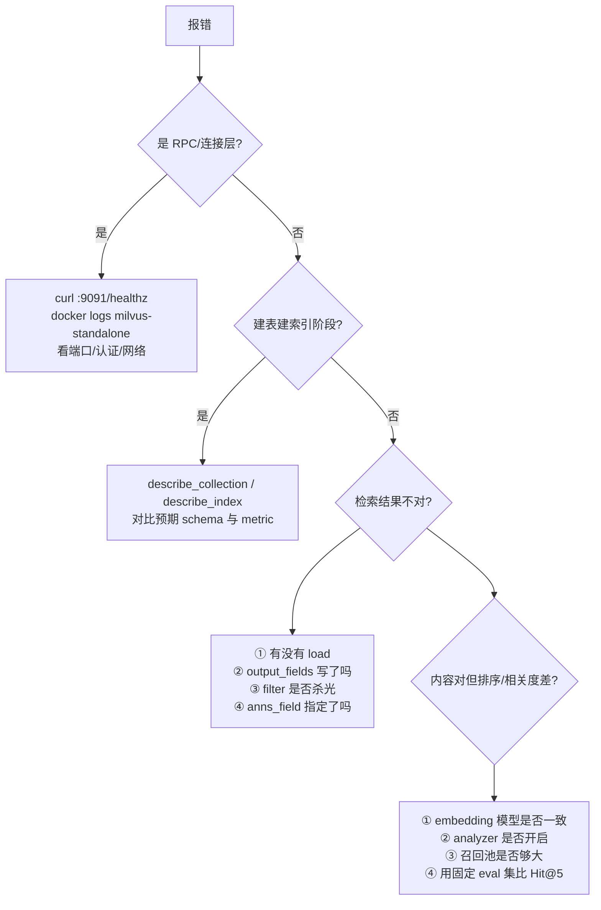

# Milvus 避坑与排障手册

> [!info] 这份笔记管什么
> 按「**现象 → 根因 → 修法**」的格式，收录本仓库真实踩过的坑 + 本次笔记写作时在本机（macOS / Python 3.11 / **pymilvus 3.0.2** / **milvus-lite 0.5.8**）**实测复现**的坑。
> ⭐ = 本机复现并贴了真实报错。其余为上机计划项，标了「待验证」。
> 概念：[[1-基础介绍]] · 操作：[[3-操作指南]] · 应用：[[4-AI中的用法]]

> [!abstract] 先记住 6 条铁律
> 1. **Collection 的 schema / 维度 / metric / analyzer 建好后基本不能改** → 生产前想清楚，改要用新表 + alias 切换。
> 2. **search 不传 `output_fields` 只返回主键 + 距离** → Python/Java 都一样。
> 3. **`limit` 是最终条数，不是候选池** → 召回池要给 rerank 留 5~10 倍空间。
> 4. **中文 BM25 必须显式 `analyzer_params={"type": "jieba"}`**，否则静默退化。
> 5. **写后即读要 `flush` 或 `Session` 一致性**，"刚插入搜不到"多半不是 bug。
> 6. **Lite ≠ 生产**：在线加字段、快照等 3.0 能力在 Lite 上直接 `UNIMPLEMENTED`。

---

## 1. 建表 / Schema 阶段

### 1.1 ⭐ `Schema must have a primary key field`

```text
pymilvus.exceptions.PrimaryKeyException: (code=1, message=Schema must have a primary key field.)
```

| 项 | 内容 |
|---|---|
| **触发** | `client.create_collection(name, schema=client.create_schema(auto_id=True), dimension=8)` |
| **根因** | 这里有个反直觉点：只要你传了 `schema=`，`dimension=` / 默认主键就**不再生效**（那只属于「极简版建表」分支），你必须自己 `add_field`。 |
| **修法** | 要么走极简版（只传 `dimension`），要么完整写 schema： |

```python
schema = client.create_schema(auto_id=True)
schema.add_field("id",     DataType.INT64, is_primary=True)
schema.add_field("vector", DataType.FLOAT_VECTOR, dim=8)
client.create_collection("demo", schema=schema)
```

### 1.2 ⭐ 极简版建表会静默打开动态字段

```python
client.create_collection("quick", dimension=4)      # 源码里 enable_dynamic_field 被自动设为 True
```

| 项 | 内容 |
|---|---|
| **根因** | `_fast_create_collection()` 中 `if "enable_dynamic_field" not in kwargs: kwargs["enable_dynamic_field"] = True` |
| **后果** | 拼错的字段名会被塞进 `$meta` 而不报错，等到检索时才发现「字段是空的」 |
| **修法** | 生产一律 `enable_dynamic_field=False`；哪怕用极简版也显式传 |

### 1.3 ⭐ `unknown tokenizer type: 'chinese'`

```text
MilvusException: (code=6, message=unknown tokenizer type: 'chinese' (supported: 'standard', 'jieba'))
```

| 项 | 内容 |
|---|---|
| **修法** | `analyzer_params={"type": "jieba"}`（报错信息本身已经告诉你支持哪些） |
| **顺带** | 3.0 宣称支持更多 analyzer，但**以你实际服务端报错里的 supported 列表为准** |

### 1.4 ⭐ 链式 `prepare_index_params().add_index()` 返回 None

```text
AttributeError: 'NoneType' object has no attribute 'add_index'
```

| 项 | 内容 |
|---|---|
| **根因** | `add_index()` 是副作用方法（返回 `None`），不是 builder |
| **修法** | 三行写清楚：`idx = client.prepare_index_params()` → `idx.add_index(...)` × N → 传 `index_params=idx` |

### 1.5 维度 / metric / 分词组不一致（上机计划项）

| 场景 | 报错关键词（2.x 经验） | 修法 |
|---|---|---|
| 向量维度 ≠ `dim` | `dimension mismatch` / `Invalid dim` | 重建 collection |
| 检索 metric ≠ 索引 metric | `metric type not match: expected=L2, actual=COSINE` | **只能删表重建**（详见 §2） |
| 稀疏字段配了 `AUTOINDEX` | ⭐ 见下 | 改成 `SPARSE_INVERTED_INDEX` + `BM25` |

⭐ 本机实测（Lite）：

```text
MilvusException: (code=6, message=sparse field 'sparse' requires SPARSE_INVERTED_INDEX with metric BM25;
got 'AUTOINDEX'/'BM25'. For an existing index, release, drop, and recreate it with the allowed metric.)
```

> 报错信息把修法也说清楚了：`release → drop → recreate`。

---

## 2. 建库阶段的错，后期只能重建

> 这一节来自自建项目的真实事故：[[2-spring ai/Ruoyi RAG 全链路排障手册|RuoYi RAG 全链路排障手册]] 的问题 3~5。

| 变更需求 | 能否靠代码修 | 实际处理 |
|---|---|---|
| 新增/删除字段 | ❌（2.x） | drop 重建；3.0 起可 `add_collection_field` |
| 改向量维度 | ❌ | drop 重建 |
| 改索引 metric（L2 ↔ COSINE） | ❌（无 alter API） | drop 重建 |
| 改主键字段名 | ❌ | drop 重建 |
| 改 analyzer | ⚠️ 通常也要重建 | 重建 |
| `output_fields` 参数调整 | ✅ | 改代码即可 |

**把风险前移的三条工程手段**：

1. **collection 名带版本**：`kb_chunks_v1` / `kb_chunks_bge_m3_v2`，升级不撞旧结构
2. **客户端只连 alias**：`client.alter_alias("kb_chunks", "kb_chunks_v2")` 原子切换
3. **启动自检**：应用启动时 `describe_collection` 比对期望的字段/维度/索引，不一致直接告警而不是带病运行

```python
def assert_schema(client, name, expect_dim, expect_metric="COSINE"):
    desc = client.describe_collection(name)
    dims = [f.get("params", {}).get("dim") for f in desc["fields"] if f["type"] in ("FloatVector", 101)]
    assert str(expect_dim) in [str(d) for d in dims], f"维度不符: {dims}"
    for idx in client.list_indexes(name):
        info = client.describe_index(name, idx)
        if info["field_name"] == "dense":
            assert info["metric_type"] == expect_metric, f"metric 不符: {info['metric_type']}"
```

---

## 3. 查询 / 检索阶段

### 3.1 ⭐ 命中但 `text` 为空（Java 版是 `outFields`）

| 项 | 内容 |
|---|---|
| **现象** | search 返回 4 条、score 都正常，但 `text` 全空 |
| **根因** | Milvus **默认只返回主键 + 距离**，标量字段必须显式要 |
| **修法** | Python：`output_fields=["text","metadata"]`；Java：`.withOutFields(List.of("text","metadata"))` |
| **陷阱** | 主键 `id` **不能**放进 outFields（会报 `field id not exist`，Java）；Python 侧写 `ids`/`id` 也会干扰 |

```python
# ✅
client.search("kb_chunks", data=[v], limit=4, output_fields=["text", "source", "chunk_idx"])
# ❌ 忘写 output_fields → hit["entity"] 里只有 {} 或只有主键
```

同一个坑在本仓库造成过「AI 收到空资料，回答"资料 1-4 都是空的"」的故障。**在封装层加一条断言**：

```python
def search_nonempty(client, name, vec, topk, **kw):
    hits = [h for h in client.search(name, data=[vec], limit=topk,
                                     output_fields=["text"], **kw)[0]
            if h["entity"].get("text", "").strip()]
    if not hits:
        raise ValueError("召回了但内容为空，检查 output_fields / 文本字段")
    return hits
```

### 3.2 ⭐ 多向量字段时 `search_iterator` 必须指定 `anns_field`

```text
MilvusException: (code=1, message=must specify anns_field when there are more than one vector field)
```

修法：`client.search_iterator(name, data=[v], anns_field="dense", batch_size=200, limit=1000)`。

> 同理，表里有 `dense` + `sparse` 两个向量字段时，`search` 虽然能靠参数猜，但**建议一律显式写 `anns_field`**，可读性也更好。

### 3.3 ⭐ `filter_params` 占位符不认

```text
MilvusException: (code=6, message=unexpected character '{' at column 11)
```

| 项 | 内容 |
|---|---|
| **触发** | `filter="source == {s}", filter_params={"s": '"a.md"'}` |
| **修法** | 自行转义拼接（见 [[3-操作指南#5.1 表达式语法速查]]），或升级 pymilvus/服务端后重试 |

### 3.4 ⭐ `Collection ... is in state 'released'; call load() before search/get/query`

| 项 | 内容 |
|---|---|
| **触发** | pymilvus 3.0 新建的 collection，进程重启后直接 `query/search` |
| **根因** | 服务端在重启或资源回收后会 release；3.0 客户端建表后也不再自动预加载 |
| **修法** | 应用启动时 `client.load_collection(name)`；或每次操作前检查 `get_load_state` |

```python
if client.get_load_state("kb_chunks")["state"] is not LoadState.Loaded:
    client.load_collection("kb_chunks")
```

### 3.5 刚插入的数据搜不到

| 可能原因 | 验证方法 | 修法 |
|---|---|---|
| 一致性级别（默认 Bounded） | 等 5s 再查 / 加 `consistency_level="Strong"` | 搜索传 `Session`；或 `flush` |
| 未 load | `get_load_state` | `load_collection` |
| 数据在别的 partition | `get_partition_stats` | 搜索带 `partition_names` 或去掉分区限制 |
| 向量模型不一致 | 对比 embedding 代码版本 | **把模型名写进 metadata** 再排查 |
| `flush` 了但没等完成 | `flush()` 只保证提交 | 测试时用 `wait_flush` 的思路轮询 `get_collection_stats` |

### 3.6 过滤把结果杀光

- `filter='status == "active"'` 命中只有 2 条而 `limit=10` → 只返回 2 条，**不是错误**
- `like` 只支持**前缀**通配：`source like "docs/%"` ✅，`like "%x"` ❌ 可能报错或全表扫
- 高基数字段做 `filter` 前先确认建了 `INVERTED` 索引，否则是暴力扫描
- 多租户场景记得 **partition key 字段 + 固定 filter**，双管齐下

### 3.7 `search` 比预期慢

| 排查 | 动作 |
|---|---|
| `limit` 太大 | 降到 10~50，精排交给 rerank |
| 索引 `FLAT` | 换 `HNSW` / `AUTOINDEX` |
| `ef` / `nprobe` 太大 | 调小，用 Recall 曲线找拐点 |
| `filter` 无索引 | 给过滤字段建 `INVERTED` / `BITMAP` |
| 加载了大量未用 segment | `compact` + `load_balance`（分布式） |
| `output_fields` 带了超大 VARCHAR / JSON | 只取需要的字段；大文本另存对象存储，向量库只存指针 |

---

## 4. 写入 / 删除 / 空间

| 现象 | 根因 | 修法 |
|---|---|---|
| 写入越来越慢 | **每条都 flush**，产生海量小 segment | 批量 500~2000 条，**整批 flush 一次** |
| 删了数据磁盘没降 | 删除只是打 tombstone | `client.compact(name)` 后轮询 `get_compaction_state` |
| upsert 后字段丢了 | upsert 是**整行替换** | 带全字段，或开动态字段用 `partial_update=True` |
| 大批量导入超时 | 逐条 insert | 走 **BulkWriter**（Parquet + import） |
| `auto_id=True` 却想 upsert | 不知道主键 | insert 时返回 `ids` 保存；或改用业务主键（`id_type="string"`） |
| 重复数据越来越多 | 没有幂等键 | `chunk_id` + `content_hash` + 写入前 `query` 判重 |

---

## 5. 应用层集成

### 5.1 ⭐ langchain-milvus 双向量字段：不传 `search_params` 直接报错

```text
MilvusException: (code=6, message=field 'sparse': only drop_ratio_build=0 is supported)
```

| 项 | 内容 |
|---|---|
| **触发** | `Milvus(vector_field=["dense","sparse"], builtin_function=BM25BuiltInFunction(...))` —— **即使只做普通检索**也报 |
| **根因** | 封装默认 `search_params[1] = {"drop_ratio_build": 0.2}`；Milvus 对 BM25 只能接受 0 |
| **修法** | 显式传 `search_params=[{"metric_type":"COSINE","params":{}}, {"metric_type":"BM25","params":{"drop_ratio_search":0.0,"drop_ratio_build":0}}]` |
| **诊断** | `print(vectorstore.search_params)` 看实际值 |

### 5.2 ⭐ langchain-milvus `index_params` 写 `field_name` 会 TypeError

```text
TypeError: pymilvus.milvus_client.index.IndexParams.add_index() got multiple values for keyword argument 'field_name'
```

修法：`index_params` 只写 `index_type` / `metric_type` / `params`，**字段由 `vector_field` 的位置决定**。

### 5.3 ⭐ langchain-milvus `ranker_type="weighted"` 报权重数量不对

```text
MilvusException: (code=1, message=weighted merge requires 2 weights, got 4)
```

修法：改用新式 `reranker=Function(function_type=FunctionType.RERANK, params={"reranker":"weighted","weights":[0.6,0.4]})`；`ranker_type="rrf"` 仍可用（但有 deprecation 警告）。

### 5.4 ⭐ 多向量模式下 `max_marginal_relevance_search` 断言失败

```text
AssertionError: _collection_search does not support multi-vector search. You can use _collection_hybrid_search instead.
```

修法：混合检索模式不支持 MMR。需要多样性就检索后自己做聚类/去重。

### 5.5 ⭐ langchain-milvus 自动把 `auto_id` 改成 True

```text
UserWarning: No ids provided and auto_id is False. Setting auto_id to True automatically.
```

后果：你没法用业务 id 做主键，后续 upsert / 精确 get 变麻烦。**显式写 `auto_id=True/False`**，要业务主键就自己传 `ids`。

### 5.6 Spring AI / milvus-sdk-java 相关

| 报错 | 根因 | 修法 |
|---|---|---|
| `NoSuchMethodError` / `ClassNotFoundException: org.springframework.ai.milvus.*` | Spring AI 版本升级后 Milvus 集成迁到 SDK 的 `io.milvus.v2.client` | 对齐 `pom` 解析出的版本，别混用示例代码 |
| `field id not exist` | `outFields` 里写了主键 | 去掉 `id` |
| `metric type not match` | 旧 collection 索引用 L2 | drop 重建（见 [[2-spring ai/Ruoyi RAG 全链路排障手册|RuoYi 排障手册]] 问题 5） |
| 启动卡住/报 `Unavailable` | Milvus 没起或端口不通 | 先 `curl :9091/healthz`，再加降级配置 |

> 可选降级文案（RuoYi 实践）：`@ConditionalOnProperty(milvus.enabled=true)` + `@Autowired(required=false)`，**外部依赖不拖垮主流程**。

---

## 6. 环境搭建排障速查

| 现象 | 根因 | 修法 |
|---|---|---|
| 连 `./x.db` 报找不到后端 | 没装 `milvus-lite` | `pip install -U "pymilvus[milvus-lite]"` |
| `milvus-lite` 的 `.db` 打不开/数据异常 | 0.5.x 与 3.x **存储格式不兼容** | 卸载重装到新版本 + 重新导入；或继续用旧版 |
| Windows 上 Lite 不可用 | Lite 不支持 win32 | 用 `milvus-lite server` 或 Docker |
| 装 `pymilvus[model]` 特别慢/占空间 | 会带 `torch`/`transformers` | 只在需要 `DefaultEmbeddingFunction` 的环境装；生产把 embedding 放独立服务 |
| `docker run` 拉不到 `quay.io/coreos/etcd` | 国内网络 | 配 daemon 代理 / 镜像加速 / 从别处 `docker save` 导入 |
| 容器一直 `starting` | 音量目录权限 / MinIO 账号不匹配 | `docker logs milvus-standalone`；检查 `MINIO_ROOT_USER` 与 `MINIO_ACCESS_KEY_ID` 一致 |
| 9091 WebUI 打不开 | 3.x 的 9091 以健康检查/指标为主 | 用 `curl /healthz`；需要 GUI 单独起 Attu |
| 升级镜像后起不来 | 跨大版本不兼容 | 看 release notes 的 compatibility 段；必要时导出数据重建 |
| `sudo` 相关报错 | `standalone_embed.sh` 内部用 `sudo docker` | macOS 把 `sudo` 去掉（脚本复制一份改）或用 compose 替代 |

---

## 7. 排障方法论（比记答案有用）



**三步定位法**：

1. **先证明 Milvus 没问题**：`get_server_version` → `list_collections` → `describe_collection` → 用 FLAT 精确检索一条已知向量
2. **再证明数据没问题**：`query(filter='id == <known>', output_fields=['text'])` 直接读原文
3. **最后才怀疑业务代码**：过滤条件、embedding 调用、字段名拼写

> [!tip] 把「不可能错」的部分固化成启动自检
> 版本、维度、metric、analyzer、load 状态 —— 这 5 项在服务启动时断言一次，能消灭 80% 的线上疑难杂症。

---

## 8. 本手册的复现环境

```text
OS        macOS (darwin)
Python    3.11.7 (/opt/anaconda3)
pymilvus  3.0.2
milvus-lite 0.5.8（注意：PyPI 最新为 3.2.2，能力边界更大）
langchain-core 1.7.0 / langchain-milvus（本机安装版，PyPI 最新 0.4.0）
Milvus 服务端文档基线：v3.0.4（2026-10-26）/ v2.6.26
```

> 复现脚本思路：每段代码独立 `MilvusClient(uri="./x.db")` + `drop_old` 式新库，确保「从零能复现」，避免旧库残留干扰结论。

---

## 9. 延伸

- 完整 API：[[3-操作指南]]
- RAG 工程建议：[[4-AI中的用法]]
- 官方文档 FAQ：<https://milvus.io/docs/faq.md>
- GitHub Issues / Discussions：<https://github.com/milvus-io/milvus/discussions>
- 本仓库历史事故：[[2-spring ai/Ruoyi RAG 全链路排障手册|RuoYi RAG 全链路排障手册]]
