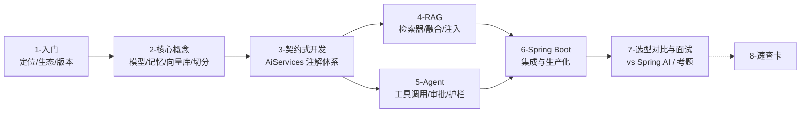

# LangChain4j 知识库

> [!info] 这份索引管什么
> Java 侧 LLM 应用框架 **LangChain4j** 的完整整理：定位与生态 → 核心概念 → **契约式开发（AiServices）** → RAG → Agent / 工具调用 → Spring Boot 集成与生产化 → 选型对比与面试。
> 基线版本：**langchain4j 1.23.0**（2026-10-28 发布，Maven 上最新）/ Spring Boot starter **1.23.0-beta33** / JDK 17。
> 所有 Java 代码都在本机用 **Maven 下载真依赖 + JDK 17 编译通过**，标 ⭐ 的附真实运行输出（用"脚本化假模型"离线跑通，不需要 API Key）。

> [!warning] 先对齐一个前提
> 你之前在 [[6-ai/AI 学习规划/03-Java开发阶段|学习规划 · 阶段二]] 和 [[6-ai/AI 学习规划/技术栈地图|技术栈地图]] 里写的是「**Spring AI 为主，LangChain4j 砍掉**」。
> 本套笔记**不推翻那个决策**——它只是把 LangChain4j 从"听说过"补到"能讲清差异、能读懂别人代码、需要时能上手"。
> 决策是否要改，见 [[7-选型对比与面试#4. 给你的决策建议]]。

---

## 1. 阅读路线



| 目标 | 读什么 |
|---|---|
| 知道 LangChain4j 是什么、要不要用 | [[1-LangChain4j-入门]] |
| 看懂项目里出现的 `@AiService` / `@Tool` | [[3-契约式开发]] |
| 自己写一个 RAG 知识库 | [[4-RAG]] |
| 写智能客服 Agent | [[5-Agent工具调用]] |
| 接进现有 Spring Boot 项目 | [[6-SpringBoot集成]] |
| 面试怎么讲 / 和 Spring AI 怎么选 | [[7-选型对比与面试]] |
| 随手查 API | [[8-速查卡]] |

---

## 2. 笔记清单

### [[1-LangChain4j-入门]] — 它是什么、和谁比
- 一句话定位：**Java 版的 LangChain，但设计上是"声明式 AI Service"**
- 与 Spring AI / Python LangChain / LangGraph 的边界
- 生态包地图（`langchain4j`、`-core`、各种 `-open-ai`、`-ollama`、社区 `langchain4j-*`、Spring Boot starter）
- **版本关键节点**：`ChatLanguageModel → ChatModel`（1.0 改的，0.x 教程不能直接抄）
- 第一个可跑的最小例子（离线也能跑的思路）

### [[2-核心概念]] — 五件套
- `ChatModel` / `StreamingChatModel` / `EmbeddingModel`：只有这三个"模型接口"
- `ChatMemory`：全量/窗口/Token 窗口，`ChatMemoryProvider` + `@MemoryId` 多会话
- `EmbeddingStore` / `EmbeddingStoreContentRetriever`：向量库也只是接口
- 切分器（Document Splitter）：**`DocumentSplitters.recursive()` 需要 opennlp**，踩坑实测
- `Filter` 元数据过滤表达式

### [[3-契约式开发]] — LangChain4j 的灵魂
- `AiServices.builder(...)`、接口 + 注解 = 你的业务 API
- `@SystemMessage` / `@UserMessage` / `@V` / `@MemoryId` / `@UserName` 全表
- 返回值形态：`String` / `POJO` / `Result<T>` / `TokenStream`
- **结构化输出的真实机制** ⭐（实测：默认不强制 JSON 模式）
- 流式 `TokenStream` 的两个回调族
- **护栏 Guardrail**（输入拦截 + 输出重生成）⭐
- 常见配置错误（`@MemoryId` 忘了 provider 会抛 `IllegalConfigurationException`）⭐

### [[4-RAG]] — 检索增强
- 原生 RAG 抽象：`ContentRetriever` / `QueryTransformer` / `ContentAggregator` / `ContentInjector`
- 一行接 RAG（`AiServices.contentRetriever(...)`）与完整编排（`DefaultRetrievalAugmentor`）
- **多路召回 + RRF 融合**：`DefaultQueryRouter` + `DefaultContentAggregator`
- 元数据过滤 / 最小相似度 / **相似度分数藏在 `content.metadata().get(ContentMetadata.SCORE)`** ⭐（`get("SCORE")` 返回 null）
- 接 Milvus：`langchain4j-milvus` 与其他方式
- 和 [[14-AI agent /3-Milvus/0-Milvus-AI知识库索引|Milvus 系列]] 的路线对照：**召回质量是同一个战场**

### [[5-Agent工具调用]] — 让模型会动手
- `@Tool` / `@P`：工具描述是**写给模型看的 prompt**
- 工具调用循环的真实过程 ⭐（2 次模型调用、4 条消息、工具结果回灌）
- 防死循环 / 限并发 / 工具执行前后钩子
- **Human-in-the-loop**：敏感工具包一层"审批门面"
- `ToolProvider` / 工具检索（工具多了怎么办）
- 与 Spring AI `@Tool`、`FunctionCallback` 的差异

### [[6-SpringBoot集成]] — 落地与生产化
- `langchain4j-spring-boot-starter`：**两种用法**（`@AiService` 自动扫描 vs 自己 `@Bean` 构建）
- 配置文件、多模型切换、模型降级
- 流式输出接 SSE（`SseEmitter` / WebFlux）
- 可观测：`addListener` / Micrometer / 日志；成本核算
- 多租户、并发、超时重试、优雅降级

### [[7-选型对比与面试]] — 怎么讲
- Spring AI vs LangChain4j：架构哲学、API 形态、生态、社区、发布节奏
- 与 Python LangChain / LangGraph 的跨语言取舍
- **面试答题骨架 20 题**（含"你项目为什么不用 LangChain4j"该怎么答）
- 迁移旧版代码时的常用对照表

### [[8-速查卡]] — 一页纸
注解表 / 常见报错 / 依赖坐标 / 与 Spring AI 对照速查

---

## 3. 本套笔记的验证方式（诚实标注）

| 内容 | 怎么验证的 |
|---|---|
| Maven 依赖坐标、版本号 | 真实从阿里云/中央仓库下载依赖，`mvn dependency:resolve` 成功 |
| AiServices / Tool / Guardrail / RAG 代码 | **JDK 17 编译通过**（14 个类） |
| 工具调用循环、多会话记忆隔离、结构化输出行为 | 用 `ScriptedChatModel`（按脚本回放 `AiMessage` 的假模型）**真实跑过 AiServices 内部流程** ⭐ |
| 切分 / Embedding / 向量检索 / 过滤器 | 用本地实现的 Embedding + 内存向量库**真实跑通** ⭐ |
| 调真实大模型（DeepSeek / 通义 / Ollama） | ❌ **没跑**（本机没有可用 API Key），相关示例只保证编译通过 |
| Spring Boot 自动装配（`@AiService` 变成 Bean、模型 Bean 名称、自动配置条件） | ✅ **真实启动 Spring 容器验证**（不调模型），见 [[6-SpringBoot集成#6. ⭐ 真实启动验证（踩坑实录）]] |

> 这是本套笔记和"抄文档"的最大区别：**凡是能离线验证的框架行为，我都跑过并贴了输出**；没验证的明确标 ❌。

---

## 4. 环境与依赖（可直接复制）

```xml
<properties>
    <langchain4j.version>1.23.0</langchain4j.version>
    <langchain4j.beta.version>1.23.0-beta33</langchain4j.beta.version>
</properties>

<dependencies>
    <!-- 核心：AiServices、RAG、Tool、Guardrail 都在这里 -->
    <dependency>
        <groupId>dev.langchain4j</groupId>
        <artifactId>langchain4j</artifactId>
        <version>${langchain4j.version}</version>
    </dependency>

    <!-- OpenAI 协议模型（DeepSeek / 通义 / vLLM / Ollama 的 OpenAI 兼容口都走这个） -->
    <dependency>
        <groupId>dev.langchain4j</groupId>
        <artifactId>langchain4j-open-ai</artifactId>
        <version>${langchain4j.version}</version>
    </dependency>

    <!-- Spring Boot 集成 -->
    <dependency>
        <groupId>dev.langchain4j</groupId>
        <artifactId>langchain4j-spring-boot-starter</artifactId>
        <version>${langchain4j.beta.version}</version>
    </dependency>
</dependencies>
```

> [!note] 三个版本号别混
> `langchain4j` 主包走 `1.23.0` 这种正式版；`langchain4j-spring-boot-starter`、`-ollama` 等集成件走 **`1.23.0-beta33`** 这种 beta 号；社区扩展走 `dev.langchain4j:langchain4j-community-*` 并配 `langchain4j-community-bom`。
> 混用会出现 `NoSuchMethodError` / 类找不到。

---

## 5. 关联笔记

| 笔记 | 关系 |
|---|---|
| [[14-AI agent /2-spring ai/RuoYi-AI-技术栈全景\|RuoYi AI 技术栈全景]] | 用 Spring AI 的完整项目；本套笔记的**对照对象** |
| [[14-AI agent /2-spring ai/Ruoyi RAG 全链路排障手册\|RuoYi RAG 全链路排障手册]] | 真实 RAG 事故；LangChain4j 会踩同样的坑（维度、metric、outFields） |
| [[14-AI agent /2-spring ai/RuoYi-Spring-AI-面试题\|RuoYi × Spring AI 面试题]] | Spring AI 侧答题骨架 |
| [[14-AI agent /3-Milvus/0-Milvus-AI知识库索引\|Milvus × AI 知识库]] | 向量库侧完整整理 |
| [[14-AI agent /1-LangChain/2-LangChain学习地图\|LangChain 学习地图]] | Python 侧对照（切分、评估、LangGraph） |
| [[6-ai/AI 学习规划/03-Java开发阶段\|学习规划 · 阶段二]] | 技术选型出处（Spring AI 为主） |
| [[面试准备/专业技能/01-AI应用工程化\|面试 · AI 应用工程化]] | 面试主线（含"LangChain4j 是另一个项目"的提醒） |

---

## 6. 待办

- [ ] 有可用 Key 后，把 [[3-契约式开发]]、[[5-Agent工具调用]] 的示例对着真实模型跑一遍并补输出
- [ ] 起一个 Spring Boot 服务验证 [[6-SpringBoot集成]] 的 `@AiService` 自动扫描
- [ ] 验证 `langchain4j-milvus` 与 Milvus 3.0 的兼容性，补进 [[4-RAG]]
- [ ] 把 [[5-Agent工具调用]] 的审批门面抽成可复用 starter
- [ ] 按 [[7-选型对比与面试]] §2 出 20 题的自测（闭卷）
