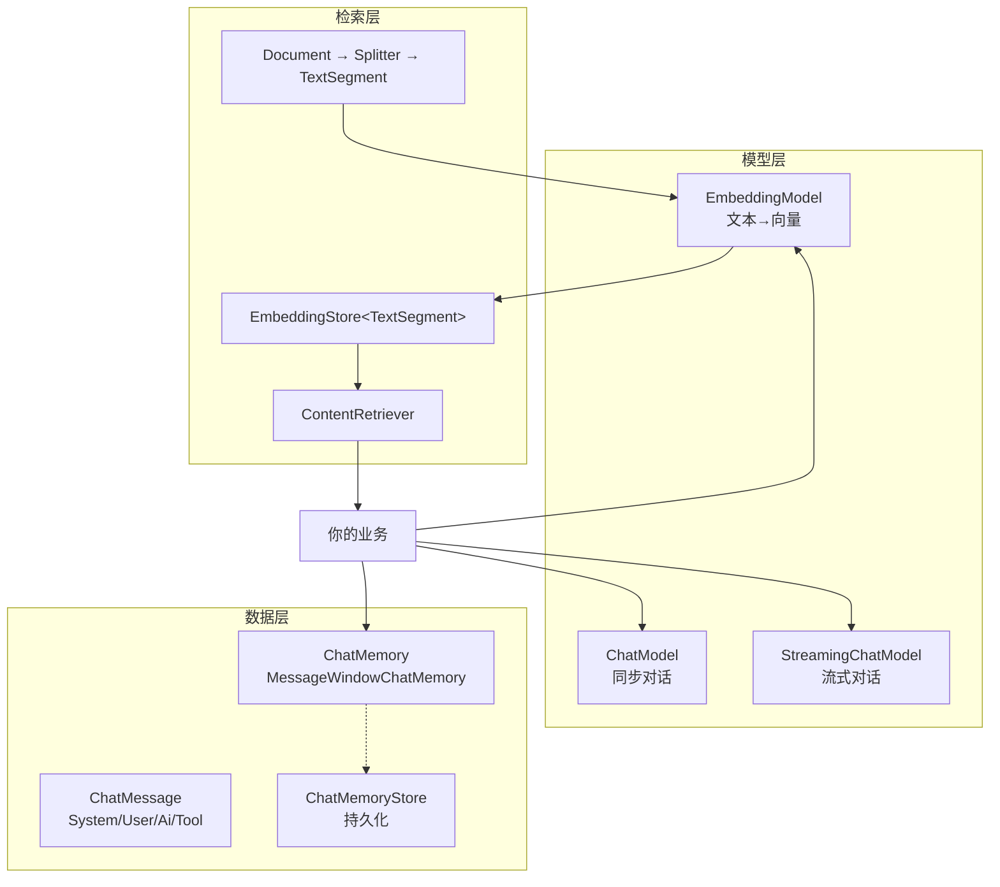
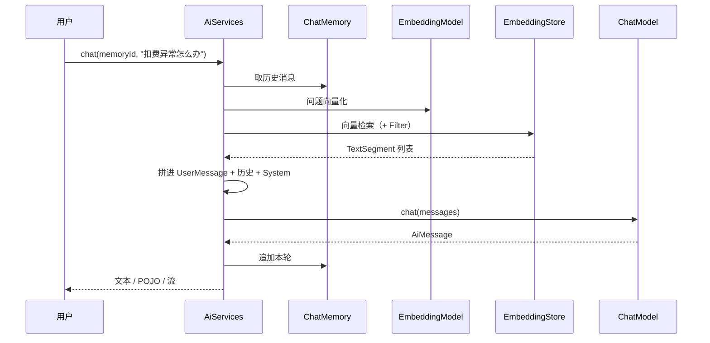

# LangChain4j 核心概念

> [!info] 这份笔记管什么
> LangChain4j 的**五件套**：模型（Chat/Streaming/Embedding）→ 消息 → 记忆 → 向量库 → 切分与过滤。
> 每个概念都给「接口签名 + 关键实现 + 踩坑」，代码在 **1.23.0** 上编译，⭐ 处有真实运行输出。
> 上一篇：[[1-LangChain4j-入门]] · 下一篇：[[3-契约式开发]]

---

## 0. 全景图



只有三个抽象：**模型**、**存储**、**记忆**。其余（AiServices、RAG、Agent）都是在这三层上搭的。

---

## 1. 模型层：三个接口

### 1.1 `ChatModel`（同步）

```java
public interface ChatModel {
    ChatResponse chat(ChatMessage... messages);        // 多消息
    ChatResponse chat(List<ChatMessage> messages);     // 多消息（列表）
    ChatResponse chat(String text);                    // 便捷：单条字符串
    ChatResponse doChat(ChatRequest request);          // 底层：所有调用最终走这里
}
```

> [!tip] `doChat` 是"唯一抽象方法"
> 想自定义模型（比如接自研推理服务），**只实现 `doChat(ChatRequest)` 即可**，其余都是 default 方法。这也是我们做"假模型"跑测试的入口——见 [[5-Agent工具调用#3. 用一个"假模型"验证 Agent 行为 ⭐]]。

典型实现：

| 实现 | 依赖 | 用途 |
|---|---|---|
| `OpenAiChatModel` | `langchain4j-open-ai` | **主力**：OpenAI / DeepSeek / 通义 / vLLM / Ollama 兼容口 |
| `OpenAiStreamingChatModel` | 同上 | 流式 |
| `OllamaChatModel` | `langchain4j-ollama` | 本地模型（原生 API） |
| 其它厂商 | 各自 `langchain4j-<provider>` | Anthropic / Gemini / Mistral… |

```java
ChatModel model = OpenAiChatModel.builder()
        .baseUrl("https://api.deepseek.com/v1")
        .apiKey(System.getenv("DEEPSEEK_API_KEY"))
        .modelName("deepseek-chat")
        .temperature(0.3)
        .maxTokens(2048)
        .timeout(Duration.ofSeconds(60))
        .maxRetries(2)                 // 内置重试（指数退避）
        .logRequests(true)             // 调试期开
        .logResponses(true)
        .build();
```

**成本核算要用的**：

```java
ChatResponse r = model.chat("...");
r.aiMessage().text();     // 文本
r.tokenUsage();           // input / output / total
r.finishReason();         // STOP / LENGTH / TOOL_EXECUTION ...
```

### 1.2 `StreamingChatModel`（流式）

1.x 的回调接口是 `StreamingChatResponseHandler`：

```java
public interface StreamingChatResponseHandler {
    void onPartialResponse(String partialResponse);       // 逐 token
    void onCompleteResponse(ChatResponse completeResponse);// 结束（含用量）
    void onError(Throwable error);
    // 1.x 还提供 onPartialThinking / onPartialToolCall 等 default 方法
}
```

```java
streamingModel.chat("写一段介绍", new StreamingChatResponseHandler() {
    public void onPartialResponse(String p) { out.print(p); out.flush(); }
    public void onCompleteResponse(ChatResponse r) { out.println("\n用量=" + r.tokenUsage()); }
    public void onError(Throwable e) { e.printStackTrace(); }
});
```

> [!warning] 流式和同步是两个 Builder
> `OpenAiChatModel` 和 `OpenAiStreamingChatModel` 是**两个类**，配置项不同（同步有 `maxRetries`、`logRequests`，流式偏少）。想给 AiServices 用流式，要用 `AiServices.builder(...).streamingChatModel(...)`。

### 1.3 `EmbeddingModel`（向量化）

```java
public interface EmbeddingModel {
    Response<List<Embedding>> embedAll(List<TextSegment> segments);   // 必须实现
    int dimension();                                                  // 必须实现
    // 便捷：embed(String) / embed(TextSegment)
}
```

要点：

- **维度必须和向量库字段一致**（Milvus 的 `dim`、pgvector 的 `vector(1024)`）→ 这是最经典的"建库即锁死"问题，见 [[14-AI agent /3-Milvus/5-避坑与排障|Milvus 避坑]] §2
- 批量 `embedAll` 会一次调一次后端，**入库存库时一定要批量**，别循环 `embedAll(List.of(one))`
- 换模型 = 重建库，且要**把模型名写进 metadata**，否则以后无法判断旧数据是哪个模型算的

常用：`OpenAiEmbeddingModel`（拿 OpenAI 协议打 DashScope / 智谱）、`OllamaEmbeddingModel`（本地 bge-m3）。

---

## 2. 消息层：`ChatMessage`

| 类型 | 谁产生的 | 用途 |
|---|---|---|
| `SystemMessage` | 你 | 角色设定、规则、输出格式约束 |
| `UserMessage` | 用户 | 问题；**可以带附件**（图片等，多模态） |
| `AiMessage` | 模型 | 回答；**可能只带 `ToolExecutionRequest`**（要调工具） |
| `ToolExecutionResultMessage` | 框架 | 工具执行结果回灌给模型 |

```java
model.chat(
    SystemMessage.from("你是一个 Java 专家"),
    UserMessage.from("解释一下 volatile")
);
```

> [!note] 为什么必须懂这层
> Agent 的本质就是"消息列表的不断增长"：`User → Ai(toolCall) → ToolResult → Ai(final)`。
> 理解了这四种消息，你就知道"为什么模型会重复调工具""为什么记忆会爆 Context"。

---

## 3. 记忆层：`ChatMemory`

### 3.1 三个实现

| 实现 | 策略 | 适合 |
|---|---|---|
| `MessageWindowChatMemory` | 保留最近 N 条消息（保留 system 在最前） | **默认首选**，简单可预测 |
| `TokenWindowChatMemory` | 保留最近 N 个 token（需 `TokenCountEstimator`） | 成本敏感、上下文窗口紧 |
| 自定义 | 摘要/滑动/向量召回 | 长会话、客服历史 |

```java
ChatMemory memory = MessageWindowChatMemory.builder()
        .id("session-1")                       // 单会话直接给 id
        .maxMessages(20)                       // 注意：按"条"算，不是"轮"
        .chatMemoryStore(myStore)              // 可选：持久化
        .build();
```

### 3.2 多会话：`ChatMemoryProvider` + `@MemoryId`

```java
interface Assistant {
    @SystemMessage("你记得之前聊过什么")
    String chatWith(@MemoryId String chatId, @UserMessage String msg);
}

Assistant ai = AiServices.builder(Assistant.class)
        .chatModel(model)
        .chatMemoryProvider(chatId -> MessageWindowChatMemory.builder()
                .id(chatId)
                .maxMessages(20)
                .build())
        .build();

ai.chatWith("u001", "我叫 Vic");
ai.chatWith("u002", "我叫什么？");   // 看不到 u001 的内容
ai.chatWith("u001", "我叫什么？");   // 能看到
```

⭐ **实测（脚本化假模型，统计每次送进模型的消息数）**：

```text
[memory] 会话u1第2次消息数=4 会话u2首次消息数=2
[memory] u2 看到=[我叫什么]
```

即：u001 第 2 次调用时带上 system + 前两轮 + 本轮 = 4 条；u002 首次只有 system + 本轮 = 2 条。**会话隔离生效**。

> [!danger] 三个必踩的坑
> 1. **用了 `@MemoryId` 却没配 `chatMemoryProvider`** → 构建时直接抛
>    `IllegalConfigurationException: In order to use @MemoryId, please configure the ChatMemoryProvider on ...`（⭐ 实测，构建期就失败，不是运行期）
> 2. **`maxMessages` 是"条"不是"轮"**：一轮问答 = user + ai = 2 条。设 20 其实只记得 10 轮；带工具调用的一轮可能一次吃掉 4~6 条
> 3. **Memory 默认在内存里**，服务重启就丢 → 要 `ChatMemoryStore`（Redis/DB）

### 3.3 持久化：`ChatMemoryStore`

```java
public interface ChatMemoryStore {
    List<ChatMessage> getMessages(Object memoryId);
    void updateMessages(Object memoryId, List<ChatMessage> messages);
    void deleteMessages(Object memoryId);
}
```

> 实现要点：**必须实现 `equals/hashCode`**（框架会用它比较是否同一会话），消息要序列化成 JSON 存 Redis；`deleteMessages` 记得在"清空会话"接口里调，否则 GDPR/隐私合规过不了。

---

## 4. 检索层：`EmbeddingStore` + `ContentRetriever`

### 4.1 `EmbeddingStore`

```java
public interface EmbeddingStore<Embedded> {
    String add(Embedding e);
    String add(Embedding e, Embedded embedded);
    List<String> addAll(List<Embedding> embeddings);
    List<String> addAll(List<Embedding> embeddings, List<Embedded> embedded);
    EmbeddingSearchResult<Embedded> search(EmbeddingSearchRequest request);
    // remove / removeAll(filter) 等 default 方法
}
```

- `Embedded` 泛型：最常用 `TextSegment`（文本 + metadata），也可是自定义实体
- **别把它当生产存储**：内存版只适合上机/单测；真实存储走集成件（`langchain4j-community-milvus`、`-pgvector` 等）
- 想在上机/单测里跑通，可以自己实现一个内存版（本笔记示例就是这么干的）

### 4.2 `EmbeddingStoreContentRetriever`

```java
ContentRetriever retriever = EmbeddingStoreContentRetriever.builder()
        .embeddingStore(store)
        .embeddingModel(embeddingModel)
        .maxResults(5)                                              // 召回池
        .minScore(0.7)                                              // 低于阈值不要
        .dynamicFilter(q -> metadataKey("tenant").isEqualTo(q.metadata().get("tenant")))
        .build();
```

> [!tip] `maxResults` 是"最终条数"，不是"候选池"
> 想要"召回 50 → 精排 5"，在 LangChain4j 原生 RAG 里对应的是 **`ContentAggregator` 的 `maxResults`**：检索器先给大池子，聚合器再收敛。见 [[4-RAG#3. 完整编排：多路召回 + 融合]]。

### 4.3 元数据过滤：`Filter`

```java
import static dev.langchain4j.store.embedding.filter.MetadataFilterBuilder.metadataKey;

Filter f = metadataKey("source").isEqualTo("billing.md");
```

⭐ 实测：`filter=` 打印出来是 `IsEqualTo(key=source, comparisonValue=billing.md)`，是**结构化对象**而非字符串，所以：

- ✅ 类型安全、能拼 `and/or/not`、不会被注入
- ❌ 跨语言移植时**不能照抄 SQL/Milvus 的表达式字符串**（`tenant == "a"`），要用 `metadataKey(...)`

**接了 Milvus 后**，这种"表达式抽象"和 Milvus 原生 filter 语法是两套东西，写错时错误信息很隐晦 → 见 [[4-RAG#5. 接 Milvus]]。

---

## 5. 切分：`Document` → `TextSegment`

```
文件/字符串 → Document(content, Metadata) → DocumentSplitter → List<TextSegment>(text, metadata)
```

```java
Document doc = Document.from(markdown, Metadata.from("source", "billing.md"));
List<TextSegment> segs = splitter.split(doc);   // metadata 会被子段继承
```

可用切分器：`DocumentByLineSplitter`、`DocumentByParagraphSplitter`、`DocumentBySentenceSplitter`、`DocumentByWordSplitter`、`DocumentByCharacterSplitter`、`DocumentByRegexSplitter`。

> [!danger] ⭐ 它们都依赖 opennlp（实测踩坑）
> ```
> java.lang.NoClassDefFoundError: opennlp/tools/sentdetect/SentenceModel
>     at dev.langchain4j.data.document.splitter.DocumentBySentenceSplitter.createSentenceModel
> ```
> `HierarchicalDocumentSplitter` 的**默认子切分器**就是按句切 → 构造阶段就加载 opennlp 的 `SentenceModel`。`langchain4j-core` 不带这个依赖。
> **规律**：`DocumentByLineSplitter`、`DocumentByParagraphSplitter`、`DocumentSplitters.recursive(...)` —— 只要走默认子切分器，都要 opennlp。
> 解决办法见 [[1-LangChain4j-入门#5. ⭐ 实测：切分器的隐藏依赖]]：补齐依赖，或自己写切分（推荐后者，见下）。

```java
// 不依赖任何分词库的稳态写法（本笔记示例用这版）
static List<TextSegment> fixedSplit(String text, int size) { ... }   // 见入门 §5

// 更贴近生产的写法：先按 Markdown 标题切，再在段内做递归/固定长度
```

> [!note] 中文切分要额外注意
> LangChain4j 的切分器按"字符/词/句子"处理，**中文没有空格**：
> - `DocumentByWordSplitter` 对中文效果差（整段算一个"词"）
> - 按句切依赖 opennlp 的英文模型，**对中文标点不友好**
> - 实务做法：按 `###` 标题 + 段落 + 固定长度/重叠切分，chunk 大小按**字符数**控（中文 400~800 字）——与 Milvus 侧结论一致

---

## 6. 一图串起来



看懂这张图，就等于懂了 LangChain4j 全部；后面 4 篇只是把每个盒子展开。

---

## 7. 延伸

- 模型清单：<https://docs.langchain4j.dev/category/integrations>
- RAG 抽象：<https://docs.langchain4j.dev/tutorials/rag>
- 下一步：[[3-契约式开发]]
