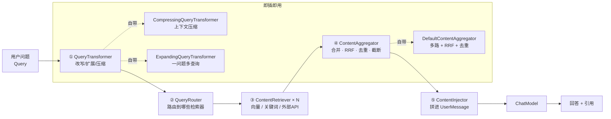

# LangChain4j RAG

> [!info] 这份笔记管什么
> LangChain4j 的 RAG 抽象：**内容检索器 → 查询改写 → 多路路由 → 融合 → 注入**，以及怎么把这一套接到 Milvus。
> 代码在 **1.23.0** 编译通过；⭐ 处是实跑过的（本地 embedding + 内存向量库，不需要 Key）。
> 概念基础：[[2-核心概念#4. 检索层：`EmbeddingStore` + `ContentRetriever`]] · 向量库侧：[[14-AI agent /3-Milvus/4-AI中的用法|Milvus 在 AI 中的用法]]

---

## 1. 原生 RAG 的五个角色



| 角色 | 接口 | 自带实现 | 你能拿来干什么 |
|---|---|---|---|
| ① 查询改写 | `QueryTransformer` | `Compressing`（把多轮对话压成独立问题）、`Expanding`（一问变多问） | 解决"那它呢？"这类指代消解、拓宽召回 |
| ② 路由 | `QueryRouter` | `DefaultQueryRouter`（全部并查）、`LanguageModelQueryRouter`（LLM 选库） | 多知识库/多业务域，避免全网检索 |
| ③ 检索 | `ContentRetriever` | `EmbeddingStoreContentRetriever` | 接向量库；也能自己实现接 ES/BGE/ES+BM25 |
| ④ 聚合 | `ContentAggregator` | `DefaultContentAggregator`（内部用 `ReciprocalRankFuser`） | **多路召回融合**、按分数阈值截断 |
| ⑤ 注入 | `ContentInjector` | `DefaultContentInjector`（模板可改） | 控制引用格式、带哪些 metadata |

> [!note] 和手写 RAG 的关系
> 手写 RAG 你会写 `retrieve()` → `buildPrompt()`；LangChain4j 把中间那 4 步**标准化成接口**。
> 好处：换个"改写策略"只改一行；坏处：**过度抽象**会让问题定位变难（尤其是在过滤器/多路融合上），所以下面 §3 给出"最少抽象"的写法。

---

## 2. 最快接入：一行 RAG

```java
ContentRetriever retriever = EmbeddingStoreContentRetriever.builder()
        .embeddingStore(store)          // 例如 Milvus / pgvector 的 EmbeddingStore
        .embeddingModel(embeddingModel) // 与建库时同一个模型！
        .maxResults(5)
        .minScore(0.6)
        .build();

Assistant assistant = AiServices.builder(Assistant.class)
        .chatModel(model)
        .chatMemory(MessageWindowChatMemory.withMaxMessages(10))
        .contentRetriever(retriever)     // ← 就这一行
        .build();
```

效果：每次调用前自动「问题向量化 → 检索 → 把片段拼进 UserMessage → 调用模型」。

> [!warning] 默认注入格式对引用不友好
> 默认注入器只是把片段拼进去（大致是"Answer using the following information: ..."），**不会自动编号、不会要求引用**。做"可溯源 RAG"必须用 §4 的自定义注入器。

---

## 3. 最少抽象：自己拼（推荐先这么写）

当只有一路检索、你只想控制"片段怎么进 prompt"时，别急着上 `RetrievalAugmentor`：

```java
interface KbAssistant {
    @SystemMessage("""
            你是企业知识库助手。只能依据 <检索结果> 回答，并用 [编号] 标注来源；
            没有依据就回答"知识库中没有相关内容"。
            """)
    String ask(@UserMessage String question);
}

// 业务侧：自己检索、自己拼
List<Content> hits = retriever.retrieve(Query.from(question));

// ⭐ 想拿相似度分数：必须用枚举 key（实测 get("SCORE") 返回 null）
import static dev.langchain4j.rag.content.ContentMetadata.SCORE;
hits.forEach(c -> log.info("score={} meta={}", c.metadata().get(SCORE),
                           c.textSegment().metadata().toMap()));
String ctx = IntStream.range(0, hits.size())
        .mapToObj(i -> "[%d] %s\n%s".formatted(i + 1,
                hits.get(i).textSegment().metadata().toMap(),   // 用 toMap()，别直接 toString
                hits.get(i).textSegment().text()))
        .collect(Collectors.joining("\n\n"));
String prompt = "<检索结果>\n" + ctx + "\n</检索结果>\n\n问题：" + question;
String answer = assistant.ask(prompt);
```

⭐ 实测最终送进模型的消息（假模型截获）：

```text
<检索结果>
[1] {source=billing.md}
扣费异常时可在「控制台-账单-争议」发起申诉，3 个工作日内处理。

[2] {source=billing.md}
# 计费说明
免费额度为每月 100 万 token。
</检索结果>

问题：扣费异常怎么申诉？
```

**为什么先这样写**：

- 调试时能打印 `hits` 的**分数和 metadata**
- 引用编号由你掌控，回查原文非常直接
- 之后想升级成 `DefaultRetrievalAugmentor`（多路/改写/路由），业务接口不变

> 这与 [[14-AI agent /3-Milvus/4-AI中的用法#3.1 完整骨架（可直接改造成生产脚本）⭐|Milvus 笔记里的 RAG 骨架]]是同一思路：**框架是脚手架，不是黑盒**。

---

## 4. 可溯源 RAG：自定义注入器

```java
DefaultContentInjector injector = DefaultContentInjector.builder()
        .promptTemplate(PromptTemplate.from("""
                <检索结果>
                {{userMessage}}
                </检索结果>

                请基于以上内容回答，并用 [编号] 标注来源；没有依据就直说不知道。
                """))
        .metadataKeysToInclude(List.of("source", "section", "page"))  // 只带这些字段进 prompt
        .build();
```

> [!tip] 模板里的 `{{userMessage}}` 是"占位"，被替换成格式化后的片段
> 默认注入器只带**全部 metadata**（可能把大 JSON 带进去，浪费 token）。`metadataKeysToInclude` 是**省 token 的第一开关**。

---

## 5. 完整编排：多路召回 + 融合

```java
// 主检索器：语义
ContentRetriever denseRetriever = EmbeddingStoreContentRetriever.builder()
        .embeddingStore(store).embeddingModel(embeddingModel)
        .maxResults(20)                       // 召回池给大
        .build();

// 第二路：按业务域/章节先过滤（比全库搜准很多）
ContentRetriever titleRetriever = EmbeddingStoreContentRetriever.builder()
        .embeddingStore(store).embeddingModel(embeddingModel)
        .maxResults(10)
        .dynamicFilter(q -> metadataKey("section").isEqualTo("计费"))
        .build();

RetrievalAugmentor augmentor = DefaultRetrievalAugmentor.builder()
        .queryRouter(new DefaultQueryRouter(denseRetriever, titleRetriever))  // 两路都查
        .contentAggregator(new DefaultContentAggregator())                     // RRF + 去重 + 截断
        .contentInjector(injector)
        .executor(Executors.newFixedThreadPool(4))                            // 并行检索
        .build();

Assistant ai = AiServices.builder(Assistant.class)
        .chatModel(model).retrievalAugmentor(augmentor).build();
```

### 5.1 ⭐ `DefaultContentAggregator` 真实行为

- 它内部就是 `ReciprocalRankFuser.fuse(...)`
- 融合后**去重**（同一 segment 在多路被召回只留一条）
- 最后按 `maxResults` 截断

⭐ 实测（本地 embedding + 内存向量库，`minScore=0.1`、`maxResults=5`，命中 2 条）：

```text
meta={source=billing.md} | 扣费异常时可在「控制台-账单-争议」并发起申诉…
raw content=DefaultContent { textSegment = TextSegment {...metadata = {source=billing.md}},
                             metadata = {EMBEDDING_ID=7a73fa45-...,
                                         SCORE=0.30690608848820916} }
```

> [!note] 重要细节（⭐ 实测，最容易找半天的一处）
> **分数不在 `textSegment.metadata()` 里，在 `content.metadata()` 里，而且要按枚举 key 取**：
>
> ```text
> segmentMeta={source=billing.md} | contentMeta=[SCORE, EMBEDDING_ID] | score=0.4080309920…
>
> # 用字符串取是 null！
> c.metadata().get("SCORE")                       // → null
> # 正确写法：
> c.metadata().get(ContentMetadata.SCORE)          // → 0.4080309920…
> c.metadata().get(ContentMetadata.EMBEDDING_ID)   // UUID
> ```
>
> `content.metadata()` 的类型是 `Map<ContentMetadata, Object>`（`ContentMetadata` 是枚举），所以别用 `get("SCORE")`。
> 做「按分数二次过滤」「调阈值」「把命中分显示给用户」都靠它。

### 5.2 融合策略选择

| 场景 | 建议 |
|---|---|
| 向量 + 关键词（两路分数不可比） | **RRF**（`DefaultContentAggregator` 默认行为）——只看排名，天然免疫量纲差异 |
| 明确知道哪路更可信 | 自定义 `ContentAggregator` 加权（要先归一化；LangChain4j 未内置加权融合，需要自己写） |
| 只一路 | 别上聚合器，直接 `contentRetriever(...)` |

> 与 Milvus 侧 `RRFRanker` / `WeightedRanker` 的结论完全一致，见 [[14-AI agent /3-Milvus/1-基础介绍#2.2 三种相似度度量（metric type）|Milvus 基础 §2.2]]。

---

## 6. 查询改写：让多轮对话也能检索

```java
QueryTransformer compressing = new CompressingQueryTransformer(chatModel);
// "那它多少钱？" → 结合历史改写成 "包年套餐多少钱？" 再去检索
```

```java
QueryTransformer expanding = new ExpandingQueryTransformer(chatModel);   // 一问扩成 3 问
```

> [!warning] 改写 = 多一次 LLM 调用（或多次）
> - 延迟 +100~500ms / 次；成本上涨
> - **只在"多轮对话 + 指代严重"的场景开启**，单轮问答没必要
> - 改写质量差时反而会跑偏，要评测（见 §7）

---

## 7. RAG 质量：改什么、怎么验

LangChain4j 只是把链路标准化，**召回质量仍取决于四件事**：

| 变量 | LangChain4j 里的位置 | 怎么验 |
|---|---|---|
| 切分 | `DocumentSplitter` 或自己写 | 固定 query 集看 Hit@5 |
| Embedding 模型 | `EmbeddingModel` | 同数据换模型比指标 |
| 召回池 / 阈值 | `maxResults` / `minScore` / 聚合器 | 看"够不够 + 噪音多不多" |
| 融合 / 改写 / 过滤 | Augmentor 各组件 | 每加一个组件都要出对比 |

> 评估方法论与 Milvus 侧相同，见 [[14-AI agent /3-Milvus/4-AI中的用法#3.4 离线评估（RAG 的硬门槛）|RAG 离线评估]]。

> [!important] 一个和 LangChain4j 强相关、但常被忽略的坑
> **`minScore` 的阈值没有普适值**：COSINE 下 0.7 在 bge-m3 上可能刚好，在 `text-embedding-v4` 上可能全过滤掉。
> 要在你的数据 + 你的模型上**画一条"分数—正确率"曲线**再定，别抄教程的 0.7。

---

## 8. 接 Milvus

### 8.1 三条路线对比

| 路线 | 做法 | 优点 | 缺点 |
|---|---|---|---|
| **A. 社区集成件** | `dev.langchain4j:langchain4j-community-milvus` + `MilvusEmbeddingStore` | 一行接上，代码最少 | 版本要跟 Milvus 服务端对齐；**高级能力（BM25 混合检索、partition key、3.0 在线改 schema）未必暴露** |
| **B. 自己实现 `EmbeddingStore`** | 用 `MilvusClient` 实现 `add/search/remove` | 完全控制 schema、metric、稀疏、过滤 | 要自己写代码、自己保证一致性 |
| **C. 混用** | LangChain4j 管"编排"，pymilvus/milvus-sdk-java 管"检索细节" | 补齐框架缺口 | 两个抽象层，排障成本高 |

```xml
<!-- 路线 A 依赖（版本请以 Maven Central 实际可用为准） -->
<dependency>
    <groupId>dev.langchain4j</groupId>
    <artifactId>langchain4j-community-milvus</artifactId>
    <version>1.23.0</version>
</dependency>
```

### 8.2 推荐：**向量召回用 Milvus 原生，编排用 LangChain4j（路线 B）**

因为 Milvus 的"混合检索 + BM25 + partition key"是它最大的卖点，而这些在通用 `ContentRetriever` 抽象里表达不出来。做法：

```java
// 自己实现一个 ContentRetriever，内部用 milvus-sdk-java 做 hybrid_search
public class MilvusHybridRetriever implements ContentRetriever {

    private final MilvusClientService milvus;   // 封装 insert / hybrid_search
    private final EmbeddingModel emb;

    @Override
    public List<Content> retrieve(Query query) {
        String q = query.text();
        float[] vec = emb.embed(q).content().vector();
        // 稠密 + 稀疏（BM25）双路 → RRF → 取 top K
        List<SearchHit> hits = milvus.hybridSearch(vec, q, /*topK*/ 5, /*filter*/ null);
        return hits.stream()
                .map(h -> Content.from(TextSegment.from(h.text(),
                        Metadata.from(Map.of("source", h.source(), "score", h.score())))))
                .toList();
    }
}
```

> [!tip] 这样做的好处
> 1. 框架层只认 `ContentRetriever` 接口，**Milvus 能力一点不浪费**
> 2. 单元测试可以换成内存实现（[[3-契约式开发#9. 用"假模型"做单元测试 ⭐]])
> 3. 以后换向量库只改一个类

### 8.3 无论哪条路线，这几条都要对齐

- **维度**：`EmbeddingModel.dimension()` == Milvus collection 的 `dim`
- **metric**：建库与检索一致（COSINE/L2 不可互改）
- **模型版本**：写进 metadata，别只写在心里
- **过滤器**：LangChain4j 的 `Filter` 对象不能直接丢给 Milvus，需要转换；转换层要单测
- 以上都是 [[14-AI agent /3-Milvus/5-避坑与排障|Milvus 避坑]] §2 的同一批坑

---

## 9. 一个容易翻车的运行时问题

| 现象 | 原因 | 位置 |
|---|---|---|
| 启动/首次调用报 `NoClassDefFoundError: opennlp/...` | 用了自带切分器但没装 opennlp | [[1-LangChain4j-入门#5. ⭐ 实测：切分器的隐藏依赖]] |
| 检索结果全被过滤 | `minScore` 过高 | §7 |
| 片段重复 / 越拼越长 | 没去重、没截断 | 用 `DefaultContentAggregator` |
| 引用编号错位 | 自己拼 prompt 时编号和展示顺序不一致 | 注入器与前端共用同一排序结果 |
| 多租户串数据 | `dynamicFilter` 取不到租户 | 把 `tenant` 显式传进 `Query.metadata()`，别依赖线程上下文 |

---

## 10. 延伸

- RAG 官方教程：<https://docs.langchain4j.dev/tutorials/rag>
- 进阶（改写/路由/聚合）：<https://docs.langchain4j.dev/tutorials/rag/#advanced-rag>
- 向量库集成列表：<https://docs.langchain4j.dev/category/embedding-stores>
- 下一步：[[5-Agent工具调用]] · [[6-SpringBoot集成]]
