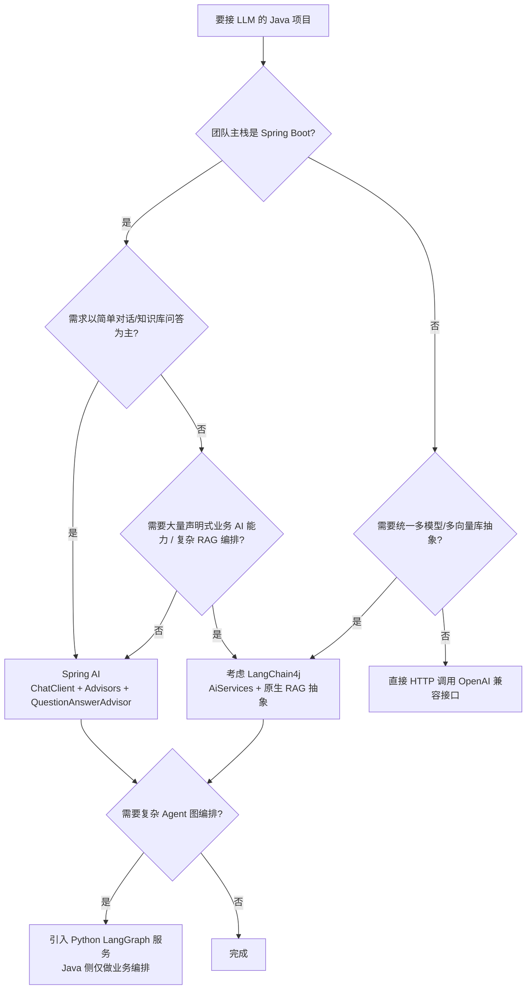

# LangChain4j 选型对比与面试

> [!info] 这份笔记管什么
> - **LangChain4j vs Spring AI vs Python LangChain / LangGraph**：怎么比、怎么选
> - **面试答题骨架 20 题**：含"你项目为什么不用 LangChain4j"这类**反问陷阱**
> - 老代码迁移对照表
> 参照你的既有权重：Spring AI 为主（[[6-ai/AI 学习规划/03-Java开发阶段]]），本文不推翻，只补齐"为什么"。

---

## 1. 三者定位一句话

| 框架 | 一句话 | 最适合 |
|---|---|---|
| **Spring AI** | Spring 官方出品，**"Spring 生态里的 AI 基础设施"**：ChatClient + Advisor + 自动装配 | **Spring Boot 项目集成**，团队已有 Spring 能力 |
| **LangChain4j** | 社区驱动的 **"Java 版 LangChain"**：统一模型/向量库 + **声明式 AiServices** | 需要**抽象完整度高**、代码更"契约化"的 Java AI 应用 |
| **LangChain / LangGraph (Python)** | 生态最大、实验最快；LangGraph 做**图状态机** Agent | 快速验证、复杂 Agent 编排、前沿能力 |

> 三者**不是互斥**：常见架构是"Java 业务系统（Spring AI 或 LangChain4j） + Python Agent 服务（LangGraph）通过 HTTP 调用"。

---

## 2. 深度对比（按工程视角，不按宣传页）

### 2.1 架构与编程模型

| 维度 | LangChain4j 1.x | Spring AI 1.x/2.x |
|---|---|---|
| 核心范式 | **声明式接口**（`AiServices` + 注解） | **命令式客户端**（`ChatClient` 链式）+ **Advisor 链** |
| 拦截扩展 | `AiServiceListener` 事件、`before/afterToolExecution` | **Advisor**（类似 AOP，可插拔） |
| 记忆 | `ChatMemory` / `ChatMemoryProvider` + `@MemoryId` | `ChatMemory` + `MessageChatMemoryAdvisor`（依赖会话 id 透传） |
| RAG | **原生抽象完整**：QueryTransformer / QueryRouter / ContentAggregator / ContentInjector | `QuestionAnswerAdvisor` / `VectorStore`，抽象层较薄，复杂编排要自己写 |
| 结构化输出 | `POJO` 返回 → OutputParser（**默认不强制 JSON 模式**，[[3-契约式开发#5. ⭐ 结构化输出的真实机制（别被宣传误导）]]） | `BeanOutputConverter` / `entity()` |
| 护栏 | **一等公民**：`InputGuardrail` / `OutputGuardrail` | 需自写 Advisor 实现 |
| 工具 | `@Tool` / `@P` + 轮次上限 + 3 个错误处理器 | `@Tool` / `@ToolParam` + `ToolCallAdvisor` |
| 流式 | `TokenStream` 回调 | `Flux<String>`（反应式优先） |

### 2.2 工程与生态

| 维度 | LangChain4j | Spring AI |
|---|---|---|
| 版本节奏 | 主包 `1.23.0`，集成件仍 `-betaXX`（如 `1.23.0-beta33`） | `1.x` 已 GA，`2.x` 迭代中 |
| 依赖坐标 | `dev.langchain4j:*`，模型/向量库拆成大量小包 | `org.springframework.ai:*` + `spring-ai-starter-*` |
| 与 Spring Boot | 提供 starter，但**不是 Spring 官方项目** | **官方项目**，自动装配最顺 |
| JDK 要求 | **17+**（1.x 实测 core 的 `Java-Version: 17`） | 17+（3.x 起） |
| 文档质量 | 教程 + 示例多，但版本间差异大（0.x 教程满地） | 官方文档体系化，但抽象较新、示例相对少 |
| 中国大模型 | 走 OpenAI 协议 `baseUrl` 即可 | 同理；另有 Spring AI Alibaba 等扩展 |
| 企业认可度 | 很多团队在用（尤其"想要 LangChain 手感"的） | Spring 团队的天然选择 |

### 2.3 一张决策图

---

## 3. 迁移对照表（0.x 老代码 → 1.x）

| 0.x（2024 前后大量教程） | 1.x（1.23.0） |
|---|---|
| `ChatLanguageModel` | `ChatModel` |
| `StreamingChatLanguageModel` | `StreamingChatModel` |
| `StreamingResponseHandler` / `onNext` | `StreamingChatResponseHandler` / `onPartialResponse` |
| `model.generate(...)` | `model.chat(...)` |
| `OpenAiChatModel.withApiKey(...)` | `OpenAiChatModel.builder()...build()` |
| `dev.langchain4j.model.chat.response.ChatResponse` 字段名变化 | `aiMessage()` / `tokenUsage()` / `finishReason()` |
| `EmbeddingStoreContentRetriever` 构造器 | `builder()` |
| `ToolExecutionRequest.from(name, args...)` | `ToolExecutionRequest.builder().name().arguments(json)` |
| `RetrievalAugmentor` 里 `contentRetrievers(...)` | `queryRouter(new DefaultQueryRouter(...))` |
| `maxSequentialToolsInvocations` | 已弃用，用 `maxToolCallingRoundTrips` |

> 判断一段代码/教程是不是 1.x：**看有没有 `ChatLanguageModel`**。有就是 0.x。

---

## 4. 给你的决策建议

结合你现在的路线（Spring AI 为主、目标 Java 团队 offer）：

| 场景 | 建议 |
|---|---|
| 主项目（RAG 知识库、智能客服） | **继续 Spring AI**，面试讲"为什么用 Spring AI"的答案更自然 |
| 简历/面试 | 写上"**了解 LangChain4j 的设计取舍**"，能答 §2 的对比即可加分 |
| 遇到 LangChain4j 的岗位 | 本套笔记 + 一个 demo 项目（AiServices + Tool + RAG）足够上手 |
| 想练"契约式"思路 | 理解 `AiServices` 模型后，回头更好理解 Spring AI 的 Advisor 与 **Spring 的 AOP/Facade** 思想 |

> [!important] 面试时最关键的一句话
> **"框架只是壳，决定质量的是工程能力"**：召回质量、护栏、审批、可观测、成本控制——这些换框架不会自动变好。
> 你能讲清"如果换成 LangChain4j，哪些会变、哪些不变"，比背两个框架的 API 强得多。

---

## 5. 面试答题骨架（20 题）

### A. 认知层

**Q1. LangChain4j 是什么？和 LangChain 什么关系？**
> Java 生态里的 LLM 应用框架，**不是 Python LangChain 的 Java 绑定**，两者独立项目、各自演进。
> 它提供：统一模型抽象（OpenAI/Anthropic/Ollama…）、统一向量库抽象、RAG 抽象、声明式 AiServices、工具调用、护栏。

**Q2. 它最核心的设计是什么？**
> **声明式 AI Service**：一个接口 + 注解，框架动态代理生成实现（`AiServices.builder(...).build()` 返回 JDK Proxy）。
> 好处：业务层像调 Repository 一样调 AI；坏处：隐式配置多，写错在构建期才炸。

**Q3. 和 Spring AI 最大的区别？**
> **编程模型**：LangChain4j 是"契约式接口"，Spring AI 是"命令式 ChatClient + Advisor 链"。
> **生态归属**：Spring AI 是 Spring 官方，自动装配与 Spring 生态结合更紧；LangChain4j 抽象更完整（尤其 RAG 和护栏）。

**Q4. LangChain4j 的 RAG 抽象有哪几层？**
> QueryTransformer（改写）→ QueryRouter（路由）→ ContentRetriever（检索）→ ContentAggregator（融合/去重/截断）→ ContentInjector（注入 Prompt）。

**Q5. 它的 `ChatModel` 和 `StreamingChatModel` 为什么是两个接口？**
> 同步与流式的返回值/错误语义不同，拆开避免"传了流式模型却调同步方法"这类运行时错误；且流式模型配置项也不同。
> 1.x 统一了"模型实现统一 API、能力差异用接口区分"。

### B. 工程层（区分"会用"和"落地过"）

**Q6. 结构化输出怎么保证可靠？**
> ① 返回 POJO，框架从 Java 类型推导 JSON Schema 并做 OutputParser；
> ② **注意**：`AiServices` 默认**不强制**模型开 JSON 模式，要自己配 `responseFormat(JSON)` / 提示词里显式给 schema；
> ③ 枚举约束取值；④ 解析失败要 try-catch 降级；⑤ 用 `Result<T>` 保留元信息。

**Q7. 多会话记忆怎么做？重启会丢吗？**
> `ChatMemoryProvider` + `@MemoryId`，框架按 id 隔离；默认在 JVM 内存，重启丢失 → 实现 `ChatMemoryStore` 落 Redis/DB。
> 坑：`@MemoryId` 未配 provider 时**构建期**抛 `IllegalConfigurationException`。

**Q8. `maxMessages` 的语义是什么？**
> 按**条数**不是轮数。一轮问答 2 条，带工具的一轮可能 4~6 条 → 设 20 大约只记 10 轮，有工具时更少。

**Q9. 工具调用为什么贵？**
> 每次"模型→工具→模型"都是一次完整 LLM 调用；且**每轮都重新发送工具定义**。实测：1 次工具调用 = 2 次模型调用、消息从 2 条涨到 4 条。
> 对策：`maxToolCallingRoundTrips`、按场景拆工具、精简工具描述。

**Q10. 怎么防止 Agent 死循环？**
> 轮次上限 + 全局超时 + 单请求费用上限（累计 tokenUsage）；工具错误回灌给模型（`toolExecutionErrorHandler`）而不是抛异常；幂等/限流。

**Q11. 敏感操作（退款）怎么让 AI 做而不出事？**
> **门面工具**：AI 只能"申请"，真正执行在审批通过后的服务端；工具内强校验（当前用户、金额阈值）、幂等、审批回调、审计日志（`afterToolExecution`）。
> LangChain4j 不像 LangGraph 能暂停整张图，但"接口式暂停"更容易接企业 OA/工单。

**Q12. 护栏怎么用？和海量正则一样吗？**
> `InputGuardrail`（可 fatal 直接终止、省钱）+ `OutputGuardrail`（可 retry 重生成）。
> 但护栏只是第一层，要配合 System Prompt 边界、工具权限收敛、人工兜底。

**Q13. 怎么测 AI 功能？**
> 两级：① **编排逻辑**——脚本化假模型（实现 `ChatModel.doChat`）断言消息序列/记忆隔离/工具回灌，不烧钱；② **效果**——固定评测集算 Hit@5 / 准确率 / 引用正确率。

**Q14. 多个知识库怎么检索？**
> `DefaultQueryRouter` 并查，或 `LanguageModelQueryRouter` 让 LLM 选库；融合后 `DefaultContentAggregator` 做 RRF。

**Q15. LangChain4j 里 RAG 的相似度分数在哪拿？**
> 不在 `textSegment.metadata()`，而在 `content.metadata().get(ContentMetadata.SCORE)`；用字符串 key 会返回 null。

**Q16. 切分遇到什么坑？**
> 1.23.0 上自带切分器（`DocumentSplitters.recursive` / Paragraph / Line）的默认子切分器依赖 **opennlp**，而 core 不引入 → 运行期 `NoClassDefFoundError`。
> 要补依赖或自实现；中文还要注意按字符/标题切，别用按词切。

**Q17. Spring Boot 里怎么接？**
> `langchain4j-spring-boot-starter`（`@AiService` 扫描 + RAG 配置）+ `langchain4j-open-ai-spring-boot-starter`（模型 Bean）。
> 模型 Bean 由 `langchain4j.open-ai.chat-model.*` 配置创建，**`api-key` 属性不存在时 Bean 不会被创建**。

### C. 反问/陷阱题

**Q18. 你项目为什么用 Spring AI 而不是 LangChain4j？**
> 得分结构：
> 1. **团队与生态**：项目是 Spring Boot 微服务，Spring AI 官方自动装配、与现有 Bean/配置/监控体系一致，学习与维护成本最低
> 2. **需求匹配**：核心是 RAG 问答 + 流式 + 少量工具调用，Spring AI 的 `ChatClient` + `QuestionAnswerAdvisor` + `Flux` 够用
> 3. **风险控制**：Spring AI 已 GA，LangChain4j 部分集成件仍是 beta
> 4. **已知取舍**：我了解 LangChain4j 在 RAG 抽象（QueryTransformer/Aggregator）和护栏上更完整；如果后续要做复杂的多路召回与策略编排，会评估引入

**Q19. 那 LangChain4j 有什么值得学的？**
> 声明式 AiServices 的"契约优先"思路、护栏一等公民、脚本化假模型测试法、完整 RAG 抽象。这些**思想可以搬到 Spring AI 上**（例如自己写 Advisor 实现护栏）。

**Q20. 如果让你把 LangChain4j 换成 Spring AI，要改哪些？**
> ① 模型装配（builder → starter 配置）；② 接口注解 → ChatClient/Advisor；③ RAG 编排 → VectorStore + Advisors 或自写检索服务；④ 工具注解改名（`@P` → `@ToolParam`）；⑤ 记忆从 `@MemoryId` → 会话 id 透传 + Advisor；⑥ 护栏要自写 Advisor。
> **不变的部分**：数据建模、切分、向量库 schema、评测集、审批与权限、成本策略。

---

## 6. 常见翻车表述（别这么说）

| 说法 | 问题 |
|---|---|
| "LangChain4j 就是 LangChain 的 Java 版" | 严格说是"Java 生态的同类框架"，二者独立演进 |
| "我用了 `ChatLanguageModel`" | 1.x 已改名 `ChatModel`，暴露没跟上版本 |
| "LangChain4j 能自动让模型输出 JSON" | 默认不强制 JSON 模式，要自己配（§ Q6） |
| "护栏能完全防住提示词注入" | 只能挡明显攻击，要分层 |
| "Agent 能自己决定退款" | 合规上必须人工审批 + 服务端强校验 |

---

## 7. 延伸

- 官方文档：<https://docs.langchain4j.dev>
- Spring AI 官方：<https://docs.spring.io/spring-ai/reference/>
- 你的选型出处：[[6-ai/AI 学习规划/技术栈地图]]
- Spring AI 侧答题：[[14-AI agent /2-spring ai/RuoYi-Spring-AI-面试题|RuoYi × Spring AI 面试题]]
