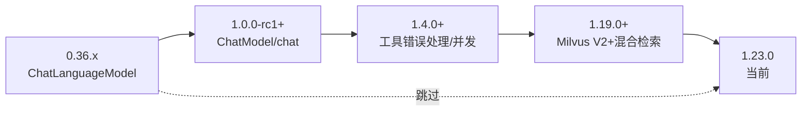

# LangChain4j 版本记录

> [!info] 这份笔记管什么
> LangChain4j 的**真实版本时间线 + 关键变更 + 升级决策**，回答：
> - 现在该用哪个版本？组件为什么版本号不一致？
> - 哪些版本号**绝对不能用**？
> - 0.x 教程为什么在 1.x 上跑不起来？具体卡在哪一步？
>
> **数据来源（均现场核对，非记忆）**：
> - GitHub Releases API：`langchain4j/langchain4j`，共 **92 个 release**
> - Maven Central `maven-metadata.xml`：`langchain4j-core` 共 **113 个版本**（含测试版），最后更新 `2026-10-28`
> - **逐版本下载 jar 用 `unzip -l` 检查类是否存在**，确定改名发生的精确版本
> 核对时间：**2026-10-29**

---

## 1. 一页看懂当前版本体系

```
langchain4j-core  1.23.0           ← 稳定（无 "beta" 字样）
langchain4j       1.23.0           ← 稳定，依赖 core
langchain4j-open-ai 1.23.0         ← 稳定
langchain4j-bom   1.23.0           ← 稳定（统一管理下面所有模块）

langchain4j-spring-boot-starter    1.23.0-beta33   ← 集成件，永远是 beta 号
langchain4j-open-ai-spring-boot-starter 1.23.0-beta33
langchain4j-milvus                 1.23.0-beta33   ← 社区/集成模块同样 beta
```

> [!danger] 这是最容易翻车的地方：同一次发布里，两个版本号并存
> 官方每个 release 的标题就写着 **`1.23.0 and 1.23.0-beta33`**。
> 即：**核心 + 主流厂商模型包 = 正式号；其余模块（集成、Spring starter、向量库、社区）= 同序号 beta 号**。
> 两个号**必须配对使用**，混搭会出现 `NoSuchMethodError` / 找不到类。

### 1.1 配对规律（已核对多个版本）

| 正式版 | 对应 beta | 配对规律 |
|---|---|---|
| 1.0.0 | 1.0.0-beta5 | 不固定，每个大版本起点不同 |
| 1.4.0 | 1.4.0-beta10 | — |
| 1.10.0 | 1.10.0-beta18 | — |
| 1.18.0 | 1.18.0-beta28 | — |
| 1.20.0 | 1.20.0-beta30 | 序号间隔缩小 |
| **1.23.0** | **1.23.0-beta33** | 当前 |

> beta 序号**不是**"第几个 beta"，而是**这条线的第几次发布**，所以只能"看官方 release 标题配对"，不能自己推算。

### 1.2 一条经验规则

> **用 `langchain4j-bom` 统一管理，不要手写每个模块的版本号。**

```xml
<dependencyManagement>
    <dependencies>
        <dependency>
            <groupId>dev.langchain4j</groupId>
            <artifactId>langchain4j-bom</artifactId>
            <version>1.23.0</version>
            <type>pom</type>
            <scope>import</scope>
        </dependency>
    </dependencies>
</dependencyManagement>

<dependencies>
    <dependency>
        <groupId>dev.langchain4j</groupId>
        <artifactId>langchain4j</artifactId>
    </dependency>
    <dependency>
        <groupId>dev.langchain4j</groupId>
        <artifactId>langchain4j-spring-boot-starter</artifactId>
    </dependency>
</dependencies>
```

`langchain4j-bom` 自身是**正式号**（`1.23.0`），但它内部已经把所有模块映射到正确版本（含 beta 号）。这是唯一不用记"配对表"的办法。

---

## 2. 版本时间线（全量）

### 2.1 0.x 时代（2023-06 ~ 2024-11）：快速迭代，113 天一个版本

| 版本 | 日期 | 里程碑 |
|---|---|---|
| 0.1.0 ~ 0.4.0 | 2023-06-20 | 首批版本，同一天连发 4 个 |
| 0.5.0 ~ 0.18.0 | 2023-06 ~ 08 | **高频**：两个月内 14 个版本，几乎全是新集成 |
| 0.19.0 | 2023-08-10 | 每用户独立记忆、DOC/XLS/PPT loader、工具强制调用 |
| **0.23.0** | 2023-09-29 | **架构转折**：模型 API 返回 `Response<T>`（带 token 用量/结束原因）；**所有集成拆成独立模块**；接入 Milvus / Elasticsearch / Redis |
| 0.24.0 | 2023-11-12 | Milvus 支持 database 配置；Spring Boot starter 支持自定义 baseUrl |
| **0.26.1** | 2024-01-30 | **Advanced RAG**（QueryTransformer/Router/Aggregator 体系）+ **多模态图片输入** |
| 0.28.0 | 2024-03-11 | 接入 Anthropic、智谱；**EmbeddingStore 元数据过滤 API**（`metadataKey(...)` 从此可用） |
| **0.29.0** | 2024-03-26 | **Easy RAG**（一行 RAG）+ **Spring Boot 声明式 AI Services**（`@AiService` 前身） |
| 0.34.0 | 2024-09-05 | 结构化输出：自动剥离 JSON 代码块再解析；`TokenStream` 返回 RAG 来源 |
| **0.36.0** | 2024-11-13 | **Java 17 成为基线**（JDK 8/11 到此为止）；`@Deprecated(forRemoval)` 清理开始 |
| **0.36.2** | 2024-11-21 | 0.x 最后一个版本（修 Spring Boot starter 破坏配置类的问题） |

> [!note] 0.x 的教训
> 两个月发 14 个版本，**0.x 代码几乎没有"长期可维护"的说法**。看到任何 2023~2024 的教程，先判断它基于哪个 0.x 版本，再决定能不能抄。

### 2.2 1.0 前的准备期（2024-12 ~ 2025-05）

| 版本 | 日期 | 关键变更 |
|---|---|---|
| 1.0.0-alpha1 | 2024-12-22 | 宣布 1.5 年后开始冲刺 1.0；**新 `ChatLanguageModel` API**（revamped）；**MCP 客户端**首次实现 |
| 1.0.0-beta1 | 2025-02-10 | `generate(...)` 被标记废弃，改用 `chat(...)`；开始解耦 OkHttp |
| 1.0.0-beta2 | 2025-03-13 | OpenAI 迁移到 `HttpClient`；支持官方 OpenAI Java SDK |
| 1.0.0-beta3 | 2025-04-11 | 结构化输出支持更多返回类型；修复 `ChatMemory` 缓存内存泄漏 |
| **1.0.0-rc1** | **2025-05-02** | ⭐ **`ChatLanguageModel` → `ChatModel`、`StreamingChatLanguageModel` → `StreamingChatModel` 就在这一版**（见 §3.1 实测） |
| **1.0.0** | **2025-05-14** | 正式 GA：`langchain4j-core` / `langchain4j` / `langchain4j-open-ai` / `-bom` 转正；其余模块 `1.0.0-beta5` |

### 2.3 1.x 逐步转正（2025-06 ~ 2026-06）

LangChain4j 的 1.x 采用**"逐批转正"**：每个版本只把一部分模块从 beta 提升为正式号。

| 版本 | 日期 | 转正 / 新增模块 | 核心能力 |
|---|---|---|---|
| 1.1.0 | 2025-06-18 | anthropic / azure-open-ai / bedrock / google-ai-gemini / mistral-ai / ollama → `1.1.0-rc1` | — |
| 1.2.0 | 2025-07-29 | 上述模块全部 → `1.2.0` 正式 | — |
| **1.3.0** | 2025-08-07 | 新增 `langchain4j-agentic` | **Agentic 模块诞生**（多 Agent 编排） |
| **1.4.0** | 2025-08-28 | — | **AI Service：工具并发执行、工具参数/执行错误处理器、多模态**（本文 [[5-Agent工具调用]] 的核心 API 集中出现在这一版） |
| 1.5.0 | 2025-09-16 | MCP registry | Agentic 异步 Agent；Bedrock prompt caching |
| 1.6.0 | 2025-09-26 | — | Agentic 稳定性（异步收尾、命名唯一） |
| 1.7.0 / 1.7.1 | 2025-10-02 | — | Agentic 支持基于类创建 Agent |
| 1.8.0 | 2025-10-24 | — | **流式取消**、输出护栏可重写整条 AiMessage |
| 1.9.0 | 2025-11-26 | — | 通用 Agentic planner；MCP WebSocket |
| 1.10.0 | 2025-12-24 | — | 模型目录；AI Service 方法参数可传 `ChatRequestParameters` |
| 1.11.0 | 2026-02-04 | — | Agentic 流式/多模态；Elasticsearch 混合检索 |
| **1.12.1** | 2026-03-05 | Hibernate EmbeddingStore | **Micrometer 指标 + Observation API**；Agent Skills |
| 1.13.0 | 2026-04-09 | — | Agentic 状态可持久化/恢复；工具可返回图片 |
| 1.14.0 | 2026-04-30 | — | AI Service 支持多态返回类型；`ReturnBehavior.IMMEDIATE_IF_LAST` |
| 1.15.0 | 2026-05-15 | `langchain4j-google-genai` | `@Tool` 参数默认值；Agent 可选不同 ChatModel |
| 1.16.0 | 2026-06-05 | — | `@Tool` 可从父类/接口继承（**Breaking**）；Blackboard 模式 |
| 1.17.0 | 2026-06-26 | — | Debate 模式；工具可声明补偿动作；Oracle 聊天记忆 |
| **1.18.0** | 2026-07-17 | — | **Agentic Human-in-the-Loop（可中断/恢复）**；BDI 模式；OpenAI TTS；EmbeddingModel 新请求/响应 API |

### 2.4 近期（2026-08 ~ 10）

| 版本 | 日期 | 与你相关的变更 |
|---|---|---|
| **1.19.0** | 2026-08-14 | ⭐ **Milvus 集成迁移到 V2 API 并支持混合检索**（`langchain4j-milvus`，PR #3311）；MCP 2026-07-28 规范；Agentic 工具补偿 |
| **1.20.0** | 2026-09-04 | ⭐ **非阻塞/响应式 AI Service**（`CompletableFuture` 返回）；Jackson 3 可选；修复 Milvus 特殊字符 ID 查询 |
| 1.20.1 / 1.20.2 | 2026-09-25 / 28 | 修复性小版本（A2A、MCP 参数） |
| **1.21.0** | 2026-10-02 | ⭐ **Decision Models**（一次调用返回答案+概率，用于路由/重排/护栏）+ `DecisionRouterPlanner`；**工具错误可按异常类型决定回灌内容** |
| 1.22.0 | 2026-10-08 | OpenAI Decisions API；Bedrock/Anthropic 批处理；Anthropic 提示词缓存 |
| **1.23.0** | **2026-10-28** | ⭐ **`langchain4j-test`（LLM 判官 + 断言）**；`AiServiceInvocationSummaryEvent`（一次 AI 调用聚合所有事件）；agentic 模式：Confidence Cascade、Decision Agents；工具执行上下文传播 |

### 2.5 需要留意的"影子维护线"

GitHub 上还看到 **`1.5.2` / `1.5.3` / `1.11.7` ~ `1.11.11`** 这些**晚于主线发布**的旧版本，日期在 2026-05 ~ 08 之间。

> 这是**维护分支打补丁**：旧版本仍在修安全/兼容问题。
> **决策含义**：如果你因某些原因停在 `1.11.x`，不要以为"已经没人管了"——可以查有没有对应补丁；但**新项目仍应上主线最新**。

---

## 3. ⭐ 用 jar 实测验证的关键改名（能省你半天）

### 3.1 `ChatLanguageModel` → `ChatModel` 发生在 **1.0.0-rc1**

逐版本下载 `langchain4j-core` 并用 `unzip -l` 检查：

```text
1.0.0-alpha1  ChatLanguageModel=1  ChatModel=0
1.0.0-beta1   ChatLanguageModel=1  ChatModel=0
1.0.0-beta3   ChatLanguageModel=1  ChatModel=0
1.0.0-rc1     ChatLanguageModel=0  ChatModel=1     ← 就在这一版切换
1.0.0         ChatLanguageModel=0  ChatModel=1
...直到 1.23.0 都只有 ChatModel
```

**流式接口同步切换**：

```text
1.0.0-beta3   StreamingChatLanguageModel=1  StreamingChatModel=0
1.0.0-rc1     StreamingChatLanguageModel=0  StreamingChatModel=1
```

> [!warning] 这条比"1.0 改名"更精确
> 说"1.0 改名"会对不上 `1.0.0-alpha1~beta3`（那些版本还是 `ChatLanguageModel`）。
> 准确说法：**从 `1.0.0-rc1`（2025-05-02）开始是 `ChatModel`**。

### 3.2 回调接口的过渡期

`StreamingChatResponseHandler` 在 **`1.0.0-beta3` 就已出现**，但旧的 `StreamingResponseHandler` **同版本仍然并存**（删改是渐进的）：

```text
1.0.0-beta3   StreamingResponseHandler=2  StreamingChatResponseHandler=1   ← 新旧共存
1.0.0-rc1     StreamingResponseHandler=2  StreamingChatResponseHandler=1
```

> 这意味着**看一个项目用的哪个 API，不能只判断"1.0 前后"**，还要看子版本。

### 3.3 一句判断口诀

| 代码特征 | 版本区间 |
|---|---|
| `ChatLanguageModel` / `generate(...)` | ≤ `1.0.0-beta3` |
| `ChatModel` / `chat(...)` | ≥ `1.0.0-rc1` |
| `@AiService`（Spring）+ Easy RAG | ≥ `0.29.0` |
| `maxToolCallingRoundTrips`、工具错误处理器 | ≥ `1.4.0` |
| 流式可取消 | ≥ `1.8.0` |
| Milvus 混合检索 | ≥ `1.19.0` |
| 非阻塞 AI Service | ≥ `1.20.0` |
| `langchain4j-test` | ≥ `1.23.0` |

---

## 4. ⚠️ 避坑：**1.19.1 是有害的版本号**

官方 release 说明原文（节选）：

> **This release was published by mistake. Do not use it.**
> 它从 `main` 而非 `release/1.19.x` 切出，**名义上是 1.19.0 的补丁，实际内容包含整个 1.20.0 及更多**。
> Maven Central 不可变，这些构件无法撤回，官方备注是唯一的警示。

官方给的处置表：

| 你当前在 | 应该用 | 原因 |
|---|---|---|
| `1.19.0` 及更早，想留在 1.19.x | **`1.19.2`** | 真正的补丁：1.19.0 + MCP backports |
| 已经在 `1.19.1` | **`1.20.0` 或更高** | 1.19.1 相当于"提前吃了 1.20" |
| 其他 | `1.20.0`（当时最新） | — |

> [!danger] 典型陷阱
> **已经在 `1.19.1` 的，不要"升级"到 `1.19.2`** —— 版本号更高，但代码更少，属于**回退**。
> 你们的依赖扫描/自动升级工具（Dependabot、Renovate）如果只看版本号，很容易踩这个坑。
> **排查方法**：`mvn dependency:tree | grep 1.19.1` 一次性确认。

---

## 5. 升级路线与检查清单

### 5.1 0.3x → 1.23（最常见的迁移）



**不要逐版本升**，直接跳到目标版本，靠编译错误驱动修改即可。但下面这些**必须人工检查**（编译器抓不到）：

| # | 检查项 | 从哪个版本起 |
|---|---|---|
| 1 | Java 基线 **17** | 0.36.0 |
| 2 | `ChatLanguageModel` → `ChatModel`、`generate` → `chat` | 1.0.0-rc1 |
| 3 | 结构化输出：确认是否需要显式 `responseFormat(JSON)` | 1.0.x |
| 4 | 工具配置：`maxToolCallingRoundTrips`、错误处理器签名 | 1.4.0 |
| 5 | `maxSequentialToolsInvocations` 已弃用（实测告警） | ~1.x 后期 |
| 6 | `@Tool` 可从父类/接口继承（行为变化，可能多出工具） | **1.16.0（Breaking）** |
| 7 | Milvus 集成切换 V2 API + 混合检索：`EmbeddingStore` 构造/参数可能变 | **1.19.0** |
| 8 | 异步/非阻塞 AI Service 的默认行为与同步路径不同 | **1.20.0** |
| 9 | `ChatMemory` 缓存相关修复（内存泄漏） | 1.0.0-beta3 |
| 10 | Spring starter 配置项改名（`language-model` → `chat-model` 等） | 1.x 期间 |

### 5.2 版本选择建议

| 场景 | 建议 |
|---|---|
| 新项目 | **1.23.0**（+ BOM 管版本） |
| 要用 Milvus 混合检索 | ≥ **1.19.0** |
| 要用 `langchain4j-test` 做 AI 单测 | ≥ **1.23.0** |
| 团队保守，只看重稳定 | 用**主线次末版**（如 1.22.0）为期一个月观察后再上最新 |
| 绝对不要 | **`1.19.1`** |
| 还在 0.x | 尽快迁（Java 17 + 1.0 之后 API 变化巨大，继续维护成本更高） |

---

## 6. 如何自己复核（不依赖本笔记）

```bash
# 1) 官方 release 列表 + 发布日期 + 正文
curl -s "https://api.github.com/repos/langchain4j/langchain4j/releases?per_page=100" | jq -r '.[] | "\(.tag_name)\t\(.published_at[0:10])"'

# 2) Maven 上的全部版本与最后更新时间
curl -s "https://repo1.maven.org/maven2/dev/langchain4j/langchain4j-core/maven-metadata.xml" | grep -E "<version>|<lastUpdated>"

# 3) 某个类在哪个版本存在（判断改名/新增）
curl -sL -o core.jar "https://repo1.maven.org/maven2/dev/langchain4j/langchain4j-core/1.0.0-rc1/langchain4j-core-1.0.0-rc1.jar"
unzip -l core.jar | grep "model/chat/ChatModel.class"
```

> 建议每季度跑一次 ①②，把结果更新到本文 §2。

---

## 7. 与 Spring AI 的版本节奏对照

| 维度 | LangChain4j | Spring AI |
|---|---|---|
| 当前稳定版本 | **1.23.0**（2026-10-28） | **2.0.x**（2.1.0 在 M / RC） |
| 版本号形态 | **双轨**：核心正式号 + 集成件 beta 号 | 单版本线：starter 与核心同号 |
| 正式版起点 | 1.0.0（2025-05-14），历经 alpha/beta/rc 半年 | 1.0.0 前经历 M1~M8 / RC1 里程碑 |
| 发版节奏 | **约每月 1~2 个**（1.19→1.23 仅 2 个月 5 个版本） | 里程碑制，节奏更慢 |
| 升级负担 | 快、但**每版都有 Breaking 可能**（如 1.16 `@Tool` 继承、1.19 Milvus V2） | 慢，但 Spring 风格的兼容性更好 |
| 对选型的含义 | 适合"愿意跟版本"的团队 | 适合"求稳、跟 Spring 走"的团队 |

> 这与 [[7-选型对比与面试]] §2 的结论一致：**LangChain4j 的迭代速度是它的优势和风险兼有的一面**。面试答"为什么选 Spring AI"时，"版本稳定性/发版节奏"是一个站得住的理由。

---

## 8. 关联

- 入门与迁移雷区：[[1-LangChain4j-入门#4. 版本与迁移雷区（**必看**）]]
- 选型对比：[[7-选型对比与面试#2.2 工程与生态]]
- 依赖坐标：[[0-LangChain4j-知识库索引#4. 环境与依赖（可直接复制）]]
- 官方 Releases：<https://github.com/langchain4j/langchain4j/releases>
- Maven Central：<https://central.sonatype.com/artifact/dev.langchain4j/langchain4j>
