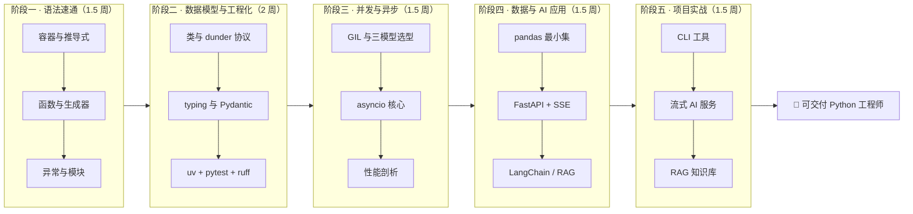
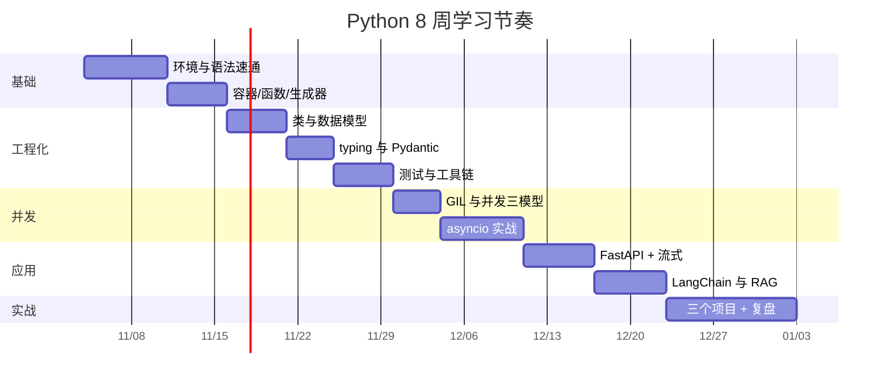
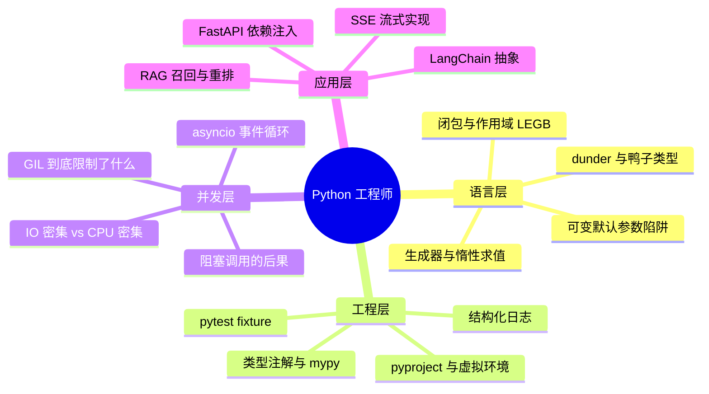
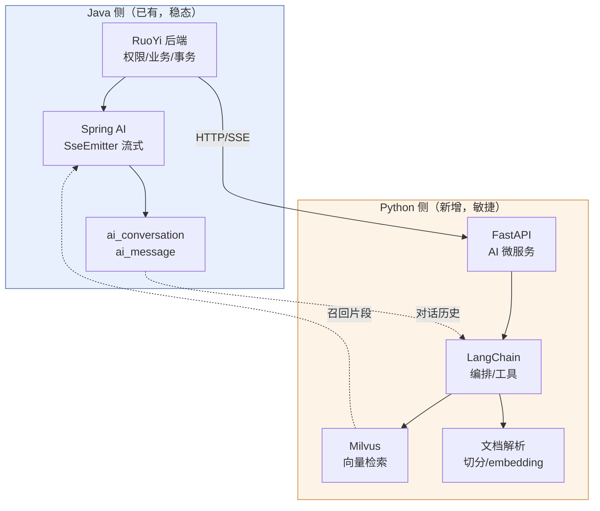

# 🐍 Python 学习计划总览

> [!tldr] 一句话目标
> **8 周内：从「Java 老手」变成「能写生产级 Python 服务 + AI 应用」的工程师，产出 3 个可演示项目。**

> [!note] 这份计划的定位
> 你不需要"从零学编程"，也不需要看"什么是变量"。这是一份 **Java → Python 的迁移式学习计划**：
> 所有知识点都按「Java 里有 X，Python 里对应 Y，差异坑在哪」来组织。
> 终点不是"会 Python 语法"，而是**能用 Python 独立交付一个带异步、带 AI 调用、带向量检索的服务**。

---

## 一、路线图

### 周历（Gantt）

> [!tip] 节奏建议
> 工作日 1.5h（40min 学 + 60min 写代码 + 10min 记笔记），周末各 3h 做整块项目。
> **宁可砍内容，不要砍动手时间**——Python 的坑全在"看起来懂了"和"真跑起来"之间。

---

## 二、周计划表

| 周 | 主题 | 核心产出 | 验收标准 |
| --- | --- | --- | --- |
| W1 | 环境 + 语法速通 | 一个 200 行的命令行小工具 | 能不看文档写出推导式、解包、f-string |
| W2 | 函数、生成器、异常、模块 | 日志分析 CLI（流式读大文件） | 内存不随文件增大而暴涨 |
| W3 | 类、dunder、dataclass | 把 W2 的 CLI 重构为包 + 类结构 | 有 `__repr__`/`__eq__`/`__enter__` |
| W4 | typing、Pydantic、依赖管理 | 一个带 schema 校验的配置加载器 | `mypy --strict` 基本通过 |
| W5 | pytest、logging、ruff | 给前面代码补 80% 覆盖的测试 | `pytest -q` 全绿，覆盖率 > 80% |
| W6 | 并发三模型 + asyncio | 并发抓取器（限流 + 重试） | 100 个请求 10s 内完成，无泄漏 |
| W7 | FastAPI + SSE + LLM 调用 | 流式 AI 问答 API（对接 DashScope） | 前端能逐字吐出 token |
| W8 | RAG + 项目收尾 | 文档知识库问答（Milvus） | 能回答带引用的领域问题 |

---

## 三、能力验收（学完应该能回答）

> [!success] 硬指标（做不到就是没学会）
> 1. 能解释 `def f(x, acc=[])` 为什么是 bug，并说出两种修法。
> 2. 能说清 GIL 存在时，为什么 `asyncio` 还能提升吞吐。
> 3. 能手写一个 async 版的限流 + 重试 + 超时控制。
> 4. 能解释 `await` 忘记写会发生什么，以及怎么用 lint 拦住。
> 5. 能画出你的 RAG 链路，并说明每一层可能丢信息的地方。

---

## 四、和现有技术栈的衔接

你不是在学一门孤立语言，而是在给已有的 AI 能力补一条腿：

> [!warning] 边界原则
> **业务与权限留在 Java，模型与检索放在 Python。**
> 不要把已经稳定的 RuoYi 事务逻辑搬去 Python 重写；也不要硬用 Spring AI 去啃 Python 生态里的新玩具。
> 两边通过 HTTP/SSE + 内部 token 通信，Python 侧永远是无状态可水平扩容的。

---

## 五、笔记索引

| 文档 | 内容 | 状态 |
| --- | --- | --- |
| [[01-阶段一-语法速通（Java 对照）]] | 类型、容器、推导式、函数、生成器、异常 | ⬜ |
| [[02-阶段二-数据模型与工程化]] | 类、dunder、dataclass、typing、uv、pytest | ⬜ |
| [[03-阶段三-并发与异步]] | GIL、三模型选型、asyncio、性能剖析 | ⬜ |
| [[04-阶段四-数据与 AI 应用]] | pandas、FastAPI、SSE、LangChain、RAG | ⬜ |
| [[05-阶段五-项目实战与验收]] | 三个项目、验收清单、面试高频题 | ⬜ |
| [[06-专题-__name__ 与程序入口]] | `if __name__ == "__main__"` 原理、四种入口写法、七个坑 | ✅ |
| [[07-专题-Python 的分布式能力边界（对比 Java 生态）]] | 微服务/RPC/限流熔断/分布式锁/事务，Nacos·Sentinel·Seata 能不能用 | ✅ |
| [[08-专题-Python 内存管理与垃圾回收（对比 JVM）]] | 引用计数、分代循环 GC、pymalloc、泄漏排查、与 JVM 逐项对照 | ✅ |

---

## 六、进度打卡

| 周 | 计划完成 | 实际完成 | 卡点 | 备注 |
| --- | --- | --- | --- | --- |
| W1 | | | | |
| W2 | | | | |
| W3 | | | | |
| W4 | | | | |
| W5 | | | | |
| W6 | | | | |
| W7 | | | | |
| W8 | | | | |

---

## 七、资源（少而精，别囤课）

> [!tip] 学习法
> **官方教程 + 一个项目 + 官方文档查漏**，就够了。收藏 20 门课的人一般一门都没看完。

- **官方**：[Python 官方教程（中文）](https://docs.python.org/zh-cn/3/tutorial/) · [标准库索引](https://docs.python.org/zh-cn/3/library/index.html)
- **风格**：[PEP 8](https://peps.python.org/pep-0008/) · [Google Python Style Guide](https://google.github.io/styleguide/pyguide.html)
- **工程**：[uv 文档](https://docs.astral.sh/uv/) · [pytest](https://docs.pytest.org/) · [Ruff](https://docs.astral.sh/ruff/)
- **异步**：[asyncio 官方](https://docs.python.org/zh-cn/3/library/asyncio.html) · [FastAPI 教程](https://fastapi.tiangolo.com/zh/)
- **AI**：[LangChain 文档](https://python.langchain.com/) · [Milvus 文档](https://milvus.io/docs/zh)
- **书（选一）**：《流畅的 Python（第 2 版）》——只在 W3-W6 当参考书查，不要从头读到尾。

---

> [!quote] 心态
> Java 教会你"严谨"，Python 要求你"克制"。
> 前者用类型和分层换安全，后者用约定和简洁换速度。
> 你要练的不是写更多代码，而是**判断什么时候该严谨、什么时候可以偷懒**。
