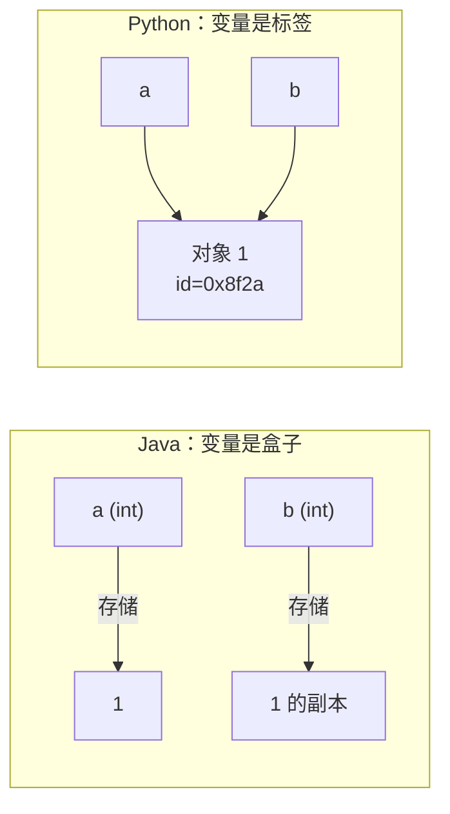
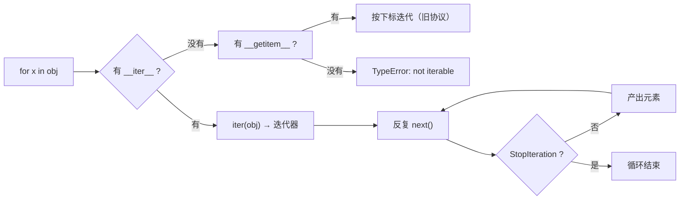
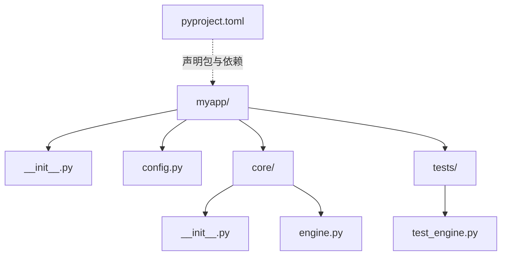

# 阶段一 · 语法速通（Java 对照）

> [!tldr] 本阶段只做三件事
> 1. 把「Java 思维」切换成「Python 思维」——**变量是标签，不是盒子**。
> 2. 把容器、推导式、解包、生成器练到肌肉记忆。
> 3. 写够 500 行代码（不是看 500 行）。

---

## 一、第一道坎：变量不是盒子

Java 里 `int a = 1` 是盒子里装了 1；Python 里 `a = 1` 是**给对象 1 贴了个名字 a**。



这直接导致三件事：

```python
a = [1, 2]
b = a          # 不是复制！两个名字指向同一个 list
b.append(3)
print(a)       # [1, 2, 3]  ← Java 程序员第一次被坑的地方

b = a.copy()   # 浅拷贝
c = deepcopy(a) # 深拷贝（嵌套结构才需要）
```

> [!warning] 判等与判同
> `==` 比值（调 `__eq__`），`is` 比身份（比 `id()`）。
> 只有 `None` / `True` / `False` 才用 `is`，其余一律 `==`。

---

## 二、类型系统对照

| Java | Python | 说明 |
| --- | --- | --- |
| `int` / `long` / `BigInteger` | `int` | 任意精度，永不溢出 |
| `double` | `float` | 双精度，同样有 0.1+0.2 问题 |
| `String` | `str` | **不可变**，和 Java 一样 |
| `StringBuilder` | `"".join(list)` | 循环里别用 `+=` 拼字符串 |
| `List<T>` | `list` | 可混类型，靠约定和注解约束 |
| `HashMap<K,V>` | `dict` | 3.7+ 保证插入序 |
| `HashSet<T>` | `set` | 元素必须可哈希 |
| `Optional<T>` | `T \| None` | 只是注解，运行时不做检查 |
| `record` | `@dataclass` | 自动生成 `__init__`/`__repr__`/`__eq__` |
| `Integer` 缓存 -128~127 | 小整数缓存 | 所以 `is` 在小整数上"看起来能用"，是陷阱 |

### 真值规则

```python
# 这些在 if 里都是 False
False, None, 0, 0.0, "", [], {}, set(), ()

# 所以 Java 风格的判空可以简化为：
if not items:        # 而不是 if items is None or len(items) == 0
    return
if name:             # 而不是 if name != null and name != ""
```

> [!danger] 反过来的坑
> `if x:` 在 `x = 0` 时走 else 分支。**数值/布尔语义混用时，显式写 `if x is not None:`**。

---

## 三、容器四件套

```python
# list —— 有序可变，等价 ArrayList
nums = [3, 1, 2]
nums.append(4); nums.insert(0, 9); nums.sort()      # 原地
sorted(nums, reverse=True)                          # 返回新表
nums[-1], nums[1:3], nums[::2]                      # 负索引 + 切片

# tuple —— 有序不可变，可作 dict key / set 元素
point = (3, 5)
x, y = point                                        # 解包

# dict —— 哈希表
user = {"id": 1, "name": "vic"}
user.get("age", 0)                                  # 不抛异常
user.setdefault("tags", []).append("dev")           # 分组常用
for k, v in user.items(): ...

# set —— 去重 + 集合运算
a, b = {1, 2, 3}, {2, 3, 4}
a & b, a | b, a - b, a ^ b
```

> [!tip] 容器选择口诀
> **要顺序 → list；要查找 → dict/set；要当 key → tuple；要改一半 → 先 list 再 frozen。**

### 切片是"视图"吗？

不是。`lst[1:3]` 返回**新列表**（拷贝），改它不影响原表。这一点和 NumPy 完全不同，后面 W8 会踩。

---

## 四、推导式：Python 的签名动作

```python
# 映射 + 过滤
squares = [n * n for n in range(10) if n % 2 == 0]

# 字典
index = {u["id"]: u for u in users}

# 嵌套展开（拍平）
flat = [x for row in matrix for x in row]

# 生成器表达式：不占内存，只能迭代一次
total = sum(n * n for n in range(10_000_000))
```

> [!warning] 可读性红线
> 超过两层 `for` + 一个 `if`，就该改成普通循环。
> **推导式是为了表达"变换"，不是为了炫技。**

---

## 五、函数：五个必踩的坑

### 1. 可变默认参数（最经典的面试题）

```python
def add(item, bucket=[]):   # ❌ 默认值只在定义时求值一次！
    bucket.append(item)
    return bucket

add(1)   # [1]
add(2)   # [1, 2]  ← 不是 [2]

def add(item, bucket=None): # ✅
    if bucket is None:
        bucket = []
    bucket.append(item)
    return bucket
```

### 2. 参数形态全家桶

```python
def f(pos, /, normal, *args, key=None, **kwargs):
    ...
# pos     仅位置参数（3.8+）
# normal  位置或关键字
# *args   多余位置参数 → tuple
# key     仅关键字参数
# **kwargs 多余关键字 → dict
```

### 3. 解包

```python
a, *rest = [1, 2, 3, 4]           # a=1, rest=[2,3,4]
first, *_, last = [1, 2, 3, 4]    # 取首尾
merged = {**d1, **d2}             # 字典合并，后者覆盖
print(*args)                      # 展开传参
```

### 4. 闭包与作用域（LEGB）

```python
def counter():
    n = 0
    def inc():
        nonlocal n      # 不加这行会 UnboundLocalError
        n += 1
        return n
    return inc
```

查找顺序：**L**ocal → **E**nclosing → **G**lobal → **B**uiltin。

### 5. 函数是一等公民

```python
from functools import partial, lru_cache

sorted(users, key=lambda u: (u["age"], u["name"]))   # 多级排序
double = partial(pow, exp=2)                          # 注意参数名
@lru_cache(maxsize=128)
def fib(n): return n if n < 2 else fib(n-1) + fib(n-2)
```

---

## 六、迭代协议与生成器（重点）



```python
# 生成器：yield 一次，暂停一次，状态留在栈里
def read_large(path):
    with open(path, encoding="utf-8") as f:
        for line in f:          # 逐行，不整文件读入
            yield line.rstrip("\n")

# 管道式处理：内存恒定
lines = (l for l in read_large("huge.log") if "ERROR" in l)
count = sum(1 for _ in lines)
```

> [!success] 验收
> 能说清：**生成器只能迭代一次**（因为迭代器就是"一次性游标"），所以 `len()` 不可用，要计数就 `sum(1 for _ in g)`。

---

## 七、异常处理

```python
try:
    data = json.loads(text)
except json.JSONDecodeError as e:
    logger.warning("bad json: %s", e)
    raise ValueError("配置格式错误") from e     # 保留异常链
except (KeyError, TypeError):
    ...
else:
    ...        # 没异常才执行
finally:
    ...        # 一定执行（关连接、释放锁）

# 自定义异常：继承 Exception，别继承 BaseException
class BizError(Exception):
    def __init__(self, code: str, msg: str):
        self.code, self.msg = code, msg
        super().__init__(f"[{code}] {msg}")
```

| Java | Python | 注意 |
| --- | --- | --- |
| `catch (Exception e)` | `except Exception as e` | 别裸 `except:`，会吞掉 Ctrl+C |
| `finally` | `finally` | 资源释放更推荐 `with` |
| try-with-resources | `with open(...) as f` | 上下文管理器协议 |
| `throws` 声明 | 无 | 异常不强制声明，靠文档和类型 |

---

## 八、模块与包

```python
# 导入顺序：标准库 → 第三方 → 本项目（ruff 会自动排）
import os, sys
from pathlib import Path
from dataclasses import dataclass

if __name__ == "__main__":     # 模块被直接运行才执行
    main()
```



> [!danger] 不要用相对导入跑脚本
> `python core/engine.py` 会让 `from .config import X` 报 `ImportError`。
> 正确做法：`python -m myapp.core.engine`，或在项目根 `uv run`。

---

## 九、本阶段练习（务必动手）

| # | 任务 | 考什么 |
| --- | --- | --- |
| 1 | 统计日志文件里各 level 出现次数，输出 Top10 | dict / Counter / 生成器 |
| 2 | 用生成器流式处理 1GB 文件，内存 < 50MB | 惰性求值 |
| 3 | 实现 `flatten(nested)` 支持任意深度 | 递归 + 迭代协议 |
| 4 | 写 `chunked(iterable, n)` 分批器 | 切片 + yield |
| 5 | 用 `functools.lru_cache` 优化斐波那契并测耗时 | 装饰器 |
| 6 | 把上面的代码用 `argparse` 包成 CLI | `__main__` / 模块 |

> [!tip] 自测方式
> 每写完一个，合上笔记**口述**一遍实现思路。说不清楚的地方，就是没懂的地方。

---

## 十、常见坑速查

| 坑 | 现象 | 解法 |
| --- | --- | --- |
| 可变默认参数 | 多次调用共享同一 list | 默认 `None` + 内部初始化 |
| 循环里 `list.remove` | 跳元素 | 用推导式重建或倒序删 |
| `a = b = []` | 两者同一对象 | 分开赋值 |
| 字符串 `+=` 拼接 | O(n²) | `"".join()` |
| `dict` 迭代时改大小 | `RuntimeError` | 迭代副本 `list(d)` |
| 浮点比较 | `0.1+0.2 != 0.3` | `math.isclose()` / `Decimal` |
| 浅拷贝嵌套 | 内层仍共享 | `copy.deepcopy()` |
| `is` 比字符串 | 结果不稳定 | 用 `==` |

---

> [!next] 下一篇
> [[02-阶段二-数据模型与工程化]] —— 把脚本变成"工程"：类、类型注解、依赖管理、测试。
