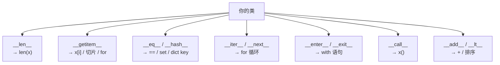
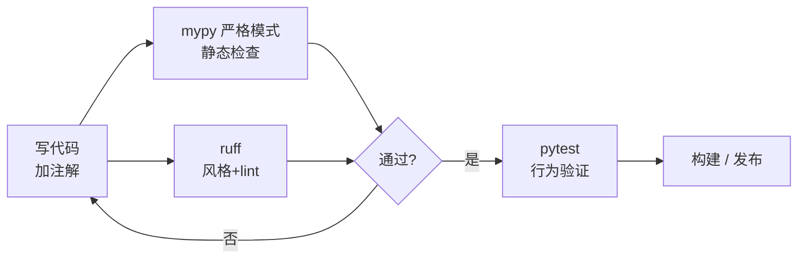

# 阶段二 · 数据模型与工程化

> [!tldr] 从"能跑"到"能维护"
> Java 用 interface + 继承 + 编译期检查来保证结构；Python 用 **协议（dunder）+ 类型注解 + 测试** 来保证。
> 本阶段产出：一个**能装、能测、能查类型**的 Python 包。

---

## 一、类：Python 的写法差异很大

```python
class Order:
    platform = "weipaitang"          # 类属性（所有实例共享）

    def __init__(self, order_id: str, amount: float):
        self.order_id = order_id     # 实例属性，无需预先声明
        self._amount = amount        # 单下划线：约定为内部
        self.__secret = None         # 双下划线：名称改写 _Order__secret

    def __repr__(self) -> str:       # 给开发者看，调试用
        return f"Order({self.order_id!r}, {self._amount})"

    @property                        # 只读属性，调用方写 o.amount
    def amount(self) -> float:
        return self._amount

    @amount.setter                   # 校验型 setter
    def amount(self, v: float):
        if v <= 0:
            raise ValueError("金额必须为正")
        self._amount = v

    @classmethod                     # 备选构造器
    def from_row(cls, row: dict) -> "Order":
        return cls(row["id"], float(row["amount"]))

    @staticmethod                    # 纯工具函数
    def is_paid(status: int) -> bool:
        return status == 2
```

| Java | Python | 说明 |
| --- | --- | --- |
| `private` | `_x` | 只是约定，没人拦你 |
| `private` 严格 | `__x` | 名称改写，防误碰，不是安全 |
| `getter/setter` | `@property` | 需要校验时才写，别全量封装 |
| 重载构造器 | `@classmethod` 工厂 | Python 不支持重载 |
| `static` | `@staticmethod` | 不接收 self/cls |
| 接口 | 抽象基类 / Protocol | 见下文 |

> [!warning] 别把 Java 的 getter/setter 全套搬过来
> Python 的原则是**先公开属性，等真的需要校验/计算时再加 `@property`**——因为 `@property` 对外接口不变，重构无痛。

---

## 二、dunder 方法 = 语言协议

Python 的"多态"不靠继承，靠**实现协议**。你实现了什么方法，就支持什么操作。



```python
class Money:
    __slots__ = ("cents",)           # 省内存，禁止动态加属性

    def __init__(self, cents: int):
        self.cents = cents

    def __repr__(self):  return f"Money({self.cents})"
    def __eq__(self, o): return isinstance(o, Money) and self.cents == o.cents
    def __hash__(self):  return hash(self.cents)
    def __add__(self, o): return Money(self.cents + o.cents)
    def __lt__(self, o):  return self.cents < o.cents
    def __str__(self):    return f"¥{self.cents / 100:.2f}"
```

> [!danger] 定义了 `__eq__` 必须定义 `__hash__`
> 否则对象变成不可哈希，放进 `set` 或当 `dict` key 直接 `TypeError`。

### 上下文管理器：把"一定要释放"的资源收进 `with`

```python
from contextlib import contextmanager

@contextmanager
def timer(label: str):
    import time
    t0 = time.perf_counter()
    try:
        yield
    finally:
        print(f"{label}: {time.perf_counter()-t0:.3f}s")

with timer("query"):
    do_something()
```

---

## 三、dataclass vs Pydantic：选型表

```python
from dataclasses import dataclass, field

@dataclass(frozen=True, slots=True)   # 不可变 + 省内存
class Point:
    x: int
    y: int
    tags: list[str] = field(default_factory=list)   # 可变默认值正确写法
```

```python
from pydantic import BaseModel, Field, field_validator

class ChatRequest(BaseModel):
    conversation_id: int
    message: str = Field(min_length=1, max_length=4000)
    stream: bool = True

    @field_validator("message")
    @classmethod
    def no_blank(cls, v: str) -> str:
        if not v.strip():
            raise ValueError("消息不能为空")
        return v.strip()
```

| 维度 | `@dataclass` | Pydantic `BaseModel` |
| --- | --- | --- |
| 运行时校验 | ❌ 不校验 | ✅ 强制校验 + 类型转换 |
| 性能 | 快（纯 Python） | 稍慢（校验开销，v2 已大幅优化） |
| 适合 | 内部数据结构、领域模型 | **API 出入参、配置、LLM 结构化输出** |
| JSON 互转 | 手写 / `asdict` | `model_dump()` / `model_validate()` |
| 生态 | 标准库 | FastAPI / LangChain / OpenAI SDK 标配 |

> [!tip] 一句话选型
> **跨边界（HTTP、DB、LLM）用 Pydantic；边界内传递用 dataclass。**

---

## 四、类型注解：给动态语言装护栏

```python
from typing import Protocol, TypeVar, Literal, Any
from collections.abc import Iterable, Sequence

T = TypeVar("T")

def first(items: Sequence[T], default: T | None = None) -> T | None:
    return items[0] if items else default

def total(prices: Iterable[float]) -> float:
    return sum(prices)

Status = Literal["pending", "paid", "refunded"]     # 枚举式字面量

class LLMClient(Protocol):                          # 结构化子类型（鸭子类型的静态版）
    async def chat(self, prompt: str) -> str: ...

def run(client: LLMClient) -> None:                 # 任何有 chat 方法的对象都行
    ...
```



> [!note] 类型注解的三个真相
> 1. **运行时不生效**——`x: int = "abc"` 不会报错，只有 mypy 会。
> 2. 但 Pydantic / FastAPI 会**读取注解并真的校验**，这是它最大的价值。
> 3. 老代码不要求全量注解，**新代码和新函数签名必须写**。

---

## 五、工程骨架：pyproject + uv

```
myapp/
├── pyproject.toml
├── README.md
├── .python-version
├── src/
│   └── myapp/
│       ├── __init__.py
│       ├── config.py
│       ├── models.py
│       └── service.py
└── tests/
    ├── conftest.py
    └── test_service.py
```

```toml
[project]
name = "myapp"
version = "0.1.0"
requires-python = ">=3.12"
dependencies = [
    "fastapi>=0.115",
    "pydantic>=2.9",
    "httpx>=0.27",
]

[dependency-groups]
dev = ["pytest>=8", "pytest-asyncio", "pytest-cov", "mypy", "ruff"]

[tool.ruff]
line-length = 100
target-version = "py312"

[tool.ruff.lint]
select = ["E", "F", "I", "UP", "B", "SIM"]   # I=导入排序, B=bugbear, UP=升级语法

[tool.mypy]
strict = true
python_version = "3.12"

[tool.pytest.ini_options]
asyncio_mode = "auto"
addopts = "-q --cov=src --cov-report=term-missing"
```

```bash
uv init myapp --package        # 建项目
uv add fastapi httpx           # 加依赖
uv add --dev pytest ruff mypy  # 加开发依赖
uv run pytest                  # 在隔离环境跑
uv sync                        # 按 lock 还原（等价 npm ci）
```

> [!success] 为什么推荐 uv
> 替代 `pip + venv + pip-tools + poetry + pyenv` 一整套：装 Python 本体、锁依赖、跑脚本一条命令。
> **速度比 pip 快 10-100 倍**，这是 2026 年的事实标准。

---

## 六、pytest：测试是 Python 的"编译期"

```python
# tests/conftest.py
import pytest
from myapp.service import OrderService

@pytest.fixture
def service():
    s = OrderService(dsn="sqlite:///:memory:")
    s.init_schema()
    yield s                  # yield 之后是 teardown
    s.close()

@pytest.fixture(params=["pending", "paid"])
def status(request):
    return request.param      # 参数化 fixture
```

```python
# tests/test_service.py
import pytest
from myapp.models import ChatRequest

def test_create_order(service):
    o = service.create("WPT-001", 99.9)
    assert o.amount == 99.9
    assert o.order_id == "WPT-001"

def test_negative_amount_raises(service):
    with pytest.raises(ValueError, match="金额必须为正"):
        service.create("WPT-002", -1)

@pytest.mark.parametrize("raw,ok", [
    ("hello", True),
    ("   ", False),
    ("", False),
])
def test_message_validation(raw, ok):
    if ok:
        assert ChatRequest(conversation_id=1, message=raw).message
    else:
        with pytest.raises(Exception):
            ChatRequest(conversation_id=1, message=raw)

async def test_async_chat(fake_llm):
    resp = await fake_llm.chat("hi")
    assert resp
```

| 概念 | pytest | JUnit 对照 |
| --- | --- | --- |
| 测试函数 | `def test_xxx()` | `@Test` |
| 断言 | 原生 `assert` | `assertEquals` |
| 前置后置 | `@pytest.fixture` | `@BeforeEach` |
| 参数化 | `@pytest.mark.parametrize` | `@ParameterizedTest` |
| Mock | `unittest.mock` / `monkeypatch` | Mockito |

> [!warning] 别测实现，测行为
> 断言"返回了什么"而不是"调用了哪个私有方法几次"。后者会让重构变成灾难。

---

## 七、日志：从 print 迁移出来

```python
import logging.config

LOGGING = {
    "version": 1,
    "disable_existing_loggers": False,
    "formatters": {
        "std": {"format": "%(asctime)s %(levelname)-7s [%(name)s] %(message)s"}
    },
    "handlers": {
        "console": {"class": "logging.StreamHandler", "formatter": "std"}
    },
    "root": {"handlers": ["console"], "level": "INFO"},
}
logging.config.dictConfig(LOGGING)

logger = logging.getLogger(__name__)
logger.info("order created id=%s amount=%.2f", order_id, amount)   # 惰性格式化
logger.exception("failed to call LLM")                             # 自动带栈
```

> [!danger] 生产环境三不要
> 1. 不要 `print`（无级别、无时间、无法关）。
> 2. 不要在日志里拼 f-string 传参（`logger.info(f"...{x}")` 会无条件求值）。
> 3. 不要把 API Key / 用户手机号打进日志。

---

## 八、本阶段练习

| # | 任务 | 验收 |
| --- | --- | --- |
| 1 | 把 W2 的 CLI 拆成 `src/` 包结构 | `uv run myapp` 可执行 |
| 2 | 给核心类加 `__repr__`/`__eq__`/`__hash__` | 能放进 `set` 去重 |
| 3 | 用 Pydantic 定义配置模型，从 `.env` 加载 | 缺字段启动即失败 |
| 4 | 写 15 个测试，覆盖正常/边界/异常 | `pytest --cov` > 80% |
| 5 | 开 `mypy --strict` 修到无 error | 类型全通 |
| 6 | 配 ruff pre-commit | 提交前自动格式化 |

---

> [!next] 下一篇
> [[03-阶段三-并发与异步]] —— GIL 到底限制了什么，以及什么场景该用哪种并发模型。
